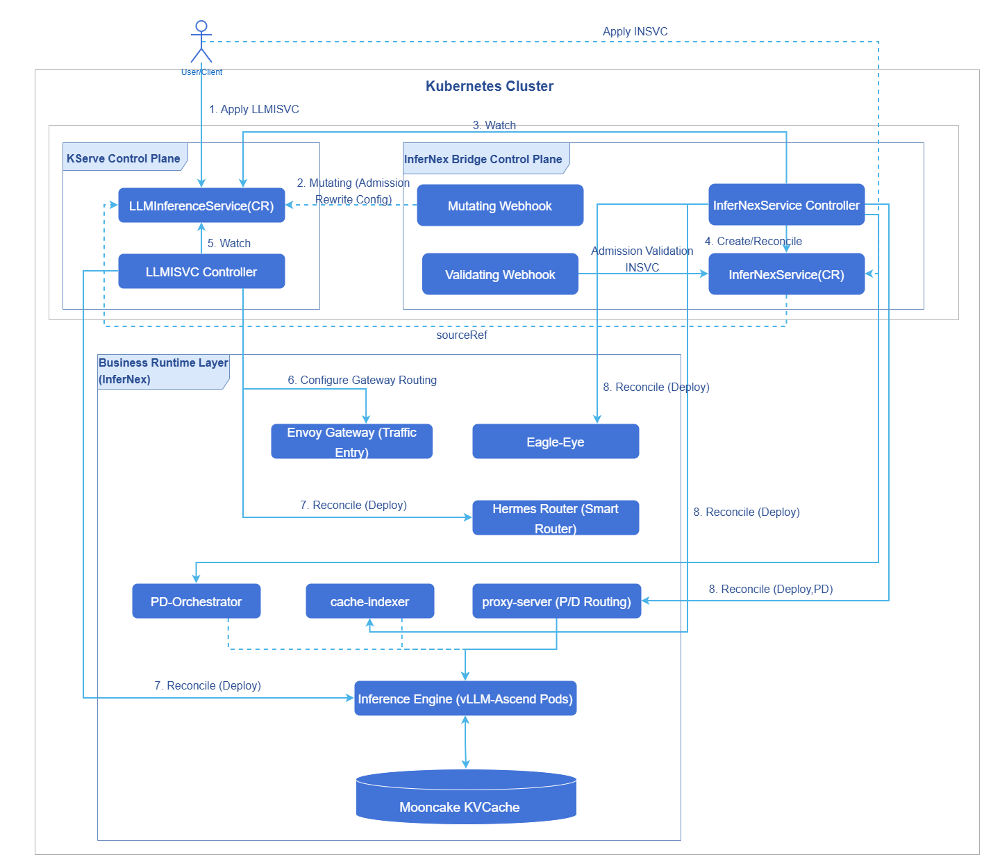
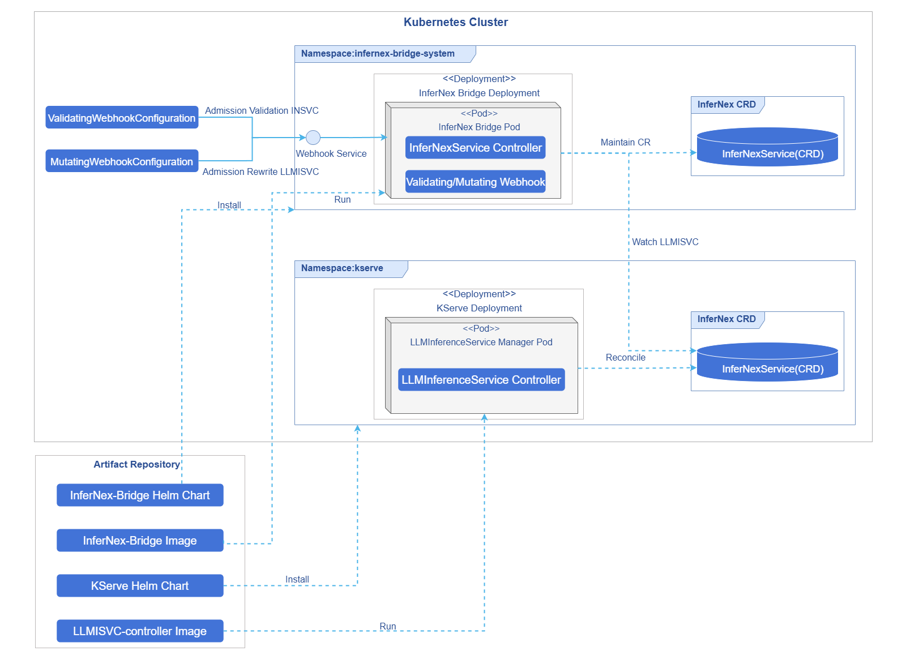
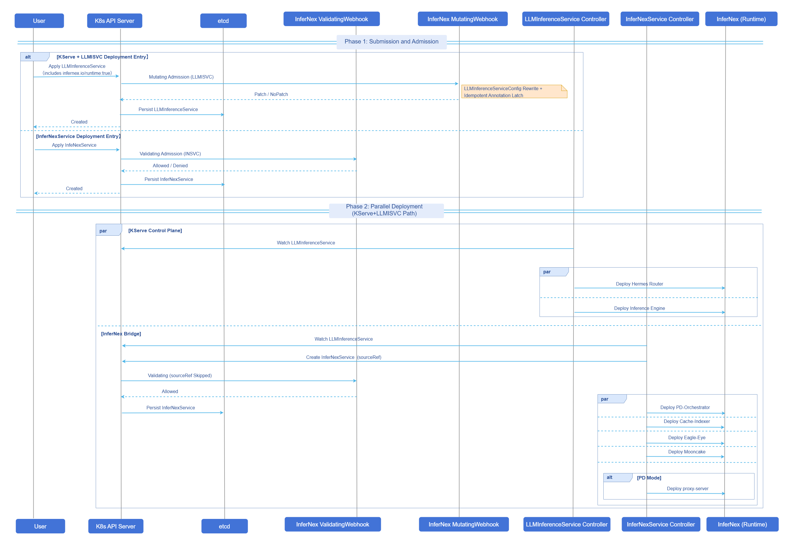

# AI Inference InferNex Bridge

## Feature Introduction

InferNex Bridge is the core hub between InferNex and KServe, connecting the two deployment entry points via Validating/Mutating Webhook and the `InferNexService` CRD, supporting a dual-mode deployment strategy: it can seamlessly integrate into existing KServe ecosystems or run independently without KServe.

- Mode 1 (`LLMInferenceService` deployment entry): Set `infernex.io/runtime: "true"` on `LLMInferenceService` to connect to the InferNex chain; the inference engine and Hermes Router are orchestrated by KServe, while Bridge manages Mooncake KVCache, cache-indexer, PD-Orchestrator, Eagle-Eye, and other enhancement components, as well as `LLMInferenceServiceConfig` runtime compatibility.

- Mode 2 (`InferNexService` deployment entry): Without going through KServe, the inference engine, Hermes Router, and enhancement components are uniformly deployed by Bridge via `InferNexService`/`InferNexServiceConfig`.

Teams with existing KServe environments can continue using the `LLMInferenceService` workflow to obtain full InferNex acceleration capabilities; scenarios without KServe or requiring an independent control plane can also obtain the same full-stack inference acceleration capabilities (intelligent routing, Mooncake KVCache, elastic scaling, hardware observability, etc.) as [AI Inference Integrated Deployment](./ai_inference_infernex.md).

> **Note:**<br/>
> Unlike the [AI Inference Integrated Deployment](./ai_inference_infernex.md) one-click full-stack installation entry via the InferNex main Chart, this document describes the standalone installation method for InferNex Bridge, with the focus on deploying via KServe + `LLMInferenceService`. For architecture and responsibility boundaries, see [OFEP-0040](https://gitcode.com/openFuyao/ofep/blob/main/ofeps/sig-ai-inference/0040-ofep-Infernex%E6%8E%A5%E5%85%A5kserve%E9%80%82%E9%85%8D%E5%B1%82.md) and [InferNex-Bridge Technical Specification](https://gitcode.com/openFuyao/InferNex/blob/master/component/InferNex-Bridge/docs/InferNex-Bridge-Technical-Specification.md).

### Application Scenarios

- The cluster has KServe installed, with supported versions from v0.17.0 to v0.19.0, and you want to deploy full InferNex capabilities via `LLMInferenceService` + `infernex.io/runtime: "true"`.
- You need InferNex Bridge to automatically handle compatibility issues between KServe built-in Config and the InferNex runtime.
- You want to deploy InferNex inference capabilities via InferNex Bridge without using the [InferNex main Chart](./ai_inference_infernex.md) one-click full-stack installation (either the KServe + `LLMInferenceService` deployment entry or the `InferNexService` deployment entry).

### Capability Scope

- InferNex Bridge itself provides the control plane: standalone Helm Chart installation; deploys CRDs, RBAC, Webhooks, and default `InferNexServiceConfig` templates.

- Dual deployment entries: supports both KServe + `LLMInferenceService` and `InferNexService` paths.

- Instances deployed via InferNex Bridge have exactly the same inference acceleration capabilities (intelligent routing, Mooncake KVCache, scaling decisions, hardware observability, etc.) as [AI Inference Integrated Deployment — Capability Scope](./ai_inference_infernex.md#capability-scope). The differences lie only in the deployment entry and orchestration logic, not in the addition or reduction of capabilities.

### Highlight Features

- KServe compatibility: continues using the `LLMInferenceService` workflow, entering the InferNex chain via labels.
- Dual deployment entries: KServe + `LLMInferenceService` deployment entry and `InferNexService` deployment entry coexist.

### Implementation Principle

InferNex Bridge constitutes the KServe adaptation layer with Mutating/Validating Webhook and the `InferNexService` CRD: users still use `LLMInferenceService` as the entry point, supplementing InferNex enhancement components without modifying the KServe CRD; it also supports submitting `InferNexService` directly without KServe, deployed uniformly by Bridge. The Mutating Webhook triggers when a `LLMInferenceService` with `infernex.io/runtime: "true"` is created or updated, applying compatibility patches to 6 preset `LLMInferenceServiceConfig` in the `kserve` namespace (without modifying the `LLMInferenceService` object itself); the Validating Webhook performs admission validation on directly submitted `InferNexService` (in the KServe chain, `InferNexService` with `sourceRef` skips validation). `InferNexService` is associated with `LLMInferenceService` via `sourceRef` for read-only observation and does not merge `llmisvc.spec` to re-launch the inference engine or Router.

#### Logical View

The KServe `LLMInferenceService` controller manages the inference engine, Hermes Router, and Gateway/`HTTPRoute`/InferencePool. InferNex Bridge manages supplementary components such as proxy-server (P/D mode), Mooncake KVCache, Cache-Indexer, PD-Orchestrator, and Eagle-Eye. In P/D mode, traffic is split by proxy-server to prefill/decode.

**Figure 1** InferNex Bridge Logical View



#### Deployment View

KServe and InferNex Bridge are deployed as independent Helm Charts; the InferNex Bridge Pod integrates Mutating/Validating Webhook and the `InferNexService` controller: `MutatingWebhookConfiguration` applies compatibility patches to 6 preset `LLMInferenceServiceConfig` in the `kserve` namespace; `ValidatingWebhookConfiguration` performs admission validation on submitted `InferNexService` (in the KServe chain, auto-created `InferNexService` with `sourceRef` skips validation).

**Figure 2** InferNex Bridge Deployment View



#### Runtime View

KServe + `LLMInferenceService` deployment entry: after the user submits a `LLMInferenceService` with `infernex.io/runtime: "true"`, the Mutating Webhook first triggers compatibility patches on 6 preset `LLMInferenceServiceConfig` in the `kserve` namespace, then KServe and InferNex Bridge deploy their respective workloads in parallel. `InferNexService` deployment entry: when the user directly submits an `InferNexService`, it first goes through Validating Webhook admission validation.

**Figure 3** InferNex Bridge Runtime View



### Relationship with Related Features

[AI Inference Integrated Deployment](./ai_inference_infernex.md) installs the full InferNex stack (control plane and inference instances) in one click via the InferNex main Chart; this document describes the standalone installation method for InferNex Bridge, with the deployment entry being the InferNex Bridge Chart, covering both the KServe + `LLMInferenceService` deployment entry and the `InferNexService` deployment entry, different from the main Chart full-stack entry.

## Installation

### Prerequisites

#### InferNex Bridge Control Plane

- An available Kubernetes cluster with kubectl and Helm (v3 or above) installed.
- KServe: KServe installation version is v0.17.0 to v0.19.0; for installation prerequisites, see [KServe LLMISVC Prerequisites](https://kserve.github.io/website/docs/0.17/install/llmisvc-install#prerequisites).
- API versions: `LLMInferenceService`/`LLMInferenceServiceConfig` supports both `serving.kserve.io/v1alpha1` and `serving.kserve.io/v1alpha2`; `serving.kserve.io/v1alpha2` is recommended. `InferNexService`/`InferNexServiceConfig` is `infernex.infernex.io/v1alpha1`.
- Envoy Gateway and related CRDs such as Gateway API, Gateway API Inference Extension have been installed; when using the KServe + `LLMInferenceService` deployment method, Hermes Router routing and `HTTPRoute` for exposing inference services externally depend on these components.
- The cluster can access `cr.openfuyao.cn` and `hub.oepkgs.net` (or equivalent mirrors configured).
- It is recommended that the namespace `infernex-bridge-system` is in Active state; avoid installing multiple sets of InferNex Bridge Webhooks.

> **Note:**<br/>
> For image lists, version compatibility, deployment scenarios, and Webhook patch behavior on `LLMInferenceServiceConfig`, see [Deployment Specification](https://gitcode.com/openFuyao/InferNex/blob/master/component/InferNex-Bridge/docs/InferNex-Bridge-Technical-Specification.md#1-部署规格), [Deployment Scenarios](https://gitcode.com/openFuyao/InferNex/blob/master/component/InferNex-Bridge/docs/InferNex-Bridge-Technical-Specification.md#2-部署场景), [Webhook Patch Description](https://gitcode.com/openFuyao/InferNex/blob/master/component/InferNex-Bridge/docs/InferNex-Bridge-Technical-Specification.md#3-mutating-admission-webhook-补丁说明), and [Appendix A Default Images](https://gitcode.com/openFuyao/InferNex/blob/master/component/InferNex-Bridge/docs/InferNex-Bridge-Technical-Specification.md#附录-a默认镜像). For Hermes Router container naming requirements, see [Appendix — Hermes Router Container Naming Convention](#hermes-router-container-naming-convention) in this document.

#### Inference Cluster Environment (General)

Before deploying inference instances (vLLM-Ascend, Mooncake KVCache, PD disaggregation, etc.), see [AI Inference Integrated Deployment](./ai_inference_infernex.md) for hardware, software, and network prerequisites.

- For InferNex installation prerequisites, see [Prerequisites](./ai_inference_infernex.md#prerequisites) (including cluster version, NPU Operator, LWS, etc.).
- For AI inference usage prerequisites, see [Using AI Inference](./ai_inference_infernex.md#using-ai-inference) (including inference node resources, metrics-server, PD + Mooncake KVCache networking, etc.).
- For network configuration when PD disaggregation and Mooncake KVCache transmit via HCCS, see [Ascend HCCS Device IP Address Configuration Example](./ai_inference_infernex.md#ascend-hccs-device-ip-address-configuration-example).
- For custom model weight host mount paths and cache directory structure, see [Custom Model Directory Configuration](./ai_inference_infernex.md#custom-model-directory-configuration).

> **Note:**<br/>
> - When deploying via the InferNex Bridge standalone installation method, pre-installation of the main Chart's inference-backend is not required; enhancement components such as Mooncake KVCache, cache-indexer, PD-Orchestrator are launched by InferNex Bridge per instance.
> - When enabling Eagle-Eye, NATS and kube-prometheus-stack must be pre-installed; for configuration and usage, see [AI Inference Eagle-Eye](../../ai_inference_eagle_eye/user_guide/eagle_eye_for_ai_inference.md).

### Getting Started with Installation

#### Method 1: Install Chart from InferNex Source Repository

```bash
git clone https://gitcode.com/openFuyao/InferNex.git
cd InferNex/component/InferNex-Bridge

helm upgrade --install infernex-bridge ./chart/infernex-bridge \
  -n infernex-bridge-system \
  --create-namespace \
  --wait \
  --timeout 10m
```

The Chart `version` corresponds one-to-one with the InferNex release version; in the source directory it is `0.0.0-latest`, indicating the latest build of the `master` branch; for other versions, see the [InferNex version list](https://gitcode.com/openFuyao/InferNex/tags). Before installation, run the following command to view Chart metadata.

```bash
helm show chart ./chart/infernex-bridge
```

#### Method 2: Install from OCI Repository (Recommended)

```bash
helm upgrade --install infernex-bridge oci://cr.openfuyao.cn/charts/infernex-bridge \
  --version <chart-version> \
  -n infernex-bridge-system \
  --create-namespace \
  --wait \
  --timeout 10m
```

`--version` specifies the Chart `version`, which corresponds one-to-one with the InferNex release version; `0.0.0-latest` indicates the latest build of the `master` branch; for other versions, see the [InferNex version list](https://gitcode.com/openFuyao/InferNex/tags). Before installation, run the following command to view Chart metadata.

```bash
helm show chart oci://cr.openfuyao.cn/charts/infernex-bridge --version <chart-version>
```

#### Webhook TLS Certificate (Optional)

InferNex Bridge Webhook requires a TLS certificate. The Chart supports two methods, switched via `webhooks.certGenerator.enabled` (default `true`) and `certManager.enabled` (default `false`).

**Table 1** Webhook TLS Certificate Configuration Methods


| Method                  | Key Parameters                                                              | Chart Hook Job                                       | Description                                                                                |
| ------------------- | ----------------------------------------------------------------- | ---------------------------------------------------- | --------------------------------------------------------------------------------- |
| Built-in certGenerator (default) | `webhooks.certGenerator.enabled=true`, `certManager.enabled=false` | `generate-webhook-cert` before installation; `cleanup-webhook-cert` before uninstallation. | The Chart generates the `webhook-server-cert` Secret in the cluster and deploys Mutating/ValidatingWebhookConfiguration. |
| cert-manager        | `certManager.enabled=true`                                        | No certGenerator-related Job created.                                | The cluster must have cert-manager installed; the Chart renders Issuer/Certificate, and the Webhook associates the certificate via CA injection annotation.                  |


When cert-manager is already deployed in the cluster, run the following command to set `certManager.enabled=true`.

```bash
helm upgrade --install infernex-bridge oci://cr.openfuyao.cn/charts/infernex-bridge \
  --version <chart-version> \
  -n infernex-bridge-system \
  --create-namespace \
  --set certManager.enabled=true \
  --wait \
  --timeout 10m
```

### Verify Deployment

```bash
helm list -n infernex-bridge-system
kubectl get pods,svc -n infernex-bridge-system
kubectl get secret webhook-server-cert -n infernex-bridge-system
kubectl get mutatingwebhookconfiguration,validatingwebhookconfiguration | grep infernex-bridge
kubectl get endpoints webhook-service -n infernex-bridge-system
```

**Expected output.**

- The InferNex Bridge controller Pod is `Running` with `READY` as `1/1`.
- Webhook certificate, configuration, and Service endpoint are all ready and can properly receive Admission requests.

### Uninstall

Uninstall the InferNex Bridge control plane (controller, Webhook, and related Release resources).

```bash
helm uninstall infernex-bridge -n infernex-bridge-system
```

> **Note:**<br/>
> When the default `webhooks.certGenerator.enabled=true` and `certManager.enabled=false`, the pre-delete Hook Job `cleanup-webhook-cert` additionally cleans up Mutating/ValidatingWebhookConfiguration and the `webhook-server-cert` Secret; when `certManager.enabled=true`, this Job is not created, Webhook configuration is deleted with the Release, and the certificate Secret is managed by cert-manager. CRDs deployed by the Chart are not deleted with the Release by default and need to be handled manually. If there are no other resources to retain in the `infernex-bridge-system` namespace, you can run `kubectl delete namespace infernex-bridge-system` to delete the namespace and its residual resources.

## Using InferNex Bridge

A single inference instance should not have two sets of the same type of enhancement components installed redundantly via two deployment entries; please select either KServe + `LLMInferenceService` or `InferNexService` for each instance, and do not mix them.

### Using LLMInferenceService

Applicable to scenarios where KServe is already installed: the inference engine and Hermes Router are reconciled by KServe; enhancement components are reconciled by InferNex Bridge.

#### Prerequisites

- The InferNex Bridge control plane and inference cluster environment checks in the prerequisites of this document have been completed.
- InferNex Bridge and Webhook are running normally.
- You have permissions to create `LLMInferenceService` and `LLMInferenceServiceConfig`.
- Envoy Gateway and GIE-related CRDs are ready (if gateway access is needed).

#### Background Information

**Table 2** Config and LLMISVC Responsibilities

| Resource                        | Responsibility                                                                                                            |
| ------------------------- | ------------------------------------------------------------------------------------------------------------- |
| LLMInferenceServiceConfig | Workload: `spec.template` (aggregate) or `spec.prefill`/decode-related templates; engine image, Mooncake KVCache init, etc.                          |
| LLMInferenceService       | `spec.baseRefs` references Config; `spec.router.scheduler` (InferencePool + EPP template); `spec.storageInitializer`; `spec.model`. |

Setting the `infernex.io/runtime` label only on Config is ineffective. It is recommended to first create the Config, then create the labeled LLMISVC and reference the Config via `spec.baseRefs`. For Hermes Router routing policies, plugins, and gateway-side configuration, see [AI Inference Hermes Router](../../ai_inference_hermes_routing/user_guide/ai_inference_hermes_routing.md).

#### Usage Restrictions

- The `infernex.io/runtime` label must only be set on `LLMInferenceService`; setting it on `LLMInferenceServiceConfig` is ineffective.
- KServe's `LLMInferenceServiceConfig` system must be used and cannot be mixed with `InferNexServiceConfig`.
- In the examples, `replicas: 1` is the default fixed replica for the inference engine; to enable PD-Orchestrator scaling, you must omit `replicas` on `spec.template`/`spec.prefill` in the LLMISVC Config, as well as LLMISVC `spec.replicas` and `spec.prefill.replicas`; see [Appendix — Inference Engine Replicas and Scaling](#inference-engine-replicas-and-scaling).

#### Operation Steps

1. Prepare the ingress Gateway (as needed).

    In the example LLMISVC, `spec.router.gateway: {}` and `route: {}` indicate that KServe creates the `HTTPRoute` and attaches it to the default ingress Gateway (commonly `kserve-ingress-gateway` in the `kserve` namespace). If it does not exist in the cluster, it must be created first.

    ```yaml
    apiVersion: gateway.networking.k8s.io/v1
    kind: Gateway
    metadata:
      name: kserve-ingress-gateway
      namespace: kserve
    spec:
      gatewayClassName: envoy
      infrastructure:
        labels:
          serving.kserve.io/gateway: kserve-ingress-gateway
      listeners:
        - name: http
          protocol: HTTP
          port: 80
          allowedRoutes:
            namespaces:
              from: All
    ```

    Save the above YAML as `kserve-ingress-gateway.yaml`, then run the following commands to create the ingress Gateway and confirm it is ready.

    ```bash
    kubectl apply -f kserve-ingress-gateway.yaml
    kubectl get gateway -n kserve kserve-ingress-gateway
    ```

2. Create `LLMInferenceServiceConfig` and configure the engine template.

    storageInitializer (disabled by default in the example, can be enabled as needed).

    ```yaml
      storageInitializer:
        enabled: false
    ```

    **Table 3** `storageInitializer.enabled` Behavior Description

    | `enabled`   | Behavior                                                                                                     |
    | ----------- | ------------------------------------------------------------------------------------------------------ |
    | `false` (recommended) | Does not inject KServe storage-initializer init; faster cold start. Model is prepared by node hostPath cache or inference engine `initContainers` (e.g., huggingface-download). |
    | `true`      | KServe pulls the model built-in via `spec.model.uri`; typically slower on first start, consistent with KServe native `hf://` flow.                                               |

    The Hermes Router EPP container must use the fixed container name `main` and named port `grpc` (see [Appendix — Hermes Router Container Naming Convention](#hermes-router-container-naming-convention)).

    ```yaml
      router:
        scheduler:
          pool:
            spec:
              selector:
                matchLabels:
                  app.kubernetes.io/name: ex-ag-01-sn-sc
              endpointPickerRef:
                kind: Service
                name: ex-ag-01-sn-sc-epp-service
          template:
            spec:
              containers:
                - name: tokenizer
                  image: cr.openfuyao.cn/openfuyao/hermes-tokenizer:latest
                - name: main
                  image: cr.openfuyao.cn/openfuyao/hermes-router:latest
                  ports:
                    - name: grpc
                      containerPort: 9002
    ```

    The fixed `main` is to ensure that when sidecars such as `tokenizer` exist, `EndpointPickerRef` uniquely locates the EPP via the Service targetPort; otherwise, it may connect to the tokenizer's `8000` port, which typically manifests externally as HTTP 500.

3. Create a labeled `LLMInferenceService`.

    When entering the InferNex chain, only label the `LLMInferenceService`.

    ```yaml
    metadata:
      labels:
        infernex.io/runtime: "true"
    ```

    Label and baseRefs (aggregate getting-started example instance name `ex-ag-01-sn-sc`).

    ```yaml
    apiVersion: serving.kserve.io/v1alpha2
    kind: LLMInferenceService
    metadata:
      name: ex-ag-01-sn-sc
      namespace: kserve
      labels:
        infernex.io/runtime: "true"
    spec:
      baseRefs:
        - name: ex-ag-01-sn-sc-config
      model:
        uri: hf://Qwen/Qwen2.5-0.5B
        name: Qwen/Qwen2.5-0.5B
    ```

4. Deploy the complete example.

    Before deployment, modify the namespace, node, `nodeName`, hostPath, model URI, image tag, etc. according to your environment. Examples are maintained in separate directories by scenario (single-node single-card/single-node multi-card/cross-node MoE + LWS, etc.); for the complete list, see the InferNex repository [component/InferNex-Bridge/config/examples/llmisvc/](https://gitcode.com/openFuyao/InferNex/tree/master/component/InferNex-Bridge/config/examples/llmisvc).

    - Aggregate getting started: [ag-01-single-node-single-card.yaml](https://gitcode.com/openFuyao/InferNex/blob/master/component/InferNex-Bridge/config/examples/llmisvc/aggregate/ag-01-single-node-single-card.yaml) ([Aggregate Mode Sample Directory](https://gitcode.com/openFuyao/InferNex/tree/master/component/InferNex-Bridge/config/examples/llmisvc/aggregate))
    - P/D getting started: [pd-01-single-node-single-card.yaml](https://gitcode.com/openFuyao/InferNex/blob/master/component/InferNex-Bridge/config/examples/llmisvc/disaggregated/pd-01-single-node-single-card.yaml) ([PD Disaggregated Mode Sample Directory](https://gitcode.com/openFuyao/InferNex/tree/master/component/InferNex-Bridge/config/examples/llmisvc/disaggregated))

    ```bash
    git clone https://gitcode.com/openFuyao/InferNex.git
    cd InferNex/component/InferNex-Bridge/config/examples/llmisvc
    kubectl apply -f aggregate/ag-01-single-node-single-card.yaml
    # or
    kubectl apply -f disaggregated/pd-01-single-node-single-card.yaml
    ```

    ```bash
    kubectl get llminferenceservice,llminferenceserviceconfig -n kserve
    kubectl get pods -n kserve
    ```

5. Verify the inference service via the gateway.

    After the instance is Ready, access via Envoy; the URL format is: `http://<gateway-IP-address>:<port>/<path-prefix>/v1/chat/completions`.

    5.1 Check the gateway IP address and port.

    ```bash
    kubectl get svc -A | grep -i envoy
    kubectl get nodes -o wide
    ```

    5.2 Confirm the path prefix and send a request.

    The path prefix for KServe default routing is `/<metadata.namespace>/<metadata.name>`, where the first segment is the namespace of the `LLMInferenceService` and the second segment is the instance name; it is not fixed to `kserve`. When the namespace and instance name are unchanged from the getting-started example YAML, the aggregate reference path is `/kserve/ex-ag-01-sn-sc`, and P/D is `/kserve/ex-pd-01-sn-sc`. The `model` in the request body must match the `spec.model.name` of the deployed YAML.

    ```bash
    curl -X POST "http://<gateway-IP>:<port>/kserve/ex-ag-01-sn-sc/v1/chat/completions" \
      -H "Content-Type: application/json" \
      -d '{"model":"<spec.model.name>","messages":[{"role":"user","content":"hello"}]}'
    ```

#### Follow-up Operations

Delete the LLMISVC instance. Delete the `LLMInferenceService` with `infernex.io/runtime: "true"` (aggregate getting-started example, namespace `kserve`; for P/D, change the instance name to `ex-pd-01-sn-sc`).

```bash
kubectl delete llminferenceservice ex-ag-01-sn-sc -n kserve

kubectl get llminferenceservice,insvc -n kserve
kubectl get pods -n kserve | grep ex-ag-01-sn-sc
```

After deletion, KServe reclaims the inference engine, Hermes Router, `HTTPRoute`, etc.; InferNex Bridge deletes the auto-created `InferNexService` with the same name, as well as enhancement components such as Mooncake KVCache, cache-indexer, PD-Orchestrator, and Eagle-Eye.

Delete LLMISVCConfig (optional). `LLMInferenceServiceConfig` is a reusable template and is not automatically deleted with LLMISVC; execute when you need to remove a custom Config.

```bash
kubectl delete llminferenceserviceconfig ex-ag-01-sn-sc-config -n kserve
```

> **Notice:**<br/>
> - If you have scaled out additional inference engine replicas via PD-Orchestrator (Elastic-Scaler/ResourceScalingGroup), after deleting the LLMISVC, check whether there are residual `Deployment`, `ElasticScaler`, `ResourceScalingGroup`, and other CRs, and clean them up manually if necessary.
> - When the namespace remains in `Terminating` for a long time, check whether `InferNexService` is stuck at the finalizer stage, and confirm no residual Pods before processing the finalizer.

### Using InferNexService

Applicable to scenarios that do not depend on KServe, deployed natively via `InferNexService`/`InferNexServiceConfig` CRD by InferNex Bridge: the inference engine, Hermes Router, and enhancement components are all reconciled by InferNex Bridge. The `InferNexService` resource is abbreviated as `insvc`, and `InferNexServiceConfig` as `insvccfg` (CRD `shortNames`); the `kubectl` examples below use these abbreviations.

#### Prerequisites

- The InferNex Bridge control plane and inference cluster environment checks in the prerequisites of this document have been completed.
- Default templates (`infernex-default-aggregate-template`/`infernex-default-pd-template`) have been installed in the template namespace (default `infernex-bridge-system`); these contain only enhancement components and IGR default values, without inference engine Pod templates; deploying an instance requires referencing example Config or building a custom `spec.engine`.
- If an external ingress is needed: Envoy Gateway and `GatewayClass` are available; `spec.intelligentGatewayRouting.router.enabled: true` with Gateway/HTTPRoute/InferencePool configured.

#### Background Information

- `InferNexService` references `InferNexServiceConfig` via `spec.baseRefs` to merge configuration; `spec.engine` can be written in `InferNexService` or `InferNexServiceConfig` (examples reference Config via `baseRefs`; flat structure: root fields are aggregate/decode workloads, with an additional `prefill` sub-block for P/D); `InferNexService` also specifies `model`, IGR, component switches, etc. Chart default templates (`infernex-default-aggregate-template`/`infernex-default-pd-template`) contain only enhancement components and IGR default values, without engine Pod templates; deploying an inference instance requires referencing example Config or building a custom engine template.
- Mooncake KVCache, cache-indexer, proxy-server (PD), PD-Orchestrator, Eagle-Eye, etc. are launched by the controller from built-in assets or merged with platform default Config, without needing to expand the full PodTemplate in user YAML.
- For Hermes Router routing policies, plugins, and gateway-side configuration, see [AI Inference Hermes Router](../../ai_inference_hermes_routing/user_guide/ai_inference_hermes_routing.md).

##### spec Field Description

`InferNexService` and `InferNexServiceConfig` division of labor: `baseRefs` are merged in order, with later ones overriding earlier ones; `spec.engine` can be written in `InferNexService` or `InferNexServiceConfig` (examples typically place it in Config); `InferNexService` also specifies `model`, IGR, component switches, etc. The two Config systems cannot be mixed with `LLMInferenceServiceConfig`.

**Table 4** InferNexService Field Description

| Field                               | Description                                                                            |
| -------------------------------- | ----------------------------------------------------------------------------- |
| `spec.baseRefs`                  | References `InferNexServiceConfig` (must be in the InferNex Bridge template namespace, default `infernex-bridge-system`). |
| `spec.model`                     | Model URI and `name`.                                                                  |
| `spec.engine`                    | Inference engine workload template; must be valid after merge.<br/>Mode is derived from whether a valid `prefill.template` exists:<br/>- Without prefill, it is aggregate (root fields are the aggregate workload).<br/>- With prefill, it is P/D (root `template` is decode, `prefill` is prefill).<br/>Can be written in `InferNexService` or in `InferNexServiceConfig` referenced via `baseRefs`; at least one side must be valid after merge; examples typically place the Pod template in Config. For field details, see Table 5.                                  |
| `spec.intelligentGatewayRouting` | Intelligent Gateway Routing (IGR); in the default Chart template, `router.enabled=false`.                                  |
| `spec.components`                | Enhancement component switches such as Mooncake KVCache, cache-indexer, PD-Orchestrator, Eagle-Eye, etc.               |

###### `spec.engine` Field Description

`spec.engine` is a flat structure (no longer using `engine.aggregate`/`engine.pd` nested blocks). Each workload segment (root field or `prefill`) shares the same set of fields.

**Table 5** `spec.engine` Workload Fields (applicable to both root field and `prefill`)

| Field | Description |
| ---- | ---- |
| `template` | Pod template. For aggregate mode or P/D decode, written in the root field; for P/D prefill, written in `prefill.template`. |
| `worker` | Optional. LWS non-leader Pod template; falls back to the sibling `template` when omitted or has no containers. Cannot set a valid `worker` when `groupSize==1` (Deployment). |
| `replicas` | Horizontal replica count of the workload. For Deployment, it is the Pod count; for LWS, it is the group count (each group contains `groupSize` Pods). Defaults to 1 on first creation when omitted; omitting enables PD-Orchestrator external scaling. |
| `dataParallelSize` | Global DP scale (corresponds to vLLM `--data-parallel-size`), default value is 1. |
| `dataParallelSizeLocal` | Number of DP ranks per Pod, default value is 1. `groupSize = dataParallelSize / dataParallelSizeLocal`; when `groupSize>1`, Bridge creates a **LeaderWorkerSet**, otherwise a **Deployment**. |

**Mode determination**: After merge is complete, if `prefill.template` contains valid containers, it is **P/D** (root field is decode, `prefill` must be configured simultaneously); otherwise, it is **aggregate** (only root field `template`). The Chart default template names still distinguish aggregate/pd for component default value fallback, unrelated to the `spec.engine` YAML shape.

The YAML skeleton for aggregate and P/D is as follows (for complete Pod templates, see example Config):

```yaml
# aggregate
spec:
  engine:
    template:
      spec:
        containers: [...]
    # Optional: replicas, dataParallelSize, dataParallelSizeLocal, worker

# P/D (root template=decode, prefill=prefill)
spec:
  engine:
    template:
      spec:
        containers: [...]   # decode
    prefill:
      template:
        spec:
          containers: [...]
```

For more LWS/Admission constraints and scaling prerequisites, see [Appendix — Inference Engine Replicas and Scaling](#inference-engine-replicas-and-scaling) in this document.

###### IGR and Gateway Objects

- `router.enabled`: Master switch for the external ingress. When `false`, only the in-cluster inference engine and enhancement components are deployed, and InferNex Bridge does not reconcile Gateway/`HTTPRoute`/`InferencePool`.
- When `router.enabled: true`, the Hermes Router EPP template must be configured (container name `main`, port name `grpc`, see [Appendix — Hermes Router Container Naming Convention](#hermes-router-container-naming-convention)); `gateway`, `httpRoute`, `inferencePool` each support two approaches.
  - `ref`: References an existing resource name in the cluster (Bring Your Own).
  - `spec`: Creates or updates the managed object by InferNex Bridge based on the fields.
  - `ref` and `spec` are mutually exclusive on the same object and cannot be specified simultaneously.
- When `router` is enabled and no `ref` is specified for `gateway`/`httpRoute`/`inferencePool`, InferNex Bridge manages the corresponding Gateway API objects according to default rules (examples typically only write the `router` section).

###### Component Switches (`spec.components`)

For `InferNexService` created under the `InferNexService` deployment entry (without `spec.sourceRef`), if a component block is declared in YAML, `enabled: true` or `false` must be explicitly written and cannot be omitted. Common fields.

- `mooncake.enabled`, `cacheIndexer.enabled`
- `pdOrchestrator.elasticScaler`/`tidal`/`resourceScalingGroup`
- `eagleEye.hardwareMonitor`/`hardwareDiagnosis` (NATS and kube-prometheus-stack must be installed before enabling)

###### `spec.sourceRef`

Under the KServe chain, InferNex Bridge automatically creates a same-named `InferNexService` with `sourceRef`. Such objects are reconciled by InferNex Bridge only for enhancement components; do not manually modify `engine`/`router`; IGR is managed by KServe, and InferNex Bridge does not touch Gateway API objects.

#### Usage Restrictions

- The `InferNexService` deployment entry does not require the `infernex.io/runtime` label; this label is only for the KServe + `LLMInferenceService` deployment entry.
- Under the `InferNexService` deployment entry, Hermes Router uses labels such as `openfuyao.com/pdRole` and `openfuyao.com/pdGroupID`; this differs from the `app.kubernetes.io/*` label system of the KServe + `LLMInferenceService` deployment entry, and they must not be mixed.
- Under the `InferNexService` deployment entry, for `InferNexService` without `spec.sourceRef`, if a component block is declared in `spec.components` in YAML, `enabled: true` or `false` must be explicitly written.
- For `InferNexService` auto-created under the KServe chain with `spec.sourceRef`, do not manually modify the `engine`/`router` fields.
- In the examples, `replicas: 1` is the default fixed replica for the inference engine; to enable PD-Orchestrator scaling, you must omit `replicas` on the `engine` root field and `engine.prefill`; see [Appendix — Inference Engine Replicas and Scaling](#inference-engine-replicas-and-scaling).

#### Operation Steps

1. Confirm default templates and namespace.

    ```bash
    kubectl get insvc,insvccfg -n infernex-bridge-system
    kubectl get pods -n infernex-bridge-system
    kubectl get gateway,httproute,inferencepool -n infernex-bridge-system
    ```

2. Prepare `InferNexServiceConfig` (customize engine template as needed).

    Custom engine templates are written in `InferNexServiceConfig` and referenced by `InferNexService` via `spec.baseRefs`; you can also use the default templates installed by the Chart.

3. Create an `InferNexService` instance.

    ```yaml
    apiVersion: infernex.infernex.io/v1alpha1
    kind: InferNexService
    metadata:
      name: ex-ag-01-sn-sc
      namespace: infernex-bridge-system
    spec:
      baseRefs:
        - name: ex-ag-01-sn-sc-engine
      model:
        uri: hf://Qwen/Qwen2.5-0.5B
        name: Qwen/Qwen2.5-0.5B
      intelligentGatewayRouting:
        router:
          enabled: true
    ```

    The Hermes Router template must use the fixed EPP container name `main` and port name `grpc` (see [Appendix — Hermes Router Container Naming Convention](#hermes-router-container-naming-convention)).

4. Deploy the complete example.

    Examples are maintained in separate directories by scenario (single-node single-card/single-node multi-card/cross-node MoE + LWS, etc.); each YAML contains an `InferNexServiceConfig` (`spec.engine`) and an `InferNexService` (`model` + IGR) with the same Spec ID. For the complete list, see the InferNex repository [component/InferNex-Bridge/config/examples/insvc/](https://gitcode.com/openFuyao/InferNex/tree/master/component/InferNex-Bridge/config/examples/insvc).

    - Aggregate getting started: [ag-01-single-node-single-card.yaml](https://gitcode.com/openFuyao/InferNex/blob/master/component/InferNex-Bridge/config/examples/insvc/aggregate/ag-01-single-node-single-card.yaml) ([Aggregate Mode Sample Directory](https://gitcode.com/openFuyao/InferNex/tree/master/component/InferNex-Bridge/config/examples/insvc/aggregate))
    - P/D getting started: [pd-01-single-node-single-card.yaml](https://gitcode.com/openFuyao/InferNex/blob/master/component/InferNex-Bridge/config/examples/insvc/disaggregated/pd-01-single-node-single-card.yaml) ([PD Disaggregated Mode Sample Directory](https://gitcode.com/openFuyao/InferNex/tree/master/component/InferNex-Bridge/config/examples/insvc/disaggregated))

    ```bash
    cd InferNex/component/InferNex-Bridge/config/examples/insvc
    kubectl apply -f aggregate/ag-01-single-node-single-card.yaml
    # or
    kubectl apply -f disaggregated/pd-01-single-node-single-card.yaml
    ```

5. Verify the inference service via the gateway.

    Similar to LLMISVC, check `Gateway`/`HTTPRoute` and then curl; the path prefix is also `/<namespace>/<instance-name>` (InferNex Bridge managed routes are also generated according to this rule). The `model` must match `spec.model.name`. The aggregate getting-started instance name is `ex-ag-01-sn-sc`, and P/D is `ex-pd-01-sn-sc` (per the example YAML).

#### Follow-up Operations

Delete the InferNexService instance. After deleting `InferNexService`, InferNex Bridge reclaims the inference engine, Hermes Router, enhancement components reconciled for this instance, as well as `Gateway`/`HTTPRoute`/`InferencePool` created when IGR is enabled (subject to controller ownership). Aggregate getting-started example (namespace `infernex-bridge-system`).

```bash
kubectl delete insvc ex-ag-01-sn-sc -n infernex-bridge-system

kubectl get insvc,pods -n infernex-bridge-system | grep ex-ag-01-sn-sc
kubectl get gateway,httproute,inferencepool -n infernex-bridge-system
```

Delete InferNexServiceConfig (optional). `InferNexServiceConfig` is a reusable engine template and is not automatically deleted with the `InferNexService` instance. When deleting an instance, typically only `insvc` needs to be deleted; Config does not need to be deleted.

- User custom templates (e.g., example `ex-ag-01-sn-sc-engine`). After confirming no other `InferNexService` references it via `spec.baseRefs`, it can be deleted as needed.

```bash
kubectl delete insvccfg ex-ag-01-sn-sc-engine -n infernex-bridge-system
```

- Chart default templates (`infernex-default-aggregate-template`, `infernex-default-pd-template`): installed by the InferNex Bridge Chart in the template namespace, for new instances to reference via `baseRefs` or as controller default fallback, with no binding relationship to individual inference instances. When deleting an `InferNexService`, there is no need to delete them and they should not be deleted; only clean them up together when uninstalling the InferNex Bridge control plane and confirming the cluster no longer uses this Bridge.

> **Notice:**<br/>
> If PD-Orchestrator scaling produces additional workloads, after deleting the instance, please also check whether related resources such as `Deployment`, `ElasticScaler`, `ResourceScalingGroup` are residual, and clean them up manually if necessary.

#### Related Operations

In addition to deleting instances, common operations commands are as follows.

View the InferNex Bridge control plane.

```bash
helm status infernex-bridge -n infernex-bridge-system
kubectl get pods -n infernex-bridge-system
```

View inference instances (KServe + `LLMInferenceService` deployment entry).

```bash
kubectl get llminferenceservice,insvc -n kserve
kubectl get pods -n kserve -l infernex.io/runtime=true
```

View inference instances (`InferNexService` deployment entry).

```bash
kubectl get insvc -n infernex-bridge-system
kubectl get pods -n infernex-bridge-system
```

## Appendix

### Hermes Router Container Naming Convention

Hermes Router (Endpoint Picker, EPP) is deployed in the same Pod as sidecars such as tokenizer. When `InferencePool.endpointPickerRef` points to the EPP Service, the controller resolves the backend by **fixed container name and port name**; when the naming does not conform to the convention, traffic may be misrouted to a sidecar (e.g., tokenizer's `8000`), which typically manifests externally as HTTP 500.

**Table 6** Hermes Router EPP Template Constraints

| Constraint Item | Requirement | Description |
| --- | --- | --- |
| EPP container name | Must be `main` | Hermes Router process container; other names such as `hermes`, `router` cannot be used. |
| EPP port | Must declare named port `grpc`, with `containerPort > 0` | Example commonly uses `9002`; `endpointPickerRef.port.number` must match this. |
| Sidecar | Name arbitrary, order arbitrary | E.g., `tokenizer`; must not occupy the name `main`. |
| LLMISVC configuration path | `LLMInferenceService.spec.router.scheduler.template` | Written on LLMISVC, Hermes template overrides KServe scheduler preset. |
| InferNexService configuration path | `InferNexService.spec.intelligentGatewayRouting.router.template` | Required when `router.enabled: true`; validated by Validating Webhook on direct submission. |

Under the KServe + `LLMInferenceService` path, the Hermes image, `main` container `args`, and sidecars such as tokenizer must be configured in `router.scheduler.template`; it is recommended to explicitly declare writable volumes such as `tokenizer-tmp` and `tokenizer-cache` (consistent with Chart examples). For Webhook compatibility patches on 6 preset `LLMInferenceServiceConfig` (clearing llm-d `initContainers`, etc.), see [Technical Specification — Mutating Webhook Patch Description](https://gitcode.com/openFuyao/InferNex/blob/master/component/InferNex-Bridge/docs/InferNex-Bridge-Technical-Specification.md#3-mutating-admission-webhook-补丁说明).

Minimal EPP snippet example (`tokenizer` and `main` order is interchangeable):

```yaml
containers:
  - name: tokenizer
    image: cr.openfuyao.cn/openfuyao/hermes-tokenizer:latest
  - name: main
    image: cr.openfuyao.cn/openfuyao/hermes-router:latest
    ports:
      - name: grpc
        containerPort: 9002
```

### Inference Engine Replicas and Scaling

PD-Orchestrator (including Elastic-Scaler, Tidal Controller, ResourceScalingGroup) has been adapted for both KServe + InferNex Bridge entry points. Whether scaling takes effect depends on whether the inference engine omits `replicas` in YAML (not writing the field, rather than writing `0`). Hermes Router, enhancement components, etc. can still write `replicas: 1`.

**Table 7** Comparison of Inference Engine Scaling Support Under Two Deployment Methods

| Deployment Method                  | Reconcile Party      | Prerequisite for Scaling Support                                                                               | When `replicas` is Declared in engine/template Segment                         |
| ----------------------- | --------------- | ------------------------------------------------------------------------------------- | --------------------------------------------- |
| KServe + `LLMInferenceService` deployment entry | KServe          | `LLMInferenceService` and `LLMInferenceServiceConfig` (`baseRefs` chain) both omit `replicas` in `spec.template`/`spec.prefill`. | Declarative fixed replicas, PD-Orchestrator and other external scaling is ineffective.                 |
| `InferNexService` deployment entry       | InferNex Bridge | `InferNexService` and `InferNexServiceConfig` (`baseRefs`) both omit `replicas` in the `engine` root field and `engine.prefill`.          | InferNex Bridge converges based on CR; external Pod replica changes on Deployment will be rolled back; on LWS, `replicas` represents group count. |

> **Note:**<br/>
> In `component/InferNex-Bridge/config/examples`, `replicas: 1` is only for fixed replica demonstration. Before enabling scaling, please delete `engine.replicas` (aggregate or decode), `engine.prefill.replicas`, and LLMISVC `spec.replicas`, `spec.prefill.replicas`, and other engine/template-related replicas fields. For multi-Pod DP (where `dataParallelSize`/`dataParallelSizeLocal` makes `groupSize>1`), Bridge uses LeaderWorkerSet, where `replicas` represents the LWS group count rather than individual Pod count.

After omitting `engine`.`replicas`, see the following documents for how to use each scaling capability.

- [AI Inference Elastic Scaling — Configuring Scaling Policies](../../ai_inference_elastic_scaling_system/ai_inference_elastic_scaling/user_guide/ai_inference_elastic_scaling.md#configuring-scaling-policies)
- [ResourceScalingGroup — Using ResourceScalingGroup](../../ai_inference_elastic_scaling_system/ai_inference_resourcescalinggroup/user_guide/ai_inference_resourcescalinggroup.md#using-resourcescalinggroup)
- [AI Inference Tidal Algorithm — Using AI Inference Tidal Algorithm](../../ai_inference_elastic_scaling_system/ai_inference_tidal_algorithm/user_guide/ai_inference_tidal_algorithm.md#using-ai-inference-tidal-algorithm)
