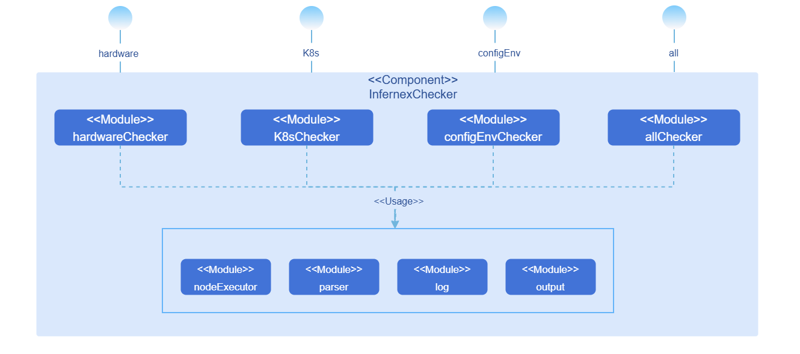

# InferNex Environment Checker

## Feature Introduction

The InferNex Environment Checker (infernex-checker) is a standalone CLI (Command-Line Interface) tool for systematically validating the InferNex deployment environment. By detecting key aspects of hardware, K8s cluster, and business configuration matching with the environment, the tool helps users identify environment issues before deployment and quickly locate root causes after deployment failures, effectively reducing deployment failure risk and improving troubleshooting efficiency.

### Application Scenarios

- **Pre-deployment Environment Pre-check**: Run a full validation before deploying InferNex for the first time. The tool sequentially validates hardware, K8s cluster, and business configuration matching with the environment. After completion, the report shows all aspects are normal. Once the environment is confirmed ready, execute `helm install` to complete the deployment.
- **Deployment Failure Troubleshooting**: After InferNex deployment fails, run a full validation to quickly locate the root cause. For example, if the hardware layer check finds that NPU drivers on all nodes are not properly deployed, the tool outputs detailed error descriptions and remediation suggestions. After completing repairs following the suggestions, re-run the validation to confirm the environment is ready, and deploy successfully again.
- **On-demand Layered Inspection**: Supports validating only a specific layer (hardware, K8s, or business configuration and environment) as needed, without repeating validation or checking uninterested parts, improving inspection efficiency.

### Capability Scope

- **Systematic Environment Validation**: Systematically validates the InferNex deployment environment before `helm install`, covering key aspects of hardware, K8s cluster, and business configuration matching with the environment.
- **Flexible Execution Modes**: Supports full validation (hardware → K8s → business configuration and environment) or layer-by-layer execution (users can choose to run only hardware checks, K8s checks, or business configuration and environment matching-related validation).
- **Structured Validation Report**: Outputs terminal reports and JSON-format result files, providing detailed error descriptions and remediation suggestions for each failed item, enabling users to quickly locate issues.

### Implementation Principle

#### Logical View



infernex-checker is internally divided into the following modules:

**Table 1** infernex-checker Module Description

| Module Name | Function |
|--------|------|
| HardwareChecker | Implements hardware layer checks, exposing the `infernex-checker hardware --nodes` command. |
| K8sChecker | Implements K8s cluster status checks, exposing the `infernex-checker k8s --nodes --dns-check-image` command. |
| ConfigEnvChecker | Implements business configuration and environment matching validation, exposing the `infernex-checker config-env --nodes --values` command. |
| AllChecker | Sequentially calls the above three Checkers in the order of hardware → K8s → business configuration and environment, exposing the `infernex-checker all --nodes --values --dns-check-image` command. |
| Parser | Parses CLI parameters and input files: reads node information files via the `--nodes` parameter, and InferNex deployment configuration files via the `--values` parameter. |
| NodeExecutor | Unified node access entry point, encapsulating SSH command execution and Kubernetes API calls. |
| Log | Records tool runtime logs (SSH connections, command execution, exception stacks, etc.). |
| Output | Organizes and presents validation results, generating terminal reports and JSON result files. |


#### Validation Flow

**Hardware Layer Validation Flow**

1. **Phase 1 - Single-Node Validation** (multi-node concurrent execution).
   - H-01: NPU driver and firmware installation status.
   - H-02: Ascend Device Plugin installation status.
   - H-03: NPU model check.
   - H-04: NPU available count statistics.
   - H-05: Key host files and directories check.
   - H-06: hccn.conf configuration correctness (910 series only).
   - H-07: Single-node HCCS communication test (910 series only, two steps: Step 1 checks TLS consistency, Step 2 checks NIC interconnectivity).
   - H-08: Single-node NPU fast/slow card detection (910 series only).

2. **Phase 2 - Cross-Node Validation** (executed after all nodes complete single-node validation).
   - H-09: Cross-node fast/slow card comparative analysis.
   - H-10: Cross-node card-side RoCE RDMA communication test (requires at least 2 910-series nodes passing single-node validation, three steps: Step 1 checks IP uniqueness, Step 2 checks TLS consistency, Step 3 checks cross-node connectivity).

**K8s Layer Validation Flow**

- K-01: Cluster CoreDNS check (subsequent K8s layer validation is terminated when CoreDNS is not Running or all nodes fail DNS resolution).
- K-02: Node readiness status (subsequent K8s layer validation is terminated when all nodes are not Ready).
- K-03: Node taint check.
- K-04: Node available resource statistics.

**Business Configuration and Environment Layer Validation Flow**

- B-01: Model cache path availability (directory existence and writability).
- B-02: Driver and CANN version compatibility.

#### Validation Interruption Logic

**Table 3** Validation Interruption Logic Description

| Trigger Condition | Interruption Scope | Description                                     |
|----------|----------|----------------------------------------|
| Any failure among H-01, H-02, H-05, H-06, H-07  | Skip all subsequent hardware validation items for that node | Serial execution within a node; single-node failure does not affect concurrent execution of other nodes.              |
| H-03 result is non-910 series | Skip H-06~H-10 for that node | HCCS/RoCE-related validation only applies to 910 series; H-04, H-05 still execute normally. |
| Number of 910-series nodes passing single-node validation (H-01~H-08) is 0 | Skip H-09, H-10 | H-09 has no data to collect, H-10 has no nodes to test.                 |
| Number of 910-series nodes passing single-node validation (H-01~H-08) is 1 | Skip H-10 | H-09 attempts to collect data (may be empty), H-10 requires at least 2 nodes.         |
| No nodes pass hardware layer validation in full mode | Terminate subsequent K8s layer validation | No nodes available to continue; K8s layer terminated entirely.                       |
| No nodes pass hardware layer validation in full mode | Skip business configuration and environment layer | Triggered simultaneously with the above; business layer skipped entirely.                       |
| K-01 fails (CoreDNS not Running or all nodes fail DNS resolution) | Terminate subsequent K8s layer validation (K-02~K-04) | Node and resource check results are unreliable when DNS is unavailable; partial node resolution failure only prompts, does not terminate.   |
| K-02 all nodes are not Ready | Terminate subsequent K8s layer validation (K-03~K-04) | No available nodes; subsequent validation is meaningless.                         |
| Any sub-step failure in B-01 (directory does not exist or is not writable) | Skip all subsequent business validation items (B-02) for that node | Serial execution within a node; single-node failure does not affect concurrent execution of other nodes.              |

## Installation

### Prerequisites

#### Hardware Requirements

infernex-checker itself has no special hardware environment requirements.

#### Software Requirements

- Kubernetes v1.33.0 or above.

#### Network Requirements

- The host running infernex-checker can access all target nodes via SSH.
- The host running infernex-checker can access the Kubernetes API Server.

#### Permission Requirements

- SSH login permissions for target nodes (username, password, or key).
- K8s cluster access permissions (via kubeconfig configuration file).

### Starting Installation

#### Binary Installation

1. Enter the directory for storing infernex-checker.

   ```bash
   cd <target-directory>
   ```

2. Download the corresponding binary file based on the host architecture.

   - Linux AMD64:
     ```bash
     wget https://static.openfuyao.cn/openFuyao/infernex/releases/download/latest/bin/linux/amd64/infernex-checker
     ```
   - Linux ARM64:
     ```bash
     wget https://static.openfuyao.cn/openFuyao/infernex/releases/download/latest/bin/linux/arm64/infernex-checker
     ```

3. Add execute permission.

   ```bash
   chmod +x infernex-checker
   ```

4. Verify installation.

   ```bash
   ./infernex-checker --help
   ```

## Using the InferNex Environment Checker

### Prerequisites

- infernex-checker has been installed.
- Node information file (nodes.yaml) has been prepared.
- InferNex deployment configuration file (values.yaml) has been prepared (required for business configuration and environment layer validation).
- K8s access credentials (kubeconfig) have been configured.

### Prepare Node Information File

Create a `nodes.yaml` file with SSH connection information for target nodes:

```yaml
nodes:
  - name: node-01
    ip: 192.168.1.10
    port: 22
    user: root
    # Password authentication
    password: "your-password"
  - name: node-02
    ip: 192.168.1.11
    port: 22
    user: root
    # Key authentication
    keyFile: "/home/user/.ssh/id_rsa"
```

**Parameter Description**:

- `name`: Node name, must match the node name in the K8s cluster.
- `ip`: Node IP address.
- `port`: SSH port, default 22.
- `user`: SSH login username.
- `password`: SSH login password (choose one of password or keyFile).
- `keyFile`: SSH private key file path (choose one of password or keyFile).

### Execute Full Validation

Full validation executes sequentially in the order of hardware layer → K8s layer → business configuration and environment layer.

```bash
infernex-checker all --nodes nodes.yaml --values values.yaml --output /output/result.json
```

**Parameter Description**:

- `--nodes`: Node information file path (required).
- `--values`: InferNex deployment configuration file path (required).
- `--kubeconfig`: Kubernetes configuration file path (optional, defaults to `~/.kube/config`).
- `--dns-check-image`: Image address for the DNS validation temporary Pod (optional, defaults to `busybox:1.36`). For offline deployment or when cluster nodes cannot pull public images, a lightweight image containing the `nslookup` command (such as busybox) must be imported into the private image repository in advance, and the private repository address specified via this parameter, e.g., `--dns-check-image private-registry.example.com/library/busybox:1.36`.
- `--enable-connectivity-check`: Enable network connectivity checks (H-07 Step 2 and H-10 Step 3) (optional, defaults to `false`). By default, time-consuming connectivity tests are skipped to speed up inspection, and only configuration consistency validation is performed; to fully verify network communication capabilities, add this parameter.
- `--output`: JSON result file output path (optional; if not specified, no JSON result file is generated).
- `--log`: Log file output path (optional, defaults to `./infernex-checker.log`).

**Output Example**:

```
=== InferNex Checker ===

[Hardware Layer - Single-Node Check: node-01]
  ✅ H-01  NPU driver and firmware installed
  ✅ H-02  Ascend Device Plugin Running and NPU resource registered
  ✅ H-03  NPU model: Ascend910B4
  ℹ️ H-04  NPU available: 8/8
  ✅ H-05  Key host files and directories are complete
  ✅ H-06  hccn.conf configuration is correct
  ✅ H-07  Step 1: NIC TLS switch states are consistent (on)
  ⏭️ H-07  Step 2: Connectivity check skipped (use --enable-connectivity-check to enable)
  ⚠️ H-08  Slow NPU card detected: rank 0 computation time significantly higher than other ranks
    → Check NPU card health status via npu-smi info (temperature, ECC errors, etc.)

[Hardware Layer - Single-Node Check: node-02]
  ✅ H-01  NPU driver and firmware installed
  ✅ H-02  Ascend Device Plugin Running and NPU resource registered
  ⚠️ H-03  NPU model is non-910 series: Ascend310P3
    → Only 910-series supports H-06~H-10, will skip these checks
  ℹ️ H-04  NPU available: 8/8
  ✅ H-05  Key host files and directories are complete
  ⏭️ H-06~H-10 skipped  Only 910-series supports HCCS/RoCE checks

[Hardware Layer - Cross-Node Check] (910-series nodes: node-01)
  ℹ️ H-09  Cross-node communication metrics (1 node): node-01(avg Transit: 2.34ms, 8 ranks)
  ⏭️ H-10  Only 1 910-series node(s) passed single-node checks, skipping cross-node check (at least 2 required)

[K8s Layer]
  ✅ K-01  CoreDNS Running, all nodes DNS resolution is normal
  ✅ K-02  node-01 Ready
  ✅ K-02  node-02 Ready
  ✅ K-03  node-01 has no taints
  ✅ K-03  node-02 has no taints
  ℹ️ K-04  node-01  Allocatable: CPU 48, Memory 256Gi | Remaining: CPU 40, Memory 200Gi
  ℹ️ K-04  node-02  Allocatable: CPU 48, Memory 256Gi | Remaining: CPU 40, Memory 200Gi

[Config-Env Layer: node-01]
  ✅ B-01  /home/llm_cache directory exists and is writable
  ✅ B-02  Driver 24.1.RC2 is compatible with image v0.13.0

[Config-Env Layer: node-02]
  ✅ B-01  /home/llm_cache directory exists and is writable
  ✅ B-02  Driver 24.1.RC2 is compatible with image v0.13.0

────────────────────────────────
Result: 19 passed, 0 failed, 2 warning, 2 skipped, 5 info

⚠️ Warning items:
  H-03  node-02  NPU model is non-910 series: Ascend310P3
  H-08  node-01  Slow NPU card detected: rank 0 computation time significantly higher than other ranks

⏭️ Skipped checks:
  H-07  node-01  Step 2: Connectivity check skipped (use --enable-connectivity-check to enable)
  H-10  Only 1 910-series node(s) passed single-node checks, skipping cross-node check (at least 2 required)

ℹ️ Info items:
  H-04  node-01  NPU available: 8/8
  H-04  node-02  NPU available: 8/8
  H-09  Cross-node communication metrics (1 node): node-01(avg Transit: 2.34ms, 8 ranks)
  K-04  node-01  Allocatable: CPU 48, Memory 256Gi | Remaining: CPU 40, Memory 200Gi
  K-04  node-02  Allocatable: CPU 48, Memory 256Gi | Remaining: CPU 40, Memory 200Gi
```

**Result Status Description**:

**Table 4** Result Status Description

| Status | Description | Remediation Suggestion |
|------|------|----------|
| ✅ passed | Validation passed; environment meets deployment requirements. | No action needed. |
| ❌ failed | Validation failed; blocking issue exists. | Must be remediated following the output remediation suggestions and re-validated; otherwise deployment may fail. |
| ⚠️ warning | Validation passed but potential risk exists. | Does not block deployment; recommended to investigate based on the prompt. For example, a slow card may affect inference performance; non-910 series nodes do not support HCCS/RoCE-related capabilities. |
| ℹ️ info | Environment information collected for operations reference. | No action needed; used to confirm whether resource capacity, communication metrics, etc. meet expectations. |
| ⏭️ skipped | Validation item was skipped. | Judge based on the skip reason:<br>• Skipped due to hardware limitations (e.g., non-910 series, insufficient node count): No action needed.<br>• Skipped due to connectivity check not enabled (H-07 Step 2, H-10 Step 3): To fully verify network communication capabilities, add the `--enable-connectivity-check` parameter and re-run. |

### Execute Layered Validation

#### Execute Only Hardware Layer Validation

```bash
infernex-checker hardware --nodes nodes.yaml
```

To enable full connectivity testing (H-07 Step 2 and H-10 Step 3), add the `--enable-connectivity-check` parameter:

```bash
infernex-checker hardware --nodes nodes.yaml --enable-connectivity-check
```

#### Execute Only K8s Layer Validation

```bash
infernex-checker k8s --nodes nodes.yaml --dns-check-image busybox:1.36
```

#### Execute Only Business Configuration and Environment Layer Validation

```bash
infernex-checker config-env --nodes nodes.yaml --values values.yaml
```

### View JSON Result File

After specifying the JSON result file path via the `--output` parameter, the file is generated upon validation completion, containing detailed validation results:

```json
{
  "summary": {
    "total": 28,
    "passed": 19,
    "failed": 0,
    "warning": 2,
    "info": 5,
    "skipped": 2
  },
  "hardware": {
    "nodes": [
      {
        "name": "node-01",
        "status": "passed",
        "is910Series": true,
        "checks": [
          { "id": "H-01", "status": "passed", "message": "NPU driver and firmware installed" },
          { "id": "H-02", "status": "passed", "message": "Ascend Device Plugin Running and NPU resource registered" },
          { "id": "H-03", "status": "passed", "message": "NPU model: Ascend910B4" },
          { "id": "H-04", "status": "info", "message": "NPU available: 8/8", "detail": { "available": 8, "total": 8, "unhealthy": [] } },
          { "id": "H-05", "status": "passed", "message": "Key host files and directories are complete" },
          { "id": "H-06", "status": "passed", "message": "hccn.conf configuration is correct" },
          { "id": "H-07", "status": "passed", "message": "Step 1: NIC TLS switch states are consistent (on)" },
          { "id": "H-07", "status": "skipped", "message": "Step 2: Connectivity check skipped (use --enable-connectivity-check to enable)" },
          {
            "id": "H-08",
            "status": "warning",
            "message": "Slow NPU card detected: rank 0 computation time significantly higher than other ranks",
            "suggestion": "Check NPU card health status via npu-smi info (temperature, ECC errors, etc.)",
            "detail": {
              "metrics": [
                {
                  "rankID": 0,
                  "physicalDeviceID": 0,
                  "nodeName": "node-01",
                  "waitTimeMS": 1.23,
                  "transitTimeMS": 2.34,
                  "synchronizationTimeMS": 0.45
                }
              ]
            }
          }
        ]
      },
      {
        "name": "node-02",
        "status": "passed",
        "is910Series": false,
        "skippedHccs": true,
        "skipReason": "non-910 series, H-06~H-10 will be skipped",
        "checks": [
          { "id": "H-01", "status": "passed", "message": "NPU driver and firmware installed" },
          { "id": "H-02", "status": "passed", "message": "Ascend Device Plugin Running and NPU resource registered" },
          { "id": "H-03", "status": "warning", "message": "NPU model is non-910 series: Ascend310P3", "suggestion": "The pre-flight checks are designed for 910 series; non-910 series may have different check items and H-06~H-10 will be skipped" },
          { "id": "H-04", "status": "info", "message": "NPU available: 8/8", "detail": { "available": 8, "total": 8, "unhealthy": [] } },
          { "id": "H-05", "status": "passed", "message": "Key host files and directories are complete" }
        ]
      }
    ],
    "cross_nodes": [
      {
        "id": "H-09",
        "status": "info",
        "message": "Cross-node communication metrics (1 node): node-01(avg Transit: 2.34ms, 8 ranks)",
        "detail": {
          "nodes_with_metrics": 1,
          "node_metrics": {
            "node-01": [
              {
                "rankID": 0,
                "physicalDeviceID": 0,
                "nodeName": "node-01",
                "waitTimeMS": 1.23,
                "transitTimeMS": 2.34,
                "synchronizationTimeMS": 0.45
              }
            ]
          }
        }
      },
      { "id": "H-10", "status": "skipped", "message": "Only 1 910-series node(s) passed single-node checks, skipping cross-node check (at least 2 required)" }
    ]
  },
  "k8s": {
    "status": "passed",
    "checks": [
      { "id": "K-01", "status": "passed", "message": "CoreDNS Running, all nodes DNS resolution is normal" },
      { "id": "K-02", "status": "passed", "message": "node-01 Ready" },
      { "id": "K-02", "status": "passed", "message": "node-02 Ready" },
      { "id": "K-03", "status": "passed", "message": "node-01 has no taints" },
      { "id": "K-03", "status": "passed", "message": "node-02 has no taints" },
      { "id": "K-04", "status": "info", "message": "node-01  Allocatable: CPU 48, Memory 256Gi | Remaining: CPU 40, Memory 200Gi" },
      { "id": "K-04", "status": "info", "message": "node-02  Allocatable: CPU 48, Memory 256Gi | Remaining: CPU 40, Memory 200Gi" }
    ]
  },
  "config_env": {
    "status": "passed",
    "checks": [
      { "id": "B-01", "node": "node-01", "status": "passed", "message": "/home/llm_cache directory exists and is writable" },
      { "id": "B-02", "node": "node-01", "status": "passed", "message": "Driver 24.1.RC2 is compatible with image v0.13.0" },
      { "id": "B-01", "node": "node-02", "status": "passed", "message": "/home/llm_cache directory exists and is writable" },
      { "id": "B-02", "node": "node-02", "status": "passed", "message": "Driver 24.1.RC2 is compatible with image v0.13.0" }
    ]
  },
  "hardwareTerminated": false
}
```

### Expected Runtime Duration

The following are expected runtime durations for typical scenarios, based on the premise of 2 910-series nodes with normal network and hardware status.

**Table 2** Typical Scenario Expected Runtime Duration

| Validation Layer | Expected Duration | Description |
|--------|------|------|
| Hardware Layer (default mode) | <4 minutes | Default skips connectivity tests (H-07 Step 2 and H-10 Step 3), only performs configuration consistency validation, with shorter duration. |
| Hardware Layer (with connectivity check enabled) | ~6-10 minutes | After enabling `--enable-connectivity-check`, H-07 Step 2 (single-node HCCS communication test) and H-10 Step 3 (cross-node card-side RoCE RDMA communication test) are the main time-consuming items. |
| K8s Layer | <1 minute | DNS resolution and node status queries are quick. |
| Business Configuration and Environment Layer | <1 minute | Path availability and version compatibility queries are quick. |

>  **Note:**<br>
> - In default mode, the hardware layer validation skips time-consuming connectivity tests and can complete full validation (hardware + K8s + business configuration and environment) within 4 minutes, suitable for quick environment check scenarios.
> - After enabling connectivity check, as the number of nodes increases, the single-node validation phase (H-01~H-08) takes roughly the same time due to concurrent execution; the cross-node phase (H-10 Step 3) requires connectivity testing for every pair of cards between all node pairs (each node pair contains 8×8=64 card pairs, executed sequentially), and the test volume grows as O(N²) with the number of nodes N. For multi-node scenarios, the hardware layer total duration can be estimated using the following empirical formula: **Hardware layer duration ≈ 3 × (N×(N-1)/2 + 1) minutes** (N is the number of 910-series nodes, N≥2). Typical reference values: 2 nodes ~6-10 minutes, 3 nodes ~12 minutes, 4 nodes ~21 minutes, 8 nodes ~87 minutes. Actual duration varies depending on network bandwidth, hardware status, and node scale.
