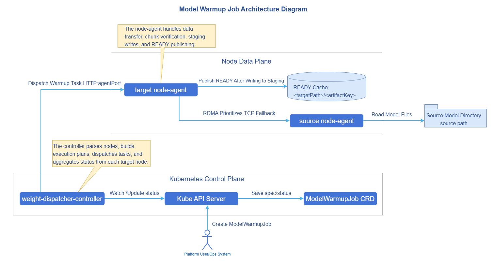
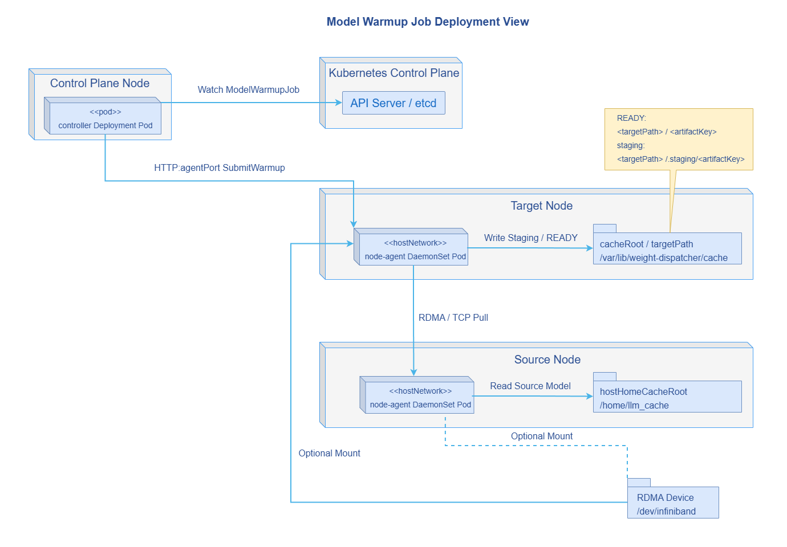

# AI Inference Weight Dispatch Acceleration

## Feature Introduction

Weight-Dispatcher is a model weight preheating and distribution component designed for AI inference scenarios. It distributes model weights from source nodes or external model repositories to target inference nodes' local cache directories before inference instances start, reducing the wait time and bandwidth pressure caused by repeatedly downloading large model weights during instance startup phases.

- Architecturally, Weight-Dispatcher consists of the control-plane Controller and node-side node-agent, described through the Kubernetes custom resource `ModelWarmupJob` for a single weight preheating task.
- In capability, Weight-Dispatcher supports storage node sources, multi-source striped fetching, multi-node distribution, CRC32C chunk verification, RDMA transport, and TCP fallback mechanism.
- In usage, users only need to create a `ModelWarmupJob`; the controller parses sources, target nodes, and distribution plans, and dispatches them to the target node's node-agent for execution.

### Application Scenarios

Weight-Dispatcher is suitable for deploying large model inference services in Kubernetes clusters where model weights need to be prepared in advance, including:

- **Large model cold start acceleration scenario**: Preheating weights to target nodes before inference service startup, reducing the time Pods wait for weights to download from remote repositories after startup.
- **Multi-node model distribution scenario**: The same model needs to be distributed to multiple inference nodes, avoiding each node repeatedly downloading complete weights from remote repositories.
- **Multi-source parallel fetching scenario**: When multiple nodes or external sources already have the same model weights, multi-source striped fetching improves single-node preparation speed, fully utilizing aggregated bandwidth.

### Capability Scope

- Supports deployment and usage in Kubernetes clusters.
- Supports initiating model weight preheating tasks via `ModelWarmupJob` CRD.
- Supports selecting target nodes by `nodeNames` or `nodeSelector`.
- Supports `sourceType=node` node sources; the controller automatically resolves source node IP addresses.
- Supports file, directory, and model weight types.
- Supports data chunk size configuration, task timeout configuration, CRC32C chunk verification, and cache hit reuse.
- Supports RDMA transport; supports TCP fallback transport when RDMA is unavailable or not enabled.
- Supports viewing overall task phase, target node list, node-level task status, throughput, cache path, and transport path via the CRD `status`.

  > **Notice**:
  > - The current version requires `spec.sources` to not be empty; fully sourceless auto-discovery mode is not supported.
  > - When setting `sourceType=node`, `endpoint` cannot be explicitly configured simultaneously; the controller auto-fills based on the source node address.
  > - The current version does not support `sourceType=external` mode.
  > - Multiple storage node sources must have consistent weight file layouts; tasks will fail when file count, relative path, size, or chunkable attributes are inconsistent.

### Highlight Features

- **Kubernetes-native interface**: Describes preheating objects, data sources, target nodes, and execution policies via `ModelWarmupJob`, facilitating integration with scheduling, scaling, and operations systems.
- **Chunked parallel transfer**: Splits large files by `chunkSizeMB`, enabling parallel fetching, verification, and retry, reducing the impact scope of a single large file transfer failure.
- **Collective data transfer**: When the number of target nodes exceeds the number of sources, target nodes can first fetch partial weight shards, then supplement missing shards via Ring transfer from other target nodes.
- **RDMA-aware data plane**: Supports RDMA export/connect/update/close sessions, improving large model weight transport efficiency on high-speed networks.
- **Stable degradation path**: When RDMA is unavailable or not enabled by the user, node-agent can use the TCP fallback path to continue task completion.
- **Cache state machine**: Target nodes use `.staging` temporary directory and ready directory publication mechanism, preventing incomplete weights from being mistakenly used by inference processes.

### Implementation Principle

**Figure 1** Component Architecture Diagram



**Figure 2** Component Deployment View



Weight-Dispatcher consists of the following components:

1. **ModelWarmupJob CRD**: The model weight preheating task submitted by the user, describing the model weights to be preheated, data storage source nodes, target nodes, and execution policies.
2. **Controller**: Watches `ModelWarmupJob`, completes parameter validation, target node resolution, verification file generation, distribution plan generation, and task status aggregation.
3. **node-agent**: Runs on nodes as a DaemonSet, used for building verification files, reading source data shards, executing weight fetching, and publishing weight files.
4. **Data plane adapter**: Can select RDMA or TCP transport path based on the actual environment or environment variables `RDMA_ENABLED` and `TCP_FALLBACK_ENABLED`.
5. **Cache state machine**: Maintains cache loading, publication, failure cleanup, and cache hit reuse logic on target nodes.

A weight preheating task execution flow is as follows:

1. User creates `ModelWarmupJob`.
2. Controller validates `spec.artifact`, `spec.sources`, and `spec.target`.
3. Controller resolves target nodes; if `nodeNames` is configured, resolves by node name; if `nodeSelector` is configured, selects by node labels.
4. Controller selects one source to build a logical manifest; if it is a node source, calls the source node's node-agent `/v1/manifests:build`; if it is a Hugging Face external source, builds the manifest via the model API.
5. Controller validates whether other node sources' manifest layout is consistent with the baseline source.
6. Controller generates a distribution plan based on source and target counts, and generates a `WarmupExecutionPlan` for each target node.
7. Controller calls the target node's node-agent `/v1/warmups` to submit the task.
8. node-agent writes weights to the sibling `.staging` directory of the target ready path, and publishes to the ready path after transfer completion.
9. Controller periodically queries node-agent task status and writes back to `ModelWarmupJob.status`.
10. After all target nodes succeed, `ModelWarmupJob.status.phase` becomes `Succeeded`; if any target fails and there are no pending/running nodes, the overall task becomes `Failed`.

## Installation

This section describes the method for independently deploying Weight-Dispatcher in an existing Kubernetes cluster.

### Independent Deployment

This section describes how to independently deploy Weight-Dispatcher in a Kubernetes cluster that already has model cache directory nodes.

#### Prerequisites

Before starting installation, ensure the following conditions are met:

- **Environment requirements**:

  - Kubernetes cluster: Version v1.28.0 or above is recommended.
  - Cluster administrator privileges: For installing CRD, ClusterRole, ClusterRoleBinding, Deployment, and DaemonSet.
  - Helm tool: For deploying Weight-Dispatcher via Chart.
  - Cluster nodes can access the node-agent listening port via node IP addresses; default port is `18080`.

- **Hardware requirements**:

  - Controller itself has no special hardware requirements and can run on standard x86 or ARM architecture nodes.
  - node-agent needs to access source node weight directories and target node weight cache directories; default mounts are `/home/llm_cache` and `/var/lib/weight-dispatcher/cache` paths.
  - If RDMA is enabled, target nodes must have RDMA devices and allow node-agent to mount `/dev/infiniband` and `/sys/class/net`.

- **Model source requirements**:

  - When using node sources, model files or directories must already exist on source nodes.
  - When using multiple node sources, model file layouts under each source path must be consistent.

- **Permission requirements**:

  - In the current version, when using RDMA for transport, node-agent needs to enable hostnetwork and privileged container flags. For security-sensitive scenarios, privileged containers can be disabled and TCP transport can be used.

#### Installing Weight-Dispatcher

If the source repository has been obtained, install via the Helm Chart in the repository by executing the following command.

```bash
cd weight-dispatcher/charts/weight-dispatcher
helm install weight-dispatcher . -n weight-dispatcher-system --create-namespace
```

If the artifact repository has published a Chart artifact package, install via the OCI repository by executing the following command.

```bash
helm install weight-dispatcher oci://cr.openfuyao.cn/charts/weight-dispatcher --version 0.0.0-latest \
  -n weight-dispatcher-system --create-namespace
```

The default Chart installs the following resources.

- `ModelWarmupJob` CRD.
- Controller Deployment.
- node-agent DaemonSet.
- ServiceAccount and RBAC required by Controller and node-agent.

After installation, execute the following command to view component status.

```bash
kubectl get pods -n weight-dispatcher-system
kubectl get crd modelwarmupjobs.warmup.openfuyao.com
```

#### Configuring node-agent

node-agent is configured via Helm values for listening address, cache directory, and transport mode. Common configurations are shown in Table 1.

**Table 1** node-agent Configuration Parameter Description

| Parameter | Type | Description | Default Value |
|------|------|------|--------|
| `nodeAgent.listenAddr` | string | node-agent HTTP service listening address. | `:18080` |
| `nodeAgent.cacheRoot` | string | Target node cache directory, mounted as hostPath. | `/var/lib/weight-dispatcher/cache` |
| `nodeAgent.hostHomeCacheRoot` | string | Read-only mounted host model cache directory. | `/home/llm_cache` |
| `nodeAgent.rdmaEnabled` | bool | Whether to enable RDMA-aware data plane. | `false` |
| `nodeAgent.tcpFallbackEnabled` | bool | Whether to enable TCP transport fallback mechanism. | `true` |
| `nodeAgent.collectiveMode` | string | Data transfer mode between target nodes; current default is `ring` transfer mode. | `ring` |
| `nodeAgent.postWriteCRC32CEnabled` | bool | Whether to enable CRC32C verification after weight disk write. | `false` |
| `nodeAgent.hostNetwork` | bool | Whether to use host network. | `true` |
| `nodeAgent.privileged` | bool | Whether to run as privileged container. Required when RDMA is enabled in current version. | `true` |

RDMA-enabled installation example:

```bash
helm install weight-dispatcher oci://cr.openfuyao.cn/charts/weight-dispatcher --version 0.0.0-latest \
  -n weight-dispatcher-system --create-namespace \
  --set nodeAgent.rdmaEnabled=true \
  --set nodeAgent.tcpFallbackEnabled=true
```

TCP-only transport installation example:

```bash
helm install weight-dispatcher ./charts/weight-dispatcher \
  -n weight-dispatcher-system --create-namespace \
  --set nodeAgent.rdmaEnabled=false \
  --set nodeAgent.tcpFallbackEnabled=true
```

> **Note:**<br/>
Controller in the current version communicates with node-agent by calling `http://<nodeIP address>:18080`; ensure that node network, NetworkPolicy, and security groups allow this access.

## Configuring Weight Distribution Strategy

This section describes how to configure `ModelWarmupJob` for different business scenarios.

### Basic Configuration

`ModelWarmupJob` is a single model weight preheating task. A basic configuration example is as follows.

```yaml
apiVersion: warmup.openfuyao.com/v1alpha1
kind: ModelWarmupJob
metadata:
  name: warmup-qwen-v1
  namespace: default
spec:
  artifact:
    type: MODEL_WEIGHT
    key: qwen:v1 # This key generates the plan ID and model storage subpath
  sources:
    - sourceType: node
      nodeName: worker-source
      path: /data/models/qwen # This path is the source node model storage path, corresponding to the nodeAgent.hostHomeCacheRoot parameter in Helm values; this path needs to be mounted into the node-agent container
  target:
    nodeNames:
      - worker-a
    targetPath: /var/lib/weight-dispatcher/cache/ready # This path is the parent path for model storage; using this yaml as an example, the final model files will be stored at /var/lib/weight-dispatcher/cache/ready/qwen_v1. Corresponding to the nodeAgent.cacheRoot parameter in Helm values; this path needs to be mounted into the node-agent container
  policy:
    timeoutSeconds: 3600
    publishAsSource: true
    enableChunkCRC32C: true
    chunkSizeMB: 64
```

**Table 2** `ModelWarmupJob` Core Parameter Description

| Parameter | Type | Description | Default Value |
|------|------|------|--------|
| `spec.artifact.type` | string | Preheating object type; supports `MODEL_WEIGHT`, `FILE`, or `DIRECTORY`. Current version `MODEL_WEIGHT` only supports Hugging Face directory structure. | - |
| `spec.artifact.key` | string | Unique identifier for the preheating object; participates in generating the plan ID and target cache subpath. | - |
| `spec.sources` | array | Weight source list; cannot be empty in current version. | - |
| `spec.target.nodeNames` | array | Target node name list. At least one of `nodeNames` or `nodeSelector` must be configured. | - |
| `spec.target.nodeSelector` | map | Target node label selector. Effective when `nodeNames` is not configured. | - |
| `spec.target.targetPath` | string | Target node weight root directory. Final path is `<targetPath>/<artifact.key normalized name>`. | - |
| `spec.policy.chunkSizeMB` | int | Data chunk size in MB. Manifest build default is 64MB. | - |
| `spec.policy.enableChunkCRC32C` | bool | Whether to generate and verify chunk CRC32C information. | `false` |
| `spec.policy.publishAsSource` | bool | Whether to retain staging as a source that can continue to provide data after completion. | `false` |
| `spec.policy.timeoutSeconds` | int | Single node task timeout. When not configured, node-agent defaults to 45 minutes. | - |

### Single Source Node Distribution

Single source node distribution is suitable for scenarios where one source node already has complete model weights and needs to distribute them to one or more target nodes.

```yaml
apiVersion: warmup.openfuyao.com/v1alpha1
kind: ModelWarmupJob
metadata:
  name: warmup-qwen-single-source
  namespace: default
spec:
  artifact:
    type: MODEL_WEIGHT
    key: qwen:v1
  sources:
    - sourceType: node
      nodeName: worker-source
      path: /var/lib/weight-dispatcher/source/qwen-v1
  target:
    nodeNames:
      - worker-a
      - worker-b
      - worker-c
    targetPath: /var/lib/weight-dispatcher/cache/ready
  policy:
    timeoutSeconds: 3600
    enableChunkCRC32C: true
    chunkSizeMB: 64
```

> **Note:**<br/>
> - Do not configure `endpoint` when `sourceType=node`; the controller automatically uses the source node IP address.
> - The source path can be a single file or a directory. If the directory contains Hugging Face's `model.safetensors.index.json`, node-agent will perform index verification.

### Multi-Source Striped Distribution

Multi-source striped distribution is suitable for scenarios where multiple source nodes already have the same model weights, and the goal is to fully utilize multi-node multi-SSD aggregated bandwidth to accelerate single target node preheating.

```yaml
apiVersion: warmup.openfuyao.com/v1alpha1
kind: ModelWarmupJob
metadata:
  name: warmup-qwen-striped
  namespace: default
spec:
  artifact:
    type: MODEL_WEIGHT
    key: qwen3:v1
  sources:
    - sourceType: node
      nodeName: worker-source-a
      path: /var/lib/weight-dispatcher/source/qwen-v1
    - sourceType: node
      nodeName: worker-source-b
      path: /var/lib/weight-dispatcher/source/qwen-v1
  target:
    nodeNames:
      - worker-a
    targetPath: /dev/shm/weight-dispatcher/cache/ready
  policy:
    timeoutSeconds: 3600
    enableChunkCRC32C: true
    chunkSizeMB: 64
```

**Table 3** Multi-Source Configuration Requirements

| Requirement | Description |
|------|------|
| Consistent source path layout | File count, relative path, size, and chunkable attributes of multiple node sources must be consistent. Different versions with the same model weight name will also cause task failure. |
| No duplicate sources | The combination of `sourceType`, `nodeName`, `endpoint`, and `path` cannot be duplicated. |
| Target path writable | Target node's node-agent must have write permissions for `targetPath`. |
| Network connectivity | Target nodes must be able to access all source node node-agents. |

### Selecting Targets Using Node Labels

If there are many target nodes, `nodeSelector` can be used for batch selection.

```yaml
apiVersion: warmup.openfuyao.com/v1alpha1
kind: ModelWarmupJob
metadata:
  name: warmup-qwen-by-selector
  namespace: default
spec:
  artifact:
    type: MODEL_WEIGHT
    key: qwen:v1
  sources:
    - sourceType: node
      nodeName: worker-source
      path: /var/lib/weight-dispatcher/source/qwen-v1
  target:
    nodeSelector:
      ai.openfuyao.com/inference: "true"
    targetPath: /var/lib/weight-dispatcher/cache/ready
  policy:
    timeoutSeconds: 3600
    chunkSizeMB: 64
```

> **Note:**<br/>
> If both `nodeNames` and `nodeSelector` are configured, the current node resolution logic prioritizes `nodeNames`.

### Enabling RDMA and TCP Fallback

RDMA and TCP transport can be controlled by node-agent startup parameters and do not need to be configured separately in `ModelWarmupJob`.

Enabling RDMA:

```bash
helm upgrade --install weight-dispatcher ./charts/weight-dispatcher \
  -n weight-dispatcher-system --create-namespace \
  --set nodeAgent.rdmaEnabled=true \
  --set nodeAgent.tcpFallbackEnabled=true
```

Using TCP:

```bash
helm upgrade --install weight-dispatcher ./charts/weight-dispatcher \
  -n weight-dispatcher-system --create-namespace \
  --set nodeAgent.rdmaEnabled=false \
  --set nodeAgent.tcpFallbackEnabled=true
```

After task execution, the actual transport path can be viewed via `status.nodeStates[].transportPath`.

- `RDMA`: Task mainly completed via RDMA path.
- `TCP_FALLBACK`: Task completed via TCP path.
- `MIXED`: Both RDMA and TCP were used during the task.

## Using Weight Dispatch Acceleration

This section demonstrates how to create, view, and manage Weight-Dispatcher preheating tasks.

### Creating a Preheating Task

Following the reference examples above, save the `ModelWarmupJob` as `modelwarmupjob.yaml` and create it by executing the following command.

```bash
kubectl apply -f modelwarmupjob.yaml
```

### Viewing Preheating Tasks

```bash
# View preheating tasks in the specified namespace
kubectl get modelwarmupjobs -n <NAMESPACE>

# View using short name
kubectl get mwj -n <NAMESPACE>

# View specific task details
kubectl describe modelwarmupjob <JOB_NAME> -n <NAMESPACE>
```

### Viewing Node-Level Status

Execute the following command to view the status fields.

```bash
kubectl get modelwarmupjob <JOB_NAME> -n <NAMESPACE> -o yaml
```

Key fields in `status` are shown in Table 4.

**Table 4** `status` Field Description

| Field | Description |
|------|------|
| `status.phase` | Overall task phase: `Pending`, `Running`, `Succeeded`, or `Failed`. |
| `status.resolvedNodes` | Target node list resolved for this task. |
| `status.summary.total` | Total number of target nodes. |
| `status.summary.pending` | Number of nodes waiting for submission or waiting for continued processing. |
| `status.summary.running` | Number of nodes currently executing. |
| `status.summary.succeeded` | Number of nodes that have succeeded. |
| `status.summary.failed` | Number of nodes that have failed. |
| `status.nodeStates[].nodeName` | Target node name. |
| `status.nodeStates[].taskID` | Task ID on the node-agent side. |
| `status.nodeStates[].cachePath` | Cache path published after task success. |
| `status.nodeStates[].bytesTransferred` | Bytes transferred. |
| `status.nodeStates[].throughputMBps` | Throughput measured on the node side in MB/s. |
| `status.nodeStates[].transportPath` | Actual transport path, such as `RDMA`, `TCP_FALLBACK`, or `MIXED`. |
| `status.lastPlanId` | Distribution plan ID generated for the current task. |
| `status.lastErrorCode` | Latest error code, such as `ValidationFailed`, `NoTargetNodes`, or `PlanBuildFailed`. |
| `status.lastErrorMessage` | Latest error details. |

JSONPath can be used to quickly view node status.

```bash
kubectl get mwj <JOB_NAME> -n <NAMESPACE> \
  -o jsonpath='{range .status.nodeStates[*]}{.nodeName}{"\t"}{.phase}{"\t"}{.cachePath}{"\t"}{.transportPath}{"\n"}{end}'
```

### Viewing Controller and node-agent Logs

```bash
# View Controller logs
kubectl logs -n weight-dispatcher-system \
  -l app.kubernetes.io/component=controller -f

# View node-agent logs
kubectl logs -n weight-dispatcher-system \
  -l app.kubernetes.io/component=node-agent -f
```

### Viewing Target Node Cache

After task success, the target path consists of `target.targetPath` and the normalized name of `artifact.key`. For example:

- `target.targetPath`: `/var/lib/weight-dispatcher/cache/ready`
- `artifact.key`: `qwen:v1`
- Final path: `/var/lib/weight-dispatcher/cache/ready/qwen_v1`

You can check whether this path exists on the target node, or obtain the actual published path via `status.nodeStates[].cachePath`.

### Re-executing a Preheating Task

After a `ModelWarmupJob` succeeds or fails, if `status.observedGeneration` matches the current generation, the controller will not re-execute the same generation task. To re-execute, use the following methods:

```bash
# Delete and recreate
kubectl delete modelwarmupjob <JOB_NAME> -n <NAMESPACE>
kubectl apply -f modelwarmupjob.yaml
```

You can also modify fields in `spec` that affect the plan, such as `artifact.key`, `target.targetPath`, `sources`, or `policy`, to trigger a new generation task.

### Deleting a Preheating Task

Deleting a `ModelWarmupJob` only deletes the task object in Kubernetes and does not automatically clean up model cache already published on target nodes.

```bash
kubectl delete modelwarmupjob <JOB_NAME> -n <NAMESPACE>
```

To clean up cache, delete the path indicated by `status.nodeStates[].cachePath` on the target node.

## FAQ

1. Why does `ModelWarmupJob` immediately become `Failed`?

   **Symptom description**: The CR `ModelWarmupJob` status shows `Failed`.<br/>
   **Possible causes**: `spec.artifact.key` is empty, no target nodes configured, `spec.sources` is empty, duplicate sources, node incorrectly configured with `endpoint`, target node selector matches no nodes, source path does not exist, or multi-source file types are inconsistent.<br/>
   **Processing steps**: View node-agent logs and `status.lastErrorMessage` to identify the specific cause.

2. Can `sourceType=node` manually specify an endpoint?

   No. The current version requires `sourceType=node` to only configure `nodeName` and `path`; the controller auto-fills the endpoint based on the node. Manually configuring endpoint triggers validation failure.

3. What external source types are supported?

   The current version does not support external sources, such as Hugging Face format download links.

4. Why does a multi-source task fail with logs indicating manifest mismatch?

   Multi-source tasks require multiple sources to have the same model file layout. Confirm that all node source paths have consistent file count, relative path, file size, and chunkable attributes.

5. How to confirm whether a task uses RDMA?

   Check `status.nodeStates[].transportPath`. If it shows `RDMA`, the task mainly uses the RDMA path; if it shows `TCP_FALLBACK`, it uses TCP fallback; if it shows `MIXED`, both RDMA and TCP were used during the task.

6. Why does RDMA still fall back to TCP when RDMA is enabled?

   Common causes include the node having no RDMA device, the container not mounting `/dev/infiniband`, RDMA initialization failure, network device unavailable, or RDMA session open failure. Check node-agent logs for `rdmaAvailable`, `rdmaInitCode`, `rdmaLastError`, and `rdmaVersion`.

7. Where is the cache after task success?

   The final path is `<spec.target.targetPath>/<artifact.key normalized name>`. The normalization rule replaces `/`, `\`, `:` and spaces with `_`. The actual path is also written to `status.nodeStates[].cachePath`.

8. Does deleting a task delete the model cache?

   No. `ModelWarmupJob` is a control-plane task record; deleting the CR does not automatically clean up the model cache directory on nodes.

9. How to reduce data verification overhead?

   You can set `spec.policy.enableChunkCRC32C` to `false` and disable `nodeAgent.postWriteCRC32CEnabled`. This reduces CRC32C-related computation and post-disk-write CRC32C re-verification, but lowers chunk transfer verification capability. It is recommended to only disable `nodeAgent.postWriteCRC32CEnabled` in performance-sensitive scenarios.