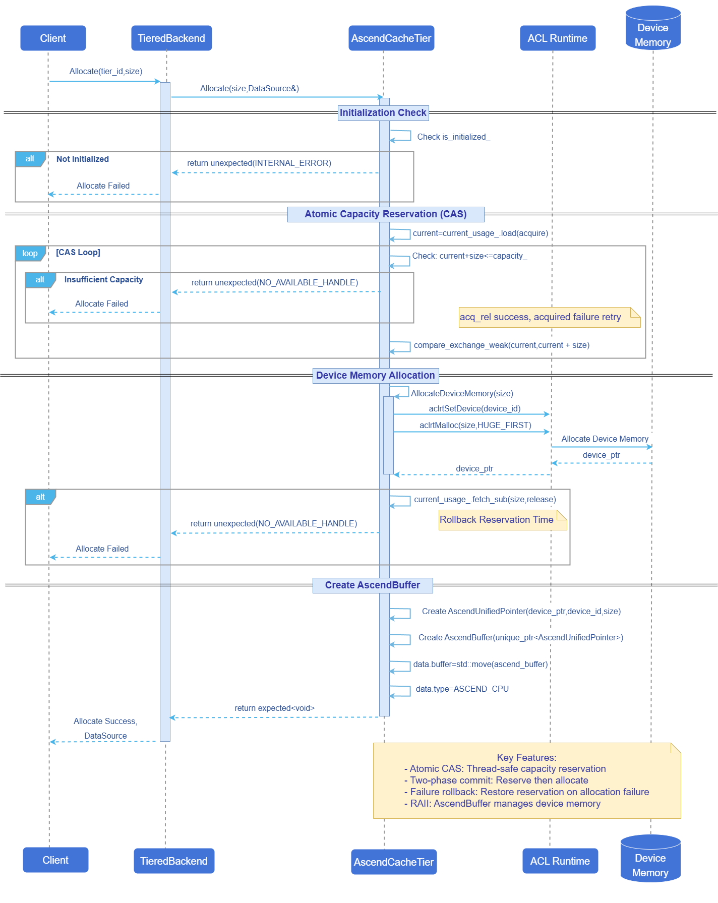
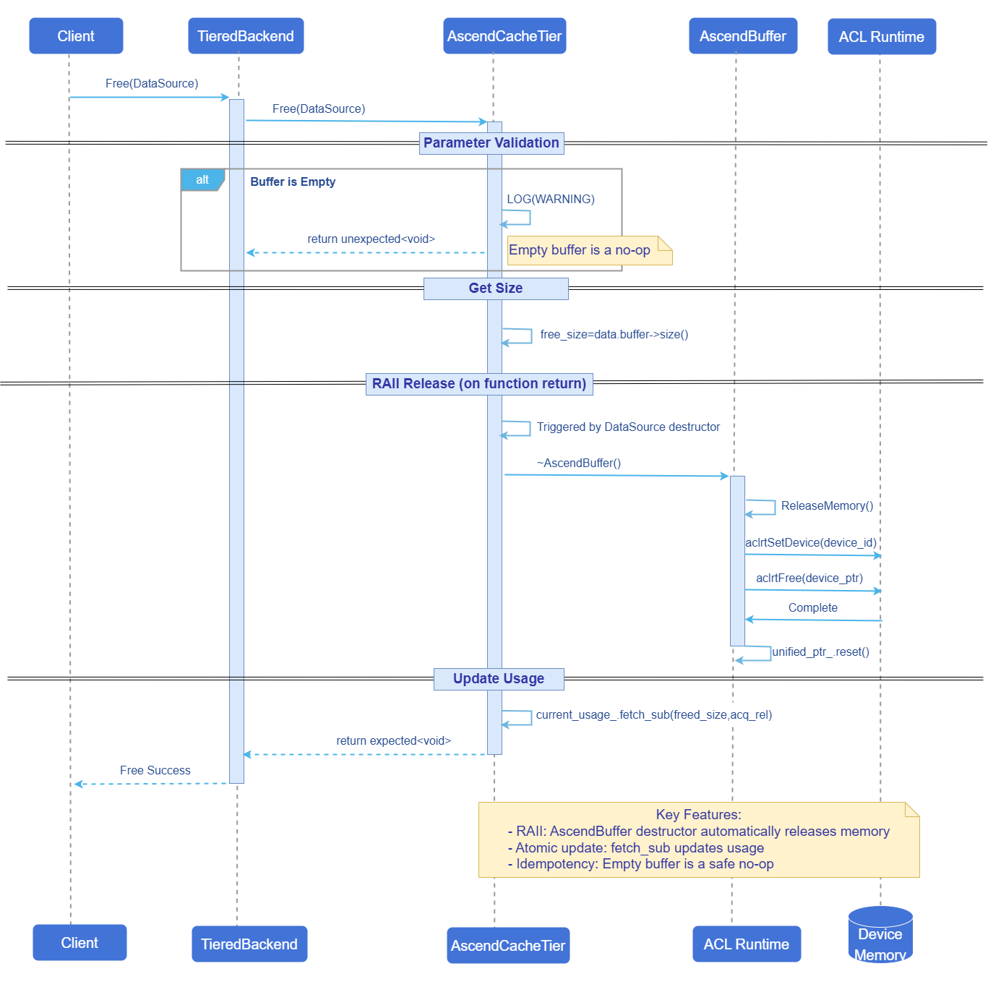
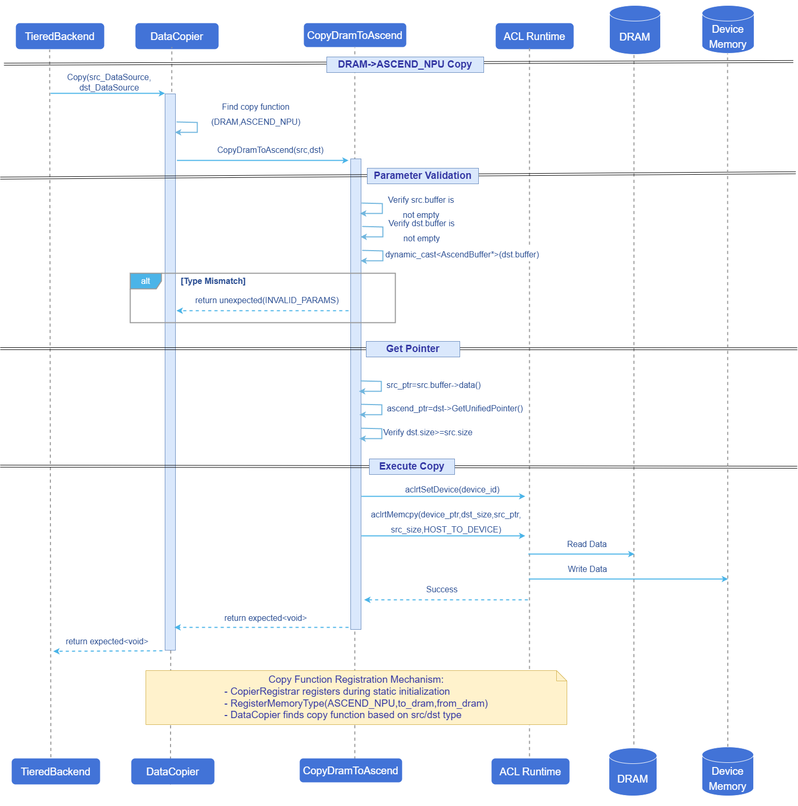

# Mooncake Ascend NPU Storage Management Layer
## Feature Introduction
This feature adapts the CacheTier abstract base class from the Mooncake Store new architecture [Issue 954](https://github.com/kvcache-ai/Mooncake/issues/954) for Ascend compatibility, implementing the AscendCacheTier class to support caching KVCache on Ascend NPU devices.
### Application Scenarios
In large model inference services, using Mooncake to manage KVCache data on local Ascend device VRAM.
### Capability Scope
- Supports data transfer between VRAM and DRAM, and between VRAM and VRAM (currently only the indirect path VRAM→DRAM→VRAM is registered).
- Supports Ascend NPU device VRAM tier management: supports Init, Allocate, Free and other basic operations, capable of successfully allocating and releasing memory on Ascend devices. Uses RAII mode for resource management and atomic operations to guarantee thread safety.
### Highlight Features
- **End-to-end Ascend adaptation**: Uses CacheTier abstraction as the interface, providing AscendCacheTier implementation; underlying integration with ACL Runtime completes device memory allocation and copy; business side can use the unified Tier interface.
- **Thread-safe capacity management**: During Allocate phase, atomic CAS is used for capacity reservation and failure rollback, avoiding over-provisioning and statistical inconsistency in concurrent scenarios.
- **RAII mechanism**: AscendBuffer encapsulates device memory and automatically releases it upon destruction.
### Implementation Principle
#### Allocate Flow
**Figure 1** Allocate Flow Diagram



**Flow Description:**
1. TieredBackend forwards the Allocate request to the target tier.
2. AscendCacheTier checks initialization status.
3. Uses CAS atomic operation to reserve space (check first then update, retry on failure).
4. Calls `AllocateDeviceMemory` to allocate device memory.
5. If device allocation fails, rolls back the reserved space via `fetch_sub`.
6. Creates `AscendBuffer` to encapsulate device memory, returns it to the caller via `DataSource`.
7. `AscendBuffer` implements RAII, automatically releasing device memory upon destruction.

#### Free Flow

**Figure 2** Free Flow Diagram



**Flow Description:**
1. TieredBackend forwards the Free request to the target tier.
2. Checks whether the buffer is empty (empty buffer is a safe no-op).
3. Obtains the size of memory to be released.
4. When `DataSource` goes out of scope, the `AscendBuffer` destructor is invoked.
5. `ReleaseMemory()` calls `aclrtFree` to release device memory.
6. Updates `current_usage_` via atomic operation.

#### CopyDramToAscend Flow

**Figure 3** CopyDramToAscend Flow Diagram



**Flow Description:**
1. `DataCopier` finds the corresponding copy function based on source/target `MemoryType`.
2. `CopyDramToAscend` function validates parameter validity.
3. Uses `dynamic_cast` to ensure the target buffer is of `AscendBuffer` type.
4. Obtains device ID and device pointer from `AscendUnifiedPointer`.
5. Sets device context and executes `aclrtMemcpy` (HOST_TO_DEVICE).
6. The copy function is automatically registered via `CopierRegistrar` during static initialization phase.

### Relationship with Related Features
Depends on the Tiered Backend feature to manage and initialize all CacheTier instances:
- Provides a global tier view, including used memory, priority, tags, and key mappings for each tier.
- Implements higher-level data operation APIs based on the CacheTier API, such as data migration between two tier layers.
## Using AscendCacheTier
### Prerequisites
- **Hardware requirements**: Ascend NPU devices required.
- **Software requirements**: ACL Runtime library support required.
- **Compilation requirements**: CMake compilation must add the option `-DUSE_ASCEND_CACHE_TIER=ON` to enable the AscendCacheTier feature.
- **Environment requirements**: The mooncake-master service must be started first.
### Background Information
- **Usage scenario**: In Ascend NPU inference scenarios, using Mooncake to manage KVCache data on local Ascend device VRAM.
- **Basic principle**: AscendCacheTier, as the Ascend implementation of CacheTier, is responsible for device memory Init/Allocate/Free; capacity is reserved through atomic CAS to guarantee thread safety; underlying calls to ACL Runtime (such as `aclrtMemcpy`) complete HOST/DEVICE or DEVICE/DEVICE transfers.
- **Important notes**:
  - **Device context**: Device memory operations and copies will set device_id (such as `aclrtSetDevice`); in multi-card scenarios, ensure the configured device_id is consistent with the actual process binding.
  - **Lifecycle and RAII**: Device memory is encapsulated by AscendBuffer and released upon destruction; users should avoid accessing buffer pointers after DataSource is released.
  - **Capacity evaluation**: capacity is a hard limit; unexpected temporary buffers/copies may amplify peak usage; it is recommended to combine monitoring of current_usage_ for capacity planning.
### Usage Limitations
- **Applicable scope**: Only available when compiled with `USE_ASCEND_CACHE_TIER=ON` enabled and the runtime environment has ACL Runtime.
### Operation Steps

AscendCacheTier configuration and initialization rely on `TieredBackend`, described in JSON format. It supports single cache tier or multi-tier combined configuration. The configuration flow mainly includes the following steps:

1. Prepare JSON configuration content.
   Example (using single-layer NPU configuration):
   ```json
   {
       "tiers": [
           {
               "type": "ASCEND_NPU",
               "capacity": 536870912,      // 512MB
               "priority": 100,            // Priority; higher value indicates higher priority
               "device_id": 0,             // Ascend device ID
               "tags": ["npu", "fast"]     // Optional tags
           }
       ]
   }
   ```

2. Pass in the JSON configuration when deploying RealClient.
    
    RealClient deployment is divided into two methods: separated deployment and integrated deployment.

    - Separated deployment

        In separated deployment scenarios, RealClient is started via the binary build product mooncake_client. The JSON configuration can be passed in directly via the startup parameter tiered_backend_config.

        Startup parameter example:

        ```
        ./mooncake_client --master_server_address 127.0.0.1:50051 \
        --port 50052 \
        --client_rpc_port 12345 \
        --deployment_mode P2P \
        --tiered_backend_config '{"tiers":[{"type":"DRAM","capacity":536870912,"priority":100,"allocator_type":"OFFSET"}]}' \
        --metadata_server P2PHANDSHAKE
        ```

        You can also set tiered_backend_config to empty and save the JSON in the environment variable `MOONCAKE_TIRED_CONFIG`.

    - Integrated deployment

        In integrated deployment scenarios, RealClient is started by calling setup_p2p_real_client via script, assigning the JSON configuration to the input parameter tiered_backend_config_json to initialize AscendCacheTier.

        Script example:
        ```python
        from mooncake.store import MooncakeDistributedStore
        import json

        store = MooncakeDistributedStore()

        tiered_backend_config = {
            "tiers": [
                {
                    "type": "DRAM",
                    "capacity": 64 * 1024 * 1024,
                    "priority": 10
                },
                {
                    "type": "ASCEND_NPU",
                    "capacity": 512 * 1024 * 1024,
                    "priority": 100,
                    "device_id": 0,
                    "tags": ["npu", "fast"]
                }
            ]
        }

        ret = store.setup_p2p_real_client(
            local_hostname="10.10.10.21",
            metadata_server="P2PHANDSHAKE",
            tiered_backend_config_json=json.dumps(tiered_backend_config),
            local_buffer_size=16 * 1024 * 1024,
            protocol="tcp",
            rdma_devices="",
            master_server_addr="127.0.0.1:50051",
            client_rpc_port=12345,
            client_rpc_thread_num=16,
        )

        print("setup ret =", ret)
        ```
    
### Follow-up Operations
For follow-up operations, refer to the [Mooncake-Store Documentation](https://kvcache-ai.github.io/Mooncake/design/mooncake-store.html).