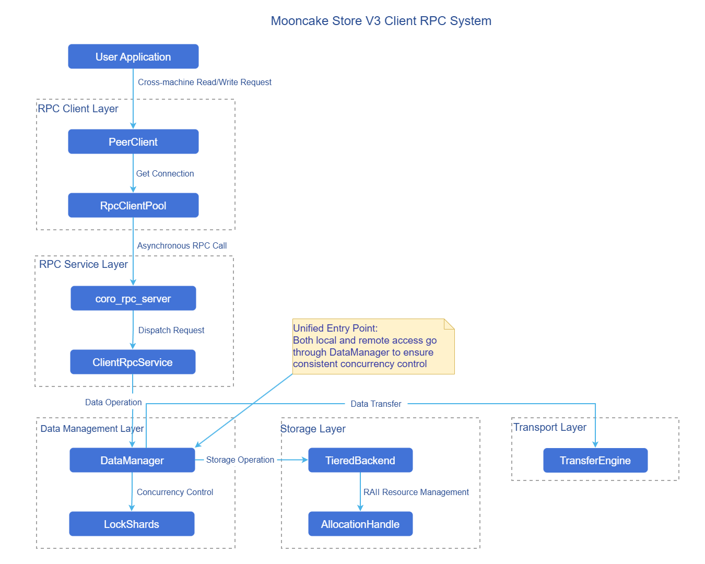
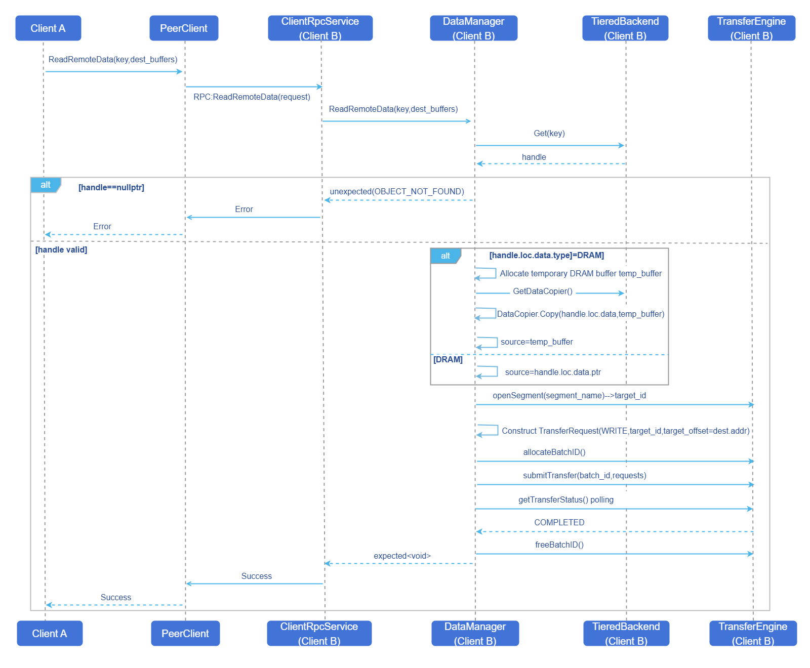
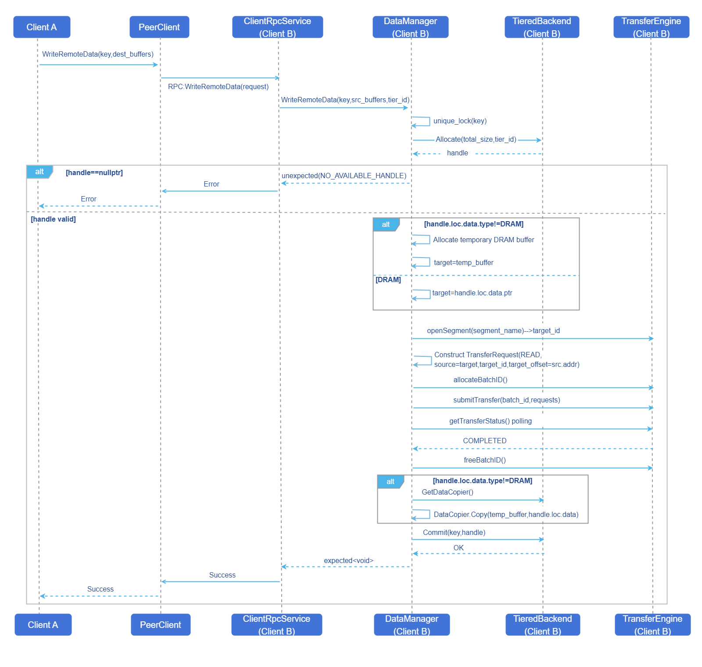

# Mooncake P2P Architecture Client Remote Invocation
## Feature Introduction
This feature aims to implement cross-machine data read/write capabilities between Clients for the Mooncake Store V3 Architecture ([ISSUE 1209](https://github.com/kvcache-ai/Mooncake/issues/1209)). The implementation completes cross-machine read/write through RPC metadata communication + TransferEngine data transfer. Core components include:
- **ClientRpcService**: RPC server, processing remote data read/write requests.
- **DataManager**: Data management layer, coordinating local/remote data operations.
- **PeerClient**: RPC client, initiating asynchronous cross-machine data read/write requests.

### Application Scenarios
In large model inference services, using the Mooncake V3 Architecture for cross-machine read/write of remote data.
### Capability Scope
- **Cross-machine data read/write RPC between Clients**: Supports secure cross-machine data read/write and properly handles RPC timeouts (timeout duration 10s). Data concurrent access safety is guaranteed through Key-level read/write locks (Lock Striping). RAII mode is adopted to guarantee operation atomicity.
- **Support for multiple storage media**: Supports DRAM and non-DRAM (such as SSD) tiers; non-DRAM data is transferred through temporary buffer zones.
### Highlight Features
- **Control plane / data plane decoupling**: RPC only handles metadata and scheduling; data is transferred across machines via TransferEngine, reducing bandwidth pressure on the RPC link.
- **Unified entry and consistent concurrency control**: Local/remote management is uniformly handled by DataManager, using Key-level read/write locks (Lock Striping) to guarantee concurrent safety.
- **Multi-media transparency and robust failure handling**: Supports DRAM/non-DRAM tiers; non-DRAM scenarios use temporary DRAM buffer zones for transfer; and properly handles RPC timeouts and object-not-exist error returns.

### Implementation Principle
#### Component View
**Figure 1** Component View



#### Cross-Machine Read Operation Flow
**Figure 2** Cross-Machine Read Operation Flow Diagram



**Flow Description:**
1. Client A initiates an asynchronous ReadRemoteData RPC request via PeerClient.
2. Client B's ClientRpcService receives the request and forwards it to DataManager.
3. DataManager obtains the data handle from TieredBackend.
4. If the data is not in DRAM, it needs to be copied to a temporary buffer first.
5. TransferEngine writes the data to Client A's target buffer via RDMA WRITE.
6. Returns the result successfully.

#### Cross-Machine Write Operation Flow
**Figure 3** Cross-Machine Write Operation Flow Diagram



**Flow Description:**
1. Client A initiates an asynchronous WriteRemoteData RPC request via PeerClient.
2. Client B's ClientRpcService receives the request and forwards it to DataManager.
3. DataManager acquires the Key's mutex lock (exclusive during writes).
4. Allocates storage space from TieredBackend and obtains the handle.
5. If the target is not DRAM, a temporary buffer is required.
6. TransferEngine reads data from Client A via RDMA READ.
7. If the target is not DRAM, copies data from the temporary buffer to the target storage.
8. Calls TieredBackend's Commit to submit metadata updates.
9. Returns the result successfully.

**RAII Guarantee:** If transfer or commit fails, allocated resources are automatically released when the handle destructor is invoked.

### Relationship with Related Features
- Depends on the TieredBackend feature to manage local storage.
- Depends on the TransferEngine feature to implement cross-node data transfer.

## Using P2P Architecture Client Remote Invocation
### Prerequisites
- **Hardware requirements**: RDMA/TCP NICs required.
- **Environment requirements**: The mooncake-master service must be started first.
### Background Information
- **Usage scenario**: In P2P deployment mode, inference processes need to read/write remote KVCache or intermediate results across machines; callers want to read/write remote data by Key as if accessing local data.
- **Basic principle**: Cross-machine read/write is divided into two segments: between PC and RPC, metadata and control information are exchanged through asynchronous RPC; the actual data plane is completed by TransferEngine for cross-machine transfer (such as RDMA WRITE/READ), avoiding routing large data directly through the RPC channel.

### Usage Limitations
- **Deployment and connectivity limitations**: Only applicable to P2P deployment mode; requires cluster network to satisfy bidirectional connectivity and port allowance for TCP or RDMA channels.
### Operation Steps
The lock shard count in DataManager can be configured via the environment variable `MOONCAKE_DM_LOCK_SHARD_COUNT` (default is 1024 shards if not set).
The RPC transport protocol can be configured as "rdma" or "tcp" via the environment variable `MC_RPC_PROTOCOL` (default is "tcp" if not set).

When deploying Master, configure the startup parameter:
 - `deployment_mode` set to P2P mode.

When deploying Client, configure the startup parameters:
 - `deployment_mode` set to P2P mode.
 - `client_rpc_port` is the RPC server port number, default value is 12345.
 - `rpc_thread_num` is the RPC thread count, default value is 2.

Startup example:
```
./mooncake_master --deployment_mode P2P --rpc_port 50051

./mooncake_client \
  --master_server_address 127.0.0.1:50051 \
  --port 50052 --client_rpc_port 12345 \
  --deployment_mode P2P \
  --tiered_backend_config '{"tiers":[{"type":"DRAM","capacity":536870912,"priority":100,"allocator_type":"OFFSET"}]}'
```

### Follow-up Operations
For follow-up operations, refer to the [Mooncake-Store Documentation](https://kvcache-ai.github.io/Mooncake/design/mooncake-store.html).