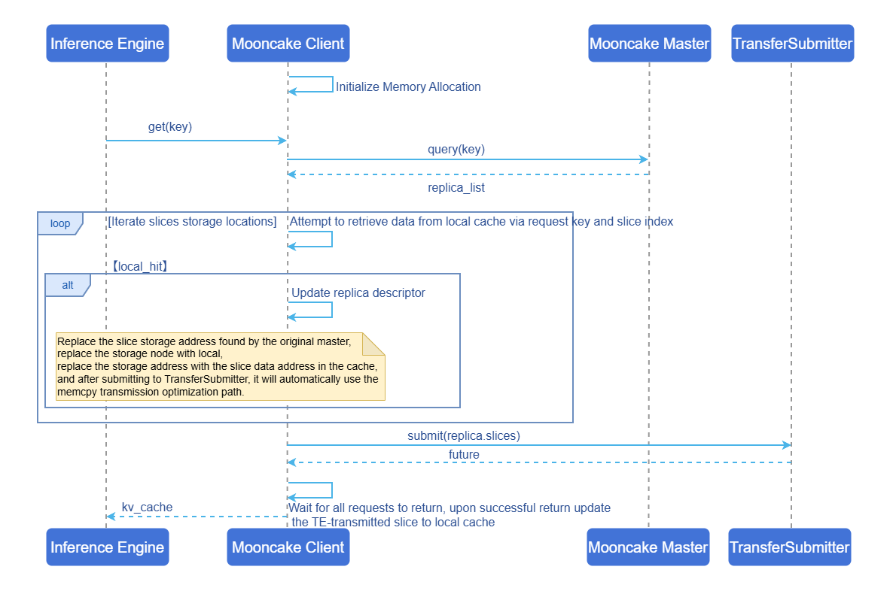

# Mooncake Store Hotspot Cache Optimization

## Feature Introduction

The core idea of the Mooncake Store hotspot cache feature is to cache frequently accessed KVCache data slices on the Mooncake Client side. This feature can significantly reduce cross-node network transfer overhead for hotspot data, optimize the performance of get and batch get operations, and improve TTFT (Time To First Token) and Total Token Throughput metrics in AI inference scenarios.

This feature is configured via the environment variable `MC_STORE_LOCAL_HOT_CACHE_SIZE`, supporting dynamic allocation of memory blocks in 16MB units for efficient hotspot data local cache management.

### Application Scenarios

- **Multi-client + master node architecture**: Recommended for distributed deployment scenarios with multiple Mooncake Clients, where the Master Service randomly assigns data slices to different storage nodes, causing frequent cross-node network transfers. This feature effectively reduces network overhead.
- **High-frequency access scenarios**: Suitable for KVCache access scenarios with hotspot data, where local caching significantly improves access efficiency when certain data is frequently accessed.

>  **Note:**<br>
> **Single-machine standalone client scenario**: Since all data is stored locally, there is no need to enable client hotspot caching. This feature should be disabled to avoid additional memory overhead.

### Capability Scope

- Supports flexible configuration of Mooncake Store hotspot cache size based on business scenarios, reducing `get/batchGet` operation latency.
- Supports seamless integration with inference engines (vLLM, SGLang, etc.), compatible with Mooncake's `get/batchGet` interface.

### Highlight Features

- **Significant performance improvement**: When local slice hit rate reaches 50% or above, `get/batchGet` interface latency is expected to decrease by ≥40%, and TTFT metric is expected to improve by over 20%.
- **Intelligent LRU eviction**: Uses an LRU eviction strategy, prioritizing retention of recently accessed data to improve hotspot data cache hit rate.
- **Efficient memory management**: Pre-allocates memory block pools in 16MB units, minimizing runtime allocation overhead.
- **Zero-invasion integration**: No need to modify inference engine code; enable via environment variable while maintaining full interface compatibility.

### Implementation Principle

**Figure 1** Runtime Sequence Diagram



**Core Processing Flow**:

1. **Initialization phase**: When creating a Client, initialize the Mooncake Store hotspot cache based on the environment variable configuration `MC_STORE_LOCAL_HOT_CACHE_SIZE`. The default value is 0, indicating the feature is disabled. If the configured value exceeds 16MB, the corresponding memory is allocated for storing hotspot data.

2. **Metadata query**: When a `get/batchGet` request arrives, first query the Master Service for the storage location information (replica descriptor) of the target KVCache, obtaining the storage node and address information for each data slice.

3. **Cache query**: Iterate through all data slices, using `{request_key}_{slice_index}` as the key to query this Mooncake Client's Mooncake Store hotspot cache. If a cache hit occurs, update the replica descriptor:
   - Replace the storage node with the local node.
   - Replace the storage address with the data address of the slice in the cache.
   - After submitting to TransferSubmitter, the LOCAL_MEMCPY transfer strategy is automatically selected to optimize the transfer.

4. **Transfer submission**: Submit the read request to TransferSubmitter. If the target address is a local node (including Mooncake Store hotspot cache hit scenarios), Transfer Engine automatically selects the LOCAL_MEMCPY transfer strategy, avoiding network transfer overhead.

5. **Cache update**: After all transfer requests return, update the remote-transferred slices into the Mooncake Store hotspot cache via the asynchronous task handler (LocalHotCacheHandler). Cache updates use the LRU strategy; when cache space is insufficient, the least recently accessed data blocks are automatically evicted.

### Relationship with Related Features

- **Relationship with Mooncake**: This feature is a performance optimization enhancement on the Mooncake Store Client side.
- **Relationship with inference engines**: Compatible with mainstream inference engines (such as vLLM, SGLang), improving performance without code modifications.

## Installation

### Getting Started with Installation

This feature can be installed via the following two methods:

#### Using Images

Images currently only support the arm architecture.

```bash
docker pull cr.openfuyao.cn/openfuyao/mooncake:0.3.7-of.1
```

#### Manual Installation

This feature is integrated in the Mooncake Store Client, consistent with the [Mooncake Installation](https://kvcache-ai.github.io/Mooncake/getting_started/build.html) method.

## Configuring Mooncake Store Hotspot Cache

### Prerequisites

- Mooncake project files have been obtained.
- No Mooncake Client process is running.

### Background Information

- **Enable condition**: When the `MC_STORE_LOCAL_HOT_CACHE_SIZE` configuration value exceeds 16MB, the Mooncake Store hotspot cache feature will be enabled.
- **Disable condition**:
  - Configuration value less than 16MB
  - Configuration value is invalid input (such as strings, negative numbers, etc.)
  - The environment variable is not set (default value is 0, indicating disabled)
- **Memory allocation**: Actual memory allocation follows 16MB unit alignment. For example:
  - Configured 32MB → allocates 2 16MB blocks
  - Configured 50MB → allocates 3 16MB blocks (48MB)
  - Configured 100MB → allocates 6 16MB blocks (96MB)

### Operation Steps

Enable and configure the Mooncake Store hotspot cache feature by setting the environment variable `MC_STORE_LOCAL_HOT_CACHE_SIZE`:

```bash
export LOCAL_HOT_CACHE_SIZE=<cache size (bytes)>
```

### Configuration Example

```bash
# Enable 64MB (64*1024*1024=67108864) hotspot cache
export LOCAL_HOT_CACHE_SIZE=67108864
```

### Configuration Recommendations

- **Multi-client architecture**: Adjust the `MC_STORE_LOCAL_HOT_CACHE_SIZE` parameter based on the actual deployment environment to balance performance improvement and memory overhead.
- **Sufficient memory resources scenario**: Cache size can be increased appropriately to improve cache hit rate.

## Using Mooncake Store Hotspot Cache

Configure the hotspot cache-related [environment variable](https://kvcache-ai.github.io/Mooncake/deployment/mooncake-store-deployment-guide.html#local-hot-cache), and the rest is consistent with the [Mooncake Usage](https://kvcache-ai.github.io/Mooncake/deployment/mooncake-store-deployment-guide.html) method. The Mooncake Client automatically handles caching logic.

### Prerequisites

Mooncake Store and other related components (Transfer Engine, etc.) have been compiled.

### Usage Limitations

- This feature should be disabled in single-machine scenarios to save memory.
- Mooncake Store hotspot cache occupies additional memory, which is not counted toward the memory mounted to Mooncake Master.
- `MC_STORE_LOCAL_HOT_CACHE_SIZE` only takes effect during Mooncake Client initialization; runtime modifications are ineffective.

### Operation Steps

1. Enter the Mooncake directory, using the image provided by openFuyao as an example:
```
cd /workspace/Mooncake
```

2. Start Mooncake Master.
```bash
./build/mooncake-store/src/mooncake_master --rpc-port 50051
```

3. Start the Metadata Server, using Redis as an example.
```bash
apt update && apt install redis-server -y
redis-server --port 6379 --protected-mode no --bind 0.0.0.0
```

4. Start Mooncake Client.

The following code example demonstrates how to configure and start the Mooncake Client. Refer to the [Community Example File](https://github.com/kvcache-ai/Mooncake/blob/main/mooncake-store/tests/distributed_object_store_provider.py).

```python
# Use 1GB (1*1024*1024*1024) size Mooncake Store hotspot cache
import os
os.environ['LOCAL_HOT_CACHE_SIZE'] = '1073741824'

from mooncake.store import MooncakeDistributedStore
# Initialize Mooncake Store Client
store = MooncakeDistributedStore()
# Use TCP protocol for data transfer
protocol = "tcp"
# Default RDMA device name
device_name = "ibp6s0"
# Mooncake Store Client address
local_hostname = "localhost:12355"
# Started Metadata Server address
metadata_server = "redis://localhost:6379"
# Provide 16GB size storage
global_segment_size = 16 * 1024 * 1024 * 1024
# Provide 512MB read/write buffer
local_buffer_size = 512 * 1024 * 1024
# Started Mooncake Master address
master_server_address = "localhost:50051"
# Start Mooncake Store Client
result = store.setup(local_hostname, 
                     metadata_server, 
                     global_segment_size,
                     local_buffer_size, 
                     protocol, 
                     device_name,
                     master_server_address)
```

5. Use the Get interface.

The following code demonstrates basic Get interface usage. For complete test cases (including error handling, edge cases, etc.), refer to the [Community Example File](https://github.com/kvcache-ai/Mooncake/blob/main/mooncake-wheel/tests/test_distributed_object_store.py).

```python
test_data = b"Hello, World!"
key = "test_teardown_key"
store.put(key, test_data)
store.get(key)
```

6. Use the BatchGet interface.

The following code demonstrates basic BatchGet interface usage. For complete test cases (including error handling, edge cases, etc.), refer to the [Community Example File](https://github.com/kvcache-ai/Mooncake/blob/main/mooncake-wheel/tests/test_distributed_object_store.py).

```python
test_data = [
    b"Batch Buffer Data 1! " * 100,  # ~2.1KB
    b"Batch Buffer Data 2! " * 200,  # ~4.2KB
]
keys = ["test_batch_get_buffer_key1", "test_batch_get_buffer_key2"]

for key, data in zip(keys, test_data):
    result = store.put(key, data)
    assert result == 0, f"Failed to put data for key {key}"
    
results = store.batch_get_buffer(keys)
```

### Related Operations

None