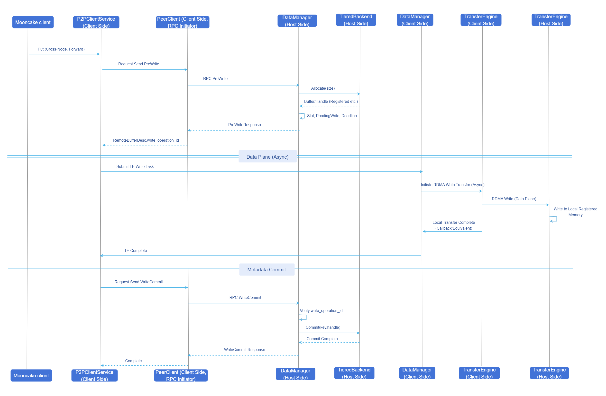
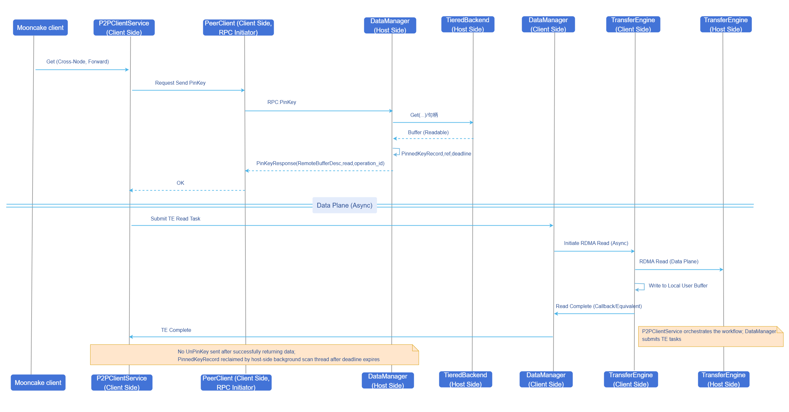

# Mooncake Store V3 Architecture Bidirectional Data Transfer

## Feature Introduction

The [Mooncake Store V3 Architecture](https://github.com/kvcache-ai/Mooncake/issues/1209) has upgraded the P2P cross-machine data pathway: on top of the existing **reverse transfer** (initiated by the data owner's TransferEngine (TE), see [Mooncake P2P Architecture Client Remote Invocation](../../mooncake_p2p_architecture_client_remote_invocation/user_guide/mooncake_p2p_architecture_client_remote_invocation.md)), a **forward transfer** capability has been added, enabling flexible selection of the TE initiation direction (by the accessor or the owner) for cross-machine Put/Get, covering more network topologies and deployment constraints.

- **Existing reverse transfer (`REVERSE` mode)**: Initiated by the data owner's TE within a single RPC (`WriteRemoteData`/`ReadRemoteData`) to complete metadata coordination and data migration — pulling data from the accessor during writes and pushing data to the accessor during reads. This is the default path and consistent with existing behavior.
- **New forward transfer (`FORWARD` mode)**: Initiated by the data accessor's TE, after the owner completes buffer reservation or locking, the accessor's TE issues Write/Read against the owner's registered buffer, using multi-stage RPC combined with asynchronous TE to complete cross-machine Put/Get.

This feature removes the limitation that the Mooncake V3 architecture's cross-machine data plane could only be initiated from the owner side, enabling efficient cross-machine reads and writes even when the reverse transfer path is unreachable or prohibitively expensive.

### Application Scenarios

- In P2P deployments, certain super-nodes or specific NIC topology constraints make **reverse transfer unreachable or prohibitively expensive**, requiring the accessor's TE to directly initiate cross-machine transfer.
- High-concurrency cross-machine read/write scenarios where lock contention on the metadata path is reduced through staged and sharded record tables.

### Capability Scope

- **Forward cross-machine write**: The `PreWrite` RPC first reserves the target buffer on the owner side, then the accessor's TE initiates a Write directly into that buffer, and finally the `WriteCommit` RPC submits metadata to make the remote data officially visible; if TE fails or is abandoned before commit, a `WriteRevoke` is issued.
- **Forward cross-machine read**: The `PinKey` RPC first locks the target data on the owner side and returns readable buffer information, supporting shared reads for the same key, then the accessor's TE initiates a Read to pull data locally; after successful reading, no additional `UnPinKey` RPC is sent, and the owner's record is reclaimed by a background thread after lease timeout.
- **Configurable transfer direction**: A single `Put`/`Get` and `BatchPut`/`BatchGet` can specify `FORWARD` or `REVERSE` via read/write extension configuration; the default is `REVERSE`.

### Highlight Features

- **Control plane / data plane decoupling**: RPCs only exchange metadata, buffer descriptors, and read/write record IDs; data is asynchronously migrated by TE between stages. Large data blocks do not pass through the RPC channel, decoupling from RPC bandwidth and latency.
- **Configurable transfer direction, default reverse**: `Put`/`Get` can specify `FORWARD` or `REVERSE` per request, defaulting to `REVERSE`; the reverse path's control plane and TE are both completed in a single pass on the owner side, with fewer RPC stages and no multi-stage record roundtrips, consistent with existing behavior. Users only switch to forward data transfer when reverse is unreachable or prohibitively expensive.
- **Three-stage shortened lock scope**: Only the metadata preparation and completion stages hold shard locks / key locks; the TE transfer stage does not hold the key write lock for extended periods, thereby avoiding incorporating network and data migration latency into lock duration, reducing lock contention under hot-key and high-concurrency scenarios, and improving cross-machine read/write throughput.
- **Session operation IDs and lease-based race condition prevention**: The write path `write_operation_id`, read path `read_operation_id`, and owner-side `deadline` jointly constrain operations, preventing stale requests from incorrectly operating on new sessions or data being prematurely reclaimed during reads, enhancing consistency and safety during cross-machine read/write processes.

### Implementation Principle

#### Cross-Machine Forward Write Operation Flow

**Figure 1** Cross-Machine Forward Write Operation Sequence Diagram



**Flow Description:**

1. The accessor prepares a cross-machine `Put` (configured as forward), and `P2PClientService` sends the `PreWrite` RPC to the owner via `PeerClient`.
2. The owner allocates a buffer, creates a `PendingWriteRecord`, and returns `RemoteBufferDesc` and `write_operation_id`.
3. `P2PClientService` submits an asynchronous RDMA Write task to `TransferEngine` via the local `DataManager`, writing data into the owner's registered memory (this stage does not hold the owner's key write lock for extended periods).
4. After TE completes on the accessor side, `P2PClientService` sends the `WriteCommit` RPC again via `PeerClient`; the owner validates `write_operation_id` and the lease, then executes `TieredBackend::Commit`.
5. **Exception path**: If TE fails in step 3 or the upper layer abandons before commit, the accessor's `P2PClientService` should send `WriteRevoke` for the same `key` and `write_operation_id`, causing the owner to delete the pending record and roll back; the caller still receives the original TE error. `WriteRevoke` may retry up to 3 times for recoverable errors.

#### Cross-Machine Forward Read Operation Flow

**Figure 2** Cross-Machine Forward Read Operation Sequence Diagram



**Flow Description:**

1. After the accessor's `Get` (configured as forward), `P2PClientService` sends the `PinKey` RPC to the owner via `PeerClient`.
2. The owner obtains a readable handle, creates or renews the lease for a `PinnedKeyRecord`, and returns `RemoteBufferDesc` and `read_operation_id`.
3. `P2PClientService` submits an asynchronous RDMA Read task to `TransferEngine` via the local `DataManager`, pulling data into the local user buffer within the lease validity period.
4. After TE succeeds, the current read request can return directly without sending an additional `UnPinKey`; the owner's `PinnedKeyRecord` is reclaimed by a background scan thread after the `deadline` expires.
5. **Exception path**: If TE fails in step 3, the accessor's `P2PClientService` will retry `UnPinKey` to clean up the pin (retry count aligned with the write path `WriteRevoke`); `LEASE_EXPIRED` can be considered as cleanup already effective.

#### Lease and Cleanup

- Leases are expressed by the `deadline` and operation IDs within the owner's read/write records, used to constrain the validity period of intermediate states. The write path validates `write_operation_id` and the lease at `WriteCommit`; the read path does not send `UnPinKey` after success, and instead the background scan reclaims the `PinnedKeyRecord` after the `deadline` expires. If TE fails and `UnPinKey` cleanup needs to be sent, the owner also determines its validity based on `read_operation_id` and the lease.
- Foreground: When each stage RPC hits a record that has already expired, it deletes it first before continuing the evaluation.
- Background: Scans the head of each shard's `ordered_list` at the `p2p_key_lease_scan_interval_ms` interval, reclaiming expired records and releasing `AllocationHandle` strong references.

#### Forward vs. Reverse Data Plane Comparison

**Table 1** Forward vs. Reverse Data Plane Principle Comparison

| Dimension | Reverse Transfer (Default) | Forward Transfer |
|-----------|----------------------------|------------------|
| TE Initiator | Data owner | Data accessor |
| Cross-Machine Write Data Plane | Owner pulls data from the accessor | Accessor writes into the owner's buffer |
| Cross-Machine Read Data Plane | Owner pushes data to the accessor | Accessor pulls data from the owner |
| Control Plane RPC | Single-stage `WriteRemoteData`/`ReadRemoteData` | Write: `PreWrite`/`WriteCommit`/`WriteRevoke`; Read: success path is `PinKey`, failure cleanup uses `UnPinKey` |
| Typical Orchestration Position | Owner completes three-stage semantics in a single processing chain | Accessor drives multi-stage RPCs, with TE inserted between stages |

### Relationship with Related Features

- Depends on [Mooncake P2P Architecture Client Remote Invocation](../../mooncake_p2p_architecture_client_remote_invocation/user_guide/mooncake_p2p_architecture_client_remote_invocation.md): P2P deployment, RPC channel, `PeerClient`/`ClientRpcService`, and baseline reverse transfer capability.
- Depends on **TieredBackend**: owner-side buffer allocation, metadata commit visibility, and handle RAII. See [TieredBackend Introduction Example](https://github.com/kvcache-ai/Mooncake/blob/P2P-Mooncake-Store/mooncake-store/conf/tiered_backend_config_example.md).
- Depends on **TransferEngine**: cross-machine data transfer relies entirely on TE execution; both forward and reverse path data planes are completed through TE. This feature does not involve TE modifications.
- This feature **only applies to the Mooncake Store V3 architecture** and does not cover other Store architectures.

## Using Mooncake Store V3 Architecture Bidirectional Data Transfer

### Prerequisites

- **Deployment mode**: Mooncake Client and Mooncake Master configured with `deployment_mode` set to `P2P`.
- **Hardware and network**: RDMA or TCP NICs or other TE-supported hardware devices, with inter-cluster TE connectivity between accessor and owner; the forward path requires the accessor's TE to reach the owner's buffer.

### Background Information

When not configured or explicitly configured as `REVERSE`, the `WriteRemoteData`/`ReadRemoteData` reverse single-stage path is still used, consistent with behavior before enabling this feature.

### Usage Limitations

- **Architecture scope**: Only V3 P2P cross-machine paths; local writes and same-process short paths are not forced to align with cross-machine forward three-stage semantics.
- **Write concurrency**: At any given time, a single key can have at most one valid `PendingWriteRecord`; concurrent `PreWrite` requests only succeed for the first one, and the rest fail and must be retried by the caller.
- **Lease duration**: When network RTT is large or load is high, `p2p_key_lease_duration_ms` should be increased appropriately to avoid frequent retries caused by lease expiration before `WriteCommit`/TE completion.

### Operation Steps

1. Deployment mode: Configure `deployment_mode` as `P2P`

    Both Master and Client must start in P2P mode. The Client also needs to specify `client_rpc_port` and `tiered_backend_config` (local DRAM and other tier configurations).

    ```bash
    ./mooncake_master --deployment_mode P2P --rpc_port 50051

    ./mooncake_client \
      --master_server_address 127.0.0.1:50051 \
      --port 50052 \
      --client_rpc_port 12345 \
      --deployment_mode P2P \
      --tiered_backend_config '{"tiers":[{"type":"DRAM","capacity":536870912,"priority":100,"allocator_type":"OFFSET"}]}'
    ```

    Optional environment variables:

    - `MOONCAKE_DM_LOCK_SHARD_COUNT`: DataManager lock shard count, default `1024` (equivalent semantics to gflag `--lock_shard_count`).

2. Configure lease

    Intermediate states such as forward write `PreWrite` and forward read `PinKey` are protected by leases.

    - `p2p_key_lease_duration_ms`: Maximum survival time (ms) for `PreWrite`/`PinKey` intermediate states; exceeding this value indicates a failed cross-machine read/write, default `5000`.
    - `p2p_key_lease_scan_interval_ms`: Background scan period (ms) for cleaning expired records; passing `0` uses the built-in default, default `1000`.

3. Transfer direction

    Which side initiates the TE transfer for cross-node data plane:

    - `reverse` (default): **Reverse transfer**, initiated by the owner's TE; writes use `WriteRemoteData`, reads use `ReadRemoteData`.
    - `forward`: **Forward transfer**, initiated by the accessor's TE; writes use `PreWrite → TE Write → WriteCommit`, reads use `PinKey → TE Read` (after success, the owner releases the pin via lease/scan, without additional RPC `UnPinKey`).

    Configuration entry:

    - Binary Client: gflag `--p2p_transfer_direction_mode forward`
    - Python: `setup_p2p_real_client(..., p2p_transfer_direction_mode="forward")`


### Usage Examples

#### V3 Architecture Master Startup

The following command starts Mooncake Master in P2P mode and enables the HTTP metadata service, allowing Clients to exchange metadata during P2P handshake and cross-machine TE connection establishment.

```bash
./mooncake_master \
  --deployment_mode P2P \
  --rpc_port 50051 \
  --enable_http_metadata_server 1 \
  --http_metadata_server_port 8000
```

#### Binary Client Startup

The following command configures both lease and forward transfer (`forward`) in P2P mode. Change `protocol` to `rdma` and set `--device_names` as needed.

```bash
./mooncake_client \
  --master_server_address 127.0.0.1:50051 \
  --port 50052 \
  --client_rpc_port 12345 \
  --deployment_mode P2P \
  --tiered_backend_config '{"tiers":[{"type":"DRAM","capacity":536870912,"priority":100,"allocator_type":"OFFSET"}]}' \
  --p2p_key_lease_duration_ms 8000 \
  --p2p_key_lease_scan_interval_ms 1000 \
  --p2p_transfer_direction_mode forward
```

#### Python Integrated Deployment

```python
from mooncake.store import MooncakeDistributedStore
import json

store = MooncakeDistributedStore()

tiered_backend_config = {
    "tiers": [
        {
            "type": "DRAM",
            "capacity": 64 * 1024 * 1024,
            "priority": 100,
            "allocator_type": "OFFSET",
        }
    ]
}

ret = store.setup_p2p_real_client(
    local_hostname="10.10.10.21",
    metadata_server="P2PHANDSHAKE",
    tiered_backend_config_json=json.dumps(tiered_backend_config),
    local_buffer_size=16 * 1024 * 1024,
    protocol="tcp",          # Change to "rdma" when using RDMA and set rdma_devices
    rdma_devices="",
    master_server_addr="127.0.0.1:50051",
    client_rpc_port=12345,
    client_rpc_thread_num=16,
    p2p_key_lease_duration_ms=8000,
    p2p_key_lease_scan_interval_ms=1000,
    p2p_transfer_direction_mode="forward",  # Or "reverse" (default)
)
print("setup ret =", ret)
```
