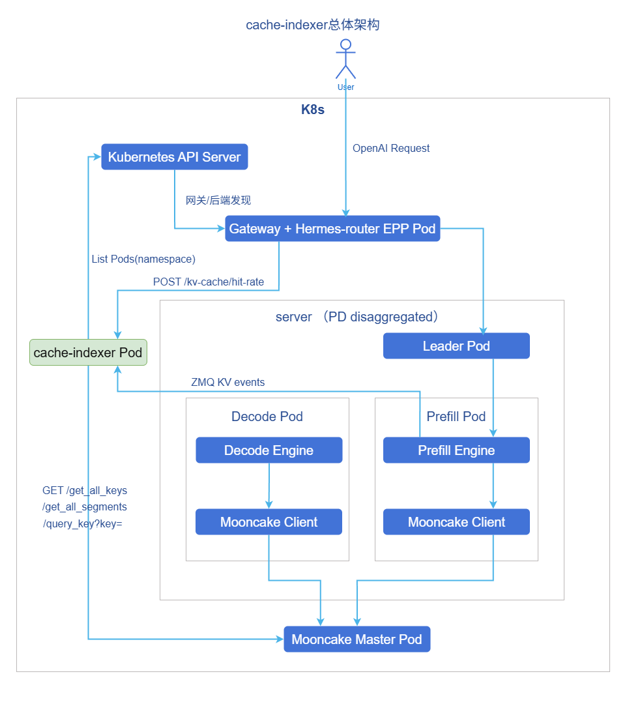

# AI推理KVCache索引管理

## 特性介绍

cache-indexer是面向大语言模型推理场景的全局KVCache索引组件，统一维护L1（推理实例本地HBM）与L3（推理实例内存缓存）两层KVCache视图。路由组件可调用cache-indexer查询候选推理实例的KVCache命中率，从而进行更准确的请求级调度。

### 应用场景

cache-indexer适用于在Kubernetes集群中部署大语言模型推理服务，并需要基于KVCache命中情况优化请求路由的场景。

- 多实例推理后端：多个vLLM实例同时提供服务，需要根据请求前缀缓存命中情况选择更合适的实例。
- KVCache感知路由：Hermes-router等路由组件需要获取L1/L3命中率，用于KVCache aware类路由策略。
- 分布式缓存复用：推理服务使用Mooncake等分布式缓存管理系统，希望将已下沉到内存的KVCache纳入调度依据。
- 动态扩缩容场景：推理实例或Mooncake Master发生上下线时，需要cache-indexer自动发现并更新索引采集目标。

### 能力范围

cache-indexer当前提供以下能力：

- 支持通过Kubernetes Pod label动态发现vLLM Pod与Mooncake Master Pod。
- 支持订阅vLLM ZMQ KV-event，维护L1 KVCache索引。
- 支持轮询Mooncake Master，维护L3 KVCache索引。
- 支持通过`/kv-cache/hit-rate`接口查询候选实例的L1/L3 KVCache命中率。
- 支持通过Helm Chart独立部署，也支持作为InferNex子组件集成部署。

> **说明**：
> 
> - cache-indexer不包含tokenizer能力，调用方需要在请求中传入已经完成编码的`token_ids`。
> - 因Mooncake V1暂未提供SSD层KVCache查询接口，L3索引不包含SSD中的KVCache信息。


### 软件依赖

cache-indexer的L1/L3命中率依赖推理引擎、分布式缓存管理系统与自身配置保持一致。当前已验证组合如下。

**表1** cache-indexer依赖组件 
| 组件类别 | 当前已验证版本 | 说明 |
|----------|----------------|------|
| 推理引擎（L1） | `vLLM 0.13.0`、`vLLM 0.18.0` | 提供L1 KVCache；需开启prefix caching与KV events，并与cache-indexer使用一致的block计算参数。 |
| 分布式缓存管理系统（L3） | `Mooncake 0.3.7` | 提供L3 KVCache；需支持`/get_all_keys`、`/query_key`、`/get_all_segments`。 |
| Kubernetes | `1.28+` | cache-indexer通过Kubernetes API进行服务发现，需要具备`pods`的`get/list/watch`权限。 |

### 亮点特征

- **L1/L3双层视图**：同时维护推理实例本地HBM缓存和分布式内存缓存视图。
- **统一KVCache block计算机制**：复刻vLLM block hash计算逻辑，使查询侧计算结果与vLLM事件、Mooncake key对齐。
- **动态服务发现**：周期发现vLLM Pod与Mooncake Master Pod，自动驱动订阅和轮询目标更新。
- **轻量接口**：只接收`token_ids`、`block_size`、`cache_salt`等必要输入，不在cache-indexer内执行tokenizer。

### 实现原理

cache-indexer位于路由决策路径上，主链路如下。

1. cache-indexer通过Kubernetes API Server列举带特定label的vLLM Pod与Mooncake Master Pod，构造发现快照。
2. 对每个vLLM Pod启动一路ZMQ SUB，订阅`BlockStored` / `BlockRemoved` / `AllBlocksCleared`事件，写入L1索引。
3. 对Mooncake Master周期调用`GET /get_all_keys`和`GET /query_key`，拉取block副本列表，并通过`GET /get_all_segments`解析vLLM Pod IP地址到Mooncake client传输端点的映射，写入L3索引。
4. 路由组件调用`POST /kv-cache/hit-rate`，cache-indexer在L1/L3两张索引上分别计算最长连续前缀命中并返回。

总体架构如下。

**图1** cache-indexer总体架构


## 安装

### 独立部署

本节介绍在已有推理引擎和分布式缓存管理系统的集群中，单独部署cache-indexer。

#### 组件规格

cache-indexer独立部署时，需要配套组件提供可采集的L1/L3数据。

| 组件 | 规格说明 |
|------|----------|
| 推理引擎 | 当前支持vLLM，已验证`vLLM 0.13.0`、`vLLM 0.18.0`；需要开启prefix caching与KV events。 |
| 分布式缓存管理系统 | 当前支持Mooncake，已验证`Mooncake 0.3.7`；需要提供Mooncake Master admin HTTP接口。 |
| cache-indexer | 通过Helm chart部署，默认提供ClusterIP Service`cache-indexer-service:8080`。 |

> **说明**：
> 
> 不部署推理引擎和分布式缓存管理系统时，cache-indexer Pod仍可启动，健康检查和查询接口可访问，但L1/L3命中率均为`0`。

#### 前提条件

在开始安装前，请确保满足以下条件。

- **环境要求**
  - Kubernetes集群：`1.28+`。
  - Helm工具：用于部署cache-indexer chart。
  - 用户具备在目标命名空间创建Deployment、Service、ConfigMap、ServiceAccount、Role、RoleBinding的权限。

- **组件要求**
  - 如需L1命中率，集群中需要部署vLLM推理实例，并按[推理引擎（以vLLM为例）](#推理引擎以vllm为例)章节配置标签、环境变量、启动参数和ZMQ端口。
  - 如需L3命中率，集群中需要部署Mooncake Master与Mooncake client，并按[分布式缓存管理系统（以Mooncake为例）](#分布式缓存管理系统以mooncake为例)章节配置标签、端口和client参数。
  - 如仅验证cache-indexer安装与接口连通性，可先不部署推理引擎和分布式缓存管理系统。

- **硬件要求**
  - cache-indexer本身无特殊硬件要求，可运行在标准CPU节点上。

#### 快速安装

1. 拉取cache-indexer Helm Chart包。

    ```bash
    helm pull oci://cr.openfuyao.cn/charts/cache-indexer --version 0.0.0-latest
    ```

2. 解压Chart包。

    ```bash
    tar -xzvf cache-indexer-0.0.0-latest.tgz
    ```

3. 安装cache-indexer。

    ```bash
    helm -n <NAMESPACE> install <RELEASE_NAME> ./cache-indexer
    ```

    参数说明如下。

    - `<NAMESPACE>`：cache-indexer的安装命名空间，也是默认服务发现范围。
    - `<RELEASE_NAME>`：Helm release名称，主要影响Deployment、ConfigMap、ServiceAccount等资源名。
    - `--create-namespace`（可选）：新创建命名空间时使用。

4. 验证部署。

    ```bash
    kubectl -n <NAMESPACE> get pod -l app.kubernetes.io/name=cache-indexer
    kubectl -n <NAMESPACE> get svc cache-indexer-service
    ```

### InferNex集成部署

本节介绍通过InferNex集成部署cache-indexer。

#### 组件规格

InferNex是openFuyao社区提供的AI推理服务软件套件，现已集成cache-indexer。通过InferNex部署时，至少需要开启以下组件。

**表2** 通过InferNex部署时组件最小集
| 组件 | 最小要求 |
|------|----------|
| `inference-backend` | 必须开启，用于部署vLLM推理后端；如需L3命中率，需要启用Mooncake Store。 |
| `cache-indexer` | 必须开启，用于采集L1/L3 KVCache并提供`/kv-cache/hit-rate`。 |
| `hermes-router` | 建议开启，用于消费cache-indexer的命中率结果并执行KVCache aware路由。 |

InferNex最新Chart中，vLLM、Mooncake、cache-indexer的关键联动配置已在values中暴露；部署时需要确保`PYTHONHASHSEED`、Hash算法、ZMQ端口名和Mooncake Master HTTP端口名保持一致。

#### 前提条件

- Kubernetes集群可访问`oci://cr.openfuyao.cn`或用户已准备离线Chart包。
- 已具备InferNex所需的推理硬件、镜像拉取权限和Helm安装权限。

#### 快速安装

1. 拉取InferNex Chart包。版本默认使用`0.0.0-latest`。

    ```bash
    helm pull oci://cr.openfuyao.cn/charts/infernex --version 0.0.0-latest
    ```

2. 解压Chart包。

    ```bash
    tar -xzvf infernex-0.0.0-latest.tgz
    ```

3. 根据环境修改`values.yaml`。至少确认以下开关和参数。

    ```yaml
    inference-backend:
      services:
        - enabled: true
          kvTransferConfig:
            mooncake:
              use_store: true

    hermes-router:
      enabled: true

    cache-indexer:
      enabled: true
    ```

4. 安装InferNex。以下命令以release名称`infernex`为例。

    ```bash
    helm install -n <namespace> infernex ./infernex
    ```

具体部署方式与网关、后端、模型配置请参考[InferNex用户手册](../../ai_inference_infernex/user_guide/ai_inference_infernex.md)。

## 使用KVCache命中率查询服务

cache-indexer对外提供集群内部接口`POST /kv-cache/hit-rate`。该接口当前主要由Hermes-router等集群内部路由组件调用，不面向集群外部用户直接暴露。

调用流程如下。

1. 路由组件构造候选推理实例IP地址列表，调用cache-indexer的`/kv-cache/hit-rate`。

    请求示例如下。

    ```bash
    curl -X POST http://cache-indexer-service:8080/kv-cache/hit-rate \
      -H 'Content-Type: application/json' \
      -d '{
        "server_ip": ["this.is.pod.ip"],
        "body": {
          "token_ids": [9707, 0, 358, 3900, 374, 1234, 5678, 9012],
          "cache_salt": "",
          "block_size": 128
        }
      }'
    ```

    请求参数说明如下。

    **表3** 请求参数说明
    | 参数 | 说明 |
    |------|------|
    | `server_ip` | 候选推理实例Pod 地址列表，cache-indexer按输入顺序返回评分结果。 |
    | `body.token_ids` | 已由上游tokenizer完成编码的token ID序列。 |
    | `body.cache_salt` | 与对应vLLM推理请求实际使用的`cache_salt`一致；未使用时传空字符串。 |
    | `body.block_size` | 与vLLM`--block-size`一致的KV block大小，建议为`128`的倍数。 |

2. cache-indexer根据`token_ids`、`block_size`、`cache_salt`计算请求block hash序列。
3. cache-indexer分别查询L1/L3索引，返回每个候选实例的命中率。
    响应示例如下。

    ```json
    {
      "server_score_list": [
        {
          "server_ip": "this.is.pod.ip",
          "l1_hit_ratio": 1.0,
          "l3_hit_ratio": 1.0
        }
      ],
      "message": "",
      "status": 0
    }
    ```
    响应参数说明如下。

    **表4** 响应参数说明
    | 参数 | 说明 |
    |------|------|
    | `server_score_list[].server_ip` | 候选推理实例Pod IP地址。 |
    | `server_score_list[].l1_hit_ratio` | L1最长连续前缀命中率，范围`[0,1]`。 |
    | `server_score_list[].l3_hit_ratio` | L3最长连续前缀命中率，范围`[0,1]`。 |
    | `message` | 业务提示信息，正常返回为空字符串。 |
    | `status` | 业务状态码。成功返回`0`；错误场景下按当前实现返回对应HTTP状态码，包括`400`（空请求体、非法JSON、未知字段、`server_ip`为空或`block_size`小于等于 `0`）、`405`（请求方法不是 `POST`）、`413`（请求体超过大小限制）和`500`（命中率计算失败）。 |

## 参数配置说明

### cache-indexer

对应配置文件见cache-indexer`values.yaml`。

```yaml
image:
  repository: "cr.openfuyao.cn/openfuyao/cache-indexer"
  tag: "latest"
  pullPolicy: IfNotPresent

service:
  name: cache-indexer-service
  port: 8080
  targetPort: 28080

resources:
  limits:
    cpu: "1"
    memory: 2Gi
  requests:
    cpu: 100m
    memory: 128Mi

log:
  level: info

http:
  shutdownTimeout: 10s
  readHeaderTimeout: 10s
  readTimeout: 30s
  writeTimeout: 30s
  idleTimeout: 120s
  maxHeaderBytes: 1048576
  maxHitRateBodyBytes: 4194304

blockKey:
  pythonHashSeed: "0"
  prefixCachingHashAlgo: sha256_cbor
  useIntBlockHashes: true

discovery:
  refreshInterval: 10s
  segmentsFetchTimeout: 2s
  labels:
    engineKey: openfuyao.com/engine
    engineValue: vllm
    pdRoleKey: openfuyao.com/pdRole
    pdRoleValue: [prefill, aggregate]
    kvManagerKey: openfuyao.com/kvmanager
    kvManagerValue: mooncake
  vllm:
    zmqPortName: zmq-pub
  mooncakeMaster:
    httpPortName: http
    rpcPortName: rpc
    httpPort: 9003
    rpcPort: 0

ingest:
  l1:
    backoffInitial: 1s
    backoffMax: 30s
  l3:
    scheme: http
    pollInterval: 10s
    httpTimeout: 5s

serviceAccount:
  create: true
  name: ""

podAnnotations: {}
podLabels: {}
nodeSelector: {}
tolerations: []
affinity: {}
```
**表5** Helm Chart关键参数说明
| 参数 | 说明 |
|------|------|
| `image.repository` | cache-indexer镜像仓库。 |
| `image.tag` | cache-indexer镜像标签。 |
| `image.pullPolicy` | 镜像拉取策略。 |
| `service.name` | cache-indexer Service名称，路由组件通过该名称访问。 |
| `service.port` | Service对外端口。 |
| `service.targetPort` | cache-indexer容器HTTP侦听端口。 |
| `resources.requests` | Pod资源请求值。 |
| `resources.limits` | Pod资源限制值。 |
| `log.level` | 日志级别，可选`debug`、`info`、`error`。 |
| `http.shutdownTimeout` | HTTP服务优雅停止超时。 |
| `http.readHeaderTimeout` | HTTP请求头读取超时。 |
| `http.readTimeout` | HTTP请求读取超时。 |
| `http.writeTimeout` | HTTP响应写入超时。 |
| `http.idleTimeout` | HTTP keep-alive空闲超时。 |
| `http.maxHeaderBytes` | HTTP请求头大小上限。 |
| `http.maxHitRateBodyBytes` | `/kv-cache/hit-rate`请求体大小上限。 |
| `blockKey.pythonHashSeed` | 必须与vLLM`PYTHONHASHSEED`一致。 |
| `blockKey.prefixCachingHashAlgo` | 必须与vLLM`--prefix-caching-hash-algo`一致。 |
| `blockKey.useIntBlockHashes` | 必须与vLLM`VLLM_KV_EVENTS_USE_INT_BLOCK_HASHES`一致。 |
| `discovery.refreshInterval` | Kubernetes Pod发现轮询周期。 |
| `discovery.segmentsFetchTimeout` | 调用Mooncake Master`/get_all_segments`的超时。 |
| `discovery.labels.engineKey` / `engineValue` | vLLM Pod发现标签。 |
| `discovery.labels.pdRoleKey` / `pdRoleValue` | 参与命中率计算的推理角色标签。 |
| `discovery.labels.kvManagerKey` / `kvManagerValue` | Mooncake Master发现标签。 |
| `discovery.vllm.zmqPortName` | vLLM KV-event ZMQ端口名。 |
| `discovery.mooncakeMaster.httpPortName` | Mooncake Master admin HTTP端口名；要与Mooncake Master Pod中对应端口的`ports[].name`名称一致。 |
| `discovery.mooncakeMaster.rpcPortName` | Mooncake Master RPC端口名。 |
| `discovery.mooncakeMaster.httpPort` | admin HTTP端口名未命中时使用的兜底端口；数值要与Mooncake`--metrics_port`一致。 |
| `discovery.mooncakeMaster.rpcPort` | RPC端口名未命中时使用的兜底端口；`0`表示不启用。 |
| `ingest.l1.backoffInitial` | L1 ZMQ订阅重连初始backoff。 |
| `ingest.l1.backoffMax` | L1 ZMQ订阅重连最大backoff。 |
| `ingest.l3.scheme` | 访问Mooncake Master使用的协议。 |
| `ingest.l3.pollInterval` | L3索引刷新周期。 |
| `ingest.l3.httpTimeout` | 单次Mooncake HTTP请求超时。 |
| `serviceAccount.create` | 是否为cache-indexer创建ServiceAccount。 |
| `serviceAccount.name` | 指定ServiceAccount名称；为空时由chart自动生成。 |
| `podAnnotations` | 附加到cache-indexer Pod的注解。 |
| `podLabels` | 附加到cache-indexer Pod的标签。 |
| `nodeSelector` | Pod节点选择器。 |
| `tolerations` | Pod容忍配置。 |
| `affinity` | Pod亲和性配置。 |

### 推理引擎（以vLLM为例）

以下片段示意vLLM Pod / Deployment中与cache-indexer联动的关键字段，不是一份完整部署清单。

```yaml
metadata:
  labels:
    openfuyao.com/engine: vllm
    openfuyao.com/pdRole: aggregate

spec:
  containers:
    - name: vllm
      env:
        - name: PYTHONHASHSEED
          value: "0"
        - name: VLLM_KV_EVENTS_USE_INT_BLOCK_HASHES
          value: "1"
      args:
        - --enable-prefix-caching
        - --block-size=128
        - --prefix-caching-hash-algo=sha256_cbor
        - --kv-events-config={"enable_kv_cache_events":true,"publisher":"zmq","topic":"kv-events"}
      ports:
        - name: zmq-pub
          containerPort: 5557
```

**表6** 推理引擎（vLLM）关键参数说明
| 参数 | 说明 |
|------|------|
| `openfuyao.com/engine` | vLLM Pod发现标签，需与`discovery.labels.engineValue`匹配。 |
| `openfuyao.com/pdRole` | 推理角色标签，默认`prefill`和`aggregate`会进入候选集。 |
| `PYTHONHASHSEED` | 必须与cache-indexer`blockKey.pythonHashSeed`一致。 |
| `VLLM_KV_EVENTS_USE_INT_BLOCK_HASHES` | 必须与cache-indexer`blockKey.useIntBlockHashes`一致。 |
| `--enable-prefix-caching` | 开启prefix caching，否则无法形成有效前缀命中。 |
| `--block-size` | KV block大小，需与查询请求`body.block_size`一致。 |
| `--prefix-caching-hash-algo` | block hash算法，需与cache-indexer`blockKey.prefixCachingHashAlgo`一致。 |
| `--kv-events-config` | 开启vLLM KV-event发布，供cache-indexer订阅L1事件。 |
| `ports[].name=zmq-pub` | KV-event ZMQ端口名，需与cache-indexer`discovery.vllm.zmqPortName`一致。 |

### 分布式缓存管理系统（以Mooncake为例）

以下片段分别示意Mooncake Master Pod / Deployment、Service和Mooncake client中与cache-indexer联动的关键字段，不是一份完整部署清单。

#### Mooncake Master Pod/Deployment

```yaml
metadata:
  labels:
    openfuyao.com/kvmanager: mooncake

spec:
  containers:
    - name: mooncake-master
      args:
        - --port=50051
        - --metrics_port=9003
      ports:
        - name: rpc
          containerPort: 50051
        - name: http
          containerPort: 9003
```

**表7** Mooncake Master关键参数说明
| 参数 | 说明 |
|------|------|
| `openfuyao.com/kvmanager` | Mooncake Master发现标签，需与cache-indexer`discovery.labels.kvManagerValue`匹配。 |
| `--port` | Mooncake Master RPC侦听端口。 |
| `--metrics_port` | Mooncake Master admin HTTP侦听端口，cache-indexer通过该端口轮询L3信息；数值需与`discovery.mooncakeMaster.httpPort`一致。 |
| `ports[].name=rpc` | RPC容器端口名，可供Service`targetPort`引用。 |
| `ports[].name=http` | admin HTTP容器端口名，需与cache-indexer`discovery.mooncakeMaster.httpPortName`对齐；如果实际部署使用其他端口名，需要同步修改该配置。 |

#### Mooncake Master Service

Mooncake Master需要对外提供admin HTTP Service端口，以支持cache-indexer轮询获取L3 KVCache信息。

```yaml
service:
  ports:
    - name: rpc
      port: 30089
      targetPort: rpc
    - name: http
      port: 9003
      targetPort: http
```

**表8** Mooncake Service关键参数说明
| 参数 | 说明 |
|------|------|
| `service.ports[].name=rpc` | Mooncake Master RPC Service端口名。 |
| `service.ports[].port=30089` | 提供给vLLM / Mooncake client访问的Master RPC Service端口。 |
| `service.ports[].name=http` | Mooncake Master admin HTTP Service端口名。 |
| `service.ports[].port=9003` | 提供给cache-indexer访问的admin HTTP Service端口。 |

#### Mooncake client配置

Mooncake client实际负责管理本地内存中的KVCache，需要配置以确保能被cache-indexer正确识别。

```yaml
mooncake:
  use_store: true
  config: |
    local_hostname: "$POD_IP"
    metadata_server: "redis://redis-service:6379"
    master_server_address: "mooncake-master-service:30089"
    device_name: ""
    protocol: "ascend"
    global_segment_size: 42949672960
    use_ascend_direct: true
```

**表9** Mooncake Client关键参数说明
| 参数 | 说明 |
|------|------|
| `mooncake.use_store` | 开启Mooncake Store，L3 KVCache才会写入Mooncake。 |
| `local_hostname` | Mooncake client本地传输端点来源；建议使用Pod IP地址，便于cache-indexer通过`/get_all_segments`反查`transport_endpoint`。 |
| `metadata_server` | Mooncake元数据服务地址，需与集群中Redis等元数据组件地址一致。 |
| `master_server_address` | Mooncake Master RPC Service地址，需与Mooncake Service RPC端口一致。 |
| `device_name` | 设备名称，按Mooncake后端要求配置；为空时使用默认设备选择逻辑。 |
| `protocol` | Mooncake数据传输协议，需与推理硬件和Mooncake部署方式一致。 |
| `global_segment_size` | Mooncake全局segment大小，按模型规模、并发量和缓存容量规划。 |
| `use_ascend_direct` | 昇腾场景下是否启用直连传输能力，需与运行环境能力匹配。 |
