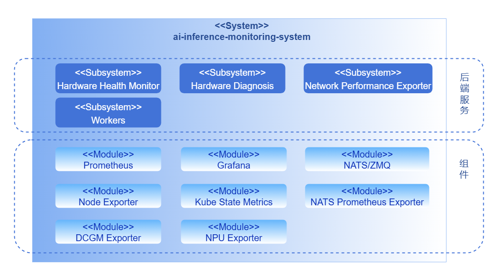
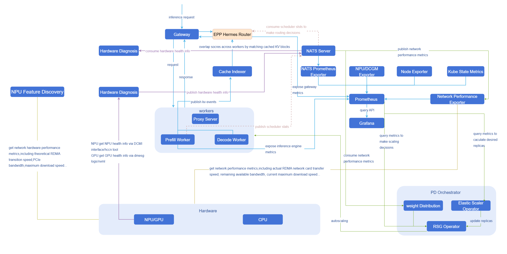
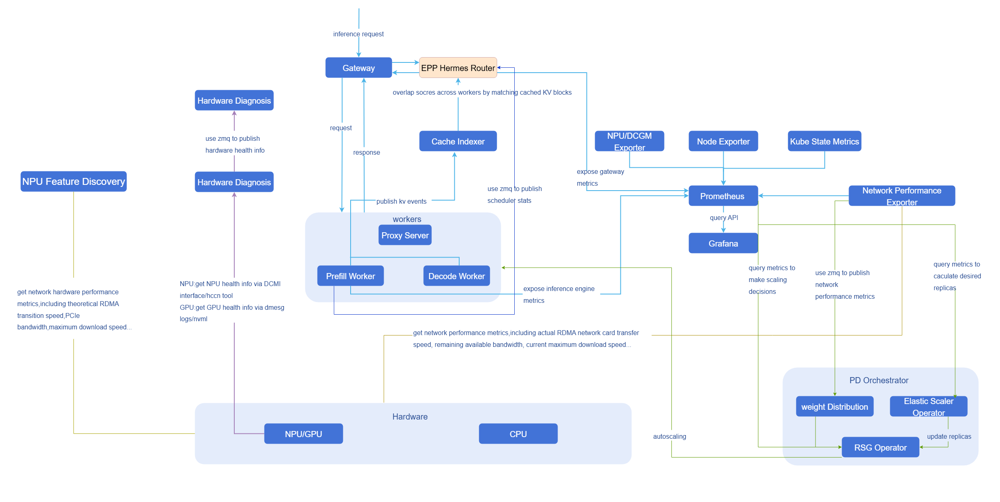
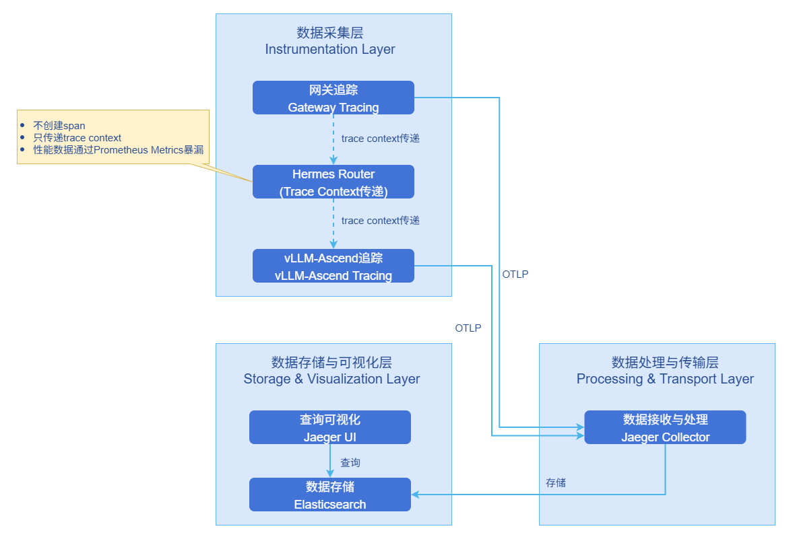

# AI推理鹰眼

## 特性介绍

Eagle Eye是**面向AI推理场景的可观测体系**，提供**全链路指标采集、近实时传输、智能诊断**与**端到端分布式链路追踪**能力。

**指标监控方面**，融合了Prometheus的周期性指标采集与分布式消息队列系统的低延迟推送机制，实现从**AI网关**、**推理引擎**、**Mooncake**到**基础设施**（Ray、K8s、硬件）的全方位可观测，既支持扩缩容决策的趋势分析，也满足时效性要求高的模块（如智能路由）对秒级数据更新的需求。通过独立的硬件健康诊断模块，实现对NPU/GPU、温度、功耗、错误码等底层指标的持续监测与异常识别，构建"采集—传输—诊断—评估"的闭环监控能力。

**链路追踪方面**，基于OpenTelemetry提供非侵入式的端到端链路追踪能力，追踪推理请求从AI网关到推理引擎（vLLM-Ascend）的完整执行路径，记录各环节耗时和关键业务属性，支持性能调优和故障诊断。

### 应用场景

- **系统资源健康监控**：实时监控基础设施（Ray、K8s、硬件），确保系统资源的健康与稳定，及时发现并解决资源瓶颈，确保系统高效运行。
- **推理过程性能优化**：实时监控推理流程中的各个阶段（如prefill、decode等）的性能指标（如延迟、吞吐量）和资源使用情况，识别并分析性能瓶颈，优化模型执行效率，提升推理任务的响应速度和计算效率。
- **硬件故障诊断与修复**：查看硬件诊断模块提供的异常分析报告，报告中包含故障模式识别与处置建议，帮助快速定位并解决硬件故障。系统能够实时监测NPU/GPU、温度、功耗等硬件状态，生成详细的故障分析报告，提供具体的故障原因和修复方案，确保硬件的稳定性和可靠性。
- **自动扩缩容决策**：获取SLA相关指标（如吞吐率、延迟等），将这些数据作为自动扩缩容决策的依据，确保推理服务根据负载和性能需求动态扩展或缩减，达到弹性伸缩的目标。
- **智能路由决策**：通过分布式消息队列系统实现近实时数据更新，使智能路由能够基于最新的数据迅速做出决策，从而优化AI推理过程中的响应速度。
- **权重分发加速决策**：通过分布式消息队列系统实现近实时数据传输，获取实时获取网络动态性能指标（如节点RDMA网卡的实际传输速率、剩余可用带宽等），并结合由NPU Feature Discovery以标签形式附加到节点上的静态指标（如节点RDMA网卡的理论传输速度、网卡的PCIe带宽等）。基于这些指标，模块对节点性能进行动态评估，最终选择性能最优的节点进行任务分配，从而确保资源的最优利用，最大化系统的稳定性与处理效率。
- **推理请求故障快速定位**：当推理请求出现响应缓慢、超时或失败等问题时，通过Jaeger UI查看完整调用链路，快速定位是AI网关、路由决策还是推理引擎的哪个阶段出现瓶颈，分析各环节的耗时和关键属性（KVCache命中率、推理执行耗时、TTFT（Time to First Token，首token延迟）/ITL（Inter-Token Latency，token间延迟等性能指标），精准识别故障根因。

### 能力范围

- **多层指标覆盖**：覆盖AI网关（如性能、资源消耗、安全与合规审计、治理策略执行记录）、推理引擎（API Server、模型输入输出、推理过程、推理引擎状态）、Mooncake（Mooncake master、transfer engine、Mooncake client）和基础设施（Ray、K8s、硬件），实现全链路观测。
- **近实时指标传输**：面向对时效性要求高的模块，通过分布式消息队列系统实现秒级指标推送，确保指标能够被及时感知并影响决策。
- **扩缩容决策支撑**：将采集到的系统与运行态指标同步上报至Prometheus，用于周期性计算与趋势评估。
- **硬件健康检查与诊断**：构建独立的硬件健康诊断模块，周期性采集NPU/GPU温度、功耗、错误码等底层指标，并通过分布式消息队列系统实时上报。诊断模块订阅并分析采集数据，结合设备型号、驱动与固件信息，基于阈值规则与异常指标分析，识别典型故障模式并输出诊断结论与处置建议，实现从数据采集到健康评估的闭环。
- **端到端分布式链路追踪**：基于OpenTelemetry标准，提供从**AI网关到推理引擎（vLLM-Ascend）**的非侵入式请求级追踪能力，支持采集、存储与查询，记录关键性能指标和业务属性。

## 实现原理

### 指标监控

#### 逻辑视图

**图1** 0层逻辑视图



监控系统按照业务层次分为**后端层**和**组件层**。

**后端层**

- **Hardware Health Monitor**: 硬件健康检测模块作为独立运行的采集组件，**以周期性任务方式主动执行指标采集与上报**。模块在运行过程中会按照固定采集周期调用底层接口（DCMI、NVML）或解析系统日志（dmesg），获取设备运行状态与健康信息。采集结果**通过分布式消息队列系统实时发布**至诊断模块，实现采集与诊断的解耦。
- **Hardware Diagnosis**: 诊断模块订阅采集模块通过分布式消息队列系统发布的指标数据，**结合设备型号、驱动及固件信息**，对硬件健康状态进行实时分析。模块支持阈值判断与异常，识别典型故障模式并输出诊断结论与处置建议，实现从数据采集到健康评估的闭环。

**组件层**

组件层提供底层的指标采集，传输与展示能力，涵盖了以下关键模块：指标采集（Exporter）、高性能分布式消息队列系统、指标存储（Prometheus）以及展示（Grafana）。

#### 数据流图

##### NATS

**图2** 数据流图-NATS



##### ZMQ

**图3** 数据流图-ZMQ



#### 全量数据列表

**表1** 全量数据列表

  <table>
    <tbody>
      <tr>
        <td>可观测维度</td>
        <td>可观测类别</td>
        <td>可观测项</td>
        <td>可观测子项</td>
        <td>具体指标</td>
        <td>静态/动态</td>
        <td>指标来源</td>
        <td>实时性要求</td>
        <td>指标传输</td>
        <td>当前支持</td>
        <td>备注</td>
      </tr>
      <tr>
        <td rowspan="13">AI网关</td>
        <td rowspan="4">性能</td>
        <td rowspan="4">-</td>
        <td rowspan="4">-</td>
        <td>QPS</td>
        <td rowspan="4">动态</td>
        <td rowspan="4">EPP</td>
        <td rowspan="4">低</td>
        <td rowspan="4">Prometheus</td>
        <td rowspan="13">-</td>
        <td>-</td>
      </tr>
      <tr>
        <td>请求成功率</td>
        <td>-</td>
      </tr>
      <tr>
        <td>非流式响应的整体延迟</td>
        <td>-</td>
      </tr>
      <tr>
        <td>流式响应的首包延迟（TTFT）</td>
        <td>-</td>
      </tr>
      <tr>
        <td rowspan="3">资源消耗</td>
        <td rowspan="3">-</td>
        <td rowspan="3">-</td>
        <td>token消耗数/s</td>
        <td rowspan="3">动态</td>
        <td>EPP</td>
        <td rowspan="3">低</td>
        <td rowspan="3">Prometheus</td>
        <td rowspan="3">大模型服务按token计费</td>
      </tr>
      <tr>
        <td>按模型维度的token使用统计</td>
        <td>EPP</td>
      </tr>
      <tr>
        <td>按用户维度的token使用统计</td>
        <td>-</td>
      </tr>
      <tr>
        <td rowspan="3">安全与合规审计</td>
        <td rowspan="3">-</td>
        <td rowspan="3">-</td>
        <td>内容安全拦截日志</td>
        <td rowspan="6">动态</td>
        <td>-</td>
        <td rowspan="3">低</td>
        <td rowspan="3">Prometheus</td>
        <td>-</td>
      </tr>
      <tr>
        <td>风险类型统计</td>
        <td>-</td>
        <td>-</td>
      </tr>
      <tr>
        <td>风险用户统计</td>
        <td>-</td>
        <td>-</td>
      </tr>
      <tr>
        <td rowspan="3">治理策略执行记录</td>
        <td rowspan="3">-</td>
        <td rowspan="3">-</td>
        <td>限流统计</td>
        <td>-</td>
        <td rowspan="3">低</td>
        <td rowspan="3">Prometheus</td>
        <td>-</td>
      </tr>
      <tr>
        <td>缓存命中情况</td>
        <td>EPP</td>
        <td>-</td>
      </tr>
      <tr>
        <td>Fallback成功率</td>
        <td>-</td>
        <td>-</td>
      </tr>
      <tr>
        <td rowspan="25">推理引擎</td>
        <td rowspan="4">API Server</td>
        <td rowspan="4">-</td>
        <td rowspan="4">-</td>
        <td>路径</td>
        <td rowspan="4">动态</td>
        <td rowspan="4">-</td>
        <td rowspan="4">低</td>
        <td rowspan="4">Prometheus</td>
        <td rowspan="4">-</td>
        <td>-</td>
      </tr>
      <tr>
        <td>状态码</td>
        <td>-</td>
      </tr>
      <tr>
        <td>客户端</td>
        <td>-</td>
      </tr>
      <tr>
        <td>耗时</td>
        <td>-</td>
      </tr>
      <tr>
        <td rowspan="8">模型输入输出</td>
        <td rowspan="8">-</td>
        <td rowspan="8">-</td>
        <td>提示词</td>
        <td rowspan="8">静态</td>
        <td>-</td>
        <td rowspan="8">低</td>
        <td rowspan="8">Prometheus</td>
        <td rowspan="21">✅</td>
        <td rowspan="8">作为OpenTelemetry Trace的属性暴露，需要在部署vLLM时启用。
vllm serve your-model --otlp-traces-endpoint=&quot;http://your-collector:4317&quot; --collect-detailed-traces=all</td>
      </tr>
      <tr>
        <td>响应方式</td>
        <td>-</td>
      </tr>
      <tr>
        <td>模型名称</td>
        <td>vLLM</td>
      </tr>
      <tr>
        <td>最大token数</td>
        <td>vLLM</td>
      </tr>
      <tr>
        <td>温度</td>
        <td>vLLM</td>
      </tr>
      <tr>
        <td>top-k</td>
        <td>-</td>
      </tr>
      <tr>
        <td>top-p</td>
        <td>vLLM</td>
      </tr>
      <tr>
        <td>N</td>
        <td>vLLM</td>
      </tr>
      <tr>
        <td rowspan="6">推理过程</td>
        <td rowspan="6">-</td>
        <td rowspan="6">-</td>
        <td>E2E时间</td>
        <td rowspan="6">动态</td>
        <td rowspan="6">vLLM</td>
        <td rowspan="6">低</td>
        <td rowspan="6">Prometheus</td>
        <td>-</td>
      </tr>
      <tr>
        <td>TTFT</td>
        <td>-</td>
      </tr>
      <tr>
        <td>prefill时间</td>
        <td>-</td>
      </tr>
      <tr>
        <td>decode时间</td>
        <td>-</td>
      </tr>
      <tr>
        <td>请求在调度器中等待的时间</td>
        <td>-</td>
      </tr>
      <tr>
        <td>token间隔时间</td>
        <td>-</td>
      </tr>
      <tr>
        <td rowspan="7">推理引擎状态</td>
        <td rowspan="7">-</td>
        <td rowspan="7">-</td>
        <td>运行中请求数</td>
        <td rowspan="7">动态</td>
        <td rowspan="7">vLLM</td>
        <td rowspan="7">低</td>
        <td rowspan="7">Prometheus</td>
        <td>-</td>
      </tr>
      <tr>
        <td>等待请求数</td>
        <td>-</td>
      </tr>
      <tr>
        <td>被抢占请求数</td>
        <td>-</td>
      </tr>
      <tr>
        <td>kv cache使用率</td>
        <td>-</td>
      </tr>
      <tr>
        <td>总提示词token数量</td>
        <td>-</td>
      </tr>
      <tr>
        <td>总生成token数量</td>
        <td>-</td>
      </tr>
      <tr>
        <td>处理成功的请求数</td>
        <td>-</td>
      </tr>
      <tr>
        <td rowspan="3">Mooncake</td>
        <td>Mooncake master</td>
        <td>-</td>
        <td>-</td>
        <td>-</td>
        <td>动态</td>
        <td rowspan="3">Mooncake</td>
        <td>低</td>
        <td>Prometheus</td>
        <td rowspan="3">-</td>
        <td rowspan="3">Mooncake master通过/metrics直接暴露metrics给prometheus，而transfer engine和Mooncake client的metrics记录在日志中。</td>
      </tr>
      <tr>
        <td>transfer engine</td>
        <td>-</td>
        <td>-</td>
        <td>-</td>
        <td>动态</td>
        <td>低</td>
        <td>Prometheus</td>
      </tr>
      <tr>
        <td>Mooncake client</td>
        <td>-</td>
        <td>-</td>
        <td>-</td>
        <td>动态</td>
        <td>低</td>
        <td>Prometheus</td>
      </tr>
      <tr>
        <td rowspan="116">基础设施</td>
        <td>ray</td>
        <td>-</td>
        <td>-</td>
        <td>-</td>
        <td>动态</td>
        <td>ray</td>
        <td>低</td>
        <td>Prometheus</td>
        <td>-</td>
        <td>-</td>
      </tr>
      <tr>
        <td rowspan="14">kubernetes</td>
        <td>集群健康</td>
        <td>-</td>
        <td>-</td>
        <td rowspan="14">动态</td>
        <td rowspan="3">kube-state-metrics/node-exporter</td>
        <td rowspan="14">低</td>
        <td rowspan="3">Prometheus</td>
        <td rowspan="3">✅</td>
        <td>-</td>
      </tr>
      <tr>
        <td>资源使用</td>
        <td>-</td>
        <td>-</td>
        <td>-</td>
      </tr>
      <tr>
        <td>工作负载状态</td>
        <td>-</td>
        <td>-</td>
        <td>-</td>
      </tr>
      <tr>
        <td rowspan="11">调度与弹性</td>
        <td rowspan="4">调度</td>
        <td>调度队列</td>
        <td rowspan="4">kube-scheduler</td>
        <td rowspan="4">Prometheus</td>
        <td rowspan="4">✅</td>
        <td>-</td>
      </tr>
      <tr>
        <td>调度延迟</td>
        <td>-</td>
      </tr>
      <tr>
        <td>调度成功/失败率</td>
        <td>-</td>
      </tr>
      <tr>
        <td>重试次数</td>
        <td>-</td>
      </tr>
      <tr>
        <td rowspan="7">弹性</td>
        <td>期望副本数</td>
        <td rowspan="3">kube-state-metrics</td>
        <td rowspan="7">Prometheus</td>
        <td rowspan="3">✅</td>
        <td>-</td>
      </tr>
      <tr>
        <td>当前副本数</td>
        <td>-</td>
      </tr>
      <tr>
        <td>已就绪副本数</td>
        <td>-</td>
      </tr>
      <tr>
        <td>扩缩容延迟</td>
        <td>-</td>
        <td>-</td>
        <td>-</td>
      </tr>
      <tr>
        <td>镜像拉取时间</td>
        <td>kubelet</td>
        <td>✅</td>
        <td>-</td>
      </tr>
      <tr>
        <td>权重下载时间</td>
        <td>-</td>
        <td>-</td>
        <td>-</td>
      </tr>
      <tr>
        <td>扩缩容触发次数</td>
        <td>-</td>
        <td>-</td>
        <td>-</td>
      </tr>
      <tr>
        <td rowspan="101">硬件</td>
        <td rowspan="13">计算资源</td>
        <td rowspan="13">-</td>
        <td>machine_npu_nums</td>
        <td rowspan="66">动态</td>
        <td rowspan="66">npu-exporter</td>
        <td rowspan="66">低</td>
        <td rowspan="66">Prometheus</td>
        <td rowspan="66">✅</td>
        <td>-</td>
      </tr>
      <tr>
        <td>npu_chip_info_utilization</td>
        <td>-</td>
      </tr>
      <tr>
        <td>npu_chip_info_overall_utilization</td>
        <td>-</td>
      </tr>
      <tr>
        <td>npu_chip_info_vector_utilization</td>
        <td>-</td>
      </tr>
      <tr>
        <td>npu_chip_info_temperature</td>
        <td>-</td>
      </tr>
      <tr>
        <td>npu_chip_info_power</td>
        <td>-</td>
      </tr>
      <tr>
        <td>npu_chip_info_voltage</td>
        <td>-</td>
      </tr>
      <tr>
        <td>npu_chip_info_aicore_current_freq</td>
        <td>-</td>
      </tr>
      <tr>
        <td>npu_chip_info_process_info_num</td>
        <td>-</td>
      </tr>
      <tr>
        <td>npu_chip_info_process_info</td>
        <td>-</td>
      </tr>
      <tr>
        <td>container_npu_utilization</td>
        <td>-</td>
      </tr>
      <tr>
        <td>container_npu_total_memory</td>
        <td>-</td>
      </tr>
      <tr>
        <td>container_npu_used_memory</td>
        <td>-</td>
      </tr>
      <tr>
        <td rowspan="14">内存与显存</td>
        <td rowspan="12">hbm (910A1/910A2/910A3/910A5)</td>
        <td>npu_chip_info_hbm_used_memory</td>
        <td>-</td>
      </tr>
      <tr>
        <td>npu_chip_info_hbm_total_memory</td>
        <td>-</td>
      </tr>
      <tr>
        <td>npu_chip_info_hbm_utilization</td>
        <td>-</td>
      </tr>
      <tr>
        <td>npu_chip_info_hbm_temperature</td>
        <td>-</td>
      </tr>
      <tr>
        <td>npu_chip_info_hbm_bandwidth_utilization</td>
        <td>-</td>
      </tr>
      <tr>
        <td>npu_chip_info_hbm_ecc_enable_flag</td>
        <td>-</td>
      </tr>
      <tr>
        <td>npu_chip_info_hbm_ecc_single_bit_error_cnt</td>
        <td>-</td>
      </tr>
      <tr>
        <td>npu_chip_info_hbm_ecc_double_bit_error_cnt</td>
        <td>-</td>
      </tr>
      <tr>
        <td>npu_chip_info_hbm_ecc_total_single_bit_error_cnt</td>
        <td>-</td>
      </tr>
      <tr>
        <td>npu_chip_info_hbm_ecc_total_double_bit_error_cnt</td>
        <td>-</td>
      </tr>
      <tr>
        <td>npu_chip_info_hbm_ecc_single_bit_isolated_pages_cnt</td>
        <td>-</td>
      </tr>
      <tr>
        <td>npu_chip_info_hbm_ecc_double_bit_isolated_pages_cnt</td>
        <td>-</td>
      </tr>
      <tr>
        <td rowspan="2">ddr (除910A2/910A3/910A5以外)</td>
        <td>npu_chip_info_total_memory</td>
        <td>-</td>
      </tr>
      <tr>
        <td>npu_chip_info_used_memory</td>
        <td>-</td>
      </tr>
      <tr>
        <td rowspan="39">互联与IO</td>
        <td rowspan="4">network (除310/310B/310P以外)</td>
        <td>npu_chip_info_bandwidth_tx</td>
        <td>-</td>
      </tr>
      <tr>
        <td>npu_chip_info_bandwidth_rx</td>
        <td>-</td>
      </tr>
      <tr>
        <td>npu_chip_link_speed</td>
        <td>-</td>
      </tr>
      <tr>
        <td>npu_chip_link_up_num</td>
        <td>-</td>
      </tr>
      <tr>
        <td rowspan="6">pcie (910A2)</td>
        <td>npu_chip_info_pcie_rx_p_bw</td>
        <td>-</td>
      </tr>
      <tr>
        <td>npu_chip_info_pcie_rx_np_bw</td>
        <td>-</td>
      </tr>
      <tr>
        <td>npu_chip_info_pcie_rx_cpl_bw</td>
        <td>-</td>
      </tr>
      <tr>
        <td>npu_chip_info_pcie_tx_p_bw</td>
        <td>-</td>
      </tr>
      <tr>
        <td>npu_chip_info_pcie_tx_np_bw</td>
        <td>-</td>
      </tr>
      <tr>
        <td>npu_chip_info_pcie_tx_cpl_bw</td>
        <td>-</td>
      </tr>
      <tr>
        <td rowspan="8">hccs (910A2/910A3)</td>
        <td>npu_chip_info_hccs_statistic_info_tx_cnt_index</td>
        <td>-</td>
      </tr>
      <tr>
        <td>npu_chip_info_hccs_statistic_info_rx_cnt_index</td>
        <td>-</td>
      </tr>
      <tr>
        <td>npu_chip_info_hccs_statistic_info_crc_err_cnt_index</td>
        <td>-</td>
      </tr>
      <tr>
        <td>npu_chip_info_hccs_bandwidth_info_tx_index</td>
        <td>-</td>
      </tr>
      <tr>
        <td>npu_chip_info_hccs_bandwidth_info_rx_index</td>
        <td>-</td>
      </tr>
      <tr>
        <td>npu_chip_info_hccs_bandwidth_info_profiling_time</td>
        <td>-</td>
      </tr>
      <tr>
        <td>npu_chip_info_hccs_bandwidth_info_total_tx</td>
        <td>-</td>
      </tr>
      <tr>
        <td>npu_chip_info_hccs_bandwidth_info_total_rx</td>
        <td>-</td>
      </tr>
      <tr>
        <td rowspan="21">roce (除310/310B/310P以外)</td>
        <td>npu_chip_mac_rx_pause_num</td>
        <td>-</td>
      </tr>
      <tr>
        <td>npu_chip_mac_tx_pause_num</td>
        <td>-</td>
      </tr>
      <tr>
        <td>npu_chip_mac_rx_pfc_pkt_num</td>
        <td>-</td>
      </tr>
      <tr>
        <td>npu_chip_mac_tx_pfc_pkt_num</td>
        <td>-</td>
      </tr>
      <tr>
        <td>npu_chip_mac_rx_bad_pkt_num</td>
        <td>-</td>
      </tr>
      <tr>
        <td>npu_chip_mac_tx_bad_pkt_num</td>
        <td>-</td>
      </tr>
      <tr>
        <td>npu_chip_mac_tx_bad_oct_num</td>
        <td>-</td>
      </tr>
      <tr>
        <td>npu_chip_mac_rx_bad_oct_num</td>
        <td>-</td>
      </tr>
      <tr>
        <td>npu_chip_info_rx_fcs_num</td>
        <td>-</td>
      </tr>
      <tr>
        <td>npu_chip_info_rx_ecn_num</td>
        <td>-</td>
      </tr>
      <tr>
        <td>npu_chip_roce_rx_all_pkt_num</td>
        <td>-</td>
      </tr>
      <tr>
        <td>npu_chip_roce_tx_all_pkt_num</td>
        <td>-</td>
      </tr>
      <tr>
        <td>npu_chip_roce_rx_err_pkt_num</td>
        <td>-</td>
      </tr>
      <tr>
        <td>npu_chip_roce_tx_err_pkt_num</td>
        <td>-</td>
      </tr>
      <tr>
        <td>npu_chip_roce_rx_cnp_pkt_num</td>
        <td>-</td>
      </tr>
      <tr>
        <td>npu_chip_roce_tx_cnp_pkt_num</td>
        <td>-</td>
      </tr>
      <tr>
        <td>npu_chip_roce_new_pkt_rty_num</td>
        <td>-</td>
      </tr>
      <tr>
        <td>npu_chip_roce_out_of_order_num</td>
        <td>-</td>
      </tr>
      <tr>
        <td>npu_chip_roce_qp_status_err_num</td>
        <td>-</td>
      </tr>
      <tr>
        <td>npu_chip_roce_unexpected_ack_num</td>
        <td>-</td>
      </tr>
      <tr>
        <td>npu_chip_roce_verification_err_num</td>
        <td>-</td>
      </tr>
      <tr>
        <td rowspan="19">网络硬件性能</td>
        <td rowspan="3">-</td>
        <td>节点RDMA网卡理论带宽上限</td>
        <td rowspan="3">静态</td>
        <td rowspan="3">npu-feature-discovery</td>
        <td rowspan="3">低</td>
        <td rowspan="3">/</td>
        <td rowspan="3">✅</td>
        <td rowspan="3">-</td>
      </tr>
      <tr>
        <td>节点RDMA网卡PCIe带宽</td>
      </tr>
      <tr>
        <td>NPU卡侧RoCE网卡总带宽</td>
      </tr>
      <tr>
        <td rowspan="16">-</td>
        <td>节点RDMA网卡链路状态</td>
        <td rowspan="16">动态</td>
        <td rowspan="16">network-performace-exporter</td>
        <td rowspan="16">高</td>
        <td rowspan="15">Prometheus
NATS/ZMQ</td>
        <td rowspan="16">✅</td>
        <td rowspan="16">-</td>
      </tr>
      <tr>
        <td>节点RDMA网卡物理链路状态</td>
      </tr>
      <tr>
        <td>节点RDMA网卡累计发送流量</td>
      </tr>
      <tr>
        <td>节点RDMA网卡累计接收流量</td>
      </tr>
      <tr>
        <td>节点RDMA网卡实际发送速率</td>
      </tr>
      <tr>
        <td>节点RDMA网卡实际接收速率</td>
      </tr>
      <tr>
        <td>节点RDMA网卡发送方向剩余带宽</td>
      </tr>
      <tr>
        <td>节点RDMA网卡接收方向剩余带宽</td>
      </tr>
      <tr>
        <td>NPU卡侧RoCE网卡物理链路状态</td>
      </tr>
      <tr>
        <td>NPU卡侧RoCE网卡物理链路UP次数</td>
      </tr>
      <tr>
        <td>NPU卡侧RoCE网卡实际发送速率</td>
      </tr>
      <tr>
        <td>NPU卡侧RoCE网卡实际接收速率</td>
      </tr>
      <tr>
        <td>NPU卡侧RoCE网卡发送方向剩余带宽</td>
      </tr>
      <tr>
        <td>NPU卡侧RoCE网卡接收方向剩余带宽</td>
      </tr>
      <tr>
        <td>NPU卡侧RoCE网卡丢包率</td>
      </tr>
      <tr>
        <td>NPU卡侧RoCE网卡重传率</td>
      </tr>
      <tr>
        <td rowspan="16">硬件健康</td>
        <td>黑匣子错误码</td>
        <td>-</td>
        <td rowspan="16">动态</td>
        <td rowspan="16">eagle-eye-hardware-monitor</td>
        <td rowspan="16">高</td>
        <td rowspan="16">NATS/ZMQ</td>
        <td rowspan="16">✅</td>
        <td>-</td>
      </tr>
      <tr>
        <td>健康管理故障码</td>
        <td>-</td>
        <td>-</td>
      </tr>
      <tr>
        <td rowspan="4">hbm (910A1/910A2/910A3/910A5)</td>
        <td>npu_chip_info_hbm_temperature</td>
        <td>-</td>
      </tr>
      <tr>
        <td>npu_chip_info_hbm_total_memory</td>
        <td>-</td>
      </tr>
      <tr>
        <td>npu_chip_info_hbm_used_memory</td>
        <td>-</td>
      </tr>
      <tr>
        <td>npu_chip_info_hbm_memory_utilization</td>
        <td>-</td>
      </tr>
      <tr>
        <td>ddr (除910A2/910A3/910A5以外)</td>
        <td>npu_chip_info_memory_utilization</td>
        <td>-</td>
      </tr>
      <tr>
        <td rowspan="3">network (除310/310B/310P以外)</td>
        <td>npu_chip_info_link_status</td>
        <td>-</td>
      </tr>
      <tr>
        <td>npu_chip_info_bandwidth_rx</td>
        <td>-</td>
      </tr>
      <tr>
        <td>npu_chip_info_bandwidth_tx</td>
        <td>-</td>
      </tr>
      <tr>
        <td rowspan="6">硬件状态</td>
        <td>npu_chip_info_power</td>
        <td rowspan="4">NPU过载降频</td>
      </tr>
      <tr>
        <td>npu_chip_info_aicore_freq</td>
      </tr>
      <tr>
        <td>npu_chip_info_aicore_current_freq</td>
      </tr>
      <tr>
        <td>npu_chip_info_temperature</td>
      </tr>
      <tr>
        <td>npu_chip_info_network_status</td>
        <td>-</td>
      </tr>
      <tr>
        <td>npu_chip_info_health_status</td>
        <td>-</td>
      </tr>
    </tbody>
  </table>

>  **注意**：
> network performance exporter、hardware monitor、hardware diagnosis和npu exporter部署的时候都需要开启特权容器，否则DCMI无法加载，导致数据无法正确采集。

### 端到端链路追踪

#### 逻辑视图

**图4** 0层逻辑视图



#### vLLM-Ascend Span结构

```
vllm_ascend.request (API进程 - 完整请求生命周期)
├─ vllm_ascend.prefill_execution (API进程 - Prefill阶段，事后创建)
│  ├─ vllm_ascend.prefill.schedule (Prefill调度聚合统计，事后创建)
│  ├─ vllm_ascend.prefill.kv_cache (Prefill分配聚合统计，事后创建)
│  └─ vllm_ascend.prefill.ascend_store (AscendStore save操作，事后创建)
└─ vllm_ascend.decode_phase (API进程 - Decode阶段，事后创建)
 ├─ vllm_ascend.decode.schedule (Decode调度聚合统计，事后创建)
 ├─ vllm_ascend.decode.kv_cache (Decode分配聚合统计，事后创建)
```

#### vLLM-Ascend Span说明

**表2** vLLM-Ascend Span说明表

| Span名称 | 父Span | 关键attributes |
|---|---|---|
| `vllm_ascend.request` | 无 | `request.request_id`<br/>`request.temperature` <br/>`request.top_p` <br/>`request.max_tokens` <br/>`request.n`<br/>`request.latency.e2e`<br>`request.latency.time_in_queue`<br>`request.latency.time_to_first_token`<br>`request.usage.prompt_tokens`<br>`request.usage.completion_tokens` |
| `vllm_ascend.prefill_execution` | request | `prefill.num_tokens`<br>`prefill.total_time_ms` |
| `vllm_ascend.prefill.schedule` | prefill_execution | `schedule.total_calls`<br>`schedule.total_tokens`<br>`schedule.avg_tokens_per_call`<br>`schedule.total_time_ms`<br>`schedule.avg_time_ms`<br>`schedule.avg_queue_length`<br>`schedule.max_queue_length`<br>`schedule.avg_running_count` |
| `vllm_ascend.prefill.kv_cache` | prefill_execution | `kv_cache.total_calls`<br>`kv_cache.total_blocks_allocated`<br>`kv_cache.avg_blocks_per_call`<br>`kv_cache.final_free_blocks`<br>`kv_cache.total_cached_tokens`<br>`kv_cache.cache_hit_rate`<br>`kv_cache.num_external_computed_tokens`<br>`kv_cache.has_external_cache` |
| `vllm_ascend.prefill.ascend_store` | prefill_execution | `store.operation`<br/>`store.save_duration_ms`<br/>`store.status` |
| `vllm_ascend.decode_phase` | request | `decode.num_iterations`<br>`decode.total_time_ms`<br>`decode.avg_time_per_token_ms`<br>`decode.max_time_per_token_ms` |
| `vllm_ascend.decode.schedule` | decode_phase | `schedule.total_calls`<br>`schedule.total_time_ms`<br>`schedule.avg_time_ms`<br>`schedule.max_time_ms`<br>`schedule.avg_queue_length`<br>`schedule.max_queue_length`<br>`schedule.avg_running_count` |
| `vllm_ascend.decode.kv_cache` | decode_phase | `kv_cache.total_calls`<br>`kv_cache.total_blocks_allocated`<br>`kv_cache.avg_blocks_per_call`<br>`kv_cache.final_free_blocks`<br>`kv_cache.min_free_blocks`<br>`kv_cache.avg_free_blocks`<br>`kv_cache.total_preemptions`<br>`kv_cache.preemption_rate` |

## 与相关特性的关系

- **链路追踪**：依赖推理引擎（如vLLM-Ascend 0.18.0）。

## 安装
### 前提条件
#### 硬件要求

Eagle Eye本身对硬件环境无特殊要求。

#### 软件要求

Kubernetes v1.33.0及以上版本。

### 开始安装

#### openFuyao平台
1. 登录openFuyao管理面。
2. 左侧导航栏选择“应用市场 > 应用列表”跳转到“应用列表”界面。
3. 勾选左侧“场景”中的“人工智能/机器学习”，查找“eagle-eye”卡片。或通过搜索框输入“eagle-eye”。
4. 单击“部署”进入“部署”界面。
5. 输入应用名称、选择安装版本和命名空间。命名空间可以选用已有命名空间或新建命名空间，创建命名空间请参见[命名空间](https://gitcode.com/openFuyao/docs/blob/master/docs/zh/user_guide/resource_management/namespaces.md)。
6. 在参数配置的“values.yaml”中对eagle-eye进行配置。

   >  **注意**：
   > `networkPerformanceExporter.collectInterval`用于配置network-performance-exporter采集间隔（单位：秒），缺省值为15s。若将该值配置过短，可能导致上一轮采集任务尚未完成时即触发下一轮采集，造成指标数据不完整，建议不低于缺省值15s。

7. 单击“部署”完成安装。

#### 独立部署
除了openFuyao平台安装部署，本特性还提供独立部署功能，有以下两种途径：

- 从openFuyao官方镜像仓库获取项目安装包。
1. 执行如下命令，拉取项目安装包。
   ```
   helm pull oci://cr.openfuyao.cn/charts/eagle-eye --version xxx
   ```
   其中`xxx`需替换为具体项目安装包版本，如`0.0.0-latest`。拉取得到的安装包为压缩包形式。

2. 执行如下命令，解压安装包。
   ```cd mo 
   tar -zxvf eagle-eye
   ```

3. 安装部署。

   执行如下命令，在eagle-eye同级目录下。
   ```
   helm install eagle-eye -n xxxxxx .
   ```
- 从openFuyao GitCode仓库获取。

1. 执行如下命令，从仓库拉取项目。

   ```
   git clone https://gitcode.com/openFuyao/eagle-eye.git
   ```
2. 安装部署。
   执行如下命令，在eagle-eye同级目录下。
   ```
   helm install eagle-eye -n xxxxxx .
   ```
   
## 使用指标监控

### 面向智能路由的高实时性指标采集与上报

#### NATS

为满足智能路由等模块的高时效性要求，系统采用NATS进行关键性能指标的秒级推送。这使得等待请求数、NPU/GPU KVCache利用率等指标能被实时感知，从而动态调整决策。

目前只支持**vLLM**部署。

**前置条件**

- Kubernetes集群已部署并可正常访问。
- 已安装`kubectl`命令行工具并配置好集群访问权限。
- 节点上已安装Ascend驱动和相关依赖。
- NATS已部署并正常运行。

**部署步骤**

选用**NATS发布/订阅**模型作为指标传输方式。`CustomStatLogger`是在**vLLM**中通过继承`StatLoggerBase`抽象类实现的自定义统计数据记录器。作为**发布者**，`CustomStatLogger`会在每次解码批次结束后，主动生成结构化的运行指标消息，并将其发布到指定的**NATS**主题；`Router`作为**订阅者**，只需在该主题上注册侦听，即可在消息发布的瞬间接收并触发后续处理逻辑。

为避免首批消息丢失，订阅端（`Router`）需先于发布端（`CustomStatLogger`）完成连接与订阅。

1. Router (订阅端)。

   `Router`作为**订阅者**，主要负责接收发布的运行指标消息并触发相应的处理逻辑。参考以下代码示例来实现`Router`，并将其部署到Kubernetes集群中。

   ```
   import logging
   import json
   from nats.aio.client import Client as NATS_Client
   
   logger = logging.getLogger()
   
   class RouterSubscriber:
       def __init__(self, server_address: str, topic: str):
           """
           初始化RouterSubscriber实例
           :param server_address: NATS服务器地址
           :param topic: 订阅的主题
           """
           self.server_address = server_address
           self.topic = topic
           self.client = NATS_Client()
   
       async def connect(self):
           """
           建立与NATS服务器的连接
           """
           try:
               # 建立NATS长连接
               await self.client.connect(self.server_address)
               logger.info("Connected to NATS server at %s", self.server_address)
           except Exception as e:
               logger.error("Failed to connect to NATS server: %s", e)
               raise e
   
       async def subscribe(self, topic: str, message_handler):
           """
           订阅指定主题，并将接收到的消息交给业务逻辑处理
           :param message_handler: 业务逻辑处理函数，用于处理接收到的消息
           """
           try:
               async def on_message(msg):
                   """
                   消息回调函数，处理订阅到的消息
                   :param msg: NATS消息
                   """
                   logger.info("Received message on topic %s", topic)
                   await message_handler(msg)
   
               # 确保NATS连接
               if not self.client.is_connected:
                   await self.connect()
   
               # 注册订阅主题，并绑定消息回调函数
               await self.client.subscribe(topic, cb=on_message)
               logger.info("Successfully subscribed to NATS topic %s", topic)
   
           except Exception as e:
               logger.error("Failed to subscribe to NATS topic %s: %s", topic, e)
               raise e
               
       async def message_handler(self, msg) -> None:
           """
           NATS原始回调，负责：
           1. 从msg中解码数据；
           2. 调用parse_message做JSON反序列化；
           3. 将解析后的结构化数据交给后续业务逻辑处理。
           """
           try:
               data = msg.data.decode("utf-8")
           except Exception as exc:
               logger.error("Failed to decode NATS message: %s", exc)
               return
   
           data_dict = self.parse_message(data)
           if not data_dict:
               # 解析失败直接返回，避免后续逻辑异常
               return
   
           # TODO: 在这里处理具体业务逻辑，例如根据指标做路由决策
           ...
   
       def parse_message(self, data: str) -> Dict[str, Any]:
           """
           将NATS消息体从JSON字符串反序列化为字典。
           解析失败时记录日志并返回空字典。
           """
           try:
               return json.loads(data)
           except Exception as exc:
               logger.error("Failed to parse message: %s, raw: %r", exc, data)
               return {}
   
   ```

2. Customstatlogger (发布端)。

   `CustomStatLogger`是**发布者**，它负责生成并发布实时的运行指标数据。每次解码批次结束后，`CustomStatLogger`将结构化的指标消息发布到指定的**NATS**主题（该主题应与订阅方的主题匹配，当前主题`eagle_eye.routing_metrics`），供`Router`订阅。

   2.1 打包源代码。

   在项目根目录下执行以下命令，将源代码打包为压缩文件。

   ```bash
   tar -czf source_code.tar.gz src/ requirements.txt
   ```

   2.2 创建ConfigMap。

   将压缩包作为二进制文件导入到ConfigMap中。

   ```bash
   # 检查是否存在namespace，如果不存在则创建它
   kubectl get namespace ai-inference || kubectl create namespace ai-inference
   
   # 如果已存在同名ConfigMap，先删除
   kubectl delete configmap vllm-source-code -n ai-inference --ignore-not-found
   
   # 创建新的ConfigMap
   kubectl create configmap vllm-source-code \
     --from-file=source_code.tar.gz=source_code.tar.gz \
     -n ai-inference
   ```

   2.3 部署服务。

   应用部署YAML文件。

   ```bash
   kubectl apply -f ./docs/routing-metrics/vllm_eagle_eye.yaml
   ```

   2.4 检查部署状态。

   ```bash
   # 查看Pod运行状态
   kubectl get pods -n ai-inference -l app=vllm-eagle-eye
   
   # 查看Pod详细信息
   kubectl describe pod -n ai-inference -l app=vllm-eagle-eye
   
   # 查看Pod日志
   kubectl logs -n ai-inference -l app=vllm-eagle-eye -f
   ```

3. 验证步骤。

   3.1 方式一：使用临时Pod验证。

   3.1.1 获取服务Pod IP地址。

   ```bash
   kubectl get pod -n ai-inference -l app=vllm-eagle-eye -o wide
   ```

   记录输出中的`IP`地址（例如：`10.244.1.5`）。

   3.1.2 启动临时测试Pod。

   ```bash
   kubectl run curl-test --image=curlimages/curl -n ai-inference -it --rm --restart=Never -- sh
   ```

   3.1.3 在临时Pod中发送测试请求。

   在临时Pod的shell中执行（将`<POD_IP>`替换为实际IP地址）：

   ```bash
   curl -X POST http://<POD_IP>:8000/generate \
     -H "Content-Type: application/json" \
     -d '{"prompt": "Hello AI"}'
   ```

   3.2 方式二：使用port-forward验证。

   ```bash
   # 端口转发
   kubectl port-forward -n ai-inference deployment/vllm-eagle-eye 8000:8000
   
   # 在另一个终端发送请求
   curl -X POST http://localhost:8000/generate \
     -H "Content-Type: application/json" \
     -d '{"prompt": "Hello AI"}'
   ```

4. 清理资源。

   ```bash
   # 删除Deployment
   kubectl delete -f ./docs/routing-metrics/vllm_eagle_eye.yaml
   
   # 删除ConfigMap
   kubectl delete configmap vllm-source-code -n ai-inference
   
   # 删除临时Pod
   kubectl delete pod -n ai-inference curl-test
   ```

**常见问题**

1. Pod启动失败。

   ```bash
   # 查看Pod事件
   kubectl describe pod -n ai-inference -l app=vllm-eagle-eye
   
   # 查看init容器日志
   kubectl logs -n ai-inference <pod-name> -c code-extractor
   ```

2. 依赖安装失败。

   如果集群无法联网，需要提前将依赖包打入压缩包。

   ```bash
   # 下载依赖到本地
   pip download -r requirements.txt -d packages/

   # 打包时包含依赖
   tar -czf source_code.tar.gz src/ requirements.txt packages/
   ```

## 使用链路追踪

### vLLM-Ascend Trace数据上报配置

Eagle Eye通过Helm Chart部署时会自动安装追踪后端组件（Jaeger + Elasticsearch）。用户需要在推理引擎侧配置OTLP上报地址，将Trace数据上报至Eagle Eye的Jaeger。

**前置条件**

- Kubernetes集群已部署并可正常访问。
- 已安装`kubectl`命令行工具并配置好集群访问权限。
- 节点上已安装Ascend驱动和相关依赖。
- Eagle Eye已通过Helm Chart成功部署（Eagle Eye追踪后端默认启用，包含Jaeger和Elasticsearch）。
- 推理引擎为vLLM-Ascend。

**部署步骤**

1. 获取Jaeger服务地址。

   ```bash
   kubectl get svc -n <release-namespace> | grep eagle-eye-tracing-collector
   ```

   记录Jaeger Collector服务的端口（默认OTLP/gRPC端口为`4317`）。

2. 修改vLLM-Ascend部署配置。

   在vLLM-Ascend的部署配置中添加追踪相关配置，包括initContainers、环境变量、启动参数、volume挂载等。

   完整示例如下（请根据实际情况替换占位符）：

   ```yaml
   apiVersion: apps/v1
   kind: Deployment
   metadata:
     name: vllm-ascend
     namespace: ai-inference
   spec:
     template:
       spec:
         # initContainer：复制tracing文件到共享目录
         initContainers:
         - name: install-tracing
           image: cr.openfuyao.cn/openfuyao/eagle-eye-tracing:latest
           imagePullPolicy: IfNotPresent
           command: ["cp", "-r", "/tracing-source/.", "/tracing-install/"]
           volumeMounts:
           - name: tracing-install
             mountPath: /tracing-install

         containers:
         - name: vllm
           image: <your-vllm-ascend-image>:<tag>
           imagePullPolicy: IfNotPresent
           command: ["/bin/bash", "-c"]
           args:
           - |
             set -euo pipefail

             # 将tracing文件安装到Python环境
             /tracing-install/install.sh

             # 其他初始化命令...

             # 启动vLLM，添加--otlp-traces-endpoint参数
             exec vllm serve <model-name> \
               --served-model-name <model-name> \
               --trust-remote-code \
               --otlp-traces-endpoint http://eagle-eye-tracing-collector.<release-namespace>.svc.cluster.local:4317 \
               --port 8000
               # 其他参数...

           # 添加环境变量
           env:
           - name: OTEL_SERVICE_NAME
             valueFrom:
               fieldRef:
                 fieldPath: metadata.name
           - name: VLLM_ASCEND_TRACING_ENABLED
             value: "1"
           - name: VLLM_ASCEND_TRACING_LOG_LEVEL
             value: "INFO"

           # 添加volume挂载
           volumeMounts:
           - name: tracing-install
             mountPath: /tracing-install
             readOnly: true

         # 添加volume定义
         volumes:
         - name: tracing-install
           emptyDir: {}
   ```

   > **说明**：配置中的`<your-vllm-ascend-image>:<tag>`、`<model-name>`、`<release-namespace>`等占位符需替换为实际值。

   **配置说明：**

   **表3** vLLM-Ascend追踪配置说明

   | 配置项 | 说明                                 |
   |---|------------------------------------|
   | `initContainers.install-tracing` | 从tracing镜像复制文件到共享volume。           |
   | `--otlp-traces-endpoint` | Jaeger Collector的OTLP接收地址。         |
   | `OTEL_SERVICE_NAME` | OpenTelemetry服务名称，使用Pod名称。         |
   | `VLLM_ASCEND_TRACING_ENABLED` | 启用vLLM-Ascend追踪。                   |
   | `VLLM_ASCEND_TRACING_LOG_LEVEL` | 追踪日志级别。                            |
   | `/tracing-install/install.sh` | 将tracing模块安装到Python site-packages。 |

3. 应用配置。

   ```bash
   kubectl apply -f vllm-ascend-deployment.yaml
   ```

   等待Pod启动完成，检查Pod运行状态：

   ```bash
   kubectl get pods -n ai-inference | grep vllm-ascend
   ```

   确认Pod状态为`Running`，且所有initContainer已成功完成。

### 查询Jaeger UI

1. 确认追踪相关Pod正常运行。

   ```bash
   kubectl get pods -n <release-namespace> | grep eagle-eye-tracing
   ```

   确认相关Pod状态均为`Running`。

2. 发送推理请求。

   ```bash
   curl -X POST http://<vllm-service-address>:8000/v1/completions \
     -H "Content-Type: application/json" \
     -d '{
       "model": "<model-name>",
       "prompt": "Hello, how are you?",
       "max_tokens": 50
     }'
   ```

   替换`<vllm-service-address>`为实际的vLLM服务地址。

3. 获取Jaeger UI访问地址。

   ```bash
   kubectl get svc -n <release-namespace> | grep eagle-eye-tracing-query
   ```

   记录输出中的NodePort端口号（如`30686`）和节点IP地址。

4. 访问Jaeger UI。

   在浏览器中访问`http://<node-ip>:<node-port>`（如`http://192.168.1.100:30686`），进入Jaeger UI。

5. 查看Trace数据。

   在Jaeger UI的**Service**下拉列表中选择`vllm-ascend`，单击**Find Traces**按钮，确认能看到Trace列表。

6. 查看Trace详情。

   单击某条Trace，展开查看详细信息，确认能看到各阶段的Span：
   - `vllm_ascend.request`：完整请求生命周期。
   - `vllm_ascend.prefill_execution`：Prefill阶段。
   - `vllm_ascend.decode_phase`：Decode阶段。
   - 以及各阶段的子Span（调度、KVCache分配等）。