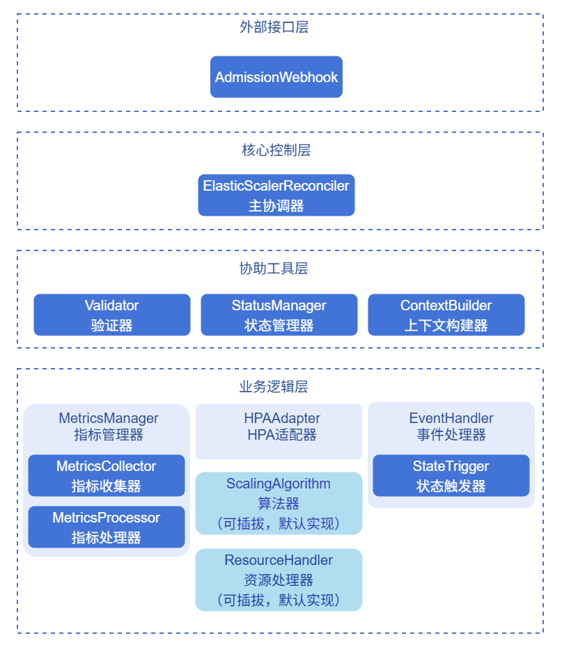
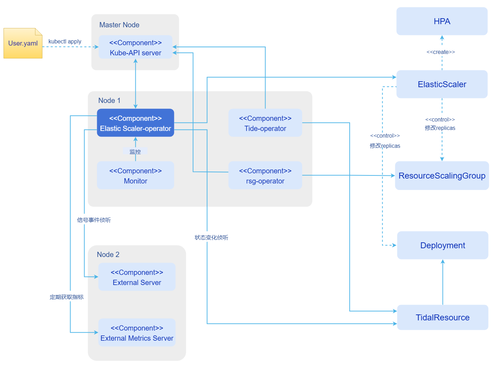

# AI推理弹性伸缩

## 特性介绍

Elastic Scaler是一个通用的扩缩容决策框架，用于满足不同业务场景下的扩缩容决策需求。

- 在架构上，Elastic Scaler采用插件化机制，支持用户自定义扩缩容决策算法及自定义资源管理逻辑的灵活扩展。
- 在能力上，Elastic Scaler同时支持指标驱动与事件驱动两类扩缩语义，其中事件驱动主要服务于资源需求有显著波动或突发变化的业务场景。

### 应用场景

Elastic Scaler适用于在Kubernetes集群环境中部署各类业务服务并需要动态资源管理的场景，具体包括：

- **动态负载场景**：请求量随时间波动较大，需要根据实际负载动态调整服务实例数量。
- **成本优化场景**：在保证服务性能的前提下，通过智能伸缩降低资源成本，提高资源利用率。
- **混合负载场景**：长短请求混合、并发量变化的业务场景，需要根据请求特征和实例状态进行智能伸缩。
- **多租户场景**：多个租户共享资源，需要根据各租户的SLA要求动态分配资源。
- **PD分离架构**：在Prefill-Decode分离架构下，需要独立调整P端和D端的资源配比。
- **明确副本数场景**：基于外部状态直接指定目标副本数，用于潮汐流量或定时负载切换等需要明确容量目标的场景。

### 能力范围

- 支持用户在K8s集群部署使用。
- 支持指标驱动扩缩（MetricsTrigger）；内置`APA`算法，兼容`HPA`算法。
- 支持事件驱动扩缩（StateTrigger）。
- 支持`Resource`、`External`、`ExternalServer`、`Custom`四类指标（HPA路径不支持`ExternalServer`）。
- 支持自定义伸缩算法插件开发与注册调用。
- 支持自定义资源插件开发（通过ResourceScalingGroup）。
- 兼容K8s原生HPA能力。

> **注意**：
> - MetricsTrigger下`scalingAlgorithm`为`HPA`时，指标类型支持`Resource`、`External`、`Custom`，不支持`ExternalServer`。
> - 使用`External`、`Custom`指标时，集群需部署并可用对应的Metrics API（如`external.metrics.k8s.io`、`custom.metrics.k8s.io`）；使用`ExternalServer`时需确保指标端点可达且`query`可正确返回数值。

### 亮点特征

- **插件化架构**：支持对扩缩容决策算法的插件化接入，使用户能够根据业务特性灵活定义和演进扩缩算法。
- **多触发模式**：支持指标驱动（MetricsTrigger）与状态驱动（StateTrigger）两类扩缩语义。
- **多指标体系**：支持多种来源的指标（Resource、External、ExternalServer、Custom）作为扩缩决策输入。
- **泛资源管理能力**：不再局限于特性资源类型，通过Resource插件机制支持任意自定义资源接入扩缩体系。
- **K8s原生集成**：基于K8s HPA（Horizontal Pod Autoscaler）和自定义资源扩展，完全兼容K8s生态。

### 实现原理
**图1** 组件架构图




**图2** 组件部署视图



Elastic Scaler通过统一的Trigger抽象管理不同类型的扩缩容触发源。根据配置的Trigger类型，框架会选择不同的执行路径：

1. **MetricsTrigger（指标驱动）**：在自定义算法路径下，由`ContextBuilder`组装指标与算法上下文，由`MetricsManager`完成指标采集与稳定化，再经伸缩算法计算目标副本数并更新目标资源；在HPA算法路径下，由`HPAAdapter`创建并维护K8s HPA资源，实际扩缩决策由集群HPA Controller执行。两模块的职责与协作关系见下文[ContextBuilder模块](#contextbuilder模块)与[MetricsManager模块](#metricsmanager模块)。
2. **StateTrigger（状态驱动）**：Elastic Scaler侦听外部资源的状态变化，读取外部资源`status.desiredReplicas`字段，并将该值应用到目标资源。适用于潮汐流量、定时负载切换等场景。
  具体流程如下: 
    1. 外部控制器（如Tidal）计算期望副本数，并写入外部资源的`status.desiredReplicas`字段。
    2. 外部资源通过标签绑定到ElasticScaler（`elasticscaler.io/namespace`和`elasticscaler.io/name`）。
    3. Elastic Scaler侦听外部资源的状态变化，读取`status.desiredReplicas`字段。
    4. Elastic Scaler将期望副本数应用到目标资源。

从架构上看，Elastic Scaler划分为外部接口层、核心控制层、协调工具层与业务逻辑层。`ElasticScalerReconciler`位于核心控制层，负责驱动一次完整的协调流程；`ContextBuilder`位于协调工具层，为各执行组件提供统一上下文；`MetricsManager`位于业务逻辑层，专责指标驱动模式下的指标采集与稳定化处理。相较早期通过独立`MetricsAdapter`对外暴露`external.metrics.k8s.io`的方案，当前实现将`MetricsCollector`收敛为框架内部组件，由`MetricsManager`统一编排，降低组件职责重叠。

#### ContextBuilder模块

<a id="contextbuilder模块"></a>

`ContextBuilder`是跨组件交互的上下文管理服务，负责将`ElasticScaler`CR配置、运行态数据与策略参数组装为统一上下文对象，避免控制器、指标模块与算法模块之间的直接耦合。

**主要职责**

- **指标链路**：通过`BuildMetricsContext`构建`MetricsContext`，汇聚Pod列表、`ElasticScaler`标识（namespace/name）、`spec.trigger.metricsTrigger.metrics`中的指标规格、指标处理策略（`MetricsPolicyConfig`）以及本轮采集时间锚点，供`MetricsManager`及其子模块在同一轮协调中共享。
- **算法决策**：通过`BuildScalingAlgorithmContext`构建`ScalingAlgorithmContext`，在`MetricsManager`返回稳定化指标后，注入处理后指标、算法名称与`algorithmConfig`、副本上下界（`minReplicas`/`maxReplicas`）、当前副本数与上次扩缩时间等，供`ScalingAlgorithm`计算期望副本数。

**指标处理策略（MetricsPolicyConfig）**

指标稳定化参数在`BuildMetricsContext`阶段由`ContextBuilder`统一解析并注入`MetricsContext`，确保同一轮协调内`MetricsProcessor`策略一致。用户可在`ElasticScaler`对象的`metadata.annotations`中配置下列键（未配置或配置非法时回退内置缺省值）：

**表1** 指标处理策略注解说明

| 注解键 | 说明 |
|--------|------|
| `elasticscaler.io/metrics.windowSeconds` | 滑动统计窗口长度（秒） |
| `elasticscaler.io/metrics.aggregationType` | 窗口内聚合方式 |
| `elasticscaler.io/metrics.missingDataPolicy` | 缺失样本处理策略 |
| `elasticscaler.io/metrics.gcFactor` | 历史样本回收系数，与窗口配合控制内存占用 |
| `elasticscaler.io/metrics.enableOutlierFilter` | 是否启用异常值过滤 |
| `elasticscaler.io/metrics.outlierThreshold` | 异常值判定阈值 |

#### MetricsManager模块

<a id="metricsmanager模块"></a>

`MetricsManager`是指标链路的统一协调入口，仅在**MetricsTrigger**路径且由框架内完成指标采集与算法决策时发挥作用（典型为自定义算法路径）。对外暴露`GetMetrics`，对内固定串联`MetricsCollector`（采集）与`MetricsProcessor`（稳定化），屏蔽`Resource`、`External`、`ExternalServer`、`Custom`等指标类型在采集实现上的差异。

**子模块职责**

- **MetricsCollector**：按`MetricsContext`中的指标规格并发采集原始样本。`Resource`/`External`/`Custom`类型通过API Server查询；`ExternalServer`类型访问外部指标服务（如Prometheus）。采集采用有界并发（默认最多10路）与单指标超时（默认5秒），避免慢指标拖垮整轮协调；结果拆分为成功样本（`Raw`）与失败明细（`Failures`）。
- **MetricsProcessor**：在`[CollectionTime - WindowSeconds, CollectionTime]`时间窗口内对原始样本做时间归一化、滑动窗口聚合、缺失值处理与可选异常值过滤，输出`ProcessedMetricsValue`（指标名 + 稳定值），供算法消费；并按`GCFactor`回收长期不活跃的对象-指标键，防止缓存无限增长。

**与ContextBuilder及控制器的协作**

在一次MetricsTrigger协调中，指标相关主路径如下：

1. `ElasticScalerReconciler`调用`ContextBuilder.BuildMetricsContext`，得到`MetricsContext`。
2. 调用`MetricsManager.GetMetrics(metricsContext)`：内部先`CollectMetrics`再`ProcessMetrics`。
3. 若存在采集失败项，`GetMetrics`在返回处理后指标的同时附带`MetricsDetail.CollectFailures`，控制器据此更新状态（部分成功语义：成功样本仍进入算法，失败项写入状态便于排查）。
4. `ContextBuilder.BuildScalingAlgorithmContext`将处理后指标与副本信息封装为`ScalingAlgorithmContext`。
5. `ScalingAlgorithm`基于该上下文计算期望副本数，再由`ResourceHandler`应用到目标资源。

> **说明**：<br/>
> - 使用**HPA**算法时，扩缩决策由K8s HPA Controller执行，不经过上述`MetricsManager`→`ScalingAlgorithm`的完整链路；Elastic Scaler主要负责HPA资源生命周期管理与状态映射。
> - 使用**APA**等内置或注册的自定义算法时，由`MetricsManager`采集并稳定化指标，再经`AlgorithmManager.CalculateDesiredReplicas`计算副本并由`ResourceHandler`执行扩缩。

### 与相关特性的关系

- **EagleEye**：兼容EagleEye提供的推理服务近实时监控指标，包括业务运行态、系统运行态、硬件健康等不同粒度的关键指标。当前版本尚未实现与EagleEye的集成。
- **Tidal**：兼容Tidal组件，使用潮汐算法时Tidal通过`status.desiredReplicas`字段表达明确的容量目标，Elastic Scaler负责执行。
- **ResourceScalingGroup**：兼容ResourceScalingGroup CRD，使用自定义资源插件接入决策框架，用于AI资源精细化管理。

## 安装

本章节分别介绍在已有集群中独立部署Elastic Scaler，以及通过InferNex套件集成部署Elastic Scaler的方法。

### 独立部署

本节介绍如何在已有推理服务和监控组件的K8s集群中，独立部署Elastic Scaler。

#### 前提条件

在开始安装前，请确保满足以下条件：

- **环境要求**:

  - Kubernetes集群：v1.28.0及以上版本。
  - 集群管理员权限：用于安装CRD和集群级资源。
  - Helm工具：用于部署Elastic Scaler和相关组件。

- **硬件要求**:

  - Elastic Scaler本身对硬件环境无特殊要求，作为轻量级控制器组件，可运行在标准x86或ARM架构的节点上。

#### 安装Elastic Scaler

执行如下命令，安装Elastic Scaler。

```bash
helm install elastic-scaler oci://cr.openfuyao.cn/charts/pd-orchestrator --version 0.0.0-latest
```
从OCI仓库安装pd-orchestrator chart。该chart默认会安装ElasticScaler、RSG和Tidal三个组件，并默认创建一份RSG CR和ElasticScaler CR实例配置。

如果当前仅需部署ElasticScaler Controller，建议显式关闭其他组件和默认示例实例：

```bash
helm install elastic-scaler oci://cr.openfuyao.cn/charts/pd-orchestrator --version 0.0.0-latest \
  --set elastic-scaler.enabled=true \
  --set elastic-scaler.elasticScaler.enabled=false \
  --set resourcescalinggroup.enabled=false \
  --set resourcescalinggroup.instanceConfig.enabled=false \
  --set tidal.enabled=false
```

> **说明**：<br/>
> - 部署Elastic Scaler时需要正确配置监控数据源和伸缩目标。
> - ElasticScaler CR需要配置正确的目标资源（Deployment、StatefulSet等）和Trigger配置。
> - 伸缩策略的详细配置请参考[配置伸缩策略](#配置伸缩策略)章节。

### InferNex集成部署

InferNex是一键集成的智能路由、监控与弹性伸缩部署套件， 内部包含elastic-scaler组件。

#### 前提条件

* Kubernetes v1.28.0及以上版本。
* 每个推理节点至少一张推理芯片。
* 每个推理节点至少16GB内存，4CPU核。
* 在线安装能够访问镜像仓库：oci://cr.openfuyao.cn。
* 用户具备创建RBAC资源的权限。

#### 快速安装InferNex

InferNex有以下两种途径独立部署：

- 从openFuyao官方制品仓库获取项目安装包。

  1. 从远端仓库安装。

      ```bash
      helm install infernex oci://cr.openfuyao.cn/charts/infernex --version xxx 
      ```
      其中`xxx`需替换为具体项目安装包版本，如`0.21.1`，`infernex`为release名称。

      执行安装前请确保：
      - 集群已创建命名空间`istio-system`（Istio Gateway资源必须部署在此命名空间）和`scaling-system`。

- 从openFuyao GitCode仓库获取。

  1. 从仓库拉取项目。

      ```bash
      git clone https://gitcode.com/openFuyao/InferNex.git
      ```

  2. 安装部署。

      以release名称`infernex`为例，在`InferNex`同级目录下执行如下命令：
      ```bash
      cd InferNex/charts/infernex
      helm dependency build
      helm install -n <namespace> infernex .
      ```

## 配置伸缩策略

本章节说明如何为不同业务场景配置Elastic Scaler的伸缩策略。

无论选择哪种触发方式，创建或更新`ElasticScaler`时都会经过准入校验（AdmissionWebhook）；控制器在协调过程中还会结合集群实际状态做补充校验（Validator）。具体规则与排查方式请参见[指标驱动扩缩（MetricsTrigger）](#metrics-trigger-admission-validator)、[事件驱动扩缩（StateTrigger）](#state-trigger-admission-validator)。

### 指标驱动扩缩（MetricsTrigger）

指标驱动扩缩基于实时指标变化自动调节副本数，适用于持续运行、负载平滑变化的业务场景。

#### 指标处理策略注解配置

指标稳定化策略通过`ElasticScaler`的`metadata.annotations`下发，由[ContextBuilder模块](#contextbuilder模块)在`BuildMetricsContext`阶段解析并注入`MetricsContext`，供`MetricsManager`的`MetricsProcessor`在同一轮协调中使用。注解键名、含义及架构说明见上文[指标处理策略（MetricsPolicyConfig）](#contextbuilder模块)；下列YAML为**注解配置示例**（可与自定义算法或HPA配置组合使用；策略主要作用于框架内指标采集与稳定化链路，HPA模式下实际扩缩仍由集群HPA Controller执行）。

```yaml
apiVersion: elasticscaler.io/v1alpha1
kind: ElasticScaler
metadata:
  name: metrics-policy-example
  namespace: ai-inference
  annotations:
    # 滑动统计窗口（秒），须为正整数；未配置或非法时默认 60
    elasticscaler.io/metrics.windowSeconds: "120"
    # 窗口内聚合方式：Average / Max / Min / P90（大小写不敏感）
    elasticscaler.io/metrics.aggregationType: "Max"
    # 缺失样本策略：Ignore / TreatAsZero / Fail（大小写不敏感）
    elasticscaler.io/metrics.missingDataPolicy: "ignore"
    # 历史样本回收系数，须为正整数；未配置或非法时默认 5
    elasticscaler.io/metrics.gcFactor: "8"
    # 是否启用异常值过滤：true / false
    elasticscaler.io/metrics.enableOutlierFilter: "true"
    # 异常值判定阈值，须为正浮点数；未配置或非法时默认 1.5
    elasticscaler.io/metrics.outlierThreshold: "2.5"
spec:
  targetRef:
    apiVersion: apps/v1
    kind: Deployment
    name: vllm-inference

  minReplicas: 2
  maxReplicas: 10

  trigger:
    type: MetricsTrigger
    metricsTrigger:
      # 示例与内置 APA 算法配合；亦可替换为 HPA 或其他已注册算法名
      scalingAlgorithm: APA
      metrics:
      - type: Resource
        resource:
          metricsName: cpu
          target:
            type: Utilization
            averageUtilization: 70
```

**表2** 指标处理策略注解取值与缺省值

| 注解键 | 取值说明 | 缺省值 |
|--------|----------|--------|
| `elasticscaler.io/metrics.windowSeconds` | 正整数，滑动窗口长度（秒） | `60` |
| `elasticscaler.io/metrics.aggregationType` | `Average`、`Max`、`Min`、`P90`（大小写不敏感） | `Average` |
| `elasticscaler.io/metrics.missingDataPolicy` | `Ignore`、`TreatAsZero`、`Fail`（大小写不敏感） | `Ignore` |
| `elasticscaler.io/metrics.gcFactor` | 正整数，与窗口配合回收长期不活跃样本 | `5` |
| `elasticscaler.io/metrics.enableOutlierFilter` | `true`或`false` | `false` |
| `elasticscaler.io/metrics.outlierThreshold` | 正浮点数，启用异常值过滤时生效 | `1.5` |

> **说明**：<br/>
> - 单个注解取值非法时，该键会被忽略并回退为对应缺省值，不会导致`ElasticScaler`创建失败。
> - 仅配置部分注解时，未配置的项使用上表缺省值。

#### 使用HPA算法

HPA算法基于CPU/内存使用率进行伸缩，利用K8s原生HPA能力。

> **说明**：<br/>
> - Elastic Scaler在HPA算法模式下会自动创建并管理对应的Kubernetes HPA资源。
> - 若将伸缩算法从HPA切换至其他模式（如自定义算法），必须先删除Elastic Scaler实例或手动清理已生成的HPA资源，否则会导致资源管理冲突。
> - Elastic Scaler与被管理资源（Deployment、StatefulSet等）需保持一对一映射关系。
> - HPA模式下，Elastic Scaler与被管理资源必须部署在同一命名空间内。

```yaml
apiVersion: elasticscaler.io/v1alpha1
kind: ElasticScaler
metadata:
  name: hpa-scaling-example
  namespace: ai-inference
spec:
  # 伸缩目标
  targetRef:
    apiVersion: apps/v1
    kind: Deployment
    name: vllm-inference

  # 最小/最大副本数
  minReplicas: 2
  maxReplicas: 10

  # 指标驱动触发配置
  trigger:
    type: MetricsTrigger
    metricsTrigger:
      # 使用HPA算法
      scalingAlgorithm: HPA

      # 指标配置
      metrics:
      - type: Resource
        resource:
          metricsName: cpu
          target:
            type: Utilization
            averageUtilization: 70
```

**表3** HPA策略参数说明

| 参数 | 类型 | 说明 | 缺省值 |
|------|------|------|------|
| `type` | string | Trigger类型，必须设置为`MetricsTrigger`。 | - |
| `scalingAlgorithm` | string | 伸缩算法，设置为`HPA`使用K8s原生HPA。 | - |
| `metrics[].type` | string | 指标类型，支持`Resource`、`External`、`Custom`；不支持`ExternalServer`。 | - |
| `metrics[].resource.metricsName` | string | 资源指标名称（cpu/memory）。 | - |
| `metrics[].resource.target.type` | string | 目标类型（Utilization/Value/AverageValue）。 | - |
| `metrics[].resource.target.averageUtilization` | int | 目标平均使用率（百分比）。 | - |

#### 使用自定义算法

当`scalingAlgorithm`不为`HPA`时，Elastic Scaler在控制器内完成指标采集、稳定化、副本计算与资源更新，不再创建K8s HPA对象。框架内置**APA**（Average Pod Autoscaling）算法，算法名大小写不敏感；`scalingAlgorithm`留空时默认使用`APA`。用户亦可实现`ScalingAlgorithm`接口并注册到`DefaultAlgorithmManager`，在CR中通过`scalingAlgorithm`指定算法名即可调用。

**表4** 内置APA算法`algorithmConfig`常用参数

| 参数 | 类型 | 说明 | 缺省值 |
|------|------|------|--------|
| `upTolerance` | float | 扩容触发的利用率上浮容差 | `0.1` |
| `downTolerance` | float | 缩容触发的利用率下浮容差 | `0.1` |
| `maxScaleUpRate` | float | 单次扩容倍率上限（≥1） | `2.0` |
| `maxScaleDownRate` | float | 单次缩容倍率下限（≥1） | `2.0` |
| `scaleDownDampingFactor` | float | 缩容阻尼系数，取值`[0,1]` | `0.0` |

下列示例使用内置`APA`算法，并通过`ExternalServer`从Prometheus查询业务指标（`query`字段用于承载PromQL，与oFEP-0044增强语义一致）：

```yaml
apiVersion: elasticscaler.io/v1alpha1
kind: ElasticScaler
metadata:
  name: custom-scaling-example
  namespace: ai-inference
  annotations:
    elasticscaler.io/metrics.windowSeconds: "120"
    elasticscaler.io/metrics.aggregationType: "Max"
spec:
  targetRef:
    apiVersion: apps/v1
    kind: Deployment
    name: vllm-inference

  minReplicas: 2
  maxReplicas: 10

  trigger:
    type: MetricsTrigger
    metricsTrigger:
      scalingAlgorithm: APA
      algorithmConfig:
        upTolerance: "0.1"
        downTolerance: "0.1"
        maxScaleUpRate: "2.0"
        maxScaleDownRate: "2.0"
      metrics:
      - type: ExternalServer
        externalServer:
          metricsName: inference_qps
          target: "100"
          endpoint: "http://prometheus.monitoring.svc:9090/api/v1/query"
          query: "sum(rate(http_requests_total{job=\"vllm\"}[1m]))"
          protocol: http
```

**表5** 自定义算法（非HPA）策略参数说明

| 参数 | 类型 | 说明 | 缺省值 |
|------|------|------|--------|
| `scalingAlgorithm` | string | 算法名称；内置`APA`，或已注册插件名（大小写不敏感）。留空时默认`APA`。 | `APA` |
| `algorithmConfig` | map | 算法参数，键值均为字符串；APA见上表，插件自定义。 | - |
| `metrics[].type` | string | 指标类型：`Resource`、`External`、`ExternalServer`、`Custom`。 | - |
| `metrics[].resource` | object | `type=Resource`时必填，`metricsName`与K8s `MetricTarget`。 | - |
| `metrics[].external` | object | `type=External`时必填，`metricsName`、`target`与可选`selector`。 | - |
| `metrics[].externalServer` | object | `type=ExternalServer`时必填；含`metricsName`、`target`、`endpoint`、可选`query`与`protocol`。 | - |
| `metrics[].custom` | object | `type=Custom`时必填；对接`custom.metrics.k8s.io`。 | - |

<a id="metrics-trigger-admission-validator"></a>

#### AdmissionWebhook与Validator补充说明

**AdmissionWebhook（创建/更新时）**

- 使用`kubectl apply`、`kubectl create`或`kubectl edit`向集群提交`ElasticScaler`资源时，若`spec`校验未通过，API Server会拒绝该请求；常见错误提示为“admission webhook denied the request”。返回信息中会给出具体字段路径（如`spec.trigger.metricsTrigger`、`invalid metric at index N`），请据此修改您用于创建或更新该实例的`ElasticScaler` CR清单YAML（即通过上述命令提交的那份配置文件，而非集群内其他无关清单）。
- 与**MetricsTrigger**相关的规格要求包括：
  - `spec.trigger.type`为`MetricsTrigger`时，只能配置`spec.trigger.metricsTrigger`，不要同时填写`stateTrigger`。
  - `scalingAlgorithm`不能为空；`metrics`至少包含一条指标。
  - 每条`metrics[]`需按`type`只填对应子结构（`Resource`/`External`/`ExternalServer`），且必填字段齐全；若`scalingAlgorithm`为`HPA`，不能使用`ExternalServer`类型指标，否则会提示某条metric不合法。
- 以下字段**所有触发方式**都会校验：`spec.targetRef`的`apiVersion`、`kind`、`name`必填；`minReplicas`/`maxReplicas`取值合法且`maxReplicas >= minReplicas`；`spec.trigger.type`须为`MetricsTrigger`或`StateTrigger`。

**Validator（控制器运行中）**

- 准入通过后，控制器仍会校验：填写的`targetRef`在集群中是否**真实存在**；是否已有**另一个**`ElasticScaler`管理同一`targetRef`（需保持一对一）。
- 若`scalingAlgorithm`**不是**`HPA`，控制器会检查该算法名是否已在运行环境中**注册**；未注册时，对象可能创建成功，但会在`.status.conditions`中出现`Validated=False`、`reason=ValidationFailed`。
- 请执行命令`kubectl describe elasticscalers <名称> -n <命名空间>`，查看`type=Validated`条件；校验失败时，`message`字段中的说明即为原因。

### 事件驱动扩缩（StateTrigger）

状态驱动扩缩基于外部资源状态变化触发，适用于潮汐流量、定时负载切换等需要明确容量目标的场景。
```yaml
apiVersion: tidal.io/v1alpha1
kind: Tidal
metadata:
  name: tidal-frequent-test
  namespace: ai-inference
  labels:
    elasticscaler.io/name: state-scaling-example
    elasticscaler.io/namespace: ai-inference
spec:
  targetRef:
    apiVersion: apps/v1
    kind: Deployment
    name: elastic-scaler-state-test   # 改成你要伸缩的 Deployment 名称
    namespace: ai-inference
  triggers:
    times:
      rules:
        - name: time1
          cron: "CRON_TZ=Asia/Shanghai 0 50 16 * * *"
          replicas: 3
          description: time1     
        - name: time2
          cron: "CRON_TZ=Asia/Shanghai 0 0 8 * * *"
          replicas: 5
          description: time2
```
```yaml
apiVersion: elasticscaler.io/v1alpha1
kind: ElasticScaler
metadata:
  name: state-scaling-example
  namespace: ai-inference
spec:
  # 伸缩目标
  targetRef:
    apiVersion: tidal.io/v1alpha1
    kind: Tidal
    name: tidal-frequent-test

  # 状态驱动触发配置
  trigger:
    type: StateTrigger
    stateTrigger: {}
```

**表6** StateTrigger参数说明

| 参数 | 类型 | 说明 | 缺省值 |
|------|------|------|--------|
| `type` | string | Trigger类型，必须设置为`StateTrigger`。 | - |
| `stateTrigger` | object | 状态驱动配置，当前版本为空对象。 | - |

<a id="state-trigger-admission-validator"></a>

#### AdmissionWebhook与Validator补充说明

**AdmissionWebhook（创建/更新时）**

- 当`spec.trigger.type`为`StateTrigger`时，必须配置`spec.trigger.stateTrigger`（允许写成空对象`{}`）；不要同时配置`metricsTrigger`。
- 如与上述结构不一致，创建或更新会被拒绝，错误信息中通常会出现`stateTrigger`或`only stateTrigger`等提示。

**Validator（控制器运行中）**

- 除与所有模式相同的校验外（`targetRef`指向的资源必须存在、同一`targetRef`只能被一个`ElasticScaler`管理），**StateTrigger**还要求：`targetRef`指向的资源在集群中已有**`status`**，且`status`下至少具备**`replicas`**或**`desiredReplicas`**之一（供状态驱动读取期望副本）。若外部控制器尚未写入状态，可能出现`Validated=False`。
- 同样请执行命令`kubectl describe elasticscalers <名称> -n <命名空间>`，查看`Validated`条件，并根据`message`字段排查原因。

## 使用弹性伸缩

本章节演示如何在集群中查看、监控和管理Elastic Scaler的伸缩行为。

### 查看伸缩策略

```bash
# 查看所有ElasticScaler资源
kubectl get elasticscalers -n <NAMESPACE>

# 查看特定ElasticScaler详情
kubectl describe elasticscalers <SCALER_NAME> -n <NAMESPACE>
```

### 查看伸缩事件

```bash
# 查看伸缩事件
kubectl get events -n <NAMESPACE> --field-selector involvedObject.kind=ElasticScaler

# 查看控制器日志
kubectl logs -n <NAMESPACE> -l control-plane=<RELEASE-NAME>-elastic-scaler-controller-manager -f 
```

### 禁用/启用伸缩策略

Elastic Scaler通过删除CR来禁用伸缩策略，创建CR来启用。

```bash
# 禁用伸缩策略（删除CR）
kubectl delete elasticscalers <SCALER_NAME> -n <NAMESPACE>

# 启用伸缩策略（创建CR）
kubectl apply -f <elastic-scaler-config>.yaml
```


### 常见问题

1. **支持哪些类型的指标？**

MetricsTrigger下支持四类指标：`Resource`（CPU/内存等）、`External`（`external.metrics.k8s.io`）、`Custom`（`custom.metrics.k8s.io`）、`ExternalServer`（HTTP/HTTPS访问外部指标服务，支持`query`承载PromQL）。其中HPA算法路径不支持`ExternalServer`；非HPA路径（如内置`APA`）四类均可配置，具体采集依赖集群Metrics API或外部端点可用性。

2. **如何调测伸缩策略？**

可通过`kubectl describe elasticscalers`查看`Validated`、`MetricsPipeline`、`ScalingCalculated`等条件，结合Controller日志与K8s事件排查。非HPA路径下，`MetricsPipeline`会反映指标采集是全量成功还是部分成功（`MetricsPartialSuccess`）。

3. **StateTrigger如何工作？**

StateTrigger模式下，外部控制器（如Tidal）计算期望副本数并写入外部资源的`status.desiredReplicas`字段。Elastic Scaler侦听外部资源的状态变化，读取该字段并应用到目标资源。外部资源需要通过标签`elasticscaler.io/namespace`和`elasticscaler.io/name`绑定到ElasticScaler。

4. **如何开发自定义伸缩算法？**

框架内置`APA`算法，可直接将`scalingAlgorithm`设为`APA`（或留空使用默认）。若需扩展，实现`ScalingAlgorithm`接口并通过`DefaultAlgorithmManager.RegisterAlgorithm()`注册后，在CR的`scalingAlgorithm`字段填写注册名即可；控制器经`AlgorithmManager.CalculateDesiredReplicas`调用。详细步骤见[插件开发指南](../developer_guide/ai_inference_elastic_scaling_plugin_in_development_guide.md)。

5. **HPA与APA（自定义算法路径）如何切换？**

自定义伸缩算法需要实现`ScalingAlgorithm`接口，并通过`DefaultRegistry.Register()`方法注册算法。详细开发指南请参考[插件开发指南](../developer_guide/ai_inference_elastic_scaling_plugin_in_development_guide.md)。

将`scalingAlgorithm`从`HPA`改为非`HPA`算法（或反向）前，建议先删除`ElasticScaler`实例，或手动清理残留的HPA资源，避免OwnerReference与副本管理冲突。切换后非HPA路径会由控制器直接更新目标资源副本。

6. **如何支持自定义资源类型？**

通过实现`ResourceHandler`接口并使用`RegisterResourceHandler()`方法注册，可以支持任意自定义资源类型。自定义资源需要实现`GetCurrentReplicas()`、`UpdateReplicas()`等方法。
