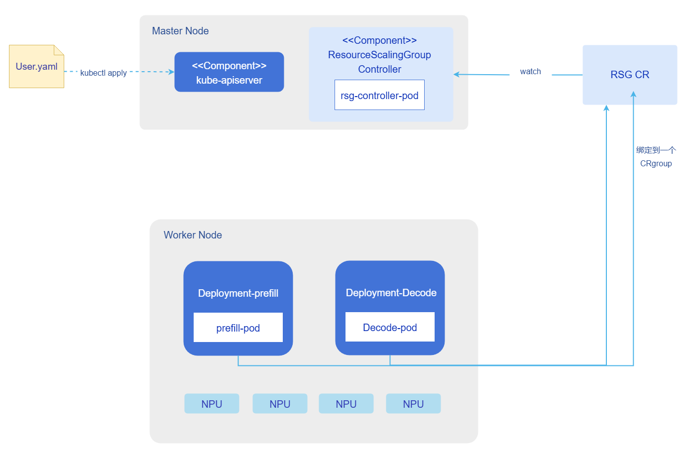
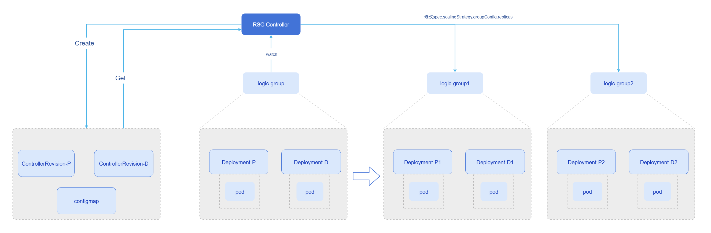
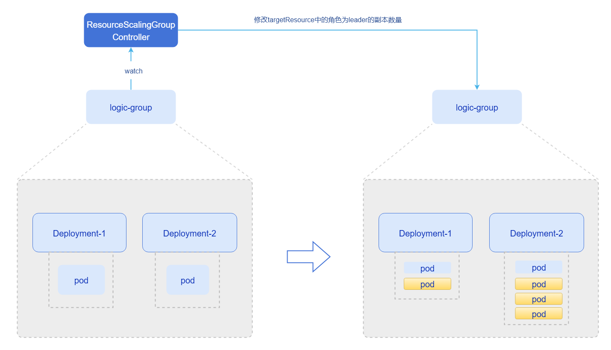
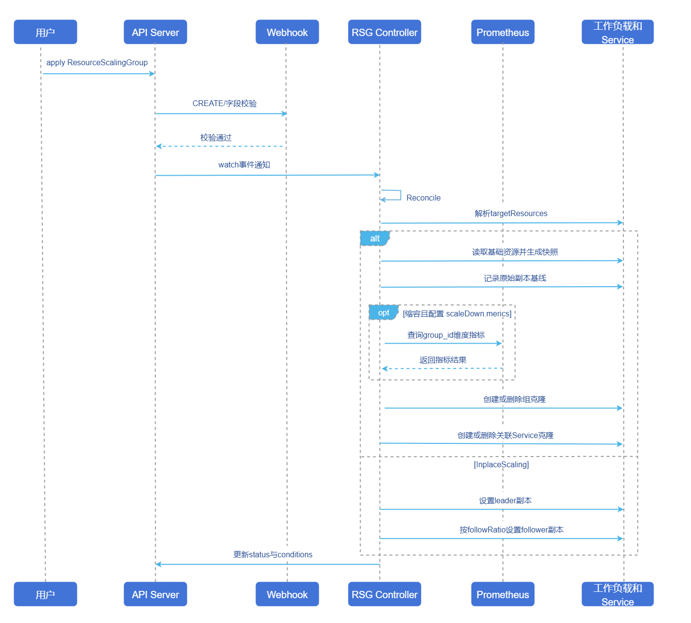

# ResourceScalingGroup-资源组扩缩容

## 特性介绍

ResourceScalingGroup（下文简称RSG）是面向Kubernetes工作负载分组扩缩容场景的控制器。它把多个相关工作负载抽象成一个逻辑组，由一个自定义资源统一描述扩缩策略，并负责将策略落实到具体资源上。当前实现提供两种扩缩容策略：

- `GroupReplication`：以一组基础工作负载为模板，按“组”进行复制、恢复和缩容，适合需要整体克隆一套完整推理链路或者Prefill-Decode分离架构下需要成组扩缩容的场景。
- `InplaceScaling`：以leader资源的replicas值为基准，按比例扩缩follower资源的副本数，适合Prefill-Decode分离架构下，Prefill-Decode组按固定比例协同扩缩场景。

RSG直接面向资源编排层，不负责复杂业务指标综合决策。对于`GroupReplication`场景，它暴露标准的`scale`子资源，并可作为HPA、ElasticScaler、TidalScheduler等上层策略的目标对象，由上层策略决定“要扩到多少组”，再由RSG执行组内资源编排。

### 应用场景

- 大模型推理链路中prefill、decode、gateway等多个组件需要按组整体扩缩容。
- 一套业务单元包含多个Deployment、StatefulSet或LeaderWorkerSet，希望一次性复制为多组独立实例。
- 业务副本数存在一定的比例关系，即leader资源的副本数变化后，需要follower资源按固定比例同步调整。
- 需要纳管集群当中的存量业务，对已部署资源赋予扩缩容能力。
- 当业务需要缩容释放算力资源时，可根据业务指标进行优雅缩容，使得对业务影响最小。

### 能力范围

- 基于标准CRD ResourceScalingGroup管理一组目标资源，目标资源至少为1个。
- 支持管理Deployment、StatefulSet、LeaderWorkerSet工作负载。
- 支持`GroupReplication`组扩缩策略，按“资源组”扩容和缩容，自动管理工作负载克隆与关联Service克隆。
- 支持`InplaceScaling`原地扩缩策略，按`leader.replicas * followRatio`计算`follower`副本。
- 支持在组缩容时接入Prometheus指标，按指标值排序选择优先回收的组。
- 支持Prometheus不可用或指标不完整时降级到注解值、再降级到最大group-id的缩容选择逻辑。
- 在`GroupReplication`策略下，暴露`scale`子资源，允许上层控制器例如HPA通过标准扩缩接口驱动组数变更。
- 通过Webhook校验重复目标、非法引用、角色配置错误、leader/follower关系错误等常见配置问题。

### 亮点特征

- **把“资源组”作为扩缩对象**：上层决策系统不必分别操作多个Deployment或StatefulSet资源，只需要面向一个RSG资源。
- **同时覆盖两类典型编排模式**：既支持整组资源扩缩，也支持Pod数量按照leader/follower比例联动，覆盖面比单纯副本扩缩更广。
- **支持与上层策略解耦组合**：GroupReplication暴露scale子资源，可以挂接HPA、ElasticScaler、TidalScheduler等外部策略。
- **对缩容过程有明确的可观测与降级机制**：优先按Prometheus指标缩容，失败后自动降级，不因单点指标问题导致缩容失败。

### 实现原理

本章节从部署视图、运行视图以及两种扩缩策略的示意图等方面说明ResourceScalingGroup的实现原理。

#### 部署视图

**图1** RSG部署视图



从组件部署形态来看，RSG controller以deployment的形式部署，通过一个RSG CR资源，将Prefill和Decode资源绑定为一个组。扩容时以组粒度进行扩容， 会创建新的Deployment-Prefill和Deployment-Decode资源副本，如下`GroupReplication`组扩缩策略示意图所示：

**图2** GroupReplication策略下的扩缩示意图



控制器将Prefill和Decode资源纳管后，会创建对应资源的ControllerRevision快照和可动态修改Pod数量的ConfigMap。在扩容时根据快照的配置信息进行资源副本的创建，此时新增资源的Pod数量应和原始资源的Pod数量保持一致。若需要动态修改新增资源副本的Pod数量比例，可修改ConfigMap文件配置，详情参考[相关操作](#groupreplication-Pod-replicas)。

> **说明**<br/>
> 当前版本RSG根据快照进行副本资源创建，若原始资源组配置更新，快照不会更新，扩容时还是按照旧版快照进行资源创建。若需要新增资源副本按照更新后的原始资源组进行配置，可在扩容前先删除旧的ControllerRevision和ConfigMap资源。

`InplaceScaling`原地扩缩策略示意图如下所示：

**图3** `InplaceScaling`原地扩缩策略示意图



在该模式下，扩缩的是Deployment资源的Pod数量，若Deployment-1作为leader对象，Deployment-2作为follower对象，那么修改Deployment-1的replicas值，可通过`leader.replicas * followRatio`计算`follower`replicas值，达到联动扩缩的目的。

#### 运行视图

RSG的典型运行流程分为四个阶段：

1. 用户提交ResourceScalingGroup CR资源，Webhook对目标资源、策略类型、角色配置和跨组冲突进行校验。
2. Controller根据`scalingStrategy.type`选择策略引擎，并解析每个`targetResources`的实际工作负载。
3. 若为`GroupReplication`，Controller会为基础资源生成快照、记录原始副本基线、补齐组标签和Service，再按目标组数进行创建或缩减；若为`InplaceScaling`，则直接把`leader`和`follower`的副本调整到目标值。
4. Controller回写`status`，上层策略或运维系统可继续根据状态进行观测、审计和联动。

**图4** RSG Controller运行视图



### 与相关特性的关系

**ElasticScaler**：RSG是ElasticScaler的典型扩缩目标之一。ElasticScaler可以把`targetRef`指向`ResourceScalingGroup`，以此管理RSG副本的扩缩容。

**TidalScheduler**：TidalScheduler可以把RSG作为潮汐调度目标，在指定时间点直接调整RSG副本数。

**HPA**：由于RSG对`GroupReplication`暴露了标准`scale`子资源，HPA资源可以直接对RSG资源进行扩缩。

**Prometheus**：Prometheus不是RSG的硬依赖，但如果配置了`scaleDown.metric`，RSG会优先调用Prometheus查询以`group_id`为维度的指标，决定缩容时优先回收的组别。

## 安装

### 独立部署

本节介绍如何在已有推理服务的k8s集群中，独立部署ResourceScalingGroup。

#### 前提条件

在开始安装前，请确保满足以下条件：

- **环境要求**：
  - kubernetes集群：v1.28.0及以上版本。
  - 集群管理员权限：用于安装CRD和集群资源。
  - Helm工具：用于部署ResourceScalingGroup和相关组件。
- **硬件要求**：
  - 无特殊硬件要求。

#### 安装ResourceScalingGroup

执行如下命令，安装ResourceScalingGroup。

```bash
helm install rsg oci://cr.openfuyao.cn/charts/pd-orchestrator --version 0.0.0-latest \
--set resourcescalinggroup.namespace.create=true # 默认是false，如果集群中不包含scaling-system namespace，这里需要设置成true。
```

从OCI仓库安装pd-orchestrator chart。该chart默认会安装ElasticScaler、RSG和Tidal三个组件，并默认创建一份RSG CR和ElasticScaler CR实例配置。

如果当前仅需部署RSG Controller，建议显式关闭其他组件和默认示例实例：

```bash
helm install pd-orchestrator oci://cr.openfuyao.cn/charts/pd-orchestrator --version 0.0.0-latest \
  --set elastic-scaler.enabled=false \
  --set resourcescalinggroup.enabled=true \
  --set resourcescalinggroup.instanceConfig.enabled=false \
  --set tidal.enabled=false \
  --set resourcescalinggroup.namespace.create=true # 默认是false，如果集群中不包含scaling-system namespace，这里需要设置成true。
```

#### 关键参数说明

**表1** helm包安装参数说明

| 参数键 | 说明 |
| --- | --- |
| `resourcescalinggroup.enabled` | 在orchestrator chart中控制是否部署RSG Controller。 |
| `resourcescalinggroup.instanceConfig.enabled` | 控制是否创建默认RSG示例CR。生产环境建议显式设为false。 |
| `resourcescalinggroup.namespace.name` | RSG Controller部署所在命名空间，默认是scaling-system。 |
| `resourcescalinggroup.namespace.create` | 默认不创建scaling-system namespace，如果集群中不包含`scaling-system` namespace，这里需要设置成true。 |
| `resourcescalinggroup.prometheus.url` | Prometheus查询地址，供`scaleDown.metric`使用，实际会注入环境变量`RSG_PROMETHEUS_URL`。 |
| `resourcescalinggroup.webhook.enabled` | 控制是否启用RSG的mutating/validating webhook。 |
| `resourcescalinggroup.webhook.failurePolicy` | Webhook失败策略，默认chart中为Ignore。对生产环境可根据风险偏好调整。 |
| `resourcescalinggroup.replicaCount` | RSG Controller Pod副本数。 |
| `elastic-scaler.enabled` | 是否同时部署ElasticScaler，用于把RSG作为上层扩缩目标。 |
| `tidal.enabled` | 是否同时部署TidalScheduler，用于按时间调整RSG组数。 |

> 说明<br/>
>
> `resourcescalinggroup.instanceConfig.enabled=true`时，chart会自动创建一个默认的`ResourceScalingGroup`实例。生产环境通常不建议保留该默认示例，避免它误操作已有业务资源。

### InferNex集成部署

InferNex是一键集成的智能路由、监控与弹性伸缩部署套件，内部包含RSG组件。

#### 前提条件

* Kubernetes v1.28.0及以上版本。
* 每个推理节点至少一张推理芯片。
* 每个推理节点至少16GB内存，4CPU核。
* 在线安装能够访问镜像仓库：oci://cr.openfuyao.cn。
* 用户具备创建RBAC资源的权限。

#### 快速安装InferNex

InferNex有以下两种途径独立部署：

- 从openFuyao官方制品仓库获取项目安装包。

  1. 从远端仓库安装。

      ```bash
      helm install infernex oci://cr.openfuyao.cn/charts/infernex --version xxx 
      ```
      其中`xxx`需替换为具体项目安装包版本，如`0.21.1`，`infernex`为release名称。

      执行安装前请确保：
      - 集群已创建命名空间`istio-system`（Istio Gateway资源必须部署在此命名空间）和`scaling-system`。
  
- 从openFuyao GitCode仓库获取。

  1. 从仓库拉取项目。

      ```bash
      git clone https://gitcode.com/openFuyao/InferNex.git
      ```

  2. 安装部署。

      以release名称`infernex`为例，在`InferNex`同级目录下执行如下命令：
      ```bash
      cd InferNex/charts/infernex
      helm dependency build
      helm install -n <namespace> infernex .
      ```

#### 验证部署

完成安装后，可以通过以下步骤验证RSG Controller是否正常运行。

- 查看Pod状态。

  ```bash
  kubectl get Pods -n scaling-system | grep -E "resourcescalinggroup|rsg"
  ```

- 查看CRD是否安装成功。

  ```bash
  kubectl get crd resourcescalinggroups.autoscaling.openfuyao.com
  ```

- 查看Controller日志。

  ```bash
  kubectl get deploy -n scaling-system
  kubectl logs -n scaling-system deploy/<deployment-name>
  ```

- 如启用了Webhook，确认相关配置对象存在。

  ```bash
  kubectl get validatingwebhookconfigurations | grep resourcescalinggroup
  ```

若部署异常，优先检查以下项目。

- 命名空间是否正确，镜像是否成功拉取。
- Prometheus URL是否可达。
- Webhook证书、caBundle或cert-manager配置是否正确。
- 是否有默认示例CR在误操作现有业务资源。

## 使用ResourceScalingGroup

### 前提条件

- 已按照[安装](#安装)步骤完成ResourceScalingGroup的部署，并且RSG Controller运行正常。
- 集群中已存在待管理的目标工作负载，且目标工作负载的名字与其所在命名空间已确认。
- 如使用`GroupReplication`的按指标缩容能力，Prometheus中需存在带`group_id`标签的指标。
- 如计划让ElasticScaler、TidalScheduler或HPA驱动RSG，请确认当前RSG类型为`GroupReplication`。

### 背景信息

- RSG的`spec.targetResources`定义一组被管理的工作负载，每个目标用`name`作为逻辑引用名，供策略配置引用。
- `GroupReplication`使用`spec.scalingStrategy.groupConfig.replicas`表示期望组数。该值在CRD中同时映射到`scale`子资源，因此上层控制器可以直接把RSG当作可扩缩对象。
- `InplaceScaling`使用`leaderFollowerConfig`定义`leader`与`follower`关系，其中`follower`的目标副本数按`leader.replicas * followRatio`计算。
- 对`GroupReplication`，RSG会为基础资源生成`ControllerRevision`快照，并用`<rsg-name>-replica-config`的`ConfigMap`保存每个目标资源的原始副本基线，用于从0组恢复或创建新组。
- 若配置了`scaleDown.metric`，RSG会构造类似以下PromQL：

  ```text
  avg by (group_id) (demo_metric)
  sum by (group_id) (rate(demo_counter[window]))
  ```

  > 说明<br/>
  > - Gauge默认聚合器为`avg`。
  > - Counter和Histogram需要配置`window`字段，默认聚合器为`sum`。
  > - `metric.type=Gauge`时，计算逻辑是`<aggregator> by (group_id) (<expr>)`，即直接对当前值按`group_id`分组聚合。
  > - `metric.type=Counter`或`metric.type=Histogram`时，计算逻辑是`<aggregator> by (group_id) (rate(<expr>[<window>]))`，即先做窗口内增长速率，再按`group_id`聚合。


### 使用限制

- `scale`子资源只对`GroupReplication`有意义。
- `GroupReplication`创建的新组资源名称遵循`<groupName>-<原始资源名>-<groupID>`，关联Service名称遵循`<原始Service名>-<groupName>-<groupID>`。控制器不会自动规避命名冲突；如果集群中已存在同名资源，创建会失败。
- 组复制产生的新资源会创建在**RSG所在命名空间**。如果基础目标资源位于其他命名空间，需要提前评估跨命名空间模板复制的影响。
- 同一策略类型下，不允许多个RSG同时引用同一目标工作负载。Webhook会校验重复引用，但运维侧仍建议遵循“一个目标由一个RSG管理”的原则。
- 当`GroupReplication`的目标组数降到0时，控制器会把`group 0`的基础资源副本缩到0，而不是删除基础资源对象。
- 删除`GroupReplication`类型RSG时，控制器默认保留已存在的业务资源实例，仅清理快照、配置等控制平面工件；删除RSG CR不等于删除已生成的组资源，若希望彻底清理业务资源，需要用户**按需手工回收**。
- 缩容选择阶段会基于上述每个`group_id`的最终值，按`scaleDown.order`执行排序：`ascending`优先回收较小值，`descending`优先回收较大值。
- 类型枚举是`Counter`、`Gauge`、`Histogram`，如果写成`guage`会被当作非法值。
- 要让`scaleDown.metric`真正生效，Prometheus返回的数据中必须包含`group_id`标签，并且该标签值要能对应到RSG创建出的组编号；如果没有这个标签，RSG会自动退回到降级逻辑，而不是按指标值缩容。详情可参考[相关操作](#groupreplication-scaledown-metric)。
- 用户在使用`GroupReplication`时，即使原始目标资源位于其他命名空间，新组资源和其克隆Service仍会创建在RSG CR所在的命名空间。

### 操作步骤

#### 使用GroupReplication管理一组Prefill-Decode实例

1. 下面的示例将prefill与decode两个Deployment组成一个资源组，初始组数为2，并配置基于Prometheus指标的缩容优先级：

   ```yaml
   apiVersion: autoscaling.openfuyao.com/v1alpha1
   kind: ResourceScalingGroup
   metadata:
     name: llm-Prefill-Decode-group
     namespace: scaling-system
   spec:
     targetResources:
       - name: prefill
         resourceRef:
           apiVersion: apps/v1
           kind: Deployment
           name: llm-prefill
           namespace: production
       - name: decode
         resourceRef:
           apiVersion: apps/v1
           kind: Deployment
           name: llm-decode
           namespace: production
     scalingStrategy:
       type: GroupReplication
       groupConfig:
         groupName: Prefill-Decode
         replicas: 2
         scaleDown:
           metric:
             expr: "vllm:num_requests_running"
             type: Gauge
             aggregator: avg
           order: ascending
   ```

    常用字段说明如下：

    **表2** RSG CR字段说明

    | 字段路径 | 是否必填 | 说明 |
    | --- | --- | --- |
    | `metadata.name` | 是 | RSG资源名称，在命名空间内唯一。 |
    | `metadata.namespace` | 是 | RSG所在命名空间，也是新组资源默认创建的命名空间。 |
    | `spec.targetResources[].name` | 是 | 目标资源逻辑名，供策略配置引用，组内必须唯一。 |
    | `spec.targetResources[].resourceRef.apiVersion` | 是 | 目标工作负载的API版本。 |
    | `spec.targetResources[].resourceRef.kind` | 是 | 目标工作负载类型，如Deployment、StatefulSet、LeaderWorkerSet、RoleBasedGroup。 |
    | `spec.targetResources[].resourceRef.name` | 是 | 目标工作负载名称。 |
    | `spec.targetResources[].resourceRef.namespace` | 否 | 目标工作负载命名空间。为空时默认使用RSG所在命名空间。 |
    | `spec.scalingStrategy.type` | 是 | 策略类型，取值为GroupReplication或InplaceScaling。 |
    | `spec.scalingStrategy.groupConfig.groupName` | 否 | 组名前缀。为空时默认使用RSG名称。 |
    | `spec.scalingStrategy.groupConfig.replicas` | 是 | 期望组数。对GroupReplication同时也是scale子资源的目标值。 |
    | `spec.scalingStrategy.groupConfig.scaleDown.metric.expr` | 否 | 缩容参考指标表达式或指标名。 |
    | `spec.scalingStrategy.groupConfig.scaleDown.metric.type` | 否 | 指标类型：Counter、Gauge、Histogram。 |
    | `spec.scalingStrategy.groupConfig.scaleDown.metric.window` | 条件必填 | 当指标类型为Counter或Histogram时必填。 |
    | `spec.scalingStrategy.groupConfig.scaleDown.metric.aggregator` | 否 | 聚合器：sum、avg、max、min。 |
    | `spec.scalingStrategy.groupConfig.scaleDown.order` | 否 | 缩容排序方向：ascending或descending。 |

2. 创建资源。

    ```bash
    kubectl apply -f llm-Prefill-Decode-group.yaml
    ```

3. 查看状态。

    ```bash
    kubectl get resourcescalinggroup llm-Prefill-Decode-group -n scaling-system -o yaml
    ```

    重点关注以下状态字段：

    - `status.currentReplicas`：当前已观测到的组数。
    - `status.lastDesiredReplicas`：最近一次控制器期望的目标组数。
    - `status.selector`：供`scale`子资源使用的标签选择器。
    - `status.conditions`：如`Ready=True`、`Reason=Reconciled`表示最近一次调和成功。

4. 查看该组创建的资源。

    ```bash
    kubectl get deploy -n scaling-system | grep "-Prefill-Decode-"
    ```

5. 如果需要手工调整组数，可以直接修改RSG。

    ```bash
    kubectl patch resourcescalinggroup llm-Prefill-Decode-group -n scaling-system \
      --type merge \
      -p '{"spec":{"scalingStrategy":{"groupConfig":{"replicas":3}}}}'
    ```

    如果需要由上层策略驱动组数，则可把ElasticScaler、TidalScheduler或HPA指向该RSG，而不是直接指向组内Deployment。

#### 使用InplaceScaling管理leader / follower联动副本

下面的示例将scheduler作为leader，worker和sidecar作为follower。leader固定为3副本，worker按2倍跟随，sidecar按1倍跟随：

```yaml
apiVersion: autoscaling.openfuyao.com/v1alpha1
kind: ResourceScalingGroup
metadata:
  name: leader-follower-rsg
  namespace: scaling-system
spec:
  targetResources:
    - name: scheduler
      resourceRef:
        apiVersion: apps/v1
        kind: Deployment
        name: scheduler
        namespace: production
    - name: worker
      resourceRef:
        apiVersion: apps/v1
        kind: Deployment
        name: worker
        namespace: production
    - name: sidecar
      resourceRef:
        apiVersion: apps/v1
        kind: Deployment
        name: sidecar
        namespace: production
  scalingStrategy:
    type: InplaceScaling
    leaderFollowerConfig:
      leader:
        resourceName: scheduler
        replicas: 3
      follower:
        - resourceName: worker
          followRatio: 2
        - resourceName: sidecar
          followRatio: 1
```

字段说明如下：

**表3** leaderFollowerConfig字段说明

| 字段路径 | 是否必填 | 说明 |
| --- | --- | --- |
| `spec.scalingStrategy.leaderFollowerConfig.leader.resourceName` | 是 | leader对应的`targetResources[].name`。 |
| `spec.scalingStrategy.leaderFollowerConfig.leader.replicas` | 是 | leader的目标副本数。 |
| `spec.scalingStrategy.leaderFollowerConfig.follower[].resourceName` | 是 | follower对应的`targetResources[].name`。 |
| `spec.scalingStrategy.leaderFollowerConfig.follower[].followRatio` | 是 | follower相对leader的副本比例，最小值为1。 |

创建资源。

```bash
kubectl apply -f leader-follower-rsg.yaml
```

查看RSG状态。

```bash
kubectl describe resourcescalinggroup leader-follower-rsg -n scaling-system
```

查看目标资源副本。

```bash
kubectl get deploy scheduler worker sidecar -n production
```

在上述示例中，预期副本关系为：

- scheduler = 3
- worker = 6
- sidecar = 3

### 后续操作

- 根据业务规模变化，定期调整`groupConfig.replicas`、`scaleDown.metric`或`leaderFollowerConfig`。
- 若需要把RSG接入上层策略，优先让上层系统面向RSG调组，而不是直接改组内资源。
- 如需停用某个RSG，可先把组数调到期望值，再评估是否删除CR；对于GroupReplication，删除前应明确是否需要保留已生成的业务资源。

删除资源示例。

```bash
kubectl delete resourcescalinggroup llm-Prefill-Decode-group -n scaling-system
```

### 相关操作

- 查看所有RSG实例。

  ```bash
  kubectl get resourcescalinggroup -A
  ```

- 查看单个实例详情。

  ```bash
  kubectl describe resourcescalinggroup llm-Prefill-Decode-group -n scaling-system
  ```

- 查看scale子资源。

  ```bash
  kubectl get --raw "/apis/autoscaling.openfuyao.com/v1alpha1/namespaces/scaling-system/resourcescalinggroups/llm-Prefill-Decode-group/scale"
  ```

- 查看控制器记录的副本基线ConfigMap。

  ```bash
  kubectl get configmap llm-Prefill-Decode-group-replica-config -n scaling-system -o yaml
  ```

- 查看基础资源快照。

  ```bash
  kubectl get controllerrevision -n scaling-system | grep "llm-Prefill-Decode-group"
  ```

- 按照annotation值排序缩容

  如果prometheus指标无法采集，或者有部分组的指标缺失，则会回退到使用annotation值进行排序缩容。若用户需要使用annotation值排序缩容，则需要将`spec.targetResources[0]`资源的`annotaions`中注入形如`autoscaling.rsg.metric.values: "10"`的注解。RSG Controller会根据values的大小和`scaleDown.order`策略进行升序缩容或者降序缩容，若annotation值缺失，则回退到按照`group-id`从大到小进行缩容。下面给出示例。

  ```yaml
  apiVersion: autoscaling.openfuyao.com/v1alpha1
  kind: ResourceScalingGroup
  metadata:
    name: llm-Prefill-Decode-group
    namespace: scaling-system
  spec:
    targetResources:
      - name: prefill
        resourceRef:
          apiVersion: apps/v1
          kind: Deployment
          name: llm-prefill
      - name: decode
        resourceRef:
          apiVersion: apps/v1
          kind: Deployment
          name: llm-decode
    scalingStrategy:
      type: GroupReplication
      groupConfig:
        groupName: Prefill-Decode
        replicas: 1
        scaleDown:
          metric:
            expr: "vllm:num_requests_running"
            type: Gauge
            aggregator: avg
          order: ascending
  ```

  若用户需要按照annotation值进行缩容，需要将`llm-prefill` Deployment以及其副本Deployment的`annotaions`字段，都注入形如`autoscaling.rsg.metric.values: <具体values>`的注解。如下所示。

  ```yaml
  # llm-prefill Deployment
  metadata: 
    annotations:
      autoscaling.rsg.metric.values: 10
    name: llm-prefill
    
  # llm-prefill-1 Deployment
  metadata: 
    annotations:
      autoscaling.rsg.metric.values: 5
    name: llm-prefill-1

  # llm-prefill-2 Deployment
  metadata: 
    annotations:
      autoscaling.rsg.metric.values: 1
    name: llm-prefill-2
  ```

  此时RSG Controller会根据`[llm-prefill-2，llm-prefill-1，llm-prefill]`的顺序进行缩容。

<a id="groupreplication-Pod-replicas"></a>
- 修改新增资源副本的Pod数量

  需要修改扩容后的资源副本的Pod数量时，可修改`<rsg-name>-replica-config` ConfigMap资源，如下所示。

  ```yaml
  apiVersion: v1
  kind: ConfigMap
  metadata:
    name: rsg-demo-replica-config
    namespace: default
    labels:
      rsg.io/name: rsg-demo
  data:
    prefill: "1" 
    decode: "1"
  ```

  此时新增副本Deployment-Prefill和Deployment-Decode的Pod数量都为1，若将其修改成：

  ```yaml
  apiVersion: v1
  kind: ConfigMap
  metadata:
    name: rsg-demo-replica-config
    namespace: default
    labels:
      rsg.io/name: rsg-demo
  data:
    prefill: "2" 
    decode: "2"
  ```

  此时新增副本Deployment-Prefill和Deployment-Decode的Pod数量都为2。

<a id="groupreplication-scaledown-metric"></a>
- 为`scaleDown.metric`准备Service与ServiceMonitor

  如果希望RSG在缩容时按业务指标对回收组进行优先级排序，需要先保证目标指标已经被Prometheus正常采集。对采用Prometheus Operator的集群，通常至少需要：

  - 应用自身在某个端口暴露Prometheus格式指标。
  - 应用指标中包含`group_id`标签，且该值与RSG组编号一致，例如0、1、2。
  - 为该指标端点创建Service。
  - 为该Service创建ServiceMonitor。

  下面给出一个完整样例。假设：

  - 业务部署在ai-inference命名空间。
  - 每个组内Pod都会暴露 :8000/metrics。
  - 指标名为`vllm:num_requests_running`，并带有`group_id`标签。

  1. 应用对外暴露的Service。

      ```yaml
      apiVersion: v1
      kind: Service
      metadata:
        name: vllm-metrics
        namespace: ai-inference
        labels:
          app: vllm-metrics
      spec:
        selector:
          openfuyao.com/model: qwen-qwen3-8b
          openfuyao.com/engine: vllm
        ports:
        - name: metrics
          port: 8000
          targetPort: 8000
        type: ClusterIP
      ```

  2. 应用Prometheus Operator使用的ServiceMonitor。

      ```yaml
      apiVersion: monitoring.coreos.com/v1
      kind: ServiceMonitor
      metadata:
        name: vllm-metrics
        namespace: monitoring
        labels:
          release: kube-prometheus-stack
      spec:
        namespaceSelector:
          matchNames: ["ai-inference"]
        selector:
          matchLabels:
            app: vllm-metrics
        endpoints:
        - port: metrics
          path: /metrics
          interval: 5s
          scrapeTimeout: 4s
          relabelings:
          - action: drop
            regex: ^vllm-metrics;([1-9][0-9]*)$
            sourceLabels: [__meta_kubernetes_service_name;__meta_kubernetes_Pod_label_rsg_io_group_id]
          - action: replace
            sourceLabels: [__meta_kubernetes_Pod_label_group_id]
            regex: (.+)
            targetLabel: group_id
          - action: replace
            sourceLabels: [__meta_kubernetes_Pod_label_rsg_io_group_id]
            regex: (.+)
            targetLabel: group_id
          - action: replace
            sourceLabels: [group_id]
            regex: ^$
            targetLabel: group_id
            replacement: "0"
      ```

      指标输出格式参考如下。

      ```text
      # HELP vllm_num_requests_running Current running requests for a replica group
      # TYPE vllm_num_requests_running gauge
      vllm:num_requests_running{group_id="0"} 3
      vllm:num_requests_running{group_id="1"} 11
      vllm:num_requests_running{group_id="2"} 5
      ```

      在上面的示例下，RSG中可这样配置。

      ```yaml
      scaleDown:
        metric:
          expr: "vllm:num_requests_running"
          type: Gauge
          aggregator: avg
        order: ascending
      ```

      >  说明<br/>
      >
      > - ServiceMonitor依赖monitoring.coreos.com/v1 CRD；如果集群没有安装Prometheus Operator，需要改用集群现有的Prometheus抓取配置方式。
      > - `Service.spec.selector`选中的Pod必须覆盖所有参与缩容决策的组，否则指标会不完整。
      > - 如果某些组没有返回`group_id`指标，RSG不会强行按残缺数据决策，而会回退到注解或`group-id`兜底逻辑。
      > - 为了避免指标名和PromQL表达式混淆，建议优先在Prometheus UI中验证`avg by (group_id) (vllm_num_requests_running)`能正常返回结果，再写入RSG。

### FAQ

下面列出用户使用RSG时最常见的故障现象、可能原因和建议检查项。

**1.RSG已创建，但没有生成新的组资源**

现象描述：RSG资源创建到集群，但是绑定的资源组未创建新的资源副本。

可能原因：

- `spec.scalingStrategy.groupConfig.replicas`实际值没有大于当前组数。
- 目标资源不存在，或`apiVersion`、`kind`、`name`、`namespace`填写错误。
- 新组资源名称与集群中已有资源冲突。
- Controller对目标资源没有访问或创建权限。

建议检查：

```bash
kubectl get resourcescalinggroup llm-Prefill-Decode-group -n scaling-system -o yaml
kubectl describe resourcescalinggroup llm-Prefill-Decode-group -n scaling-system
kubectl logs -n scaling-system deploy/<rsg-controller-deployment>
```

重点确认：

- `status.conditions`中是否出现`Ready=False`或错误原因。
- 日志里是否有target resource not found、already exists、forbidden等关键词。
- 目标资源是否真的存在：

```bash
kubectl get deploy llm-prefill -n production
kubectl get deploy llm-decode -n production
```

**2.RSG创建了组资源，但组数与期望不一致**

现象描述：RSG字段replicas值与实际replicas数量不一致。

可能原因：

- 仍处于调和收敛过程，Controller还在补齐缺失组或清理多余组。
- 某些组资源创建成功，另一些因命名冲突或权限问题失败。
- group 0之前被缩到0，当前正处于恢复和二次调和阶段。

建议检查：

```bash
kubectl get resourcescalinggroup llm-Prefill-Decode-group -n scaling-system -o yaml
kubectl get deploy -n scaling-system
kubectl get svc -n scaling-system
kubectl logs -n scaling-system deploy/<rsg-controller-deployment>
```

重点确认：

- `status.currentReplicas`与`status.lastDesiredReplicas`是否持续不一致。
- Controller日志里是否反复出现requeue for convergence。
- 是否存在某一组资源只创建了一部分，例如工作负载创建了但对应Service没创建成功。

**3.`scaleDown.metric`已配置，但缩容没有按指标执行**

现象描述：缩容时未按照指标排序缩容。

可能原因：

- resourcescalinggroup.prometheus.url未配置或Prometheus不可访问。
- expr、type、window、aggregator配置不正确。
- Prometheus返回的数据里没有`group_id`标签，或`group_id`值与实际组编号不匹配。
- 某些候选组没有返回指标，RSG自动退回到降级逻辑。

建议检查：

```bash
kubectl logs -n scaling-system deploy/<rsg-controller-deployment> | grep -i prometheus
kubectl logs -n scaling-system deploy/<rsg-controller-deployment> | grep -i group_id
```

在Prometheus UI或API中验证查询结果：

```promql
avg by (group_id) (vllm_num_requests_running)
```

重点确认：

- 是否能查到所有候选组的指标值。
- 返回结果里是否形如`{group_id="0"}`、`{group_id="1"}`，且所有的组都有指标采集。
- 如果是Counter或Histogram，是否已经配置window。
- 如果日志中出现fallback to annotation或fallback to max group-id，说明当前并未按Prometheus指标完成决策。

**4.ServiceMonitor已创建，但Prometheus里查不到业务指标**

现象描述：查看prometheus的URL，上报的指标labels无group id字段或者无业务指标。

可能原因：

- 集群没有安装Prometheus Operator，ServiceMonitor没有被消费。
- ServiceMonitor.metadata.labels不符合Prometheus实例的选择器要求。
- `Service.spec.selector`没有选中真正暴露指标的Pod。
- Pod实际没有开放metrics端口或 /metrics路径。

建议检查：

```bash
kubectl get servicemonitor -A
kubectl get svc llm-Prefill-Decode-metrics -n scaling-system -o yaml
kubectl get endpoints llm-Prefill-Decode-metrics -n scaling-system
kubectl describe servicemonitor llm-Prefill-Decode-metrics-monitor -n monitoring
```

重点确认：

- Service是否真的关联到了后端Pod。
- endpoints是否为空；如果为空，说明Service.selector选不中Pod。
- ServiceMonitor的namespaceSelector和selector.matchLabels是否与实际Service对得上。
- Prometheus实例是否只抓取特定label的ServiceMonitor。

**5.InplaceScaling创建成功，但follower副本没有变化**

现象描述：RSG资源创建成功，修改leader资源副本数，follower副本数不变

可能原因：

- `leaderFollowerConfig`中的`resourceName`与`targetResources[].name`不一致。
- follower目标资源不存在，或Controller无法访问。
- 目标资源本身不支持通过`spec.replicas`调整副本。

建议检查：

```bash
kubectl describe resourcescalinggroup leader-follower-rsg -n scaling-system
kubectl get deploy scheduler worker sidecar -n production
kubectl logs -n scaling-system deploy/<rsg-controller-deployment>
```

重点确认：

- `leader`和`follower`是否都能在`targetResources`中找到对应条目。
- `follower`的`followRatio`是否为预期值。
- 日志里是否出现follower resource not found、patch follower replicas failed等错误。

**6.删除RSG后，业务资源还在**

这是当前实现的预期行为之一，尤其是`GroupReplication`。

原因说明：

- RSG删除时会优先保留业务工作负载，避免因为删除控制对象而直接中断业务。
- 控制器主要清理的是快照、配置等控制平面工件，不会默认替用户删除所有已生成的组资源。

建议处理：

- 先确认这些资源是否仍需保留。
- 如不再需要，可按命名规则批量清理：

```bash
kubectl get deploy -n scaling-system | grep "-Prefill-Decode-"
kubectl get svc -n scaling-system | grep -- "-Prefill-Decode-"
```

确认后再执行删除。

**7.上层ElasticScaler、TidalScheduler或HPA没有驱动RSG生效**

现象描述：HPA修改RSG的replicas字段，但是资源副本Pod数量不变

可能原因：

- 当前RSG实际是InplaceScaling，并不适合作为scale目标。
- 上层策略的targetRef没有正确指向ResourceScalingGroup。
- 上层控制器本身未正常运行。
- RSG的scale子资源读写没有成功。

建议检查：

```bash
kubectl get resourcescalinggroup llm-Prefill-Decode-group -n scaling-system -o yaml
kubectl get --raw "/apis/autoscaling.openfuyao.com/v1alpha1/namespaces/scaling-system/resourcescalinggroups/llm-Prefill-Decode-group/scale"
kubectl logs -n scaling-system deploy/<elastic-scaler-or-tidal-deployment>
```

重点确认：

- `spec.scalingStrategy.type`是否为`GroupReplication`。
- `scale`子资源返回的`spec.replicas`和`status.replicas`是否符合预期。
- 上层控制器日志里是否有`target not found`、`uPrefill-Decodeate scale failed`等错误。
