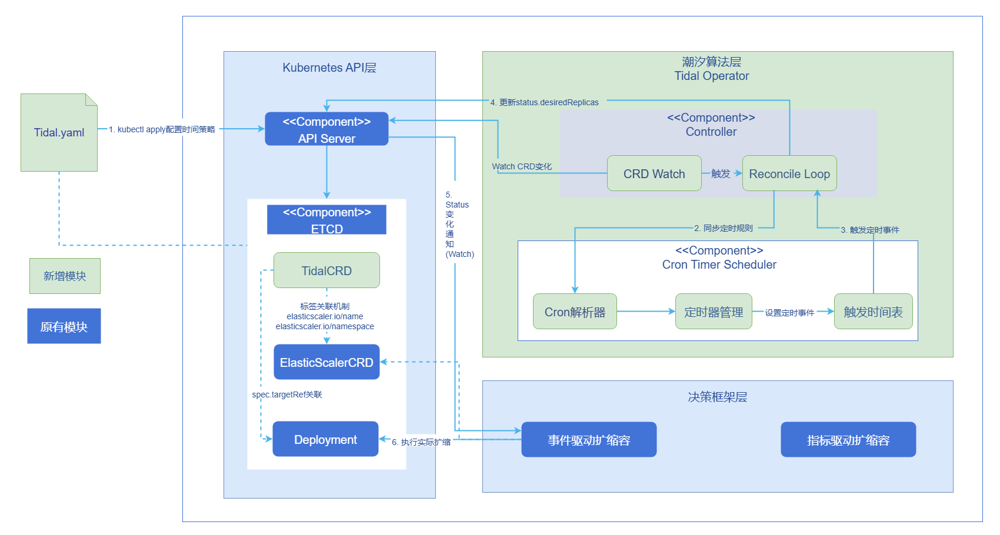
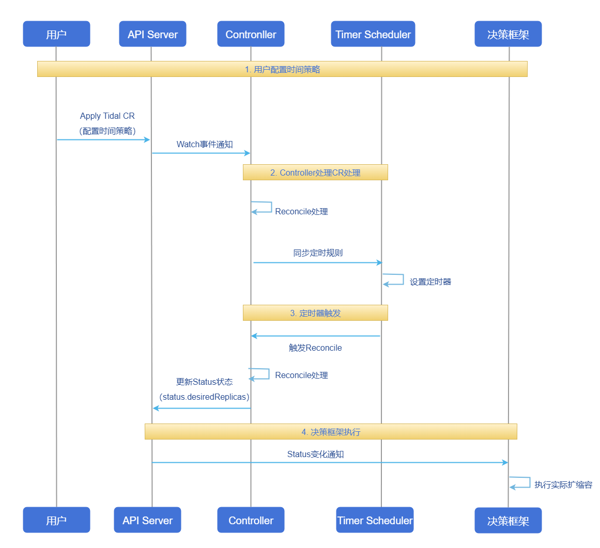

# AI推理潮汐算法

## 特性介绍

Tidal是面向具有明显潮汐特征业务的定时扩缩容算法。用户通过编写Tidal CRD，在指定时间点将可扩缩容的目标工作负载（如Deployment、StatefulSet、ResourceScalingGroup等）扩/缩到指定副本数。当前版本主要考虑时间维度因素，适合业务负载规律清晰、可通过时间配置预先规划容量的场景。Tidal Controller只负责计算期望副本并写入状态字段，实际扩缩容由通用决策框架ElasticScaler执行。通过CRD的`metadata.labels`（`elasticscaler.io/name`、`elasticscaler.io/namespace`）与ElasticScaler资源绑定，由ElasticScaler统一消费扩缩容决策。
> **说明**：<br/>openFuyao在Kubernetes中定义了一种名为ResourceScalingGroup（缩写为RSG）的自定义资源。关于该资源的详细介绍与使用方法，请参考文档：[ResourceScalingGroup-资源组扩缩容](../../ai_inference_resourcescalinggroup/user_guide/ai_inference_resourcescalinggroup.md)。本文后续提到的RSG或ResourceScalingGroup均指代该自定义资源对象。
### 应用场景

- 早晚高峰、活动日等有明确业务时间规律的场景，需在高峰前主动扩容、低谷时缩容。
- 工作日/周末、节假日、预热期/高峰期/收尾期等多阶段资源策略，需按时间点设置不同副本数。
- 已有ElasticScaler的集群，希望增加基于时间策略的扩缩容能力，与现有指标类策略协同。

### 能力范围

- 基于标准CRD（Tidal）提供时间驱动的扩缩容决策，不依赖历史指标预测，适合有明确业务时间规律的场景（如早晚高峰、活动日等）。
- 支持以Deployment、StatefulSet、ResourceScalingGroup等可扩缩资源作为目标，配合ElasticScaler框架进行统一弹性管理。
- 支持通过多条时间规则（rules）组合，构建工作日/周末、节假日、预热期/高峰期/收尾期等多阶段资源策略。
- 支持秒级精度的6位CRON表达式，并强制携带时区配置，确保跨环境行为一致。
- 支持在同一时间点多规则同时触发时的冲突消解策略（取最大副本数），在复杂规则下仍优先保证业务容量安全。
- 通过Status字段（如`desiredReplicas`、`activeRule`、`lastTriggerTime`、`nextTriggerTime`）对外提供可观测的扩缩容意图，便于排障和审计。

### 亮点特征

- **专注“时间维度”的潮汐调度**：相比传统基于实时指标的自动扩缩容，更适合有明确业务日历（工作日/周末/活动时段）的场景，可在高峰前主动扩容、低谷时及时缩容。
- **与ElasticScaler深度协同**：通过`elasticscaler.io/name`和`elasticscaler.io/namespace`两个标准label，将Tidal资源与ElasticScaler资源解耦绑定，ElasticScaler负责将时间策略与其他指标类策略统一编排。
- **强约束的时区+6位CRON语法**：内置校验规则，避免由于时区遗漏或5位CRON导致的时间偏差问题。

### 实现原理

本章节从逻辑视图与运行视图两方面说明潮汐算法的实现原理。

#### 逻辑视图

逻辑视图展示了基于时间策略的潮汐业务场景调度决策算法的核心组件及其交互关系。系统采用分层架构设计，包含用户层、Kubernetes API层、潮汐算法层（Tidal Controller和Timer Scheduler）以及决策框架集成层。各层之间通过标准Kubernetes API机制（Watch、Reconcile）进行交互，Controller负责Watch CR变化并协调定时规则，Timer Scheduler负责CRON表达式的解析和定时触发，最终通过标签机制与决策框架集成，实现对目标Deployment的自动扩缩容。

**图1** 潮汐算法逻辑视图



#### 运行视图

运行视图通过时序图展示系统从用户配置到最终执行扩缩容的完整运行时流程，整体可分为四个阶段。

1. 用户通过YAML配置Tidal CR并提交到APIServer。
2. Controller通过Watch机制感知CR变化，触发Reconcile处理并同步时间规则到内部TimerScheduler。
3. TimerScheduler根据CRON表达式设置定时器，到达触发时间后通知Controller。
4. Controller更新Tidal的Status和期望副本数，ElasticScaler等决策框架Watch状态变化后执行实际的Pod扩缩容操作。

**图2** 潮汐算法运行时序图


### 与相关特性的关系

**ElasticScaler**：Tidal资源依赖ElasticScaler才能完成实际扩缩容。Tidal资源仅负责按时间策略计算期望副本并写入`status`，不直接修改目标资源；通过`metadata.labels`中的`elasticscaler.io/name`、`elasticscaler.io/namespace`绑定到指定ElasticScaler资源后，由ElasticScaler通过Watch机制Watch Tidal资源的`status.desiredReplicas`等状态，并对`spec.targetRef`指向的目标资源执行实际扩缩容。使用Tidal前需先部署并配置好ElasticScaler。

## 安装

### 前提条件

- 已有可用的Kubernetes集群，并安装好`kubectl`、`helm`。
- 已配置可访问`cr.openfuyao.cn`的网络环境。

### 开始安装

创建命名空间`scaling-system`（若不存在）：

```bash
kubectl create namespace scaling-system
```

支持两种部署方式：通过pd-orchestrator统一chart部署（可选用子组件），或从源码仓库单独部署Tidal组件。

#### 方式一：通过pd-orchestrator chart部署

从OCI仓库安装pd-orchestrator chart，默认会安装三个Controller：**elastic-scaler**、**resourcescalinggroup**和**tidal**。由于Tidal依赖ElasticScaler才能完成实际扩缩容，**建议将Tidal与ElasticScaler一起部署**；ResourceScalingGroup（RSG）可按需选择性部署。

若需完整能力（Tidal+ElasticScaler），使用默认安装即可。

```bash
helm install orchestrator oci://cr.openfuyao.cn/charts/pd-orchestrator --version 0.0.0-latest
```

若只需部署Tidal Controller，可通过`--set`开关按需启用子组件，例如仅启用Tidal Controller。

```bash
helm install orchestrator oci://cr.openfuyao.cn/charts/pd-orchestrator --version 0.0.0-latest \
  --set elastic-scaler.enabled=true \
  --set resourcescalinggroup.enabled=false \
  --set tidal.enabled=true
```

> **说明**：<br/> ElasticScaler通常只指向一个扩缩目标。使用潮汐时，Tidal资源会通过标签关联到某个ElasticScaler，由该ElasticScaler对同一目标执行扩缩；若安装时还创建了默认的ElasticScaler示例CR（用于HPA对RSG组扩缩），会与潮汐使用的ElasticScaler形成冲突或重复。**建议一个扩缩目标只对应一个ElasticScaler资源**，由用户自行创建该ElasticScaler CR并与Tidal资源的labels绑定，因此应关闭安装时的默认ElasticScaler CR。当`resourcescalinggroup.enabled=false`时，RSG未部署，`resourcescalinggroup.instanceConfig.enabled`自然不生效；但`elastic-scaler.enabled=true`时仍需**单独**设置`elastic-scaler.elasticScaler.enabled=false`，才能不创建默认ElasticScaler示例CR。示例：

```bash
helm install orchestrator oci://cr.openfuyao.cn/charts/pd-orchestrator --version 0.0.0-latest \
  --set elastic-scaler.enabled=true \
  --set resourcescalinggroup.enabled=false \
  --set tidal.enabled=true \
  --set elastic-scaler.elasticScaler.enabled=false
```

#### 方式二：单独组件部署（从源码）

从ElasticScaler仓库克隆代码后，进入`charts/elastic-scaler/charts/tidal`路径，在该目录下执行`helm install`，仅部署Tidal Controller。

```bash
git clone https://gitcode.com/openFuyao/elastic-scaler.git
cd elastic-scaler/charts/elastic-scaler/charts/tidal
helm install tidal . -n <命名空间>
```

该方式仅安装Tidal组件，若需实际扩缩容能力，需另行部署ElasticScaler并保证Tidal CR的labels与ElasticScaler资源正确绑定。

<a id="helm-params"></a>
#### 关键参数说明

**表1** Helm关键参数说明

| 参数键 | 说明 |
| --- | --- |
| `orchestrator` | Helm Release名称，可按需修改。 |
| `--version 0.0.0-latest` | 安装最新版本的orchestrator（其中包含上述三个Controller）。 |
| `--set elastic-scaler.enabled` / `--set resourcescalinggroup.enabled` / `--set tidal.enabled` | 按需设为`true`或`false`，控制是否部署对应Controller；未指定时默认均为启用。 |
| `--set resourcescalinggroup.instanceConfig.enabled` | 控制是否安装ResourceScalingGroup默认示例CR。若主要通过Tidal/ElasticScaler进行潮汐扩缩，建议在`--set resourcescalinggroup.enabled=false`时保持该值默认（此时RSG未部署，instanceConfig不再生效）。 |
| `--set elastic-scaler.elasticScaler.enabled` | 控制是否安装ElasticScaler默认示例CR。由于ElasticScaler通常只指向一个扩缩资源，若使用Tidal绑定自定义ElasticScaler进行潮汐扩缩，建议将该值显式设置为`false`，避免默认ElasticScaler示例CR与潮汐场景下的ElasticScaler冲突。 |

#### 验证部署

完成安装后，可以通过以下步骤简单验证Tidal Controller是否正常运行。

- 查看Pod状态（以命名空间`scaling-system`为例）。

  ```bash
  kubectl get pods -n scaling-system | grep tidal
  ```

  预期看到名称中包含`tidal`的Pod，且`STATUS`为`Running`。

- 查看Controller日志，确认没有持续报错（根据实际部署名称替换`<pod-name>`或`<deployment-name>`）。

  ```bash
  # 查看Pod日志
  kubectl logs -n scaling-system <pod-name>

  # 或通过Deployment查看Pod列表后再查看日志
  kubectl get deploy -n scaling-system
  kubectl logs -n scaling-system deploy/<deployment-name>
  ```

若Pod处于非Running状态或日志中有大量错误，可优先检查。

- Helm安装时命名空间是否正确。
- 集群对`cr.openfuyao.cn`的访问是否正常（镜像是否拉取成功）。
- 是否与集群中已有的ElasticScaler/ResourceScalingGroup部署冲突。

## 使用AI推理潮汐算法

### 前提条件

- 已完成本指南前文的安装步骤，Tidal Controller与ElasticScaler运行正常。
- 安装时已按[关键参数说明](#helm-params)中的建议，关闭与潮汐场景冲突的默认ElasticScaler/ResourceScalingGroup示例CR。
- 集群中已存在至少一个待扩缩容的目标工作负载（如Deployment、StatefulSet等）。

### 背景信息

- Tidal通过CR的方式描述时间策略规则，ElasticScaler通过Watch机制Watch Tidal资源的`status.desiredReplicas`等字段，对`spec.targetRef`指向的目标资源执行实际扩缩容。
- 该能力适用于业务负载具有明显时间规律的场景（如早晚高峰、活动日等），当前版本仅考虑时间维度，不做实时指标综合决策。
- 时间规则通过「时区前缀 + 6位CRON表达式」进行配置，格式为。

  ```text
  CRON_TZ=<时区> 秒 分 时 日 月 周
  ```

  示例（工作日每天 8 点触发）。

  ```text
  CRON_TZ=Asia/Shanghai 0 0 8 * * 1-5
  └────────────时区─── ┘ │ │ │ │ │ └─ 周（1-5 表示周一到周五）
                        │ │ │ │ └── 月
                        │ │ │ └──── 日
                        │ │ └────── 时
                        │ └──────── 分
                        └────────── 秒
  ```

### 使用限制

- 当前仅支持**基于时间策略的固定副本数设置**，不支持按照时间段内动态曲线调整。
- 单个ElasticScaler资源通常只指向一个扩缩目标；同一目标不建议同时由多个ElasticScaler/Tidal/HPA等策略共同控制，以避免策略冲突。
- CRON表达式必须为**时区前缀 + 6 位格式**，且必须包含秒位；表达式错误会导致时间策略不生效。
- Tidal Controller只负责计算期望副本并写入Status，不直接修改目标资源；若ElasticScaler未正确部署或绑定，时间策略不会真正生效。

### 操作步骤

1. 编写Tidal CR。

   下方是一个面向生产环境更贴近实际场景的Tidal示例，用于在不同时段设置不同副本数。

   - 在工作日早高峰前（8:00）扩容到 10 副本。
   - 在工作日晚高峰（20:00）扩容到 20 副本。
   - 在每日凌晨 1:00 缩容到 2 副本，节省资源。

   ```yaml
   apiVersion: tidal.io/v1alpha1
   kind: Tidal
   metadata:
     name: ecommerce-traffic-tidal
     namespace: scaling-system
     labels:
       elasticscaler.io/name: ecommerce-traffic-elasticscaler
       elasticscaler.io/namespace: scaling-system
   spec:
     targetRef:
       apiVersion: apps/v1
       kind: Deployment
       name: ecommerce-frontend
       namespace: production

     triggers:
       times:
         rules:
           - name: workday-morning-base
             cron: "CRON_TZ=Asia/Shanghai 0 0 8 * * 1-5"
             replicas: 10
             description: "工作日早高峰前扩容到 10 副本，保障白天流量"

           - name: workday-evening-peak
             cron: "CRON_TZ=Asia/Shanghai 0 0 20 * * 1-5"
             replicas: 20
             description: "工作日晚高峰扩容到 20 副本，应对晚间访问高峰"

           - name: nightly-offpeak
             cron: "CRON_TZ=Asia/Shanghai 0 0 1 * * *"
             replicas: 2
             description: "每天凌晨 1 点缩容到 2 副本，节省资源"
   ```
   **表2** Tidal CR字段说明
    
    | 字段路径 | 是否必填 | 说明                                                       |
    | --- | --- |----------------------------------------------------------|
    | `metadata.name` | 是 | Tidal资源名称，在命名空间内唯一。                                      |
    | `metadata.namespace` | 是 | Tidal所在命名空间。建议与ElasticScaler所在命名空间一致或按运维规范规划。            |
    | `metadata.labels.elasticscaler.io/name` | 是 | 绑定的ElasticScaler资源名称，ElasticScaler会Watch该Tidal资源的status。 |
    | `metadata.labels.elasticscaler.io/namespace` | 是 | 绑定的ElasticScaler资源命名空间。                                  |
    | `spec.targetRef.apiVersion` | 是 | 目标工作负载的APIVersion。                                       |
    | `spec.targetRef.kind` | 是 | 目标工作负载类型，如Deployment、StatefulSet、ResourceScalingGroup等。  |
    | `spec.targetRef.name` | 是 | 目标工作负载名称。                                                |
    | `spec.targetRef.namespace` | 是 | 目标工作负载命名空间。                                              |
    | `spec.triggers.times.rules[].name` | 是 | 时间规则名称，在同一个Tidal资源中应唯一，用于排查和在status中标识当前规则。              |
    | `spec.triggers.times.rules[].cron` | 是 | 带时区前缀的6位CRON表达式，控制规则触发时间。                                |
    | `spec.triggers.times.rules[].replicas` | 是 | 规则触发时希望设置的目标副本数。                                         |
    | `spec.triggers.times.rules[].description` | 否 | 规则描述，便于团队理解该规则的业务含义。                                     |

2. 创建资源。

   ```bash
   kubectl apply -f ecommerce-traffic-tidal.yaml
   ```

3. 查看并验证Tidal资源状态。

   ```bash
   kubectl get tidal ecommerce-traffic-tidal -n scaling-system -o yaml
   ```

   > **说明**：<br/>
   > `status.desiredReplicas`：当前由时间策略计算出的期望副本数。<br/>
   > `status.activeRule`：当前生效的时间规则名称。<br/>
   > `status.lastTriggerTime`：最近一次时间规则触发的时间点。<br/>
   > `status.nextTriggerTime`：下一次预计触发时间点。<br/>
   > 当达到某个时间规则触发点时，`desiredReplicas`和`activeRule`会更新，ElasticScaler Watch到状态变化后，会对`spec.targetRef`指向的Deployment/StatefulSet等资源执行实际扩缩。

4. 根据业务需要调整规则。

   - 可通过编辑CR（`kubectl edit tidal ...`）或重新`apply`更新`rules`中的CRON表达式和副本数。
   - 建议在低风险时段先做小规模演练，确认扩缩时点与预期一致后再应用到生产流量。

### 后续操作

- 根据业务变化，定期审视和调整Tidal资源的时间规则，避免历史活动规则长期遗留。
- 当不再需要某个时间策略时，可删除对应的Tidal CR：

  ```bash
  kubectl delete tidal ecommerce-traffic-tidal -n scaling-system
  ```

### 相关操作

- 执行如下命令，查看所有Tidal实例：

  ```bash
  kubectl get tidal -A
  ```

- 执行如下命令，查看单个实例详情：

  ```bash
  kubectl describe tidal ecommerce-traffic-tidal -n scaling-system
  ```

