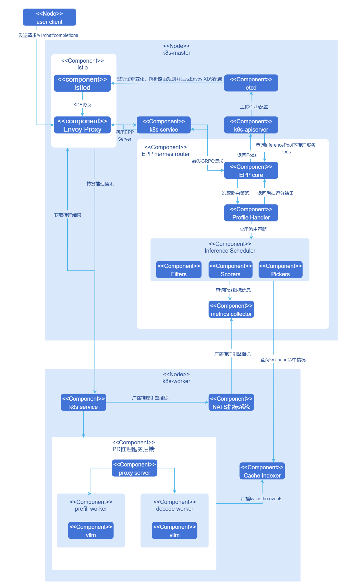
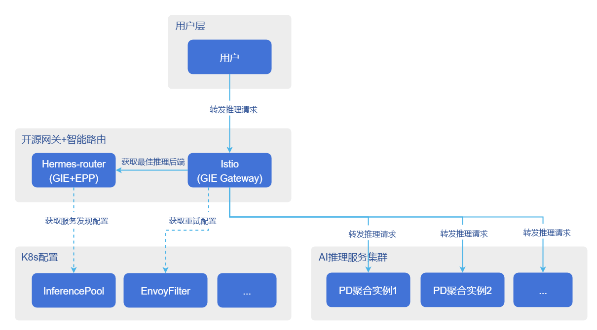
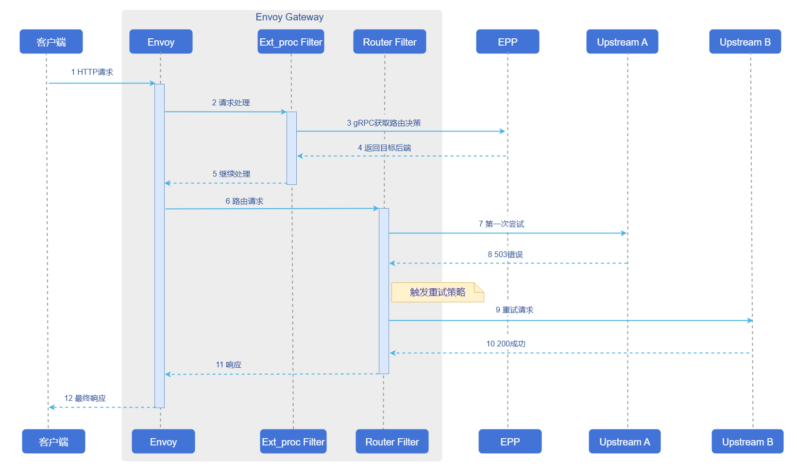

# AI推理赫尔墨斯路由

## 特性介绍

Hermes-router是一个Kubernetes（K8s）原生的AI推理智能路由方案，用于接收用户推理请求并转发至合适的推理服务后端。

- 在架构上，Hermes-router遵从K8s gateway api inference extension（GIE）框架，是一个可插拔、可扩展的EndPointPicker（EPP）组件，最大程度兼容K8s生态。
- 在能力上，Hermes-router提供KVCache aware、PD分桶调度、时延预测等多种AI推理路由策略，帮助用户在多种云原生场景下提升AI推理性能、集群资源利用率与服务稳定性。

### 应用场景

Hermes-router适用于在Kubernetes集群环境中部署和运行AI推理服务，具体包括如下场景。

- 云原生AI推理服务：在K8s集群中部署大语言模型（LLM）推理服务，需要智能路由能力来优化请求分发和资源利用。
- 多实例推理后端：需要将推理请求智能路由到多个推理服务实例（支持聚合架构或PD分离架构），实现负载均衡和性能优化。
- 高并发推理场景：在长短请求混合、中高并发的业务场景中，需要根据请求特征和实例负载状态进行智能调度，提升推理吞吐量。
- KVCache aware优化场景：在重复请求较多的场景中，需要利用KVCache命中率信息进行路由优化，提升推理性能和资源利用率。
- 时延预测优化场景：在需要综合考虑实例负载、缓存状态和推理时延的场景中，可通过时延预测路由策略选择更优推理后端。
- 网关集成场景：已有K8s网关基础设施，需要在不影响原有网关的基础上，增加AI推理路由能力。
- 轻量独立部署场景：无需额外部署Istio、HTTPRoute等网关资源，可通过EPP入口完成推理请求转发。

### 能力范围

- 支持在K8s集群中以独立模式（standalone）或网关（Gateway）模式两种方式部署并使用。
- 支持用户配置多种路由策略，进行openAI API风格的AI推理请求。
- 当前对外仅暴露以下推理接口：`/v1/chat/completions`、`/v1/completions`。该接口不涉及认证鉴权和日志审计能力；相关用户管理能力由上游用户管理面统一提供。

### 软件依赖

在基于Gateway的部署模式下，Hermes-router作为GIE框架的EPP组件，需与支持Gateway API Inference Extension的开源网关配合使用。表1列出了基于Gateway部署模式下可选开源网关及其依赖组件的版本要求。

**表1** 可选开源网关与依赖组件版本
| 网关 | 网关版本 | Gateway API | GIE | Kubernetes |
|------|----------|-------------|-----|------------|
| Istio | 1.27+ | 1.4.0+ | 1.0+ | 1.29+ |
| Nginx Gateway Fabric | 2.2+ | 1.3.0+ | 1.0+ | 1.25+ |
| Envoy AI Gateway | 0.4+ | 1.4.0+ | 1.0+ | 1.32+ |
| Kgateway | 2.1+ | 1.3.0+ | 1.0+ | 1.29+ |

>  **说明：**<br>
> 表中为已验证兼容的最低版本，推荐使用最新版本的开源网关以确保体验。standalone模式下无需依赖开源网关。

### 亮点特征

这里主要列举独立于GIE框架的亮点。

- 特性设计遵循GIE框架，天然支持K8s网关体系，支持集成多种开源网关，在已有网关的集群，可以作为可插拔能力加入，在不影响原有网关的基础上增加AI推理路由能力。
- 提供多种创新路由策略，支持聚合、PD等推理后端架构，帮助使用者在多种业务场景中提升性能。
    - KVCache aware(聚合/PD)：提供允许用户自定义得分函数的KVCache aware路由策略，在重复请求场景提升推理性能。
    - PD分桶调度路由 (PD)：提供允许用户自定义参数的分桶调度策略，在长短请求、中高并发场景提升推理吞吐量。
    - 时延预测路由策略(聚合/PD)：基于实例实时指标、缓存状态和时延预测结果进行路由决策，帮助用户进一步优化推理时延与资源利用率。
- 动态推理服务发现：允许用户在运行时新增/删除推理后端，允许用户灵活调整推理资源投入。

### 实现原理
**图1** Hermes-router架构


Hermes-router以EPP组件形式集成到开源网关，下面以基于Gateway部署模式下的一次完整推理请求为例说明内部原理。

1. 用户向集群网关发送openAI API请求`/v1/chat/completions`。
2. 网关识别到请求为推理请求，将请求转发至EPP。
3. EPP根据用户配置的路由策略处理请求，选出最适合处理该推理请求的推理后端。
4. EPP将推理后端返回集群网关，集群网关将推理请求发送至目标推理后端。
5. 推理后端完成请求返回网关，网关将推理结果返回用户。

### 与相关特性的关系
- cache-indexer：使用KVCache aware和时延预测类型策略时依赖，通过`/kv-cache/hit-rate`接口从该组件获取KVCache命中率及相关缓存信息。
- vLLM-ascend：对于该特性有以下具体依赖。
    - PD代理服务组件`proxy-server`：原为vllm官方在PD分离架构下提供的示例组件，作为中枢组织P/D实例完成推理任务，openFuyao社区对该组件进行增强，现作为PD Group的Leader实例接收网关推理请求，并具备根据指定标签动态发现推理服务实例的能力。
    - NPU适配：当环境为昇腾NPU时，需要使用vLLM-ascend作为推理引擎启动服务。
    - 推理指标：依赖vllm提供的`/metrics`接口获取推理服务指标，由GIE架构自动获取。

## 安装

### EPP组件单独部署

本节介绍如何在Kubernetes集群中单独部署Hermes-router作为EPP组件。根据接入方式不同，分为standalone模式部署和基于Gateway的EPP部署。

#### standalone模式部署

##### 交付规格

Hermes-router standalone模式使用独立chart部署。部署完成后，集群中会运行一个包含EPP主容器和envoy sidecar的Pod，并通过Service对外暴露HTTP入口。用户可以直接向EPP Service发送openAI API风格的推理请求，由EPP按照配置的路由策略将请求转发至推理后端。

##### 前提条件

在开始安装前，请确保满足以下条件。

- **环境要求**

  - Kubernetes集群：v1.33.0及以上版本。
  - Helm工具：用于部署Hermes router和相关组件。

- **部署组件要求**

  部署Hermes-router之前，集群中需要已安装以下组件。

  - **推理后端服务**：集群中已部署vLLM等推理引擎服务。
  - **后端标签配置**：推理后端实例需配置可用于服务发现的标签，standalone模式通过标签选择器发现并管理推理后端实例。

  > **说明**：<br/>
  > 如果需要使用KVCache aware或时延预测路由策略，请参考[安装配套组件](#安装配套组件)章节部署cache-indexer等相关组件。

- **硬件要求**

  Hermes-router本身对硬件环境无特殊要求，作为轻量级路由组件，可运行在标准x86或ARM架构的节点上。

##### 快速安装Hermes router

Hermes-router standalone模式支持复用统一的路由策略配置文件。用户可根据业务场景，从[openFuyao GitCode仓库](https://gitcode.com/openFuyao/hermes-router)获取chart包和预置的路由策略配置文件。

1. 从仓库拉取项目。

   ```bash
   git clone https://gitcode.com/openFuyao/hermes-router.git
   ```

2. 安装部署。

  在节点上创建下面目录用于存放tokenizer sidecar 自动下载的词表(以便开箱即用)，生产环境中hermes-router可调整为挂载卷。
  
  ```
  mkdir -p /home/llm_cache/huggingface/hub
  chown 65532:65532 /home/llm_cache/huggingface/hub
  chmod 777 -R /home/llm_cache/huggingface/hub
  ```

   以release名称`hermes-router`为例，在`hermes-router`根目录下执行如下命令。

   ```bash
   cd hermes-router
   helm dependency build ./charts/standalone
   helm install -n <NAMESPACE> hermes-router ./charts/standalone \
     -f ./examples/profiles/<路由策略文件名> \
     --set inferenceExtension.endpointsServer.createInferencePool=false \
     --set inferenceExtension.endpointsServer.endpointSelector='openfuyao.com/model=qwen-qwen3-8b' \
     --set inferenceExtension.endpointsServer.targetPorts=8000
   ```

   参数说明如下。

   - `<NAMESPACE>`：部署的目标命名空间（如`ai-inference`）。
   - `<路由策略文件名>`：直接使用**表2**中的策略文件；仓库已在`examples/profiles/`目录提供示例（见[profiles目录](https://gitcode.com/openFuyao/hermes-router/tree/master/examples/profiles)），可按需复用或自定义。
   - `inferenceExtension.endpointsServer.endpointSelector`：用于发现推理后端实例的标签选择器，需与后端Pod标签保持一致。
   - `inferenceExtension.endpointsServer.targetPorts`：推理后端对外提供服务的端口，缺省值为`8000`。

   **表2** 预置路由策略列表

    | 策略文件 | 策略名称 | 适用场景 | 说明 |
    |---------|---------|---------|------|
    | `aggregate-random.yaml` | 聚合架构随机路由 | 聚合架构基础负载均衡 | 在聚合架构下随机选择推理后端实例，实现基础的负载均衡。 |
    | `aggregate-kv-cache-aware.yaml` | 聚合架构KVCache感知路由 | 聚合架构KVCache优化 | 结合KVCache命中率、XPU缓存使用率、等待请求数和在途请求数，智能选择最优推理服务实例。 |
    | `aggregate-prediction.yaml` | 聚合架构时延预测路由 | 聚合架构时延优化 | 基于时延预测结果和实时指标选择最优推理后端，适用于聚合架构。 |
    | `pd-random.yaml` | PD架构随机路由 | PD架构基础负载均衡 | 在PD分离架构下按角色随机选择推理后端实例。 |
    | `pd-kv-cache-aware.yaml` | PD架构KVCache感知路由 | PD架构KVCache优化 | 结合Prefill和Decode实例的KVCache命中率、负载等信息进行路由优化。 |
    | `pd-bucket.yaml` | PD分桶调度路由 | 长短请求混合、中高并发场景 | 基于请求长度分桶和实例负载状态进行评分，支持TP异构的PD分离架构。 |
    | `pd-prediction.yaml` | PD架构时延预测路由 | PD架构时延优化 | 基于时延预测结果、前缀缓存信息和实时指标选择最优Prefill/Decode实例。 |

3. 验证部署。

   ```bash
   # 检查Pod运行状态
   kubectl get pods -n <NAMESPACE> -l epp=hermes-router

   # 检查Service资源
   kubectl get svc -n <NAMESPACE> hermes-router
   ```

    > **说明**：<br/> standalone模式下，EPP Service缺省会暴露`8081`端口用于接收推理请求。用户可在集群内直接通过该Service访问，也可根据需要进一步暴露为NodePort或LoadBalancer类型服务。

#### 基于Gateway的EPP部署

##### 交付规格

Hermes-router作为单独的EPP组件部署到集群中，需要集群中已有Envoy based的Gateway、Gateway API及Inference Extension CRDs、以及推理后端服务。Hermes-router部署后提供多种AI推理智能路由策略（随机路由、KVCache aware、PD分桶调度、时延预测路由等），通过InferencePool动态发现和管理推理后端，并通过HTTPRoute接入集群网关。

##### 前提条件

在开始安装前，请确保满足以下条件。

- **环境要求**

  - Kubernetes集群：v1.33.0及以上版本。
  - 集群管理员权限：用于安装CRD和集群级资源。
  - Helm工具：用于部署Hermes router和相关组件。

- **部署组件要求**

  部署Hermes-router之前，集群中需要已安装以下组件。

  - **Envoy based网关**：集群中已部署支持ExtProc协议的网关（如Istio、Envoy Gateway等），Hermes-router通过ExtProc（gRPC）与网关交互。
  - **Gateway API CRDs**：已安装Kubernetes Gateway API核心资源定义。
  - **Inference Extension CRDs**：已安装Gateway API Inference Extension，提供InferencePool等推理扩展资源定义。
  - **推理后端服务**：集群中已部署vLLM等推理引擎服务。

  > **说明**：<br/>
  > 如果集群中尚未安装上述组件，请参考[安装配套组件](#安装配套组件)章节完成安装。

- **硬件要求**

  Hermes-router本身对硬件环境无特殊要求，作为轻量级路由组件，可运行在标准x86或ARM架构的节点上。

##### 快速安装Hermes router

Hermes-router支持多种路由策略。用户可根据业务场景，从[openFuyao GitCode仓库](https://gitcode.com/openFuyao/hermes-router)获取chart包和预置的路由策略配置文件。

1. 从仓库拉取项目。

   ```bash
   git clone https://gitcode.com/openFuyao/hermes-router.git
   ```

2. 安装部署。

  在节点上创建下面目录用于存放tokenizer sidecar 自动下载的词表(以便开箱即用)，生产环境中hermes-router可调整为挂载卷。
  
  ```
  mkdir -p /home/llm_cache/huggingface/hub
  chown 65532:65532 /home/llm_cache/huggingface/hub
  chmod 777 -R /home/llm_cache/huggingface/hub
  ```

   以release名称`hermes-router`为例，在`hermes-router`根目录下执行如下命令。

   ```bash
   cd hermes-router
   helm dependency build ./charts/hermes-router
   helm install -n <NAMESPACE> hermes-router ./charts/hermes-router \
     -f ./examples/profiles/<路由策略文件名>
   ```

   参数说明如下。

   - `<NAMESPACE>`：部署的目标命名空间（如`ai-inference`）。
   - `<路由策略文件名>`：直接使用**表2**中的策略文件；仓库已在`examples/profiles/`目录提供示例，可按需复用或自定义。

3. 验证部署。

   ```bash
   # 检查Pod运行状态
   kubectl get pods -n <NAMESPACE> -l inferencepool=<INFERENCEPOOL_NAME>-epp

   # 检查InferencePool资源
   kubectl get inferencepool -n <NAMESPACE>

   # 检查HTTPRoute资源
   kubectl get httproute -n <NAMESPACE>
   ```

> **说明**：<br/> EPP Pod的label格式为`inferencepool=<INFERENCEPOOL_NAME>-epp`，其中`<INFERENCEPOOL_NAME>`为InferencePool资源的名称。

> **注意**：<br/>
> 部署Hermes router时需要正确配置HTTPRoute和InferencePool CR。
> - HTTPRoute需要通过parentRef关联到集群中的Gateway资源。
> - InferencePool需要配置正确的标签选择器（matchLabels），以发现和管理推理后端实例。
> - 路由策略的详细配置请参考[配置路由策略](#配置路由策略)章节。

### InferNex集成部署

本节介绍如何通过InferNex集成部署Hermes-router。

#### 交付规格

InferNex是完整的AI推理服务集成部署包，一键部署网关、Hermes-router、HTTPRoute/InferencePool等K8s资源、以及推理后端服务。提供端到端的AI推理解决方案，集成网关、智能路由和推理服务，开箱即用。

当环境中尚无网关和推理后端且需要开箱部署时，可直接使用InferNex完成集成部署，参考[安装与配置指南](../../ai_inference_infernex/user_guide/ai_inference_infernex.md)。

#### 前提条件

* Kubernetes v1.33.0及以上版本。
* Kubernetes Gateway API CRDs：提供Gateway API的核心资源定义。
* Gateway API Inference Extension CRDs：提供InferencePool等推理扩展资源定义。
* 每个推理节点至少一张推理芯片。
* 每个推理节点至少16GB内存，4CPU核。
* 在线安装能够访问镜像仓库：oci://cr.openfuyao.cn。
* 用户具备创建RBAC资源的权限。

#### 快速安装InferNex

InferNex有以下两种途径集成部署。

- 从openFuyao官方镜像仓库获取项目安装包。

  1. 拉取项目安装包。

      ```bash
      helm pull oci://cr.openfuyao.cn/charts/infernex --version xxx
      ```
      其中`xxx`需替换为具体项目安装包版本，如`0.21.1`。拉取得到的安装包为压缩包形式。

  2. 解压安装包。

      ```bash
      tar -xzvf infernex-xxx.tgz
      ```
        其中`xxx`需替换为具体项目安装包版本，如`0.21.1`。

  3. 安装部署。

      以release名称`infernex`为例，执行安装前请确保完成如下操作。
      - 集群已创建命名空间`istio-system`（Istio Gateway资源必须部署在此命名空间）。
      - 除网关相关资源外，其他组件（如inference-backend、hermes-router、cache-indexer等）会通过Helm release所在命名空间进行部署，本文以`ai-inference`为例。

      在`infernex`同级目录下执行如下命令。
      ```bash
      helm install -n ai-inference infernex ./infernex
      ```

- 从openFuyao GitCode仓库获取。

  1. 从仓库拉取项目。

      ```bash
      git clone https://gitcode.com/openFuyao/InferNex.git
      ```

  2. 安装部署。
      以release名称`infernex`为例，执行安装前请确保集群已创建命名空间`istio-system`。其中，网关相关资源会部署在`istio-system`命名空间，其他组件会通过Helm release所在命名空间进行部署。在`InferNex/charts/infernex`目录下执行如下命令。
      ```bash
      cd InferNex/charts/infernex
      helm dependency build
      helm install -n ai-inference infernex .
      ```

### 安装配套组件

如果您的集群中尚未部署网关、推理后端等配套组件，请按照本节内容完成安装。

#### 开源网关安装

Hermes-router需要配合支持**Kubernetes Gateway API**和**Gateway API Inference Extension**的开源网关使用。本文档以**Istio**为例介绍安装部署流程。

1. 安装Istio并启用Gateway API Inference Extension支持。

    ```bash
    ISTIO_VERSION=1.28.0
    curl -L https://istio.io/downloadIstio | ISTIO_VERSION=${ISTIO_VERSION} sh -

    ./istio-$ISTIO_VERSION/bin/istioctl install \
      --set values.pilot.env.ENABLE_GATEWAY_API_INFERENCE_EXTENSION=true \
      --set values.gateways.istio-ingressgateway.type=NodePort
    ```
  
    > **注意**：<br/>
    > 请使用支持Inference Extension的Istio版本，并根据集群网络环境调整网关暴露方式。

2. 验证安装。

    验证Istio安装。

    ```shell
    kubectl get pods -n istio-system
    ```

3. 配置网关入口资源。

    完成基础设施安装后，请根据所选开源网关的官方文档创建Gateway、GatewayClass及相关入口资源，并确保HTTPRoute能够通过parentRef关联到对应的Gateway。
    
开源网关注意事项如下。

- **Istio版本**：需要使用支持Inference Extension的Istio版本。
- **权限要求**：安装CRDs需要集群管理员权限。
- **其他开源网关**：除了Istio，用户可以根据自己需要选择支持Gateway API和Gateway API Inference Extension的开源网关，配置时只需将`gateway.className`设置为对应的GatewayClass名称即可。

#### 推理引擎后端安装

Hermes-router目前支持vLLM推理引擎，支持聚合与PD分离两种架构。推理后端的部署方式与模型、硬件资源和业务形态相关，建议参考[InferNex用户指南](../../ai_inference_infernex/user_guide/ai_inference_infernex.md)完成推理后端部署。

在PD分离架构下，请确保代理服务和后端组件能够识别并转发EPP新增的请求头，以实现向Prefill和Decode实例的精准路由。

#### 安装cache-indexer（可选）

Hermes-router在使用KVCache aware或时延预测路由策略时，需要安装cache-indexer组件，以获取全局KVCache信息，安装步骤如下。

1. 获取openFuyao cache-indexer组件Helm chart部署包。

    ```shell
    helm fetch oci://cr.openfuyao.cn/charts/cache-indexer --version 0.0.0-latest
    ```

2. 配置cache-indexer以正确提供全局KVCache hit rate计算服务。在上一步获取的helm chart中打开`charts/cache-indexer/values.yaml`文件进行配置，下面对必须配置的参数进行说明。
    ```yaml
    app:
      serviceDiscovery: # 该类配置用于动态发现推理服务实例，并订阅kv cache消息
        labelSelector: "openfuyao.com/model=qwen-qwen3-8b" # 动态发现携带此标签的推理实例Pod
        portName: "zmq-pub" # 向名称为此值的vllm port中订阅kv cache消息；
        refreshInterval: 10 # 订阅间隔(s)

    service:
      name: cache-indexer-service # 运行时service资源的名称，hermes-router通过该名称请求cache-indexer
      port: 8080 # 对外端口

    # ... 其他配置
    ```

3. 部署cache-indexer。

    ```shell
    helm upgrade --install cache-indexer ./charts/cache-indexer \
        -n ${NAMESPACE} --create-namespace
    ```

4. 检查部署结果。

    确认Pod运行正常，且日志显示已成功发现推理服务后端实例。

## 使用AI推理服务

部署完成后，可根据部署方式选择不同的访问路径。

### standalone模式访问

standalone模式下，用户可以直接访问带有`epp=<RELEASE_NAME>`标签的Pod。该Pod内的envoy sidecar会在`8081`端口接收推理请求，并将请求交由EPP完成路由。下面以release名称`hermes-router`为例进行说明。

1. 执行如下命令，获取EPP Pod的IP地址。

    ```shell
    RELEASE_NAME=hermes-router
    EPP_POD_IP=$(kubectl get pods -n <NAMESPACE> -l epp=${RELEASE_NAME} -o jsonpath='{.items[0].status.podIP}')
    ```

2. 发送推理请求。

    ```shell
    curl -X POST http://${EPP_POD_IP}:8081/v1/chat/completions \
      -H "Content-Type: application/json" \
      -d '{
        "model": "Qwen/Qwen3-8B",
        "messages": [
          {"role": "user", "content": "你好"}
        ],
        "max_tokens": 100,
        "temperature": 0.7,
        "stream": false
      }'
    ```

### 基于Gateway的访问

基于Gateway部署模式下，可以通过如下两种方式向Inference Gateway发送推理请求。

- LoadBalancer访问

  1. 如果集群支持LoadBalancer，Istio Gateway会自动创建LoadBalancer类型的Service。

      ```shell
      # 获取External IP
      EXTERNAL_IP=$(kubectl get svc -n istio-system istio-ingressgateway -o jsonpath='{.status.loadBalancer.ingress[0].ip}')
      ```

  2. 发送推理请求。

      ```shell
      curl -X POST http://${EXTERNAL_IP}/v1/chat/completions \
        -H "Content-Type: application/json" \
        -d '{
          "model": "Qwen/Qwen3-8B",
          "messages": [
            {"role": "user", "content": "你好"}
          ],
          "max_tokens": 100,
          "temperature": 0.7,
          "stream": false
        }'
      ```

- NodePort访问

  1. 执行如下命令，获取节点IP地址和端口。

      ```shell
      kubectl get svc -n istio-system istio-ingressgateway
      ```
      查看PORT(S)列，例如80:30080/TCP，其中30080是NodePort。

      如果没有ExternalIP，使用InternalIP。

      ```shell
      NODE_IP=$(kubectl get nodes -o jsonpath='{.items[0].status.addresses[?(@.type=="InternalIP")].address}')
      NODE_PORT=$(kubectl get svc -n istio-system istio-ingressgateway -o jsonpath='{.spec.ports[?(@.port==80)].nodePort}')
      ```

  2. 发送请求。

      ```shell
      curl -X POST http://${NODE_IP}:${NODE_PORT}/v1/chat/completions \
        -H "Content-Type: application/json" \
        -d '{
          "model": "Qwen/Qwen3-8B",
          "messages": [
            {"role": "user", "content": "你好"}
          ],
          "max_tokens": 100,
          "temperature": 0.7,
          "stream": false
        }'
      ```

## 配置路由策略

Hermes-router当前的路由策略统一通过`inferenceExtension.routing`进行配置。用户需要首先确定部署模式，再选择对应的路由策略类型。

**表3** 路由策略与部署模式对应关系

| 路由策略 | aggregate架构 | pd架构 |
|---------|-----------|----|
| `random` | 支持 | 支持 |
| `kv-cache-aware` | 支持 | 支持 |
| `bucket` | 不支持 | 支持 |
| `prediction` | 支持 | 支持 |

### 基本配置结构

```yaml
inferenceExtension:
  routing:
    deploymentMode: aggregate
    profile: random
```

所有路由策略都以`inferenceExtension.routing`作为配置入口。

- `deploymentMode`：声明推理后端的部署模式，`aggregate`表示聚合架构，`pd`表示PD分离架构。
- `profile`：声明要启用的路由策略类型。

除这两个基础字段外，其余配置项均由具体策略决定。对于依赖分词或时延预测能力的路由策略，还需要在`inferenceExtension`下补充相应的sidecar配置。为避免在不同策略小节中重复展开，下面先统一说明sidecar相关配置，再按不同路由策略分别说明其余必需配置项及作用。

### sidecar配置说明

`kv-cache-aware`路由策略依赖tokenizer sidecar。`prediction`路由策略在`predictionMode`为`active`时依赖tokenizer和prediction两类sidecar；`predictionMode`为`shadow`时仅采集预测训练数据，可不启用prediction sidecar。以下配置与`routing`同级，均位于`inferenceExtension`下。启用tokenizer sidecar时，`routing.tokenizer.socketPath`默认与`inferenceExtension.tokenizer.socketPath`一致；若自定义任一侧，需保证两端一致。启用`prediction`路由策略且`predictionMode`为`active`时，需保证`targetModel`、`modelVersion`与`modelVolume`中的制品目录布局一致。

tokenizer sidecar常用配置如下。

```yaml
inferenceExtension:
  tokenizer:
    enabled: true
    socketPath: /var/run/tokenizer/tokenizer.sock
    provider: huggingface
    extraArgs: []
    extraEnv: []
    volumeMounts:
      - name: tokenizer-cache
        mountPath: /workspace/.cache/huggingface/hub
    volumes:
      - name: tokenizer-cache
        hostPath:
          path: /home/llm_cache/huggingface/hub
          type: Directory
    resources:
      requests:
        cpu: "4"
        memory: 2Gi
      limits:
        cpu: "4"
        memory: 4Gi
```

各字段含义如下。

- `enabled`：是否启用tokenizer sidecar。启用`kv-cache-aware`或`prediction`路由策略时应保持为`true`。
- `volumeMounts`、`volumes`：为tokenizer sidecar单独挂载缓存或模型目录，不影响主EPP容器。部署时通常需要按实际环境修改宿主机缓存路径：将`volumes[].hostPath.path`改为节点上存放 Hugging Face 分词器缓存的目录（示例为`/home/llm_cache/huggingface/hub`），并确保`volumeMounts[].mountPath`与sidecar内缓存目录一致（示例为`/workspace/.cache/huggingface/hub`）。生产环境也可将`hostPath`替换为PVC等持久化挂载方式；`volumeMounts`与`volumes`中的`name`需一一对应。
- `socketPath`：tokenizer sidecar提供服务的Unix Socket路径。启用sidecar后，`routing.tokenizer.socketPath`默认与此字段相同；自定义时需与`routing.tokenizer.socketPath`保持一致。
- `image.repository`、`image.tag`、`image.pullPolicy`：tokenizer sidecar镜像地址、版本和拉取策略。使用私有镜像仓库或固定版本时可按需修改。
- `provider`：分词服务后端类型，当前支持`huggingface`与`modelscope`两种取值，缺省为`huggingface`。模型托管在 ModelScope Hub 时改为`modelscope`，并同步调整缓存挂载目录以匹配对应平台的缓存布局。
- `extraArgs`、`extraEnv`：传递给tokenizer sidecar的额外启动参数和环境变量，仅在需要覆盖sidecar默认行为时使用。例如可通过`extraEnv`设置`TOKENIZER_CACHE_DIR`，将缓存目录指向与`volumeMounts`中`mountPath`一致的路径。
- `resources`：tokenizer sidecar的资源请求与限制。示例配置适用于绝大多数场景，一般无需修改。sidecar会根据`limits.cpu`自动调整分词线程池规模（每核一个worker），因此请保持示例中`limits.cpu`已设置；该sidecar与EPP同Pod部署，节点资源需按两者合计规划。
- `threadPoolSize`：可选。分词线程池worker数量；未设置时由`resources.limits.cpu`自动推导。

prediction sidecar常用配置如下。当前chart缺省`prediction.enabled`为`false`；启用`prediction`路由策略且`predictionMode`为`active`时需显式改为`true`。

```yaml
inferenceExtension:
  prediction:
    enabled: false
    socketPath: /var/run/hermes/prediction.sock
    predictionMode: active
    timeout: 1s
    maxBatchSize: 128
    ttftWeight: 0.8
    tpotWeight: 0.2
    kvWeight: 1.0
    queueWeight: 1.0
    prefixWeight: 1.0
    inflightWeight: 1.0
    targetModel: Qwen/Qwen3-8B
    modelVersion: baseline-conversation-data
    resources:
      requests:
        cpu: "2"
        memory: 1Gi
      limits:
        cpu: "4"
        memory: 2Gi
    env:
      - name: OMP_NUM_THREADS
        value: "2"
    modelVolume:
      hostPath:
        path: /path/to/prediction-models
        type: Directory
```

各字段含义如下。

- `enabled`：是否启用prediction sidecar。`predictionMode`为`active`且启用`prediction`路由策略时必须设为`true`；`predictionMode`为`shadow`时可保持`false`，此时不加载预测模型，仅采集训练数据并回退到快照评分路由。
- `predictionMode`：预测路由模式，支持`active`与`shadow`两种取值，缺省为`active`。`active`根据预测时延进行路由，需要启用prediction sidecar并配置预测模型制品；`shadow`仅收集`PredictionInput`训练数据，路由走快照回退逻辑，可与`enabled: false`和空的`modelVolume`配合，用于在无sidecar的情况下引导数据集。
- `targetModel`、`modelVersion`、`modelVolume`：时延预测模型制品标识与挂载来源，部署时通常需要按实际环境修改。制品在卷根目录下按`<targetModel>/<modelVersion>/`组织（需包含`manifest.json`），例如`Qwen/Qwen3-8B/baseline-conversation-data/`。`modelVolume`仅声明卷来源（`hostPath`、PVC或CSI等），chart会将制品挂载到Pod内固定路径并传递给sidecar，无需单独配置`mountPath`。`shadow`模式下可留空`modelVolume`。
- `socketPath`：prediction sidecar提供服务的Unix Socket路径，EPP通过该路径发起时延预测请求。
- `image.repository`、`image.tag`、`image.pullPolicy`：prediction sidecar镜像地址、版本和拉取策略。使用私有镜像仓库或固定版本时可按需修改。
- `timeout`：单次预测请求的超时时间。
- `maxBatchSize`：prediction sidecar单次处理的最大批量。
- `ttftWeight`、`tpotWeight`、`kvWeight`、`queueWeight`、`prefixWeight`、`inflightWeight`：各评分维度的相对权重。`ttftWeight`与`tpotWeight`分别作用于预测路径下的首token时延与逐token时延；`kvWeight`、`queueWeight`、`prefixWeight`、`inflightWeight`在预测不可用、走快照回退路径时生效。权重须为非负数，且`ttftWeight`与`tpotWeight`之和、后四项之和均须大于0；设为0可忽略对应维度。增大某权重表示该指标在评分中的影响更大。
- `resources`、`env`：prediction sidecar的资源请求与限制及环境变量。

### aggregate random

aggregate random适用于聚合架构下的基础负载均衡场景，直接从候选推理后端中随机选择实例。

```yaml
inferenceExtension:
  routing:
    deploymentMode: aggregate
    profile: random
```

该策略只需要配置以下字段。

- `deploymentMode: aggregate`：表示后端为聚合架构。
- `profile: random`：表示对候选推理后端执行随机路由。

### pd random

pd random适用于PD分离架构下的基础负载均衡场景，会先根据PD角色和分组过滤候选实例，再随机选择后端。

```yaml
inferenceExtension:
  routing:
    deploymentMode: pd
    profile: random
    pd:
      pdLabelName: openfuyao.com/pdRole
      pdGroupLabelName: openfuyao.com/pdGroupID
      prefillValue: prefill
      decodeValue: decode
      leaderValue: leader
```

除基础字段外，该策略还需要配置`routing.pd`，用于让EPP识别PD架构中的角色和分组。各字段含义如下。

- `pdLabelName`：PD角色标签名称，EPP通过该标签识别`prefill`、`decode`和`leader`角色，缺省值为`openfuyao.com/pdRole`。
- `pdGroupLabelName`：PD分组标签名称，EPP通过该标签将属于同一组的Prefill和Decode实例关联起来，缺省值为`openfuyao.com/pdGroupID`。
- `prefillValue`：`pdLabelName`对应的Prefill角色标签值，缺省值为`prefill`。
- `decodeValue`：`pdLabelName`对应的Decode角色标签值，缺省值为`decode`。
- `leaderValue`：`pdLabelName`对应的Leader角色标签值，缺省值为`leader`。

### aggregate kvcache aware

aggregate kvcache aware适用于聚合架构下重复请求较多的场景，通过KVCache命中率、缓存使用率、等待请求数和在途请求数综合评分选择实例。

```yaml
inferenceExtension:
  routing:
    deploymentMode: aggregate
    profile: kv-cache-aware
    tokenizer:
      model: Qwen/Qwen3-8B
      socketPath: /var/run/tokenizer/tokenizer.sock
    cacheIndexer:
      address: http://cache-indexer-service:8080
    requestTracking:
      storeName: hermes-inflight
      persistence:
        enabled: false
        flushThreshold: 100
        outputPath: /tmp/hermes-inflight/completed.jsonl
    kvCacheAware:
      kvCacheNotHitRateWeight: 1.0
      xpuCacheUsageWeight: 1.0
      waitingRequestWeight: 1.0
      inflightWeight: 1.0
  tokenizer:
    enabled: true
```

除基础字段外，该策略需要补充分词、缓存查询和请求在途统计配置。必需项及作用如下。

- `routing.tokenizer.model`：分词器使用的模型名称，应与实际推理模型一致，用于前缀切分和KVCache命中率计算。
- `routing.tokenizer.socketPath`：EPP与tokenizer sidecar通信的Unix Socket路径。
- `routing.cacheIndexer.address`：cache-indexer服务地址，EPP通过该地址查询全局KVCache命中信息。
- `routing.requestTracking.storeName`：在途请求统计的存储名称，用于记录每个后端当前正在处理的请求数。
- `routing.requestTracking.persistence.enabled`：是否将完成请求记录落盘，通常仅在排障或分析时开启。
- `routing.requestTracking.persistence.flushThreshold`：累计多少条记录后执行一次刷盘。
- `routing.requestTracking.persistence.outputPath`：请求记录文件的输出路径。
- tokenizer sidecar的镜像、挂载、资源和Socket配置可参考前文“sidecar配置说明”；至少需要启用`inferenceExtension.tokenizer.enabled`，并保持`inferenceExtension.tokenizer.socketPath`与`routing.tokenizer.socketPath`一致。

**表4** aggregate kvcache aware参数说明

| 参数 | 类型 | 说明 | 缺省值 |
|------|------|------|--------|
| `kvCacheNotHitRateWeight` | float | KVCache未命中率权重。 | 1.0 |
| `xpuCacheUsageWeight` | float | XPU缓存使用率权重。 | 1.0 |
| `waitingRequestWeight` | float | 等待请求数权重。 | 1.0 |
| `inflightWeight` | float | 在途请求数权重。 | 1.0 |

权重参数说明如下。

- 增大权重：该指标在评分中的影响更大。
- 减小权重：该指标在评分中的影响降低。
- 示例：如果更关注KVCache命中率，可增大`kvCacheNotHitRateWeight`。

### pd kvcache aware

pd kvcache aware适用于PD分离架构下的重复请求场景，分别对Prefill和Decode实例进行评分，并结合缓存命中信息完成路由。

```yaml
inferenceExtension:
  routing:
    deploymentMode: pd
    profile: kv-cache-aware
    pd:
      pdLabelName: openfuyao.com/pdRole
      pdGroupLabelName: openfuyao.com/pdGroupID
      prefillValue: prefill
      decodeValue: decode
      leaderValue: leader
    tokenizer:
      model: Qwen/Qwen3-8B
      socketPath: /var/run/tokenizer/tokenizer.sock
    cacheIndexer:
      address: http://cache-indexer-service:8080
    requestTracking:
      storeName: hermes-inflight
      persistence:
        enabled: false
        flushThreshold: 100
        outputPath: /tmp/hermes-inflight/completed.jsonl
    kvCacheAware:
      prefillKVUsageWeight: 1.0
      prefillPrefixWeight: 1.0
      prefillQueueWeight: 1.0
      prefillInflightWeight: 1.0
      decodeKVUsageWeight: 1.0
      decodeQueueWeight: 1.0
      decodeInflightWeight: 1.0
      prefillScoreWeight: 1.0
      decodeScoreWeight: 1.0
  tokenizer:
    enabled: true
```

除基础字段外，该策略需要同时配置PD标签、分词、缓存查询和请求在途统计。必需项及作用如下。

- `routing.pd`：用于识别Prefill、Decode、Leader角色以及PD Group；各字段含义与pd random中的说明一致。
- `routing.tokenizer.model`：分词器使用的模型名称，应与实际推理模型一致，用于前缀切分和KVCache命中率计算。
- `routing.tokenizer.socketPath`：EPP与tokenizer sidecar通信的Unix Socket路径。
- `routing.cacheIndexer.address`：cache-indexer服务地址，EPP通过该地址查询全局KVCache命中信息。
- `routing.requestTracking.storeName`：在途请求统计的存储名称，用于记录Prefill和Decode实例当前正在处理的请求数。
- `routing.requestTracking.persistence.enabled`：是否将完成请求记录落盘，通常仅在排障或分析时开启。
- `routing.requestTracking.persistence.flushThreshold`：累计多少条记录后执行一次刷盘。
- `routing.requestTracking.persistence.outputPath`：请求记录文件的输出路径。
- tokenizer sidecar的镜像、挂载、资源和Socket配置可参考前文“sidecar配置说明”；至少需要启用`inferenceExtension.tokenizer.enabled`，并保持`inferenceExtension.tokenizer.socketPath`与`routing.tokenizer.socketPath`一致。

**表5** pd kvcache aware参数说明

| 参数 | 类型 | 说明 | 缺省值 |
|------|------|------|--------|
| `prefillKVUsageWeight` | float | Prefill阶段KVCache使用率权重。 | 1.0 |
| `prefillPrefixWeight` | float | Prefill阶段前缀命中权重。 | 1.0 |
| `prefillQueueWeight` | float | Prefill阶段等待请求数权重。 | 1.0 |
| `prefillInflightWeight` | float | Prefill阶段在途请求数权重。 | 1.0 |
| `decodeKVUsageWeight` | float | Decode阶段KVCache使用率权重。 | 1.0 |
| `decodeQueueWeight` | float | Decode阶段等待请求数权重。 | 1.0 |
| `decodeInflightWeight` | float | Decode阶段在途请求数权重。 | 1.0 |
| `prefillScoreWeight` | float | Prefill阶段综合评分权重。 | 1.0 |
| `decodeScoreWeight` | float | Decode阶段综合评分权重。 | 1.0 |

参数调整说明如下。

- Prefill相关权重用于控制Prefill实例的评分影响。
- Decode相关权重用于控制Decode实例的评分影响。
- `prefillScoreWeight`和`decodeScoreWeight`用于控制Prefill和Decode评分结果在最终决策中的影响占比。

### pd bucket

pd bucket适用于PD分离架构下的长短请求混合场景。该策略会根据请求长度进行分桶，并结合实例负载状态完成调度。

```yaml
inferenceExtension:
  routing:
    deploymentMode: pd
    profile: bucket
    pd:
      pdLabelName: openfuyao.com/pdRole
      pdGroupLabelName: openfuyao.com/pdGroupID
      prefillValue: prefill
      decodeValue: decode
      leaderValue: leader
    requestTracking:
      storeName: hermes-inflight
      persistence:
        enabled: false
        flushThreshold: 100
        outputPath: /tmp/hermes-inflight/completed.jsonl
    bucket:
      alpha: 1.0
      beta: 2.0
      decayFactor: 0.99
      bucketSeparateLength: 200
      tpSizeLabelKey: openfuyao.com/tpSize
```

除基础字段外，该策略需要配置PD标签和请求在途统计参数。必需项及作用如下。

- `routing.pd`：用于识别Prefill、Decode、Leader角色以及PD Group；各字段含义与pd random中的说明一致。
- `routing.requestTracking.storeName`：在途请求统计的存储名称，用于累计不同实例的在途请求信息。
- `routing.requestTracking.persistence.enabled`：是否将完成请求记录落盘。
- `routing.requestTracking.persistence.flushThreshold`：累计多少条记录后执行一次刷盘。
- `routing.requestTracking.persistence.outputPath`：请求记录文件的输出路径。

**表6** pd bucket参数说明

| 参数 | 类型 | 说明 | 缺省值 |
|------|------|------|--------|
| `alpha` | float | 基础评分系数。 | 1.0 |
| `beta` | float | 请求长度评分系数。 | 2.0 |
| `decayFactor` | float | 负载衰减因子。 | 0.99 |
| `bucketSeparateLength` | int | 长短请求的分桶阈值。 | 200 |
| `tpSizeLabelKey` | string | Tensor Parallel规模标签名称。 | openfuyao.com/tpSize |

参数说明如下。

- `alpha`用于控制实例当前负载在评分中的影响。
- `beta`用于控制请求长度在评分中的影响。
- `decayFactor`越接近1，历史负载影响保留越久。
- `bucketSeparateLength`用于区分长请求和短请求。

### aggregate prediction

aggregate prediction适用于聚合架构下对时延敏感的场景。该策略会综合缓存命中情况、NPU实时指标和时延预测结果选择推理后端。

```yaml
inferenceExtension:
  routing:
    deploymentMode: aggregate
    profile: prediction
    tokenizer:
      model: Qwen/Qwen3-8B
      socketPath: /var/run/tokenizer/tokenizer.sock
    requestTracking:
      storeName: hermes-inflight
      persistence:
        enabled: false
        flushThreshold: 100
        outputPath: /tmp/hermes-inflight/completed.jsonl
    cacheIndexer:
      address: http://cache-indexer-service:8080
    npuExporter:
      exporterNamespace: npu-exporter
      exporterPodLabelSelector: app=npu-exporter
      exporterPort: 8082
      path: /metrics
      cacheTTL: 500ms
      scrapeTimeout: 1s
      staleAfter: 5s
    prefixCacheFilter:
      threshold: 0.5
  tokenizer:
    enabled: true
  prediction:
    enabled: true
    targetModel: Qwen/Qwen3-8B
    modelVersion: baseline-conversation-data
    modelVolume:
      hostPath:
        path: /path/to/prediction-models
        type: Directory
```

除基础字段外，该策略需要同时配置分词、请求在途统计、缓存查询、NPU指标采集和prediction sidecar。必需项及作用如下。

- `routing.tokenizer.model`：分词器使用的模型名称，应与实际推理模型一致，用于请求切词和前缀分析。
- `routing.tokenizer.socketPath`：EPP与tokenizer sidecar通信的Unix Socket路径。
- `routing.requestTracking.storeName`：在途请求统计的存储名称，用于纳入当前负载信息。
- `routing.requestTracking.persistence.enabled`：是否将完成请求记录落盘。
- `routing.requestTracking.persistence.flushThreshold`：累计多少条记录后执行一次刷盘。
- `routing.requestTracking.persistence.outputPath`：请求记录文件的输出路径。
- `routing.cacheIndexer.address`：cache-indexer服务地址，用于补充前缀缓存命中信息。
- `routing.npuExporter.*`：用于定位NPU exporter服务并控制指标抓取行为。
- `routing.prefixCacheFilter.threshold`：前缀缓存过滤阈值，低于该阈值的缓存候选会被过滤。
- tokenizer sidecar配置可参考前文[sidecar配置说明](#sidecar配置说明)；启用该策略时，需要保持`inferenceExtension.tokenizer.enabled`为`true`，并确保`inferenceExtension.tokenizer.socketPath`与`routing.tokenizer.socketPath`一致。
- prediction sidecar配置可参考前文[sidecar配置说明](#sidecar配置说明)；启用该策略时，需要显式设置`inferenceExtension.prediction.enabled: true`，并正确配置`targetModel`、`modelVersion`与`modelVolume`中的制品目录。

### pd prediction

pd prediction适用于PD分离架构下对时延敏感的场景。该策略在PD标签过滤基础上，进一步结合缓存命中情况、NPU实时指标和时延预测结果完成路由。

```yaml
inferenceExtension:
  routing:
    deploymentMode: pd
    profile: prediction
    pd:
      pdLabelName: openfuyao.com/pdRole
      pdGroupLabelName: openfuyao.com/pdGroupID
      prefillValue: prefill
      decodeValue: decode
      leaderValue: leader
    tokenizer:
      model: Qwen/Qwen3-8B
      socketPath: /var/run/tokenizer/tokenizer.sock
    requestTracking:
      storeName: hermes-inflight
      persistence:
        enabled: false
        flushThreshold: 100
        outputPath: /tmp/hermes-inflight/completed.jsonl
    cacheIndexer:
      address: http://cache-indexer-service:8080
    npuExporter:
      exporterNamespace: npu-exporter
      exporterPodLabelSelector: app=npu-exporter
      exporterPort: 8082
      path: /metrics
      cacheTTL: 500ms
      scrapeTimeout: 1s
      staleAfter: 5s
    prefixCacheFilter:
      threshold: 0.5
  tokenizer:
    enabled: true
  prediction:
    enabled: true
    targetModel: Qwen/Qwen3-8B
    modelVersion: baseline-conversation-data
    modelVolume:
      hostPath:
        path: /path/to/prediction-models
        type: Directory
```

除基础字段外，`pd prediction`在分词、请求在途统计、缓存查询、NPU指标采集和prediction sidecar配置上与上一节`aggregate prediction`相同，可直接复用上一节的配置说明；其中tokenizer和prediction sidecar的镜像、挂载与Socket配置可参考前文[sidecar配置说明](#sidecar配置说明)，并确保`targetModel`、`modelVersion`与`modelVolume`中的制品目录保持一致。

与`aggregate prediction`相比，`pd prediction`仅额外需要配置`routing.pd`，用于让EPP在执行时延预测前先识别PD分离架构中的角色和分组。各字段含义如下。

- `pdLabelName`：PD角色标签名称，EPP通过该标签识别`prefill`、`decode`和`leader`角色，缺省值为`openfuyao.com/pdRole`。
- `pdGroupLabelName`：PD分组标签名称，EPP通过该标签将属于同一组的Prefill和Decode实例关联起来，缺省值为`openfuyao.com/pdGroupID`。
- `prefillValue`：`pdLabelName`对应的Prefill角色标签值，缺省值为`prefill`。
- `decodeValue`：`pdLabelName`对应的Decode角色标签值，缺省值为`decode`。
- `leaderValue`：`pdLabelName`对应的Leader角色标签值，缺省值为`leader`。

因此，`pd prediction`相较于`aggregate prediction`的核心差异不在prediction本身，而在于需要先依赖这些PD标签将Prefill和Decode实例正确分组并识别角色，随后再执行同样的时延预测路由逻辑。

## 配置容灾能力

### 前提条件
已在K8s环境部署GIE支持的开源网关。

### 背景信息
已支持的容灾能力包括自动切流、故障恢复以及请求重试，目的是在推理后端故障或重启时保证请求流量的无损或低损切换，以及推理请求因各种异常情况失败时，网关按照预定规则自动重试请求。容灾能力的架构如下图所示。

**图2** 容灾能力架构


#### 自动切流
自动切流流程如下。
1. 故障判定：监控系统检测到后端服务业务异常（如服务长时间无响应）。
2. 触发退出：触发故障处理服务的优雅退出流程。
3. 主动下线：删除故障后端服务的Pod（或触发Pod自动终止）。
4. 流量切换：
   - 新流量：Pod删除后，K8s Endpoint Controller会将该IP地址从Service/InferencePool列表中移除，新流量自动路由到其他节点。
   - 在途流量：对于正在发送给故障Pod的请求，由于Pod终止或网络不可达，请求会失败。此时网关代理捕获5xx错误或连接失败，触发自动重试，将请求转发给其他健康的后端服务。

#### 故障恢复
故障恢复流程如下。
1. 重启服务：由K8s集群或用户手动拉起新的推理后端Pod。
2. 服务发现预热：EPP发现并等待Pod就绪，并通过发送推理请求验证服务可用性。
3. 上线接流：验证通过后，EPP将新Pod加入可用服务后端列表。

#### 请求重试
请求重试机制用于处理超时或异常的推理请求，确保系统的可靠性和容错能力。在GIE架构中，重试机制需要在网关数据平面进行配置。推理请求经过网关转发时，重试逻辑由网关的Envoy代理直接执行，具体的请求重试逻辑如下图所示。

**图3** 容灾能力请求重试流程


### 使用限制
- 当前容灾能力在开源网关Istio上完成验证，本小节中的配置适用于Istio。
- 由于Envoy数据平面的运行逻辑限制，触发网关重试请求时，网关不会再次调用EPP，而是从inferencepool资源池的推理后端Pod中进行选取。
- 因当前重试机制要求推理后端以Pod为资源粒度，所以不支持inferencepool资源池中包含Prefill、Decode等不提供完整推理能力的Pod资源的情况，其他容灾能力正常支持。当前重试机制暂不支持的路由策略包含：pd KVCache aware、pd bucket和pd random。

### 操作步骤

自动切流与故障恢复能力已作为Hermes-router的基础能力直接支持，用户仅需关注请求重试相关配置。

#### 基于Gateway的EPP部署时开启容灾

基于Gateway的EPP部署时，推理服务所需的其他组件（开源网关、推理后端等）都由用户单独部署，用户需要在`charts/hermes-router/values.yaml`中增加如下配置以启用容灾。

```yaml
provider:
    istio:
      destinationRule:
        trafficPolicy:
          tls:
            mode: SIMPLE         
            insecureSkipVerify: true
      retryConfig:
        enabled: false
        retryOn: "connect-failure,refused-stream,unavailable,cancelled,retriable-status-codes,5xx,reset"
        numRetries: 3
```
上述配置中的参数说明如下表所示。

**表8** 容灾能力请求重试参数
| 参数 | 说明 |
|------|------|
| `enabled` | 是否开启请求重试能力，可选：`true`/`false`。 |
| `retryOn` | 触发重试的错误类型列表，典型可选值包括：`connect-failure`、`refused-stream`、`unavailable`、`cancelled`、`retriable-status-codes`、`5xx`、`reset`等，可按需组合。 |
| `numRetries` | 单次请求允许的最大重试次数。 |
| `mode` | Istio与后端通信时的TLS模式，可选：`DISABLE`（不启用TLS）、`SIMPLE`（单向TLS）、`MUTUAL`/`ISTIO_MUTUAL`（双向TLS，依赖证书或Istio提供的身份）。 |
| `insecureSkipVerify` | 是否跳过对后端服务证书的校验，可选：`true`/`false`；`true`仅建议在测试/验证环境使用，生产环境推荐设置为`false`。 |

基于Gateway的EPP部署时，建议为推理后端Pod配置健康探针以增强容灾效果。

#### 通过InferNex部署时开启容灾
通过InferNex部署时，容灾配置已在Helm chart中预置，用户只需在`charts/infernex/values.yaml`中将`provider.istio.retryConfig.enabled`设置为`true`即可启用请求重试能力。重试策略参数（如`retryOn`、`numRetries`）可根据业务需求调整，配置方式与基于Gateway的EPP部署时相同。

> **说明**：
> 
> InferNex中的推理后端已默认配置了健康探针，无需额外配置。