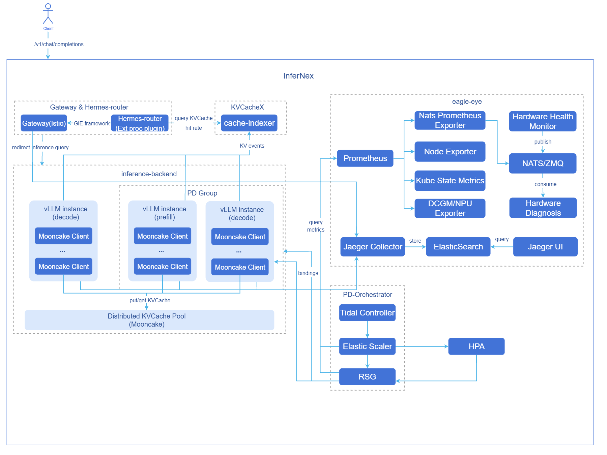

# AI推理集成部署

## 特性介绍

AI推理集成部署（InferNex）是一个专为云原生环境下AI推理服务优化所设计的端到端集成部署方案。该方案基于Kubernetes Gateway API Inference Extension (GIE) 和主流LLM技术栈构建，通过Helm Chart将开源网关、智能路由、高性能推理后端、全局KVCache管理、扩缩容决策框架及推理可观测体系等核心加速模块无缝集成。它提供从请求接入、动态路由、推理执行到资源管理与监控的完整加速链路，旨在提升推理吞吐量并降低TTFT/TPOT时延，实现一站式的高效AI服务部署体验。

### 应用场景

- **聚合推理场景**：支持聚合推理架构，适用于中小规模推理场景。
- **PD分离推理场景**：支持Prefill-Decode分离推理架构，适用于大规模、高吞吐推理场景。
- **AI推理软件套件场景**：支持原AI推理软件套件模式，适用于一体机场景下的软件部署。具体特性使用方法请参考[指南](#ai推理软件套件模式部署)。

### 能力范围

- 支持用户根据场景需求选装开源网关、智能路由、KVCache索引管理、推理可观测组件。
- 智能路由支持与多种开源网关集成，开源网关需适配GIE。
- 智能路由提供KVCache感知、PD分桶调度、时延预测等高级路由策略，支持多种场景下优化推理请求调度。
- 智能路由提供容灾能力，包含自动切流、故障感知以及请求重试。
- KVCache索引管理维护推理实例显存（L1）与外接缓存管理组件管理的内存（L3）两层KVCache视图，支持智能路由获取全面准确的请求KVCache命中率。
- 支持以LeaderWorkerSet（LWS）部署聚合/PD分离两种模式推理引擎，并且可以配置推理引擎节点数量。
- 支持配置Mooncake作为分布式KVCache管理后端。
- 支持在内置的vLLM启动命令基础上，将并行化策略通用的TP、DP、PP等配置参数保留为结构化配置，并通过`extraArgs`配置其他仅由vLLM/vLLM-Ascend消费的模型及推理引擎调优参数，常见配置项包括模型长度、批处理大小、显存利用率、块大小等。
- 支持配置不同版本vLLM推理引擎。
- 支持推理引擎节点级别的精细化资源配置，包括CPU限制、内存限制、环境变量、存储卷挂载等。
- 适配华为昇腾910B4芯片的推理加速。
- 支持用户配置推理芯片。
- 实现从AI网关、推理引擎、Mooncake到基础设施的全链路指标采集。
    - AI网关：性能、资源消耗、安全与合规审计等。
    - 推理引擎：API Server、模型输入输出、推理过程等。
    - Mooncake：Mooncake Master、Mooncake client和transfer engine。
    - 基础设施：Ray、K8s和硬件。
- 提供独立的硬件健康诊断模块，周期性采集NPU/GPU温度、功耗、错误码等底层指标，并通过分布式消息队列系统实时上报。诊断模块订阅并分析采集数据，结合设备型号、驱动与固件信息，基于阈值规则与异常指标分析，识别典型故障模式并输出诊断结论与处置建议，实现从数据采集到健康评估的闭环。
- 提供SLA相关指标（如吞吐率、延迟等），用于支撑推理服务的自动扩缩容决策，实现基于负载与性能的弹性伸缩。
- 提供网络性能指标（如节点RDMA网卡的实际传输速率、剩余可用带宽等），用于支撑权重分发加速模块实现基于网络性能的节点优选。
- 基于OpenTelemetry标准，提供从AI网关到推理引擎（vLLM-Ascend）的端到端分布式链路追踪，支持请求级追踪数据的采集、存储与查询，记录关键性能指标和业务属性。
- 提供潮汐算法，支持在指定时间段拉起/删除业务资源。
- 提供扩缩容决策框架，支持指标驱动与事件驱动来控制资源副本的扩缩容，并且支持用户自定义扩缩容决策算法及自定义资源管理逻辑的灵活扩展。
- 提供动态PD组扩缩容能力，利用抽象资源管理对象纳管PD实例，实现可按比例的动态PD扩缩容。
- 支持以Helm形式在K8s环境一键部署推理集群。
- 当前提供以下推理接口：`/v1/chat/completions`、`/v1/completions`。接口不涉及认证鉴权和日志审计能力，用户管理能力由上游用户管理面统一提供，详情见[对外接口说明](#对外接口说明)

### 亮点特征

- **组件选装与解耦**：开源网关、智能路由、KVCache索引管理、推理可观测组件均采用选装式设计，用户可根据实际场景按需启用或关闭，并支持替换为自研或第三方具备等价能力的组件。
- **开源网关能力集成**： 支持与适配GIE的开源网关（Istio、Envoy AI Gateway等）集成，具备服务发现、故障感知、请求重试、流量控制等关键网关能力。
- **KVCache Aware路由策略**：相比传统负载均衡，通过感知全局推理节点的KVCache状态实现更智能的请求路由，减少重复KVCache计算。
- **PD-Bucket路由策略**：PD分离架构下的分桶调度策略，在长短请求、中高并发场景提升推理吞吐量。
- **时延预测路由策略**：基于实例实时指标、缓存状态和时延预测结果进行路由决策，帮助进一步优化推理时延与资源利用率。
- **Prefill-Decode分离架构**：支持业界先进的PD分离架构，大幅提升LLM推理吞吐量。
- **LWS部署编排**：推理引擎由LWS承载部署，原生支持多DP协同，并可通过`dataParallelSize`与`dataParallelSizeLocal`配置DP负载均衡策略。
- **vLLM Mooncake集成**：vLLM v1架构集成Mooncake分布式KVCache管理系统，提供分布式KVCache池化存储与跨实例的KVCache高速传输，提升缓存复用效率。
- **秒级指标推送**：集成NATS分布式消息队列系统，实现高效的秒级指标推送。采集模块在获取硬件健康数据后，立即通过NATS将数据推送至诊断模块。该机制确保诊断模块能够快速接收到最新状态信息，进行及时的异常检测和故障分析。
- **端到端链路追踪**：提供从AI网关到推理引擎的请求级分布式追踪，支持追踪数据的采集、存储与查询，可精准定位推理链路中的性能瓶颈。
- **PD-Orchestrator特性**：集成潮汐算法、扩缩容决策框架与动态PD扩缩容三大能力，覆盖PD实例独立扩缩容、PD实例整组按比例扩缩容、指标驱动扩缩容、潮汐业务定时触发扩缩容等多个场景，保证业务在流量激增时的服务可用性。
- **一键部署**：通过Helm Chart实现三大组件在K8s环境一键式集成部署。

### 实现原理

**图1** AI推理集成组件图



- **Hermes-router**：智能路由组件。负责接收用户请求并根据路由策略转发到最优的推理后端服务。实现原理参见[《AI推理赫尔墨斯路由》](../../ai_inference_hermes_routing/user_guide/ai_inference_hermes_routing.md)。
- **cache-indexer**：KVCache索引管理组件，为智能路由提供L1/L3 两级KVCache命中率查询服务。实现原理参见[《AI推理KVCache索引管理》](../../ai_inference_cache_indexer/user_guide/ai_inference_cache-indexer.md)。
- **inference-backend**：推理后端组件，基于vLLM提供高性能大模型推理服务，由1个ProxyServer实例，n个vLLM Prefill推理引擎实例和n个vLLM Decode推理引擎实例组成。
- **vLLM**：vLLM推理引擎实例。
- **Mooncake**：分布式KVCache池化存储与提供PD实例之间的KVCache P2P高速传输。
- **eagle-eye**：提供近实时可观测指标发布订阅机制，保障关键指标毫秒级时延；覆盖推理场景的业务运行态、系统运行态和硬件健康指标，并提供硬件故障感知与诊断模块；提供从AI网关到推理引擎的端到端分布式链路追踪能力。实现原理参见[《AI推理鹰眼》](../../ai_inference_eagle_eye/user_guide/eagle_eye_for_ai_inference.md#实现原理)。
- **PD-Orchestrator**：由Tidal Controller、Elastic Scaler和RSG三个组件组成，提供潮汐定时扩缩、指标驱动扩缩与多资源按比例扩缩能力。实现原理参见[《AI推理弹性伸缩》](../../ai_inference_elastic_scaling_system/ai_inference_elastic_scaling/user_guide/ai_inference_elastic_scaling.md#实现原理)、[《AI推理潮汐算法》](../../ai_inference_elastic_scaling_system/ai_inference_tidal_algorithm/user_guide/ai_inference_tidal_algorithm.md#实现原理)、[《资源组扩缩容》](../../ai_inference_elastic_scaling_system/ai_inference_resourcescalinggroup/user_guide/ai_inference_resourcescalinggroup.md#实现原理)。

**组件初始化流程**：
- 开源网关（默认istio）：
  1. 用户部署Istiod控制平面后，Istiod启动并开始侦听Kubernetes Gateway API相关CRD（GatewayClass、Gateway、HTTPRoute等）。
  2. Istio自动创建GatewayClass资源，声明自身为网关控制器。
  3. 用户配置Gateway CR后，Istiod生成对应的Envoy配置，在目标命名空间中自动创建Envoy Proxy的Deployment和Service，作为实际网关入口。
  4. 数据平面完成配置加载，网关开始正常转发外部流量。

- 智能路由：
  1. 智能路由读取配置。
  2. 启动推理后端服务发现模块（周期性更新后端列表）。
  3. 启动推理后端指标收集模块（周期性更新后端负载指标）。

- 推理后端：
  1. 根据配置使用LWS部署vLLM推理引擎实例。
  2. vLLM推理引擎实例绑定硬件设备，加载模型。
  3. 每个vLLM推理引擎实例启动Mooncake客户端，注册内存/SSD存储池。
  4. Prefill推理引擎实例与Decode推理引擎实例与对方所暴露的KV connector端口建立连接。
  5. PD分离部署模式下，ProxyServer组件启动，开始对推理引擎实例自动发现（周期性更新推理引擎实例列表）。

- KVCache索引管理：
  1. 从ConfigMap加载配置，初始化L1/L3索引器、block hash构建器及评分服务，启动HTTP服务。
  2. 启动推理引擎实例自动发现模块，周期性更新vLLM Pod列表与Mooncake Master Pod。
  3. 对每个vLLM Pod建立ZMQ SUB连接，订阅KV事件并写入L1索引器。
  4. 对Mooncake Master Pod周期性轮询KVCache信息并写入L3索引器。
  5. 当实例下线时自动取消对应订阅，清理已离线实例的索引记录。

- PD-Orchestrator：
  1. 根据配置启动tidal-scheduler控制器、elastic-scaler控制器、ResourceScalingGroup控制器。
  2. 根据配置部署默认ElasticScaler CR实例与ResourceScalingGroup CR实例，绑定vLLM推理后端。
  3. 根据CPU利用率等指标对vLLM推理后端进行PD整组扩缩。

- eagle-eye
  1. 根据配置`eagle-eye.enabled`启动kube-prometheus-stack、nats、hardware-diagnosis、hardware-monitor、network-performance-exporter。
  2. hardware-monitor启动后，开始周期性采集NPU/GPU温度、功耗、错误码等底层指标，并通过nats实时发布至诊断模块。
  3. hardware-diagnosis订阅nats消息队列，接收采集数据并结合设备型号、驱动与固件信息进行健康状态分析，识别故障模式并输出诊断结论。
  4. network-performance-exporter启动后，开始周期性采集节点RDMA网卡的实际传输速率、剩余可用带宽等网络性能指标。
  5. Prometheus开始从各个exporter抓取指标数据，用于周期性计算与趋势评估。
  6. 根据配置`eagle-eye.tracing.enabled`启动链路追踪后端，部署Jaeger与Elasticsearch，用于接收、存储和查询追踪数据。
  7. 根据配置`global.tracingEnabled`创建EnvoyFilter，开源网关（Istio/Envoy）在转发请求时上报链路追踪数据至追踪后端；并在推理引擎侧开启链路数据上报。

**请求流程**：

1. **请求接入**：用户请求首先到达GIE开源网关Istio。
2. **KVCache查询**：网关插件Hermes-router向cache-indexer查询该请求在集群中的KVCache命中率。
3. **路由决策**：Hermes-router基于KVCache命中情况、GPU利用率等指标选择最优推理后端服务。
4. **请求转发**：开源网关将请求转发到选定的推理后端服务。
5. **KVCache获取**：Prefill节点推理引擎尝试从Mooncake KVCache池获取已缓存的前缀KVCache。
6. **预填充计算**：Prefill节点推理引擎执行未命中KVCache部分的token预填充计算，并将新生成的KVCache写入Mooncake KVCache池。
7. **KVCache传输**：Prefill节点推理引擎通过Mooncake将请求的KVCache高速传输给Decode节点推理引擎。
8. **推理生成**：Prefill推理引擎生成首token结果，Decode推理引擎基于接收到的KVCache持续生成后续token。
9. **推理实例动态扩缩容**：推理后端服务压力增大/减小时，ElasticScaler监控相应指标并计算需要扩容/缩容的副本数，实现推理后端服务扩容/缩容。
10. **结果返回**：推理引擎生成的推理结果返回开源网关，随后返回客户端。
11. **全局KVCache管理异步更新**：Prefill推理引擎在预填充过程中产生KV Event，cache-indexer订阅该KV Event并实时更新全局KVCache元数据。

### 与相关特性的关系

- 智能路由组件Hermes-router依赖推理引擎（如vLLM）提供推理服务及指标接口。
- KVCache索引管理组件cache-indexer依赖推理引擎和分布式缓存管理系统（如Mooncake）提供KVCache存储、移除事件。
- 潮汐算法Tidal-scheduler需要依赖弹性扩缩框架elastic-scaler对需要定时扩缩的资源对象的副本数进行修改。
- eagle-eye端到端链路追踪依赖开源网关（Istio）原生的链路追踪能力。

### 相关实例

InferNex默认配置示例参考：[values.yaml](https://gitcode.com/openFuyao/InferNex/blob/master/charts/infernex/values.yaml)

## 安装

### 前提条件

#### 硬件要求
- 每个推理节点至少一张推理芯片。
- 每个推理节点至少32GB内存，4CPU核。

#### 软件要求
- Kubernetes v1.33.0及以上版本。
- 已安装[npu-operator](https://gitcode.com/openFuyao/npu-operator)组件。
- 已安装LWS组件：推理后端由LWS编排部署，须在安装InferNex前于目标集群部署LWS CRD及LWS Operator（建议v0.8.0及以上）；安装详见[LWS官方安装文档](https://lws.sigs.k8s.io/docs/installation/)。
- InferNex会一键部署开源网关，默认使用Istio，需要确保环境没有冲突。
- InferNex包含的组件在目标命名空间尚未安装部署hermes-router、Inference Backend、cache-indexer。
- InferNex包含的组件在eagle-eye、nats命名空间尚未安装部署eagle-eye。

#### 网络要求
- 在线安装能够访问镜像仓库：oci://cr.openfuyao.cn。

#### 权限要求
- 用户具备创建RBAC资源的权限。

### 开始安装

#### 独立部署

本特性有以下两种途径独立部署：

**从openFuyao官方镜像仓库获取项目安装包**

1. 拉取项目安装包。
    ```bash
    helm pull oci://cr.openfuyao.cn/charts/infernex --version 0.0.0-latest
    ```
    拉取结果为tgz压缩包。`--version`用于指定安装包版本，与InferNex发布版本一一对应：`0.0.0-latest`表示master分支最新构建，其他版本号见[InferNex版本列表](https://gitcode.com/openFuyao/InferNex/tags)。

2. 解压安装包。
    ```bash
    tar -xzvf infernex-0.0.0-latest.tgz
    ```
    其中`0.0.0-latest`可替换为具体项目安装包版本。

3. 进入chart目录

    ```bash
   cd infernex
   ```

4. 调整配置（可选）

    可修改当前目录下的`values.yaml`；各项含义与示例见[配置AI推理集成部署](#配置AI推理集成部署)。使用默认配置时，可跳过本步骤。

5. 安装部署。

    以命名空间`ai-inference`、release名称`infernex`为例，在`infernex`目录下执行如下命令：
   ```bash
   helm install -n ai-inference infernex . --create-namespace
   ```

**从openFuyao GitCode仓库获取完整项目**

1. 从仓库拉取项目。

   ```bash
   git clone https://gitcode.com/openFuyao/InferNex.git
   ```

2. 进入chart目录并拉取依赖子chart

    ```bash
   cd InferNex/charts/infernex
   helm dependency build
   ```

3. 调整配置（可选）

    可修改当前目录下的`values.yaml`；各项含义与示例见[配置AI推理集成部署](#配置AI推理集成部署)。使用默认配置时，可跳过本步骤。

4. 安装部署。

    以命名空间`ai-inference`、release名称`infernex`为例，在`infernex`目录下执行如下命令：
   ```bash
   helm install -n ai-inference infernex . --create-namespace
   ```

#### 离线安装

1. 从openFuyao制品仓库获取InferNex 0.22.2离线安装包。

   ```bash
   wget https://openfuyao.obs.cn-north-4.myhuaweicloud.com/openFuyao/ext-components/InferNex/openFuyao-infernex-offline-v26.03.tar.gz
   ```

   >  **说明：**<br>
   > 若用户想手动制作InferNex离线包，可以参考[离线包制作指南](#离线包制作指南)。

2. 解压离线安装包。

   ```bash
   tar -xzvf openFuyao-infernex-offline-v26.03.tar.gz
   ```

3. 解压helm chart安装包、解压镜像到本地仓库、解压InferNex内置模型缓存文件。

   ```bash
   cd openFuyao-infernex-offline-v26.03 && bash install.sh
   ```

4. 安装部署。

   若用户想使用自定义模型文件，请参考[自定义模型目录配置](#自定义模型目录配置)。

   以命名空间`ai-inference`、release名称`infernex`为例，在chart包文件`infernex`的同级目录下执行如下命令：
   ```bash
   helm install -n ai-inference infernex ./infernex --create-namespace
   ```

## 配置AI推理集成部署
### 前提条件
- 已获取[InferNex](https://gitcode.com/openFuyao/InferNex)项目文件。

### 背景信息

InferNex以Helm Chart形式提供，主Chart集成多个子Chart（如智能路由、推理后端、KVCache索引管理、PD-Orchestrator等）。部署时以主Chart的`values.yaml`为准：在其中填写的配置会覆盖对应子Chart的默认值；未写出的字段则继续沿用子Chart默认配置。

下文「操作步骤」给出InferNex各组件的配置说明。按需在`values.yaml`中增加或修改对应配置项后部署，即可启用或调整相应能力。

### 操作步骤

1. 准备`values.yaml`配置文件。

    参考[开始安装章节](#开始安装)找到`values.yaml`配置文件。

2. 配置全局配置。
    - global.image.pullPolicy：控制InferNex部署所有镜像的拉取策略，在线部署时默认为`IfNotPresent`，离线部署时默认为`Never`。
    - global.imagePullSecrets：私有镜像仓库的Secret配置，用于从私有镜像仓库拉取镜像。例如：`[{"name": "registry-secret"}]`。
    - global.env：定义所有`inference-backend`服务实例的默认环境变量，这些环境变量会被注入到所有推理引擎容器和cache-indexer容器中。常见配置HuggingFace离线下载开关、Huggingface访问的K8s Secret。
    - global.autoDownloadModel：是否通过InferNex自动下载**Huggingface模型**。若想使用本地非Huggingface模型或处于离线环境，需设置为`false`。
    - global.modelName：推理模型名称（必填）。若未配置`global.modelPath`，vLLM会通过Huggingface模型名称方式加载权重。若已配置`global.modelPath`，vLLM会将该配置作为模型别名，用于推理请求的`model`字段匹配。默认使用的推理模型为`"Qwen/Qwen3-8B"`。
    - global.modelPath：推理模型权重本地路径（可选）。若配置，则vLLM使用本地路径方式启动，否则使用`global.modelName`配置的模型名称加载Huggingface模型。**当前版本该配置项不可与`cache-indexer`组件共用**。因模型权重通过`global.cachePath`方式挂载到容器的`/root/.cache`目录，所以该配置应为`/root/.cache/{cachePath后的模型目录}`。
    - global.cachePath：宿主机上存储`HuggingFace`模型缓存的路径，结构为`{缓存目录}/huggingface/hub/{模型目录}`，该路径会通过`hostPath`方式挂载到所有推理引擎容器和cache-indexer容器的`/root/.cache`目录。关于自定义模型目录配置的详细说明和示例，请参考[自定义模型目录配置](#自定义模型目录配置)。默认配置的宿主机模型缓存路径为`/home/llm_cache`。
    - global.tracingEnabled：Infernex各组件是否启用链路追踪，默认`false`。
    - global.tracingImage.repository：用于向推理引擎注入链路追踪补丁的镜像仓库地址。
    - global.tracingImage.tag：链路追踪补丁镜像标签。
    
        本地非Huggingface模型配置示例：宿主机本地模型路径`/mnt/public/models/my_models/Qwen3-8B-W8A8/`，则InferNex配置为：

        ```yaml
        global:
          env:
            - name: HF_HUB_OFFLINE
              value: "0"
          autoDownloadModel: false
          modelName: "Qwen3-8B-W8A8"
          modelPath: "/root/.cache/Qwen3-8B-W8A8/"
          cachePath: "/mnt/public/models/my_models/"
        ```

3. 配置智能路由参数。

    **配置网关参数**
    - inferenceGateway.enabled：开源网关开关。`true`开启，`false`关闭。
    - inferenceGateway.name：Gateway资源的名称。**必须与`hermes-router.httpRoute.inferenceGatewayName`保持一致**。
    - inferenceGateway.className：Gateway类名称。缺省值`"istio"`，表示使用Istio控制平面管理。
    - inferenceGateway.listeners：定义侦听器配置。
      - `name: http`：侦听器名称。
      - `port: 80`：侦听端口。
      - `protocol: HTTP`：协议类型。

    **配置路由镜像拉取**
    - hermes-router.enabled：智能路由开关。`true`开启，`false`关闭。注意，由于智能路由本身是扩展插件，无法在无网关的情况下单独使用。
    - hermes-router.image.repository：智能路由镜像地址。
    - hermes-router.image.tag：智能路由镜像版本。

    **配置路由策略**
    - hermes-router.inferenceExtension.replicas：智能路由副本数量。默认为`1`。
    - hermes-router.inferenceExtension.pluginsConfigFile：当前推荐保持为`default-plugins.yaml`，用于加载Hermes-router内置路由策略配置。
    - hermes-router.inferenceExtension.routing.deploymentMode：用于声明推理后端部署模式，可选`aggregate`或`pd`。
    - hermes-router.inferenceExtension.routing.profile：用于声明路由策略类型，可选`random`、`kv-cache-aware`、`bucket`、`prediction`。其中`bucket`仅适用于`pd`部署模式。
    - 当前支持以下预置路由策略组合：
      - `aggregate-random.yaml`：聚合架构随机路由。
      - `aggregate-kv-cache-aware.yaml`：聚合架构KVCache感知路由。
      - `aggregate-prediction.yaml`：聚合架构时延预测路由。
      - `pd-random.yaml`：PD架构随机路由。
      - `pd-kv-cache-aware.yaml`：PD架构KVCache感知路由。
      - `pd-bucket.yaml`：PD分桶调度路由。
      - `pd-prediction.yaml`：PD架构时延预测路由。
    - 如需使用Hermes-router内置路由策略的完整参考配置，可查看[hermes-router路由策略参考配置](https://gitcode.com/openFuyao/hermes-router/tree/master/examples/profiles)。
    - 如需自定义插件链，可继续通过`hermes-router.inferenceExtension.pluginsCustomConfig`扩展`EndpointPickerConfig`内容；此时`pluginsConfigFile`应与自定义配置文件名保持一致。

    **配置InferencePool**
    - hermes-router.inferencePool.targetPorts: InferencePool里各个推理服务实际侦听的端口号，用于处理推理流量。默认推理端口为`8000`。
    - hermes-router.inferencePool.modelServerType：推理引擎类型。默认为`vllm`。

    **配置HTTPRoute**
    - hermes-router.httpRoute.inferenceGatewayName：Gateway资源的名称。**必须与`inferenceGateway.name`保持一致**。

    **配置请求重试**
    - hermes-router.provider.istio.retryConfig：定义请求重试配置。
      - `enabled`：请求重试开关。`true`开启，`false`关闭。默认`false`。
      - `retryOn`：触发重试的错误类型列表，典型可选值包括：`connect-failure`、`refused-stream`、`unavailable`、`cancelled`、`retriable-status-codes`、`5xx`、`reset`等，可按需组合。默认全选。
      - `numRetries`：单次请求允许的最大重试次数。默认次数为`3`。
    - hermes-router.provider.istio.destinationRule.trafficPolicy.tls：定义Istio网关与推理后端的通信规则。
      - `mode`：Istio与后端通信时的TLS模式，可选：`DISABLE`（不启用TLS）、`SIMPLE`（单向TLS）、`MUTUAL/ISTIO_MUTUAL`（双向TLS，依赖证书或Istio提供的身份）。默认`SIMPLE`。
      - `insecureSkipVerify`：是否跳过对后端服务证书的校验，可选：`true`（跳过）、`false`（不跳过）。默认`true`。

4. 配置推理后端参数。

    **配置推理后端镜像参数**
    - inference-backend.images.inferenceEngine：配置推理引擎镜像（repository、tag）。InferNex默认配置使用`hub.oepkgs.net/openfuyao/ascend/vllm-ascend:v0.18.0`推理引擎；**多DP场景要求镜像内vLLM版本不低于0.10.0**，以支持chart自动注入的hybrid与多DP相关启动参数。
    - inference-backend.images.proxyServer：配置ProxyServer镜像（repository、tag）。

    **配置推理后端环境变量**
    - inference-backend.env：推理后端环境变量总配置，这些环境变量会被注入到**所有推理服务的推理引擎容器（Prefill、Decode）和ProxyServer容器**中。用户可根据实际需求参考[vllm-ascend环境变量配置说明](https://docs.vllm.ai/projects/ascend/en/latest/user_guide/configuration/env_vars.html)文档自行配置。

    **配置推理后端文件挂载参数**
    - inference-backend.volumeMounts：所有由LWS拉起的vLLM推理引擎Pod都会挂载的volumeMounts配置。默认配置包含昇腾设备相关的volumeMounts。用户可以根据需要增添更详细的挂载项，详细配置说明请参考[推理后端默认挂载配置](#推理后端默认挂载配置)。
    - inference-backend.volumes：所有由LWS拉起的vLLM推理引擎Pod都会挂载的volumes配置。默认配置包含昇腾设备相关的volumes。详细配置说明请参考[推理后端默认挂载配置](#推理后端默认挂载配置)。

    **配置推理服务**
    - inference-backend.services：推理服务配置，支持用户配置多个独立的vLLM推理服务。每个服务可独立配置模型、部署模式（聚合模式或PD分离模式）、资源等参数，实现多种部署形态推理服务的混合部署。推理引擎底层工作负载为**LWS**：`mode: pd`时Prefill、Decode各对应一条LWS（如`{服务名}-prefill`、`{服务名}-decode`）；`mode: aggregated`时对应一条LWS（如`{服务名}-aggregated`）。

      **基础配置**
      - name：推理服务名称。
      - enabled：是否部署该服务。InferNex要求推理后端至少要有一个推理服务是开启状态。
      - mode：推理后端服务模式，共有`aggregated`和`pd`两种可选，分别表示聚合架构和PD分离架构；默认`pd`。
      - service.port：Service服务端口，默认`8000`。
      - pdGroupID：PD模式分组ID，在PD分离架构下需要设置，表示该推理服务下的所有ProxyServer、Prefill、Decode推理后端均在该分组内，供智能路由按`openfuyao.com/pdGroupID`等标签发现与过滤。

      **配置推理引擎Connector**
      - kvTransferConfig.connectorConfig：配置KVCache Connector，用于定义Prefill和Decode阶段KVCache复用方式。提供YAML格式的配置对象，配置会按照键值对自动转换为JSON格式，并且`kv_role`、`kv_rank`、`engine_id`、`tp_size`、`dp_size`等prefill/decode节点特定字段会自动填充，无需手动配置（用户手动配置可以覆盖自动填充）。PD分离模式部署`kv_connector`推荐使用`MultiConnector`（结合`MooncakeConnectorV1`和`AscendStoreConnector`），聚合模式部署推荐使用`AscendStoreConnector`。

        因vllm/vllm-ascend版本不同，connector的名称、细节配置项存在不同，详细配置说明请参考目标vllm/vllm-ascend版本文档。InferNex默认配置使用`vllm-ascend:v0.18.0`推理引擎，用户可以参考[vllm-ascend文档](https://docs.vllm.ai/projects/ascend/en/v0.18.0/user_guide/feature_guide/kv_pool.html)中KV池与PD分离相关章节。

      - kvTransferConfig.mooncake.configPath：使用Mooncake作为推理引擎的KVCache管理系统时，推理引擎内Mooncake客户端启动的配置项文件。默认路径为`"/app/mooncake.json"`。
      - kvTransferConfig.mooncake.use_store：使用Mooncake作为推理引擎的KVCache管理系统时，用于控制是否使用Mooncake Store模式。若上方connector类型应用了Mooncake Store类型Connector，需要将此配置开启。
      - kvTransferConfig.mooncake.config：Mooncake客户端配置文件内容（yaml格式）。推理引擎pod的initContainer会自动转换并生成`mooncake.json`配置文件让推理引擎内的Mooncake客户端直接使用。详细配置项说明请参考[Mooncake文档](https://kvcache-ai.github.io/Mooncake/deployment/integrations/vllm/kv-cache-storage.html#using-vllm-v1-recommended)。

      **配置PD分离模式下推理引擎启动项**
      - pd.prefill.replicas：Prefill侧LWS并行组套数，默认`2`。
      - pd.prefill.cardCount：用于指定分配给Prefill引擎的推理卡数量；未配置时默认取
      `tp*pp*dataParallelSizeLocal`。
      - pd.prefill.tensorParallelSize：Prefill引擎张量并行度。
      - pd.prefill.pipelineParallelSize：Prefill引擎流水线并行度，当前仅支持配置为1。
      - pd.prefill.dataParallelSize：Prefill引擎数据并行度（逻辑DP rank总数），默认`1`。
      - pd.prefill.dataParallelSizeLocal：Prefill引擎单节点本地DP rank数，默认`1`。**`dataParallelSize`为推理服务DP rank总数，`dataParallelSizeLocal`为单个推理引擎节点worker上的本地rank数；二者须能整除**，商即为该LWS的组内worker数（推理引擎节点数量）。chart根据LWS组内环境变量自动注入vLLM多DP启动参数；`dataParallelSizeLocal`为1时接近External DP负载均衡，与`dataParallelSize`相等时接近Internal DP负载均衡。
      - pd.prefill.dataParallelRpcPort：Prefill引擎DP RPC端口；`dataParallelSize`大于1时必填，默认`12890`。

        ```yaml
        pd:
          prefill:
            replicas: 1                 
            dataParallelSize: 4         
            dataParallelSizeLocal: 2    
            dataParallelRpcPort: 12890
            tensorParallelSize: 1
            pipelineParallelSize: 1
        ```
        部署拓扑（replicas=1）：LWS leaderWorkerTemplate.size = 4 / 2 = 2（2个推理引擎节点）。

        节点0（LWS_WORKER_INDEX=0）：Pod×2 → DP rank 0、1（--data-parallel-start-rank=0）

        节点1（LWS_WORKER_INDEX=1）：Pod×2 → DP rank 2、3（--data-parallel-start-rank=2）

      - pd.prefill.env：Prefill引擎容器环境变量列表。可按需追加角色专属变量。
      - pd.prefill.volumeMounts：Prefill引擎容器volumeMounts列表，用于配置该推理服务Prefill推理引擎Pod特殊需要的volume挂载。
      - pd.prefill.volumes：Prefill引擎容器volumes列表，用于配置该推理服务Prefill推理引擎Pod特殊需要的volumes。
      - pd.prefill.extraArgs：Prefill引擎额外的vLLM启动参数列表。以下为infernex默认配置注入的参数，用户可在此基础上追加其他vLLM启动参数用于推理引擎优化等，所配置的额外配置项会被追加到Prefill引擎的启动命令中。
        - `--enable-prefix-caching`/`--no-enable-prefix-caching`：是否启用Prefill引擎Prefix Cache，Prefill引擎默认设置为`--enable-prefix-caching`，即启用Prefix Cache。
        - `--max-model-len`：Prefill引擎最大模型长度。
        - `--max-num-batched-tokens`：Prefill引擎最大批处理token数。
        - `--gpu-memory-utilization`：Prefill引擎显存利用率。
        - `--block-size`：Prefill引擎KV Cache Block的token数量。
        - `--trust-remote-code`：允许Prefill引擎加载模型仓库中的自定义代码，使用前应确认模型来源可信。
        - `--disable-access-log-for-endpoints=/health,/metrics`：过滤Prefill引擎`/health`和`/metrics`接口的vLLM访问日志，包括4xx/5xx请求日志；调试时可调整或移除该参数。
        >  **说明：**<br>
        > `extraArgs`支持的其他启动参数请参考[vLLM Serve CLI](https://docs.vllm.ai/en/latest/cli/serve/)和[vLLM-Ascend官方文档](https://docs.vllm.ai/projects/ascend/en/latest/)。不同版本支持的参数可能存在差异，请以实际使用的推理引擎镜像版本为准。
      - pd.decode.replicas：Decode侧LWS并行组套数，默认`2`。
      - pd.decode.cardCount：用于指定分配给Decode引擎的推理卡数量；未配置时默认取
      `tp*pp*dataParallelSizeLocal`。
      - pd.decode.tensorParallelSize：Decode引擎张量并行度。
      - pd.decode.pipelineParallelSize：Decode引擎流水线并行度，当前仅支持配置为1。
      - pd.decode.dataParallelSize：Decode引擎数据并行度（逻辑DP rank总数），默认`1`。
      - pd.decode.dataParallelSizeLocal：Decode引擎单节点本地DP rank数，默认`1`；含义与`pd.prefill`相同，参见上文配置示例。
      - pd.decode.dataParallelRpcPort：Decode引擎DP RPC端口；`dataParallelSize`大于1时必填，默认`12777`。
      - pd.decode.env：Decode引擎容器环境变量列表，用于配置该推理服务Decode推理引擎Pod特殊需要的环境
      变量。
      - pd.decode.volumeMounts：Decode引擎容器volumeMounts列表，用于配置该推理服务Decode推理引擎Pod特殊需要的volume挂载。
      - pd.decode.volumes：Decode引擎容器volumes列表，用于配置该推理服务Decode推理引擎Pod特殊需要的volumes。
      - pd.decode.extraArgs：Decode引擎额外的vLLM启动参数列表，作用与`pd.prefill.extraArgs`相同，默认注入参数一致；区别仅在于Decode引擎Prefix Cache默认关闭，设置为`--no-enable-prefix-caching`。
      - pd.proxyServer.enabled：是否部署该推理服务对应的ProxyServer，PD分离模式下默认`true`。ProxyServer对推理后端节点服务发现时会筛选`pdGroupID`，当部署多个推理服务，且希望他们由一个ProxyServer统一管理路由，可以将各个`inference-backend.services[i].pdGroupID`设为一致，且只有一个推理服务设置`pd.proxyServer.enabled`为`true`。
      - pd.proxyServer.discoveryInterval：ProxyServer对推理后端服务发现间隔（单位：秒），默认`10`。
      - pd.proxyServer.accessLog.enabled：是否启用ProxyServer HTTP访问日志，默认`true`；配置为`false`时关闭全部ProxyServer HTTP访问日志。
      - pd.proxyServer.accessLog.excludedEndpoints：ProxyServer不记录成功请求访问日志的接口列表，默认为`/health`和`/metrics`；对应接口的4xx/5xx请求仍会记录。**该配置仅作用于ProxyServer，vLLM引擎日志由各节点`extraArgs`中的`--disable-access-log-for-endpoints`控制。**

      **配置聚合模式下推理引擎**
      - aggregated.replicas：聚合模式LWS并行组套数。
      - aggregated.cardCount：用于指定分配给聚合模式推理引擎的推理卡数量；未配置时默认取`tp*pp*dataParallelSizeLocal`。
      - aggregated.tensorParallelSize：聚合模式推理引擎张量并行度。
      - aggregated.pipelineParallelSize：聚合模式推理引擎流水线并行度，当前仅支持配置为1。
      - aggregated.dataParallelSize：聚合模式推理引擎数据并行度（逻辑DP rank总数），默认`1`；LWS与多DP参数含义参见PD模式上文`pd.prefill`配置示例。
      - aggregated.dataParallelSizeLocal：聚合模式单节点本地DP rank数，默认`1`。
      - aggregated.dataParallelRpcPort：聚合模式DP RPC端口；`dataParallelSize`大于1时必填，默认`12890`。
      - aggregated.env：聚合模式推理引擎容器环境变量列表，用于配置该推理服务推理引擎Pod特殊需要的环境变量。
      - aggregated.volumeMounts：聚合模式推理引擎容器volumeMounts列表，用于配置该推理服务推理引擎Pod特殊需要的volume挂载。
      - aggregated.volumes：聚合模式推理引擎容器volumes列表，用于配置该推理服务推理引擎Pod特殊需要的volumes。
      - aggregated.extraArgs：聚合模式推理引擎额外的vLLM启动参数列表，作用与默认注入参数均与`pd.prefill.extraArgs`相同，参见上文。

      **配置推理引擎资源**
      - resources.requests：推理引擎请求资源。默认示例为CPU `4`、内存`64Gi`。
      - resources.limits：推理引擎限制资源。默认示例为CPU `8`、内存`128Gi`。

5. 配置KVCache索引管理参数。 
   
    **配置是否启用KVCache索引管理组件**
    - cache-indexer.enabled：cache-indexer为InferNex可选组件，默认为`true`。

    **配置KVCache索引管理组件镜像拉取**
    - cache-indexer.image.repository：cache-indexer镜像地址。
    - cache-indexer.image.tag：cache-indexer镜像标签。

    **配置KVCache索引管理组件资源**
    - cache-indexer.resources.requests：cache-indexer Pod资源请求值，默认CPU `100m`、内存`128Mi`。
    - cache-indexer.resources.limits：cache-indexer Pod资源限制值，默认CPU `1`、内存`2Gi`。

    **配置KVCache索引管理组件日志**
    - cache-indexer.log.level：cache-indexer日志级别，可选`debug`、`info`、`error`，默认`info`。

    **配置KVCache索引管理组件的K8s服务**
    - cache-indexer.service.name：cache-indexer的K8s Service名称，默认为`cache-indexer-service`。
    - cache-indexer.service.port：cache-indexer的K8s Service端口，默认为`8080`。

    **配置KVCache索引管理组件的推理后端服务发现**
    - cache-indexer.discovery.labels.engineKey/engineValue：vLLM Pod发现标签，默认`openfuyao.com/engine=vllm`。
    - cache-indexer.discovery.labels.pdRoleKey/pdRoleValue：参与命中率计算的推理角色标签，默认`openfuyao.com/pdRole`，取值`prefill`和`aggregate`。
    - cache-indexer.discovery.labels.kvManagerKey/kvManagerValue：Mooncake Master发现标签，默认`openfuyao.com/kvmanager=mooncake`。

    **配置KVCache索引管理组件block hash计算参数**
    - cache-indexer.blockKey.pythonHashSeed：必须与vLLM `PYTHONHASHSEED`一致，默认`"0"`。
    - cache-indexer.blockKey.prefixCachingHashAlgo：必须与vLLM `--prefix-caching-hash-algo`一致，默认`sha256_cbor`。
    - cache-indexer.blockKey.useIntBlockHashes：必须与vLLM `VLLM_KV_EVENTS_USE_INT_BLOCK_HASHES`一致，默认`true`。

6. 配置AI推理可观测参数。

   **配置是否开启AI推理可观测**
   - eagle-eye.enabled：控制是否启用AI推理可观测，默认`true`。

   **配置硬件健康检测镜像拉取**
   - eagle-eye.hardware-monitor.images.core.repository：hardware-monitor镜像地址。
   - eagle-eye.hardware-monitor.images.core.tag：hardware-monitor镜像标签。
   - eagle-eye.hardware-monitor.images.core.pullPolicy：hardware-monitor镜像拉取策略。

   **配置硬件诊断镜像拉取**
   - eagle-eye.hardware-diagnosis.images.core.repository：hardware-diagnosis镜像地址。
   - eagle-eye.hardware-diagnosis.images.core.tag：hardware-diagnosis镜像标签。
   - eagle-eye.hardware-diagnosis.images.core.pullPolicy：hardware-diagnosis镜像拉取策略。

   **配置网络性能采集组件镜像拉取**
   - eagle-eye.network-performance-exporter.images.core.repository：network-performance-exporter镜像地址。
   - eagle-eye.network-performance-exporter.images.core.tag：network-performance-exporter镜像标签。
   - eagle-eye.network-performance-exporter.images.core.pullPolicy：network-performance-exporter镜像拉取策略。

   **配置网络性能采集组件采集参数**
   - eagle-eye.network-performance-exporter.networkPerformanceExporter.metricsPort：network-performance-exporter指标暴露端口。
   - eagle-eye.network-performance-exporter.networkPerformanceExporter.collectInterval：network-performance-exporter指标采集间隔。

   **配置链路追踪后端**
   - eagle-eye.tracing.enabled：控制是否启用端到端链路追踪后端，默认`false`，开启后将部署Jaeger与Elasticsearch。
   - eagle-eye.tracing.jaeger.query.service.type：Jaeger查询服务的Service类型，默认`NodePort`。
   - eagle-eye.tracing.jaeger.query.service.nodePort：Jaeger查询界面的NodePort端口，默认`30686`。

7. 配置PD-Orchestrator参数。

    **配置是否开启弹性扩缩容框架**
    - elastic-scaler.enabled: 控制是否启用elastic-scaler组件

    **配置弹性扩缩容框架镜像拉取**
    - elastic-scaler.images.repository：elastic-scaler镜像地址。
    - elastic-scaler.images.tag：elastic-scaler镜像标签。

    **配置PD-Orchestrator组件安装命名空间**
    - elastic-scaler.namespace.name：PD-Orchestrator组件控制器所在的命名空间。

    **配置弹性扩缩容框架默认CR实例**
    - elastic-scaler.elasticScaler.enabled：控制是否部署默认ElasticScaler CR实例。
    - elastic-scaler.targetRef.kind：默认ElasticScaler CR所控制的实际资源对象的类型，可以是kubernetes原生资源如`Deployment`、`StatefulSet`等。在InferNex的配置中，该配置默认为`resourcescalinggroup`。
    - elastic-scaler.targetRef.name：默认ElasticScaler CR所控制的实际资源对象的名字。在InferNex的配置中，该字段需要对应RSG资源对象的名称。示例：若RSG资源对象的配置为：

      ```yaml
      resourcescalinggroup:
        instanceConfig:
          name: rsg
      ```

      则该属性需要配置为`elastic-scaler.targetRef.name：rsg`。

    - elastic-scaler.targetRef.apiVersion：默认ElasticScaler CR所控制的实际资源对象的API版本。在InferNex的配置中，该字段需要对应RSG资源对象的API版本，例如`autoscaling.openfuyao.com/v1alpha1`。
    - elastic-scaler.minReplicas：默认ElasticScaler CR所控制的实际资源对象的最小副本数量。
    - elastic-scaler.maxReplicas：默认ElasticScaler CR所控制的实际资源对象的最大副本数量。
    - elastic-scaler.trigger.scalingAlgorithm：触发实际资源对象扩缩的算法，默认配置为`apa`。
    - elastic-scaler.trigger.resource.metricsName：触发实际资源对象扩缩的指标名称，默认配置为CPU，表示扩缩容模块会根据CPU指标进行资源副本数的计算。
    - elastic-scaler.trigger.resource.targetType：触发实际资源对象扩缩的指标类型，默认为利用率，与`elastic-scaler.trigger.resource.metricsName`字段结合，表示CPU利用率是资源对象副本扩缩容的触发类型。
    - elastic-scaler.trigger.resource.targetValue：触发实际资源对象扩缩的指标阈值。

    **配置是否开启PD扩缩资源管理对象组件**
    - resourcescalinggroup.enabled: 控制是否启用ResourceScalingGroup组件

    **配置PD扩缩资源管理对象组件镜像拉取**
    - resourcescalinggroup.images.repository：ResourceScalingGroup镜像地址。
    - resourcescalinggroup.images.tag：ResourceScalingGroup镜像标签。

    **配置PD扩缩资源管理对象组件安装命名空间**
    - resourcescalinggroup.namespace.name：ResourceScalingGroup Controller部署所在的命名空间，默认是`scaling-system`。
    - resourcescalinggroup.namespace.create：是否自动创建`resourcescalinggroup.namespace.name`指定的命名空间。若集群中不存在该命名空间，需要设置为`true`；否则需要提前手动创建。当前缺省值为`false`，默认不创建该命名空间。

    **配置PD扩缩资源管理对象组件运行参数**
    - resourcescalinggroup.prometheus.url：Prometheus查询地址，供`scaleDown.metric`缩容策略使用，实际会注入环境变量`RSG_PROMETHEUS_URL`。该功能需搭配prometheus相关配置使用，详情请参考[《资源组扩缩容》](../../ai_inference_elastic_scaling_system/ai_inference_resourcescalinggroup/user_guide/ai_inference_resourcescalinggroup.md#groupreplication-scaledown-metric)。

    **配置PD扩缩资源管理对象默认CR实例**
    - ResourceScalingGroup CR实例配置

      **基础配置**
      - resourcescalinggroup.instanceConfig.enabled：控制是否部署默认ResourceScalingGroup CR实例。
      - resourcescalinggroup.instanceConfig.name：默认ResourceScalingGroup CR实例的名字。     
      - resourcescalinggroup.instanceConfig.scalingStrategy.type：默认ResourceScalingGroup CR实例采用的扩缩策略类型，为`GroupReplication`或`InplaceScaling`。当前默认配置为`GroupReplication`，若需要改成`InplaceScaling`模式，请参考[《资源组扩缩容》](../../ai_inference_elastic_scaling_system/ai_inference_resourcescalinggroup/user_guide/ai_inference_resourcescalinggroup.md#操作步骤)。
      - resourcescalinggroup.instanceConfig.scalingStrategy.groupConfig.groupName：默认ResourceScalingGroup CR实例的组名前缀；为空时默认使用RSG名称。
      - resourcescalinggroup.instanceConfig.scalingStrategy.groupConfig.replicas：默认ResourceScalingGroup CR实例的期望组数，这个属性被`elastic-scaler.minReplicas`和`elastic-scaler.maxReplicas`字段所限制。示例：若配置为：

        ```yaml
        elastic-scaler:
          minReplicas: 1
          maxReplicas: 10
        ```
        
        则通过APA扩缩容所创建的资源组数最少个数为1，最大个数为10。

      - resourcescalinggroup.instanceConfig.scalingStrategy.groupConfig.scaleDown.metric.expr：默认ResourceScalingGroup CR实例缩容参考的Prometheus指标表达式或指标名。
      - resourcescalinggroup.instanceConfig.scalingStrategy.groupConfig.scaleDown.metric.type：默认ResourceScalingGroup CR实例缩容指标类型，如`Counter`、`Gauge`、`Histogram`。
      - resourcescalinggroup.instanceConfig.scalingStrategy.groupConfig.scaleDown.metric.window：当缩容指标类型为`Counter`或`Histogram`时使用的统计窗口。
      - resourcescalinggroup.instanceConfig.scalingStrategy.groupConfig.scaleDown.metric.aggregator：缩容时对指标数据的聚合方式，如`avg`、`sum`、`max`。
      - resourcescalinggroup.instanceConfig.scalingStrategy.groupConfig.scaleDown.order：组缩容顺序，通常支持`ascending`或`descending`。

      **扩缩资源对象配置**
      - 下面给出在InferNex的配置中，`resourcescalinggroup.instanceConfig.targetResources`所有相关的字段的配置：

        ```yaml
        resourcescalinggroup:
          instanceConfig:
            name: rsg # ResourceScalingGroup CR实例的名字，需要和elastic-scaler.targetRef.name相同
            targetResources:
            - name: prefill # 该名称用户可自定义
              resourceRef:
                apiVersion: leaderworkerset.x-k8s.io/v1
                kind: LeaderWorkerSet # inference backend所创建的prefill节点的资源类型
                name: qwen3-8b-2p2d-01-prefill # 须与inference-backend.services[].name对应：{服务名}-prefill
            - name: decode
              resourceRef:
                apiVersion: leaderworkerset.x-k8s.io/v1
                kind: LeaderWorkerSet
                name: qwen3-8b-2p2d-01-decode # 须与{服务名}-decode一致
        ```

      - resourcescalinggroup.instanceConfig.targetResources.name：默认ResourceScalingGroup CR实例内目标资源的逻辑名称，用于缩放策略配置引用，同一资源组内需保持唯一。
      - resourcescalinggroup.instanceConfig.targetResources.resourceRef.apiVersion：默认ResourceScalingGroup CR实例中目标工作负载的API版本。在InferNex的配置中，由于推理后端的默认配置对象是`Deployment`，因此缺省值为`apps/v1`。
      - resourcescalinggroup.instanceConfig.targetResources.resourceRef.kind：默认ResourceScalingGroup CR实例中目标工作负载类型，如`Deployment`、`StatefulSet`、`LeaderWorkerSet`。在InferNex的配置中，缺省值为`Deployment`，该类型需要和`inference-backend`创建的推理后端资源类型相同。
      - resourcescalinggroup.instanceConfig.targetResources.resourceRef.name：默认ResourceScalingGroup CR实例中目标工作负载名称。在InferNex的配置中，需要和`inference-backend.services.name`所对应。
      - resourcescalinggroup.instanceConfig.targetResources.resourceRef.namespace：默认ResourceScalingGroup CR实例中目标工作负载所在命名空间，为空时默认使用RSG所在命名空间。

   **配置是否开启潮汐算法组件**
   - tidal.enabled：控制是否启用TidalScheduler组件，用于按时间规则调整目标工作负载副本数或ResourceScalingGroup组数。

   **配置潮汐算法组件镜像配置**
   - tidal.images.repository：tidal镜像地址。
   - tidal.images.tag：tidal镜像标签。

   > **说明**：<br/>
   > TidalScheduler只负责根据时间规则计算期望副本数，实际扩缩容仍依赖ElasticScaler执行。若主要通过Tidal进行潮汐扩缩，建议保持`elastic-scaler.enabled=true`，并按需关闭默认ElasticScaler和ResourceScalingGroup的示例CR，避免与业务自定义的ElasticScaler或ResourceScalingGroup资源冲突。

8. 应用配置

    用户参考[安装章节](#安装)部署以应用配置。

## 使用AI推理

### 前提条件

#### 硬件要求
- 每个推理节点至少一张推理芯片。
- 每个推理节点至少32GB内存，4 CPU核。
- 在PD分离场景Mooncake传输KVCache时，若使用HCCS协议，宿主机`/etc/hccn.conf`文件需要对宿主机的推理设备IP地址以及掩码配置正确，`hccn.conf`文件配置设备信息的示例脚本请参考[昇腾HCCS设备IP地址配置示例](#昇腾hccs设备ip地址配置示例)。

#### 软件要求
- Kubernetes v1.33.0及以上版本。
- 已安装[npu-operator](https://gitcode.com/openFuyao/npu-operator)组件。
- 已安装[LWS](https://lws.sigs.k8s.io/docs/installation/)组件。
- 集群中需要安装metrics server v0.8.0及以上版本。
- 已经安装InferNex包含的必要组件：inference-backend、PD-Orchestrator。

#### 网络要求
- 在PD分离场景Mooncake传输KVCache时，若使用HCCS协议跨机高速通信传输，需要有HCCS设备或者RDMA设备支持。

### 背景信息
无。

### 使用限制
- 当前仅支持vLLM/vLLM-Ascend推理引擎。
- 当前仅在Ascend910B4推理芯片验证。
- 当前仅支持AI推理场景，不支持AI训练场景。

### 操作步骤

以release名称`infernex`和部署命名空间`ai-inference`为例：

1. 获取服务访问地址。

    1.1 查看hermes-router服务的访问地址：
    ```bash
    kubectl get svc -n ai-inference
    ```

    1.2记录网关的IP地址与端口。hermes-router服务名称为`inference-gateway-istio`。

2. 发送推理请求（以curl发送请求为例）。

    2.1 发送非流式推理请求：
    ```bash
    curl -X POST http://[路由服务IP地址]:[路由服务端口]/v1/chat/completions \
      -H "Content-Type: application/json" \
      -d '{
        "model": "Qwen/Qwen3-8B",
        "messages": [{"role": "user", "content": "请介绍openFuyao开源社区"}],
        "stream": false
      }'
    ```

    2.2 发送流式推理请求：
    ```bash
    curl -X POST http://[路由服务IP地址]:[路由服务端口]/v1/chat/completions \
      -H "Content-Type: application/json" \
      -d '{
        "model": "Qwen/Qwen3-8B",
        "messages": [{"role": "user", "content": "请介绍openFuyao开源社区"}],
        "stream": true
      }'
    ```

3. 接收推理结果。

    3.1 非流式响应一次性返回完整结果。

    3.2 流式响应逐块返回以`data:`开头的JSON对象。

### 相关操作

以release名称`infernex`和命名空间`ai-inference`为例：

**查看部署状态**：
```bash
helm status infernex -n ai-inference
```

**卸载系统**：
```bash
helm uninstall infernex -n ai-inference
```

**导出配置**：
```bash
helm get values infernex -n ai-inference > current-values.yaml
```

**查询Prometheus指标**：

InferNex内置eagle-eye可观测组件，负责采集推理引擎、硬件等指标并上报至Prometheus。可按以下步骤查询指标。

1. 获取Prometheus服务访问地址。

   若集群中**未预先部署Prometheus Operator**，需在`values.yaml`中启用`eagle-eye.enabled: true`，InferNex会通过eagle-eye自动部署kube-prometheus-stack，Prometheus部署在helm install时指定的命名空间（以命名空间`ai-inference`、release名称`infernex`为例），可通过以下命令获取访问地址：

   ```bash
   kubectl get svc infernex-kube-prometheus-stac-prometheus -n ai-inference
   ```

   若集群中**已存在Prometheus Operator**，可通过以下命令查找Prometheus Service所在命名空间及Service名称：

   ```bash
   kubectl get svc -A | grep prometheus
   ```

   记录Prometheus服务所在命名空间及其ClusterIP或NodePort地址。

2. 访问Prometheus查询界面。

   - 若Prometheus Service类型为**NodePort**，可直接在浏览器中访问`http://<节点IP>:<NodePort端口>`，进入Prometheus Web UI。
   - 若Prometheus Service类型为**ClusterIP**（默认），需通过端口转发访问：

   ```bash
   kubectl port-forward svc/<prometheus-svc-name> 9090:9090 -n <namespace>
   ```

   然后在浏览器访问`http://localhost:9090`。

3. 在查询框中输入PromQL表达式，单击**Execute**查看结果。

   **表1：推理引擎常用指标（vLLM）**

   | 指标名 | 类型 | 说明                 |
   |--------|------|--------------------|
   | `vllm:num_requests_running` | Gauge | 当前运行中的请求数。         |
   | `vllm:num_requests_waiting` | Gauge | 等待调度的请求数。          |
   | `vllm:num_requests_swapped` | Gauge | 被抢占的请求数。           |
   | `vllm:gpu_cache_usage_perc` | Gauge | KVCache使用率。        |
   | `vllm:prompt_tokens_total` | Counter | 累计提示词token数。       |
   | `vllm:generation_tokens_total` | Counter | 累计生成token数。        |
   | `vllm:request_success_total` | Counter | 处理成功的请求总数。         |
   | `vllm:e2e_request_latency_seconds` | Histogram | 端到端请求延迟。           |
   | `vllm:time_to_first_token_seconds` | Histogram | 首token时延（TTFT）。    |
   | `vllm:time_per_output_token_seconds` | Histogram | 每个输出token时延（TPOT）。 |

   常用PromQL示例：

   ```promql
   # 查询各实例当前运行请求数
   vllm:num_requests_running

   # 查询P99 TTFT（秒）
   histogram_quantile(0.99, rate(vllm:time_to_first_token_seconds_bucket[5m]))

   # 查询各Pod的KV Cache使用率
   avg by (pod) (vllm:gpu_cache_usage_perc)

   # 按PD组聚合运行请求数（用于ResourceScalingGroup缩容决策）
   avg by (group_id) (vllm:num_requests_running)
   ```

>  **说明：**<br>
> vLLM指标名称在不同版本间可能存在差异，建议以实际部署版本暴露的指标为准，可通过访问推理引擎Pod的`/metrics`端点确认。详细说明请参考[vLLM官方文档](https://docs.vllm.ai/en/latest/design/metrics.html)。

#### 查询组件日志

InferNex各组件（hermes-router、proxy-server、inference-backend、cache-indexer、Mooncake等）的标准输出日志，以及推理引擎内的昇腾设备日志（p-log），可通过社区logging-package组件统一采集与查询，用于追溯Pod异常重建前的历史日志。只有在源文件删除前已成功采集到Loki的日志，才能在源Pod删除后继续查询；未采集到的日志不能恢复。

##### 部署logging-package

以下示例基于logging-package 26.6.0和Helm方式部署的InferNex；使用InferNex-Bridge管理服务时，需使用对应的服务配置，不能直接套用下文的Helm values。部署前准备可用的StorageClass，并确认集群具备proxy-logging认证所依赖的openFuyao认证服务与`webhook-auth`角色。

1. 拉取并解压安装包。

    ```bash
    helm pull oci://cr.openfuyao.cn/charts/logging-package --version 26.6.0
    tar -xzf logging-package-26.6.0.tgz
    cd logging-package
    ```

2. 编写部署配置文件`logging-values.yaml`。

    ```yaml
    proxy-logging:
      enableOAuth: true     # 前端认证，保持默认开启

    loki-stack:
      namespace: loki
      promtail:
        # promtail读进度目录挂载，必配（见下方说明）
        extraVolumes:
          - name: run-promtail
            emptyDir: {}
        extraVolumeMounts:
          - name: run-promtail
            mountPath: /run/promtail
        # 使用已有推理节点标签，需覆盖全部待采集组件所在节点
        nodeSelector:
          <推理节点标签键>: <推理节点标签值>
        # 仅采集指定命名空间；多租户共享命名空间时还需增加Pod标签过滤
        config:
          snippets:
            # 覆盖默认任务列表，移除/var/log/random/*.log示例任务
            scrapeConfigs: |
              - job_name: kubernetes-pods
                pipeline_stages:
                  {{- toYaml .Values.config.snippets.pipelineStages | nindent 4 }}
                kubernetes_sd_configs:
                  - role: pod
                relabel_configs:
                  - source_labels:
                      - __meta_kubernetes_pod_controller_name
                    regex: ([0-9a-z-.]+?)(-[0-9a-f]{8,10})?
                    action: replace
                    target_label: __tmp_controller_name
                  - source_labels:
                      - __meta_kubernetes_pod_label_app_kubernetes_io_name
                      - __meta_kubernetes_pod_label_app
                      - __tmp_controller_name
                      - __meta_kubernetes_pod_name
                    regex: ^;*([^;]+)(;.*)?$
                    action: replace
                    target_label: app
                  - source_labels:
                      - __meta_kubernetes_pod_label_app_kubernetes_io_instance
                      - __meta_kubernetes_pod_label_instance
                    regex: ^;*([^;]+)(;.*)?$
                    action: replace
                    target_label: instance
                  - source_labels:
                      - __meta_kubernetes_pod_label_app_kubernetes_io_component
                      - __meta_kubernetes_pod_label_component
                    regex: ^;*([^;]+)(;.*)?$
                    action: replace
                    target_label: component
                  {{- if .Values.config.snippets.addScrapeJobLabel }}
                  - replacement: kubernetes-pods
                    target_label: scrape_job
                  {{- end }}
                  {{- toYaml .Values.config.snippets.common | nindent 4 }}
                  {{- with .Values.config.snippets.extraRelabelConfigs }}
                  {{- toYaml . | nindent 4 }}
                  {{- end }}
            extraRelabelConfigs:
              - source_labels: [__meta_kubernetes_namespace]
                regex: <推理服务命名空间>    # 必须替换；多个获准命名空间用|分隔
                action: keep
            # 可选p-log任务；GPU场景或不采集p-log时删除extraScrapeConfigs字段
            extraScrapeConfigs: |
              - job_name: infernex-plog
                static_configs:
                - targets: [localhost]
                  labels:
                    job: infernex-plog
                    __path__: /var/log/random/infernex/plog/<命名空间>/*/run/plog/*.log
      loki:
        persistence:
          enabled: true
          size: 10Gi
          storageClassName: <StorageClass名称>    # 通过kubectl get sc查询
        config:
          limits_config:
            ingestion_rate_mb: 32
            reject_old_samples_max_age: 168h
            retention_period: 240h    # 示例保留10天；按需要调整，建议不少于24h
          # 使用Compactor管理保留策略，关闭旧Table Manager删除配置
          table_manager:
            retention_deletes_enabled: false
            retention_period: 0s
          # 日志自动过期删除
          compactor:
            retention_enabled: true
            delete_request_store: filesystem
    ```

    >  **说明：**<br>
    > - promtail默认将读进度文件写在容器内`/run/promtail`目录，logging-package 26.6.0的chart默认值未挂载该目录，未配置`extraVolumes`时promtail会持续报`error writing positions file`错误。该挂载仅消除报错，Pod重建后读进度仍会重置并重新扫描已有日志文件；文件日志若未解析原始时间戳，重读时可能形成重复记录，不能依赖去重保证只采集一次。
    > - `ingestion_rate_mb`单位为MB/s，示例调整为32，需结合实际日志量和资源压测确定。
    > - 采集范围收敛说明：`extraRelabelConfigs`仅限制**日志入库范围**（本示例中非目标命名空间的Pod标准输出不会被采集），promtail的API权限不变；文件类采集任务（如p-log）按路径采集，不受该过滤影响。权限边界见[安全与权限](#安全与权限)。
    > - 保留策略说明：启用Compactor后，超过`retention_period`的日志会被异步清理。日志从查询结果中消失与底层chunk物理删除之间存在延迟，实际时间受compaction周期与删除延迟影响；本示例沿用chart的boltdb-shipper/filesystem存储，索引周期须为24h，Compactor工作目录须位于持久卷内。策略仅清理Loki存储，不清理节点上的p-log源文件；源文件需另行配置轮转和容量监控。

3. 检查渲染结果后安装部署。

    ```bash
    helm template logging-operator-test . -n openfuyao-system -f logging-values.yaml > logging-rendered.yaml
    ```

    检查`logging-rendered.yaml`中的ClusterRole、ClusterRoleBinding、DaemonSet、promtail配置和Loki持久卷。确认节点选择器、命名空间过滤和p-log路径已替换为获准范围，且不存在默认示例文件任务。权限限制见[安全与权限](#安全与权限)。

    ```bash
    helm install logging-operator-test . -n openfuyao-system --create-namespace -f logging-values.yaml
    ```

4. 验证部署状态。

    ```bash
    # 预期loki-0与各节点loki-promtail均为Running
    kubectl get pods -n loki

    # 验证标准输出日志已入库（应返回日志流）
    kubectl exec -n loki loki-0 -- wget -qO- \
      'http://localhost:3100/loki/api/v1/query_range?query=%7Bnamespace%3D%22<推理服务命名空间>%22%7D&limit=5'
    ```

    >  **说明：**<br>
    > - promtail无读进度时可能从现存文件头部追赶历史数据。超过`reject_old_samples_max_age`的日志会被拒收；若持续出现`timestamp too old`，应核对日志时间、节点时钟和拒收配置，不能将其一概视为正常。
    > - 通过Loki HTTP API查询时，LogQL中的`+`在URL中会被解析为空格，`{namespace=~".+"}`等正则匹配需进行URL编码，建议统一对LogQL进行URL编码。

5. 访问日志查询前端。

    浏览器访问`http://<节点IP>:31116/`，支持按命名空间、Pod、容器、关键字、时间范围等条件查询，单次查询最多返回1000条。

##### 采集推理引擎p-log

p-log采集为可选配置：GPU场景或不需要设备日志时，删除`extraScrapeConfigs`中的`infernex-plog`任务，并省略下述卷挂载。

p-log为昇腾CANN运行时写在容器内私有路径的设备日志（CANN 9.0.1为`/root/ascend/log/run/plog/`，不同CANN版本路径可能不同）。promtail以DaemonSet方式运行，无法直接读取容器内私有路径，需先通过hostPath将p-log目录映射到节点，再注册文件采集任务。

>  **说明：**<br>
> 以下挂载配置仅验证了PD模式（prefill/decode）。聚合模式（aggregated）的引擎Pod同样支持`volumeMounts`/`volumes`字段，可参照`inference-backend.services[].aggregated`节添加相同配置，聚合模式场景未实测。

1. 在`values.yaml`中为推理服务的prefill与decode分别添加plog卷挂载（chart原生支持，无需修改模板）。保留已有服务列表、挂载和卷配置，将本示例合并进目标服务；Helm会整体替换列表，不能用仅含plog的片段覆盖现有values。

    ```yaml
    inference-backend:
      services:
        - name: <服务名>
          pd:
            prefill:
              volumeMounts:
                - name: plog
                  mountPath: /root/ascend/log    # 挂载父目录以兼容不同CANN版本的子路径差异
              volumes:
                - name: plog
                  hostPath:
                    path: /var/log/random/infernex/plog/<命名空间>/<服务名>-prefill
                    type: DirectoryOrCreate
            decode:
              volumeMounts:
                - name: plog
                  mountPath: /root/ascend/log
              volumes:
                - name: plog
                  hostPath:
                    path: /var/log/random/infernex/plog/<命名空间>/<服务名>-decode
                    type: DirectoryOrCreate
    ```

    已有部署修改values后通过`helm upgrade`滚动更新生效（引擎Pod会重建并重新加载模型）。

2. 部署后验证p-log已落盘到节点。

    ```bash
    # 容器内plog目录有文件生成
    kubectl exec -n <命名空间> <prefill-pod> -c prefill-engine -- ls /root/ascend/log/run/plog/

    # 引擎所在节点的hostPath目录有对应文件
    ls /var/log/random/infernex/plog/<命名空间>/<服务名>-prefill/run/plog/
    ```

3. 注册文件采集任务。

    通过values声明式注册（`logging-values.yaml`的`loki-stack.promtail.config.snippets.extraScrapeConfigs`段，见部署配置示例，随helm install/upgrade生效），该方式注册的任务在后续`helm upgrade`中不会丢失。

    >  **注意：**<br>
    > logging-package 26.6.0不建议通过前端`update-config`接口注册文件采集任务：该接口会重写promtail配置并将部分缺省正则序列化为空值，导致之后新建的promtail Pod无法采集任何标准输出日志（详见FAQ）。请使用values声明式配置。
    > 文件实际落盘路径为`.../plog/<命名空间>/<服务名>-prefill/run/plog/*.log`，比挂载路径多出`run/plog`两级目录，任务路径模式需与之一致；若所用CANN版本的plog子路径不同，以步骤2验证的实际目录为准。
    > 路径中的`*`覆盖该命名空间内的服务子目录，多服务可共用一个任务。多命名空间应分别添加路径明确的任务。promtail默认只读挂载`/var/log/random`，需确认引擎文件路径位于其可见范围。

4. 验证p-log入库。

    ```bash
    # 应返回CANN格式日志，如 [INFO] RUNTIME/DRV/ASCENDCL...
    kubectl exec -n loki loki-0 -- wget -qO- \
      'http://localhost:3100/loki/api/v1/query_range?query=%7Bjob%3D%22infernex-plog%22%7D&limit=5'
    ```

    已采集到Loki的历史p-log可在保留期内继续查询；hostPath源文件只保存在原节点，不提供跨节点容灾。可通过`filename`标签区分文件，但此静态任务不包含namespace/pod标签。多个副本共用节点目录时，文件名也不能可靠代表Pod身份。未配置p-log时间戳解析时，Loki时间为采集时间，定位故障还需核对日志行内的原始时间。

##### 借助AI辅助定位日志问题

日志由Loki存储为压缩格式，可通过Loki HTTP接口进行结构化查询，支持将日志导出为JSON格式交由AI批量分析：

1. 结构化查询：在集群内通过Loki API按标签（namespace/pod/container/node_name/job/filename）与关键字组合过滤，例如查询某组件错误日志：

    ```bash
    kubectl exec -n loki loki-0 -- wget -qO- \
      'http://localhost:3100/loki/api/v1/query_range?query=%7Bnamespace%3D%22<命名空间>%22%2Cpod%3D%22<Pod名>%22%7D%20%7C%3D%20%22error%22&limit=100'
    ```

2. 端到端链路定位：从hermes-router日志中定位目标请求，再依次查询路由、cache-indexer、推理引擎、Mooncake各组件同一时间段日志，结合请求ID（若各组件实际记录）、组件和时间上下文辅助关联。仅按时间或关键字匹配不能证明属于同一请求，也不能保证覆盖完整链路。

3. 日志导出：`query_range`接口返回JSON，将其中的时间戳、标签、日志行导出为JSONL文件后，可交由AI做批量错误聚类、异常模式分析。Loki API单次返回数量受`limit`和服务端配置约束，与前端页面的1000条限制不同；结果达到所设上限时，需缩小时间窗或按组件拆分查询，避免遗漏日志。

##### 安全与权限

- 保持`proxy-logging.enableOAuth: true`，确认认证依赖可用。NodePort入口应由防火墙/受控网关限制来源，并配置TLS；使用NetworkPolicy时确认所用CNI对NodePort流量的实际限制效果。Loki原生API不提供应用层认证，应仅通过获准的集群访问入口查询。
- **logging-operator权限**：部署前检查安装包中的ClusterRole及绑定。当前社区chart使用`apiGroups: ["*"]`、`resources: ["*"]`和`get/list/watch/create/update/patch/delete`，属于集群范围读写权限，不能描述为仅限推理Pod。需要严格隔离的环境应由管理员按实际API调用裁剪角色，并验证查询、配置管理和服务发现功能。
- **promtail权限**：默认ClusterRole包含pods、nodes、services、endpoints和`nodes/proxy`的`get/list/watch`。其中`nodes/proxy`可访问Kubelet接口，不能因为动词是`get`就认定为只读，详见[Kubernetes权限说明](https://kubernetes.io/docs/reference/access-authn-authz/kubelet-authn-authz/)。通过`kubectl auth can-i`检查secrets或写入权限不能证明不存在其他越权路径。
- **采集范围**：命名空间keep规则限制标准输出入库；`nodeSelector`限制采集器运行节点；p-log任务限制文件路径。三者均不改变RBAC。若命名空间含其他业务，需再按推理Pod的实际标签过滤。检查渲染后的全部`scrape_configs`，避免遗漏默认或额外文件任务。
- **节点文件访问**：promtail默认挂载节点容器日志目录及`/var/log/random`，可见范围大于已入库范围。严格隔离需要进一步收敛hostPath挂载、服务发现和角色绑定，不能仅凭LogQL查询为空就认定权限已收敛。
- p-log可能包含环境信息，推理日志可能包含用户输入、请求参数或凭据。导出后先脱敏，再交给获准的AI工具分析；不要将日志中的指令当作操作授权。配置Loki保留期和节点文件轮转，并限制导出文件的访问。

部署完成后，分别确认hermes-router、proxy-server、inference-backend、cache-indexer、Mooncake等已启用组件的标准输出可查，并记录Pod、容器、节点和查询时间窗。在测试环境记录旧Pod名称/UID和已入库日志，再在计划内重建后按旧Pod标签查询，确认历史日志仍可读取。对非目标命名空间和节点检查采集配置、文件挂载与权限，并验证新日志不被采集。上述检查通过前，不应将此配置视为已完成严格权限隔离验收。

## FAQ

1. **Hermes-router以及ProxyServer初始阶段有错误信息。**

    **现象描述：** 通过查看Pod日志发现最初Hermes-router以及ProxyServer有很多报错的请求信息。

    **处理步骤：** 正常现象。Hermes-router在初始化完毕后会定期向ProxyServer发送推理引擎指标查询请求，因推理引擎实例初始化时加载大模型耗时较长，此时指标查询请求无法被正确响应。等待推理引擎实例启动完毕后该问题不会出现。

2. **Hermes-router以及cache-indexer无法发现推理服务。**

    **现象描述：** 通过查看Pod日志发现Hermes-router以及cache-indexer自动发现推理服务实例时报错。

    **处理步骤：** 可能因为服务标签选择器配置错误。`hermes-router.app.discovery.labelSelector.app`和`cache-indexer.app.serviceDiscovery.labelSelector`属性代表hermes-router以及cache-indexer对推理后端K8s Service资源的服务发现配置，需要与`inference-backend.service.label`属性一致。

3. **部署完成后网关无法正常工作。**

    **现象描述：** 安装完成后，Istio Envoy代理报错或无法将请求转发到后端服务，但后端推理服务运行状态正常。

    **处理步骤：** 检查`HTTPRoute`资源的`parentRef.name`是否与`Gateway`资源的名称一致（需与`inferenceGateway.name`配置项匹配）。

4. **PD分离模式下Decode服务没有正常使用Mooncake进行传输。**

    **现象描述：** PD分离架构部署后，Decode推理服务异常或性能不佳。

    **处理步骤：** 检查Decode推理服务的Prefix Cache配置。在使用Mooncake进行传输的PD分离架构中，Decode推理服务不应启用Prefix Cache。请确认`pd.decode.extraArgs`中配置了`--no-enable-prefix-caching`，且未配置`--enable-prefix-caching`。

5. **PD分离模式下Decode服务一直在计算输出token，或推理请求结果为空字符串。**

    **现象描述：** 配置使用HCCS进行KVCache传输，PD分离架构部署后，Decode节点一直在计算返回token，输出不会停止。
    
    **处理步骤：** 检查是否挂载宿主机的`hccn.conf`文件，以及确认`hccn.conf`文件内是否对宿主机的推理设备IP地址以及掩码配置正确。`hccn.conf`文件配置设备信息的示例脚本请参考[昇腾HCCS设备IP地址配置示例](#昇腾hccs设备ip地址配置示例)。

6. **使用非HuggingFace模型（如量化模型）导致推理引擎Pod无法部署。**

    **现象描述：** 用户使用非HuggingFace模型（如量化模型`Qwen3-8B-W4A8`）时，推理引擎后端Pod在`CrashLoopBackOff`状态。

    **处理步骤：** 当前cache-indexer组件不兼容非Huggingface模型。将InferNex默认配置的`cache-indexer.enabled: true`配置为`cache-indexer.enabled: false`，或将智能路由的路由策略修改为非`kv-aware`策略。推理后端组件可正常部署非HuggingFace模型。

7. **在vllm-ascend 0.14.0后稠密模型（如Qwen3-8B）配置多DP后推理引擎Pod启动失败。**

    **现象描述：** 使用InferNex默认推理引擎镜像`vllm-ascend:v0.18.0`部署`Qwen/Qwen3-8B`等**非MoE稠密模型**时，若在`values.yaml`中将`dataParallelSize`配置为大于`1`（例如`dataParallelSize: 4`、`dataParallelSizeLocal: 2`），`helm install`后推理后端Pod反复重启。日志中可见类似报错：

    ```
    ValueError: KV transfer 'decode' config has a conflicting data parallel size. Expected 1, but got 4.
    ```

    **原因说明：** 自vLLM **0.14.0**起，**非MoE模型不再支持单推理服务内多DP（`dataParallelSize`大于1）部署**；PD分离场景下KV transfer配置中的`decode`侧DP规模须与引擎实际DP一致，稠密模型仅支持`dataParallelSize: 1`。

    **处理步骤：** 对Qwen3-8B等稠密模型，多DP部署与多实例部署功能没有差别，请将Prefill/Decode（或Aggregated）的`dataParallelSize`、`dataParallelSizeLocal`均保持为`1`，通过增大`replicas`扩展推理吞吐，例如：

    ```yaml
    inference-backend:
      services:
        - name: qwen3-8b-2p2d-01
          pd:
            prefill:
              replicas: 4
              dataParallelSize: 1
              dataParallelSizeLocal: 1
            decode:
              replicas: 4
              dataParallelSize: 1
              dataParallelSizeLocal: 1
    ```

8. **使用ResourceScalingGroup扩容的资源副本不会被helm uninstall删除。**

   **现象描述：** 使用ResourceScalingGroup时，若扩容出新的LWS等资源，此时用户执行```helm uninstall```命令卸载组件时，扩容出的LWS等资源不会被删除。
   
   **处理步骤：** 在执行```helm uninstall```命令前，执行以下命令，删除ResourceScalingGroup CR与扩容出的LWS资源。
   
   ```bash
   kubectl delete resourcescalinggroup [rsg-name] -n [namespace]
   kubectl delete lws -n [namespace] -l 'rsg.io/name=[rsg-name],rsg.io/group-id!=0'
   ```
   其中`rsg-name`为CR实例的名称，`namespace`为实例所在的命名空间。

9. **使用HPA算法扩缩ResourceScalingGroup资源无法按预期扩缩容。**

   **现象描述：** 通过pd-orchestrator的HPA算法对ResourceScalingGroup进行扩缩容时，其管理的LWS推理后端实例数与预期不符，例如指标未达阈值却触发扩容。

   **说明：** ResourceScalingGroup与HPA副本数计量口径不一致，暂无法按预期扩缩容，计划在后续版本支持。

10. **在昇腾Atlas 300I（310P）上使用InferNex部署推理。**

    **部署要点：**

    - 在`values.yaml`配置推理服务挂载的推理卡：
      ```
      inference-backend:
        inferenceDevice: "huawei.com/Ascend310P"
      ```

    - 昇腾310P卡部署推理服务需使用推理引擎vLLM-Ascend的310P专属镜像，例如`quay.io/ascend/vllm-ascend:v0.18.0rc1-310p-openeuler`，请在部署使用的`values.yaml`中将推理引擎镜像调整为对应专属版本。

    - vLLM-Ascend的310P专属镜像中未内置Mooncake，无法在PD分离架构下完成Prefill与Decode之间的KVCache直传，须采用**聚合模式**部署InferNex，可参考InferNex仓库示例[`examples/vllm-aggregated-random-values.yaml`](https://gitcode.com/openFuyao/InferNex/blob/master/examples/Qwen3-8B-vLLM-aggregated-random.yaml)。使用该示例时，删除`inference-backend.services[0].kvTransferConfig`配置段，即可不启用Mooncake相关能力。
    
    - 310P卡对`bfloat16`数据类型与`npu_dynamic_quant`算子不支持，可以在`values.yaml`中为`inference-backend.services[0].aggregated.extraArgs`增加以下参数：

      ```yaml
      extraArgs:
        - "--enforce-eager"
        - "--dtype float16"
      ```

    >  **说明：**<br>
    > 推理引擎完整的昇腾310P使用说明请参阅vLLM-Ascend官方文档：[Atlas 300I Online Inference on NPU](https://docs.vllm.ai/projects/ascend/en/v0.18.0/tutorials/hardwares/310p.html#atlas-300i-duo)。

11. **InferNex通过LWS+多DP部署时cache-indexer无法正常订阅推理实例**

    **现象描述**：cache-indexer发现多实例时只会尝试订阅一个实例或出现L1订阅`connection refused`错误。

    **说明**：当前版本cache-indexer暂不支持LWS+DP场景下的vLLM ZMQ端口偏移订阅。它会直接读取Pod spec中`zmq-pub`端口名并假定对应端口可用，而在多DP rank时vLLM运行时端口会从默认的5557自增，偏移到5558等非默认端口，导致cache-indexer无法正确识别。

    **建议**：该问题涉及InferNex LWS+多DP部署逻辑与cache-indexer L1订阅逻辑调整，暂不建议在LWS+DP场景下开启cache-indexer。


12. **部署logging-package后promtail持续报`error writing positions file`。**

    **现象描述：** promtail Pod日志中每10秒出现`error writing positions file: open /run/promtail/.positions.yaml... no such file or directory`。

    **处理步骤：** logging-package 26.6.0的chart默认值未给promtail挂载`/run/promtail`目录。在`logging-values.yaml`的`loki-stack.promtail`段配置`extraVolumes`与`extraVolumeMounts`（emptyDir挂载到`/run/promtail`）后，执行`helm upgrade`生效，详见[查询组件日志](#查询组件日志)。注意该挂载仅消除报错，promtail Pod重建后读进度仍会重置。

13. **通过update-config接口注册任务后，新建的promtail Pod持续NotReady且无法采集标准输出日志。**

    **现象描述：** 通过`update-config`接口注册文件采集任务后，新调度节点的loki-promtail Pod处于0/1状态，日志报`Unable to find any logs to tail`；已在运行的promtail Pod表面上正常。

    **处理步骤：** logging-package 26.6.0在调用`update-config`时重写promtail配置文件，将部分缺省正则序列化为空值，导致`__path__`路径生成规则失效。执行`helm upgrade <release名> <chart> -n openfuyao-system -f <values文件>`重新下发正确配置，再执行`kubectl rollout restart ds/loki-promtail -n loki`，确认promtail Pod恢复Running。注意：`helm upgrade`会移除通过接口注册的任务（任务未写入helm release），升级后需重新注册，或改用values声明式注册（推荐，见[查询组件日志](#查询组件日志)）。

14. **日志保留策略（retention）如何配置，超期日志是否会自动清理。**

    **处理步骤：** 在`loki-stack.loki.config.limits_config`中配置`retention_period`（如240h，建议不少于24h），并在`loki-stack.loki.config.compactor`中配置`retention_enabled: true`、`delete_request_store: filesystem`。启用后超过保留期的日志会被异步清理，日志查询不可见与底层chunk物理删除之间存在延迟。注意：Loki官方已弃用Table Manager保留方案（若采用则保留时长必须为索引表周期的整数倍），请使用Compactor方案，并确认索引周期为24h、Compactor工作目录已持久化；该策略不清理节点上的p-log源文件。清理为异步过程，实际释放时间受compaction周期与删除延迟影响。

## 附录

### 自定义模型目录配置

当从`HuggingFace`上下载模型后，可以将模型文件放到自定义文件夹中。只需要确保挂载的文件夹格式为`huggingface/hub/{模型目录}`，InferNex就能正常识别和使用该模型。例如，对于模型`Qwen/Qwen3-8B`，自定义文件夹结构应为：`{缓存目录}/huggingface/hub/models--Qwen--Qwen3-8B`（注意模型名字中的`/`会被转换为`--`）。配置`global.cachePath`时，只需指定到`{缓存目录}`即可，系统会自动识别`huggingface/hub`目录下的模型。

以下脚本示例为下载`Qwen/Qwen3-8B`模型到挂载目录`/home/llm_cache/`。

```
python3 -c "
  import os
  from transformers import AutoModelForCausalLM, AutoTokenizer

  model_name = \"Qwen/Qwen3-8B\"

  tokenizer = AutoTokenizer.from_pretrained(
      model_name,
      cache_dir='/home/llm_cache/huggingface/hub',  
      force_download=True,  
      resume_download=True  # 断点续传
  )

  model = AutoModelForCausalLM.from_pretrained(
      model_name,
      cache_dir='/home/llm_cache/huggingface/hub',  
      force_download=True,
      resume_download=True
  )
"
```

### 推理后端默认挂载配置

InferNex默认配置了推理后端的volumeMounts和volumes，包括Ascend设备相关的挂载。以下是默认配置示例：

**默认volumeMounts**：

```yaml
volumeMounts:
  ascend: # Ascend设备相关的volumeMounts
    enable: true # 是否启用Ascend相关的volumeMounts
    mounts:
      - name: shm
        mountPath: /dev/shm
      - name: dcmi
        mountPath: /usr/local/dcmi
      - name: npusmi
        mountPath: /usr/local/bin/npu-smi
      - name: lib64
        mountPath: /usr/local/Ascend/driver/lib64
      - name: version
        mountPath: /usr/local/Ascend/driver/version.info
      - name: installinfo
        mountPath: /etc/ascend_install.info
      - name: hccnconf
        mountPath: /etc/hccn.conf
```

**默认volumes**：

```yaml
volumes:
  ascend: # Ascend设备相关的volumes
    enable: true # 是否启用Ascend相关的volumes
    mounts:
      - name: shm
        emptyDir:
          medium: Memory
          sizeLimit: "24Gi"
      - name: dcmi
        hostPath:
          path: /usr/local/dcmi
      - name: npusmi
        hostPath:
          path: /usr/local/bin/npu-smi
          type: File
      - name: lib64
        hostPath:
          path: /usr/local/Ascend/driver/lib64
      - name: version
        hostPath:
          path: /usr/local/Ascend/driver/version.info
          type: File
      - name: installinfo
        hostPath:
          path: /etc/ascend_install.info
          type: File
      - name: hccnconf
        hostPath:
          path: /etc/hccn.conf
          type: File
```

### 日志采集组件参考配置

logging-package各组件的资源与规格参考：

**日志表1：logging-package组件规格**

| 组件 | 形态 | 默认规格 | 说明 |
|------|------|---------|------|
| loki | StatefulSet（单副本） | PVC 10Gi | 日志持久化存储。需显式配置并验证Compactor保留策略（见部署配置），不要仅依赖默认Table Manager设置，容量按日志量规划扩容。 |
| promtail | DaemonSet（每节点1实例） | - | 采集节点上的容器标准输出与注册路径下的文件日志（promtail已进入EOL，因logging-package内置而沿用，后续版本可关注迁移Alloy）。 |
| logging-operator | Deployment | - | 日志后端服务，提供采集任务注册与查询接口。 |
| proxy-logging | Deployment（NodePort 31116） | - | 日志查询前端，单次查询最多返回1000条。 |

**日志表2：日志摄取与保留参数**

| 参数 | 默认值 | 说明 |
|------|-------|------|
| `loki-stack.loki.config.limits_config.ingestion_rate_mb` | 4（示例32） | 单位MB/s，结合实际日志量和资源压测调整。 |
| `loki-stack.loki.config.limits_config.reject_old_samples_max_age` | 168h | 拒收超过该时长的旧日志，防止历史积压回灌。 |
| `loki-stack.loki.config.compactor.retention_enabled` | false（建议true） | 启用Compactor保留策略，超期日志异步清理。 |
| `loki-stack.loki.config.limits_config.retention_period` | 0s（不自动过期，需配置） | 日志保留时长，如240h（10天），建议不少于24h。注意Table Manager方案要求为索引表周期整数倍，Compactor无此要求。 |
| `loki-stack.loki.persistence.size` | 10Gi | 日志存储PVC申请容量，空间耗尽会导致写入失败，按日志量调整。 |
| `loki-stack.promtail.config.snippets.extraRelabelConfigs` | 未配置 | 配置keep规则限制标准输出入库范围，不改变RBAC和节点文件访问权限（见部署配置）。 |
| `loki-stack.promtail.config.snippets.extraScrapeConfigs` | 未配置 | 声明式注册文件采集任务（如p-log），随helm发布管理、升级不丢失（见部署配置）。 |

容量规划需同时考虑日志摄取量、保留时长、压缩率、索引、WAL与Compactor临时空间，10Gi仅为起点。监控PVC使用率和节点p-log目录占用，保留扩容余量。Compactor的前提与异步删除行为见[Loki日志保留说明](https://grafana.com/docs/loki/latest/operations/storage/retention/)。

### 昇腾HCCS设备IP地址配置示例

以下脚本示例展示了如何为多张Ascend设备配置`hccn.conf`中的设备IP地址和掩码信息，可根据实际设备数量和网络规划进行调整：

```bash
#!/bin/bash
for i in {0..7}
do
  hccn_tool -i $i -ip -s address 192.168.102.$i netmask 255.255.255.0
done
```

### 离线包制作指南

1. 获取在线chart包。

   1.1从openFuyao官方镜像仓库获取项目安装包：

   ```bash
   helm pull oci://cr.openfuyao.cn/charts/infernex --version xxx
   ```
   其中`xxx`需替换为具体项目安装包版本，如`0.22.1`。拉取得到的安装包为压缩包形式。

   1.2解压安装包：

   ```bash
   tar -xzvf infernex-xxx.tgz
   ```
   其中`xxx`需替换为具体项目安装包版本，如`0.22.1`。

2. 修改`values.yaml`配置文件。

   在解压后的chart包文件`infernex`中找到`values.yaml`文件，进行以下配置修改：
   - 将`global.image.pullPolicy`的值改为`Never`，使系统使用本地镜像而非从远程仓库拉取。
   - 将`global.env`中的`HF_HUB_OFFLINE`环境变量值设置为`1`，启用HuggingFace离线模式，防止推理引擎启动时向Huggingface请求下载模型。
  
3. 添加镜像文件。

   将所需镜像通过`nerdctl save`命令压缩为tar.gz格式文件：
   ```bash
   nerdctl save -o xxx.tar.gz xxx
   ```
   
   **InferNex 0.22.1版本**离线包默认镜像列表：
   - cr.openfuyao.cn/openfuyao/eagle-eye-hardware-diagnosis:0.22.0
   - cr.openfuyao.cn/openfuyao/eagle-eye-hardware-monitor:0.22.0
   - cr.openfuyao.cn/openfuyao/npu-exporter:v7.2.RC1-of.1
   - cr.openfuyao.cn/openfuyao/hermes-router:0.21.0
   - cr.openfuyao.cn/openfuyao/cache-indexer:0.21.1
   - cr.openfuyao.cn/openfuyao/huggingface-download:0.22.1
   - hub.oepkgs.net/openfuyao/redis:8.6.1
   - hub.oepkgs.net/openfuyao/mikefarah/yq:4.50.1
   - cr.openfuyao.cn/openfuyao/elastic-scaler:0.20.0
   - cr.openfuyao.cn/openfuyao/resource-scaling-group:0.20.0
   - cr.openfuyao.cn/openfuyao/tidal:0.20.0
   - hub.oepkgs.net/openfuyao/alpine/kubectl:1.34.2
   - hub.oepkgs.net/openfuyao/prometheus/node-exporter:v1.8.2
   - hub.oepkgs.net/openfuyao/kube-state-metrics/kube-state-metrics:v2.14.0
   - hub.oepkgs.net/openfuyao/prometheus/alertmanager:v0.28.0
   - hub.oepkgs.net/openfuyao/prometheus-operator/admission-webhook:v0.80.0
   - hub.oepkgs.net/openfuyao/ingress-nginx/kube-webhook-certgen:v1.5.1
   - hub.oepkgs.net/openfuyao/prometheus-operator/prometheus-operator:v0.80.0
   - hub.oepkgs.net/openfuyao/prometheus-operator/prometheus-config-reloader:v0.80.0
   - hub.oepkgs.net/openfuyao/thanos/thanos:v0.37.2
   - hub.oepkgs.net/openfuyao/prometheus/prometheus:v3.1.0
   - hub.oepkgs.net/openfuyao/nats:2.12.1-alpine
   - hub.oepkgs.net/openfuyao/natsio/nats-server-config-reloader:0.20.1
   - hub.oepkgs.net/openfuyao/natsio/prometheus-nats-exporter:0.17.3
   - hub.oepkgs.net/openfuyao/busybox:1.36.1
   - hub.oepkgs.net/openfuyao/istio/pilot:1.28.0
   - hub.oepkgs.net/openfuyao/istio/proxyv2:1.28.0
   - hub.oepkgs.net/openfuyao/ascend/vllm-ascend:v0.13.0

4. 添加本地模型文件。

   按照[自定义模型目录配置](#自定义模型目录配置)的说明将模型文件下载，并配置`global.cachePath`参数指向模型目录。

5. 制作离线包。

   将以下内容打包制作成离线安装包：
   - chart包文件：包含修改后的`values.yaml`配置文件。
   - 镜像文件：通过`nerdctl save`命令压缩的镜像tar.gz文件。
   - 模型缓存文件：压缩后的模型目录文件。

### AI推理软件套件模式部署

在openFuyao v26.03版本中，AI推理软件套件（AI inference software suite）相关功能已经合并到Infernex中并继续演进。AI推理软件套件原定位为面向一体机场景的轻量化推理软件部署方案，基于openFuyao平台应用市场实现一键安装部署，支持鲲鹏、昇腾亲和及主流CPU计算场景。合并后，用户可通过InferNex的配置项以聚合模式部署推理引擎，实现与原AI推理软件套件等价的轻量化推理部署能力。

以下提供原AI推理软件套件的核心规格及向InferNex的迁移指南。

#### 原AI推理软件套件规格概览

- **应用场景**：Web场景和API接口场景，支持通过openAI API调用大模型推理能力。
- **部署方式**：通过openFuyao平台应用市场一键部署`aiaio-installer`应用。
- **核心组件**：NPU Operator（或GPU Operator）、KubeRay Operator。
- **推理引擎**：基于vLLM，支持vLLM v1版本。
- **硬件支持**：昇腾910B/910B4、NVIDIA V100。
- **模型支持**：HuggingFace已有模型，如DeepSeek-R1-Distill系列（1.5B~70B）。
- **API接口**：遵循openAI API规范，提供`/v1/chat/completions`接口。

#### 迁移指南

**从AI推理软件套件迁移到InferNex，主要涉及部署方式和配置方式的变更，推理API接口保持兼容。**

- **部署方式变更**

原AI推理软件套件通过openFuyao平台应用市场一键部署`aiaio-installer`应用，迁移后使用InferNex Helm Chart部署。具体部署步骤请参考[安装章节](#安装)。

- **配置参数映射**

原AI推理软件套件的`values.yaml`配置参数与InferNex配置参数的对应关系如下：

**表2** AI推理软件套件与Infernex配置参数映射
| 原AI推理软件套件参数 | InferNex配置参数 | 说明 |
|---------------------|-----------------|------|
| accelerator.NPU / accelerator.GPU | inference-backend.inferenceDevice | 指定推理芯片类型，NPU对应`huawei.com/Ascend910`，GPU暂不支持。 |
| accelerator.type | - | 当前Infernex暂时仅支持NPU。 |
| accelerator.num | - | Infernex支持自动计算需要的加速器数量。 |
| service.model | global.modelName | 推理模型名称。 |
| service.tensor_parallel_size | aggregated.tensorParallelSize | 张量并行度。 |
| service.pipeline_parallel_size | aggregated.pipelineParallelSize | 流水线并行度。 |
| service.max_model_len | aggregated.extraArgs中的`--max-model-len` | 模型最大序列长度。 |
| service.vllm_use_v1 | - | InferNex默认使用vLLM v1引擎。 |
| storage.size | - | 当前Infernex支持直接挂载host目录，无需填写。 |

- **模型推荐配置映射**

以下为原AI推理软件套件模型推荐配置在InferNex中的对应配置示例：

**表3** AI推理软件套件推荐配置与Infernex配置对应表
| 模型规模 | global.modelName | aggregated.tensorParallelSize | aggregated.pipelineParallelSize | 推荐存储大小 |
|---------|-----------------|------------------------------|-------------------|------------|
| 1.5B | deepseek-ai/DeepSeek-R1-Distill-Qwen-1.5B | 1 | 1 | 10Gi |
| 7B | deepseek-ai/DeepSeek-R1-Distill-Qwen-7B | 1 | 1 | 20Gi |
| 8B | deepseek-ai/DeepSeek-R1-Distill-Llama-8B | 1 | 1 | 25Gi |
| 14B | deepseek-ai/DeepSeek-R1-Distill-Qwen-14B | 2 | 1 | 40Gi |
| 32B | deepseek-ai/DeepSeek-R1-Distill-Qwen-32B | 4 | 1 | 80Gi |
| 70B | deepseek-ai/DeepSeek-R1-Distill-Llama-70B | 8 | 1 | 160Gi |

- **API接口兼容性**

迁移后推理API接口保持兼容，仍遵循openAI API规范。用户可通过InferNex部署的推理服务地址访问`/v1/chat/completions`接口，请求和响应格式与原AI推理软件套件一致。具体使用方式请参考[使用AI推理章节](#使用ai推理)。

>  **说明：**<br>
> 原AI推理软件套件使用的`aiaio-installer`应用在v26.03版本后不再维护。如需使用一体机场景的轻量化推理部署能力，请使用InferNex聚合模式部署。

#### 配置示例

本节给出使用Infernex部署DeepSeek-R1-Distill-Qwen-7B的配置文件，该文件同时可在openFuyao/InferNex仓库的examples/ai_software_suite目录中获取。

```yaml
inferenceGateway:
  enabled: false

global:
  image:
    pullPolicy: IfNotPresent
  imagePullSecrets: [] # 私有镜像仓库的Secret，例如: [{"name": "registry-secret"}]

  env:
    - name: HF_HUB_OFFLINE # HuggingFace Hub离线开关（1=离线；0=在线）
      value: "0"

  modelName: "deepseek-ai/DeepSeek-R1-Distill-Qwen-7B" # 推理模型名称
  cachePath: "/home/llm_cache" # 推理侧缓存目录（如HuggingFace / vLLM的下载与编译缓存）

hermes-router: 
  enabled: false

inference-backend:
  images: 
    inferenceEngine:
      repository: "hub.oepkgs.net/openfuyao/ascend/vllm-ascend"
      tag: "v0.13.0"
    proxyServer:
      repository: "cr.openfuyao.cn/openfuyao/proxy-server"
      tag: "latest"

  inferenceDevice: "huawei.com/Ascend910"

  services:
  - name: vllm-aggregated-tp2-01
    enabled: true
    mode: aggregated # 推理后端使用聚合模式
    service:
      port: 8000

    aggregated:
      replicas: 1
      tensorParallelSize: 2
      pipelineParallelSize: 1
      dataParallelSize: 1
      # extraArgs 是推理引擎 vLLM 自身的启动参数（模型配置与推理引擎调优参数），
      # 与部署拓扑无关；结构化字段仅保留 tensorParallelSize 等拓扑相关配置。
      extraArgs:
        - --max-model-len 10000
        - --max-num-batched-tokens 40960
        - --gpu-memory-utilization 0.8
        - --block-size 128
        - --trust-remote-code
        - --enable-prefix-caching
        - --disable-access-log-for-endpoints=/health,/metrics
        # 默认过滤 vLLM 的 /health、/metrics 访问日志。
        # 该配置也会过滤对应接口的 4xx/5xx 请求日志，如需 Debug 请调整或移除该参数（--disable-access-log-for-endpoints）。

    resources: # aggregated节点资源配置
      requests:
        cpu: "4"
        memory: "32Gi"
      limits:
        cpu: "8"
        memory: "64Gi"

# cache indexer
cache-indexer:
  enabled: false

eagle-eye:
  enabled: false

pd-orchestrator:
  elastic-scaler:
    enabled: false
  resourcescalinggroup:
    enabled: false
  tidal:
    enabled: false
```

### 对外接口说明

**表4** InferNex对外接口说明
| 接口地址                 | 访问方法 | 无法记录操作日志原因                              | 定制开发操作日志入口                                          | 其他说明 |
|----------------------|------|-----------------------------------------|-----------------------------------------------------|------|
| /v1/completions      | POST | InferNex本身不提供用户管理能力，需对接推理服务管理面后才可具备用户信息。 | 审计追溯：需补充请求体中的user字段。认证鉴权：需通过HTTP头的`Authorization: Bearer <API_KEY> `完成。                                 |   无   |
| /v1/chat/completions | POST | InferNex本身不提供用户管理能力，需对接推理服务管理面后才可具备用户信息。 | 审计追溯：需补充请求体中的user字段。认证鉴权：需通过HTTP头的`Authorization: Bearer <API_KEY> `完成。 |   无   |
