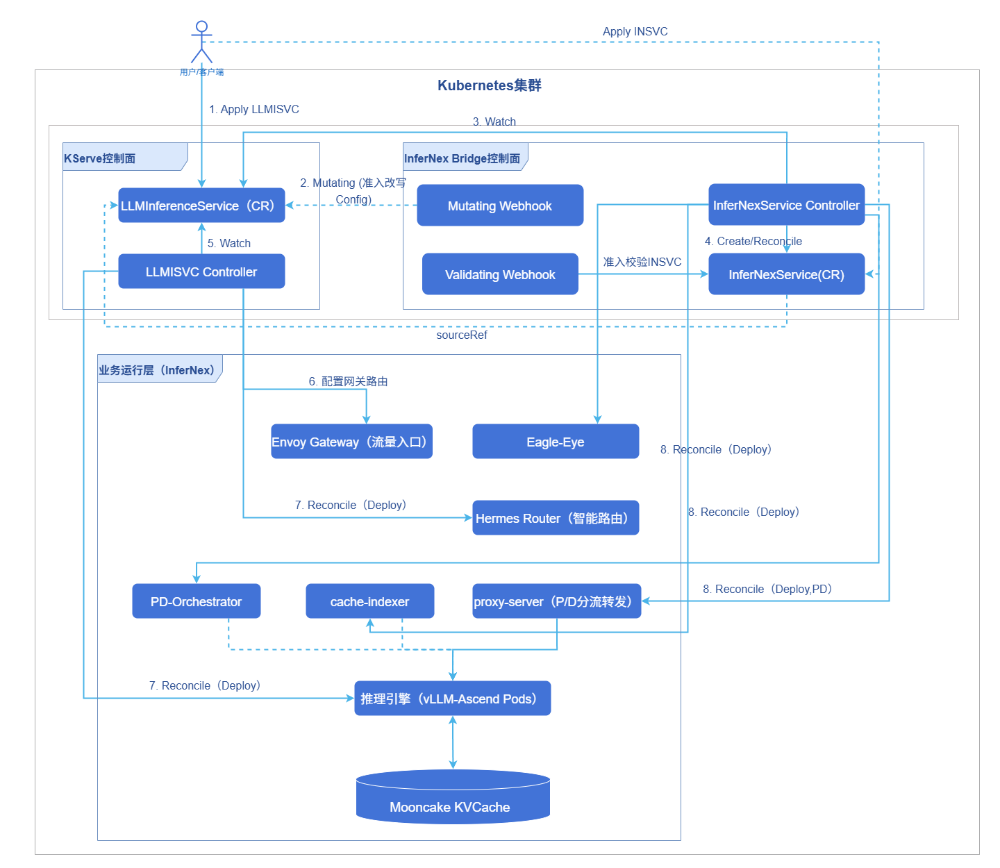
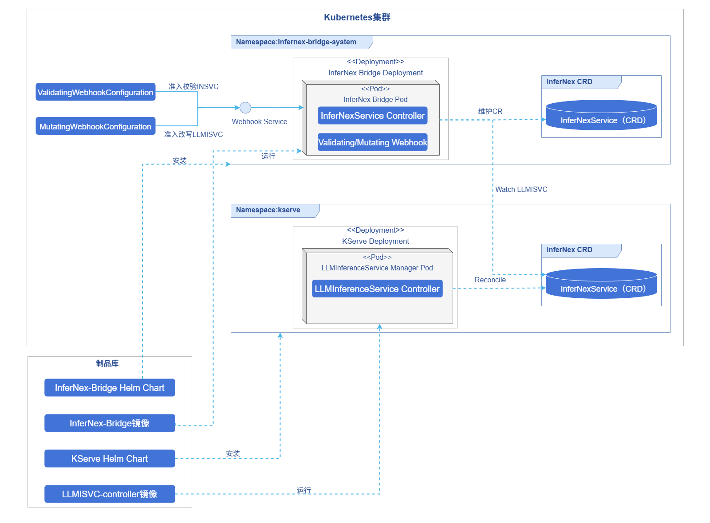
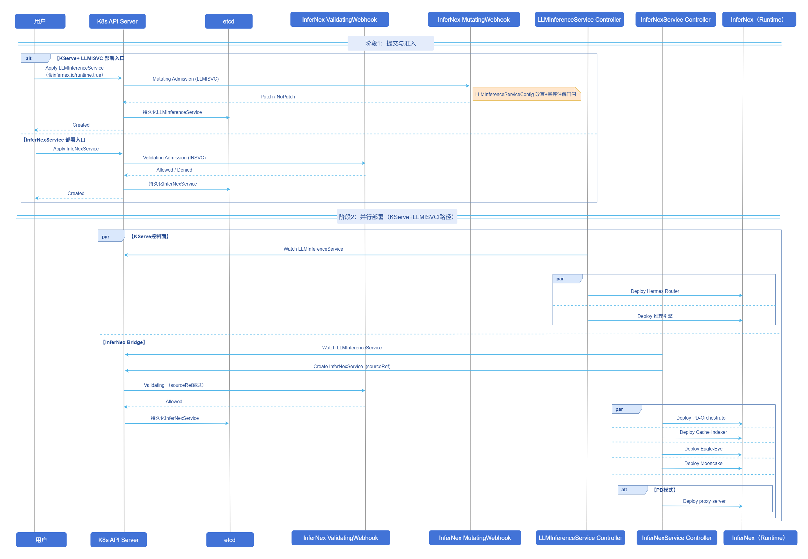

# AI推理InferNex Bridge

## 特性介绍

InferNex Bridge是InferNex与KServe之间的核心枢纽，以Validating/Mutating Webhook与`InferNexService` CRD衔接两套部署入口，支持双模式部署策略：既可无缝融入现有KServe生态，也可在无KServe环境下独立运行。

- 模式一（`LLMInferenceService`部署入口）：在`LLMInferenceService`上设置`infernex.io/runtime: "true"`接入InferNex链路；推理引擎与Hermes Router由KServe编排，Bridge负责Mooncake KVCache、cache-indexer、PD-Orchestrator、Eagle-Eye等增强组件及`LLMInferenceServiceConfig`运行时兼容。

- 模式二（`InferNexService`部署入口）：不经KServe，通过`InferNexService`/`InferNexServiceConfig`由Bridge统一部署推理引擎、Hermes Router与增强组件。

已有KServe环境的团队可沿用`LLMInferenceService`工作流获得完整InferNex加速能力；无KServe或需独立控制面的场景亦可获得与[AI推理集成部署](./ai_inference_infernex.md)一致的全栈推理加速能力（智能路由、Mooncake KVCache、弹性扩缩、硬件可观测等）。

> **说明**：<br/>
> 与[AI推理集成部署](./ai_inference_infernex.md)InferNex主Chart一键全栈安装入口不同，本文介绍InferNex Bridge独立安装方式，其中以配合KServe经`LLMInferenceService`部署为主线。架构与责任边界见[OFEP-0040](https://gitcode.com/openFuyao/ofep/blob/main/ofeps/sig-ai-inference/0040-ofep-Infernex%E6%8E%A5%E5%85%A5kserve%E9%80%82%E9%85%8D%E5%B1%82.md)及[InferNex-Bridge技术规格](https://gitcode.com/openFuyao/InferNex/blob/master/component/InferNex-Bridge/docs/InferNex-Bridge-Technical-Specification.md)。

### 应用场景

- 集群已安装KServe，支持的版本号为v0.17.0到v0.19.0，希望通过`LLMInferenceService` + `infernex.io/runtime: "true"`部署完整InferNex能力。
- 需要InferNex Bridge自动处理KServe内置Config与InferNex运行时的兼容问题。
- 希望通过InferNex Bridge部署InferNex推理能力，而不使用[InferNex主Chart](./ai_inference_infernex.md)一键全栈安装（KServe + `LLMInferenceService`部署入口或`InferNexService`部署入口均可）。

### 能力范围

- InferNex Bridge自身提供控制面：独立Helm Chart安装；下发CRD、RBAC、Webhook及默认`InferNexServiceConfig`模板。

- 双部署入口：支持KServe + `LLMInferenceService`与`InferNexService`两种路径。

- 通过InferNex Bridge部署的实例，其推理加速能力（智能路由、Mooncake KVCache、扩缩容决策、硬件可观测等）与[AI推理集成部署 — 能力范围](./ai_inference_infernex.md#能力范围)完全一致。其差异仅在于部署入口和编排逻辑，而非能力集合的增减。

### 亮点特征

- KServe兼容：沿用`LLMInferenceService`工作流，通过标签进入InferNex链路。
- 双部署入口：KServe + `LLMInferenceService`部署入口与`InferNexService`部署入口并存。

### 实现原理

InferNex Bridge以Mutating/Validating Webhook与`InferNexService` CRD构成KServe适配层：用户仍以`LLMInferenceService`为入口，在不改动KServe CRD的前提下补齐InferNex增强组件；亦支持不经KServe、直接提交`InferNexService`由Bridge统一部署。Mutating Webhook在带`infernex.io/runtime: "true"`的`LLMInferenceService`创建或更新时触发，对`kserve`命名空间内6个预设`LLMInferenceServiceConfig`做兼容补丁（不修改`LLMInferenceService`对象本身）；Validating Webhook对直连提交的`InferNexService`做准入校验（KServe链路下带`sourceRef`的`InferNexService`跳过校验）。`InferNexService`通过`sourceRef`与`LLMInferenceService`关联并做只读观测，不会把`llmisvc.spec`合并进来重复拉起推理引擎或Router。

#### 逻辑视图

KServe `LLMInferenceService`控制器负责推理引擎、Hermes Router与Gateway/`HTTPRoute`/InferencePool。InferNex Bridge负责proxy-server（P/D模式）、Mooncake KVCache、Cache-Indexer、PD-Orchestrator、Eagle-Eye等补充组件。P/D模式下流量经proxy-server分流至prefill/decode。

**图1** InferNex Bridge逻辑视图



#### 部署视图

KServe与InferNex Bridge分别以独立Helm Chart部署；InferNex Bridge Pod内集成Mutating/Validating Webhook与`InferNexService`控制器：`MutatingWebhookConfiguration`对`kserve`命名空间内6个预设`LLMInferenceServiceConfig`做兼容补丁；`ValidatingWebhookConfiguration`对提交的`InferNexService`做准入校验（KServe链路下自动创建的带`sourceRef`的`InferNexService`跳过校验）。

**图2** InferNex Bridge部署视图



#### 运行视图

KServe + `LLMInferenceService`部署入口：用户提交带`infernex.io/runtime: "true"`的`LLMInferenceService`后，先经Mutating Webhook触发对`kserve`命名空间内6个预设`LLMInferenceServiceConfig`的兼容补丁，再由KServe与InferNex Bridge并行部署各自负责的工作负载。`InferNexService`部署入口：用户直连提交`InferNexService`时，先经Validating Webhook准入校验。

**图3** InferNex Bridge运行视图



### 与相关特性的关系

[AI推理集成部署](./ai_inference_infernex.md)通过InferNex主Chart一键安装InferNex全栈（控制面与推理实例）；本文介绍InferNex Bridge独立安装方式，部署入口为InferNex Bridge Chart，覆盖KServe + `LLMInferenceService`部署入口与`InferNexService`部署入口，与主Chart全栈入口不同。

## 安装

### 前提条件

#### InferNex Bridge控制面

- 已有可用的Kubernetes集群，并安装kubectl、Helm（v3以上版本）。
- KServe：KServe安装版本为v0.17.0到v0.19.0，安装前提请参见[KServe LLMISVC Prerequisites](https://kserve.github.io/website/docs/0.17/install/llmisvc-install#prerequisites)。
- API版本：`LLMInferenceService`/`LLMInferenceServiceConfig`同时支持`serving.kserve.io/v1alpha1`和`serving.kserve.io/v1alpha2`，推荐使用`serving.kserve.io/v1alpha2`。`InferNexService`/`InferNexServiceConfig`为`infernex.infernex.io/v1alpha1`。
- 已安装Envoy Gateway及Gateway API、Gateway API Inference Extension等相关CRD；采用KServe + `LLMInferenceService`部署方式时，Hermes Router路由与`HTTPRoute`对外暴露推理服务须依赖上述组件。
- 集群可访问`cr.openfuyao.cn`、`hub.oepkgs.net`（或已配置等价镜像）。
- 建议命名空间`infernex-bridge-system`处于Active状态；避免重复安装多套InferNex Bridge Webhook。

> **说明**：<br/>
> 镜像清单、版本兼容、部署场景及Webhook对`LLMInferenceServiceConfig`的补丁行为请参见[部署规格](https://gitcode.com/openFuyao/InferNex/blob/master/component/InferNex-Bridge/docs/InferNex-Bridge-Technical-Specification.md#1-部署规格)、[部署场景](https://gitcode.com/openFuyao/InferNex/blob/master/component/InferNex-Bridge/docs/InferNex-Bridge-Technical-Specification.md#2-部署场景)、[Webhook补丁说明](https://gitcode.com/openFuyao/InferNex/blob/master/component/InferNex-Bridge/docs/InferNex-Bridge-Technical-Specification.md#3-mutating-admission-webhook-补丁说明)与[附录 A 默认镜像](https://gitcode.com/openFuyao/InferNex/blob/master/component/InferNex-Bridge/docs/InferNex-Bridge-Technical-Specification.md#附录-a默认镜像)。Hermes Router容器命名要求见本文[附录 — Hermes Router容器命名约定](#hermes-router容器命名约定)。

#### 推理集群环境（通用）

部署推理实例（vLLM-Ascend、Mooncake KVCache、PD分离等）前，硬件、软件与网络前提请参见[AI推理集成部署](./ai_inference_infernex.md)。

- 安装InferNex的前提条件请参见[前提条件](./ai_inference_infernex.md#前提条件)（包含集群版本、NPU Operator、LWS等）。
- 使用AI推理的前提条件请参见[使用AI推理](./ai_inference_infernex.md#使用ai推理)（包含推理节点资源、metrics-server、PD + Mooncake KVCache网络等）。
- PD分离且Mooncake KVCache经HCCS传输时的网络配置请参见[昇腾HCCS设备IP地址配置示例](./ai_inference_infernex.md#昇腾hccs设备ip地址配置示例)。
- 自定义模型权重宿主机挂载路径与缓存目录结构请参见[自定义模型目录配置](./ai_inference_infernex.md#自定义模型目录配置)。

> **说明**：<br/>
> - 按InferNex Bridge独立安装方式部署时，不要求预先安装主Chart的inference-backend；Mooncake KVCache、cache-indexer、PD-Orchestrator等增强组件由InferNex Bridge按实例拉起。
> - 启用Eagle-Eye时须预先安装NATS、kube-prometheus-stack；配置与使用见[AI推理鹰眼](../../ai_inference_eagle_eye/user_guide/eagle_eye_for_ai_inference.md)。

### 开始安装

#### 方式一：从InferNex源码仓库安装Chart

```bash
git clone https://gitcode.com/openFuyao/InferNex.git
cd InferNex/component/InferNex-Bridge

helm upgrade --install infernex-bridge ./chart/infernex-bridge \
  -n infernex-bridge-system \
  --create-namespace \
  --wait \
  --timeout 10m
```

Chart的`version`与InferNex发布版本一一对应；源码目录中为`0.0.0-latest`，表示`master`分支最新构建，其他版本号见[InferNex版本列表](https://gitcode.com/openFuyao/InferNex/tags)。安装前执行如下命令可查看Chart元数据。

```bash
helm show chart ./chart/infernex-bridge
```

#### 方式二：从OCI仓库安装（推荐）

```bash
helm upgrade --install infernex-bridge oci://cr.openfuyao.cn/charts/infernex-bridge \
  --version <chart-version> \
  -n infernex-bridge-system \
  --create-namespace \
  --wait \
  --timeout 10m
```

`--version`用于指定Chart的`version`，与InferNex发布版本一一对应；`0.0.0-latest`表示`master`分支最新构建，其他版本号见[InferNex版本列表](https://gitcode.com/openFuyao/InferNex/tags)。安装前执行如下命令可查看Chart元数据。

```bash
helm show chart oci://cr.openfuyao.cn/charts/infernex-bridge --version <chart-version>
```

#### Webhook TLS证书（可选）

InferNex Bridge Webhook需要TLS证书。Chart支持两种方式，通过`webhooks.certGenerator.enabled`（默认`true`）与`certManager.enabled`（默认`false`）切换。

**表1** Webhook TLS证书配置方式


| 方式                  | 关键参数                                                              | Chart Hook Job                                       | 说明                                                                                |
| ------------------- | ----------------------------------------------------------------- | ---------------------------------------------------- | --------------------------------------------------------------------------------- |
| 内置certGenerator（默认） | `webhooks.certGenerator.enabled=true`，`certManager.enabled=false` | 安装前`generate-webhook-cert`；卸载前`cleanup-webhook-cert`。 | Chart在集群内生成`webhook-server-cert` Secret并下发Mutating/ValidatingWebhookConfiguration。 |
| cert-manager        | `certManager.enabled=true`                                        | 不创建certGenerator相关Job。                                | 须集群已安装cert-manager；Chart渲染Issuer/Certificate，Webhook通过CA注入注解关联证书。                  |


集群已部署cert-manager时，执行如下命令，设置`certManager.enabled=true`。

```bash
helm upgrade --install infernex-bridge oci://cr.openfuyao.cn/charts/infernex-bridge \
  --version <chart-version> \
  -n infernex-bridge-system \
  --create-namespace \
  --set certManager.enabled=true \
  --wait \
  --timeout 10m
```

### 验证部署

```bash
helm list -n infernex-bridge-system
kubectl get pods,svc -n infernex-bridge-system
kubectl get secret webhook-server-cert -n infernex-bridge-system
kubectl get mutatingwebhookconfiguration,validatingwebhookconfiguration | grep infernex-bridge
kubectl get endpoints webhook-service -n infernex-bridge-system
```

**预期返回。**

- InferNex Bridge控制器Pod为`Running`且`READY`为`1/1`。
- Webhook证书、配置与Service端点均已就绪，可正常接收Admission请求。

### 卸载

卸载InferNex Bridge控制面（控制器、Webhook及相关Release资源）。

```bash
helm uninstall infernex-bridge -n infernex-bridge-system
```

> **说明**：<br/>
> 默认`webhooks.certGenerator.enabled=true`且`certManager.enabled=false`时，pre-delete Hook Job `cleanup-webhook-cert`会额外清理Mutating/ValidatingWebhookConfiguration与`webhook-server-cert` Secret；`certManager.enabled=true`时不创建该Job，Webhook配置随Release删除，证书Secret由cert-manager管理。Chart下发的CRD默认不随Release删除，需自行处理。若`infernex-bridge-system`命名空间内已无其他需保留的资源，可执行`kubectl delete namespace infernex-bridge-system`删除该命名空间及其中的残留资源。

## 使用InferNex Bridge

同一推理实例不宜经两种部署入口重复安装两套同类增强组件；请为每个实例选定KServe + `LLMInferenceService`或`InferNexService`其中一种入口，勿混用。

### 使用LLMInferenceService

适用于已安装KServe的场景：推理引擎、Hermes Router由KServe reconcile；增强组件由InferNex Bridge reconcile。

#### 前提条件

- 已完成本文前提条件中的InferNex Bridge控制面与推理集群环境检查。
- InferNex Bridge与Webhook运行正常。
- 具备创建`LLMInferenceService`、`LLMInferenceServiceConfig`的权限。
- Envoy网关及GIE相关CRD已就绪（若需经网关访问）。

#### 背景信息

**表2** Config与LLMISVC职责

| 资源                        | 职责                                                                                                            |
| ------------------------- | ------------------------------------------------------------------------------------------------------------- |
| LLMInferenceServiceConfig | Workload：`spec.template`（聚合）或`spec.prefill`/decode相关模板；引擎镜像、Mooncake KVCache init等。                          |
| LLMInferenceService       | `spec.baseRefs`引用Config；`spec.router.scheduler`（InferencePool + EPP模板）；`spec.storageInitializer`；`spec.model`。 |

仅在Config上设置`infernex.io/runtime`标签无效。推荐先创建Config，再创建带标签的LLMISVC并通过`spec.baseRefs`引用Config。Hermes Router路由策略、插件与网关侧配置见[AI推理赫尔墨斯路由](../../ai_inference_hermes_routing/user_guide/ai_inference_hermes_routing.md)。

#### 使用限制

- `infernex.io/runtime`标签仅打在`LLMInferenceService`上，打在`LLMInferenceServiceConfig`上无效。
- 须使用KServe的`LLMInferenceServiceConfig`体系，与`InferNexServiceConfig`不可混用。
- 示例中`replicas: 1`为推理引擎默认固定副本；启用PD-Orchestrator扩缩须省略LLMISVC Config中`spec.template`/`spec.prefill`上的`replicas`及LLMISVC `spec.replicas`、`spec.prefill.replicas`，详见[附录 — 推理引擎的副本与扩缩容](#推理引擎的副本与扩缩容)。

#### 操作步骤

1. 准备入口Gateway（按需）。

    示例LLMISVC中`spec.router.gateway: {}`、`route: {}`表示由KServe创建`HTTPRoute`并挂到默认入口Gateway（常为`kserve`命名空间下的`kserve-ingress-gateway`）。若集群中不存在，须先创建。

    ```yaml
    apiVersion: gateway.networking.k8s.io/v1
    kind: Gateway
    metadata:
      name: kserve-ingress-gateway
      namespace: kserve
    spec:
      gatewayClassName: envoy
      infrastructure:
        labels:
          serving.kserve.io/gateway: kserve-ingress-gateway
      listeners:
        - name: http
          protocol: HTTP
          port: 80
          allowedRoutes:
            namespaces:
              from: All
    ```

    将上文YAML保存为`kserve-ingress-gateway.yaml`后，执行如下命令创建入口Gateway并确认就绪。

    ```bash
    kubectl apply -f kserve-ingress-gateway.yaml
    kubectl get gateway -n kserve kserve-ingress-gateway
    ```

2. 创建`LLMInferenceServiceConfig`并配置引擎模板。

    storageInitializer（示例默认关闭，可按需开启）。

    ```yaml
      storageInitializer:
        enabled: false
    ```

    **表3** `storageInitializer.enabled`行为说明

    | `enabled`   | 行为                                                                                                     |
    | ----------- | ------------------------------------------------------------------------------------------------------ |
    | `false`（推荐） | 不注入KServe storage-initializer init；冷启动更快。模型由节点hostPath缓存或推理引擎`initContainers`（如huggingface-download）准备。 |
    | `true`      | KServe按`spec.model.uri`内置拉模型；首启通常更慢，与KServe原生`hf://`流程一致。                                               |

    Hermes Router EPP容器须固定容器名`main`、命名端口`grpc`（详见[附录 — Hermes Router 容器命名约定](#hermes-router容器命名约定)）。

    ```yaml
      router:
        scheduler:
          pool:
            spec:
              selector:
                matchLabels:
                  app.kubernetes.io/name: ex-ag-01-sn-sc
              endpointPickerRef:
                kind: Service
                name: ex-ag-01-sn-sc-epp-service
          template:
            spec:
              containers:
                - name: tokenizer
                  image: cr.openfuyao.cn/openfuyao/hermes-tokenizer:latest
                - name: main
                  image: cr.openfuyao.cn/openfuyao/hermes-router:latest
                  ports:
                    - name: grpc
                      containerPort: 9002
    ```

    固定`main`是为在存在`tokenizer`等sidecar时，让`EndpointPickerRef`经Service targetPort唯一定位EPP；否则可能连到tokenizer的`8000`端口，对外常表现为HTTP 500。

3. 创建带标签的`LLMInferenceService`。

    进入InferNex链路时，仅在`LLMInferenceService`上打标签。

    ```yaml
    metadata:
      labels:
        infernex.io/runtime: "true"
    ```

    标签与baseRefs（聚合入门示例实例名`ex-ag-01-sn-sc`）。

    ```yaml
    apiVersion: serving.kserve.io/v1alpha2
    kind: LLMInferenceService
    metadata:
      name: ex-ag-01-sn-sc
      namespace: kserve
      labels:
        infernex.io/runtime: "true"
    spec:
      baseRefs:
        - name: ex-ag-01-sn-sc-config
      model:
        uri: hf://Qwen/Qwen2.5-0.5B
        name: Qwen/Qwen2.5-0.5B
    ```

4. 部署完整示例。

    部署前请按环境修改命名空间、节点、`nodeName`、hostPath、模型URI、镜像tag等。示例按场景分目录维护（单机单卡/单机多卡/跨机MoE + LWS等），完整清单见InferNex仓库[component/InferNex-Bridge/config/examples/llmisvc/](https://gitcode.com/openFuyao/InferNex/tree/master/component/InferNex-Bridge/config/examples/llmisvc)。

    - 聚合入门：[ag-01-single-node-single-card.yaml](https://gitcode.com/openFuyao/InferNex/blob/master/component/InferNex-Bridge/config/examples/llmisvc/aggregate/ag-01-single-node-single-card.yaml)（[聚合模式样例目录](https://gitcode.com/openFuyao/InferNex/tree/master/component/InferNex-Bridge/config/examples/llmisvc/aggregate)）
    - P/D入门：[pd-01-single-node-single-card.yaml](https://gitcode.com/openFuyao/InferNex/blob/master/component/InferNex-Bridge/config/examples/llmisvc/disaggregated/pd-01-single-node-single-card.yaml)（[PD分离模式样例目录](https://gitcode.com/openFuyao/InferNex/tree/master/component/InferNex-Bridge/config/examples/llmisvc/disaggregated)）

    ```bash
    git clone https://gitcode.com/openFuyao/InferNex.git
    cd InferNex/component/InferNex-Bridge/config/examples/llmisvc
    kubectl apply -f aggregate/ag-01-single-node-single-card.yaml
    # 或
    kubectl apply -f disaggregated/pd-01-single-node-single-card.yaml
    ```

    ```bash
    kubectl get llminferenceservice,llminferenceserviceconfig -n kserve
    kubectl get pods -n kserve
    ```

5. 经网关验证推理服务。

    实例Ready后，经Envoy访问，URL形如：`http://<网关IP地址>:<端口>/<路径前缀>/v1/chat/completions`。

    5.1 查网关IP地址与端口。

    ```bash
    kubectl get svc -A | grep -i envoy
    kubectl get nodes -o wide
    ```

    5.2 确认路径前缀并发送请求。

    KServe默认路由的路径前缀为`/<metadata.namespace>/<metadata.name>`，其中第一段是`LLMInferenceService`所在命名空间，第二段是实例名；并非固定`kserve`。按入门示例YAML未改命名空间与实例名时，聚合参考路径为`/kserve/ex-ag-01-sn-sc`，P/D为`/kserve/ex-pd-01-sn-sc`。请求体中的`model`须与所部署YAML的`spec.model.name`一致。

    ```bash
    curl -X POST "http://<网关IP>:<端口>/kserve/ex-ag-01-sn-sc/v1/chat/completions" \
      -H "Content-Type: application/json" \
      -d '{"model":"<spec.model.name>","messages":[{"role":"user","content":"你好"}]}'
    ```

#### 后续操作

删除LLMISVC实例。删除带`infernex.io/runtime: "true"`的`LLMInferenceService`（聚合入门示例，命名空间`kserve`；P/D将实例名换为`ex-pd-01-sn-sc`）。

```bash
kubectl delete llminferenceservice ex-ag-01-sn-sc -n kserve

kubectl get llminferenceservice,insvc -n kserve
kubectl get pods -n kserve | grep ex-ag-01-sn-sc
```

删除后，KServe回收推理引擎、Hermes Router与`HTTPRoute`等；InferNex Bridge删除自动创建的同名`InferNexService`及Mooncake KVCache、cache-indexer、PD-Orchestrator、Eagle-Eye等增强组件。

删除LLMISVCConfig（可选）。`LLMInferenceServiceConfig`为可复用模板，不随LLMISVC自动删除；确需移除自定义Config时执行。

```bash
kubectl delete llminferenceserviceconfig ex-ag-01-sn-sc-config -n kserve
```

> **注意**：<br/>
> - 若曾通过PD-Orchestrator（Elastic-Scaler/ResourceScalingGroup）扩缩出额外推理引擎副本，删除LLMISVC后请检查是否仍有残留`Deployment`、`ElasticScaler`、`ResourceScalingGroup`等CR，必要时手动清理。
> - 命名空间长时间处于`Terminating`时，检查`InferNexService`是否受阻在finalizer阶段，确认无残留Pod后再处理finalizer。

### 使用InferNexService

适用于不依赖KServe、由InferNex Bridge通过`InferNexService`/`InferNexServiceConfig`原生CRD部署：推理引擎、Hermes Router及增强组件均由InferNex Bridge reconcile。`InferNexService`资源简称为`insvc`，`InferNexServiceConfig`简称为`insvccfg`（CRD `shortNames`）；下文`kubectl`示例使用缩写。

#### 前提条件

- 已完成本文前提条件中的InferNex Bridge控制面与推理集群环境检查。
- 默认模板（`infernex-default-aggregate-template`/`infernex-default-pd-template`）已安装在模板命名空间（默认`infernex-bridge-system`）；二者仅含增强组件与IGR缺省值，不含推理引擎Pod模板，部署实例须引用示例Config或自建`spec.engine`。
- 若需对外入口：Envoy Gateway、`GatewayClass`可用；`spec.intelligentGatewayRouting.router.enabled: true`并配置Gateway/HTTPRoute/InferencePool。

#### 背景信息

- `InferNexService`经`spec.baseRefs`引用`InferNexServiceConfig`合并配置；`spec.engine`可写在`InferNexService`或`InferNexServiceConfig`中（示例经`baseRefs`引用Config；扁平结构：根字段为aggregate/decode工作负载，P/D时另设`prefill`子块），`InferNexService`另写`model`、IGR、组件开关等。Chart默认模板（`infernex-default-aggregate-template`/`infernex-default-pd-template`）仅含增强组件与IGR缺省值，不含引擎Pod模板；部署推理实例须引用示例Config或自建引擎模板。
- Mooncake KVCache、cache-indexer、proxy-server（PD）、PD-Orchestrator、Eagle-Eye等由控制器从内置assets或与平台默认Config合并后拉起，无需在用户YAML中展开全部PodTemplate。
- Hermes Router路由策略、插件与网关侧配置见[AI推理赫尔墨斯路由](../../ai_inference_hermes_routing/user_guide/ai_inference_hermes_routing.md)。

##### spec字段说明

`InferNexService`与`InferNexServiceConfig`分工：`baseRefs`按顺序merge，后者覆盖前者；`spec.engine`可写在`InferNexService`或`InferNexServiceConfig`中（示例通常放在Config），`InferNexService`另写`model`、IGR、组件开关等。两套Config与`LLMInferenceServiceConfig`不可混用。

**表4** InferNexService字段说明

| 字段                               | 说明                                                                            |
| -------------------------------- | ----------------------------------------------------------------------------- |
| `spec.baseRefs`                  | 引用`InferNexServiceConfig`（须在InferNex Bridge模板命名空间，默认`infernex-bridge-system`）。 |
| `spec.model`                     | 模型URI与`name`。                                                                  |
| `spec.engine`                    | 推理引擎工作负载模板，merge后须有效。<br/>模式由是否存在有效`prefill.template`推导：<br/>- 无prefill为aggregate（根字段即聚合负载）。<br/>- 有prefill为P/D（根`template`为decode，`prefill`为prefill）。<br/>可写在`InferNexService`或经`baseRefs`引用的`InferNexServiceConfig`中，merge后须至少一侧有效，示例通常将Pod模板放在Config。字段详情请参见表5。                                  |
| `spec.intelligentGatewayRouting` | 智能网关路由（IGR）；默认Chart模板中`router.enabled=false`。                                  |
| `spec.components`                | Mooncake KVCache、cache-indexer、PD-Orchestrator、Eagle-Eye等增强组件开关。               |

###### `spec.engine`字段说明

`spec.engine`为扁平结构（不再使用`engine.aggregate`/`engine.pd`嵌套块）。每个工作负载段（根字段或`prefill`）共用同一组字段。

**表5** `spec.engine`工作负载字段（根字段与`prefill`均适用）

| 字段 | 说明 |
| ---- | ---- |
| `template` | Pod模板。aggregate模式或P/D的decode写在根字段；P/D的prefill写在`prefill.template`。 |
| `worker` | 可选。LWS非leader Pod模板；省略或无containers时回退为同级的`template`。`groupSize==1`（Deployment）时不可设有效`worker`。 |
| `replicas` | 工作负载水平副本数。Deployment为Pod数；LWS为组数（每组含`groupSize`个Pod）。省略时首次创建默认为1；省略方可启用PD-Orchestrator外部扩缩。 |
| `dataParallelSize` | 全局DP规模（对应vLLM `--data-parallel-size`），缺省值为1。 |
| `dataParallelSizeLocal` | 每个Pod内DP rank数，缺省值为1。`groupSize = dataParallelSize / dataParallelSizeLocal`；`groupSize>1`时Bridge创建**LeaderWorkerSet**，否则为**Deployment**。 |

**模式判定**：merge完成后，若`prefill.template`含有效containers，则为**P/D**（根字段为decode，须同时配置`prefill`）；否则为**aggregate**（仅根字段`template`）。Chart默认模板名仍区分aggregate/pd，用于组件缺省值回退，与`spec.engine`YAML形状无关。

聚合与P/D的YAML骨架如下（完整Pod模板见示例Config）：

```yaml
# aggregate
spec:
  engine:
    template:
      spec:
        containers: [...]
    # 可选：replicas、dataParallelSize、dataParallelSizeLocal、worker

# P/D（根template=decode，prefill=prefill）
spec:
  engine:
    template:
      spec:
        containers: [...]   # decode
    prefill:
      template:
        spec:
          containers: [...]
```

更多LWS/Admission约束及扩缩前提见本文[附录 — 推理引擎的副本与扩缩容](#推理引擎的副本与扩缩容)。

###### IGR与网关对象

- `router.enabled`：对外入口总开关。`false`时仅部署集群内推理引擎与增强组件，InferNex Bridge不调和Gateway/`HTTPRoute`/`InferencePool`。
- `router.enabled: true`时须配置Hermes Router EPP模板（容器名`main`、端口名`grpc`，见[附录 — Hermes Router 容器命名约定](#hermes-router容器命名约定)）；`gateway`、`httpRoute`、`inferencePool`各支持两种写法。
  - `ref`：引用集群中已有资源名（Bring Your Own）。
  - `spec`：由InferNex Bridge按字段创建或更新托管对象。
  - 同一对象上`ref`与`spec`互斥，不可同时填写。
- 启用`router`且未为`gateway`/`httpRoute`/`inferencePool`指定`ref`时，InferNex Bridge按默认规则托管对应Gateway API对象（示例通常只写`router`段）。

###### 组件开关（`spec.components`）

`InferNexService`部署入口下创建的`InferNexService`（无`spec.sourceRef`）若在YAML中声明某组件块，须显式写`enabled: true`或`false`，不可省略。常见字段。

- `mooncake.enabled`、`cacheIndexer.enabled`
- `pdOrchestrator.elasticScaler`/`tidal`/`resourceScalingGroup`
- `eagleEye.hardwareMonitor`/`hardwareDiagnosis`（启用前须安装NATS、kube-prometheus-stack）

###### `spec.sourceRef`

KServe链路下InferNex Bridge会自动创建带`sourceRef`的同名`InferNexService`。此类对象由InferNex Bridge仅调和增强组件，勿手改`engine`/`router`；IGR由KServe管理，InferNex Bridge不触碰Gateway API对象。

#### 使用限制

- `InferNexService`部署入口不需要打`infernex.io/runtime`标签；该标签仅用于KServe + `LLMInferenceService`部署入口。
- `InferNexService`部署入口下，Hermes Router使用`openfuyao.com/pdRole`、`openfuyao.com/pdGroupID`等标签；与KServe + `LLMInferenceService`部署入口的`app.kubernetes.io/*`标签体系不同，勿混用。
- `InferNexService`部署入口下、无`spec.sourceRef`的`InferNexService`，若在YAML中声明`spec.components`某组件块，须显式写`enabled: true`或`false`。
- KServe链路下自动创建的带`spec.sourceRef`的`InferNexService`，勿手改`engine`/`router`字段。
- 示例中`replicas: 1`为推理引擎默认固定副本；启用PD-Orchestrator扩缩须省略`engine`根字段及`engine.prefill`上的`replicas`，详见[附录 — 推理引擎的副本与扩缩容](#推理引擎的副本与扩缩容)。

#### 操作步骤

1. 确认默认模板与命名空间。

    ```bash
    kubectl get insvc,insvccfg -n infernex-bridge-system
    kubectl get pods -n infernex-bridge-system
    kubectl get gateway,httproute,inferencepool -n infernex-bridge-system
    ```

2. 准备`InferNexServiceConfig`（按需自定义引擎模板）。

    自定义引擎模板写在`InferNexServiceConfig`中，由`InferNexService`通过`spec.baseRefs`引用；亦可使用Chart安装的默认模板。

3. 创建`InferNexService`实例。

    ```yaml
    apiVersion: infernex.infernex.io/v1alpha1
    kind: InferNexService
    metadata:
      name: ex-ag-01-sn-sc
      namespace: infernex-bridge-system
    spec:
      baseRefs:
        - name: ex-ag-01-sn-sc-engine
      model:
        uri: hf://Qwen/Qwen2.5-0.5B
        name: Qwen/Qwen2.5-0.5B
      intelligentGatewayRouting:
        router:
          enabled: true
    ```

    Hermes Router模板须固定EPP容器名为`main`、端口名为`grpc`（见[附录 — Hermes Router 容器命名约定](#hermes-router容器命名约定)）。

4. 部署完整示例。

    示例按场景分目录维护（单机单卡/单机多卡/跨机MoE + LWS等），每个YAML内含同Spec ID的`InferNexServiceConfig`（`spec.engine`）与`InferNexService`（`model` + IGR）。完整清单见InferNex仓库[component/InferNex-Bridge/config/examples/insvc/](https://gitcode.com/openFuyao/InferNex/tree/master/component/InferNex-Bridge/config/examples/insvc)。

    - 聚合入门：[ag-01-single-node-single-card.yaml](https://gitcode.com/openFuyao/InferNex/blob/master/component/InferNex-Bridge/config/examples/insvc/aggregate/ag-01-single-node-single-card.yaml)（[聚合模式样例目录](https://gitcode.com/openFuyao/InferNex/tree/master/component/InferNex-Bridge/config/examples/insvc/aggregate)）
    - P/D入门：[pd-01-single-node-single-card.yaml](https://gitcode.com/openFuyao/InferNex/blob/master/component/InferNex-Bridge/config/examples/insvc/disaggregated/pd-01-single-node-single-card.yaml)（[PD分离模式样例目录](https://gitcode.com/openFuyao/InferNex/tree/master/component/InferNex-Bridge/config/examples/insvc/disaggregated)）

    ```bash
    cd InferNex/component/InferNex-Bridge/config/examples/insvc
    kubectl apply -f aggregate/ag-01-single-node-single-card.yaml
    # 或
    kubectl apply -f disaggregated/pd-01-single-node-single-card.yaml
    ```

5. 经网关验证推理服务。

    与LLMISVC类似，查`Gateway`/`HTTPRoute`后curl；路径前缀同为`/<命名空间>/<实例名>`（InferNex Bridge托管路由亦按此规则生成）。`model`须与`spec.model.name`一致。聚合入门实例名`ex-ag-01-sn-sc`，P/D为`ex-pd-01-sn-sc`（以示例YAML为准）。

#### 后续操作

删除InferNexService实例。删除`InferNexService`后，InferNex Bridge会回收该实例调和的推理引擎、Hermes Router、增强组件，以及启用IGR时创建的`Gateway`/`HTTPRoute`/`InferencePool`等（以控制器ownership为准）。聚合入门示例（命名空间`infernex-bridge-system`）。

```bash
kubectl delete insvc ex-ag-01-sn-sc -n infernex-bridge-system

kubectl get insvc,pods -n infernex-bridge-system | grep ex-ag-01-sn-sc
kubectl get gateway,httproute,inferencepool -n infernex-bridge-system
```

删除InferNexServiceConfig（可选）。`InferNexServiceConfig`为可复用引擎模板，不随`InferNexService`实例自动删除。删除实例时通常只需删`insvc`，不必删Config。

- 用户自定义模板（如示例`ex-ag-01-sn-sc-engine`）。确认无其他`InferNexService`通过`spec.baseRefs`引用后，可按需删除。

```bash
kubectl delete insvccfg ex-ag-01-sn-sc-engine -n infernex-bridge-system
```

- Chart默认模板（`infernex-default-aggregate-template`、`infernex-default-pd-template`）：由InferNex Bridge Chart安装在模板命名空间，供新建实例通过`baseRefs`引用或作为控制器默认回退，与单个推理实例无绑定关系。删除某个`InferNexService`时无需也不要删除它们；仅在卸载InferNex Bridge控制面、确认集群不再使用该Bridge时再一并清理。

> **注意**：<br/>
> 若PD-Orchestrator扩缩产生额外workload，删除实例后请同样检查`Deployment`、`ElasticScaler`、`ResourceScalingGroup`等相关资源是否残留，必要时手动清理。

#### 相关操作

除删除实例外，常见运维命令如下。

查看InferNex Bridge控制面。

```bash
helm status infernex-bridge -n infernex-bridge-system
kubectl get pods -n infernex-bridge-system
```

查看推理实例（KServe + `LLMInferenceService`部署入口）。

```bash
kubectl get llminferenceservice,insvc -n kserve
kubectl get pods -n kserve -l infernex.io/runtime=true
```

查看推理实例（`InferNexService`部署入口）。

```bash
kubectl get insvc -n infernex-bridge-system
kubectl get pods -n infernex-bridge-system
```

## 附录

### Hermes Router容器命名约定

Hermes Router（Endpoint Picker，EPP）与tokenizer等sidecar同Pod部署。`InferencePool.endpointPickerRef`指向EPP Service时，控制器按**固定容器名与端口名**解析后端；命名不符合约定时，流量可能误连到sidecar（如tokenizer的`8000`），对外常表现为HTTP 500。

**表6** Hermes Router EPP模板约束

| 约束项 | 要求 | 说明 |
| --- | --- | --- |
| EPP容器名 | 必须为`main` | Hermes Router进程容器；不可使用`hermes`、`router`等其它名称。 |
| EPP端口 | 须声明命名端口`grpc`，且`containerPort > 0` | 示例常用`9002`；`endpointPickerRef.port.number`须与此一致。 |
| Sidecar | 名称任意、顺序任意 | 如`tokenizer`；不得占用名称`main`。 |
| LLMISVC配置路径 | `LLMInferenceService.spec.router.scheduler.template` | 写在LLMISVC上，由Hermes模板覆盖KServe scheduler预设。 |
| InferNexService配置路径 | `InferNexService.spec.intelligentGatewayRouting.router.template` | `router.enabled: true`时必填；直连提交时由Validating Webhook校验。 |

KServe + `LLMInferenceService`路径下，须在`router.scheduler.template`中配置Hermes镜像、`main`容器`args`及tokenizer等sidecar；建议显式声明`tokenizer-tmp`、`tokenizer-cache`等可写卷（与Chart示例一致）。6个预设`LLMInferenceServiceConfig`的Webhook兼容补丁（清空llm-d `initContainers`等）见[技术规格 — Mutating Webhook 补丁说明](https://gitcode.com/openFuyao/InferNex/blob/master/component/InferNex-Bridge/docs/InferNex-Bridge-Technical-Specification.md#3-mutating-admission-webhook-补丁说明)。

最小EPP片段示例（`tokenizer`与`main`顺序可互换）：

```yaml
containers:
  - name: tokenizer
    image: cr.openfuyao.cn/openfuyao/hermes-tokenizer:latest
  - name: main
    image: cr.openfuyao.cn/openfuyao/hermes-router:latest
    ports:
      - name: grpc
        containerPort: 9002
```

### 推理引擎的副本与扩缩容

PD-Orchestrator（含Elastic-Scaler、Tidal Controller、ResourceScalingGroup）已在KServe + InferNex Bridge双入口适配。扩缩能否生效取决于推理引擎是否在YAML中省略`replicas`（不写该字段，而非写`0`）。Hermes Router、增强组件等仍可写`replicas: 1`。

**表7** 两种部署方式下推理引擎扩缩支持对照

| 部署方式                  | reconcile方      | 支持扩缩的前提                                                                               | 声明engine/template段`replicas`时                         |
| ----------------------- | --------------- | ------------------------------------------------------------------------------------- | --------------------------------------------- |
| KServe + `LLMInferenceService`部署入口 | KServe          | `LLMInferenceService`与`LLMInferenceServiceConfig`（`baseRefs`链）中`spec.template`/`spec.prefill`均省略`replicas`。 | 声明式固定副本，PD-Orchestrator等外部扩缩无效。                 |
| `InferNexService`部署入口       | InferNex Bridge | `InferNexService`与`InferNexServiceConfig`（`baseRefs`）中`engine`根字段及`engine.prefill`均省略`replicas`。          | InferNex Bridge按CR收敛，Deployment上外部改Pod副本会被回滚，LWS上`replicas`表示组数。 |

> **说明**：<br/>
> `component/InferNex-Bridge/config/examples`中`replicas: 1`仅用于固定副本演示。启用扩缩前请删除`engine.replicas`（aggregate或decode）、`engine.prefill.replicas`，以及LLMISVC `spec.replicas`、`spec.prefill.replicas`等engine/template相关replicas字段。多Pod DP（`dataParallelSize`/`dataParallelSizeLocal`使`groupSize>1`）时Bridge使用LeaderWorkerSet，此时`replicas`表示LWS组数而非单Pod数。

省略`engine`.`replicas`后，各扩缩能力的使用方式请参见以下文档。

- [AI推理弹性伸缩 — 配置伸缩策略](../../ai_inference_elastic_scaling_system/ai_inference_elastic_scaling/user_guide/ai_inference_elastic_scaling.md#配置伸缩策略)
- [ResourceScalingGroup — 使用ResourceScalingGroup](../../ai_inference_elastic_scaling_system/ai_inference_resourcescalinggroup/user_guide/ai_inference_resourcescalinggroup.md#使用resourcescalinggroup)
- [AI推理潮汐算法 — 使用AI推理潮汐算法](../../ai_inference_elastic_scaling_system/ai_inference_tidal_algorithm/user_guide/ai_inference_tidal_algorithm.md#使用ai推理潮汐算法)

