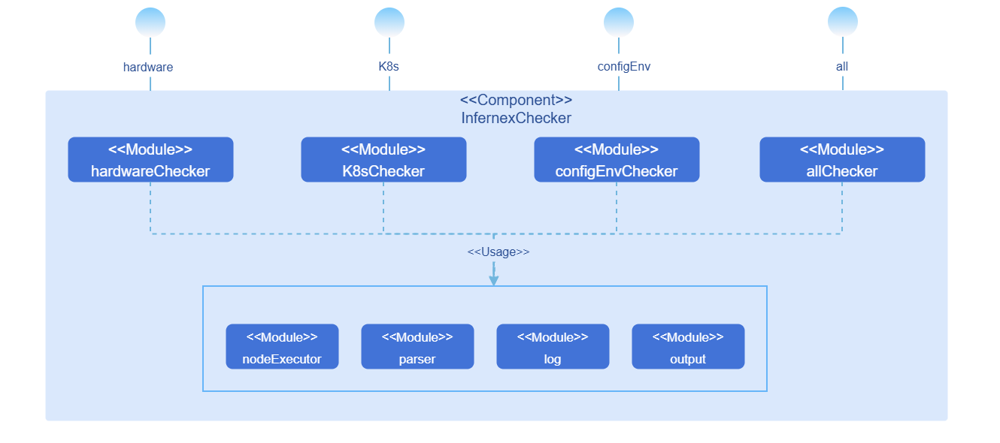

# InferNex环境校验工具

## 特性介绍

InferNex环境校验工具（infernex-checker）是一个独立的CLI（Command-Line Interface，命令行界面）工具，用于对InferNex部署环境进行系统性验证。该工具通过检测硬件、K8s集群及业务配置与环境匹配的关键环节，帮助用户在部署前识别环境问题、在部署失败后快速定位原因，有效降低部署失败风险并提升问题排查效率。

### 应用场景

- **部署前环境预检**：在首次部署InferNex前运行全量校验，工具依次验证硬件、K8s集群以及业务配置与环境匹配情况。检查完成后，报告显示所有环节正常，确认环境就绪后执行`helm install`完成部署。
- **部署失败问题定位**：InferNex部署失败后，运行全量校验快速定位问题根因。例如硬件层检查发现所有节点NPU驱动未正确部署，工具输出详细错误描述和修复建议。按照建议完成修复后，重新运行校验确认环境就绪，再次部署成功。
- **按需分层检查**：按照用户需要支持仅某一层级的校验（硬件、K8s或业务配置与环境），无需重复校验或者校验不关注的部分，提高校验效率。

### 能力范围

- **系统性环境校验**：在`helm install`前对InferNex部署环境进行系统性校验，覆盖硬件、K8s集群及业务配置与环境匹配的关键环节。
- **灵活的执行模式**：支持全量校验（硬件 → K8s → 业务配置与环境）或按层级执行（用户可选择仅运行硬件检查、K8s检查或业务配置与环境匹配相关校验）。
- **结构化校验报告**：输出终端报告和JSON格式结果文件，对每个失败项提供详细错误描述与修复建议，便于用户快速定位问题。

### 实现原理

#### 逻辑视图



infernex-checker内部划分为以下模块：

**表1** infernex-checker模块说明

| 模块名 | 功能 |
|--------|------|
| HardwareChecker | 实现硬件层检查，对外提供`infernex-checker hardware --nodes`命令。 |
| K8sChecker | 实现K8s集群状态检查，对外提供`infernex-checker k8s --nodes --dns-check-image`命令。 |
| ConfigEnvChecker | 实现业务配置与环境匹配校验，对外提供`infernex-checker config-env --nodes --values`命令。 |
| AllChecker | 按硬件 → K8s → 业务配置与环境顺序依次调用上述三个Checker，对外提供`infernex-checker all --nodes --values --dns-check-image`命令。 |
| Parser | 解析CLI参数及输入文件：通过`--nodes`参数读取节点信息文件，通过`--values`参数读取InferNex部署配置文件。 |
| NodeExecutor | 节点访问统一入口，封装SSH命令执行和Kubernetes API调用。 |
| Log | 记录工具运行日志（SSH连接、命令执行、异常堆栈等）。 |
| Output | 整理并呈现校验结果，生成终端报告与JSON结果文件。 |


#### 校验流程

**硬件层校验流程**

1. **阶段1 - 单节点校验**（多节点并发执行）。
   - H-01：NPU驱动固件安装状态。
   - H-02：Ascend Device Plugin安装状态。
   - H-03：NPU型号检查。
   - H-04：NPU可用数量统计。
   - H-05：主机关键文件与目录检查。
   - H-06：hccn.conf配置正确性（仅910系列）。
   - H-07：单机HCCS通信测试（仅910系列，分两步：Step 1检查TLS一致性，Step 2检查网卡间互通性）。
   - H-08：单机NPU快慢卡检测（仅910系列）。

2. **阶段2 - 跨节点校验**（等待所有节点单机校验完成后执行）。
   - H-09：跨节点快慢卡对比分析。
   - H-10：跨机卡侧RoCE RDMA通信测试（需至少2个910系列节点通过单机校验，分三步：Step 1检查IP唯一性，Step 2检查TLS一致性，Step 3检查跨节点连通性）。

**K8s层校验流程**

- K-01：集群CoreDNS检查（CoreDNS非Running或所有节点DNS解析失败时终止后续K8s层校验）。
- K-02：节点就绪状态（所有节点均不Ready则终止后续K8s层校验）。
- K-03：节点污点检查。
- K-04：节点可用资源统计。

**业务配置与环境层校验流程**

- B-01：模型缓存路径可用性（目录存在性与可写性）。
- B-02：Driver与CANN版本兼容性。

#### 校验中断逻辑

**表3** 校验中断逻辑说明

| 触发条件 | 中断范围 | 说明                                     |
|----------|----------|----------------------------------------|
| H-01、H-02、H-05、H-06、H-07中任意一项失败  | 跳过该节点后续所有硬件校验项 | 节点内串行执行，单节点失败不影响其他节点并发执行。              |
| H-03结果为非910系列 | 跳过该节点H-06~H-10 | HCCS/RoCE相关校验仅适用于910系列；H-04、H-05仍正常执行。 |
| 通过单机校验（H-01~H-08）的910系列节点数为0 | 跳过H-09、H-10 | H-09无数据可收集，H-10无节点可测试。                 |
| 通过单机校验（H-01~H-08）的910系列节点数为1 | 跳过H-10 | H-09尝试收集数据（可能为空），H-10至少需要2个节点。         |
| 全量模式下无节点通过硬件层校验 | 终止K8s层后续校验 | 无节点可继续，K8s层整体终止。                       |
| 全量模式下无节点通过硬件层校验 | 跳过业务配置与环境层 | 与上条同时触发，业务层整体跳过。                       |
| K-01失败（CoreDNS非Running或所有节点DNS解析失败） | 终止K8s层后续校验（K-02~K-04） | DNS不可用时节点和资源检查结果不可靠；部分节点解析失败仅提示，不终止。   |
| K-02所有节点均非Ready | 终止K8s层后续校验（K-03~K-04） | 无可用节点，后续校验无意义。                         |
| B-01中任意子步骤失败（目录不存在或不可写） | 跳过该节点后续所有业务校验项（B-02） | 节点内串行执行，单节点失败不影响其他节点并发执行。              |

## 安装

### 前提条件

#### 硬件要求

infernex-checker本身对硬件环境无特殊要求。

#### 软件要求

- Kubernetes v1.33.0及以上版本。

#### 网络要求

- 运行infernex-checker的主机能够通过SSH访问所有目标节点。
- 运行infernex-checker的主机能够访问Kubernetes API Server。

#### 权限要求

- 具备目标节点的SSH登录权限（用户名、密码或密钥）。
- 具备K8s集群的访问权限（通过kubeconfig配置文件）。

### 开始安装

#### 二进制安装

1. 进入用于存放infernex-checker的目录。

   ```bash
   cd <目标目录>
   ```

2. 根据主机架构下载对应的二进制文件。

   - Linux AMD64：
     ```bash
     wget https://static.openfuyao.cn/openFuyao/infernex/releases/download/latest/bin/linux/amd64/infernex-checker
     ```
   - Linux ARM64：
     ```bash
     wget https://static.openfuyao.cn/openFuyao/infernex/releases/download/latest/bin/linux/arm64/infernex-checker
     ```

3. 添加执行权限。

   ```bash
   chmod +x infernex-checker
   ```

4. 验证安装。

   ```bash
   ./infernex-checker --help
   ```

## 使用InferNex环境校验工具

### 前提条件

- 已完成infernex-checker的安装。
- 已准备节点信息文件（nodes.yaml）。
- 已准备InferNex部署配置文件（values.yaml）（业务配置与环境层校验需要）。
- 已配置K8s访问凭证（kubeconfig）。

### 准备节点信息文件

创建`nodes.yaml`文件，填写目标节点的SSH连接信息：

```yaml
nodes:
  - name: node-01
    ip: 192.168.1.10
    port: 22
    user: root
    # 使用密码认证
    password: "your-password"
  - name: node-02
    ip: 192.168.1.11
    port: 22
    user: root
    # 使用密钥认证
    keyFile: "/home/user/.ssh/id_rsa"
```

**参数说明**：

- `name`：节点名称，需与K8s集群中的节点名称一致。
- `ip`：节点IP地址。
- `port`：SSH端口，默认22。
- `user`：SSH登录用户名。
- `password`：SSH登录密码（与keyFile二选一）。
- `keyFile`：SSH私钥文件路径（与password二选一）。

### 执行全量校验

全量校验按硬件层 → K8s层 → 业务配置与环境层顺序依次执行。

```bash
infernex-checker all --nodes nodes.yaml --values values.yaml --output /output/result.json
```

**参数说明**：

- `--nodes`：节点信息文件路径（必填）。
- `--values`：InferNex部署配置文件路径（必填）。
- `--kubeconfig`：Kubernetes配置文件路径（可选，默认使用`~/.kube/config`）。
- `--dns-check-image`：DNS校验临时Pod使用的镜像地址（可选，默认为`busybox:1.36`）。离线部署或集群节点无法拉取公网镜像时，需提前将含`nslookup`命令的轻量镜像（如busybox）导入私有镜像仓库，并通过此参数指定私有仓库地址，例如`--dns-check-image private-registry.example.com/library/busybox:1.36`。
- `--enable-connectivity-check`：启用网络连通性检查（H-07 Step 2和H-10 Step 3）（可选，默认为`false`）。默认情况下跳过耗时的连通性测试以加快检查速度，仅执行配置一致性校验；若需完整验证网络通信能力，可添加此参数。
- `--output`：JSON结果文件输出路径（可选，不指定则不生成JSON结果文件）。
- `--log`：日志文件输出路径（可选，默认为`./infernex-checker.log`）。

**输出示例**：

```
=== InferNex Checker ===

[Hardware Layer - Single-Node Check: node-01]
  ✅ H-01  NPU driver and firmware installed
  ✅ H-02  Ascend Device Plugin Running and NPU resource registered
  ✅ H-03  NPU model: Ascend910B4
  ℹ️ H-04  NPU available: 8/8
  ✅ H-05  Key host files and directories are complete
  ✅ H-06  hccn.conf configuration is correct
  ✅ H-07  Step 1: NIC TLS switch states are consistent (on)
  ⏭️ H-07  Step 2: Connectivity check skipped (use --enable-connectivity-check to enable)
  ⚠️ H-08  Slow NPU card detected: rank 0 computation time significantly higher than other ranks
    → Check NPU card health status via npu-smi info (temperature, ECC errors, etc.)

[Hardware Layer - Single-Node Check: node-02]
  ✅ H-01  NPU driver and firmware installed
  ✅ H-02  Ascend Device Plugin Running and NPU resource registered
  ⚠️ H-03  NPU model is non-910 series: Ascend310P3
    → Only 910-series supports H-06~H-10, will skip these checks
  ℹ️ H-04  NPU available: 8/8
  ✅ H-05  Key host files and directories are complete
  ⏭️ H-06~H-10 skipped  Only 910-series supports HCCS/RoCE checks

[Hardware Layer - Cross-Node Check] (910-series nodes: node-01)
  ℹ️ H-09  Cross-node communication metrics (1 node): node-01(avg Transit: 2.34ms, 8 ranks)
  ⏭️ H-10  Only 1 910-series node(s) passed single-node checks, skipping cross-node check (at least 2 required)

[K8s Layer]
  ✅ K-01  CoreDNS Running, all nodes DNS resolution is normal
  ✅ K-02  node-01 Ready
  ✅ K-02  node-02 Ready
  ✅ K-03  node-01 has no taints
  ✅ K-03  node-02 has no taints
  ℹ️ K-04  node-01  Allocatable: CPU 48, Memory 256Gi | Remaining: CPU 40, Memory 200Gi
  ℹ️ K-04  node-02  Allocatable: CPU 48, Memory 256Gi | Remaining: CPU 40, Memory 200Gi

[Config-Env Layer: node-01]
  ✅ B-01  /home/llm_cache directory exists and is writable
  ✅ B-02  Driver 24.1.RC2 is compatible with image v0.13.0

[Config-Env Layer: node-02]
  ✅ B-01  /home/llm_cache directory exists and is writable
  ✅ B-02  Driver 24.1.RC2 is compatible with image v0.13.0

────────────────────────────────
Result: 19 passed, 0 failed, 2 warning, 2 skipped, 5 info

⚠️ Warning items:
  H-03  node-02  NPU model is non-910 series: Ascend310P3
  H-08  node-01  Slow NPU card detected: rank 0 computation time significantly higher than other ranks

⏭️ Skipped checks:
  H-07  node-01  Step 2: Connectivity check skipped (use --enable-connectivity-check to enable)
  H-10  Only 1 910-series node(s) passed single-node checks, skipping cross-node check (at least 2 required)

ℹ️ Info items:
  H-04  node-01  NPU available: 8/8
  H-04  node-02  NPU available: 8/8
  H-09  Cross-node communication metrics (1 node): node-01(avg Transit: 2.34ms, 8 ranks)
  K-04  node-01  Allocatable: CPU 48, Memory 256Gi | Remaining: CPU 40, Memory 200Gi
  K-04  node-02  Allocatable: CPU 48, Memory 256Gi | Remaining: CPU 40, Memory 200Gi
```

**结果状态说明**：

**表4** 结果状态说明

| 状态 | 含义 | 处理建议 |
|------|------|----------|
| ✅ passed | 校验通过，环境满足部署要求。 | 无需处理。 |
| ❌ failed | 校验失败，存在阻断性问题。 | 必须按输出的修复建议处理后重新校验，否则部署可能失败。 |
| ⚠️ warning | 校验通过但存在潜在风险。 | 不阻断部署，建议根据提示排查。例如慢卡可能影响推理性能，非910系列节点不支持HCCS/RoCE相关能力。 |
| ℹ️ info | 环境信息采集，供运维参考。 | 无需处理，用于确认资源容量和通信指标等是否符合预期。 |
| ⏭️ skipped | 校验项被跳过。 | 根据跳过原因判断：<br>• 因硬件限制跳过（如非910系列、节点数不足）：无需处理。<br>• 因未启用连通性检查跳过（H-07 Step 2、H-10 Step 3）：若需完整验证网络通信能力，添加`--enable-connectivity-check`参数重新执行。 |

### 执行分层校验

#### 仅执行硬件层校验

```bash
infernex-checker hardware --nodes nodes.yaml
```

若需启用完整的连通性测试（H-07 Step 2和H-10 Step 3），添加`--enable-connectivity-check`参数：

```bash
infernex-checker hardware --nodes nodes.yaml --enable-connectivity-check
```

#### 仅执行K8s层校验

```bash
infernex-checker k8s --nodes nodes.yaml --dns-check-image busybox:1.36
```

#### 仅执行业务配置与环境层校验

```bash
infernex-checker config-env --nodes nodes.yaml --values values.yaml
```

### 查看JSON结果文件

通过`--output`参数指定JSON结果文件路径后，校验完成时会生成该文件，包含详细的校验结果：

```json
{
  "summary": {
    "total": 28,
    "passed": 19,
    "failed": 0,
    "warning": 2,
    "info": 5,
    "skipped": 2
  },
  "hardware": {
    "nodes": [
      {
        "name": "node-01",
        "status": "passed",
        "is910Series": true,
        "checks": [
          { "id": "H-01", "status": "passed", "message": "NPU driver and firmware installed" },
          { "id": "H-02", "status": "passed", "message": "Ascend Device Plugin Running and NPU resource registered" },
          { "id": "H-03", "status": "passed", "message": "NPU model: Ascend910B4" },
          { "id": "H-04", "status": "info", "message": "NPU available: 8/8", "detail": { "available": 8, "total": 8, "unhealthy": [] } },
          { "id": "H-05", "status": "passed", "message": "Key host files and directories are complete" },
          { "id": "H-06", "status": "passed", "message": "hccn.conf configuration is correct" },
          { "id": "H-07", "status": "passed", "message": "Step 1: NIC TLS switch states are consistent (on)" },
          { "id": "H-07", "status": "skipped", "message": "Step 2: Connectivity check skipped (use --enable-connectivity-check to enable)" },
          {
            "id": "H-08",
            "status": "warning",
            "message": "Slow NPU card detected: rank 0 computation time significantly higher than other ranks",
            "suggestion": "Check NPU card health status via npu-smi info (temperature, ECC errors, etc.)",
            "detail": {
              "metrics": [
                {
                  "rankID": 0,
                  "physicalDeviceID": 0,
                  "nodeName": "node-01",
                  "waitTimeMS": 1.23,
                  "transitTimeMS": 2.34,
                  "synchronizationTimeMS": 0.45
                }
              ]
            }
          }
        ]
      },
      {
        "name": "node-02",
        "status": "passed",
        "is910Series": false,
        "skippedHccs": true,
        "skipReason": "non-910 series, H-06~H-10 will be skipped",
        "checks": [
          { "id": "H-01", "status": "passed", "message": "NPU driver and firmware installed" },
          { "id": "H-02", "status": "passed", "message": "Ascend Device Plugin Running and NPU resource registered" },
          { "id": "H-03", "status": "warning", "message": "NPU model is non-910 series: Ascend310P3", "suggestion": "The pre-flight checks are designed for 910 series; non-910 series may have different check items and H-06~H-10 will be skipped" },
          { "id": "H-04", "status": "info", "message": "NPU available: 8/8", "detail": { "available": 8, "total": 8, "unhealthy": [] } },
          { "id": "H-05", "status": "passed", "message": "Key host files and directories are complete" }
        ]
      }
    ],
    "cross_nodes": [
      {
        "id": "H-09",
        "status": "info",
        "message": "Cross-node communication metrics (1 node): node-01(avg Transit: 2.34ms, 8 ranks)",
        "detail": {
          "nodes_with_metrics": 1,
          "node_metrics": {
            "node-01": [
              {
                "rankID": 0,
                "physicalDeviceID": 0,
                "nodeName": "node-01",
                "waitTimeMS": 1.23,
                "transitTimeMS": 2.34,
                "synchronizationTimeMS": 0.45
              }
            ]
          }
        }
      },
      { "id": "H-10", "status": "skipped", "message": "Only 1 910-series node(s) passed single-node checks, skipping cross-node check (at least 2 required)" }
    ]
  },
  "k8s": {
    "status": "passed",
    "checks": [
      { "id": "K-01", "status": "passed", "message": "CoreDNS Running, all nodes DNS resolution is normal" },
      { "id": "K-02", "status": "passed", "message": "node-01 Ready" },
      { "id": "K-02", "status": "passed", "message": "node-02 Ready" },
      { "id": "K-03", "status": "passed", "message": "node-01 has no taints" },
      { "id": "K-03", "status": "passed", "message": "node-02 has no taints" },
      { "id": "K-04", "status": "info", "message": "node-01  Allocatable: CPU 48, Memory 256Gi | Remaining: CPU 40, Memory 200Gi" },
      { "id": "K-04", "status": "info", "message": "node-02  Allocatable: CPU 48, Memory 256Gi | Remaining: CPU 40, Memory 200Gi" }
    ]
  },
  "config_env": {
    "status": "passed",
    "checks": [
      { "id": "B-01", "node": "node-01", "status": "passed", "message": "/home/llm_cache directory exists and is writable" },
      { "id": "B-02", "node": "node-01", "status": "passed", "message": "Driver 24.1.RC2 is compatible with image v0.13.0" },
      { "id": "B-01", "node": "node-02", "status": "passed", "message": "/home/llm_cache directory exists and is writable" },
      { "id": "B-02", "node": "node-02", "status": "passed", "message": "Driver 24.1.RC2 is compatible with image v0.13.0" }
    ]
  },
  "hardwareTerminated": false
}
```

### 预期运行时长

以下为典型场景下的预期运行时长，基于2个910系列节点、网络与硬件状态正常的前提。

**表2** 典型场景预期运行时长

| 校验层 | 预期时长 | 说明 |
|--------|------|------|
| 硬件层（默认模式） | <4分钟 | 默认跳过连通性测试（H-07 Step 2和H-10 Step 3），仅执行配置一致性校验，耗时较短。 |
| 硬件层（启用连通性检查） | 约6~10分钟 | 启用`--enable-connectivity-check`后，H-07 Step 2（单机HCCS通信测试）与H-10 Step 3（跨机卡侧RoCE RDMA通信测试）为主要耗时项。 |
| K8s层 | <1分钟 | DNS解析与节点状态查询耗时较短。 |
| 业务配置与环境层 | <1分钟 | 路径可用性与版本兼容性查询耗时较短。 |

>  **说明：**<br>
> - 默认模式下，硬件层校验跳过耗时的连通性测试，可在4分钟内完成全量校验（硬件+K8s+业务配置与环境），适用于快速环境检查场景。
> - 启用连通性检查后，节点数量增加时，单机校验阶段（H-01~H-08）因并发执行耗时基本不变；跨节点阶段（H-10 Step 3）需对所有节点两两之间的每对卡逐一进行连通性测试（每组节点对含8×8=64个卡对，顺序执行），测试量随节点数N呈O(N²)增长。多节点时硬件层总耗时可参考以下经验公式：**硬件层耗时 ≈ 3 × (N×(N-1)/2 + 1) 分钟**（N 为910系列节点数，N≥2）。典型参考值：2节点约6~10分钟，3节点约12分钟，4节点约21分钟，8节点约87分钟。实际耗时因网络带宽、硬件状态及节点规模等因素存在差异。
