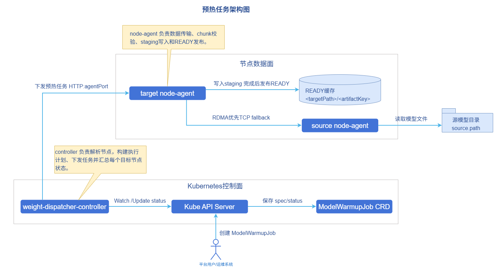
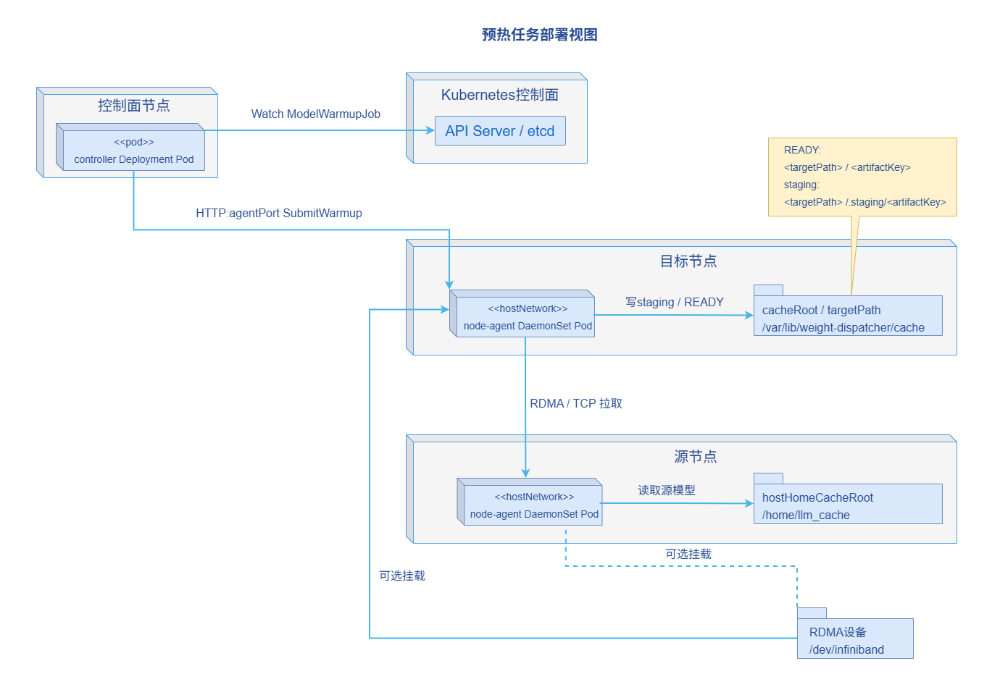

# AI推理权重分发加速

## 特性介绍

Weight-Dispatcher是面向AI推理场景的模型权重预热与分发组件，用于在推理实例启动前，将模型权重从源节点或外部模型仓库分发到目标推理节点的本地缓存目录，减少实例启动阶段反复下载大模型权重带来的等待时间和带宽压力。

- 在架构上，Weight-Dispatcher由控制面Controller和节点侧node-agent组成，通过Kubernetes自定义资源`ModelWarmupJob`描述一次权重预热任务。
- 在能力上，Weight-Dispatcher支持存储节点源、多源条带化拉取、多节点分发、CRC32C分块校验、RDMA传输以及TCP回退机制。
- 在使用方式上，用户只需要创建`ModelWarmupJob`，控制器会解析源、目标节点和分发计划，并下发到目标节点的node-agent执行。

### 应用场景

Weight-Dispatcher适用于在Kubernetes集群中部署大模型推理服务，并需要提前准备模型权重的场景，具体包括：

- **大模型冷启动加速场景**：推理服务启动前提前将权重预热到目标节点，缩短Pod启动后等待权重从远端下载的时间。
- **多节点模型分发场景**：同一模型需要分发到多个推理节点，避免每个节点都从远端仓库重复下载完整权重。
- **多源并行拉取场景**：多个节点或外部源已具备相同模型权重时，通过多源条带化方式提高单节点准备速度，充分利用聚合带宽。

### 能力范围

- 支持用户在Kubernetes集群中部署使用。
- 支持通过`ModelWarmupJob`CRD发起模型权重预热任务。
- 支持按`nodeNames`或`nodeSelector`选择目标节点。
- 支持`sourceType=node`的节点源，控制器会自动解析源节点IP地址。
- 支持文件、目录和模型权重等类型。
- 支持数据分块大小配置、任务超时时间配置、CRC32C分块校验和缓存命中复用。
- 支持RDMA传输；RDMA不可用或未启用时支持TCP回退传输。
- 支持通过CRD的`status`查看任务整体阶段、目标节点列表、节点级任务状态、吞吐、缓存路径和传输路径。

  > **注意**：
  > - 当前版本要求`spec.sources`不能为空，不支持完全无源的自动发现模式。
  > - 当设置`sourceType=node`时，不能同时显式配置`endpoint`，控制器会根据源节点地址自动填充。
  > - 当前版本不支持`sourceType=external`模式。
  > - 多个存储节点源必须具备一致的权重文件布局；文件数量、相对路径、大小和可分块属性不一致时任务会失败。

### 亮点特征

- **Kubernetes 原生接口**：通过`ModelWarmupJob`描述预热对象、数据源、目标节点和执行策略，便于与调度、扩缩容和运维系统集成。
- **分块并行传输**：对大文件按`chunkSizeMB`切分，可并行拉取、校验和重试，降低单个大文件传输失败的影响范围。
- **Collective数据传输**：当目标节点数量大于源数量时，目标节点可先拉取部分权重分片，再通过Ring传输从其他目标节点补齐缺失分片。
- **RDMA感知数据面**：支持RDMA export/connect/update/close会话，提升大模型权重在高速网络下的传输效率。
- **稳定降级路径**：当RDMA不可用或用户未启用RDMA时，node-agent可使用TCP回退路径继续完成任务。
- **缓存状态机**：目标节点使用`.staging`临时目录和ready目录发布机制，避免未完成权重被推理进程误用。

### 实现原理

**图1** 组件架构图



**图2** 组件部署视图



Weight-Dispatcher 由以下组件组成：

1. **ModelWarmupJob CRD**：用户提交的模型权重预热任务，描述待预热模型权重、数据存储源节点、目标节点和执行策略。
2. **Controller**：侦听`ModelWarmupJob`，完成参数校验、目标节点解析、校验文件生成、分发计划生成和任务状态聚合。
3. **node-agent**：以DaemonSet形式运行在节点上，用于构建校验文件、读取源数据分片、执行权重拉取和发布权重文件。
4. **数据面适配器**：可根据实际环境或环境变量`RDMA_ENABLED`与`TCP_FALLBACK_ENABLED`选择RDMA或TCP传输路径。
5. **缓存状态机**：在目标节点维护缓存加载、发布、失败清理和缓存命中复用逻辑。

一次权重预热任务的执行流程如下：

1. 用户创建`ModelWarmupJob`。
2. Controller校验`spec.artifact`、`spec.sources`和`spec.target`。
3. Controller解析目标节点；如果配置`nodeNames`，按节点名解析；如果配置`nodeSelector`，按节点标签选择。
4. Controller选择一个源构建logical manifest；如果是node源，则调用源节点node-agent的`/v1/manifests:build`；如果是Hugging Face外部源，则通过模型API构建manifest。
5. Controller校验其他node源的manifest布局是否与基准源一致。
6. Controller根据源和目标数量生成分发计划，并为每个目标节点生成`WarmupExecutionPlan`。
7. Controller调用目标节点node-agent的`/v1/warmups`提交任务。
8. node-agent将权重写入目标ready 路径的兄弟`.staging`目录，传输完成后发布到ready路径。
9. Controller周期性查询node-agent任务状态，并回写`ModelWarmupJob.status`。
10. 所有目标节点成功后，`ModelWarmupJob.status.phase`变为`Succeeded`；任一目标失败且无pending/running节点时，整体任务变为`Failed`。

## 安装

本章节介绍在已有Kubernetes集群中独立部署Weight-Dispatcher的方法。

### 独立部署

本节介绍如何在已有模型缓存目录节点的Kubernetes集群中，独立部署Weight-Dispatcher。

#### 前提条件

在开始安装前，请确保满足以下条件：

- **环境要求**：

  - Kubernetes集群：建议v1.28.0及以上版本。
  - 集群管理员权限：用于安装CRD、ClusterRole、ClusterRoleBinding、Deployment和DaemonSet。
  - Helm工具：用于通过Chart部署Weight-Dispatcher。
  - 集群节点之间可通过节点IP地址访问node-agent侦听端口，默认端口为`18080`。

- **硬件要求**：

  - Controller本身对硬件环境无特殊要求，可运行在标准x86或ARM架构节点上。
  - node-agent需要访问源节点的权重目录和目标节点权重缓存目录，默认挂载`/home/llm_cache`和`/var/lib/weight-dispatcher/cache`路径。
  - 如果启用RDMA，需要目标节点具备RDMA设备，并允许node-agent挂载`/dev/infiniband` 和 `/sys/class/net`。

- **模型源要求**：

  - 使用node源时，源节点上必须已存在模型文件或目录。
  - 使用多node源时，各源路径下的模型文件布局必须一致。

- **权限要求**：

  - 当前版本使用RDMA进行传输时，node-agent需要开启hostnetwork与特权容器开关。若对安全敏感场景，可关闭特权容器，使用TCP传输。 

#### 安装Weight-Dispatcher

如果已获取源码仓库，可通过仓库内Helm Chart安装，执行如下命令进行安装。

```bash
cd weight-dispatcher/charts/weight-dispatcher
helm install weight-dispatcher . -n weight-dispatcher-system --create-namespace
```

如果制品仓库已发布Chart制品包，可执行如下命令，通过OCI仓库安装。

```bash
helm install weight-dispatcher oci://cr.openfuyao.cn/charts/weight-dispatcher --version 0.0.0-latest \
  -n weight-dispatcher-system --create-namespace
```

默认Chart会安装以下资源。

- `ModelWarmupJob`CRD。
- Controller Deployment。
- node-agent DaemonSet。
- Controller和node-agent所需ServiceAccount与RBAC。

安装完成后，执行如下命令查看组件状态。

```bash
kubectl get pods -n weight-dispatcher-system
kubectl get crd modelwarmupjobs.warmup.openfuyao.com
```

#### 配置node-agent

node-agent 通过Helm values配置侦听地址、缓存目录和传输方式。常用配置如下表1。

**表1** node-agent配置参数说明

| 参数 | 类型 | 说明 | 缺省值 |
|------|------|------|--------|
| `nodeAgent.listenAddr` | string | node-agent HTTP服务侦听地址。 | `:18080` |
| `nodeAgent.cacheRoot` | string | 目标节点缓存目录，作为hostPath挂载。 | `/var/lib/weight-dispatcher/cache` |
| `nodeAgent.hostHomeCacheRoot` | string | 只读挂载的宿主机模型缓存目录。 | `/home/llm_cache` |
| `nodeAgent.rdmaEnabled` | bool | 是否启用RDMA感知数据面。 | `false` |
| `nodeAgent.tcpFallbackEnabled` | bool | 是否启用TCP传输回退机制。 | `true` |
| `nodeAgent.collectiveMode` | string | 目标节点之间的数据传输模式，当前默认为`ring`传输模式。 | `ring` |
| `nodeAgent.postWriteCRC32CEnabled` | bool | 是否启用权重落盘后的CRC32C校验。 | `false` |
| `nodeAgent.hostNetwork` | bool | 是否使用宿主机网络。 | `true` |
| `nodeAgent.privileged` | bool | 是否以特权容器运行。当前版本启用RDMA时需要开启。 | `true` |

启用RDMA的安装示例如下。

```bash
helm install weight-dispatcher oci://cr.openfuyao.cn/charts/weight-dispatcher --version 0.0.0-latest \
  -n weight-dispatcher-system --create-namespace \
  --set nodeAgent.rdmaEnabled=true \
  --set nodeAgent.tcpFallbackEnabled=true
```

仅使用TCP传输的安装示例如下。

```bash
helm install weight-dispatcher ./charts/weight-dispatcher \
  -n weight-dispatcher-system --create-namespace \
  --set nodeAgent.rdmaEnabled=false \
  --set nodeAgent.tcpFallbackEnabled=true
```

> **说明**：<br/>
Controller当前版本通过调用 `http://<nodeIP地址>:18080`与node-agent通信，请确保节点网络、NetworkPolicy和安全组允许该访问。

## 配置权重分发策略

本章节说明如何为不同业务场景配置`ModelWarmupJob`。

### 基础配置

`ModelWarmupJob`是一次模型权重预热任务。基础配置示例如下。

```yaml
apiVersion: warmup.openfuyao.com/v1alpha1
kind: ModelWarmupJob
metadata:
  name: warmup-qwen-v1
  namespace: default
spec:
  artifact:
    type: MODEL_WEIGHT
    key: qwen:v1 # 该key会生成计划ID和模型存储子路径
  sources:
    - sourceType: node
      nodeName: worker-source
      path: /data/models/qwen # 该路径为源节点存储模型的路径，与Helm values中的参数nodeAgent.hostHomeCacheRoot对应，该路径需要挂载到node-agent容器中
  target:
    nodeNames:
      - worker-a
    targetPath: /var/lib/weight-dispatcher/cache/ready # 该路径为模型存储的父路径，以该yaml为例，最终模型文件会存储到/var/lib/weight-dispatcher/cache/ready/qwen_v1路径下。与Helm values中的参数nodeAgent.cacheRoot对应，该路径需要挂载到node-agent容器中
  policy:
    timeoutSeconds: 3600
    publishAsSource: true
    enableChunkCRC32C: true
    chunkSizeMB: 64
```

**表2** `ModelWarmupJob`核心参数说明

| 参数 | 类型 | 说明 | 缺省值 |
|------|------|------|--------|
| `spec.artifact.type` | string | 预热对象类型，支持使用`MODEL_WEIGHT`、`FILE`或`DIRECTORY`。当前版本`MODEL_WEIGHT`仅支持Hugging Face目录结构。 | - |
| `spec.artifact.key` | string | 预热对象唯一标识，会参与生成计划ID和目标缓存子路径。 | - |
| `spec.sources` | array | 权重来源列表，当前版本不能为空。 | - |
| `spec.target.nodeNames` | array | 目标节点名称列表。与`nodeSelector`至少配置一项。 | - |
| `spec.target.nodeSelector` | map | 目标节点标签选择器。未配置`nodeNames`时生效。 | - |
| `spec.target.targetPath` | string | 目标节点的权重根目录。最终路径为`<targetPath>/<artifact.key 规整后名称>`。 | - |
| `spec.policy.chunkSizeMB` | int | 数据分块大小，单位为MB。manifest构建默认64MB。 | - |
| `spec.policy.enableChunkCRC32C` | bool | 是否生成并校验分块CRC32C信息。 | `false` |
| `spec.policy.publishAsSource` | bool | 完成后是否保留staging作为可继续对外提供数据的来源。 | `false` |
| `spec.policy.timeoutSeconds` | int | 单节点任务超时时间。未配置时node-agent默认使用45分钟。 | - |

### 单源节点分发

单源节点分发适用于一个源节点已有完整模型权重，需要分发到一个或多个目标节点的场景。

```yaml
apiVersion: warmup.openfuyao.com/v1alpha1
kind: ModelWarmupJob
metadata:
  name: warmup-qwen-single-source
  namespace: default
spec:
  artifact:
    type: MODEL_WEIGHT
    key: qwen:v1
  sources:
    - sourceType: node
      nodeName: worker-source
      path: /var/lib/weight-dispatcher/source/qwen-v1
  target:
    nodeNames:
      - worker-a
      - worker-b
      - worker-c
    targetPath: /var/lib/weight-dispatcher/cache/ready
  policy:
    timeoutSeconds: 3600
    enableChunkCRC32C: true
    chunkSizeMB: 64
```

> **说明**：<br/>
> - `sourceType=node`时不要配置`endpoint`，控制器会自动使用源节点IP地址。
> - 源路径可以是单个文件，也可以是目录。目录下如果存在Hugging Face的`model.safetensors.index.json`，node-agent会进行索引校验。

### 多源条带分发

多源条带分发适用于多个源节点都已有同一模型权重，需要充分利用多节点多SSD聚合带宽加速单个目标节点预热的场景。

```yaml
apiVersion: warmup.openfuyao.com/v1alpha1
kind: ModelWarmupJob
metadata:
  name: warmup-qwen-striped
  namespace: default
spec:
  artifact:
    type: MODEL_WEIGHT
    key: qwen3:v1
  sources:
    - sourceType: node
      nodeName: worker-source-a
      path: /var/lib/weight-dispatcher/source/qwen-v1
    - sourceType: node
      nodeName: worker-source-b
      path: /var/lib/weight-dispatcher/source/qwen-v1
  target:
    nodeNames:
      - worker-a
    targetPath: /dev/shm/weight-dispatcher/cache/ready
  policy:
    timeoutSeconds: 3600
    enableChunkCRC32C: true
    chunkSizeMB: 64
```

**表3** 多源配置要求

| 要求 | 说明 |
|------|------|
| 源路径布局一致 | 多个node源的文件数量、相对路径、大小和可分块属性必须一致。如果是不同版本但是同名的模型权重也会导致任务失败。 |
| 源不能重复 | `sourceType`、`nodeName`、`endpoint`和`path`组合不能重复。 |
| 目标路径可写 | 目标节点的node-agent必须对`targetPath`具备写权限。 |
| 网络连通 | 目标节点需要能访问所有源节点node-agent。 |

### 使用节点标签选择目标

如果目标节点较多，可通过`nodeSelector`批量选择节点。

```yaml
apiVersion: warmup.openfuyao.com/v1alpha1
kind: ModelWarmupJob
metadata:
  name: warmup-qwen-by-selector
  namespace: default
spec:
  artifact:
    type: MODEL_WEIGHT
    key: qwen:v1
  sources:
    - sourceType: node
      nodeName: worker-source
      path: /var/lib/weight-dispatcher/source/qwen-v1
  target:
    nodeSelector:
      ai.openfuyao.com/inference: "true"
    targetPath: /var/lib/weight-dispatcher/cache/ready
  policy:
    timeoutSeconds: 3600
    chunkSizeMB: 64
```

> **说明**：<br/>
> 如果同时配置`nodeNames`和`nodeSelector`，当前节点解析逻辑优先使用`nodeNames`。

### 启用RDMA与TCP回退

RDMA与TCP传输可以由node-agent启动参数控制，不需要在`ModelWarmupJob`中单独配置。

启用RDMA：

```bash
helm upgrade --install weight-dispatcher ./charts/weight-dispatcher \
  -n weight-dispatcher-system --create-namespace \
  --set nodeAgent.rdmaEnabled=true \
  --set nodeAgent.tcpFallbackEnabled=true
```

使用TCP：

```bash
helm upgrade --install weight-dispatcher ./charts/weight-dispatcher \
  -n weight-dispatcher-system --create-namespace \
  --set nodeAgent.rdmaEnabled=false \
  --set nodeAgent.tcpFallbackEnabled=true
```

任务执行后可通过`status.nodeStates[].transportPath`查看实际传输路径。

- `RDMA`：任务主要通过RDMA路径完成。
- `TCP_FALLBACK`：任务通过TCP路径完成。
- `MIXED`：任务中同时使用了RDMA和TCP。

## 使用权重分发加速

本章节演示如何创建、查看和管理Weight-Dispatcher预热任务。

### 创建预热任务

按照上述参考示例，将`ModelWarmupJob`保存为`modelwarmupjob.yaml`，执行如下命令创建。

```bash
kubectl apply -f modelwarmupjob.yaml
```

### 查看预热任务

```bash
# 查看指定命名空间下的预热任务
kubectl get modelwarmupjobs -n <NAMESPACE>

# 使用短名称查看
kubectl get mwj -n <NAMESPACE>

# 查看特定任务详情
kubectl describe modelwarmupjob <JOB_NAME> -n <NAMESPACE>
```

### 查看节点级状态

执行如下命令查看状态字段。

```bash
kubectl get modelwarmupjob <JOB_NAME> -n <NAMESPACE> -o yaml
```

`status`中的关键字段如下表4。

**表4** `status`字段说明

| 字段 | 说明 |
|------|------|
| `status.phase` | 整体任务阶段：`Pending`、`Running`、`Succeeded` 或 `Failed`。 |
| `status.resolvedNodes` | 本次任务解析出的目标节点列表。 |
| `status.summary.total` | 目标节点总数。 |
| `status.summary.pending` | 等待提交或等待继续处理的节点数。 |
| `status.summary.running` | 正在执行的节点数。 |
| `status.summary.succeeded` | 已成功的节点数。 |
| `status.summary.failed` | 已失败的节点数。 |
| `status.nodeStates[].nodeName` | 目标节点名称。 |
| `status.nodeStates[].taskID` | node-agent侧任务ID。 |
| `status.nodeStates[].cachePath` | 任务成功后发布的缓存路径。 |
| `status.nodeStates[].bytesTransferred` | 已传输字节数。 |
| `status.nodeStates[].throughputMBps` | 节点侧统计的吞吐，单位MB/s。 |
| `status.nodeStates[].transportPath` | 实际传输路径，如`RDMA`、`TCP_FALLBACK` 或 `MIXED`。 |
| `status.lastPlanId` | 当前任务生成的分发计划ID。 |
| `status.lastErrorCode` | 最近一次错误码，如`ValidationFailed`、`NoTargetNodes`或`PlanBuildFailed`。 |
| `status.lastErrorMessage` | 最近一次错误详情。 |

可使用JSONPath快速查看节点状态。

```bash
kubectl get mwj <JOB_NAME> -n <NAMESPACE> \
  -o jsonpath='{range .status.nodeStates[*]}{.nodeName}{"\t"}{.phase}{"\t"}{.cachePath}{"\t"}{.transportPath}{"\n"}{end}'
```

### 查看控制器和node-agent日志

```bash
# 查看 Controller 日志
kubectl logs -n weight-dispatcher-system \
  -l app.kubernetes.io/component=controller -f

# 查看 node-agent 日志
kubectl logs -n weight-dispatcher-system \
  -l app.kubernetes.io/component=node-agent -f
```

### 查看目标节点缓存

任务成功后，目标路径由`target.targetPath` 和 `artifact.key`规整后的名称组成。例如：

- `target.targetPath`: `/var/lib/weight-dispatcher/cache/ready`
- `artifact.key`: `qwen:v1`
- 最终路径：`/var/lib/weight-dispatcher/cache/ready/qwen_v1`

可以在目标节点上查看该路径是否存在，或通过`status.nodeStates[].cachePath 获取实际发布路径。

### 重新执行预热任务

`ModelWarmupJob` 成功或失败后，如果`status.observedGeneration`与当前generation一致，控制器不会重复执行同一代任务。如需重新执行，可采用以下方式：

```bash
# 删除后重新创建
kubectl delete modelwarmupjob <JOB_NAME> -n <NAMESPACE>
kubectl apply -f modelwarmupjob.yaml
```

也可以修改`spec`中会影响计划的字段，例如`artifact.key`、`target.targetPath`、`sources`或`policy`，触发新一代任务。

### 删除预热任务

删除`ModelWarmupJob`只会删除Kubernetes中的任务对象，不会自动清理目标节点上已经发布的模型缓存。

```bash
kubectl delete modelwarmupjob <JOB_NAME> -n <NAMESPACE>
```

如需清理缓存，请在目标节点上按`status.nodeStates[].cachePath`指向的路径进行删除。

## FAQ

1. 为什么`ModelWarmupJob`直接变成`Failed`？

   **现象描述**：CR`ModelWarmupJob`的状态显示为`Failed`。<br/>
   **可能原因**：`spec.artifact.key`为空、未配置目标节点、`spec.sources`为空、source重复、node错误配置了`endpoint`、目标节点选择器没有匹配任何节点、源路径不存在或多源文件类型不一致。<br/>
   **处理步骤**：查看node-agent日志与`status.lastErrorMessage`信息，定位具体原因。

2. `sourceType=node`能否手动指定 endpoint？

   不能。当前版本要求`sourceType=node`只配置`nodeName`和`path`，控制器会根据节点自动填充endpoint。手动配置endpoint会触发校验失败。

3. 外部源支持哪些类型？

   当前版本暂不支持外部源，如Hugging Face格式的下载链接。

4. 为什么多源任务失败，日志提示manifest mismatch？

   多源任务依赖多个源拥有同一份模型文件布局。请确认所有node源路径下的文件数量、相对路径、文件大小和可分块属性一致。

5. 如何确认任务是否走RDMA？

   查看`status.nodeStates[].transportPath`。如果显示`RDMA`，表示任务主要使用RDMA路径；如果显示`TCP_FALLBACK`，表示使用 TCP fallback；如果显示`MIXED`，表示任务过程中同时出现RDMA和TCP混用。

6. 为什么启用了RDMA仍然走TCP fallback？

   常见原因包括节点没有RDMA设备、容器未挂载`/dev/infiniband`、RDMA初始化失败、网络设备不可用，或RDMA会话打开失败。可查看 node-agent日志中的`rdmaAvailable`、`rdmaInitCode`、`rdmaLastError`和`rdmaVersion`。

7. 任务成功后缓存在哪里？

   最终路径为`<spec.target.targetPath>/<artifact.key 规整后名称>`。规整规则会将`/`、`\`、`:` 和空格替换为`_`。实际路径也会写入`status.nodeStates[].cachePath`。

8. 删除任务会删除模型缓存吗？

   不会。`ModelWarmupJob`是一次控制面任务记录，删除CR不会自动清理节点上的模型缓存目录。

9. 如何降低数据校验开销？

   可以将`spec.policy.enableChunkCRC32C`设置为`false`，并关闭`nodeAgent.postWriteCRC32CEnabled`。这样能减少CRC32C相关计算和落盘后的CRC32C重新校验，但会降低分块传输后的校验能力，建议在性能敏感场景只关闭`nodeAgent.postWriteCRC32CEnabled`。
