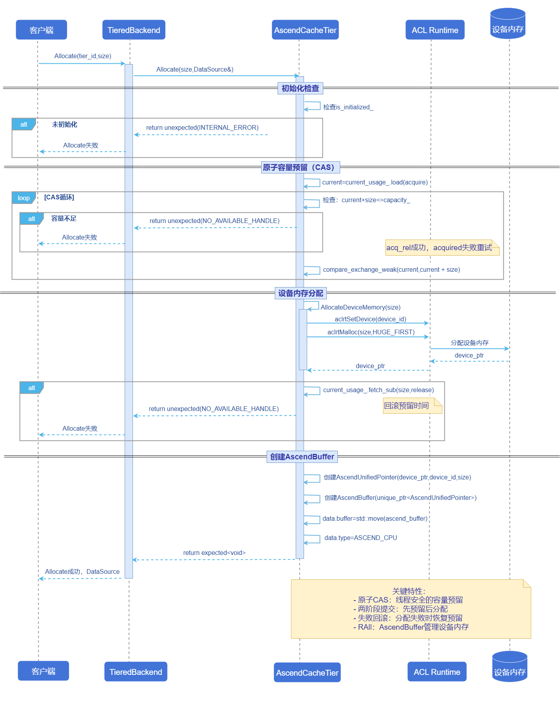
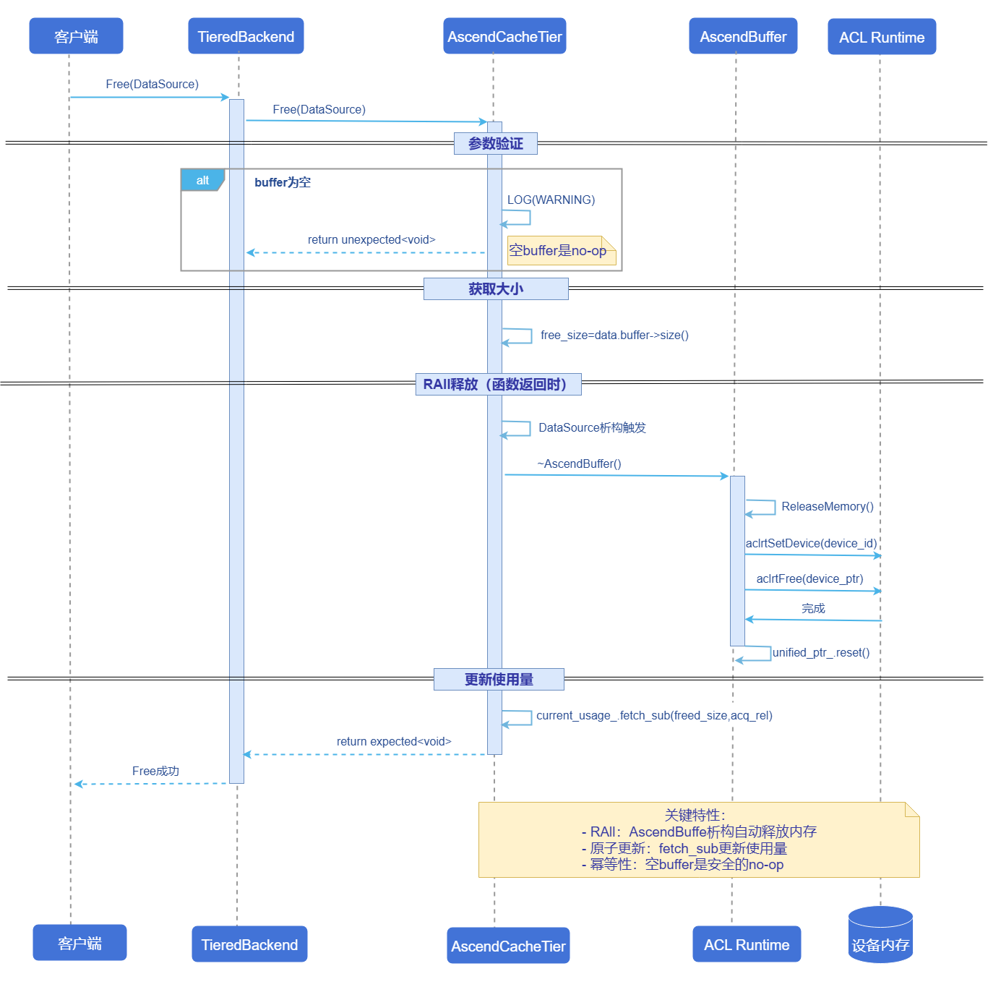
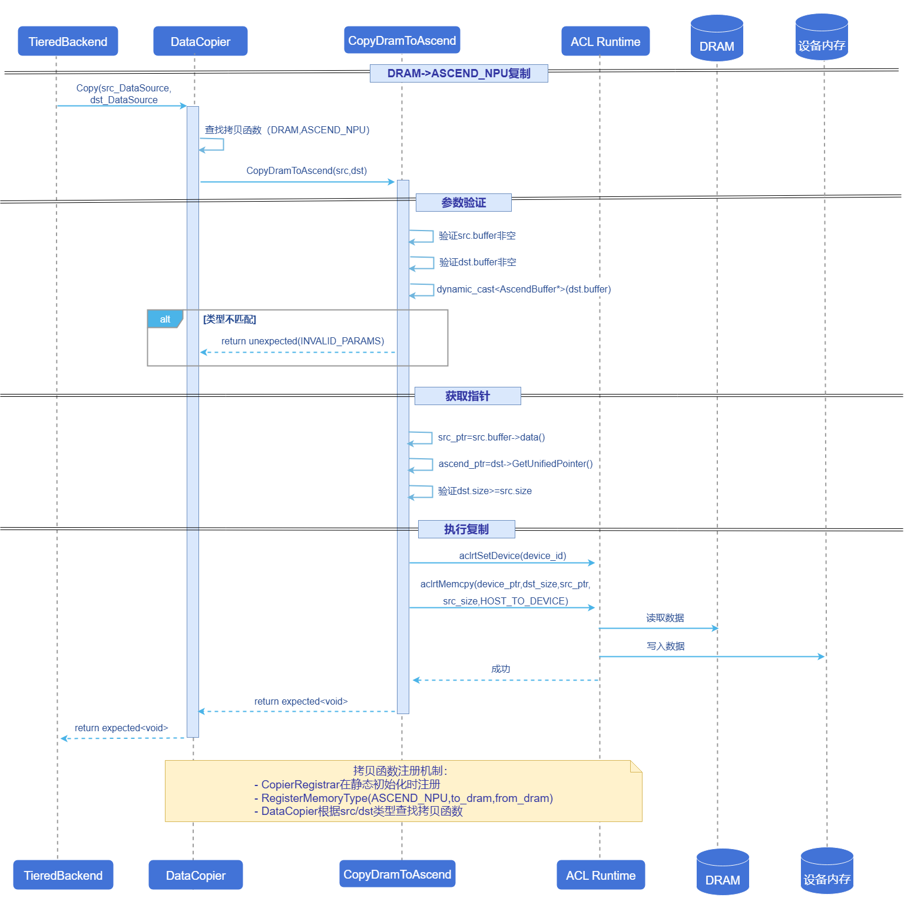

# Mooncake昇腾NPU存储管理层
## 特性介绍
本特性基于Mooncake Store新架构[Issue 954](https://github.com/kvcache-ai/Mooncake/issues/954)中的CacheTier抽象基类进行昇腾适配，实现AscendCacheTier类以支持在昇腾NPU设备上缓存KVCache。
### 应用场景
在大模型推理服务中，使用Mooncake管理本地昇腾设备VRAM的KVCache数据。
### 能力范围
- 支持VRAM和DRAM间数据传输、VRAM和VRAM间数据传输（当前仅注册了间接方式VRAM->DRAM->VRAM）。
- 支持昇腾NPU设备的VRAM层管理：支持Init、Allocate、Free等基本操作，能够成功在昇腾设备上分配和释放内存。采用RAII模式进行资源管理，并通过原子操作保证线程安全。
### 亮点特征
- **端到端昇腾适配**：以CacheTier抽象为接口，提供AscendCacheTier实现，底层对接ACL Runtime完成设备内存分配与复制，业务侧可按统一Tier接口使用。
- **线程安全的容量管理**：Allocate阶段通过原子CAS进行容量预留与失败回滚，避免并发场景下的超配与统计不一致。
- **RAII机制**：AscendBuffer封装设备内存并在析构时自动释放。
### 实现原理
#### Allocate流程
**图1** Allocate流程图


**流程说明：**
1. TieredBackend将Allocate请求转发给目标tier。
2. AscendCacheTier检查初始化状态。
3. 使用CAS原子操作预留空间（先检查后更新，失败重试）。
4. 调用`AllocateDeviceMemory`分配设备内存。
5. 如果设备分配失败，通过`fetch_sub`回滚预留的空间。
6. 创建`AscendBuffer`封装设备内存，通过`DataSource`返回给调用者。
7. `AscendBuffer`实现RAII，析构时自动释放设备内存。

#### Free流程

**图2** Free流程图



**流程说明：**
1. TieredBackend将Free请求转发给目标tier。
2. 检查buffer是否为空（空buffer是安全的no-op）。
3. 获取待释放的内存大小。
4. 当`DataSource`超出作用域时，`AscendBuffer`析构函数被调用。
5. `ReleaseMemory()`调用`aclrtFree`释放设备内存。
6. 通过原子操作更新`current_usage_`。

#### CopyDramToAscend流程

**图3** CopyDramToAscend流程图


**流程说明：**
1. `DataCopier`根据源/目标的`MemoryType`查找对应的复制函数。
2. `CopyDramToAscend`函数验证参数有效性。
3. 通过`dynamic_cast`确保目标buffer是`AscendBuffer`类型。
4. 从`AscendUnifiedPointer`获取设备ID和设备指针。
5. 设置设备上下文并执行`aclrtMemcpy`（HOST_TO_DEVICE）。
6. 复制函数通过`CopierRegistrar`在静态初始化阶段自动注册。

### 与相关特性的关系
依赖Tiered Backend特性来管理和初始化所有CacheTier实例：
- 提供全局的tier视图，包含各个tier的已使用内存，优先级，tag，和key之间的映射等。
- 基于CacheTier的API实现更上层的数据操作API，如实现两个tier层之间数据迁移等。
## 使用AscendCacheTier
### 前提条件
- **硬件要求**：需配备昇腾NPU设备。
- **软件要求**：需支持ACL Runtime库。
- **编译要求**：CMake编译时需添加选项`-DUSE_ASCEND_CACHE_TIER=ON`以启用AscendCacheTier功能。
- **环境要求**：需先拉起mooncake-master服务。
### 背景信息
- **使用场景**：在昇腾NPU推理场景下，使用Mooncake管理本地昇腾设备VRAM的KVCache数据。
- **基本原理**：AscendCacheTier作为CacheTier的昇腾实现，负责设备内存的Init/Allocate/Free；容量通过原子CAS预留保证线程安全；底层调用ACL Runtime（如`aclrtMemcpy`）完成HOST/DEVICE或DEVICE/DEVICE传输。
- **重要注意事项**：
  - **设备上下文**：涉及设备内存操作与复制时会设置device_id（如`aclrtSetDevice`），多卡场景需确保配置的device_id与实际进程绑定一致。
  - **生命周期与RAII**：设备内存由AscendBuffer封装并在析构时释放；使用方应避免在DataSource释放后继续访问buffer指针。
  - **容量评估**：capacity为硬限制，非预期的临时缓冲区/复制可能放大峰值占用，建议配合监控current_usage_做容量规划。
### 使用限制
- **适用范围**：仅在编译启用`USE_ASCEND_CACHE_TIER=ON`且运行环境具备ACL Runtime的前提下可用。
### 操作步骤

AscendCacheTier的配置和初始化依托于`TieredBackend`，通过JSON格式进行描述。可支持单一缓存层或多层级联合配置。配置流程主要包括如下步骤：

1. 准备JSON配置内容。
   示例（以单层NPU配置为例）：
   ```json
   {
       "tiers": [
           {
               "type": "ASCEND_NPU",
               "capacity": 536870912,      // 512MB
               "priority": 100,            // 优先级，数值越大优先级越高
               "device_id": 0,             // Ascend设备ID
               "tags": ["npu", "fast"]     // 可选标签
           }
       ]
   }
   ```

2. 部署RealClient时传入json配置。
   
    RealClient部署分为两种方式：分离式部署和一体化部署。

    - 分离式部署

        分离式部署场景下，RealClient通过二进制编译产物mooncake_client启动。可以直接通过启动参数tiered_backend_config传入json配置。

        启动参数示例：

        ```
        ./mooncake_client --master_server_address 127.0.0.1:50051 \
        --port 50052 \
        --client_rpc_port 12345 \
        --deployment_mode P2P \
        --tiered_backend_config '{"tiers":[{"type":"DRAM","capacity":536870912,"priority":100,"allocator_type":"OFFSET"}]}' \
        --metadata_server P2PHANDSHAKE
        ```

        也可以将tiered_backend_config设置为空，将json保存在环境变量`MOONCAKE_TIRED_CONFIG`中。

    - 一体化部署

        一体化部署场景下，RealClient通过脚本调用setup_p2p_real_client来启动，将json配置赋值给入参tiered_backend_config_json，从而初始化AscendCacheTier。

        脚本示例：
        ```python
        from mooncake.store import MooncakeDistributedStore
        import json

        store = MooncakeDistributedStore()

        tiered_backend_config = {
            "tiers": [
                {
                    "type": "DRAM",
                    "capacity": 64 * 1024 * 1024,
                    "priority": 10
                },
                {
                    "type": "ASCEND_NPU",
                    "capacity": 512 * 1024 * 1024,
                    "priority": 100,
                    "device_id": 0,
                    "tags": ["npu", "fast"]
                }
            ]
        }

        ret = store.setup_p2p_real_client(
            local_hostname="10.10.10.21",
            metadata_server="P2PHANDSHAKE",
            tiered_backend_config_json=json.dumps(tiered_backend_config),
            local_buffer_size=16 * 1024 * 1024,
            protocol="tcp",
            rdma_devices="",
            master_server_addr="127.0.0.1:50051",
            client_rpc_port=12345,
            client_rpc_thread_num=16,
        )

        print("setup ret =", ret)
        ```
   
### 后续操作
后续操作可参考[Mooncake-Store文档](https://kvcache-ai.github.io/Mooncake/design/mooncake-store.html)。
