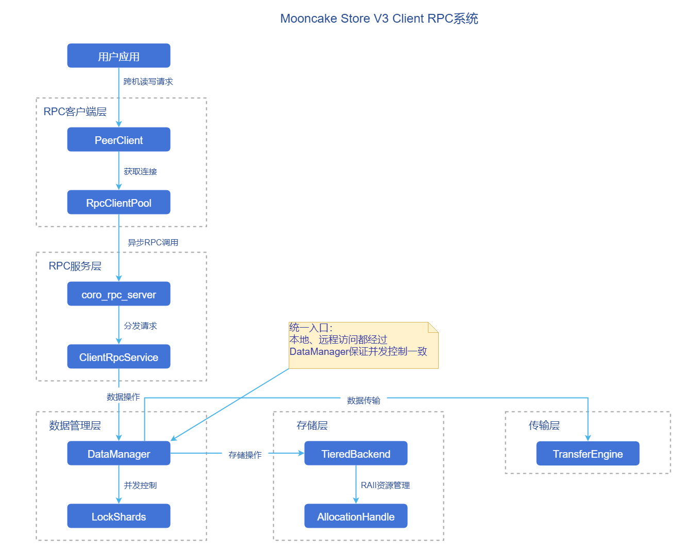
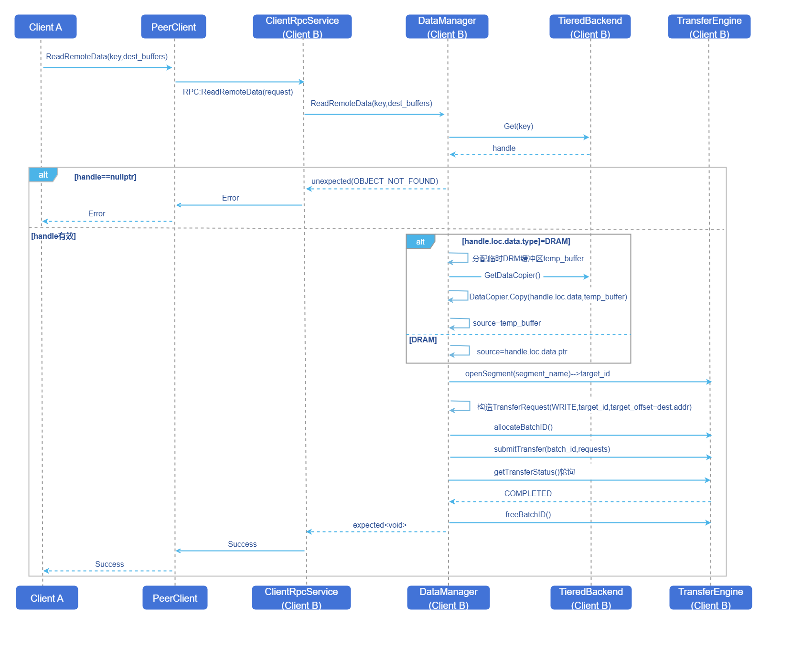
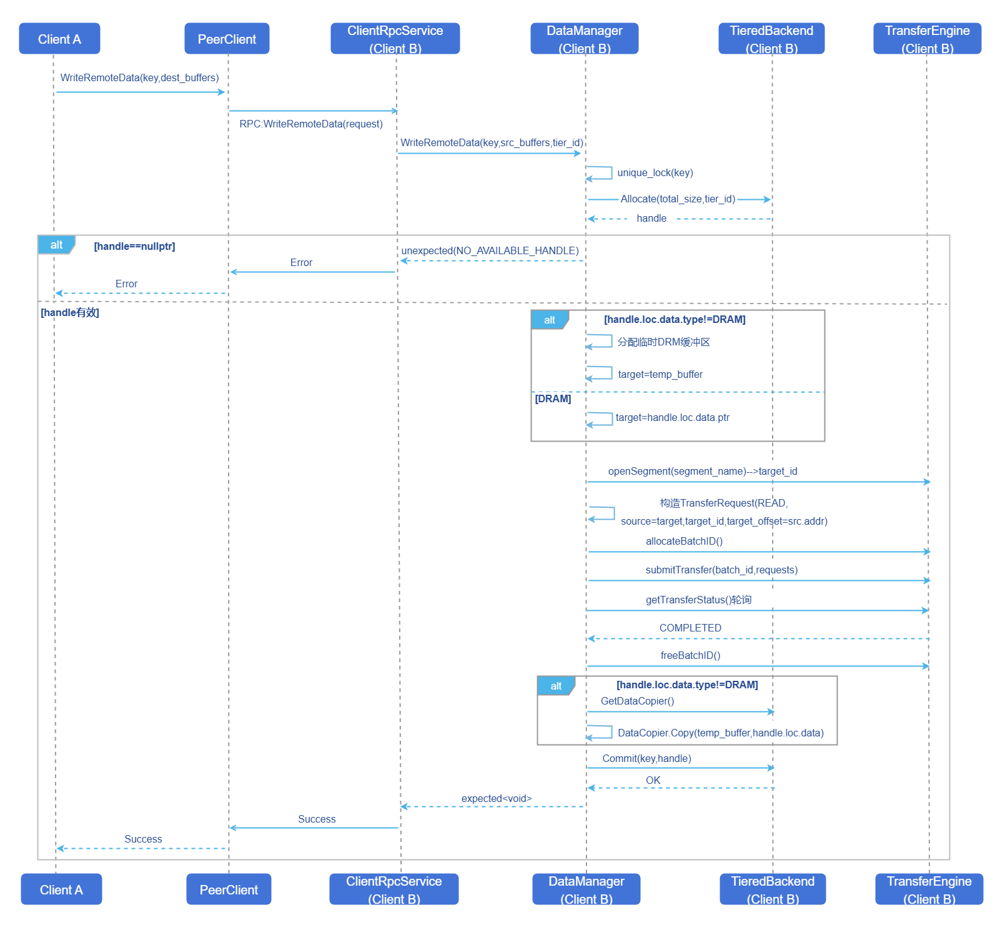

# Mooncake P2P架构客户端远程调用
## 特性介绍
本特性旨在为Mooncake Store V3架构([ISSUE 1209](https://github.com/kvcache-ai/Mooncake/issues/1209))实现Client间跨机数据读写能力。该实现通过RPC元数据通信+TransferEngine数据传输的方式完成跨机读写，核心组件包括：
- **ClientRpcService**：RPC服务端，处理远程数据读写请求。
- **DataManager**：数据管理层，协本地/远程数据操作。
- **PeerClient**：RPC客户端，发起异步跨机数据读写请求。

### 应用场景
在大模型推理服务中，使用Mooncake V3架构跨机读写远端数据。
### 能力范围
- **实现Client间跨机数据读写RPC**：支持跨机数据的安全读写，并能正确处理RPC超时（超时时间10s）。通过Key级别读写锁（Lock Striping）保证数据的并发访问安全。采用RAII模式，保证操作原子性。
- **支持多种存储介质**：支持DRAM和非DRAM（如SSD）Tier，非DRAM数据通过临时缓冲区中转。
### 亮点特征
- **控制面/数据面解耦**：RPC仅负责元数据与调度，数据通过TransferEngine进行跨机传输，降低RPC链路的带宽压力。
- **统一入口与一致并发控制**：本地/远程管理统一由DataManager承接，采用Key级别读写锁（Lock Striping）保证并发安全。
- **多介质透明与健壮失败处理**：支持DRAM/非DRAM Tier，非DRAM场景通过临时DRAM缓冲区中转；并能正确处理RPC超时与对象不存在等错误返回。

### 实现原理
#### 组件视图
**图1** 组件视图



#### 跨机读操作流程
**图2** 跨机读操作流程图



**流程说明：**
1. Client A通过PeerClient发起异步ReadRemoteData RPC请求。
2. Client B的ClientRpcService接收请求，转发到DataManager。
3. DataManager从TieredBackend获取数据handle。
4. 如果数据不在DRAM，需要先复制到临时缓冲区。
5. 通过TransferEngine将数据以RDMA WRITE方式写入Client A的目标缓冲区。
6. 成功返回结果。

#### 跨机写操作流程
**图3** 跨机写操作流程图



**流程说明：**
1. Client A通过PeerClient发起异步WriteRemoteData RPC请求。
2. Client B的ClientRpcService接收请求，转发到DataManager。
3. DataManager获取Key的互斥锁（写时互斥）。
4. 从TieredBackend分配存储空间，获取handle。
5. 如果目标不是DRAM，需要使用临时缓冲区。
6. 通过TransferEngine以RDMA READ方式从Client A读取数据。
7. 如果目标不是DRAM，将数据从临时缓冲区复制到目标存储。
8. 调用TieredBackend的Commit提交元数据更新。
9. 成功返回结果。

**RAII保证：** 如果传输或提交失败，handle析构时会自动释放已分配的资源。

### 与相关特性的关系
- 依赖TieredBackend特性来管理本地存储。
- 依赖TransferEngine特性来实现跨节点数据传输。

## 使用P2P架构客户端远程调用
### 前提条件
- **硬件要求**：需配备RDMA/TCP网卡。
- **环境要求**：需先拉起mooncake-master服务。
### 背景信息
- **使用场景**：在P2P部署模式下，推理进程需要跨机读写远端KVCache或中间结果，调用方希望像访问本地一样按Key读写远端数据。
- **基本原理**：跨机读写分为两段：PC与RPC之间通过异步RPC交换元数据与控制信息；真实数据面由TransferEngine完成跨机搬运（如RDMA WRITE/READ），避免将大数据直接走RPC通道。

### 使用限制
- **部署与连通性限制**：仅适用于P2P部署模式；需要集群网络满足TCP或RDMA通道的双向连通与端口放通。
### 操作步骤
可通过环境变量`MOONCAKE_DM_LOCK_SHARD_COUNT`配置DataManger中锁分片数量（如无设置，默认为1024分片）。
通过环境变量`MC_RPC_PROTOCOL`配置RPC的传输协议为"rdma"或"tcp"（如无设置，默认为"tcp"）。

部署Master时，需配置启动参数：
 - `deployment_mode`配置成P2P模式。

部署Client时，需配置启动参数：
 - `deployment_mode`配置成P2P模式。
 - `client_rpc_port`即RPC服务端的端口号，缺省值为12345。
 - `rpc_thread_num`即RPC线程数，缺省值为2。

启动示例：
```
./mooncake_master --deployment_mode P2P --rpc_port 50051

./mooncake_client \
  --master_server_address 127.0.0.1:50051 \
  --port 50052 --client_rpc_port 12345 \
  --deployment_mode P2P \
  --tiered_backend_config '{"tiers":[{"type":"DRAM","capacity":536870912,"priority":100,"allocator_type":"OFFSET"}]}'
```

### 后续操作
后续操作可参考[Mooncake-Store文档](https://kvcache-ai.github.io/Mooncake/design/mooncake-store.html)。