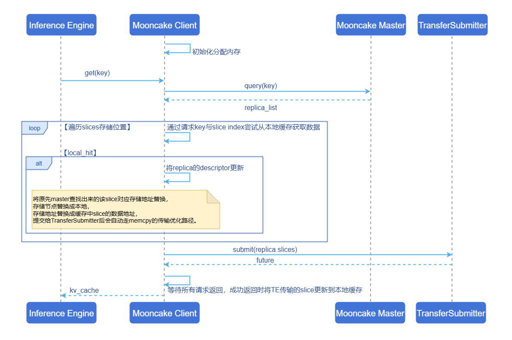

# Mooncake Store热点缓存优化

## 特性介绍

Mooncake Store热点缓存特性的核心思想是在Mooncake Client端缓存被频繁访问的KVCache数据切片。该特性能够显著减少热点数据的跨节点网络传输开销，优化get和批量get操作的性能，改善AI推理场景下的TTFT（Time To First Token）和Total Token Throughput指标。

该特性通过环境变量`MC_STORE_LOCAL_HOT_CACHE_SIZE`进行配置，支持按16MB为单位动态分配内存块，实现高效的热数据本地缓存管理。

### 应用场景

- **多客户端+主节点架构**：推荐在多Mooncake Client的分布式部署场景中使用，Master Service随机分配数据切片到不同存储节点，导致频繁跨节点网络传输时，该特性能够有效减少网络开销。
- **高频访问场景**：适用于存在热点数据的KVCache访问场景，当部分数据被频繁访问时，本地缓存能够显著提升访问效率。

>  **说明：**<br>
> **单机独立客户端场景**：由于所有数据都在本地存储，无需启用客户端热缓存功能，为避免额外内存开销应禁用该特性。

### 能力范围

- 支持用户根据自身业务场景灵活配置Mooncake Store热点缓存大小，降低`get/batchGet`操作延迟。
- 支持推理引擎（vLLM、SGLang等）无感集成，兼容Mooncake的`get/batchGet`接口。

### 亮点特征

- **性能提升显著**：当本地切片命中率达到50%以上时，`get/batchGet`接口延迟预期降低≥40%，TTFT指标预期提升20%以上。
- **智能LRU淘汰**：采用LRU淘汰策略，优先保留最近访问的数据，提升热点数据的缓存命中率。
- **内存高效管理**：以16MB为单位预分配内存块池，最小化运行时分配开销。
- **零侵入集成**：无需修改推理引擎代码，通过环境变量即可启用，保持接口完全兼容。

### 实现原理

**图1** 运行时序图



**核心处理流程**：

1. **初始化阶段**：当创建Client时，根据环境变量配置项`MC_STORE_LOCAL_HOT_CACHE_SIZE`初始化Mooncake Store热点缓存。缺省值为0，表示禁用该特性。如果配置值大于16MB，则分配相应的内存用于存储热数据。

2. **元数据查询**：当`get/batchGet`请求到达时，首先向Master Service查询目标KVCache的存储位置信息（replica descriptor），获取每个数据切片所在的存储节点和地址信息。

3. **缓存查询**：遍历所有数据切片，使用`{request_key}_{slice_index}`作为键查询该Mooncake Client的Mooncake Store热点缓存。如果缓存命中，更新replica descriptor：
   - 将存储节点替换为本地节点。
   - 将存储地址替换为缓存中该切片的数据地址。
   - 提交给TransferSubmitter后，会自动选择LOCAL_MEMCPY传输策略优化传输。

4. **传输提交**：将读取请求提交给Transfer Submitter。如果目标地址是本地节点（包括Mooncake Store热点缓存命中的情况），Transfer Engine会自动选择LOCAL_MEMCPY传输策略，避免网络传输开销。

5. **缓存更新**：等待所有传输请求返回后，通过异步任务处理器（LocalHotCacheHandler）将远程传输的切片更新到Mooncake Store热点缓存。缓存更新采用LRU策略，当缓存空间不足时自动驱逐最久未访问的数据块。

### 与相关特性的关系

- **与Mooncake的关系**：该特性是Mooncake Store Client端的性能优化增强。
- **与推理引擎的关系**：兼容主流推理引擎（如vLLM、SGLang），无需修改代码即可提升性能。

## 安装

### 开始安装
本特性有以下两种途径安装：

#### 使用镜像
镜像目前仅支持arm架构。
```bash
docker pull cr.openfuyao.cn/openfuyao/mooncake:0.3.7-of.1
```

#### 手动安装

该特性已集成在Mooncake Store Client中，与[Mooncake安装](https://kvcache-ai.github.io/Mooncake/getting_started/build.html)方式一致。

## 配置Mooncake Store热点缓存

### 前提条件

- 已获取Mooncake项目文件。
- 未启动Mooncake Client进程。

### 背景信息
- **启用条件**：当`MC_STORE_LOCAL_HOT_CACHE_SIZE`配置值大于16MB时，Mooncake Store热点缓存功能将被启用。
- **禁用条件**：
  - 配置值小于16MB
  - 配置值为无效输入（如字符串、负数等）
  - 未设置该环境变量（缺省值为0，表示禁用）
- **内存分配**：实际内存分配遵循16MB单位对齐。例如：
  - 配置32MB → 分配2个16MB块
  - 配置50MB → 分配3个16MB块（48MB）
  - 配置100MB → 分配6个16MB块（96MB）

### 操作步骤

通过设置环境变量`MC_STORE_LOCAL_HOT_CACHE_SIZE`来启用和配置Mooncake Store热点缓存功能：

```bash
export LOCAL_HOT_CACHE_SIZE=<缓存大小（字节）>
```

### 配置示例

```bash
# 启用64MB（64*1024*1024=67108864）热缓存
export LOCAL_HOT_CACHE_SIZE=67108864
```

### 配置建议

- **多客户端架构**：根据实际部署环境调整`MC_STORE_LOCAL_HOT_CACHE_SIZE`参数，以平衡性能提升与内存开销。
- **内存资源充足场景**：可以适当增大缓存大小，提高缓存命中率。

## 使用Mooncake Store热点缓存

配置环境变量`LOCAL_HOT_CACHE_SIZE`，与[Mooncake使用方式](https://kvcache-ai.github.io/Mooncake/deployment/mooncake-store-deployment-guide.html)一致，Mooncake Client会自动处理缓存逻辑。

### 前提条件
Mooncake Store与其他相关组件（Transfer Engine等）已编译。

### 使用限制
- 单机场景下应禁用该特性以节省内存。
- Mooncake Store热点缓存占用额外内存，不计入向Mooncake Master挂载的内存。
- `MC_STORE_LOCAL_HOT_CACHE_SIZE`仅在Mooncake Client初始化时生效，运行时修改无效。

### 操作步骤

1. 进入Mooncake目录，以使用openFuyao提供的镜像为例：
```
cd /workspace/Mooncake
```

2. 启动Mooncake Master。
```bash
./build/mooncake-store/src/mooncake_master --rpc-port 50051
```

3. 启动Metadata Server，以Redis为例。
```bash
apt update && apt install redis-server -y
redis-server --port 6379 --protected-mode no --bind 0.0.0.0
```

4. 启动Mooncake Client。

以下代码示例展示了如何配置并启动Mooncake Client。参考[社区示例文件](https://github.com/kvcache-ai/Mooncake/blob/main/mooncake-store/tests/distributed_object_store_provider.py)。

```python
# 使用1GB(1*1024*1024*1024)大小Mooncake Store热点缓存
import os
os.environ['LOCAL_HOT_CACHE_SIZE'] = '1073741824'

from mooncake.store import MooncakeDistributedStore
# 初始化Mooncake Store Client
store = MooncakeDistributedStore()
# 使用tcp协议传输数据
protocol = "tcp"
# 默认的RDMA设备名称
device_name = "ibp6s0"
# Mooncake Store Client地址
local_hostname = "localhost:12355"
# 启动的Metadata Server地址
metadata_server = "redis://localhost:6379"
# 提供16GB大小存储
global_segment_size = 16 * 1024 * 1024 * 1024
# 提供512MB的读写buffer
local_buffer_size = 512 * 1024 * 1024
# 启动的Mooncake Master地址
master_server_address = "localhost:50051"
# 启动Mooncake Store Client
result = store.setup(local_hostname, 
                      metadata_server, 
                      global_segment_size,
                      local_buffer_size, 
                      protocol, 
                      device_name,
                      master_server_address)
```
5. 使用Get接口。

以下代码展示了基本的Get接口使用方法。如需查看完整的测试用例（包括错误处理、边界情况等），请参考[社区示例文件](https://github.com/kvcache-ai/Mooncake/blob/main/mooncake-wheel/tests/test_distributed_object_store.py)。

```python
test_data = b"Hello, World!"
key = "test_teardown_key"
store.put(key, test_data)
store.get(key)
```

6. 使用BatchGet接口。

以下代码展示了基本的BatchGet接口使用方法。如需查看完整的测试用例（包括错误处理、边界情况等），请参考[社区示例文件](https://github.com/kvcache-ai/Mooncake/blob/main/mooncake-wheel/tests/test_distributed_object_store.py)。
```python
test_data = [
    b"Batch Buffer Data 1! " * 100,  # ~2.1KB
    b"Batch Buffer Data 2! " * 200,  # ~4.2KB
]
keys = ["test_batch_get_buffer_key1", "test_batch_get_buffer_key2"]

for key, data in zip(keys, test_data):
    result = store.put(key, data)
    assert result == 0, f"Failed to put data for key {key}"
  
results = store.batch_get_buffer(keys)
```

### 相关操作
无
