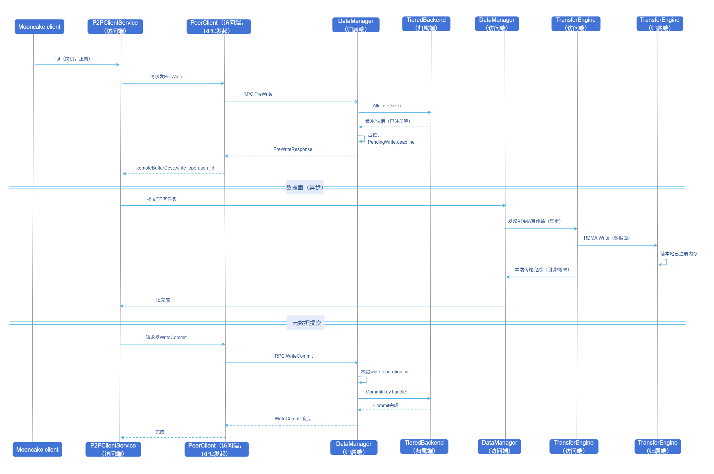
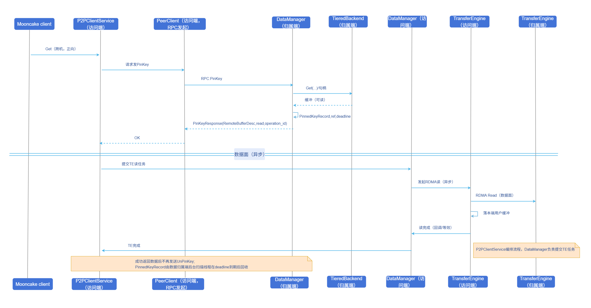

# Mooncake Store V3架构双向数据传输

## 特性介绍

[Mooncake Store V3架构](https://github.com/kvcache-ai/Mooncake/issues/1209)在P2P跨机数据通路上进行了升级：在原有**反向传输**（由数据归属方TransferEngine（TE）发起传输，参见[Mooncake P2P架构客户端远程调用](../../mooncake_p2p_architecture_client_remote_invocation/user_guide/mooncake_p2p_architecture_client_remote_invocation.md)）基础上，新增**正向传输**能力，实现了跨机Put/Get时由访问方或归属方灵活选择TE发起方向，覆盖更多网络拓扑与部署约束。

- **原有反向传输（`REVERSE`模式）**：由数据归属端TE在单次RPC（`WriteRemoteData`/`ReadRemoteData`）内完成元数据协调与数据搬移——写时从访问端拉取数据、读时向访问端推送数据，为默认路径且与存量行为一致。
- **新增正向传输（`FORWARD`模式）**：由数据访问端TE在归属端完成缓冲预留或锁定后，对归属端已注册缓冲发起Write/Read，以多阶段RPC配合异步TE完成跨机Put/Get。

该特性打破了Mooncake V3架构跨机数据面仅能由归属端单向发起的限制，在反向传输路径不可达或代价过高时仍可高效完成跨机读写。

### 应用场景

- 在P2P部署下，部分超节点、特定网卡拓扑约束导致**反向传输不可达或代价过高**，需由访问端TE直接发起跨机传输。
- 高并发跨机读写场景，希望通过分阶段与分片record表降低元数据路径上的锁争用。

### 能力范围

- **正向跨机写**：通过`PreWrite`RPC先在归属端预留目标缓冲，再由访问端TE发起Write直接写入该缓冲，最后用`WriteCommit`RPC提交元数据，使远端数据正式可见；若TE失败或提交前放弃。
- **正向跨机读**：通过`PinKey`RPC先在归属端锁定目标数据并返回可读缓冲信息，支持同key多读共享，再由访问端TE发起Read将数据拉取到本地；成功读取后不再额外发送`UnPinKey`RPC，归属端record由后台线程在租约超时后回收。
- **可配置传输方向**：单次`Put`/`Get`及`BatchPut`/`BatchGet`可通过读写扩展配置指定`FORWARD`或`REVERSE`；缺省值为`REVERSE`。

### 亮点特征

- **控制面/数据面解耦**：RPC仅交换元数据、缓冲描述符与读写记录id，数据由TE在阶段间异步搬移，大块数据不经RPC通道，与RPC带宽、时延解耦。
- **传输方向可配置，默认反向**：`Put`/`Get`可按请求指定`FORWARD`或`REVERSE`，缺省为`REVERSE`；反向路径控制面与TE均在归属端一次完成，RPC段数少、无多阶段record往返，与现有行为一致，仅在反向不可达或代价过高时用户指定切换成正向数据传输。
- **三阶段缩短持锁范围**：仅元数据准备与完成阶段持分片锁/key锁，TE传输阶段不长时间占用key写锁，从而避免将网络与数据搬移时延放进锁内，降低热点key和高并发场景下的锁竞争，提升跨机读写吞吐。
- **会话操作id与租约防竞态**：写路径`write_operation_id`、读路径`read_operation_id`与归属端`deadline`共同约束，避免旧请求误操作新会话、读取期间数据被提前回收，提升跨机读写过程中的一致性与安全性。

### 实现原理

#### 跨机正向写操作流程

**图1** 跨机正向写操作时序图



**流程说明：**

1. 访问端准备跨机`Put`（配置为正向），由`P2PClientService`经`PeerClient`向归属端发起RPC `PreWrite`。
2. 归属端分配缓冲、创建`PendingWriteRecord`，返回`RemoteBufferDesc`与`write_operation_id`。
3. `P2PClientService`经本端`DataManager`向`TransferEngine`提交异步RDMA Write任务，数据写入归属端已注册内存（此阶段不长时间持有归属端key写锁）。
4. TE在访问端侧完成后，由`P2PClientService`再次经`PeerClient`发起RPC `WriteCommit`；归属端校验`write_operation_id`与租约后执行`TieredBackend::Commit`。
5. **异常路径**：步骤3中TE失败或上层在提交前放弃时，访问端`P2PClientService`应对同一`key`与`write_operation_id`发起`WriteRevoke`，由归属端删除pending记录回滚；调用方仍收到原始TE错误。`WriteRevoke`对可恢复错误可做3次重试。

#### 跨机正向读操作流程

**图2** 跨机正向读操作时序图



**流程说明：**

1. 访问端`Get`（配置为正向）后，由`P2PClientService`经`PeerClient`向归属端发起RPC `PinKey`。
2. 归属端取得可读句柄、创建或续租`PinnedKeyRecord`，返回`RemoteBufferDesc`与`read_operation_id`。
3. `P2PClientService`经本端`DataManager`向`TransferEngine`提交异步RDMA Read任务，在租约有效期内将数据拉取到本端用户缓冲。
4. TE成功后，本次读请求即可直接返回，不再额外发送`UnPinKey`；归属端`PinnedKeyRecord`由后台扫描线程在`deadline`到期后回收。
5. **异常路径**：步骤3中TE失败时，访问端`P2PClientService`才会重试`UnPinKey`清理pin（策略与写路径`WriteRevoke`重试次数对齐）；`LEASE_EXPIRED`可视为清理已生效。

#### 租约与清理

- 租约由归属端读写record内的`deadline`与操作id共同表达，用于约束中间态的有效期。写路径在`WriteCommit`时校验`write_operation_id`与租约；读路径成功后不再发送`UnPinKey`，而是由后台扫描在`deadline`到期后回收`PinnedKeyRecord`。若TE失败需要发送`UnPinKey`清理，归属端同样会基于`read_operation_id`与租约判定其是否有效。
- 前台：各阶段RPC命中record时若已过期则先删除再继续判定。
- 后台：按`p2p_key_lease_scan_interval_ms`周期扫描各shard的`ordered_list`头部，超时record被回收并释放`AllocationHandle`强引用。

#### 正向与反向数据面对比

**表1** 正向与反向数据面原理对比

| 维度 | 反向传输（默认） | 正向传输 |
|------|------------------|----------|
| TE发起方 | 数据归属端 | 数据访问端 |
| 跨机写数据面 | 归属端拉取对端数据 | 访问端写入归属端缓冲 |
| 跨机读数据面 | 归属端推送到对端 | 访问端从归属端拉取 |
| 控制面RPC | 单段`WriteRemoteData`/`ReadRemoteData` | 写：`PreWrite`/`WriteCommit`/`WriteRevoke`；读：成功路径为`PinKey`，失败清理使用`UnPinKey` |
| 典型编排位置 | 归属端一次处理链内连续完成三阶段语义 | 访问端驱动多段RPC，阶段间插入TE |

### 与相关特性的关系

- 依赖[Mooncake P2P架构客户端远程调用](../../mooncake_p2p_architecture_client_remote_invocation/user_guide/mooncake_p2p_architecture_client_remote_invocation.md)：P2P部署、RPC通道、`PeerClient`/`ClientRpcService`与反向传输基线能力。
- 依赖**TieredBackend**：归属端缓冲分配、元数据提交可见与句柄RAII。详见[Tier Backend介绍示例](https://github.com/kvcache-ai/Mooncake/blob/P2P-Mooncake-Store/mooncake-store/conf/tiered_backend_config_example.md)。
- 依赖**TransferEngine**：跨机数据传输整体依赖TE执行，正向与反向路径的数据面均通过TE完成。本特性不涉及TE改动。
- 本特性**仅适用于Mooncake Store V3架构**，不覆盖其他Store架构。

## 使用Mooncake Store V3架构双向数据传输

### 前提条件

- **部署模式**：Mooncake Client与Mooncake Master配置`deployment_mode`为`P2P`。
- **硬件与网络**：具备RDMA或TCP网卡或其他TE支持的硬件设备，集群内访问端与归属端TE互通；正向路径要求访问端TE能到达归属端缓冲。

### 背景信息

未配置或显式配置为`REVERSE`时，仍走`WriteRemoteData`/`ReadRemoteData`反向单段路径，与启用本特性前一致。

### 使用限制

- **架构范围**：仅V3 P2P跨机路径；本地写、同进程短路径不强制与跨机正向三阶段一致。
- **写并发**：同一key任一时刻最多一条有效`PendingWriteRecord`，并发`PreWrite`仅首个成功，其余失败需由调用方重试。
- **租约时长**：网络RTT较大或负载高时，应适当增大`p2p_key_lease_duration_ms`，避免`WriteCommit`/TE完成前租约过期导致频繁重试。

### 操作步骤

1. 部署模式：配置`deployment_mode`为`P2P`

    Master与Client均需以P2P模式启动。Client还需指定`client_rpc_port`与`tiered_backend_config`（本地DRAM等tier配置）。

    ```bash
    ./mooncake_master --deployment_mode P2P --rpc_port 50051

    ./mooncake_client \
      --master_server_address 127.0.0.1:50051 \
      --port 50052 \
      --client_rpc_port 12345 \
      --deployment_mode P2P \
      --tiered_backend_config '{"tiers":[{"type":"DRAM","capacity":536870912,"priority":100,"allocator_type":"OFFSET"}]}'
    ```

    可选环境变量：

    - `MOONCAKE_DM_LOCK_SHARD_COUNT`：DataManager锁分片数，默认`1024`（与gflag `--lock_shard_count`等价语义）。

2. 配置租约

    正向写`PreWrite`、正向读`PinKey`等中间态由租约保护。

    - `p2p_key_lease_duration_ms`：`PreWrite`/`PinKey`中间态最长存活时间（ms），超过该数值认为本次跨机读写失败，默认`5000`。
    - `p2p_key_lease_scan_interval_ms`：后台清理过期记录扫描周期（ms）；传`0`时使用内建默认，默认`1000`。

3. 传输方向

    跨节点数据面由谁发起TE传输：

    - `reverse`（默认）：**反向传输**，归属端TE发起；写走`WriteRemoteData`，读走`ReadRemoteData`。
    - `forward`：**正向传输**，访问端TE发起；写走`PreWrite → TE Write → WriteCommit`，读走`PinKey → TE Read`（成功后由归属端lease/扫描释放pin，不再RPC `UnPinKey`）。

    配置入口：

    - 二进制Client：gflag `--p2p_transfer_direction_mode forward`
    - Python：`setup_p2p_real_client(..., p2p_transfer_direction_mode="forward")`


### 使用示例

#### V3架构Master启动

下列命令以P2P模式启动Mooncake Master，并开启HTTP元数据服务，供Client在P2P握手与跨机TE建连时交换元数据。

```bash
./mooncake_master \
  --deployment_mode P2P \
  --rpc_port 50051 \
  --enable_http_metadata_server 1 \
  --http_metadata_server_port 8000
```

#### 二进制Client启动

下列命令在P2P模式下同时配置租约与正向传输（`forward`）。按需将`protocol`改为`rdma`并设置`--device_names`。

```bash
./mooncake_client \
  --master_server_address 127.0.0.1:50051 \
  --port 50052 \
  --client_rpc_port 12345 \
  --deployment_mode P2P \
  --tiered_backend_config '{"tiers":[{"type":"DRAM","capacity":536870912,"priority":100,"allocator_type":"OFFSET"}]}' \
  --p2p_key_lease_duration_ms 8000 \
  --p2p_key_lease_scan_interval_ms 1000 \
  --p2p_transfer_direction_mode forward
```

#### Python一体化部署

```python
from mooncake.store import MooncakeDistributedStore
import json

store = MooncakeDistributedStore()

tiered_backend_config = {
    "tiers": [
        {
            "type": "DRAM",
            "capacity": 64 * 1024 * 1024,
            "priority": 100,
            "allocator_type": "OFFSET",
        }
    ]
}

ret = store.setup_p2p_real_client(
    local_hostname="10.10.10.21",
    metadata_server="P2PHANDSHAKE",
    tiered_backend_config_json=json.dumps(tiered_backend_config),
    local_buffer_size=16 * 1024 * 1024,
    protocol="tcp",          # 使用RDMA时改为 "rdma" 并设置rdma_devices
    rdma_devices="",
    master_server_addr="127.0.0.1:50051",
    client_rpc_port=12345,
    client_rpc_thread_num=16,
    p2p_key_lease_duration_ms=8000,
    p2p_key_lease_scan_interval_ms=1000,
    p2p_transfer_direction_mode="forward",  # 或 "reverse"（默认）
)
print("setup ret =", ret)
```
