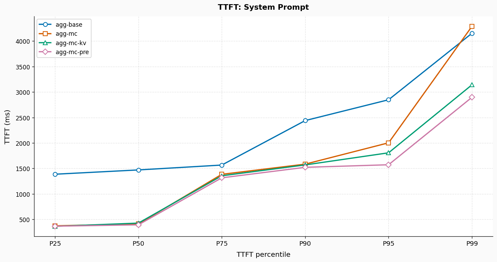
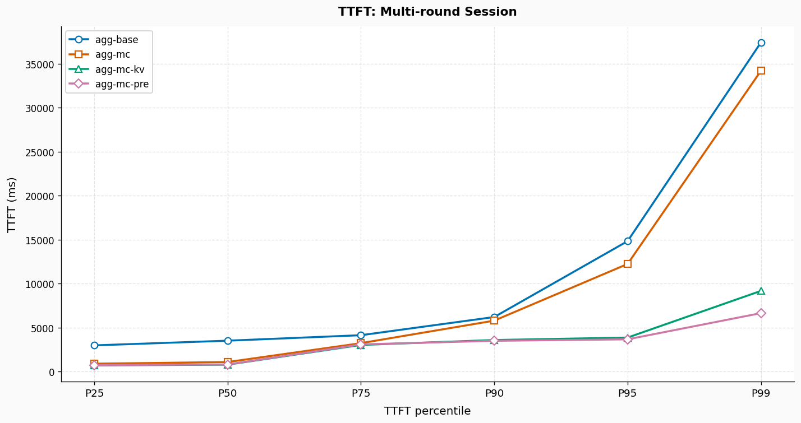

# InferNex整体性能测试报告-v26.06

## 摘要

本报告在定长系统提示词与多轮对话两种场景下测试了InferNex性能，相比基线：

- 开启mooncake情况下，TTFT降低约 51.0%，TPS提高约 24.8%；
- 使用kv-cache-aware路由策略情况下，TTFT降低约 59.0%，TPS提高约 40.5%；
- 使用prediciton路由策略情况下，TTFT降低约 59.6%，TPS提高约 31.7%。

## 测试场景与数据集

- **定长系统提示词复用**:该场景模拟系统提示词复用，衡量推理服务在请求长度固定且有KVCache重复的场景下的性能表现。数据集包含120种长度固定为8k的系统提示词，每种系统提示词重复4次，共有480条请求，请求时间遵循泊松分布，请求并发数为8。
- **多轮对话**：该场景模拟多位用户与LLM持续对话，单个会话中包含多次请求。每个用户开始发送长度为16k的请求，LLM返回长度为128 tokens的回答，用户第二次发送长度为1k的请求，此时请求总长度来到17k，以此类推共进行4轮对话，平均请求长度为17.5k。数据集包含120个独立用户，共有480条请求，请求时间遵循泊松分布，请求并发数为8。

## 实验环境

### 硬件集群
- **NPU**: 昇腾 910B4 32G × 16 卡
- **拓扑**: 2台昇腾Atlas A2，每节点 8 卡

### 软件版本
- **推理引擎**: vLLM 0.18.0
- **InferNex**: 26.06
- **测试工具**：aiperf

### 模型配置 

模型使用`Qwen/Qwen3-32B`，关键参数如下表：

| 参数 | 配置值 | 说明 |
|:---|:---|:---|
| `maxModelLen` | 40,960 | 模型最大上下文长度 |
| `maxNumBatchedTokens` | 40,960 | 批处理 token 上限 |
| `gpuMemoryUtilization` | 0.8 | 显存利用率上限 | 
| `max_tokens` | 128 | 请求输出 token 上限 | 

## InferNex测试与部署规格

InferNex测试规格如下表所示：

| 规格         | 架构   | 描述 | hermes-router | strategy       | cache-indexer | mooncake-store | elastic-scaler | eagle-eye  |
|------------|------|------|---------------|----------------|---------------|----------------|----------------|------------|
| agg-base   | 聚合   | 仅使用random路由策略 | ✅             | random         | ❌             | ❌              | ❌              | ❌          |
| agg-mc     | 聚合   | 开启mooncake能力 | ✅             | random         | ✅             | ✅              | ✅              | ✅          |
| agg-mc-kv  | 聚合   | 叠加kv cache aware路由策略 | ✅             | kv-cache-aware | ✅             | ✅              | ✅              | ✅          |
| agg-mc-pre | 聚合   | 叠加prediction路由策略 | ✅             | prediction     | ✅             | ✅              | ✅              | ✅          |

性能测试部署规格如下：
- 聚合模式：共4个推理实例，单个实例TP=4，DP=1，PP=1，共使用2台物理机16卡。

> 说明： 
> 
> - elastic-scaler、eagle-eye两个组件理论上不会对性能产生影响，这里选择开启是为了验证InferNex的整体性能。

## 定长系统提示词复用场景

### 聚合架构性能结果

| 规格         | 请求成功率 | TTFT(avg)/ms | TTFF(p99)/ms | TPOT(avg) | TPOT(p99) | TPS(avg) tokens/sec | E2EL(avg)/ms | E2EL(p99)/ms |
|------------|-------|--------------|--------------|-----------|-----------|---------------------|--------------|--------------|
| agg-base   | 100%  | 1616.19     | 4,152.34     | 65.73     | 104.76    | 6739.39          | 9963.69     | 14,855.05     |
| agg-mc     | 100%  | 791.35       | 4,288.49     | 61.23     | 92.51     | 7827.05         | 8567.87     | 15,180.11     |
| agg-mc-kv  | 100%  | 736.32       | 3,140.79     | 57.15     | 74.81     | 8368.87         | 7994.65     | 11,045.84     |
| agg-mc-pre | 100%  | 688.83       | 2,896.28     | 59.58     | 79.76     | 8114.42            | 8255.78     | 11,801.84     |

定长系统提示词场景中，各项优化开启后相比基线`agg-base`均产生性能收益，其中`agg-mc-pre`综合提升最为明显：

**agg-mc：开启mooncake store**
- TTFT：平均耗时791.35ms（对比基线降低约51.0%），p99耗时4288.49ms（对比基线升高约3.3%）；
- TPS：平均吞吐7827.06 tokens/sec（对比基线提升约16.8%）；
- TPOT：平均耗时61.23ms（对比基线降低约6.8%），p99耗时92.51ms（对比基线降低约11.7%）；
- E2E延迟：平均耗时8567.87ms（对比基线降低约14.0%），p99耗时15180.11ms（对比基线升高约2.2%）。

**agg-mc-kv：叠加开启kv-cache-aware**
- TTFT：平均耗时736.32ms（对比基线降低约54.4%），p99耗时3140.79ms（对比基线降低约24.4%）；
- TPS：平均吞吐8368.87 tokens/sec（对比基线提升约24.2%）；
- TPOT：平均耗时57.15ms（对比基线降低约13.1%），p99耗时74.81ms（对比基线降低约28.6%）；
- E2E延迟：平均耗时7994.65ms（对比基线降低约19.8%），p99耗时11045.84ms（对比基线降低约25.6%）。

**agg-mc-pre：叠加开启prediction**
- TTFT：平均耗时688.83ms（对比基线降低约57.4%），p99耗时2896.28ms（对比基线降低约30.3%）；
- TPS：平均吞吐8114.42 tokens/sec（对比基线提升约20.4%）；
- TPOT：平均耗时59.58ms（对比基线降低约9.4%），p99耗时79.76ms（对比基线降低约23.9%）；
- E2E延迟：平均耗时8255.78ms（对比基线降低约17.1%），p99耗时11801.84ms（对比基线降低约20.6%）。

下图为请求TTFT的分布情况：

  

## 多轮对话场景

### 聚合架构性能结果

| 规格         | 请求成功率 | TTFT(avg)/ms | TTFF(p99)/ms | TPOT(avg) | TPOT(p99) | TPS(avg) tokens/sec | E2EL(avg)/ms | E2EL(p99)/ms |
|------------|-------|--------------|--------------|-----------|-----------|---------------------|--------------|--------------|
| agg-base   | 100%  | 4183.16      | 14347.3      | 90.24     | 165.42    | 9408.38             | 15643.9      | 30101.09     |
| agg-mc     | 100%  | 2051.48      | 9506.05      | 76.65     | 138.97    | 12498.01            | 11785.69     | 21487.07     |
| agg-mc-kv  | 100%  | 1445.34      | 6371.27      | 67.44     | 91.97     | 14749.95            | 10010.36     | 15104.71     |
| agg-mc-pre | 100%  | 1601         | 6203.58      | 73.62     | 120.44    | 13443.75            | 10950.87     | 18963.20      |

多轮对话场景中，各项优化开启后相比基线`agg-base`均产生性能收益，其中`agg-mc-kv`综合提升最为明显，`agg-mc-pre`在TTFT p99上表现最优：

**agg-mc：开启 mooncake store**
- TTFT：平均耗时2051.48ms（对比基线降低约51.0%），p99耗时9506.05ms（对比基线降低约33.7%）；
- TPS：平均吞吐12498.01 tokens/sec（对比基线提升约32.8%）；
- TPOT：平均耗时76.65ms（对比基线降低约15.1%），p99耗时138.97ms（对比基线降低约16.0%）；
- E2E延迟：平均耗时11785.69ms（对比基线降低约24.7%），p99耗时21487.07ms（对比基线降低约28.6%）。

**agg-mc-kv：叠加开启 kv-cache-aware**
- TTFT：平均耗时1445.34ms（对比基线降低约65.5%），p99耗时6371.27ms（对比基线降低约55.6%）；
- TPS：平均吞吐14749.95 tokens/sec（对比基线提升约56.8%）；
- TPOT：平均耗时67.44ms（对比基线降低约25.3%），p99耗时91.97ms（对比基线降低约44.4%）；
- E2E延迟：平均耗时10010.36ms（对比基线降低约36.0%），p99耗时15104.71ms（对比基线降低约49.8%）。

**agg-mc-pre：叠加开启 prediction**
- TTFT：平均耗时1601ms（对比基线降低约61.7%），p99耗时6203.58ms（对比基线降低约56.8%）；
- TPS：平均吞吐13443.75 tokens/sec（对比基线提升约42.9%）；
- TPOT：平均耗时73.62ms（对比基线降低约18.4%），p99耗时120.44ms（对比基线降低约27.2%）；
- E2E延迟：平均耗时10950.87ms（对比基线降低约30.0%），p99耗时18963.20ms（对比基线降低约37.0%）。

下图为请求TTFT的分布情况：

  

## 结论

InferNex性能在定长系统提示词与多轮对话两种场景下均有明显的性能提升。

prediciton与kv cache aware两种路由策略在部分核心指标上具有一致性——vLLM推理引擎负载均衡以及KVCache命中率指标，二者差异主要在于prediciton路由策略额外引入了NPU侧硬件监测指标，从算力与设备运行状态维度补充决策依据，理论上具备更细粒度的请求调度能力。

当前prediciton路由策略的性能上限主要受到两方面制约：
- 预测模型基于离线训练获得，训练集规模相对有限，与实际测试场景在负载特征、请求分布等方面存在一定差异；若在业务场景中持续、充分地训练与迭代，预计仍有较大优化空间。
- NPU侧上报的硬件监测数据实时性不足，存在3s-5s的指标延迟，导致prediciton路由策略对NPU侧信息的利用效率下降，起主要作用的仍然是负载状态和缓存命中率，因而两者性能表现接近。

## 后续工作

- 补充PD分离场景下的性能测试结果。
- 更多具有代表性的性能测试场景。

