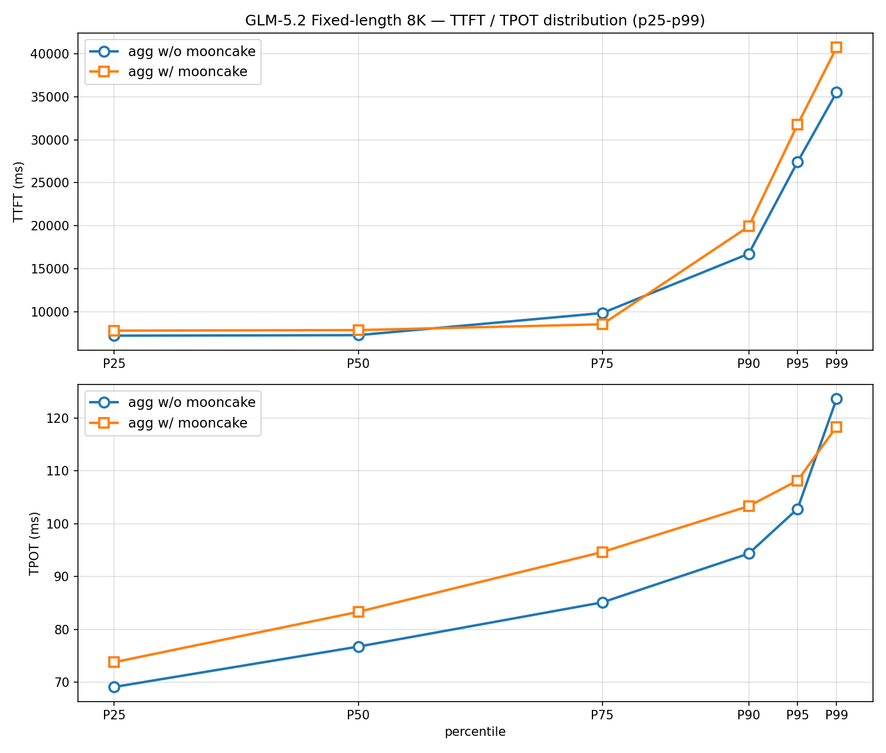
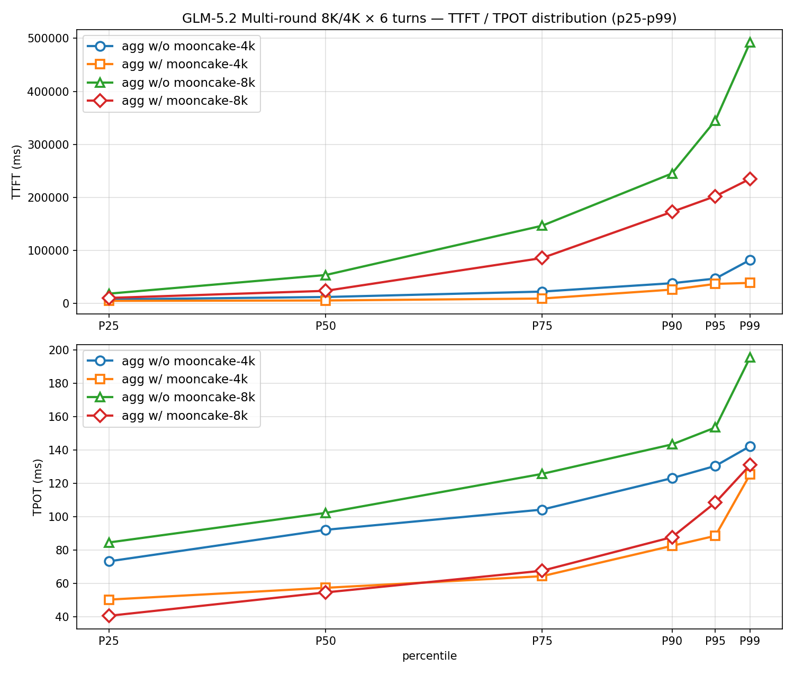
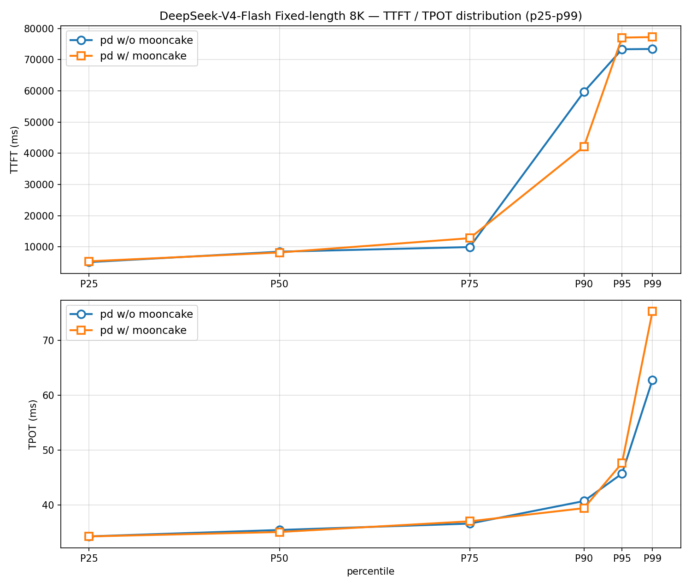
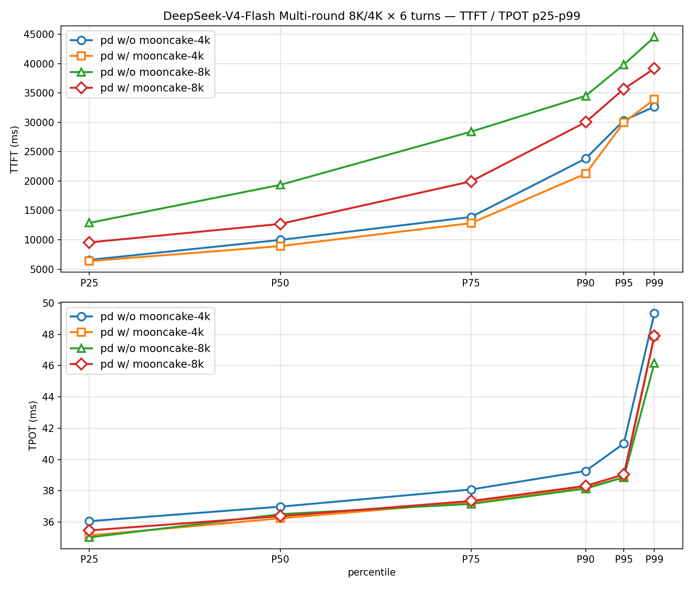

# InferNex整体性能测试报告-v26.09

## 摘要

本报告在定长全随机请求、多轮对话两种场景下测试了InferNex v26.09性能，验证的模型包括GLM5.2与DeepSeek-V4-Flash。

### GLM5.2
模型为GLM-5.2-W4A8C8，聚合模式部署（TP=8，DP=4）共使用32卡，相比基线：

- 定长全随机请求场景：开启优化时TTFT升高约8.6%，TPS降低约9.3%。该场景中存储的KV Cache理论无复用，性能基本持平；
- 多轮对话场景：包含4k/8k两种输入规格，开启优化时TTFT分别降低约45.8%/41.6%，TPS分别提升约50.9%/67.5%。

### deepseek v4
模型为DeepSeek-V4-Flash-W8A8-MTP，PD分离模式部署，Prefill与Decode分别使用16卡（TP=8，DP=2），相比基线：

- 定长全随机请求场景：开启优化时TTFT平均升高约3.9%，TPS降低约7.3%，该场景中存储的KV Cache理论无复用，性能基本持平；
- 多轮对话场景：包含4k/8k两种规格、开启优化时TTFT分别降低约7.3%/25.3%、TPS分别提升约2.8%/10.0%。

## 测试场景与数据集

- **定长全随机请求**：包含64条定长8k的随机请求，跨请求零前缀命中，并发量为8，输出上限1k tokens。该数据集衡量推理服务在定长请求、无KVCache命中场景的基线性能。
- **多轮对话**：包含16个独立会话×6轮共96条变长请求，每轮新增4k/8k的固定长度输入，上下文逐轮累积。4k规格末轮约29k、平均16.5k；8k规格末轮约53k、平均30.5k。数据集并发量为8，输出上限1k tokens。该数据集模拟多位用户或agent与大模型持续对话的场景，衡量KVCache高复用情况下inferNex性能提升。

> 数据集生成与测试工具见[附录](#附录)

## 实验环境

### 硬件集群

- **NPU**:昇腾910B4 32G×32卡
- **拓扑**:4台昇腾Atlas A2，每节点8卡

### 软件版本

- **推理引擎**: vLLM-Ascend 0.23.0
- **InferNex**: 26.9.0-rc.2
- **测试工具**: aiperf 0.13.0

### 模型配置

**GLM-5.2**：使用W4A8C8量化模型，权重来源[Eco-Tech/GLM-5.2-w4a8c8](https://www.modelscope.cn/models/Eco-Tech/GLM-5.2-w4a8c8)，关键参数见下表：

| 参数 | 值 | 说明 |
|:---|:---|:---|
| `maxModelLen` | 68,096 tokens | 模型最大上下文长度 |
| `maxNumBatchedTokens` | 4,096 tokens | 批处理token上限 |
| `gpuMemoryUtilization` | 0.90 | 显存利用率上限 |
| `maxNumSeqs` | 16 | 并发序列上限 |
| `blockSize` | 128 tokens| KVCache block大小 |
| `max_tokens` | 1,024 tokens| 请求输出token上限 |
| 量化 | W4A8C8 | 权重378GB |
| 投机解码 | MTP3（deepseek_mtp） | 每步4 token/seq |
| cudagraph | FULL_DECODE_ONLY [8,16,32,48,64] | |

**DeepSeek-V4-Flash**：使用W8A8量化MTP模型，权重来源[Eco-Tech/DeepSeek-V4.1-Flash-w8a8](https://www.modelscope.cn/models/Eco-Tech/DeepSeek-V4.1-Flash-w8a8)，关键参数见下表：

| 参数 | 值 | 说明 |
|:---|:---|:---|
| `maxModelLen` | 68,096 tokens | 模型最大上下文长度，覆盖多轮8k×6轮末轮约50k需求 |
| `maxNumBatchedTokens` | 1,024 tokens（P）/ 64 tokens（D） | 批处理token上限，按32G显存KV自检约束裁剪 |
| `gpuMemoryUtilization` | 0.90 | 显存利用率上限 |
| `maxNumSeqs` | 16（P）/ 30（D） | 并发序列上限 |
| `blockSize` | 128  tokens| KVCache block大小 |
| `max_tokens` | 1,024  tokens| 请求输出token上限 |
| 量化 | W8A8，Ascend量化 | 权重280GB |
| 投机解码 | MTP1（deepseek_mtp） | 每步2 token/seq |
| cudagraph | FULL_DECODE_ONLY，decode侧生效 | prefill侧enforce-eager |

## InferNex测试与部署规格

InferNex测试规格如下表所示：

| 规格 | 架构 | 描述 | hermes-router | strategy | cache-indexer | mooncake-store | elastic-scaler | eagle-eye |
|:---|:---|:---|:---:|:---:|:---:|:---:|:---:|:---:|
| agg w/o mooncake | 聚合 | 聚合模式性能基线 | ✅ | random | ❌ | ❌ | ✅ | ✅ |
| agg w/ mooncake | 聚合 | 开启mooncake优化 | ✅ | random | ❌ | ✅ | ✅ | ✅ |
| pd w/o mooncake | PD分离 | PD分离模式性能基线 | ✅ | random | ❌ | ❌ | ✅ | ✅ |
| pd w/ mooncake | PD分离 | PD分离模式开启mooncake优化 | ✅ | random | ❌ | ✅ | ✅ | ✅ |

性能测试部署规格如下：

- **聚合模式**：共1个推理服务，TP=8，DP=4，PP=1，由分布于4个节点的4个推理实例pod组成，每pod使用8卡，共32卡。
- **PD分离模式**：共1个推理服务，Prefill与Decode规格为TP=8、DP=2，各有2个推理实例pod分布于2个物理节点，每pod使用8卡，共使用32卡；P到D的KV传输由MooncakeHybridConnector以P2P方式承担。
- 正式性能测试部署规格开启elastic-scaler弹性伸缩与eagle-eye监控采集组件。

> 说明： 两种模型均部署为单个推理服务，当前路由策略统一使用random。kv-cache-aware、prediction等高级路由策略的验证见[后续工作](#后续工作)。

## GLM-5.2-W4A8C8

### 定长全随机请求场景

| 规格 | 请求成功率 | TTFT(avg)/ms | TTFT(p99)/ms | TPOT(avg)/ms | TPOT(p99)/ms | TPS(avg) tokens/sec | E2EL(avg)/ms | E2EL(p99)/ms |
|:---|:---|:---|:---|:---|:---|:---|:---|:---|
| agg w/o mooncake | 100% | 10,130.27 | 35,520.05 | 76.96 | 123.67 | 91.14 | 80,825.07 | 119,177.68 |
| agg w/ mooncake | 100% | 10,999.98 | 40,750.19 | 82.28 | 118.38 | 82.63 | 87,196.15 | 149,478.33 |

定长全随机请求场景中，推理实例存储的KV Cache理论无复用，开启mooncake后KVCache写入等额外开销可能带来性能损耗，实际TTFT、TPS和TPOT均有小幅劣化，整体符合预期。

**agg w/ mooncake**

- TTFT：平均耗时10,999.98ms，较基线升高约8.6%，p99耗时40,750.19ms，较基线升高约14.7%；
- TPS：平均吞吐82.63 tokens/sec，较基线降低约9.3%；
- TPOT：平均耗时82.28ms，较基线升高约6.9%，p99耗时118.38ms，较基线降低约4.3%；

下图为请求TTFT与TPOT的分位数分布，覆盖p25到p99：

### 多轮对话场景

#### 4k×6轮规格

| 规格 | 请求成功率 | TTFT(avg)/ms | TTFT(p99)/ms | TPOT(avg)/ms | TPOT(p99)/ms | TPS(avg) tokens/sec | E2EL(avg)/ms | E2EL(p99)/ms |
|:---|:---|:---|:---|:---|:---|:---|:---|:---|
| agg w/o mooncake-4k | 100% | 17,905.98 | 82,067.23 | 90.61 | 142.16 | 73.21 | 105,802.34 | 175,089.21 |
| agg w/ mooncake-4k | 100% | 9,712.68 | 38,781.74 | 60.66 | 125.21 | 110.45 | 62,810.51 | 137,498.43 |

#### 8k×6轮规格

| 规格 | 请求成功率 | TTFT(avg)/ms | TTFT(p99)/ms | TPOT(avg)/ms | TPOT(p99)/ms | TPS(avg) tokens/sec | E2EL(avg)/ms | E2EL(p99)/ms |
|:---|:---|:---|:---|:---|:---|:---|:---|:---|
| agg w/o mooncake-8k | 100% | 101,056.71 | 492,015.28 | 104.88 | 195.36 | 36.64 | 202,322.48 | 533,001.14 |
| agg w/ mooncake-8k | 100% | 58,995.42 | 234,945.93 | 57.14 | 130.87 | 61.28 | 109,728.26 | 281,790.23 |

多轮对话场景存在会话内历史跨轮复用，而随机路由下同一会话的后续轮次可能调度到其他推理实例，需依赖mooncake存储层跨实例复用KVCache。实测开启mooncake后4k/8k两规格TTFT、TPS均大幅改善，TPOT亦明显降低，整体符合预期。

**agg w/ mooncake**

4k×6轮规格：
- TTFT：平均耗时9,712.68ms，较基线降低约45.8%，p99耗时38,781.74ms，较基线降低约52.7%；
- TPS：平均吞吐110.45 tokens/sec，较基线提升约50.9%；
- TPOT：平均耗时60.66ms，较基线降低约33.0%，p99耗时125.21ms，较基线降低约12.0%；

8k×6轮规格：
- TTFT：平均耗时58,995.42ms，较基线降低约41.6%，p99耗时234,945.93ms，较基线降低约52.2%；
- TPS：平均吞吐61.28 tokens/sec，较基线提升约67.5%；
- TPOT：平均耗时57.14ms，较基线降低约45.6%，p99耗时130.87ms，较基线降低约33.0%；

下图为请求TTFT与TPOT的分位数分布，覆盖p25到p99：

## DeepSeek-V4-Flash-W8A8-MTP

### 定长全随机请求场景

| 规格 | 请求成功率 | TTFT(avg)/ms | TTFT(p99)/ms | TPOT(avg)/ms | TPOT(p99)/ms | TPS(avg) tokens/sec | E2EL(avg)/ms | E2EL(p99)/ms |
|:---|:---|:---|:---|:---|:---|:---|:---|:---|
| pd w/o mooncake | 100% | 15,299.75 | 73,449.64 | 36.59 | 62.78 | 120.30 | 35,977.78 | 113,088.46 |
| pd w/ mooncake | 100% | 15,890.98 | 77,260.77 | 37.05 | 75.29 | 111.46 | 34,888.13 | 116,223.26 |

定长全随机请求场景中，推理实例内prefix cache与mooncake存储层均无KVCache复用，开启mooncake后KVCache写入等额外开销可能带来性能损耗，实际TTFT与TPS小幅劣化，TPOT平均基本持平、p99有所升高，整体符合预期。

**pd w/ mooncake**
- TTFT：平均耗时15,890.98ms，较基线升高约3.9%，p99耗时77,260.77ms，较基线升高约5.2%；
- TPS：平均吞吐111.46 tokens/sec，较基线降低约7.3%；
- TPOT：平均耗时37.05ms，较基线升高约1.1%，p99耗时75.29ms，较基线升高约19.9%；

下图为请求TTFT与TPOT的分位数分布，覆盖p25到p99：

### 多轮对话场景

#### 4k×6轮规格

| 规格 | 请求成功率 | TTFT(avg)/ms | TTFT(p99)/ms | TPOT(avg)/ms | TPOT(p99)/ms | TPS(avg) tokens/sec | E2EL(avg)/ms | E2EL(p99)/ms |
|:---|:---|:---|:---|:---|:---|:---|:---|:---|
| pd w/o mooncake | 100% | 11,946.07 | 32,645.65 | 37.51 | 49.34 | 139.38 | 37,035.51 | 64,873.62 |
| pd w/ mooncake | 100% | 11,075.30 | 33,915.11 | 36.48 | 47.87 | 143.29 | 34,212.19 | 68,349.89 |

#### 8k×6轮规格

| 规格 | 请求成功率 | TTFT(avg)/ms | TTFT(p99)/ms | TPOT(avg)/ms | TPOT(p99)/ms | TPS(avg) tokens/sec | E2EL(avg)/ms | E2EL(p99)/ms |
|:---|:---|:---|:---|:---|:---|:---|:---|:---|
| pd w/o mooncake | 100% | 20,964.57 | 44,515.97 | 36.44 | 46.15 | 110.12 | 44,184.03 | 75,046.44 |
| pd w/ mooncake | 100% | 15,661.62 | 39,154.20 | 36.63 | 47.90 | 121.14 | 37,070.46 | 72,648.35 |

多轮对话场景存在会话内历史跨轮复用，而随机路由下同一会话的后续轮次可能调度到不同推理实例，mooncake存储层开启后允许跨实例复用KVCache。实测开启mooncake后8k规格TTFT、TPS改善明显，4k规格小幅改善，两规格TPOT基本持平，整体符合预期。

**pd w/ mooncake**

4k×6轮规格：
- TTFT：平均耗时11,075.30ms，较基线降低约7.3%，p99耗时33,915.11ms，较基线升高约3.9%；
- TPS：平均吞吐143.29 tokens/sec，较基线提升约2.8%；
- TPOT：平均耗时36.48ms，较基线降低约2.7%，p99耗时47.87ms，较基线降低约2.8%；

8k×6轮规格：
- TTFT：平均耗时15,661.62ms，较基线降低约25.3%，p99耗时39,154.20ms，较基线降低约12.0%；
- TPS：平均吞吐121.14 tokens/sec，较基线提升约10.0%；
- TPOT：平均耗时36.63ms，与基线基本持平（+0.8%），p99耗时47.90ms，较基线升高约3.9%；

下图为请求TTFT与TPOT的分位数分布，覆盖p25到p99：

## 后续工作

- **DCP性能验证**：测试开启DCP后的性能变化，重点评估其对并发能力与上下文长度的改善幅度，明确收益边界与推荐规格；
- **高级路由策略验证**：测试 kv-cache-aware、prediction、decode-first 等路由策略的性能，需先补齐cache-indexer的dp级感知能力；
- **新模型验证**：评测GLM 5.3等新模型的性能，覆盖定长全随机请求与多轮对话两种场景，输出各模型的推荐部署规格与最佳实践。

## 附录

### 数据集生成
使用社区InferNex开源仓库[hacks/dataset_gen](https://gitcode.com/openFuyao/InferNex/tree/master/hacks/dataset_gen)中的`gen_single_turn.py`、`gen_multi_turn.py`脚本生成。

### 测试工具与方法

- 测试工具为 [**aiperf**](https://docs.nvidia.com/aiperf)：流式chat completions请求经InferNex网关的NodePort 30088端口下发；token统计采用GLM-5.2本地分词器口径；数据集采样策略统一为shuffle，无重复消费；单请求超时3,600s。
- 每组测试前全量重建：`helm uninstall`卸载上一组部署确保清除缓存数据，接着重新安装目标规格，等待4/4推理实例就绪后，先发送6条零重叠短请求预热，再发起压测。请求失败率>10%判定该组失败。
- 指标口径：TTFT为流式实测；**TPOT按单请求decode时长÷（输出token数−1）推导**，avg与p99均基于逐请求记录；TPS为全实例聚合输出吞吐；E2EL为请求端到端总时延。
- 测试脚本：`run_group.sh`系列单组一键脚本，为本报告配套维护，一键完成重建、就绪、预热、压测并输出结果摘要。
