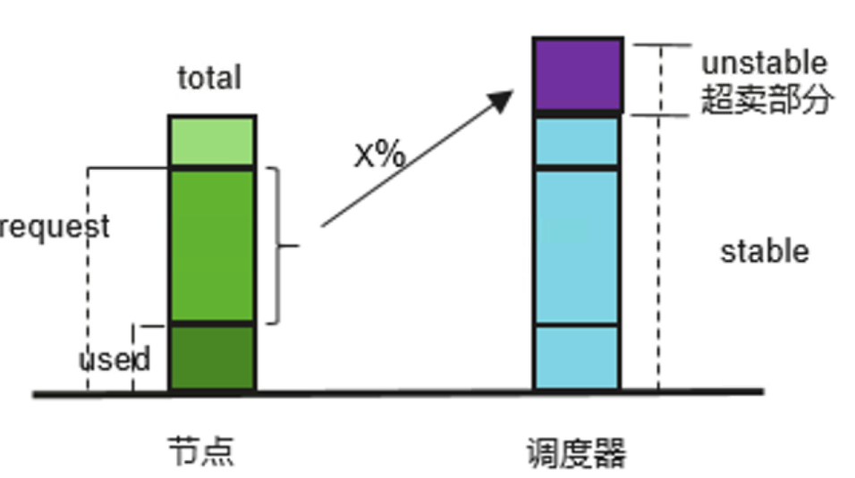
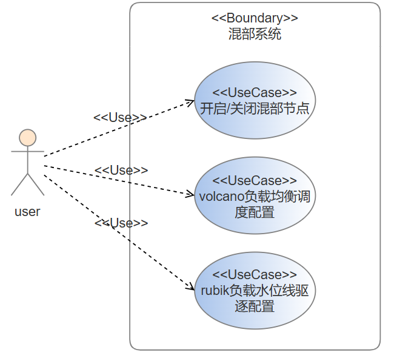
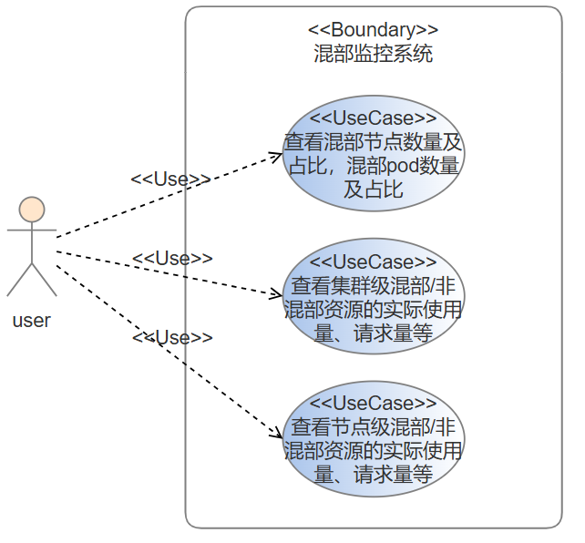
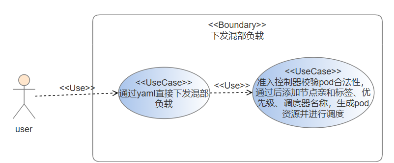
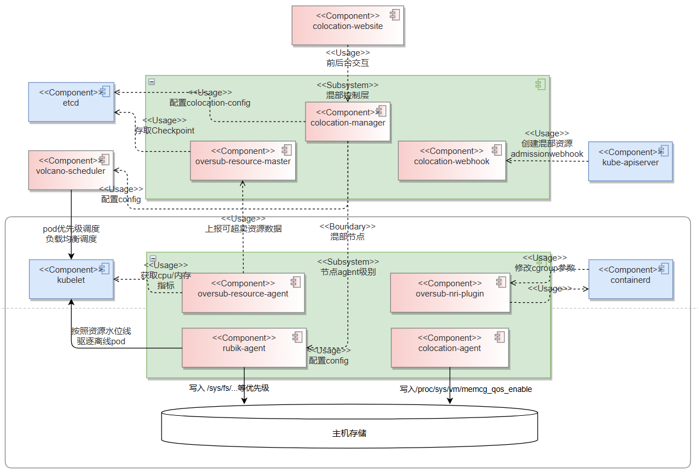
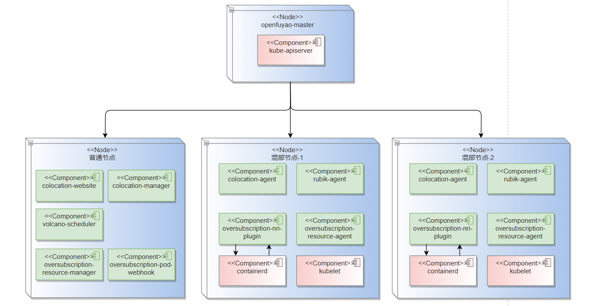
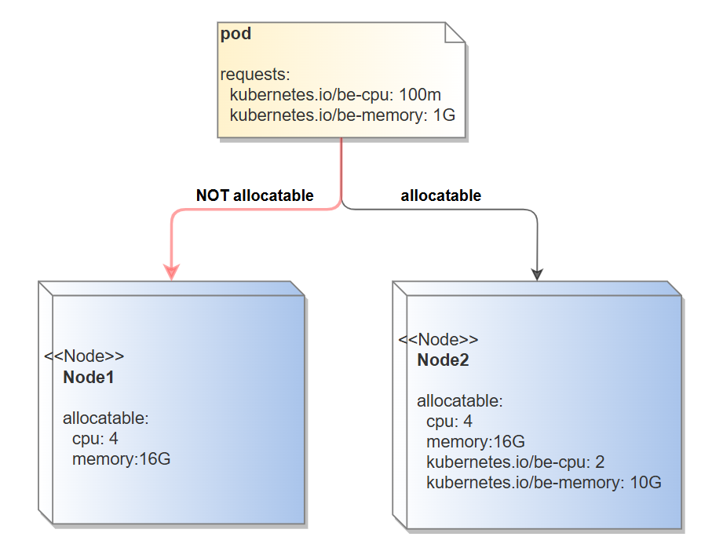
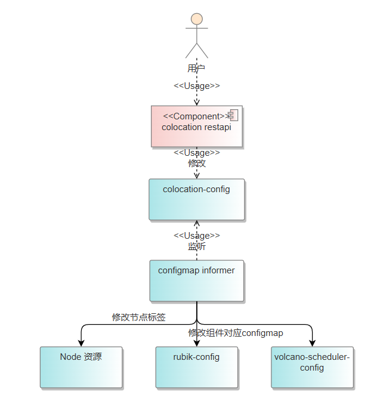
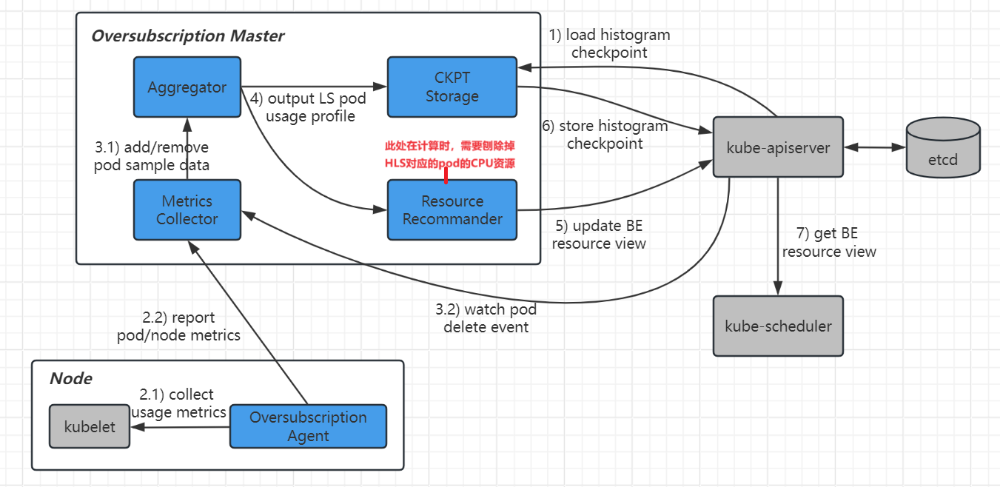

# 1、特性描述

简单来说，将在线业务和离线业务混合部署到相同的物理资源上，通过资源隔离、调度等控制手段，充分使用资源，同时保证服务的稳定性，我们称这样的技术为“混部”。

将多种类型业务混合部署能够显著提升集群资源利用率，但也带来了共峰问题，但是该问题会导致部分业务服务质量（QoS）受损。如何在提升资源利用率之后，保障业务QoS不受损是技术上的关键挑战。Rubik是openEuler提供的容器混部引擎，提供一套自适应的单机算力调优和服务质量保障机制，旨在保障关键业务服务质量的前提下，提升节点的资源利用率。Rubik容器调度在业务混合部署的场景下，根据用户对业务的配置，对资源进行合理调度和隔离，从而实现在保障在线业务的服务体验情况下，提升节点资源利用率。同时Rubik还提供基于节点实际资源使用的水位线驱逐功能，在节点的在线业务对离线业务存在长时间压制时，若此时节点实际CPU或内存利用率到达配置的水位线以上，Rubik会主动驱逐离线业务，促使离线业务重新进入调度尽量调度至资源使用量较低节点，防止离线业务被长期压制。

为了提供集群资源利用率，集群管理员可能会考虑提交一些低优先级的任务（也即离线业务），利用这些已分配但未使用的资源，以实现对集群资源的超卖。这就是“资源超卖”。将收集到的节点真实的负载数据，以标准扩展资源的形式实时更新到kubernetes的节点元信息中去，而低优先可以在Request和Limit中声明这些扩展资源来使用资源超卖的能力。

在调度层面，同样需要开启部分调度策略以保证在离线业务能以更合理的方式调度到不同节点上。对于在线业务（高优先级）和离线任务（低优先级），调度器需要保证高优先级的业务得以抢占低优先级任务马上被调度，同时在调度时需要考虑不同节点的实际负载情况，在调度层避免发生节点过热现象。

## 1.1、依赖组件

| 组件             | 组件描述                         | 可获得性      |
|:---------------| :------------------------------- | :------------ |
| rubik v2.0.1   | 节点QoS隔离保障引擎              | openEuler开源 |
| volcano v1.9.0 | 基于Kubernetes的容器批量调度平台 | 开源软件      |
| prometheus     | 收集混部相关指标信息             | 开源软件      |

## 1.2、License

Mulan Permissive Software License, Version 2

## 1.3、环境依赖

rubik中CPU/内存压制的功能需要依赖操作系统内核版本，目前支持的操作系统为`openEuler`，版本为`openEuler 22.03LTS`及以上版本。

# 2、需求分析

主要强调需求来自联通云商业上量部署，以及混部与超卖特性统一部署。竞争力构筑

联通云上量部署要求大规模可用，调度层统一，qos保障，可以将离线pod驱逐，防止其一直被压制

## 2.1、需求来源

原始JDC需求：实现在线业务与离线业务混合部署，通过资源超卖实现集群CPU、MEM资源利用率提升，并保障QoS抖动小于1%

相关价值：在联通云业务场景上量后进行推广

## 2.2、需求背景及解决方案分析

### 2.2.1、为何使用混部引擎+动态资源超卖

随着云原生技术迅速发展，海量应用正在走向云原生化，Kubernetes正在成为云时代的“操作系统”。但在各大厂商实际应用部署在Kubernetes集群后，大部分用户节点的CPU利用率不足15%。在调研不同类型客户，发现造成资源利用率低的主要因素可归纳为如下两点：

1. 在线和离线作业分布不同集群，资源**无法分时复用**：用户因为**担心容器运行时的隔离资源能力有限**，离线业务部署侵占资源多的情况下往往会影响在线业务，所以为**在线和离线作业划分不同的K8s集群或节点中**，在线业务在波谷时，无法部署离线作业使用这部分资源。
2. 业务“潮汐”特性明显，**预留资源较多**：在线业务具有明显日级别波峰、波谷特性，用户为保证服务的性能和稳定性**按照波峰申请资源，集群的大部分资源处于闲置状态。**

为解决资源利用率低的问题，势必需要尝试将在线业务和离线业务**部署在同一个节点**上，同时希望离线业务能在在线业务的波谷时**尽可能使用在线业务已申请但是没有实际使用起来的资源**。

对于部署在统一节点的问题，不断完善的内核隔离能力可以较好地解决该问题。我们可以对在离线业务进行多级的QoS分级，具有高级别的QoS的pod相比低级别的pod的QoS会被**混部引擎**在内核接口文件上写入更大的数字，指示内核在遇到资源不足时，有限调度高级别QoS对应的pod的进程，从而完成在线业务对离线业务的压制，在资源竞争时保障了在线业务的SLA，从而将在离线业务调度到统一节点共享资源变为可能。



对于在线业务预留资源较多的问题，可以通过将不同时段在线业务预留但是没有真正使用的资源（cpu或mem）额外分给离线业务的方式，对调度器虚拟地“扩大”每个节点的可用资源，从而让更多业务能够调度到每个节点上，提升资源的利用率。当然由于此处可超卖的部分是随时间变化计算而来，不稳定，这部分资源只能超卖给随时可以中断的离线业务，以保证整体业务SLA质量同时提升资源使用率。

> 注：因为业界在离线混部已有较成熟的方案实现，且openFuyao前面两个版本都已经对混部+超卖的需求进行过分析，同时也对功能进行了开发，此处需求分析不再赘述需求分析的思路的合理性。

### 2.2.2、调度与驱逐功能的引入

引入混部引擎可设置pod的不同QoS-level以及超卖组件为集群额外上报在线业务未及时使用的资源后，大体已经达成了在保证在线业务QoS抖动几乎不变的情况下大幅提升集群资源使用率的目标，但为达到成规模上量部署的目的，还有调度和驱逐的问题亟待解决：

1. 某节点上同时部署了在线业务和离线业务，且**在线业务的实际资源使用量一直很高**，而存在其他节点整体的资源利用率都很低，此时如果没有对离线业务的驱逐功能，会出现**离线业务会长时间被在线业务压制而得不到运行，但集群中是有空闲节点可以运行离线任务**的情况。此处需要对离线业务实现某种驱逐机制，保障离线业务最终可被驱逐重新调度到可以尽早完成离线业务的节点上，提高集群整体资源使用率；
2. 在调度层面，主要需要考虑的有两层：
   + 与1中根据节点实际使用率进行离线业务驱逐对应的，在调度器进行调度时，需要同时考虑节点的实际资源使用率，把待调度pod调度到实际资源使用率较少的节点上，在调度层即防止节点出现过热情况，与驱逐形成闭环。
   + 不同的QoS-level之间本身就具有调度上的优先级，例如对同为在线业务的两个不同QoS-level作业，如果他们两个同时需要被调度，调度器要保证QoS-level高对应的pod可以先于QoS-level低的pod被调度，同时在资源不足时，调度器支持用高QoS-level的pod抢占掉低QoS-level的pod使用的资源，保证最高优先级业务的SLA。

基于上述说明，整个在离线混部系统才完成端到端的闭环，整个系统可以稳定运行。

### 2.2.3、已开发的混部和超卖部分的合并整改

由于之前版本openFuyao的混部部分代码和超卖部分代码是分开开发的，目前存在以下问题：

+ 定义的混部负载标记的标签位置不同
+ 混部和超卖分别有自己的准入控制器，且准入控制器检查的资源对象、校验的字段信息等均有所不同
+ 部署的组件过多，有部分组件可以考虑删去或与现有组件合并

此部分的展开说明参见`3.5.4`和`3.5.5`

## 2.3、 需求分解分配表

| SR                                                           | AR                                                           |
| ------------------------------------------------------------ | ------------------------------------------------------------ |
| 混部三级QoS-level以及对应优先级定义                          | 定义HLS，LS，BE三级混部QoS保障服务质量，同时定义对应Qos的调度优先级 |
| 支持混部场景调度增强，保证离线业务调度到使用超卖资源节点上   | 基于Volcano支持优先级抢占调度，保证在线业务（高优先级）在可用资源不足时抢占离线业务资源 |
|                                                              | 基于Volcano支持基于在线业务的负载均衡调度，保证节点的在线业务不会存在过热情况 |
|                                                              | 支持将离线业务只调度到存在资源超卖的节点上                   |
| 基于rubik的节点混部引擎支持配置水位线驱逐功能                | 支持开启基于rubik的CPU水位线驱逐功能                         |
|                                                              | 支持开启基于rubik的内存水位线驱逐功能                        |
| 使用统一的configmap进行混部配置管理                          | 支持用户在前台设置某一节点为混部节点，混部节点上会使用扩展资源 |
|                                                              | 支持对volcano、rubik组件的关键阈值进行配置管理               |
| 合并原有混部和超卖的准入webhook                              | 合并2503中混部和超卖的相关准入控制器，并为通过准入的pod增加必要混部所需信息 |
| 确保混部压制、驱逐与超卖资源功能只在开启混部功能的节点上工作 | 节点可超卖资源的收集上报方式适配非全部节点为混部节点的情况   |
|                                                              | colocation-agent在部署时合并至rubik-agent的daemonset中       |
| 超卖资源范围计算修正                                         | 超卖资源的计算范围需要去除掉qos-level为HLS对应的pod          |
| 提供混部基础监控能力                                         | 统计集群内开启混部节点的个数与相比全部节点的占比             |
|                                                              | 统计集群内三种QoS对应pod个数与相比全部pod的占比              |
|                                                              | 统计集群/节点内CPU、内存的资源实际使用量，混部离线CPU、内存实际使用量，其它在线/正常CPU、内存实际使用量等基本指标 |
| 文档编写                                                     | 在离线混部使用文档更新                                       |
|                                                              | 在离线混部API文档更新                                        |

# 3、特性设计

## 3.1、上下文/USE-CASE视图

### 3.1.1、混部系统配置



使用统一的配置方式管理混部节点配置、volcano针对在线资源的负载均衡参数配置，以及rubik混部引擎中CPU/内存驱逐水位线的配置。通过统一的方式方便用户在在离线混部管理面上进行配置。

### 3.1.2、在离线混部基础监控系统使用



在离线混部的监控系统对判断整个系统的资源利用率提升方面尤为重要。openFuyao在离线混部系统支持用户在管理面观测混部节点、混部pod数量，以及集群级和节点级的混部资源/非混部资源的资源实际使用量、请求量等重要指标，通过其变化情况获取集群整体使用率的提升情况。

### 3.1.3、用户下发混部负载




## 3.2、逻辑视图



混部组件从功能和部署形态上分成两部分：

混部控制层负责**混部组件统一管理**，

- 全局配置面：提供全局的混部配置，包括混部节点的开启，混部引擎驱逐水位线配置以及调度器负载均衡调度时调度阈值的设定；
- 混部规则管理：降低openFuyao在离线混部的使用门槛，提供用户简单快速使用在离线混部技术的快捷方式；
- 准入控制：提供Kube-Apiserver的准入控制器，控制超卖资源只受离线业务使用；
- 超卖资源的统一管理：接收超卖资源Agent采集的指标，定期将各节点以及各节点上pod的资源使用情况更新至Checkpoint的CRD中，同时周期性更新节点资源中的可超卖资源总量；
- REST API 服务： 提供对接可视化界面的RestApi服务。

节点Agent以DaemonSet的形式部署在Kubernetes集群中，用于**支持混部场景下的资源超卖，支持精细化的资源管理策略注入**等：

- 超卖agent：实现资源指标采集，使用histograms来统计和预测工作负载的资源使用细节，构建应用的资源画像；实现资源超卖的上报，通过应用的资源画像，预测pod资源的实际使用情况，回收已分配但未使用的资源，并上报统一管理面；
- 混部agent：开启/关闭rubik特性的功能；
- 超卖资源nri plugin: 使用containerd的nri机制在容器不同的生命周期内注入精细化的资源管理策略

## 3.3、部署视图



混部相关的agent：colocation-agent，rubik-agent，oversubscription-resource-agent，oversubscription-nri-plugin会通过亲和混部节点的标签的方式被调度到混部节点上；其余混部控制面的组件colocation-manager，colocation-website以及调度相关的volcano-scheduler则会被部署到任意节点上。


## 3.5、 Story分解

_结合3.1~3.2的分析，分解支持该特性所需要的Stroy，可以按照USE-CASE场景划分，也可以按照USE-CASE操作步骤划分_ 

*功能描述，接口清单，模块设计*

### 3.5.1、SR-001 混部三级QoS-level以及对应优先级定义

| 编号       | 描述                                                         | 工作量(人月) |
| ---------- | ------------------------------------------------------------ | ------------ |
| AR-001-001 | 定义HLS，LS，BE三级混部QoS保障服务质量，同时定义对应Qos的调度优先级 | 0.05         |

#### 3.5.1.1、定义HLS，LS，BE三级混部QoS保障服务质量，同时定义对应Qos的调度优先级

##### 3.5.1.1.1、功能描述

**三级QoS定义**

+ 考虑到openFuyao整个调度框架的建设，同时也为了openFuyao混部后续多Qos分级的建设，2506版本的openFuyao拟引入三层分级的Qos保障模型，即将在线业务细分为HLS(high-latency-sensitive)和LS(latency-sensitive)两类，具体如下

| QoS                         | 特点                                                         | 场景           | 说明                                                         | K8s QoS              |
| --------------------------- | ------------------------------------------------------------ | -------------- | ------------------------------------------------------------ | -------------------- |
| HLS(High Latency Sensitive) | 对时延、稳定性有严格要求，不进行超卖，预留资源以获得更好的确定性 | 高要求在线业务 | 类似于社区的 Guaranteed，CPU 核被绑定，在准入中要对cpu和mem的request和limit做检查，确保HLS标记的pod对应guarantee独占类型 | Guaranteed           |
| LS(Latency Sensitive)       | 共享资源，对突发流量有更好的弹性                             | 在线业务       | 微服务工作负载的典型QoS级别，实现更好的资源弹性和更灵活的资源调整能力 | Guaranteed/Burstable |
| BE(Best Effort)             | 共享资源，资源运行质量有限，甚至在极端情况下被杀死           | 离线业务       | 批量作业的典型 QoS 水平，在一定时期内稳定的计算吞吐量，低成本资源，只使用超卖资源 | Besteffort           |

+ 用户在为工作负载使用该QoS时，需要在工作负载pod的annotation中加入`openfuyao.com/qos-level: BE`字样，此时在离线混部会将该pod识别为对应QoS的负载，进行资源压制/分配。

```yaml
apiVersion: v1
kind: Pod
metadata:
  name: test-pod
  annotations:
    volcano.sh/preemptable: "true"
    openfuyao.com/qos-level: BE	# 标识对应QoS层级
spec:
  ...

```

+ 在实际使用HLS的QoS时，需要用户提前开启K8s的[拓扑管理策略](https://kubernetes.io/zh-cn/docs/tasks/administer-cluster/topology-manager/#topology-manager-policies)

**优先级定义**

+ 为保证QoS-level级别较高的负载在调度层得以优先完成调度，需要对每一层级的QoS绑定一个优先级CR（PriorityClass）。openFuyao在离线混部系统定义了`priority-hls`、`priority-ls`、`priority-be`三个优先级来保证QoS-level由高到低的负载能够顺利按照优先级进行调度

```yaml
```yaml
# HLS 负载对应优先级
apiVersion: scheduling.k8s.io/v1
kind: PriorityClass
metadata:
  name: priority-hls
value: 10000	# 默认值
# LS 负载对应优先级
apiVersion: scheduling.k8s.io/v1
kind: PriorityClass
metadata:
  name: priority-ls
value: 1000	# 默认值
# BE 负载对应优先级
apiVersion: scheduling.k8s.io/v1
kind: PriorityClass
metadata:
  name: priority-be
value: -1000	# 默认值
```


### 3.5.2、SR-002 支持混部场景调度增强，保证离线业务调度到使用超卖资源节点上

| 编号       | 描述                                                         | 工作量(人月) |
| ---------- | ------------------------------------------------------------ | ------------ |
| AR-002-001 | 基于Volcano支持优先级抢占调度，保证高优先级业务在可用资源不足时抢占低优先级业务资源 | 0.1          |
| AR-002-002 | 基于Volcano支持基于节点资源的负载均衡调度，保证节点不会存在过热情况 | 0.1          |
| AR-002-003 | 支持将离线业务只调度到存在资源超卖的节点上                   | 0.1          |

#### 3.5.2.1、基于Volcano支持优先级抢占调度，保证高优先级业务在可用资源不足时抢占低优先级业务资源

##### 3.5.2.1.1、功能描述

Volcano调度器天然支持优先级抢占调度，其对vcjob以及普通的pod均支持根据priorityClassName来进行优先级排序，在覆盖现有工作负载的场景前提下，未来对rayjob等自定义作业可实现兼容。

```yaml
# volcano-scheduler 优先级配置
apiVersion: v1
data:
  volcano-scheduler.conf: |
    actions: "allocate, backfill, preempt"
    tiers:
    - plugins:
      - name: priority           # 开启优先级调度
      - name: gang
        enablePreemptable: false 
        enableJobStarving: false
      - name: conformance
...
kind: ConfigMap
metadata:
    meta.helm.sh/release-name: volcano
    meta.helm.sh/release-namespace: volcano-system
  labels:
    app.kubernetes.io/managed-by: Helm
  name: volcano-scheduler-configmap
  namespace: volcano-system
```

**注：**在安装Volcano之后该配置项默认开启。

#### 3.5.2.2、基于Volcano支持基于实际资源使用量的负载均衡调度，保证节点不会存在过热情况

##### 3.5.2.2.1、功能描述

Volcano调度器的原生插件中支持开启基于节点实际资源利用量的负载均衡调度，在调度每个pod时，volcano综合考虑**每个节点上的cpu和memory的实际使用量，加权计算每个节点上可用资源的分数**，最后会将pod调度到获得分数最高的节点上。volcano对usage插件的具体配置方法如下：

```yaml
apiVersion: v1
data:
  volcano-scheduler.conf: |
    actions: "allocate, backfill, preempt"
    tiers:
    - plugins:
      - name: priority           # 开启优先级调度
     ...
      - name: usage  # usage based scheduling plugin
        enablePredicate: true  # 若关闭，则下方的thresholds字段失效，在节点实际资源使用率超过阈值时也会继续调度pod到该节点上
        arguments:
          usage.weight: 5
          cpu.weight: 1
          memory.weight: 1
          thresholds:
            cpu: 50  # The actual CPU load of a node reaches 50%, and the node cannot schedule new pods.
            mem: 70  # The actual Memory load of a node reaches 70%, and the node cannot schedule new pods.
    ...
    metrics:                               
      type: prometheus                     # 节点实际资源使用率指标来源
      address: http://prometheus-k8s.monitoring.svc:9090    # prometheus在集群中的dns
      interval: 30s                        # 获取指标间隔
kind: ConfigMap
metadata:
    meta.helm.sh/release-name: volcano
    meta.helm.sh/release-namespace: volcano-system
  labels:
    app.kubernetes.io/managed-by: Helm
  name: volcano-scheduler-configmap
  namespace: volcano-system
```

#### 3.5.2.3、支持将离线业务只调度到存在资源超卖的节点上

##### 3.5.2.3.1、功能描述

在openFuyao在离线混部2506版本中，我们规定**离线业务（`annotation: openfuyao.com/qos-level: BE`）只能使用计算出来的超卖资源**（kubernetes.io/be-cpu 以及 kubernetes.io/be-memory），不能使用K8s默认的cpu和memory资源。在超卖系统设计说明书中有对该资源计算的详细说明。

以kubernetes.io开头的资源在更新至NodeStatus后，原生调度器可以识别该资源并将请求该资源的pod调度到存在这些资源的节点上，而Volcano调度器继承了原生K8s调度器的这个能力。因此通过绑定离线业务只使用超卖资源，我们可以完成将离线业务只调度到存在资源超卖的节点上的功能。



### 3.5.3 SR-003 使用统一的configmap进行混部配置管理

| 编号       | 描述                                           | 工作量(人月) |
| ---------- | ---------------------------------------------- | ------------ |
| AR-003-001 | 支持用户在前台设置某一节点为混部节点           | 0.1          |
| AR-003-002 | 支持对volcano、rubik组件的关键阈值进行配置管理 | 0.25         |

#### 3.5.3.1、功能描述

此SR的本质即为openFuyao在离线混部系统提供一个能与用户直接交互的配置方式。在2503版本中，目前已有的配置文件主要关注的是节点是否为混部节点/超卖节点，具体字段如下：

```yaml
apiVersion: v1
kind: ConfigMap
metadata:
  name: colocation-config
  namespace: openfuyao-colocation
data:
  # colocation-options: 混部节点开关
  # nodeConfigs: 会指定打开该开关的哪些节点
  colocation-options: |
    {
     	"enable": true,
     	"nodesConfig": [
     		{
     			"name": "fuyao-worker1",
     		},
     		{
     			"name": "fuyao-worker2",
     		}
     	]
    }
  # openFuyao-v25.03版本中的oversubscription-options 在openFuyao-v25.06版本会删去，混部节点默认开启资源超卖
  
```

在v25.06版本中，在对节点配置的基础上加入对volcano负载均衡阈值以及对rubik的驱逐水位线的配置，具体字段如下：

```yaml
apiVersion: v1
kind: ConfigMap
metadata:
  name: colocation-config
  namespace: openfuyao-colocation
data:
  # colocation-options: 混部节点开关
  colocation-options: ...
  # rubik-options: rubik混部引擎相关的参数配置
  # - cpuevict: cpu 驱逐水位线控制
  # - - threshold：窗口期间平均CPU利用率的阈值，超过阈值将驱逐离线pod
  # - memoryevict: memory 驱逐水位线控制
  # - - threshold：窗口期间内存利用率的阈值，超过阈值将驱逐离线pod
  rubik-options: | 
    {
    	"enabled": true,
    	"cpuevict": {
    		"threshold": 60
    	},
    	"memoryevict": {
    		"threshold": 80
    	}
    }
  # volcano-scheduler-options: volcano-scheduler中负载均衡阈值设置，当enable时，当节点的真实cpu/内存使用率到达设置的阈值时，节点将不会调度新的pod
  volcano-scheduler-options: | 
    {
    	"enabled": true,
    	"usagethreshold": {
    		"cpu": 80,
    		"memory": 80
    	}
    }
```

> 注：rubik的配置参数除了水位线的threshold，还有interval（利用率采集间隔）、cooldown（两次驱逐之间冷却时间）可以直接对rubik自带的configmap进行配置，这部分我们使用默认提供的参数，不开放给用户配置，需要高级配置的用户可以参考[此处](https://docs.openeuler.org/zh/docs/24.03_LTS_SP1/docs/rubik/modules.html#cpu%E9%A9%B1%E9%80%90%E6%B0%B4%E4%BD%8D%E7%BA%BF%E6%8E%A7%E5%88%B6)自行在后台配置。

用户通过界面弹窗对上述关键信息进行配置，通过API调用在离线混部后台修改`colocation-config`这个configmap。

#### 3.5.3.2、 模块设计

用户在通过界面调用后台的API对`colocation-config`进行修改后，后台会对该configmap启动informer监听修改，并将对应的改动同步给节点标签、volcano-scheduler-config以及rubik-config中，从而完成从顶层用户到底层组件的各个配置文件的打通适配。



其中Node资源修改的部分是对开启混部的节点上打上标签`node.openfuyao.com/colocation=true`

### 3.5.4 SR-004 合并原有混部和超卖的准入webhook，并利用Profile对满足命名空间/标签选择器的pod增加混部所需字段

| 编号       | 描述                                                         | 工作量(人月) |
| ---------- | ------------------------------------------------------------ | ------------ |
| AR-004-001 | 合并2503中混部和超卖的相关准入控制器，并为通过准入的pod增加必要混部所需信息 | 0.3          |

#### 3.5.4.1   合并2503中混部和超卖的准入控制器，并为通过准入的pod增加必要混部所需信息

openFuyao-v25.03的版本中存在混部工作负载和超卖工作负载尚未统一，具体由以下几点：

+ 混部组件的准入（colocation-operator）检查**多种k8s原生工作负载**，包括（pod，deployment，statefulset，job，cronjob）；而超卖组件的准入（overquota-pod-webhook）**只检查pod类型**
+ 对已经打好混部标记的工作负载，混部组件准入检查工作负载**label**是否存在`volcano.sh/preemtable`标签，同时在检查通过后会将代表混部标签的label同步给下层的pod，而超卖组件准入检查annotation中是否存在`volcano.sh/preemtable`，同时检查pod是否只使用了**超卖资源**`kubernetes.io/be-cpu`以及`kubernetes.io/be-memory`

而在openFuyao-v25.06版本中为统一上述冲突，我们约定几个标准：

+ 不存在混部工作负载和超卖工作负载之分，而是通过三级QoS-level进行负载类型的区分，其中只有`openfuyao.com/qos-level=BE`的pod才可以使用超卖资源；
+ 所有准入检查的统一归为**pod**，对其它k8s原生工作负载不去做准入检查；
+ 标记pod的QoS-level统一写在**pod的annotation处**
+ 对QoS-level为HLS的pod，额外要求其为**guarantee**类型的pod，同时申请的**cpu核数为整数**（保证符合cpu-manager-policy为static时候独占cpu核的要求）

在解决了上述冲突后，准入控制器会为满足准入要求的pod进行额外的信息添加，包括：

+ 对`node.openfuyao.com/colocation`节点标签的亲和性
+ 和QoS-level对应的优先级信息
+ 调度器信息
+ 对QoS-level为`openfuyao.com/qos-level=BE`的pod：
  + 添加rubik识别的离线业务annotation: `volcano.sh/preemptable=true`
  + 增加使用超卖资源的注解：`extender-resource-cfg`

综上，对于HLS类型的pod，检查点为：

```yaml
apiVersion: v1
kind: Pod
metadata:
  name: hls-pod
  # 1. 检查 pod.annotations["openfuyao.com/qos-level"] == "HLS"
  annotations:
  	openfuyao.com/qos-level: "HLS"
spec:
  containers:
  - name: app
    image: nginx:1.15.1
    resources:
    # 2. 检查申请资源为cpu和mem，同时request-cpu=limit-cpu; request-mem=limit-mem
    # 3. 检查 isIntegaer(limits.cpu) == true
      limits:
        cpu: "1"
        memory: "3456Mi"
      requests:
        cpu: "1"
        memory: "3456Mi"
    # 4. 添加在离线混部的调度器volcano
    schedulerName: volcano
    # 5. 添加QoS对应的优先级
    priorityClassName: priority-hls
    # 6. 添加对混部节点的节点亲和
    affinity:
      nodeAffinity:
        requiredDuringSchedulingIgnoredDuringExecution:
          nodeSelectorTerms:
            - matchExpressions:
              - key: "node.openfuyao.com/colocation"
                operator: "Exists"
```

对于LS类型的pod，检查点为：

```yaml
apiVersion: v1
kind: Pod
metadata:
  name: ls-pod
  # 1. 检查 pod.annotations["openfuyao.com/qos-level"] == "LS"
  annotations:
  	openfuyao.com/qos-level: "LS"
spec:
  containers:
  - name: app
    image: nginx:1.15.1
    resources:
    # 2. 检查申请资源为cpu和mem，同时不同时满足 request-cpu=limit-cpu; request-mem=limit-mem; isIntegaer(limits.cpu) == true
      limits:
        cpu: "1"
        memory: "3456Mi"
      requests:
        cpu: "500m"
        memory: "456Mi"
    # 3. 添加在离线混部的调度器volcano
    schedulerName: volcano
    # 4. 添加QoS对应的优先级
    priorityClassName: priority-ls
    # 5. 添加对混部节点的节点亲和
    affinity:
      nodeAffinity:
        requiredDuringSchedulingIgnoredDuringExecution:
          nodeSelectorTerms:
            - matchExpressions:
              - key: "node.openfuyao.com/colocation"
                operator: "Exists"
```

对于BE类型的pod，检查点为：

```yaml
apiVersion: v1
kind: Pod
metadata:
  name: be-pod
  # 1. 检查 pod.annotations["openfuyao.com/qos-level"] == "BE"
  annotations:
  	openfuyao.com/qos-level: "BE"
  	# 3. 添加rubik认识的离线业务标签
  	volcano.sh/preemptable: "true"
  	# 4. 增加nri需要使用的扩展资源信息
  	openfuyao.com/extender-resource-cfg: '{"containers":{"app":{"requests":{"kubernetes.io/be-cpu":"1k","kubernetes.io/be-memory":"100Mi"},"limits":{"kubernetes.io/be-cpu":"1k","kubernetes.io/be-memory":"100Mi"}}}'
spec:
  containers:
  - name: app
    image: nginx:1.15.1
    resources:
    # 2. 检查申请资源为kubernetes.io/be-cpu和kubernetes.io/be-mem，而非正常cpu或者mem
      limits:
        kubernetes.io/be-cpu: "1000"
        kubernetes.io/be-memory: "100Mi"
      requests:
        kubernetes.io/be-cpu: "1000"
        kubernetes.io/be-memory: "100Mi"
    # 5. 添加在离线混部的调度器volcano
    schedulerName: volcano
    # 6. 添加QoS对应的优先级
    priorityClassName: priority-be
    # 7. 添加对混部节点的节点亲和
    affinity:
      nodeAffinity:
        requiredDuringSchedulingIgnoredDuringExecution:
          nodeSelectorTerms:
            - matchExpressions:
              - key: "node.openfuyao.com/colocation"
                operator: "Exists"
```

其余情况则非混部相关的pod，不会对其做准入校验。（符合ColocationMatchRule的情况除外，下文会展开）

### 3.5.5 SR-005 确保混部压制、驱逐与超卖资源功能只在开启混部功能的节点上工作

| 编号       | 描述                                                       | 工作量(人月) |
| ---------- | ---------------------------------------------------------- | ------------ |
| AR-005-001 | 节点可超卖资源的收集上报方式适配非全部节点为混部节点的情况 | 0.1          |
| AR-005-002 | colocation-agent在部署时合并至rubik-agent的daemonset中     | 0.1          |

#### 3.5.5.1 节点可超卖资源的收集上报方式适配非全部节点为混部节点的情况

此功能点在openFuyao-v25.03已经进行了修改，修改方式即为对`oss-agent`镜像（部署方式为daemonset）提供了节点亲和性，将其调度到节点上带有`node.openfuyao.com/oversold=true`的标签上，同时对`oss-master`在collect每个节点的`oss-agent`上报数据的逻辑进行了极少量修改。

```yaml
# v25.03版本添加亲和性
apiVersion: apps/v1
kind: DaemonSet
metadata:
  name: oss-agent
  namespace: openfuayo-colocation
spec:
  selector:
    matchLabels:
      app.kubernetes.io/name: oversubscription-agent
  template:
    metadata:
      labels:
        app.kubernetes.io/name: oversubscription-agent
    spec:
      affinity:
        nodeAffinity:				# 通过nodeAffinity完成亲和性调度，只调度pod到混部节点上
          requiredDuringSchedulingIgnoredDuringExecution:
            nodeSelectorTerms:
              - matchExpressions:
                  - key: "node.openfuyao.com/colocation"
                    operator: "Exists"
```

这里将该需求重新提起的原因有两点：

+ 对oss-agent来说，是采用当前亲和性方法或是在代码中通过读取该agent所在node上面是否带有`node.openfuyao.com/colocation`的标签作为开关的方式更普适，更优雅。

```go
// upload example func
func (a *agent) upload(metrics interface{}) {
    ...
    if !isColocationNode() {
        doNothing
        return
    }
    uploadMetricsToMaster(metrics interface{})
    return
}
```

+ 结合第一点的修改，联通云作为代码初始贡献者，需再次检视下`oss-master`中修改的收集metrics逻辑是否符合预期，以防代码存在考虑不周导致超卖资源计算出错的情况。

#### 3.5.5.2 colocation-agent在部署时合并至rubik-agent的daemonset中

colocation-agent的功能只是为了配合rubik-agent，保证开启混部的节点内核的cgroup的memory优先级配置：

```yaml
# 在节点的文件写入
/proc/sys/vm/memcg_qos_enable: 1 # 1表示开启
```

当前每个colocation-agent里面有informer机制watch的节点对象是否含有混部标签`node.openfuayo.com/colocation=true`，并且判断是否是colocation-agent所在节点，然后更改文件。

但是colocation-agent会配亲和性，保证colocation-agent的实例只会在混部节点上。场景：

- 若某节点是混部节点，该节点的上一定会有该colocation-agent的实例，此时轮询检查memcg_qos使能的文件，保持为1即可。
- 若某节点不是混部节点，则该节点没有colocation-agent的实例，不需要更改这个文件。

改造：

每个colocation-agent不再需要informer和本地node判断机制，默认轮询写入本地文件即可，可以考虑使用busybox镜像，并在command中不断向对应的文件中写入1即可。

```yaml
apiVersion: apps/v1
kind: DaemonSet
metadata:
  name: colocation-rubik
  namespace: oepnfuyao-colcoation
spec:
  ...
    spec:
      affinity:
        nodeAffinity:
          requiredDuringSchedulingIgnoredDuringExecution:
            nodeSelectorTerms:
            - matchExpressions:
              - key: "node.openfuyao.com/colocation"
                operator: "Exists"
      serviceAccountName: colocation-rubik
      hostPID: true
      containers:
      - name: colocation-agent
        image: busybox
        commnand:
        - /bin/sh
        - -c
        - | 
          while true; do
            echo "1" > /proc/sys/vm/memcg_qos_enable		# 不断写入1即可
            sleep 1
          done
      - name: colocation-rubik
```


### 3.5.6 SR-006 超卖资源范围计算修正

> 具体可能依赖联通云的输入做修改，目前看代码只看到了上报给master的usage都是非离线pod

| 编号       | 描述                                                | 工作量(人月) |
| ---------- | --------------------------------------------------- | ------------ |
| AR-006-001 | 超卖资源的计算范围需要去除掉qos-level为HLS对应的pod | 0.1          |

#### 3.5.6.1 功能描述

[openFuyao超卖资源原始设计文档](https://gitee.com/openfuyao/sig-colocation/blob/master/design/%E5%9F%BA%E4%BA%8Erubik%E7%9A%84%E6%B7%B7%E9%83%A8%E9%9B%86%E7%BE%A4%E8%B6%85%E5%8D%96%E7%B3%BB%E7%BB%9F%E8%AE%BE%E8%AE%A1%E8%AF%B4%E6%98%8E%E4%B9%A6/openFuyao-oversubscription-design.md)中，已经对每个节点如何预测在线业务使用量以及计算超卖资源进行了详细的说明，此处不再赘述。在openFuyao-v25.06版本中引入了HLS、LS、BE三级QoS，其中**HLS中代表的是需要在kubelet的cpu_manager_policy设置为static时能够独占核心的pod**。则在计算节点可用的超卖资源时，应该在计算整机CPU资源可使用量以及预测在线业务的CPU实际使用量时，均将annotation中含有`openfuyao.com/qos-level=HLS`的pod排除在外。



总结来说，依照设计文档，原有的可超卖资源计算公式为：

`离线资源可分配量=整机资源量 - 节点安全Margin- 节点预留资源量 -在线预测使用资源量`

在加入三级QoS分级后，计算超卖资源的计算公式应该为：

`离线资源可分配量=整机资源量 - 节点安全Margin - HLS类Pod的节点资源请求量 - 节点预留资源量 - 在线业务中除HLS的pod之外预测使用资源量`

综上应在仓库`overquota-resource-management`中的agent上报资源以及master预测在线使用资源处做对应修改。


## 3.6、质量属性设计

### 3.6.1、性能规格

在联通云真实使用场景下在保证在线业务QoS抖动小于1%的前提下，CPU和内存的利用率预期提升至50%。因为该版本是第一个版本，目前大规模部署的性能基线还不确定，需要此版本完成后进行性能测试获得性能基线。

### 3.6.2、可靠性设计

**1、程序异常退出**

在离线混部涉及到的组件使用容器启动，容器因为异常终止后，可由 k8s 重新拉起进行重启。

**2、集群部署数量**

通过增加在离线混部部署中 deployment 类别组件的 pod Replica 数可提高组件的可靠性，对外仍表现为一个 service，内部由 k8s 进行负载均衡。

### 3.6.3、安全/韧性/隐私设计

**韧性增强**

组件统一的配置文件colocation-config带有误删保护机制，在用户误删除后会自动生成一个默认的全新configmap。

### 3.6.4、兼容性设计

略

### 3.6.5、可服务性设计

略

### 3.6.6、可测试性设计

# 4、修改日志
| 版本  | 发布说明 |
| :---- | :------- |
| 0.1.0 | 初稿     |
|       |          |

# 5、参考目录