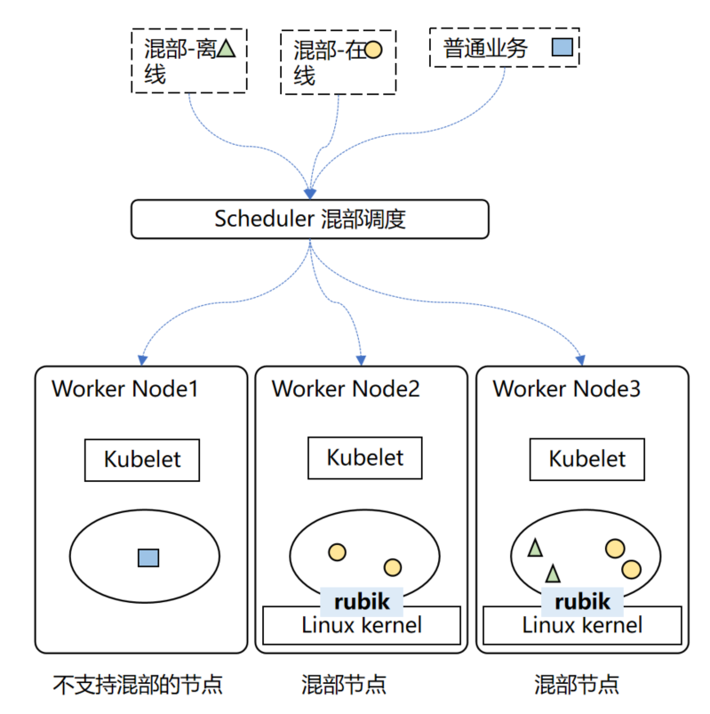
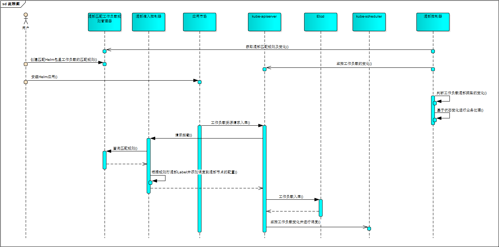
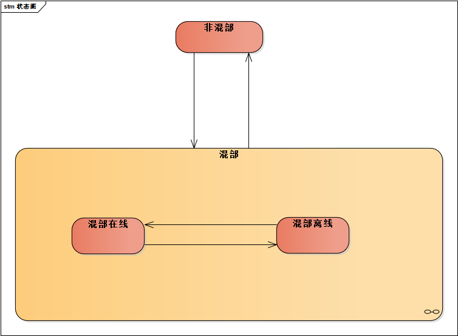

# 1、特性描述

简单来说，将在线业务和离线任务混合混部到相同物理资源上，通过资源隔离、调度等控制手段 , 充分使用资源，同时保证服务的稳定性，我们称这样的技术为“混部”。

将多种类型业务混合部署能够显著提升集群资源利用率，但也带来了共峰问题，该问题会导致部分业务服务质量（QoS）受损。如何在提升资源利用率之后，保障业务QoS不受损是技术上的关键挑战。rubik容器调度在业务混合部署的场景下，根据用户对业务的配置（包括QoS分级、cache限制、弹性限流等配置），对资源进行合理调度与隔离，从而实现在保障在线业务的服务体验情况下，提升节点资源利用率。

Rubik 是 openEuler 提供的容器混部引擎，提供一套自适应的单机算力调优和服务质量保障机制，旨在保障关键业务服务质量的前提下，提升节点资源利用率。

## 1.1、依赖组件

|组件|组件描述|可获得性|
|:---|:-------|:-------|
|rubik | 节点Qos隔离保障引擎 | openEuler开源 |
|    |        |        |

## 1.2、License

# 2、需求场景
在离线混部场景概览如下：


1、集群节点分为混部节点和非混部节点。
2、工作负载分为非混部工作负载（普通业务）、混部-离线工作负载和混部-在线工作负载。
3、非混部工作负载只能调度到非混部节点上，混部-离线和混部-在线工作负载只能调度到混部节点上。依赖污点和标签亲和性实现该调度策略。

# 3、特性设计

业务流程图：



## SR-001: 支持自动识别Node是否支持混部及进行混部参数预设置
- 通过节点OS类型、版本、内核版本等信息，判断该节点是否具备支持基于rubik的在离线混部能力。
- 根据节点是否打开混部能力，打开内存优先级管理开关
### 用例
1. 用例1：界面提供对节点支持混部/取消混部的能力。
2. 用例2：节点支持混部时，内存优先级管理开关打开。

### 模块设计
1、ColocationAgent以DaemonSet方式在所有Node上部署。
2、通过k8s API获取节点OS类型和版本信息，URL：https://_节点IP_/api/v1/nodes。
3、OS Image为openEuler系统，且版本不低于openEuler 22.03 LTS时，该节点才可以被设置为混部节点。
4、开启内存优先级支持: echo 1 > /proc/sys/vm/memcg_qos_enable；关闭内存优先级支持: echo 1 > /proc/sys/vm/memcg_qos_enable。默认为关闭状态。

#### 接口定义
不涉及

### Story分解
| 编号 | 描述 | 工作量（K) | 优先级 | 备注 |
| - | - | - | - | - |
| AR-001-001 | 支持自动识别Node是否支持混部| 0.4 | 高 | - |
| AR-001-002 | 监控Node结点信息变更，当Node是混部Node时，打开内存优先级开关 | 0.6 | 高 | - |

## SR-002: 提供对Node支持混部的管理接口
- 单点/批量设置节点为支持混部节点，或取消节点支持混部。
### 用例
1. 用例1：界面提供对节点支持混部/取消混部的能力，支持批量设置。
2. 用例2：混部工作负载只能调度到混部节点，非混部工作负载只能调度到非混部节点。
### 模块设计
1、当节点设置为支持混部时，调用API接口POS：rest/colocation/v1/colocation-nodes/
需要将节点打上colocation污点：
```yaml
kubectl taint nodes XXX node.openfuyao.com/colocation=enabled:NoExecute
```
同时，增加混部节点标签的节点亲和性：使用只有当亲和性规则满足时才进行调度，保证只调度到混部节点上。
```yaml
  spec:
  affinity:
    nodeAffinity:
      requiredDuringSchedulingIgnoredDuringExecution:
        nodeSelectorTerms:
        - matchExpressions:
          - key: node.openfuyao.com/colocation
            operator: Exists
```
2、当节点设置为取消混部时，调用接口DELETE：rest/colocation/v1/colocation-nodes/{id}：
 - 需要将节点colocation污点删除
 - 标签亲和性删除
 - 节点上的工作负载需要做驱逐
3、查询节点是否支持混部。
 - 调用接口GET：rest/colocation/v1/colocation-nodes/
#### 接口定义
```go
// deletelColocationNodeById 把一个混部节点转变成普通节点
func (server *Server) deletelColocationNodeById(request *restful.Request, response *restful.Response) {
}

// addColocationNode 把一个普通节点转变成混部节点
func (server *Server) addColocationNode(request *restful.Request, response *restful.Response) {
}
```
### Story分解
| 编号 | 描述 | 工作量（K) | 优先级 | 备注 |
| - | - | - | - | - |
| AR-002-001 | 提供设置Node为混部/非混部的接口 | 0.4 | 高 | - |
| AR-002-002 | 提供设置Node为混部/非混部的批量接口 | 0.4 | 高 | - |
| AR-002-003 | 提供查询支持Node混部的接口 | 0.4 | 高 | - |

## SR-003: 支持对工作负载进行非混部、混部-在线、混部-离线三种业务类型的CRD定义
支持基于标签选择器的规则与精确规则两种类型，定义CRD的数据结构，支持如下两种规则匹配工作负载功能：
- 支持通过k8s的标准标签选择器匹配工作负载
- 支持通过k8s的(namespace,workloadType,workloadName)列表匹配工作负载
### 用例
1. 用例1：界面提供对混部工作负载匹配规则的增、删、改、查操作及对应的校验
2. 用例2：准入控制器使用CRD定义的CR规则，在创建工作负载时，将该工作负载与CR规则进行匹配，如果匹配成功，则将该工作负载标记为该CR规则所指定的混部类型
3. 用例3：混部控制器watch工作负载的变化，有变化时根据CR规则进行匹配，如果匹配成功，则将该工作负载标记为该CR规则所指定的混部类型，如果混部类型有变化则进行工作负载的驱逐并进行重调度
### 模块设计
主要定义CRD的Spec。
#### CR接口定义
```go
// ColocationType 混部工作负载的类型
// +enum
type ColocationType string

const (
	// ColocationOnline 混部在线工作负载
	ColocationOnline ColocationType = "Online"
	// ColocationOffline 混部离线工作负载
	ColocationOffline ColocationType = "Offline"
)

type ColocationWorkloadMatchRule struct {
	metav1.TypeMeta `json:",inline"`

	// Standard object's metadata.
	// More info: https://git.k8s.io/community/contributors/devel/sig-architecture/api-conventions.md#metadata
	// +optional
	metav1.ObjectMeta `json:"metadata,omitempty" protobuf:"bytes,1,opt,name=metadata"`

	// Spec ColocationWorkloadMatchRule的详细规格
	Spec ColocationWorkloadMatchRuleSpec `json:"spec,omitempty" protobuf:"bytes,2,name=spec"`

	// Status ColocationWorkloadMatchRule的当前状态.
	// +optional
	Status ColocationWorkloadMatchRuleStatus `json:"status,omitempty" protobuf:"bytes,3,opt,name=status"`
}

type ColocationWorkloadMatchRuleSpec struct {
	// Selector 选择器，用于选择需要混部的工作负载
	// +optional
	Selector *metav1.LabelSelector `json:"selector" protobuf:"bytes,1,opt,name=selector"`

	// NameSelectors 工作负载名称选择器，用于选择需要混部的工作负载
	// +optional
	// +listType=atomic
	NameSelectors []NameSelector `json:"nameSelector" protobuf:"bytes,2,opt,name=nameSelectors"`

	// Colocation 工作负载的混部类型：Online与Offline(默认为在线)
	// +optional
	Colocation ColocationType `json:"values,omitempty" protobuf:"bytes,2,opt,name=colocation,casttype=ColocationType"`
}

type NameSelector struct {
	// Namespaces 命名空间，空为所有命名空间
	// +optional
	Namespace string `json:"namespace" protobuf:"bytes,1,opt,name=namespace"`

	// WorkloadTypes 工作负载类型，空为所有工作负载类型
	// +optional
	// +listType=atomic
	WorkloadTypes []string `json:"values,omitempty" protobuf:"bytes,2,opt,rep,name=workloadTypes"`

	// Name 工作负载名称
	Name string `json:"name" protobuf:"bytes,3,opt,name=name"`
}

// ColocationWorkloadMatchRuleStatus 混部工作负载匹配规则状态
type ColocationWorkloadMatchRuleStatus struct {
}

// +k8s:deepcopy-gen:interfaces=k8s.io/apimachinery/pkg/runtime.Object

// ColocationWorkloadMatchRuleList ColocationWorkloadMatchRule集合
type ColocationWorkloadMatchRuleList struct {
	metav1.TypeMeta `json:",inline"`
	// Standard list's metadata.
	// More info: https://git.k8s.io/community/contributors/devel/sig-architecture/api-conventions.md#metadata
	// +optional
	metav1.ListMeta `json:"metadata,omitempty" protobuf:"bytes,1,opt,name=metadata"`

	// Items ColocationWorkloadMatchRule集合
	Items []ColocationWorkloadMatchRule `json:"items" protobuf:"bytes,2,rep,name=items"`
}
```
### Story分解
| 编号 | 描述 | 工作量（K) | 优先级 | 备注 |
| - | - | - | - | - |
| AR-003-001 | CRD结构定义及clientset| 0.8 | 高 | - |
| AR-003-002 | 支持通过(namespace,标签选择器)选择工作负载为混部（在线,离线）业务 | 0.1 | 高 | - |
| AR-003-003 | 支持通过(namespace,workloadType,Name)列表选择工作负载为混部（在线,离线）业务 | 0.1 | 高 | - |
## SR-004: 混部准入控制器，基于CRD创建的CR对工作负载进行校验与修改，增加支持混部调度的相关内容
混部工作负载调度到混部节点的调度设计：
1. 识别混剖节点，打上混部node.openfuyao.com/colocation污点的为混部节点
```yaml
kubectl taint nodes XXX node.openfuyao.com/colocation=enabled:NoExecute
```
2. 识别工作负载的混部类型
- 没有volcano.sh/preemptable标签的为非混部工作负载，不能调度到混部节点，只能调度到非混部节点
- 打上volcano.sh/preemptable=true标签的工作负载为混部离线类型，只能调度到混部节点，不能调度到非混部节点
- 打上volcano.sh/preemptable标签且值不为true的工作负载为混部在线类型，只能调度到混部节点，不能调度到非混部节点
3. 准入控制器对基于CR规则匹配，对匹配的工作负载进行如下修改，支持混部工作负载的调度。使用容忍度与节点亲和性，把此工作负载调度到混部节点。
  - 增加注解：标明此混部工作负载是由CR生成的
  - 增加混部在离线的标签：volcano.sh/preemptable=true为离线，volcano.sh/preemptable=false或其它值为在线
  - 增加混部污点的容忍度：效果类型为"NoExecute"， 即可调度到混部节点上
  - 增加混部节点标签的节点亲和性：使用只有当亲和性规则满足时才进行调度，保证只调度到混部节点上
```yaml
  spec:
  affinity:
    nodeAffinity:
      requiredDuringSchedulingIgnoredDuringExecution:
        nodeSelectorTerms:
        - matchExpressions:
          - key: node.openfuyao.com/colocation
            operator: Exists
```
> 容忍度：可保证混部工作负载可调度到混部节点，但混部工作负载还可能会部署到非混部节点上。为保证一定会把混部工作负载调度到混部节点上，需要增加混部节点亲和性。
> 亲和性：亲和性只能保证混部工作负载调度到混部节点上，不能保证非混部工作负载也会调度到混部节点上（非混部工作负载可亲和混部节点的其它标签），所以还需要加上混部节点的污点容忍度。
### 用例
1. 用例1：对CR里的字段进行校验，如果不符合要求，则拒绝此次修改
2. 用例2：工作负载增、删、改时，基于CR规则进行匹配，匹配成功，则将该工作负载标记为该CR规则所指定的混部类型
### 模块设计
开发两个准入控制器，准入控制器与kube-apiserver间使用https协议，使用单向认证。
1. 校验准入控制器：对CR字段进行校验，如果不符合要求，则拒绝此次修改。
2. 可变准入控制器：
- 对工作负载的新建时，基于CR规则进行匹配，匹配成功，则对该工作负载增加相关标签、容忍度与亲和性，支持把此工作负载调度到混部节点。
  - 增加注解：标明此混部工作负载是由CR生成的
  - 增加混部在离线的标签：volcano.sh/preemptable=true为离线，volcano.sh/preemptable=false或其它值为在线
  - 增加混部污点的容忍度：效果类型为"NoExecute"， 即可调度到混部节点上
```yaml
    tolerations:
  - key: "node.openfuyao.com/colocation"
    operator: "Exists"
    effect: "NoExecute"
```     
  - 增加混部节点标签的节点亲和性：使用只有当亲和性规则满足时才进行调度，保证只调度到混部节点上
```yaml
  spec:
  affinity:
    nodeAffinity:
      requiredDuringSchedulingIgnoredDuringExecution:
        nodeSelectorTerms:
        - matchExpressions:
          - key: node.openfuyao.com/colocation
            operator: Exists
```            
- 对工作负载的新建时，判断工作负载是否存在volcano.sh/preemptable标签，且此标签不是CR规则匹配增加的，如果存在，则对工作负载做如下修改
  - 增加混部污点的容忍度：效果类型为"NoExecute"， 即可调度到混部节点上
```yaml
    tolerations:
  - key: "node.openfuyao.com/colocation"
    operator: "Exists"
    effect: "NoExecute"
```    
  - 增加混部节点标签的节点亲和性：使用只有当亲和性规则满足时才进行调度，保证只调度到混部节点上
```yaml
  spec:
  affinity:
    nodeAffinity:
      requiredDuringSchedulingIgnoredDuringExecution:
        nodeSelectorTerms:
        - matchExpressions:
          - key: node.openfuyao.com/colocation
            operator: Exists
```  
  - 增加注解：表明此工作负载的混部标签，容忍度与亲和性是由此CR添加的。
#### 接口定义
无
### Story分解
| 编号 | 描述 | 工作量（K) | 优先级 | 备注 |
| - | - | - | - | - |
| AR-004-001 | CR的校验准入控制器，对CR里的字段进行合法性校验 | 0.2 | 高 |  |
| AR-004-002 | 工作负载的可变准入控制器（新建），基于CR规则进行匹配，并增加支持混部调度的配置 | 0.4 | 高 |  |
| AR-004-003 | 工作负载的可变准入控制器（新建），基于混部标签进行匹配，并增加支持混部调度的配置 | 0.2 | 高 |  |
| AR-004-004 | 准入控制器支持单向认证，证书预配置 | 0.2 | 高 | 准入控制器不认证不认证APIServer |

## SR-005: 开发CRD Operator，对工作负载的（非混部，混部-在线，混部-离线）三种状态进行管理
工作负载的状态转换如下：



Operator的主要功能是监测工作负载的混部类型标签的变动，基于变动采取不同action，详情查看用例。
### 用例
1. 用例1：工作负载由混部在线修改为非混部，需要首先驱逐工作负载，再进行重调度
- a. 用户在混部工作负载管理界面删除该工作负载
  - a.1 Service删除此工作负载的混部标签，同时删除此工作负载的容忍度、亲和性与关联配置
- b. Controller监测到此工作负载的混部标签被删除，此工作负载因不满足混部节点的污点配置，导致被驱逐重调度
2. 用例1：工作负载由混部离线修改为非混部，需要首先驱逐工作负载，再进行重调度
- a. 用户在混部工作负载管理界面删除该工作负载
  - a.1 Service删除此工作负载的混部标签，同时删除此工作负载的容忍度、亲和性与关联配置
- b. Controller监测到此工作负载的混部标签被删除，此工作负载因不满足混部节点的污点配置，导致被驱逐重调度
3. 用例2：工作负载由非混部修改为混部-在线，需要首先驱逐工作负载，再进行重调度
- a. 用户在混部工作负载管理界面添加一个非混部工作负载为混部在线
  - a.1 Service添加此工作负载的混部在线标签，同时添加此工作负载的容忍度、亲和性与关联配置
- b. Controller监控到此工作负载由非混部修改为混部在线，则调用驱逐api对此工作负载进行驱逐，驱逐成功后进行重调度
4. 用例3：工作负载由非混部修改为混部-离线，需要首先驱逐工作负载，再进行重调度
- a. 用户在混部工作负载管理界面添加一个非混部工作负载为混部离线
  - a.1 Service添加此工作负载的混部离线标签，同时添加此工作负载的容忍度、亲和性与关联配置
- b. Controller监控到此工作负载由非混部修改为混部离线，则调用驱逐api对此工作负载进行驱逐，驱逐成功后进行重调度
5. 用例4：工作负载由混部-在线修改为混部-离线，此时不需要驱逐，只需要调用内核接口重新设置qos_level即可
- a. 用户在混部工作负载管理界面把工作负载由在线修改为离线
  - a.1 Service修改工作负载的混部标签由在线修改为离线
- b. Controller监控到此工作负载由在线修改为离线，调用内核接口重新设置qos_level
6. 用例5：工作负载由混部-离线修改为混部-在线，此时不需要驱逐，只需要调用内核接口重新设置qos_level即可
- a. 用户在混部工作负载管理界面把工作负载由离线修改为在线
  - a.1 Service修改工作负载的混部标签由离线修改为在线
- b. Controller监控到此工作负载由离线修改为在线，调用内核接口重新设置qos_level
### 模块设计
Controller监控工作负载标签volcano.sh/preemptable的变化，状态变化如下：
| 状态 | 新状态 | 动作 |
| - | - | - |
| 非混部 | 混部-在线 | 调用驱逐api对此工作负载进行驱逐，驱逐成功后进行重调度 |
| 非混部 | 混部-离线 | 调用驱逐api对此工作负载进行驱逐，驱逐成功后进行重调度 |
| 混部-在线 | 混部-离线 | 调用内核接口重新设置qos_level |
| 混部-离线 | 混部-在线 | 调用内核接口重新设置qos_level |
| 混部-在线 | 非混部 | NA(工作负载因不满足混部节点的污点配置，导致被驱逐重调度) |
| 混部-离线 | 非混部 | NA(工作负载因不满足混部节点的污点配置，导致被驱逐重调度) |

> 约束：
> 1. 驱逐工作负载可能会失败，如不满足驱逐条件，驱逐失败需要上报事件。
> 2. 驱逐成功是删除对应的Pod，如果工作负载是单纯的Pod，会不会导致无法重调度？需要确认
#### 接口定义
无
### Story分解
| 编号 | 描述 | 工作量（K) | 优先级 | 备注 |
| - | - | - | - | - |
| AR-005-001 | 对非混部->混部，需要驱逐工作负载并进行重调度 | 0.5 | 高 | - |
| AR-005-002 | 对混部->非混部，需要驱逐工作负载并进行重调度 | 0.5 | 高 | - |
| AR-005-003 | 对混部-在线->混部-离线，调用内核接口重新设置qos_level | 0.5 | 高 |  |
| AR-005-004 | 对混部-离线->混部-在线，调用内核接口重新设置qos_level | 0.5 | 高 | rubik不建议此操作，需要在界面进行风险提示 |

## SR-006: 提供查询所有工作负载的接口
- 提供分类查询所有类型工作负载的接口，供前台界面使用。
### 用例
1. 用例1：前台界面可正确查询/刷新Pod、deployment、daemonset、statefulset、job、cronjob等工作负载。
 - 获取Pod的URL，GET rest/colocation/v1/pods/ 
 - 获取deployment的URL，GET rest/colocation/v1/deployments/
 - 获取daemonset的URL，GET rest/colocation/v1/daemonsets/ 
 - 获取statefulset的URL，GET rest/colocation/v1/statefulsets/ 
 - 获取job的URL，GET rest/colocation/v1/jobs/
 - 获取cronjob的URL，GET rest/colocation/v1/cronjobs/ 
2、用例2：可以根据命名空间过滤工作负载。
### 模块设计

#### CR接口定义
```go
func (server *Server) getAllPods(request *restful.Request, response *restful.Response) {
}

func (server *Server) getAllDeployments(request *restful.Request, response *restful.Response) {
}

func (server *Server) getAllDaemonsets(request *restful.Request, response *restful.Response) {
}

func (server *Server) getAllStatefulsets(request *restful.Request, response *restful.Response) {
}

func (server *Server) getAllJobs(request *restful.Request, response *restful.Response) {
}

func (server *Server) getAllCronJobs(request *restful.Request, response *restful.Response) {
}
```
### Story分解
| 编号 | 描述 | 工作量（K) | 优先级 | 备注 |
| - | - | - | - | - |
| AR-006-001 | 提供查询Pod的接口| 0.4 | 高 | - |
| AR-006-002 | 提供查询deployment的接口 | 0.4 | 高 | - |
| AR-006-003 | 提供查询daemonset的接口 | 0.4 | 高 | - |
| AR-006-004 | 提供查询statefuset的接口| 0.4 | 高 | - |
| AR-006-005 | 提供查询job的接口 | 0.6 | 高 | - |
| AR-006-006 | 提供查询cronjob的接口 | 0.4 | 高 | - |

## SR-007: 提供工作负载混部状态转换的接口
- 提供工作负载混部状态转换的接口，供前台使用，进行工作负载类型的状态变换。
### 用例
1. 用例1：Pod、deployment、daemonset、statefulset、job、cronjob等工作负载在非混部、混部-离线、混部-在线三种状态之间切换。
2、用例2：如果Pod存在父工作负载，则不允许直接对pos进行状态切换，可以对其父工作负载进行操作。
### 模块设计
Pod、deployment、daemonset、statefulset、job、cronjob等工作负载在非混部、混部-离线、混部-在线三种状态之间切换。
以daemonset为例：
 - 设置daemonset为混部-在线：POST rest/colocation/v1/daemonsets/{id}/action/colocation-online 
 - 设置daemonset为混部-离线：POST rest/colocation/v1/daemonsets/{id}/action/colocation-offline 
 - 设置daemonset为非混部：POST rest/colocation/v1/daemonsets/{id}/action/common
#### CR接口定义（以deployment为例）
```go
// convertDeploymentToColocationOnline 把Deployment转换成一个在线的混部Deployment
func (server *Server) convertDeploymentToColocationOnline(request *restful.Request, response *restful.Response) {
}

// convertDeploymentToColocationOffline 把Deployment转换成一个离线的混部Deployment
func (server *Server) convertDeploymentToColocationOffline(request *restful.Request, response *restful.Response) {
}

// convertDeploymentToCommon 把Deployment转换成一个非混部Deployment
func (server *Server) convertDeploymentToCommon(request *restful.Request, response *restful.Response) {
}
```
### Story分解
| 编号 | 描述 | 工作量（K) | 优先级 | 备注 |
| - | - | - | - | - |
| AR-007-001 | 提供设置工作负载混部-在线的接口 | 0.4 | 高 | - |
| AR-007-002 | 提供设置工作负载混部-离线的接口 | 0.4 | 高 | - |
| AR-007-003 | 提供设置工作负载非混部的接口 | 0.4 | 高 | - |
| AR-007-004 | 提供查询Pod是否有父工作负载的接口| 0.2 | 高 | - |

## SR-008: 提供混部统计的接口
- 提供混部统计的接口，供前台使用。
### 用例
1. 用例1：提供统计集群里混部节点数量的接口，前台可正确显示混部节点数量。
2、用例2：提供集群中所有离线Pod和在线Pod数量，前台可正确展示。
3、用例3：提供单节点离线Pod和在线Pod数量，前台可正确展示。
### 模块设计
 - 获取混部统计数据，GET rest/colocation/v1/colocation-stats/ 
 - 统计数据包括混部节点数量、在线工作负载数量和离线工作负载数量
#### CR接口定义（以deployment为例）
```go
// getAllColocationNodes 查询所有的混部节点
func (server *Server) getAllColocationNodes(request *restful.Request, response *restful.Response) {
}

func (server *Server) getAllWorkloadsByNode(request *restful.Request, response *restful.Response) {
}

// getColocationStats 查询混部统计数据：包含（混部节点数量，在线工作负载数量，离线工作负载数量）
func (server *Server) getColocationStats(request *restful.Request, response *restful.Response) {
}
```
### Story分解
| 编号 | 描述 | 工作量（K) | 优先级 | 备注 |
| - | - | - | - | - |
| AR-008-001 | 提供统计混部节点数量的接口 | 0.4 | 高 | - |
| AR-008-002 | 提供统计混部(在线，离线)工作负载数量的接口 | 0.4 | 高 | - |
| AR-008-003 | 提供统计混部节点下工作负载的接口 | 0.4 | 高 | - |

## SR-009: 前台界面设计
### Story分解
| 编号 | 描述 | 工作量（K) | 优先级 | 备注 |
| - | - | - | - | - |
| AR-009-001 | 节点管理：混部节点列表和统计数据概览 | 0.2 | 高 | - |
| AR-009-002 | 节点管理：混部节点的添加和批量添加 | 0.2 | 高 | - |
| AR-009-003 | 节点管理：混部节点的移除 | 0.2 | 高 | - |
| AR-009-004 | 工作负载管理：列出混部节点下的所有工作负载 | 0.2 | 高 | - |
| AR-009-005 | 工作负载管理：新增一个非混部工作负载为混部工作负载 | 0.2 | 高 | - |
| AR-009-006 | 工作负载管理：移除一个混部工作负载为非混部工作负载 | 0.2 | 高 | - |
| AR-009-007 | 规则管理：规则列表和查询 | 0.2 | 高 | - |
| AR-009-008 | 规则管理：新增/修改规则，标签选择器模式 | 0.2 | 高 | - |
| AR-009-009 | 规则管理：新增/修改规则，workload精确匹配模式 | 0.2 | 高 | - |
| AR-009-010 | 规则管理：删除规则 | 0.2 | 高 | - |

## SR-010: 资料文档
### Story分解
| 编号 | 描述 | 工作量（K) | 优先级 | 备注 |
| - | - | - | - | - |
| AR-010-001 | 在离线混部用户指南 | 0.3 | 高 | - |
| AR-010-002 | 在离线混部特性指南 | 0.3 | 高 | - |
| AR-010-003 | 在离线混部API参考 | 0.3 | 高 | - |
| AR-010-004 | 在离线混部开发指南 | 0.3 | 高 | - |

## SR-011: 其它daemonSet自动容忍节点混部污点
 - daemonSet类型的工作负载一般需要在所有节点部署，所以此类工作负载要想成功部署在混部节点，需要自动容忍节点混部污点
### Story分解
| 编号 | 描述 | 工作量（K) | 优先级 | 备注 |
| - | - | - | - | - |
| AR-011-001 | 在离线混部用户指南 | 0.5 | 高 | - |

## 3.4、质量属性设计

### 3.4.1、性能规格

|规格名称|规格指标|
|:-------|:-------|
|内存占用|        |
|启动时间|        |
|响应时间|        |
|xxx     |        |

### 3.4.2、可靠性设计

### 3.4.3、安全/韧性/隐私设计

### 3.4.4、兼容性设计

### 3.4.5、可服务性设计

### 3.4.6、可测试性设计


# 4、需求分解分配表

|序号 |模块名称|Story名称|Story描述|
|:----|:-------|:--------|:--------|
|     |        |         |         |
|     |        |         |         |

# 5、修改日志
|版本|发布说明|
|:---|:-------|
|    |        |
|    |        |

# 6、参考目录

