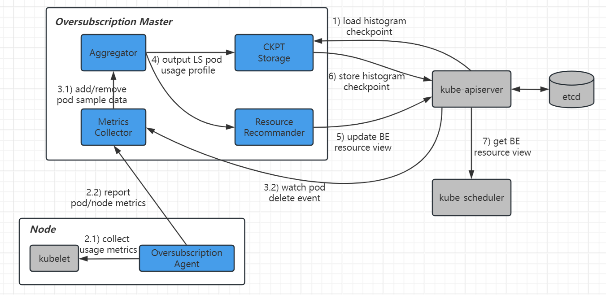
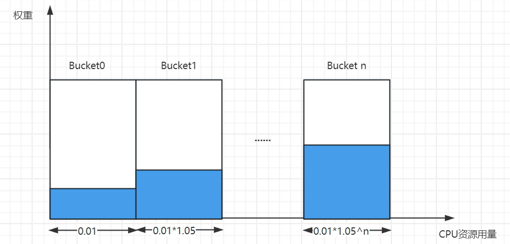
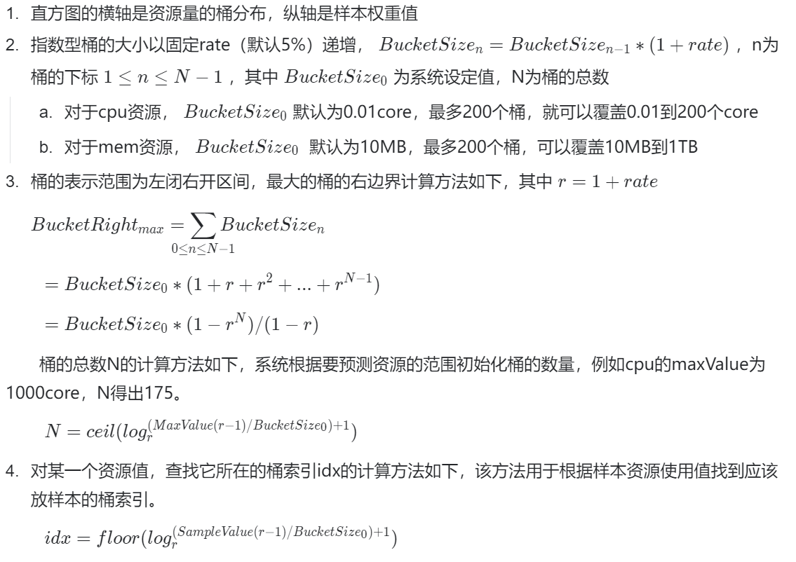
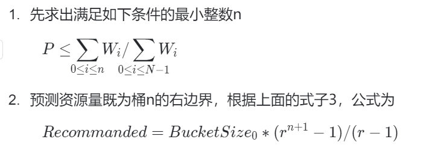

# 1. 特性描述
超卖系统在混部场景下提供的功能有：
- 按节点维度计算出可供离线容器使用的资源总量
- 提供超卖资源视图给调度器用于分配离线容器

## 1.1. 依赖组件
无外部组件依赖

## 1.2. License

# 2. 需求场景威胁建模
无

# 3. 特性设计

## 3.1. 上下文/USE-CASE视图

### 3.1.1 QoS的定义
|QoS类别| 特点                | 场景          | K8S QoS              |
|:---|:------------------|:------------|:---------------------|
|Dedicate|对延时和稳定性有严格要求，不希望任何混部|推广搜业务、数据库等，独立高质池| guaranteed           |
|LS（online）|对资源弹性有要求，共享资源|在线业务| burstable或guaranteed |
|BE（offline）|共享资源，对资源质量要求有限，极端情况可被杀死|离线业务| besteffort           |
基于单机资源隔离引擎rubik的技术现状，混部节点只支持在线LS（online）和离线BE（offline）两种QoS，本方案超卖出来的资源提供给BE容器使用

### 3.1.2. 离线资源的用法
TODO 离线资源在Pod中如何表示
1. 离线Pod标记：同其他方向保持一致 TODO
2. 请求资源量：使用扩展资源表示
   
## 3.2. 架构设计
超卖系统架构如下：

如图所示，超卖系统由Master和单机Agent两部分组成。

**资源超卖的主要流程**
1. 超卖Master启动时尝试从apisever中加载之前保存的Ckpt CR，用于恢复每个节点的历史超卖评估直方图；
2. 每台节点上的超卖Agent每隔xx秒调用一次kubelet的指标接口，得到node和pod的资源使用数据，在内存中维护最近xx分钟的采样数据；Agent每隔XX分钟上报一次采样数据到超卖Master；
3. 超卖Master的MetricsCollector过滤出在线LS pod，并将LS pod的采样数据输入Aggregator，同时监听集群pod删除事件，及时将已删除的LS pod样本数据从Aggregator中去掉；
4. 超卖Master的Aggregator借助算法，刻画出每台节点上所有LS pod的资源使用画像；
5. 超卖Master的Resource Recommander读取Aggregator中计算出来的cpu/mem资源百分位数，再结合系统配置参数和超卖公式，将BE可分配资源量更新到apiserver的node对象上；
6. 超卖Master的CKPT Storage定期读取Aggregator中的超卖评估直方图数据，以Ckpt CRD的形式写入到apiserver；方便冷启动后更精确的恢复BE视图

## 3.3. 资源超卖模型

### 3.3.1. 离线超卖公式
离线资源可分配量=整机资源量 - 节点安全Margin- 节点预留资源量 -在线预测使用资源量
1. 要求全部系统实际使用量<=节点预留资源量
2. cpu和mem使用相同的公式，配置不同的Margin

### 3.3.2. 在线资源使用画像算法
按节点维度绘制在线LS Pod资源使用画像，本方案参考google Borg Autopilot，采用半衰期滑动窗口算法和指数直方图表示法。

**算法思路**
1. 预测在线业务资源使用量，需要参考过去一段时间窗口业务Pod真实使用的资源量（默认这个窗口为8天）
2. 这段时间窗口内距离当前时间越近的数据参考权重越大，越久远的数据权重逐渐衰减（默认每24小时衰减1/2）
3. 资源使用率是非线性分布的，超卖要求对数据尖刺更敏感，因此指数直方图比等分直方图更合适
   
**计算样本权重**
1. 样本的权重$W(t)$=固定权重 * 衰减系数$Factor(t)$，默认cpu的固定权重是request值，memory的固定权重是1.0；
2. 样本的权重衰减系数$Factor(t) = 2^{-\frac{t - t_{ref}}{t_{hf}}}$，其中t为采样时间点，$t_{ref}$是基准参考时间，$t_{hf}$为半衰期（默认24小时），实际计算时$t_{ref}$和t都四舍五入最接近半衰期的倍数；

**预测在线资源使用量**

建模方案：采用指数直方图表示资源使用量和样本权重的关系。某段时间窗口内某节点上所有在线Pod的资源用量样本数据分布在该直方图上。

预测方案：采用累积权重分位值作为画像推荐值的计算方法。既给出一个预测资源量，使在这之前的历史资源使用量占比大于或等于分位值百分比Percentile。

### 3.3.3. 系统配置项

**单机Agent**
1. 超卖开关，关闭则停止采集metric并清空内存，默认开
2. 调用kubelet metric api的频率，默认30sec
3. 单机缓存的metric时间总量，默认5min，既单机最多缓存最近10个采样点的数据
4. 超卖Master的k8s service名称和端口
5. 上报超卖Master的时间间隔，默认1min

**超卖Master**
1. 超卖开关，关闭则清空超卖的BE资源，默认开
2. 节点标签选择器，控制超卖的节点范围
3. BE资源视图的最小更新时间阈值，控制更新频率，默认300sec
4. BE资源的更新触发阈值，控制资源抖动，默认0.1
5. 未收到节点上报指标的降级超时，降级策略为清空节点超卖资源，默认15min
6. cpu节点安全Margin，默认60%
7. mem节点安全Margin，默认65% 
8. cpu资源预测滑动窗口算法半衰期，默认12小时 
9. mem资源预测滑动窗口算法半衰期，默认24小时

## 3.4. 模块设计

### 3.4.1 metric上报通信协议
TODO

### 3.4.2.资源历史使用量Checkpoint定义
CRD TODO

## 3.5. 质量属性设计
- 评估资源画像算法的内存占用TODO
- 评估系统冷启动加载历史数据的时间TODO

# 4. 需求分解分配表

# 5. 修改日志

# 6. 参考目录