# 1、特性描述

_描述该特性要做什么_

容器化环境中，使用资源超分允许将主机上的计算资源（如CPU、内存等）按需超额分配给运行中的容器，已完成更加有效的资源利用。

超分主要实现：
+ 资源共享和隔离
  + 对于高Qos容器，资源隔离确保不被其他容器干扰。
  + 资源超分允许主机上的超分资源在容器之间共享。
+ 分配算法
  + 提供智能的资源超分算法，确保每个容器都能获得足够的资源，避免不必要的资源浪费和竞争。
+ 动态超分
  + 支持动态调整超分比，容器根据实际需求和应用画像动态获取和释放资源。
+ 监控
  + 资源超分实时监控跟踪每个容器实际的资源使用情况，确保资源超分的有效实施。 
+ 无侵入设计
  + 通过NRI(node resource interface)机制避免对上游Kubernetes侵入

NRI(Node Resource Interface)接口 <https://github.com/containerd/nri> 是containerd 中位于 CRI 插件中的一种扩展机制。
借助NRI 可以在容器不同生命周期事件时，在不修改容器运行时源代码的情况下添加用户自定义逻辑。

本设计旨在借助NRI机制，绕开kubelet的侵入设计，实现资源管理策略的注入，优化资源的分配和共享，提升容器化环境资源利用的灵活性和可靠性，提高资源整体使用率
## 1.1、依赖组件

| 组件         | 组件描述  |可获得性| 版本      |
|:-----------|:------|:-------|---------|
| Containerd | 容器运行时 |开源可获得| 1.7.0以上 |

## 1.2、License

无

# 2、需求场景

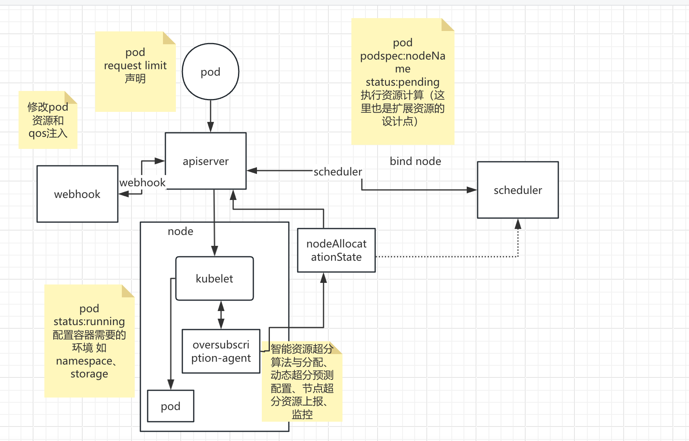

+ 超分组件通过自定义资源对象的上报在调度过程中提供当前节点的资源使用情况和超分比配置
+ 监控当前pod实际运行情况，结合超卖资源视图计算的资源量计算超分比
+ 超分组件利用NRI机制在容器多个生命周期执行自定义逻辑

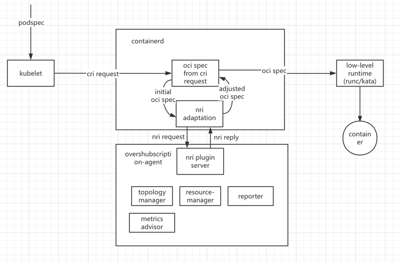

+ 借助NRI机制在pod和容器的生命周期hook期间添加自定义逻辑
+ 通过NRI reply完成对容器oci spec的修改
+ 通过NRI UpdateContainer完成对实际资源的修改

# 3、特性设计

## 3.1、上下文/USE-CASE视图

业务流程图

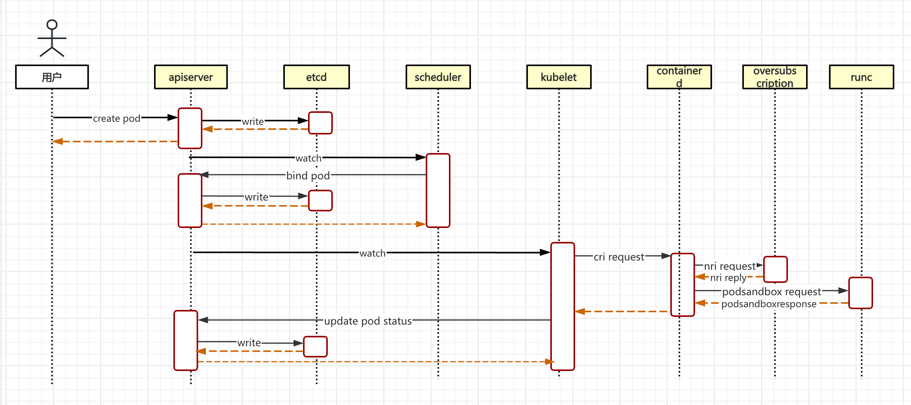


+ scheduler在调度过程中使用Nodeallocataion辅助调度,该自定义对象中包含绑核信息、Numa信息、超分系统获得的资源使用信息
+ containerd在容器的特殊event事件中调用超分agent的nri server对容器进行修改

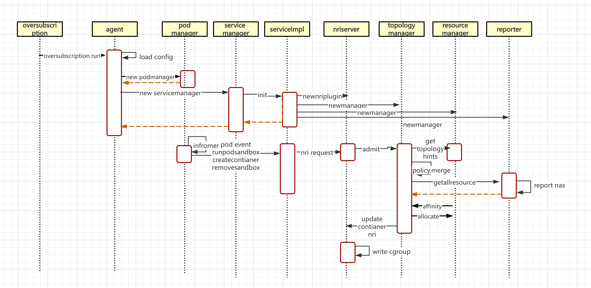

+ topology负责资源对齐，返回亲和性关系，根据配置的policy进行merge 调用allocate接口实现对实际资源的分配。
+ Resource manager 取代原生的cpu manager 和memory manager
+ resourceAllocation 从report中获取，获取Node和pod的分配信息，画像信息
+ rubik当前支持了ori pod informer
+ 最终目标：完成对Oci spec的修改 


## 3.2、 Story分解

### 3.2.1 SR-001: 容器运行时多个hook点实现资源管理策略注入

_功能描述_

+ 无侵入性的情况下，在容器运行时的多个hook点实现资源管理策略注入

_用例描述_

_接口清单_

```go
//RunPodSandBox用于在节点上创建和启动一个容器运行环境。负责初始化网络环境、进行网络配置、挂载等。
func (p *pluginServer) RunPodSandbox(context.Context,podSandbox *api.PodSandbox) 

//CreateContainer这是容器创建请求处理接口。此时容器尚未创建，触发生命周期事件，允许您对容器的配置进行最大的更改，包括一些后续的不可变参数。除了重新配置正在创建的容器之外，还可以更新其他现有容器。这个生命周期进行实际的资源配置和创建分配。
 func (p *pluginServer) CreateContainer(context.Context, pod *api.PodSandbox, ctr *api.Container)

//RemovePodSandBox 用于删除已存在的 Pod Sandbox。这个操作会清理并删除与 Pod 相关的隔离环境，包括网络设置和挂载点，确保容器运行时环境被正确释放。这个生命周期进行超分混部资源的回收和释放。
 func (p *pluginServer) RemovePodSandBox(context.Context, pod *api.PodSandbox)

// UpdateContainers NRI机制中用于更新容器资源信息的操作，允许更新和修改OCI spec
UpdateContainers(context.Context, *UpdateContainersRequest)
```

_模块设计_

1.RunPodSandbox

首先要将nri request中 api.podsandbox 请求解析出扩展信息

```go
//nri request api.PodSandbox
//这里需要从注解里面获取扩展资源的信息
podreqeust := parseRequest(api.PodSandbox)

const AnnotationExtendedResourceConfiguration = FuyaoPrefix + "/extendedResourceConfiguration"
annotations := podSandbox.getAnnotations()
if len(annotations) == 0 return nil,nil
cfg, ok := annotations[AnnotationExtendedResourceConfiguration] ok{
  	err := json.Unmarshal([]byte(cfg), &info)		
  	if err != nil {
			return nil, err
		}
    return cfg,nil
}else {
  		return nil , nil
}
	
```

需要在这里将扩展资源处理到podSandbox中 此时并没有进行实际的allocate 。

```go
//获取当前Pod的Qos level
podQos := getQosLevel(podrequest.Annotations)

//结合qos和扩展资源配置 获取最终要写入cgroup的值
ExtendResourseValue  := getExtenderResource(podQos,cfg)

//对当前分配的资源进行admit检查
admit()
```


2.CreateContainer

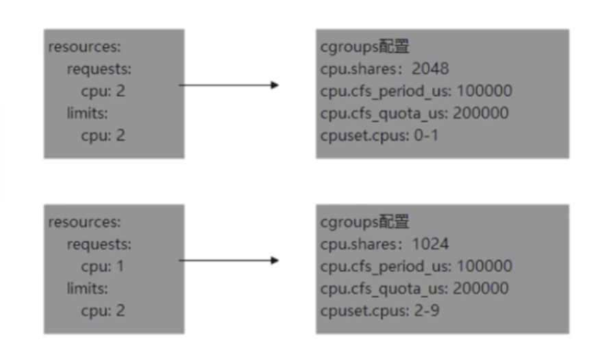

request主要是给调度用的 也包含cpu上的调度   

cpurequest存在cpushares cpu limit存在cfs_period_us和cfs_quota_us

```go
//获取contianer信息
containerreqeust := parseContainerRequest(api.PodSandbox)

//设置ContainerResource信息
setContainerResource(containerreqeust)
{
//cpushares
containerRequestCpu := getResource["extend-resource-cpu"]
setCpuShare(containerRequestCpu)
  
//cfsquota
containerLimitCpu := getResource["extend-resource-cpu"]
setCpuQuota(containerLimitCpu)

//memorylimit
containerLimitMemory := getResource["extend-resource-memory"]
setLimitMemory(containerLimitMemory)
}

//cpuset 绑核资源 在allocate过程中
//获取绑核cpu数
guaranteedCpus(pod,container)
hint := getAffinity()
//according to the NUMA affinity contained in the hint
cpuset := allocateCpus
//这里可以结合qos
//cpushare pool的增减计算得到绑核信息
setContainerCpuSet(pod,contianer ,cpuset)
```

setCpuShare

```go
// MilliCPUToShares converts the milliCPU to CFS shares.
//SharesPerCPU 1024
// MinShares 2  MaxShares  262144
// MilliCPUToCPU 1000
func MilliCPUToShares(milliCPU int64) uint64 {
	if milliCPU == 0 {
		// Docker converts zero milliCPU to unset, which maps to kernel default
		// for unset: 1024. Return 2 here to really match kernel default for
		// zero milliCPU.
		return MinShares
	}
	// Conceptually (milliCPU / milliCPUToCPU) * sharesPerCPU, but factored to improve rounding.
	shares := (milliCPU * SharesPerCPU) / MilliCPUToCPU
	if shares < MinShares {
		return MinShares
	}
	if shares > MaxShares {
		return MaxShares
	}
	return uint64(shares)
}
```

setCpuQuota

```go
//QuotaPeriod 100000 period 如果关闭自定义门户 可以不传
//MilliCPUToCPU 1000
//MinQuotaPeriod 1000
func MilliCPUToQuota(milliCPU int64, period int64) (quota int64) {


	if milliCPU == 0 {
		return
	}

	// we then convert your milliCPU to a value normalized over a period
	quota = (milliCPU * period) / MilliCPUToCPU

	// quota needs to be a minimum of 1ms.
	if quota < MinQuotaPeriod {
		quota = MinQuotaPeriod
	}
	return
}
```

setLimitMemory

```go
sum (container limitmemory )
```


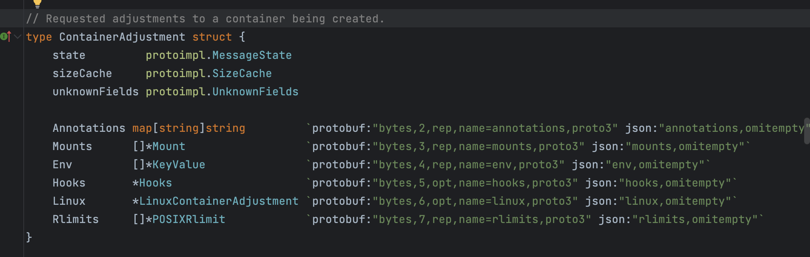

```go
//最后需要Update更新  此时ContainerAdjustment需要记录 
adjustment := updatecontianer(pod,contianer)

```


3.RemovePodSandBox

```go
//nri request api.PodSandbox
podreqeust := parseRequest(api.PodSandbox)
//related all allocate resource
```


### 3.2.2 SR-002: 超分使用扩展资源

_功能描述_

+ 超分资源使用扩展资源描述

_用例描述_

混部应用使用超分资源

_接口清单_

_模块设计_

1.resource中增加扩展资源描述

```go
//resource中增加扩展资源描述request和limit
//由于当前K8s中扩展资源限制必须使用整数 当前1000表示1core
//qos-cpu 
resource:
	request:
		FuyaoPrefix/mix-cpu: 1000
		FuyaoPrefix/mix-memory: 1Gi
	limits:
		FuyaoPrefix/mix-cpu: 2000
		FuyaoPrefix/mix-memory: 2Gi
```

2.Nodeinfo中记录扩展资源

```go
//nodeinfo中记录扩展资源
node:
	status:
		capacity:
			FuyaoPrefix/mix-cpu
			FuyaoPrefix/mix-memory
		allocatable:
			FuyaoPrefix/mix-cpu
			FuyaoPrefix/mix-memory
```

3.webhook注入扩展资源到pod注解

```go
//webhook注入扩展资源到pod注解 label有长度限制
//pod增加注解描述超分资源的使用情况：
FuyaoPrefix + "/extendedResourceConfiguration"

map[string]ExtendedResourceConfiguration


type ExtendedResourceConfiguration struct{
  //container为key
  Items map[string]ExtendedResourceItem
}

type ExtendedResourceItem struct {
  Requests corev1.ResourceList `json:"requests,omitempty"`
	Limits   corev1.ResourceList `json:"limits,omitempty"`
}


```


### 3.2.3 SR-003: 节点资源上报

_功能描述_

+ 增加一个CRD nodeAllocationState 以单节点为单位 上报给Apiserver   

_用例描述_

上报节点的当前NUMA信息、绑核信息、资源使用量

_接口清单_

_模块设计_

1.资源使用量可以由超分画像计算结果获取

2.上报节点的资源分配情况，辅助调度


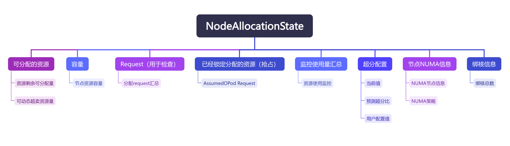


### 3.2.4 SR-004: 资源动态超分比

_功能描述_
根据监控情况，调整资源的动态超分比
_用例描述_

_接口清单_

_模块设计_

允许用户配置节点超分比和动态调整

通过监控指标获取到的资源使用情况，动态调整

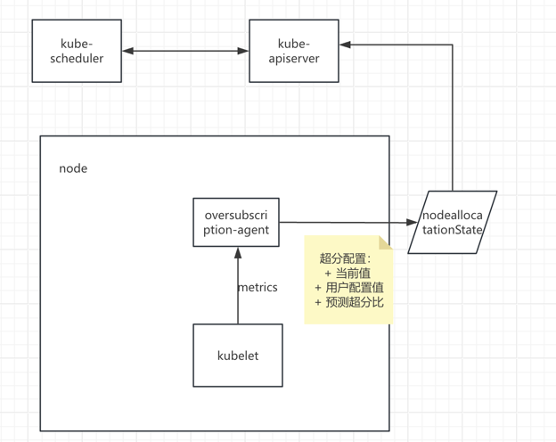


### 3.2.5 SR-005: 绑核（离线 qos-level 不支持绑核）

_功能描述_

离线应用的qos相当于原生BE，不支持绑核，按照实际的sharepool进行分配

需要结合原生的scheduler进行设计，避免用户自定义配置匹配到原生高级的level 导致的调度优先级升高


### 3.2.6 SR-006: 混部和超分的开关

_功能描述_
混部的开关

_接口清单_

_模块设计_

1.沿用当前rubik的混部开关

`volcano.sh/preemptable="true"/"false"`标识在线和离线


`混部和超卖是两个特性,目前作为标签使用没有当作注解。`


### 3.2.7 SR-007 webhook注入qos level

_功能描述_
webhook完成对扩展资源的注解注入到pod中

webhook根据pod声明匹配对应到qos level 注入到注解中

_接口清单_

_模块设计_

1.webhook根据pod声明匹配对应到qos level 注入到注解中

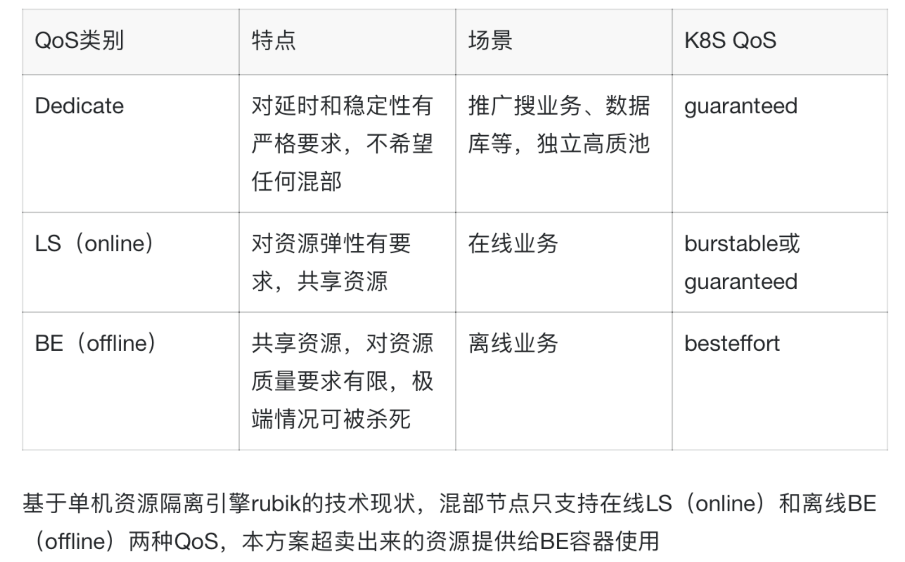

```go
//FuyaoPrefix + "/qos-level"
//besteffort类型的为离线qos
if pod.status.QOSClass  == PodQOSBestEffort  {
  pod.annotation[FuyaoPrefix + "/qos-level"] =  "BE"
}
```

2. webhook完成对离线资源优先级pod priorityClass的配置


### 3.2.8 SR-008 NUMA亲和性和cpuset

_功能描述_
cpu numa亲和性设置cpuset，确保pod在适合的节点运行

_接口清单_

_模块设计_

1.调度使用NUMA信息

```go
//prefilter阶段
//获取上报的Numa信息 从NAS中
numaInfo := getNUMAfromNAS(nodeallocatationstatu)

//将numa信息写入NodeInfo  NodeTopologyZones
UpdateNodeInfo(nodeallocatationstatu)

//filter使用
//遍历NUMANODE验证是否可分配资源
//最终判断是否有匹配 匹配的多个结果 延续kubelet的选择方法 最低的MUMAID 
// If the current bestHint and the candidate hint are both preferred,
// then only consider fitter NUMANodeAffinity
bitMask.Isempty()bool

//score使用
//NodeTopologyZones获取NumaNodelist
//根据不同的策略  均匀分布 资源最少 资源最多 选择不同的Scorer 
//根据topologypolicy  如果是pod 计算出result  如果是container 计算加权平均值 
//最终选出首选优先级 
score int64
//华为鲲鹏numa的限制策略更多 侵入式修改了kubelet代码 不一定对的上
```


2.setcpuset	

```go
if cpuset,ok := GetCpuSet();ok{
  //如果设置了cpuset
  updatecontianers()
}

numCPUs := guaranteedCPUs(pod, container)
if numCPUs==0 {
  //使用shared pool
  return
}

// get the aligned socket affinity across all hint providers.
hint := getAffinity()
//根据NUMA 亲和性分配 CPU
cpuset := allocateCpus(numCPUS,hint.NUMANodeAffinity){
  //获取可分配的cpuset
  GetAvailableCpus()
  if numaAffinity != nil {
    //根据 numa 关联掩码和配置的策略选项返回对齐的 CPU set。
    alignedCPUs := p.getAlignedCPUs(numaAffinity, allocatableCPUs)
		numAlignedToAlloc := alignedCPUs.Size()
    //是否满足绑核需求
		if numCPUs < numAlignedToAlloc {
			numAlignedToAlloc = numCPUs
		}
    //当需要多个 NUMA 节点来满足分配时，该算法会在 NUMA 节点之间均匀分配 CPU
		alignedCPUs, err := p.takeByTopology(alignedCPUs, numAlignedToAlloc)
		if err != nil {
			return cpuset.New(), err
		}
		result = result.Union(alignedCPUs)
  }
  
  // Get any remaining CPUs from what's leftover after attempting to grab aligned ones.
	remainingCPUs, err := p.takeByTopology(allocatableCPUs.Difference(result), numCPUs-result.Size())
	if err != nil {
		return cpuset.New(), err
	}
	result = result.Union(remainingCPUs)

  //从共享 CPUSet 中删除分配的 CPU。
	s.SetDefaultCPUSet(s.GetDefaultCPUSet().Difference(result))
}


setCPUset()//修改LinuxResources cpu即可
updatecontainers()

```


### 3.2.9 SR-009 调度

_功能描述_

在调度器调度Pod时，会从schedulingQueue中Pop出一个元素pod，此时需要在线pod优先于离线pod被选出

_模块设计_

在原生的排序中，主要是看priorityClass优先级，更高级priorityClass的pod 会更早的调度，当无法调度此类pod时，才会尝试调度其他低优先级的pod ，当pod优先级相同时，会使QueuePodInfo.timestamp进行排序

默认情况下priorityClass都是0

所以对扩展资源增加一个特定的priorityClass声明，供离线业务pod使用，使其始终晚于在线任务被选择

```yaml
apiVersion: scheduling.k8s.io/v1
kind: PriorityClass
metadata:
  name: fuyao-oversubscription
value: -1000 # -1000000000 到 1000000000 之间的任何整数值 
description: >-
  此 PriorityClass 只能用于离线业务Pod。  
globalDefault: false # 或 true。只有一个 PriorityClass 可以作为全局默认值。	
```


### 3.2.10 SR-010 驱逐

_功能描述_

本需求不包含oom_killer和调度抢占过程中的主动驱逐资源，是描述在节点资源压力的时候，由kubelet发起的主动驱逐行为，在此过程中，主要设计准则依然是要求离线业务优先释放

_模块设计_

1.原生

原生在驱逐触发前会首先尝试回收资源，由垃圾回收进行自我修复行为，这部分逻辑同样适用于超分资源。

离线扩展资源在驱逐过程中不需要考虑软驱逐，只需要考虑硬驱逐即可,会立即驱逐杀死pod，需要借助cadvisor的数据支持

驱逐信号包括：

+ memory.available
+ nodefs.available
+ nodefs.inodesfree
+ imagesfs.available
+ image.inodesfress
+ pid.available

原生的驱逐监测间隔为10秒

根据不同的信号，会有不同的sort排序规则（实现了sort接口），但是均主要参考pod优先级priorityClass

在memory驱逐pod时顺序为：

+ pod的资源使用是否超过request（qos为BestEffort或Burstable）
+ Pod优先级
+ Pod相对于请求的资源使用情况

 因 inode 或 进程 ID 不足而驱逐 Pod 时， 它使用 Pod 的相对优先级来确定驱逐顺序

nodefs的使用情况（本地卷+所有容器的日志）进行排序  imagefs会根据容器的可写层排序

这个过程中驱逐并不参考qos类

2.rubik

由于我们结合了rubik的容器引擎，利用了rubik的memory分级回收、动态回收，会在资源

<30%时  释放限制离线任务使用的内存 不会kill 主动drop 离线业务的cache 

<10% 主动硬限制 进行oom 

<5% 无法保证在线业务 全局drop cache 

利用此特性，可以满足基础的对在线业务的内存保证

同时在rubik当中，有异步水位线功能支持，在警戒水位线时会触发异步内存回收，memory.high时直接内存回收


但是rubik本身并没有驱逐pod

3.结合

最终我们选择rubik+原生驱逐的设计

设计主要准则： rubik的memory回收在原生驱逐前，尝试释放资源，rubik释放资源后仍处于驱逐条件，使用原生驱逐。

为了实现设计需要满足：

rubik警戒水位线要在原生的硬驱逐触发前到达

同步协调监控周期保持一致 均为10s   讲checkInterval配置为10

保证离线业务的pod优先级低于在线业务pod，与调度设计一致，使用定义的PriorityClass配置离线业务

### 3.2.11 SR-011 抢占

_功能描述_

在调度时，如果没找到合适的node，会触发抢占，尝试释放资源来满足调度需求，抢占过程中，离线业务不能抢占在线业务资源

_模块设计_

Pod 被创建后会进入队列等待调度。 调度器从队列中挑选一个 Pod 并尝试将它调度到某个节点上。 如果没有找到满足 Pod 的所指定的所有要求的节点，则触发对悬决 Pod 的抢占逻辑。 让我们将悬决 Pod 称为 P。抢占逻辑试图找到一个节点， 在该节点中删除一个或多个优先级低于 P 的 Pod，则可以将 P 调度到该节点上。 如果找到这样的节点，一个或多个优先级较低的 Pod 会被从节点中驱逐。 被驱逐的 Pod 消失后，P 可以被调度到该节点上。

在执行 filter 和 score 的所有"检查点"后， 如果没有找到合适的 node，触发抢占

配置非抢占的话 preemptionPolicy: Never  ， 会在调度队列低优先级pod之前，留在调度队列中，等待直到有足够大可用资源

抢占逻辑：

+ 驱逐受害pod 
+ 拒绝watingPod  
+ 清理低优先级pod（抢占核心）

调度器的抢占逻辑在选择抢占目标时不考虑 QoS。 抢占会考虑 Pod 优先级并尝试选择一组优先级最低的目标  

目前的原生抢占逻辑 结合调度使用定义的PriorityClass设置离线业务  可以满足要求 

### 3.2.12 SR-012 绝对压制

_功能描述_

在线任务在和离线任务资源竞争中，对离线业务绝对压制

_模块设计_

rubik设计中，在线任务对离线任务保持绝对的压制

包括cpu_qos、memory_qos的绝对压制效果，在线任务可以快速抢占离线任务获得cpu/mem

另外rubik中设计了qos throttle 将离线组对应的cfs_rq添加到了一个全局链表中，避免对在线任务干扰

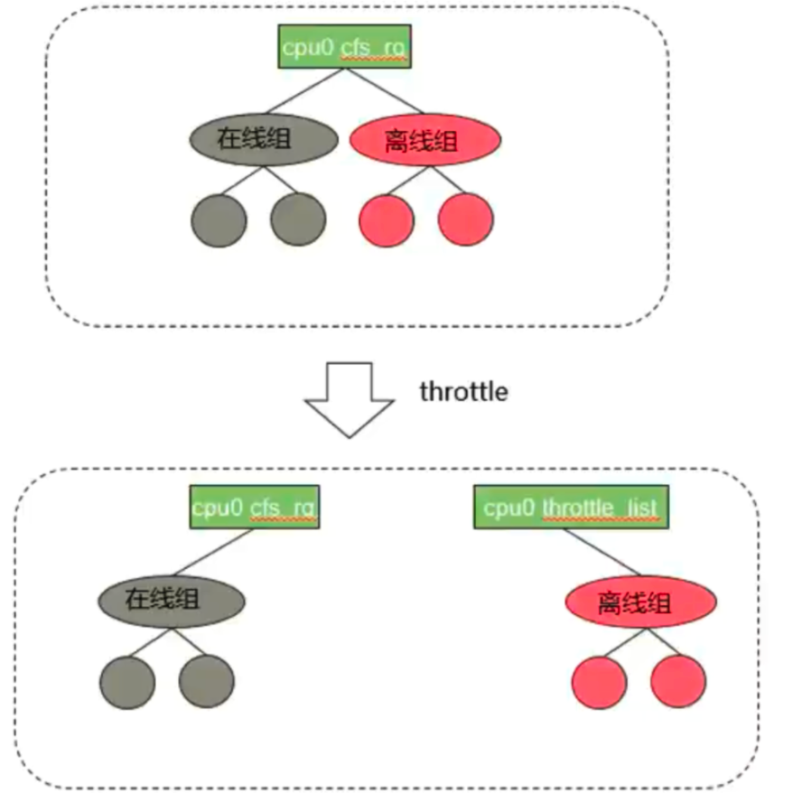

另外在多核之间的任务负载均衡过程中，在线也对离线业务存在绝对压制关系，仅仅在cpu为空闲核且没有待调度在线任务时，才会均衡迁移离线任务，在cfs_loadbalance上进行了额外的优化

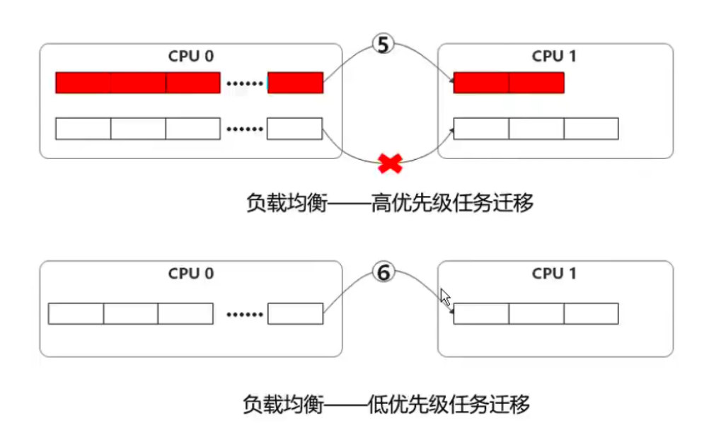

### 3.2.13 SR-013 干扰

_功能描述_

在线任务和离线任务因为资源争抢的时候出现干扰时，对离线任务进行压制

_模块设计_

使用Rubik的防干扰设计，当在线和离线产生干扰时，将ipi中断到核，驱离离线业务

### 3.2.14 SR-014 OOM

_功能描述_

当节点资源严重不足，主动触发资源也无法改善时，会触发oom主动杀死容器，不同于驱逐，这种方式pod可能会重启

_模块设计_

结合rubik的memcg oom分级功能

定义了两个memory cg队列 分为不同的优先级。低优先级对应离线业务 高优先级对应在线业务

在触发oom的out_of_memory函数时，在select_bad_process中，主动去选择了低优先级的队列中 寻找task打分（oom_score_adj打分因子和内存情况综合进行评分）最高的进程，进行杀死，如果低优先级队列中没有找到，才去高优先级队列

这样保障离线业务总是先于在线业务被杀死

需要使用两个rubik定义的接口：

+  /proc/sys/vm/memcg_qos_enable 打开Memcg OOM分级功能   

+ memory.qos_level -1表示低优先级 0表示高优先级

### 3.2.15 SR-015 重调度

_功能描述_

在调度器处，增加重调度器，对混部扩展资源在各个节点的资源使用情况进行感知，并均衡。

_模块设计_

讲混部扩展资源的资源使用情况汇报到重调度器，由重调度器根据分布情况，进行均衡调度，仅对离线业务进行均衡。

## 3.3、质量属性设计

### 3.4.1、性能规格

|规格名称|规格指标|
|:-------|:-------|
|内存占用|        |
|启动时间|        |
|响应时间|        |
|xxx     |        |

### 3.4.2、可靠性设计

### 3.4.3、安全/韧性/隐私设计

### 3.4.4、兼容性设计

### 3.4.5、可服务性设计

### 3.4.6、可测试性设计

# 4、需求分解分配表

|序号 |模块名称|Story名称|Story描述|
|:----|:-------|:--------|:--------|
|     |        |         |         |
|     |        |         |         |

# 5、修改日志
| 版本  |发布说明|
|:----|:-------|
|     |        |
|     |        |

# 6、参考目录

