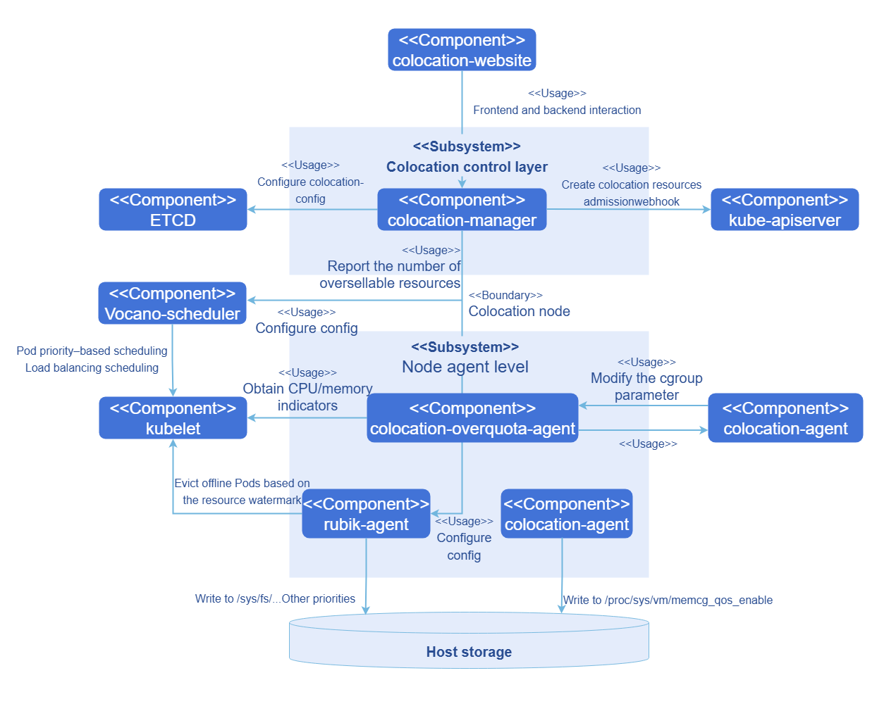
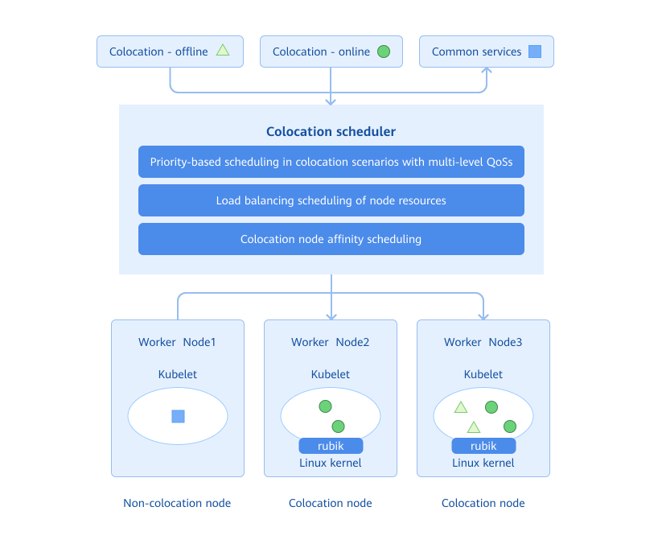
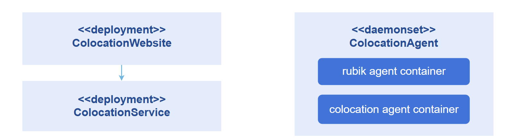
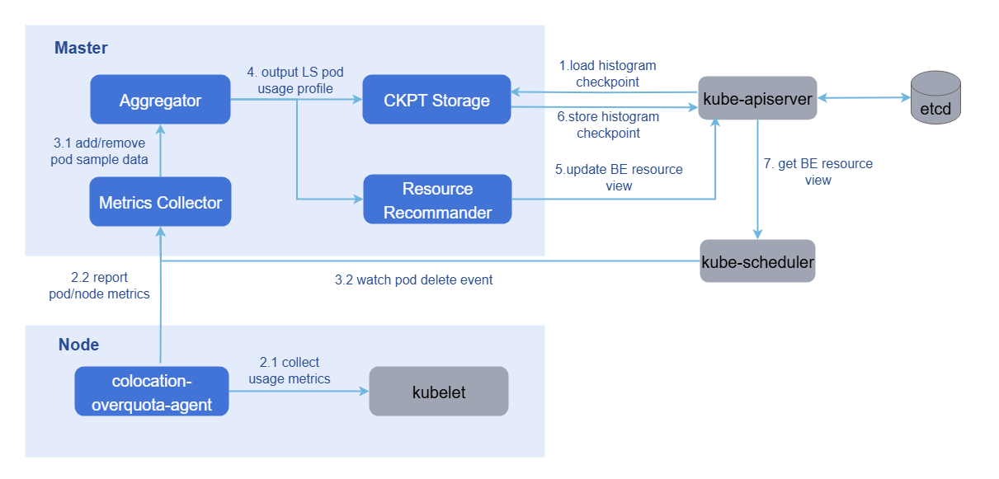
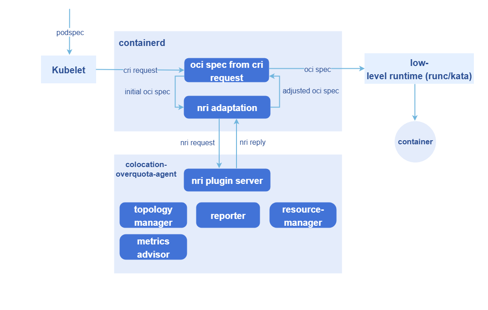

# Colocation

## Feature Overview

As cloud services and hardware resources become increasingly diversified, higher management requirements are imposed on cloud-native systems, such as resource utilization optimization and service quality assurance. Various colocation solutions have emerged to ensure that diversified services and computing power run in the optimal state in a colocation system. The colocation and resource overselling solution of openFuyao provides the following functions:

- Multi-tier QoS management for services
- Service feature-aware scheduling
- Colocation node management
- Colocation policy configuration
- Management and reporting of oversold resources on nodes
- NRI-based, non-intrusive colocation Pod creation and cgroup management
- Multi-layer optimization system consisting of the single-node colocation engine (rubik) and kernel isolation technologies

### Application Scenarios

When deploying a workload, you need to determine the QoS level of the workload based on its characteristics. The scheduler adds necessary colocation information to the workload and schedules it to a colocation or non-colocation node to meet your colocation requirements. You can also manage colocation scheduling and colocation nodes through unified colocation configuration management.

### Supported Capabilities

+ Priority-based scheduling and load balancing scheduling are supported for services with different QoS levels.
+ On a single node, online services can suppress the CPU and memory QoS of offline services.
+ On a single node, offline services can be evicted and rescheduled based on CPU/memory watermarks.
+ Advanced colocation features such as CPU elastic throttling, asynchronous memory reclamation, memory bandwidth limitation, and PSI interference detection are supported.
+ Monitoring and viewing of colocation resources are supported.

### Highlights

+ openFuyao adopts industry-leading colocation and resource overselling solutions. It supports hybrid deployment of online and offline services, ensuring that online services are prioritized during peak periods, while enabling offline services to utilize oversold resources during off-peak periods of online services, thereby improving cluster resource utilization.
+ Services are classified into multiple QoS levels: online services (HLS — High-priority Latency Sensitive services with CPU pinning, and LS — Latency Sensitive services) and offline services (BE — Best Effort services that use oversold resources). At the scheduling layer, the scheduler ensures that high-priority tasks can preempt low-priority tasks. Offline service eviction is also supported to prevent offline services from being preempted by online services with high resource utilization for extended periods. On a single node, CPU pinning is supported for HLS online services, and NUMA affinity scheduling is supported for LS online services.

### Constraints

This feature, along with NUMA affinity scheduling and the NPU Operator, uses Volcano, all at version 1.9.0. If NUMA affinity scheduling has been deployed in advance, or if `vcscheduler.enabled` or `vccontroller.enabled` was enabled when installing the NPU Operator component, you do not need to manually install Volcano. After configuring the volcano-scheduler-configmap as described in [Prerequisites](#prerequisites) in the installation section, you can use them together.

### Feature Dependency Description

The dependencies of each colocation function on hardware and the operating system are as follows.

#### Single-Node Colocation Engine (rubik)

| Function | Hardware Dependency | OS Dependency |
| --- | --- | --- |
| CPU suppression | None | openEuler 22.03 LTS and later (kernel 5.10.0-60.139.0.166 and later) |
| Memory suppression | None | openEuler 22.03 LTS and later (kernel 5.10.0-60.139.0.166 and later) |
| CPU elastic throttling | None | openEuler 22.03 LTS and later (kernel 5.10.0-60.139.0.166 and later) |
| PSI metric interference detection | None | openEuler 22.03 LTS and later (kernel 5.10.0-60.139.0.166 and later) |
| dynCache (memory bandwidth limitation) | Physical machine (x86/ARM supported) | openEuler 22.03 LTS SP3 and later (kernel 5.10.0-182.0.0.95 and later) |
| dynMemory (asynchronous memory reclamation) | None | openEuler 22.03 LTS SP3 and later (kernel 5.10.0-182.0.0.95 and later) |
| Offline workload interference detection and eviction | None | None |

#### Colocation Scheduling

| Function | Hardware Dependency | OS Dependency | Other Dependency |
| --- | --- | --- | --- |
| Priority and load-aware scheduling | None | None | — |
| Resource overselling management | None | None | containerd >= 1.7 |
| NUMA affinity policy | None | None | — |
| Colocation monitoring | None | None | — |

#### Configuration File Paths Involved

The main configuration files and paths involved in the operation of each function are as follows:

- kubelet configuration: `/var/lib/kubelet/config.yaml`
- containerd configuration: `/etc/containerd/config.toml`
- rubik-related configuration and mount paths:
  - `/sys/fs/cgroup/`
  - `/sys/fs/resctrl/`
  - `/etc/kubernetes/node-feature-discovery/features.d/`
  - `/proc/sys/vm/memcg_qos_enable`
  - `/dev` (used only for blkio)
  - `/run/rubik` (ensures that only one rubik process runs on each node)

### Implementation Principles

The colocation component is divided into two parts from the perspectives of functions and deployment modes.

1. The control layer is responsible for the unified management of colocation components.

    - Global configuration plane: Provides global colocation configurations, including enabling colocation on nodes, eviction watermark configuration for the colocation engine, and scheduling threshold settings for load balancing scheduling by the scheduler.
    - Admission control: Provides an admission controller for colocation workloads, which checks rules for workloads annotated with QoS labels at each level, and adds mandatory resource items for colocation scheduling (such as scheduler, priority, and affinity label information).
    - Unified management of oversold resources: Receives metrics collected by the overselling agent, periodically updates the resource usage of each node and Pods on each node to the CRDs in Checkpoint, and periodically updates the total oversellable resources in node resources.
    - REST API service: Provides REST API services for integration with visual interfaces.
    - Colocation monitoring: Provides a unified visualization interface for colocation monitoring.

2. Node agents are deployed in the Kubernetes cluster as DaemonSets to support resource overselling in colocation scenarios and injection of refined resource management policies.

    - Overselling agent: Collects resource metrics, uses histograms to collect and predict workload resource usage details, and builds resource profiles for applications. It also implements resource overselling reporting, predicts the actual usage of Pod resources based on application resource profiles, reclaims allocated but unused resources, and reports to the unified management plane.
    - Colocation agent: The rubik colocation engine and additional functionality for interfacing with the kernel to enable/disable rubik features.
    - Overselling resource NRI plugin: Uses the NRI mechanism of containerd to inject refined resource management policies at different container lifecycle stages.

**Figure 1** Colocation and resource overselling solution diagram



Considering the overall scheduling framework construction of openFuyao, and also for the future multi-tier QoS construction of openFuyao colocation, openFuyao introduces a three-tier QoS guarantee model. This model further divides online services into HLS (High-priority Latency Sensitive) and LS (Latency Sensitive) categories, and marks offline services as BE (Best Effort). The details are as follows.

**Table 1** Three QoS levels for workloads

| QoS | Characteristics | Scenario | Description | K8s QoS |
| --- | --- | --- | --- | --- |
| HLS (High-priority Latency Sensitive) | Strict requirements for latency and stability. Resources are not oversold and are reserved to guarantee better determinism. | High-requirement online services | Corresponds to the Guaranteed class of the community. When the kubelet CPU pinning function is enabled on a node, CPU cores are bound. During admission, the requests and limits of CPU and memory are checked, requiring that both CPU and memory requests and limits exist and are respectively equal, and that CPU requests are **integer** cores, ensuring that Pods marked as HLS correspond to the exclusive Guaranteed type. | Guaranteed |
| LS (Latency Sensitive) | Shared resources, with better elasticity for burst traffic. | Online services | The typical QoS level for microservice workloads, achieving better resource elasticity and more flexible resource adjustment capabilities. | Guaranteed/Burstable |
| BE (Best Effort) | Shared resources, with limited resource quality, and may be forcefully deleted in extreme cases. | Offline services | The typical QoS level for batch jobs, providing stable computing throughput within a certain period, at low cost, using only oversold resources. | Besteffort |

Nodes in the cluster are classified into colocation nodes and non-colocation nodes. Generally, online services and offline services are deployed on colocation nodes, and common services are deployed on non-colocation nodes. The colocation scheduler properly schedules the current service to an appropriate node based on the service attributes to be deployed and the colocation attributes of nodes in the cluster. Workloads with different QoS levels are mapped to different PriorityClass levels. During scheduling, the colocation Scheduler performs priority-based scheduling/preemption at the scheduling queue layer according to the workload PriorityClass, ensuring that high-priority tasks are preferentially guaranteed at the scheduling level. On the other hand, when selecting a scheduling node, the colocation Scheduler also scores nodes based on the actual CPU and memory usage of each node, scheduling the workload to a node with low comprehensive CPU and memory usage, minimizing node overheating.

**Figure 2** Colocation scheduling diagram



The colocation component mainly consists of the colocation scheduler, unified colocation management component, single-node colocation engine, oversold resource reporting/management component, and NRI plugin. The colocation scheduler is currently implemented based on the Volcano scheduler, and the single-node colocation engine is integrated through rubik. The unified colocation management component mainly consists of:

- colocation-website: Deployed in the cluster as a Deployment. It is the frontend interface design for colocation, including colocation statistics visualization, colocation node management, and colocation scheduling configuration management.
- colocation-service: Deployed in the cluster as a Deployment. It provides external service interfaces, including colocation monitoring information interfaces, colocation node management (add/remove), and colocation scheduling policy configuration.
- colocation-agent: Deployed in the cluster as a DaemonSet. It is primarily responsible for enabling the memory QoS management switch on colocation nodes.

**Figure 3** Colocation module design and deployment view<br />


The colocation engine and oversold resource management system are provided by the unified colocation-management repository:

+ colocation-overquota-agent: Deployed on cluster overselling nodes as a DaemonSet. The single-node agent obtains node and Pod resource sampling data from kubelet and reports it to the Master component. It also integrates the rubik colocation engine, providing advanced colocation features such as CPU elastic throttling, asynchronous memory reclamation, memory bandwidth limitation, and PSI interference detection.
+ colocation-manager: Deployed in the cluster as a Deployment. The overselling Master uses the sampling data to profile the resource usage of online Pods on each node, and then combines system configuration parameters and the overselling formula to update the BE allocatable resource amount to the node object. It also provides the admission controller function for colocation workloads.

**Figure 4** Node resource overselling reporting and management



The creation of oversold Pods and cgroup management utilizes the NRI mechanism to execute custom logic at multiple container lifecycle stages:

- Using the NRI mechanism to add custom logic during Pod and container lifecycle hooks.
- Using the NRI reply to modify the container OCI spec.
- Using NRI UpdateContainer to modify actual resources.

The entire process involves two workloads:

+ colocation-manager: Deployed in the cluster as a Deployment. It serves as the admission controller for colocation workloads, responsible for verifying whether the workload configuration meets the resource requirements corresponding to the QoS level during the admission phase, rejecting non-compliant colocation workloads. It also adds mandatory resource items for colocation scheduling (scheduler, priority, affinity label, etc.).
+ colocation-overquota-agent: Deployed on overselling nodes as a DaemonSet. It uses the aforementioned NRI mechanism to modify actual resources.

**Figure 5** NRI-based non-intrusive oversold Pod creation and cgroup management



### Relationship with Related Features

This feature depends on the resource management module to provide the interface for delivering workloads, and depends on Prometheus to provide monitoring capabilities.

### Related Instances

Code links:<br />
[openFuyao/colocation-website (gitcode.com)](https://gitcode.com/openfuyao/colocation-website) <br />
[openFuyao/colocation-service (gitcode.com)](https://gitcode.com/openfuyao/colocation-service) <br />
[openFuyao/colocation-management (gitcode.com)](https://gitcode.com/openfuyao/colocation-management) <br />

## Installation

### Prerequisites

1. Kubernetes v1.21 or later, containerd v1.7.0 or later, and kube-prometheus v1.19 or later have been deployed.

2. The colocation scheduler used by openFuyao is `volcano-scheduler`, which needs to be pre-installed in Kubernetes using Helm. Full testing has been completed on version 1.9.0. Functions in versions later than 1.9.0 are expected to work properly, and users can choose to deploy them, but functional correctness is not yet guaranteed.

   2.1 Install volcano-scheduler using Helm.

      ```shell
       helm repo add volcano-sh https://volcano-sh.github.io/helm-charts
       helm repo update
       helm install volcano volcano-sh/volcano --version 1.9.0 -n volcano-system --create-namespace
      ```

   > **Note:**<br/>
   > If the NUMA affinity scheduling component has already been installed on openFuyao, the volcano component will be installed by default. In this case, you do not need to perform pre-installation using Helm.

   2.2 Modify the default configuration of volcano-scheduler.

      ```shell
       kubectl edit cm -n volcano-system volcano-scheduler-configmap
      ```

   The main modifications are as follows (in the commented sections):

   ```yaml
   apiVersion: v1
   data:
     volcano-scheduler.conf: |
       actions: "allocate, backfill, preempt" # Ensure that the action types and order are correct
       tiers:
       - plugins:
         - name: priority             # Ensure that priority scheduling is enabled in tiers[0].plugins[0]
         - name: gang
           enablePreemptable: false
           enableJobStarving: false   # Ensure that enableJobStarving is disabled
        ...
   kind: ConfigMap
   metadata:
       meta.helm.sh/release-name: volcano
       meta.helm.sh/release-namespace: volcano-system
     labels:
       app.kubernetes.io/managed-by: Helm
     name: volcano-scheduler-configmap
     namespace: volcano-system
   ```

   > **Note:**<br/>
   > When deployed together with the npu-operator, the npu-operator may automatically modify the volcano-scheduler.conf file, overwriting key items (for example, removing "preempt" from actions, or changing tiers.plugins.gang.enablePreemptable). After installing/upgrading the npu-operator, please re-check and restore the configuration as required in this section: ensure that actions includes "preempt" and enablePreemptable: false.

3. The colocation engine of openFuyao requires the OS kernel to be version 4.19 or later. For details about whether each colocation function can be enabled, see the **Colocation Capability Support** module in **Colocation Policy Configuration** on the WebUI.

   > **Note:**<br/>
   > The complete functions of colocation have been verified on openEuler 22.03 LTS-SP3. For other later versions, you can choose to deploy them, but functional correctness is not yet guaranteed.

4. Enable kubelet CPU pinning and NUMA affinity policies.

   > **Note:**<br/>This function is designed to enable CPU pinning for Pods with **QoS-level** set to **HLS**. Only when the static policy of kubelet is enabled, HLS-level Pods gain exclusivity and NUMA affinity, thereby boosting the performance of HLS workloads.

   To use this module, you must modify the kubelet configuration file. The configuration procedure is as follows:

   4.1 Open the kubelet configuration file.

      ```  shell
       vi /etc/kubernetes/kubelet-config.yaml
      ```

   > **Note:**<br/>
   > If the configuration file is not found at the preceding location, you can locate it at `/var/lib/kubelet/config.yaml`.

   4.2 Add or modify configuration items. (When switching to the static policy, you also need to configure reserved CPUs.)

     ```yaml
     cpuManagerPolicy: static
     systemReserved:
       cpu: "0.5"
     # Note: If the number of CPU cores on the node is small, enabling kubeReserved may cause insufficient available CPUs on the node and kubelet may break down. Exercise caution when enabling kubeReserved.
     kubeReserved:
       cpu: "0.5"
     topologyManagerPolicy: xxx # best-effort / restricted / single-numa-node
     ```

   4.3 Modify the application.

     ```
     rm -rf /var/lib/kubelet/cpu_manager_state
     systemctl daemon-reload
     systemctl restart kubelet
     ```

   4.4 Check the kubelet running status.

     ```
     systemctl status kubelet
     ```

   If the kubelet running status is **running**, the operation is successful.

5. Enable the NRI extension function of containerd on colocation nodes.

   5.1 On the colocation node, run `vi /etc/containerd/config.toml` and search for [plugins."io.containerd.nri.v1.nri"].

   5.2 If it exists, change disable=true to disable=false. If it does not exist, add the following under [plugins]:

      ```
       [plugins."io.containerd.nri.v1.nri"]
       
           disable = false
       
           disable_connections = false
       
           plugin_config_path="/etc/nri/conf.d"
       
           plugin_path="/opt/nri/plugins"
       
           plugin_registration_timeout="5s"
       
           plugin_request_timeout = "2s"
       
           socket_path="/var/run/nri/nri.sock"
      ```

   5.3 After the configuration is complete, run the following command to restart containerd.

      ```shell
       sudo systemctl restart containerd 
      ```

### Starting the Installation

1. In the left navigation pane of the openFuyao platform, choose **Application Market** > **Application List** to enter the **Application List** page.
2. Select **Extension** in the left type filter to view all extension components. Or enter **colocation-package** in the search box.
3. Click the **colocation-package** card to enter the **Details** page of the colocation extension component.
4. Click **Deploy** to enter the **Deploy** page.
5. Enter the application name, select the installation version and namespace.
6. Enter the values information to be deployed in the **Values.yaml** of parameter configuration.
7. Click **Deploy** to complete the deployment.
8. Click **Extension Component Management** in the left navigation pane to manage this component.


### Independent Deployment

Compared to installation and deployment through the application market, this component also provides an independent deployment function. The procedure is as follows:

> **Note:**<br/>
> For independent deployment, you still need to pre-deploy Kubernetes v1.26 or later, Prometheus, containerd, and Volcano v1.9.0.

1. Pull the image.

   ```shell
   helm pull oci://cr.openfuyao.cn/charts/colocation-package --version xxx
   ```

   Replace xxx with the Helm image version to be pulled, for example, 0.13.0.

2. Decompress the installation package.

   ```shell
   tar -zxvf colocation-package-xxx.tgz
   ```

3. Disable the openFuyao and OAuth switches.

   ```shell
   vi colocation-package/values.yaml
   ```

   Change the `colocation-website.enableOAuth` and `colocation-website.openFuyao` options to **false**.

4. Set the service type to NodePort.

   ```shell
   vi colocation-package/values.yaml
   ```

   Change `colocation-website.service.type` to `NodePort`.

5. Integrate with Prometheus.

   ```shell
   vi colocation-package/values.yaml
   ```

   For independent deployment, the monitoring component must already be installed in the cluster. Change the `colocation-service.serverHost.prometheus` field to the indicator query address and port exposed by Prometheus in the current cluster, for example, `http://prometheus-k8s.monitoring.svc.cluster.local:9090`.

6. Perform independent installation.

   ```
   helm install colocation-package ./
   ```

7. Access the independent frontend.

   You can enter "http://*Client login IP address of the management plane*:30880" in the browser to access the independent frontend.

## Viewing the Overview

In the left navigation pane of the openFuyao platform, under **Computing Power Optimization Center**, choose **Colocation** > **Overview** to enter the **Overview** page of colocation. The page displays the workflow of colocation.

### Prerequisites

The **colocation-package** extension component has been deployed in the application market.

### Context

View the colocation workflow, including environment preparation, colocation policy configuration, workload deployment, and colocation monitoring.

### Constraints

None.

### Procedure

Click **Colocation** > **Overview** to enter the **Overview** page.

- **Environment Preparation** includes modifying kubelet and containerd configurations to enable the node colocation function. Click  to display the configuration methods.
- **Colocation Policy Configuration**: You can click **Configure Colocation Policy** after the description to jump to the colocation policy configuration page.
- **Workload Deployment** involves actually using the scheduling function for workload scheduling. Click **Deploy Workloads** to jump to the workload deployment page.
- **Colocation Monitoring** displays health monitoring information for cluster-level colocation and node-level colocation. Click **View Colocation Monitoring** to jump to the colocation monitoring page.

## Configuring Colocation Policies

In the left navigation pane of the openFuyao platform, under **Computing Power Optimization Center**, choose **Colocation** > **Colocation Policy Configuration** to enter the **Colocation Policy Configuration** page. This page displays the list of colocation-related nodes in the cluster, provides a colocation parameter configuration window, and supports enabling or disabling the colocation label of nodes in the node list, helping to achieve balanced allocation and stable running of cluster resources.

### Enabling or Disabling the Colocation Label of a Node

#### Context

Users need to change the colocation label status of a specified node.

#### Constraints

After changing the colocation label of a node, deployed services must meet the corresponding requirements. Please properly plan the colocation capabilities of nodes in the cluster.

#### Procedure

Click the switch in the **Enable Colocation Node** column corresponding to a node in the colocation node list to toggle the state of enabling or disabling the node's colocation capability.

If the page displays "Node xxx has enabled the colocation function" or "Node xxx has disabled the colocation function", the toggle is successful.

> **Note:**<br/>
> - For Pods that are already running, node label changes usually do not trigger immediate migration; this behavior only affects newly scheduled Pods.
> - When disabling a colocation node, it is recommended to remove the `node.openfuyao.com/colocation` label key rather than just changing the value to `false`, to avoid label semantic ambiguity in subsequent scheduling.

### Configuring Colocation Policy Parameters

#### Context

This page provides parameter configuration functions for load-aware scheduling, offline workload watermark eviction, and advanced colocation features. You can set the actual CPU and memory load thresholds to control the scheduling policy for new workloads and prevent node overload. After configuring offline workload watermark eviction, when the node resource usage exceeds the set watermark, offline job eviction is automatically triggered to release resources.

Advanced colocation features include:

- **CPU elastic throttling**: When the node load is low, LS-level Pods are allowed to dynamically exceed CPU limits. When the load increases, the limits are automatically converged.
- **Asynchronous memory reclamation**: Memory is reclaimed based on different QoS levels, with BE-level Pod memory reclaimed first.
- **Memory bandwidth limitation**: Hardware technologies are used to limit the memory bandwidth and CPU cache occupied by BE-level Pods.
- **PSI interference detection**: Offline Pods that interfere with online services are automatically detected and evicted based on system pressure indicators.

#### Constraints

- The load-aware scheduling threshold ranges from 0 to 100%, with a default setting of 60% to balance resource utilization and stability.
- Adjusting the threshold does not affect workloads that are already running.
- The offline workload watermark eviction threshold ranges from 0 to 99%, affecting only offline jobs. Critical online services are not affected. The eviction process may cause brief service fluctuations.
- **Advanced colocation feature restrictions**:
  - CPU elastic throttling and asynchronous memory reclamation require cgroup v2 support. openEuler 22.03 LTS SP3 or later is recommended.
  - Memory bandwidth limitation requires hardware support (Intel RDT or ARM MPAM) and only takes effect in the physical machine environment.
  - Some features require specific kernel interfaces. The system automatically detects the node support status.

#### Procedure

1. On the **Colocation Policy Configuration** page, click **Colocation Policy Parameter Configuration** in the upper-right area of the colocation node list.

2. In the pop-up window, click the corresponding switches for **Load-Aware Scheduling** and **Offline Load Watermark Eviction** or other advanced colocation features.

   > **Note:**<br/>
   > - After enabling **Load-Aware Scheduling** and **Offline Load Watermark Eviction**, the node CPU and memory thresholds default to 60%. You can modify them as prompted.
   > - Default configurations of advanced colocation features:
   >   - CPU elastic throttling: The load high watermark defaults to 60%, and the alert watermark defaults to 80%.
   >   - Memory bandwidth limitation: L3 cache allocation (low/medium/high priority) defaults to 20%/30%/50%, and memory bandwidth allocation defaults to 20%/30%/50%. By default, all offline Pods use the dynamic control group. To customize the control group level, add the `volcano.sh/cache-limit: "low/mid/high"` annotation to the Pod.
   >   - PSI interference detection: The monitored resources default to CPU and memory, and the 10-second average pressure threshold defaults to 5.0%.
   >   - Asynchronous memory reclamation: No additional parameter configuration is required. It takes effect automatically after being enabled.

3. After modifying the corresponding configuration parameters and thresholds, click **OK** to save the changes.
   > **Note:**<br/>
   > - The switch status of advanced colocation features is automatically determined based on the node hardware and kernel support status.
   > - For unsupported features, the switch will be grayed out and the specific reason for non-support will be displayed.
   > - Configuration modifications take effect automatically within approximately 30 seconds, without restarting related components.
   > - Regarding the memory bandwidth limitation feature: The system defaults to configuring the dynamic control group to manage all offline Pods. The low/medium/high watermark parameters take effect only when the user manually specifies the Pod control group.

## Deploying Workloads with Different QoS Levels

This section is for self-test verification.

### QoS Classification Criteria

1. The entry point for colocation QoS classification is the Pod annotation `openfuyao.com/qos-level`. The value must be `HLS`, `LS`, or `BE` (uppercase). When using controllers such as Deployment, it should be written under `spec.template.metadata.annotations`.
2. The Webhook of `colocation-manager` processes the `CREATE/UPDATE` requests of Pods. Only when the above QoS annotation is recognized, the corresponding colocation validation and auto-completion process will be triggered.
3. Relying solely on `requests/limits` does not automatically infer the QoS level. If the QoS annotation is missing or the value is invalid, the Pod will be passed through as a normal Pod without applying colocation enhancement logic.

### Required and Auto-Completed Fields

| QoS Level | Required Fields (recommended to fill manually) | Admission Validation Points | System Auto-Completed (Webhook) |
| --- | --- | --- | --- |
| HLS | `metadata.annotations.openfuyao.com/qos-level: "HLS"`; containers use native resources `cpu/memory` | Cannot use `kubernetes.io/be-cpu`, `kubernetes.io/be-memory`; each container (including Init containers) requires `cpu/memory` `requests` and `limits` to both exist and be respectively equal; `cpu requests` must be integer cores (e.g., `1000`, `2000`) | Auto-completes `spec.schedulerName=volcano`, `spec.priorityClassName=priority-hls`, and colocation node affinity |
| LS | `metadata.annotations.openfuyao.com/qos-level: "LS"`; containers use native resources `cpu/memory` | Cannot use BE extended resources; cannot simultaneously satisfy the three HLS conditions (equal CPU, equal memory, integer CPU cores), otherwise it will be rejected as "configuration not compliant with LS" | Auto-completes `spec.schedulerName=volcano`, `spec.priorityClassName=priority-ls`, colocation node affinity, and `volcano.sh/quota-turbo=true` |
| BE | `metadata.annotations.openfuyao.com/qos-level: "BE"`; containers use extended resources `kubernetes.io/be-cpu`, `kubernetes.io/be-memory` | Cannot mix native `cpu/memory`; must declare at least BE extended resources (can write `requests`, or only write `limits`) | Auto-completes `spec.schedulerName=volcano`, `spec.priorityClassName=priority-be`, colocation node affinity, `openfuyao.com/extender-resource-cfg`, and `volcano.sh/preemptable=true`; when only `limits` are written, `requests` of the same value are auto-completed |

> **Note:**<br/>
> - `spec.priorityClassName` does not need to be written manually. If written manually, it must be consistent with the QoS level (e.g., HLS corresponds to `priority-hls`). Inconsistent values will be rejected.
> - `spec.schedulerName` does not need to be written manually. The Webhook will uniformly change it to `volcano`.
> - For BE extended resources, `kubernetes.io/be-cpu` only supports the "integer" or "integer+k" format (recommended formats such as `1000`, `2000`, `1000k`). The `1500m` or decimal format is not supported.

### YAML Examples

1. HLS example (strong guarantee)

```yaml
apiVersion: apps/v1
kind: Deployment
metadata:
  name: hls-demo
spec:
  replicas: 1
  selector:
    matchLabels:
      app: hls-demo
  template:
    metadata:
      labels:
        app: hls-demo
      annotations:
        openfuyao.com/qos-level: "HLS"
    spec:
      containers:
        - name: app
          image: nginx:1.25
          resources:
            requests:
              cpu: "2000"
              memory: "4Gi"
            limits:
              cpu: "2000"
              memory: "4Gi"
```

2. LS example (elastic online)

```yaml
apiVersion: apps/v1
kind: Deployment
metadata:
  name: ls-demo
spec:
  replicas: 1
  selector:
    matchLabels:
      app: ls-demo
  template:
    metadata:
      labels:
        app: ls-demo
      annotations:
        openfuyao.com/qos-level: "LS"
    spec:
      containers:
        - name: app
          image: nginx:1.25
          resources:
            requests:
              cpu: "1500"
              memory: "2Gi"
            limits:
              cpu: "2000"
              memory: "2Gi"
```

3. BE example (offline overselling)

```yaml
apiVersion: apps/v1
kind: Deployment
metadata:
  name: be-demo
spec:
  replicas: 1
  selector:
    matchLabels:
      app: be-demo
  template:
    metadata:
      labels:
        app: be-demo
      annotations:
        openfuyao.com/qos-level: "BE"
    spec:
      containers:
        - name: app
          image: nginx:1.25
          resources:
            requests:
              kubernetes.io/be-cpu: "1000"
              kubernetes.io/be-memory: "2Gi"
            limits:
              kubernetes.io/be-cpu: "2000"
              kubernetes.io/be-memory: "4Gi"
```

### Quick Verification

> **Note:**<br/>
> The following commands assume that the example Pods are deployed in the `default` namespace. If using another namespace, add `-n <namespace>` to the commands.

1. Confirm that the Webhook is available in the cluster.

```bash
kubectl get mutatingwebhookconfiguration colocation-manager-webhook
kubectl get pods -n openfuyao-colocation -l app.kubernetes.io/name=colocation-manager
```

2. Deploy the HLS/LS/BE examples separately.

```bash
kubectl apply -f hls-demo.yaml
kubectl apply -f ls-demo.yaml
kubectl apply -f be-demo.yaml
kubectl rollout status deploy/hls-demo
kubectl rollout status deploy/ls-demo
kubectl rollout status deploy/be-demo
```

3. Check the Webhook auto-completion results.

```bash
# All three types of Pods should use the volcano scheduler, and priorityClassName should be consistent with QoS
kubectl get pod -l app=hls-demo -o jsonpath='{.items[0].spec.schedulerName}{"\n"}{.items[0].spec.priorityClassName}{"\n"}'
kubectl get pod -l app=ls-demo  -o jsonpath='{.items[0].spec.schedulerName}{"\n"}{.items[0].spec.priorityClassName}{"\n"}{.items[0].metadata.annotations.volcano\.sh/quota-turbo}{"\n"}'
kubectl get pod -l app=be-demo  -o jsonpath='{.items[0].spec.schedulerName}{"\n"}{.items[0].spec.priorityClassName}{"\n"}{.items[0].metadata.annotations.volcano\.sh/preemptable}{"\n"}{.items[0].metadata.annotations.openfuyao\.com/extender-resource-cfg}{"\n"}'
```


## Using Colocation Monitoring

In the left navigation pane of the openFuyao platform, under **Computing Power Optimization Center**, choose **Colocation** > **Colocation Monitoring** to enter the **Colocation Monitoring** page by default. This page displays the data monitoring panel related to colocation in the cluster.

### Cluster-Level Colocation Monitoring

This page provides data monitoring related to colocation in the cluster, including colocation node information, colocation workload information, and resource usage in the cluster.

- You can hover the mouse over the curve chart of a monitoring indicator to view detailed data information.

- In the **Legend** area of each chart, you can click a legend item to choose whether to display the data in the chart, facilitating comparison between different datasets.

### Node-Level Colocation Monitoring

Click the **Node-Level Colocation Monitoring** tab to switch to the node-level monitoring page, where you can view node colocation data, such as the total physical resources used by each node and the resource amounts used by HLS, LS, and BE types of Pods.

- You can hover the mouse over the curve chart of a monitoring indicator to view detailed data information.

- In the **Legend** area of each chart, you can click a legend item to choose whether to display the data in the chart, facilitating comparison between different datasets.

- In the filter box in the upper-right corner of the page, you can select or deselect some nodes for display.

## Enabling NUMA Affinity Enhancement

### Prerequisites

The node must have a multi-NUMA architecture, and the NUMA affinity function must be enabled in the ConfigMap.

### Context

On servers with multiple NUMA nodes, cross-NUMA-node memory access causes high latency, affecting the performance of latency-sensitive (LS-level) services. By enabling the NUMA affinity enhancement function, containers in LS-level Pods are bound to the same NUMA node, reducing memory access latency and improving service stability.

### Constraints

- Only LS-level (low-priority online services) Pods are supported. Pods of other QoS levels (such as HLS and BE) are not affected.

- Enabling this function only intercepts resource allocation before Pod startup. It does not affect the scheduling phase prior to enabling the function.

### Procedure

1. Ensure that the colocation and overselling function has been enabled.

   Confirm that colocation has been enabled for the node. For the specific procedure, see the relevant operation steps in [Enabling or Disabling the Colocation Label of a Node](#enabling-or-disabling-the-colocation-label-of-a-node).

2. Enable the NUMA affinity function.

   Edit the ConfigMap to enable the NUMA function:

   ```bash
   kubectl edit configmap colocation-config -n openfuyao-colocation
   ```

   Change the value of `enable` in `numa-affinity-options` from `false` to `true`.

3. Wait 30 seconds for the component to detect the configuration change. The configuration change takes effect automatically.

4. Deploy the application.

   Add LS-level annotations to Pods that require NUMA affinity.

   ```yaml
   annotations:
     openfuyao.com/qos-level: "LS"
   ```

5. Verify the result.

   After the function is enabled and the application is deployed, the system automatically performs the following operations:
    - Detects the QoS level of Pods.
    - Selects the optimal NUMA node for LS-level Pods.
    - Restricts the Pod's CPU usage to the selected NUMA node.

   You can check whether the function is working properly by viewing the component logs:

  ```bash
  kubectl logs -n openfuyao-colocation -l app.kubernetes.io/name=colocation-overquota-agent
  ```

If the log shows "Successfully applied NUMA affinity for LS Pod", the function is working properly.

> **Note:**
>
> - If resources on a single NUMA node are insufficient, the system will automatically select another suitable node.
> - HLS and BE-level Pods are not affected by the NUMA affinity function and are handled according to the existing scheduling policy.
