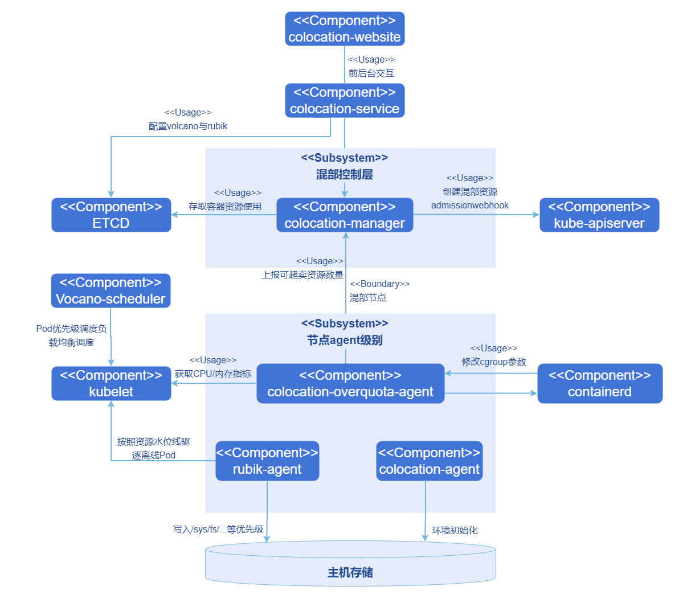
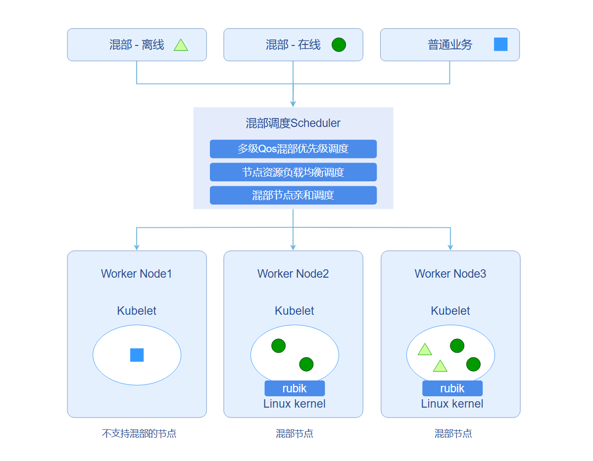
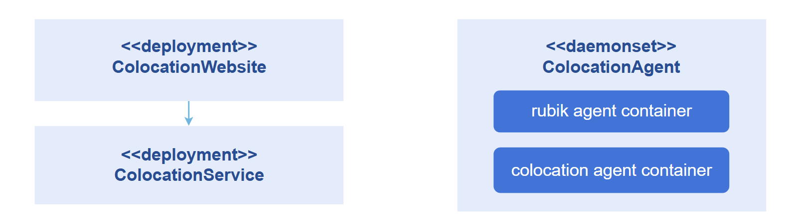
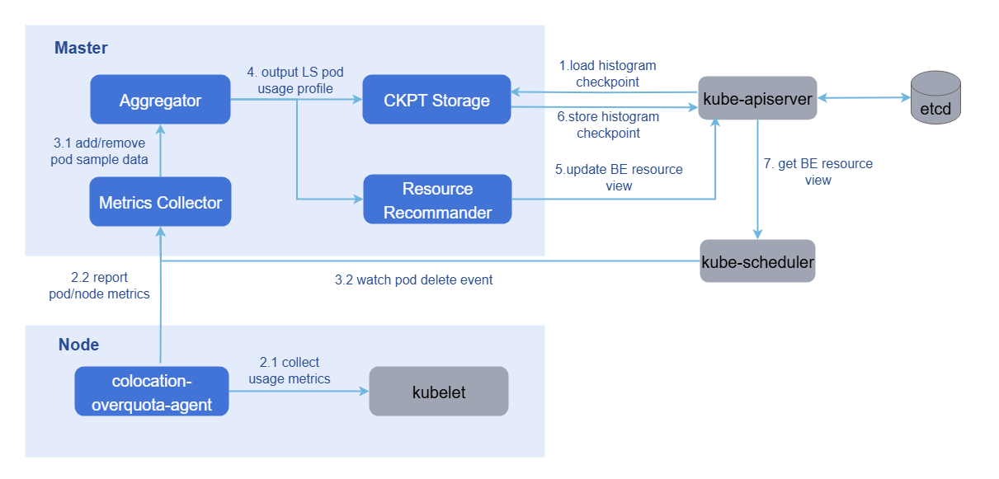
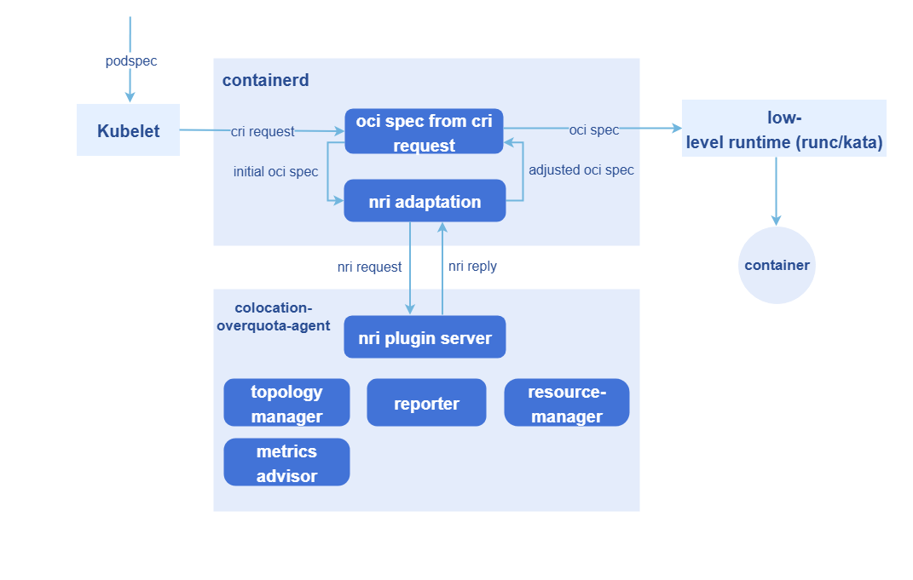

# 在离线混部

## 特性介绍

在云上业务类型和硬件资源越来越丰富的背景下，对云原生系统提出了更高的管理要求，例如资源利用率问题，服务质量保障问题等等。为了让多样性业务和算力混部系统以更优状态运行，各种在离线业务混部解决方案应运而生，在openFuyao在离线混部和资源超卖的解决方案中，包括以下功能。

- 业务多QoS分级管理。
- 业务特性感知调度。
- 混部节点管理。
- 混部策略配置。
- 节点超卖资源管理和上报。
- 基于NRI机制的无侵入混部Pod创建和cgroup管理。
- 单机混部引擎（rubik）和内核隔离技术多层次优化系统。

### 应用场景

用户在部署工作负载时，需要根据工作负载的特性决定该工作负载的QoS分级。调度器会将该工作负载添加必要的混部信息后调度到混部或非混部节点上，以满足用户对混合部署的诉求。用户还可通过统一的混部配置管理统管混部调度、混部节点。

### 能力范围

+ 支持对不同QoS分级业务的优先级调度和负载均衡调度。
+ 支持单机上在线业务对离线业务的cpu和memory的QoS压制。
+ 支持单机上基于cpu/memory的水位线对离线业务进行驱逐重调度。
+ 支持CPU弹性限流、内存异步回收、访存带宽限制和PSI干扰检测等高级混部特性。
+ 支持混部资源监控查看。

### 亮点特征

+ 业界领先的在离线业务混合部署和资源超卖解决方案。支持在线/离线业务混合部署，保障在线业务在使用高峰时期的调度，同时使能离线业务在在线业务低谷时期使用超卖资源提升集群的资源利用率。
+ 对业务进行多QoS的分级，在线业务（HLS高优绑核在线业务，LS低优在线业务）以及离线业务（BE使用超卖资源的业务）。在调度层面保障高优先级任务可抢占低优先级任务，同时支持离线业务驱逐保证离线业务可不会被高利用率的在线业务长时间抢占资源。单机上支持对HLS在线业务进行绑核，对LS在线业务进行NUMA亲和调度。

### 使用限制

本特性与NUMA亲和调度、NPU Operator都使用到了volcano，他们的版本都是1.9.0。若提前装了NUMA亲和调度或者安装NPU Operator组件时已经开启了`vcscheduler.enabled`或者`vccontroller.enabled`，则无需再手动安装volcano，在参考安装章节的[前提条件](#前提条件)中安装的volcano-scheduler-configmap进行配置后可一同使用。

### 功能依赖说明

在离线混部各功能对硬件和操作系统的依赖情况如下。

#### 单机混部引擎（rubik）

| 功能 | 硬件依赖 | OS依赖 |
| --- | --- | --- |
| CPU压制 | 无 | openEuler 22.03 LTS及以上（内核5.10.0-60.139.0.166及以上） |
| 内存压制 | 无 | openEuler 22.03 LTS及以上（内核5.10.0-60.139.0.166及以上） |
| CPU弹性限流 | 无 | openEuler 22.03 LTS及以上（内核5.10.0-60.139.0.166及以上） |
| PSI指标干扰检测 | 无 | openEuler 22.03 LTS及以上（内核5.10.0-60.139.0.166及以上） |
| dynCache（访存带宽限制） | 物理机（x86/ARM均可） | openEuler 22.03 LTS SP3及以上（内核5.10.0-182.0.0.95及以上） |
| dynMemory（内存异步回收） | 无 | openEuler 22.03 LTS SP3及以上（内核5.10.0-182.0.0.95及以上） |
| 离线负载干扰检测驱逐 | 无 | 无 |

#### 混部调度

| 功能 | 硬件依赖 | OS依赖 | 其他依赖 |
| --- | --- | --- | --- |
| 优先级和负载感知调度 | 无 | 无 | — |
| 资源超卖管理 | 无 | 无 | containerd >= 1.7 |
| NUMA亲和策略 | 无 | 无 | — |
| 混部监控 | 无 | 无 | — |

#### 涉及的配置文件路径

各功能在运行时涉及的主要配置文件及路径如下：

- kubelet配置：`/var/lib/kubelet/config.yaml`
- containerd配置：`/etc/containerd/config.toml`
- rubik相关配置及挂载路径：
  - `/sys/fs/cgroup/`
  - `/sys/fs/resctrl/`
  - `/etc/kubernetes/node-feature-discovery/features.d/`
  - `/proc/sys/vm/memcg_qos_enable`
  - `/dev`（仅用于blkio）
  - `/run/rubik`（保证每个节点中只有一个rubik进程运行）

### 实现原理

在离线混部组件从功能和部署形态上分成两部分。

1. 混部控制层负责混部组件统一管理。

    - 全局配置面：提供全局的混部配置，包括混部节点的开启，混部引擎驱逐水位线配置以及调度器负载均衡调度时调度阈值的设定。
    - 准入控制：提供混部负载的准入控制器，对标有各层级的QoS的注解的负载进行规则检查，并添加混部调度必备的资源项（调度器、优先级、亲和标签等信息）。
    - 超卖资源的统一管理：接收超卖资源Agent采集的指标，定期将各节点以及各节点上Pod的资源使用情况更新至Checkpoint的CRD中，同时周期性更新节点资源中的可超卖资源总量。
    - REST API服务：提供对接可视化界面的RestApi服务。
    - 混部监控：提供混部监控统一可视化界面。

2. 节点Agent以DaemonSet的形式部署在Kubernetes集群中，用于支持混部场景下的资源超卖，支持精细化的资源管理策略注入等。

    - 超卖Agent：实现资源指标采集，使用histograms来统计和预测工作负载的资源使用细节，构建应用的资源画像；实现资源超卖的上报，通过应用的资源画像，预测Pod资源的实际使用情况，回收已分配但未使用的资源，并上报统一管理面。
    - 混部Agent：rubik混部引擎以及额外对接内核接口开启/关闭rubik特性的功能。
    - 超卖资源nri plugin: 使用containerd的nri机制在容器不同的生命周期内注入精细化的资源管理策略。

**图 1** 在离线混部和资源超卖解决方案示例图



考虑到openFuyao整个调度框架的建设，同时也为了openFuyao混部后续多QoS分级的建设，openFuyao引入三层分级的QoS保障模型，将在线业务细分为HLS(high-latency-sensitive)和LS(latency-sensitive)两类，离线业务标记为BE(best-effort)类别，具体如下。

**表 1** 工作负载三级QoS分级

| QoS                         | 特点                                                         | 场景           | 说明                                                                                                                                                                        | K8s QoS              |
| --------------------------- | ------------------------------------------------------------ | -------------- |---------------------------------------------------------------------------------------------------------------------------------------------------------------------------| -------------------- |
| HLS（High Latency Sensitive）| 对时延、稳定性有严格要求。不进行超卖，预留资源以获得更好的确定性。 | 高要求在线业务 | 对应社区的Guaranteed，在开启节点kubelet绑核功能时，cpu核被绑定，在准入中要对cpu和memory的request和limit做检查，要求cpu和memory的requests和limits均存在且分别相等，同时cpu的requests为**整数**(Core)，确保HLS标记的Pod对应Guaranteed独占类型。 | Guaranteed           |
| LS（Latency Sensitive）      | 共享资源，对突发流量有更好的弹性。                             | 在线业务       | 微服务工作负载的典型QoS级别，实现更好的资源弹性和更灵活的资源调整能力。                                                                                                                                     | Guaranteed/Burstable |
| BE（Best Effort）             | 共享资源，资源运行质量有限，甚至在极端情况下被强制删除。           | 离线业务       | 批量作业的典型QoS水平，在一定时期内稳定的计算吞吐量，低成本资源，只使用超卖资源。                                                                                                                                | Besteffort           |

集群中的节点规划分为混部节点和非混部节点。一般情况下，在线业务和离线业务部署在混部节点上，普通业务部署在非混部节点上。混部调度器根据当前要部署的业务属性以及集群中节点的混部属性，合理调度当前业务到适当的节点上。在不同QoS级别的负载会对应到不同的负载PriorityClass级别，在进行调度时，混部Scheduler会在调度队列层依照负载PriorityClass进行优先级调度/抢占，确保高优先级任务在调度层级得到优先保障；另一方面，在选择调度节点时，混部Scheduler也会根据每个节点的CPU和内存的真实使用率进行打分，将负载调度到综合CPU和内存使用较低的节点上，最大限度避免节点过热情况。

**图 2** 在离线混部调度示例图



在离线混部组件主要由混部调度器、混部统一管理组件、单机混部引擎、超卖资源上报/管理组件以及NRI插件构成。组件混部调度器当前依托volcano调度器实现，单机混部引擎通过rubik集成。混部统一管理组件主要构成如下：

- colocation-website：以Deployment形式部署在集群中。在离线混部前台界面设计，包括混部统计可视化、混部节点管理、混部调度配置管理等。
- colocation-service：以Deployment形式部署在集群中。对外提供sevice服务接口，包括混部监控信息接口，混部节点管理的添加、移除，混部调度策略配置。
- colocation-agent：以Daemonset形式部署在集群中。主要负责在混部节点上打开内存QoS管理开关。

**图 3** 在离线混部模块设计及部署视图<br />


混部引擎和超卖资源管理系统由统一的colocation-management仓库提供：

+ colocation-overquota-agent：以DaemonSet形式部署在集群超卖节点上。单机Agent负责从kubelet得到node和Pod的资源采样数据并上报Master组件。同时集成rubik混部引擎，提供CPU弹性限流、内存异步回收、访存带宽限制、PSI干扰检测等高级混部特性。
+ colocation-manager：以Deployment形式部署在集群中。包含超卖Master从采样数据中刻画出每台节点上的在线Pod的资源使用画像，再结合系统配置参数和超卖公式，将BE可分配资源量更新到node对象上。同时提供混部工作负载的准入控制器功能。

**图 4** 节点资源超卖上报和管理



超卖Pod创建和cgroup管理利用NRI机制在容器多个生命周期执行自定义逻辑：

- 借助NRI机制在Pod和容器的生命周期hook期间添加自定义逻辑。
- 借助NRI reply完成对容器oci spec的修改。
- 通过NRI UpdateContainer完成对实际资源的修改。

整个过程涉及两个工作负载：

+ colocation-manager：以Deployment形式部署在集群中。混部工作负载的准入控制器，负责在混部工作负载准入阶段校验工作负载的配置是否对应QoS级别下的资源设置要求，拒绝掉不符合条件的混部负载。同时添加混部调度必备的资源项（调度器、优先级、亲和标签等信息）
+ colocation-overquota-agent：以DaemonSet形式部署在超卖节点上。利用上述NRI机制完成对实际资源的修改。

**图 5** 基于NRI机制的无侵入超卖Pod创建和cgroup管理



### 与相关特性的关系

依赖资源管理模块提供下发工作负载的接口，依赖Prometheus提供监控能力。

### 相关实例

代码链接：<br />
[openFuyao/colocation-website (gitcode.com)](https://gitcode.com/openfuyao/colocation-website) <br />
[openFuyao/colocation-service (gitcode.com)](https://gitcode.com/openfuyao/colocation-service) <br />
[openFuyao/colocation-management (gitcode.com)](https://gitcode.com/openFuyao/colocation-management) <br />

## 安装

### 前提条件

1. 已部署Kubernetes v1.21版本及以上、containerd v1.7.0版本及以上，kube-prometheus v1.19版本及以上。

2. openFuyao的混部调度器选择的是`volcano-scheduler`在使用时需要预先在Kubernetes中通过helm提前进行安装。目前在1.9.0版本进行了全量测试，功能上晚于1.9.0的预期可以正常使用，用户可以选择部署，但暂不保证功能正确性。

   2.1 通过helm安装volcano-scheduler

      ```shell
       helm repo add volcano-sh https://volcano-sh.github.io/helm-charts
       helm repo update
       helm install volcano volcano-sh/volcano --version 1.9.0 -n volcano-system --create-namespace
      ```

   > **说明：**<br />
   > 如果已经在openFuyao上安装了NUMA亲和调度组件，此时volcano组件会被默认安装，此时无需再通过helm进行前置安装。

   2.2 修改volcano-scheduler默认配置

      ```shell
       kubectl edit cm -n volcano-system volcano-scheduler-configmap
      ```

   主要修改如下注释部分:

   ```yaml
   apiVersion: v1
   data:
     volcano-scheduler.conf: |
       actions: "allocate, backfill, preempt" # 确保actions类别和顺序
       tiers:
       - plugins:
         - name: priority             # 确保tiers[0].plugins[0]中开启优先级调度
         - name: gang
           enablePreemptable: false
           enableJobStarving: false   # 确保关闭 enableJobStarving
        ...
   kind: ConfigMap
   metadata:
       meta.helm.sh/release-name: volcano
       meta.helm.sh/release-namespace: volcano-system
     labels:
       app.kubernetes.io/managed-by: Helm
     name: volcano-scheduler-configmap
     namespace: volcano-system
   ```

   > 提示：<br />
   > 与npu-operator同时部署时，npu-operator可能会自动修改volcano-scheduler.conf，覆盖关键项（例如移除actions中的 "preempt"，或更改tiers.plugins.gang.enablePreemptable）。请在安装/升级npu-operator后，重新检查并按本节要求恢复配置：确保actions包含 "preempt"，且enablePreemptable: false。

3. openFuyao的混部引擎需要操作系统内核至少在4.19及以上，具体各项混部功能是否可以开启可以参见界面上**混部策略配置**中的**混部能力支持**模块。

   > **说明：**<br />
   > 在离线混部的完整功能在openEuler 22.03 LTS-SP3版本上做了详细的验证，对于其它更新版本，您可以选择部署，但暂不保证功能正确性。

4. 开启kubelet绑核和NUMA亲和策略。

   > **说明：**<br />此功能是为了配合QoS-level为HLS级别Pod开启绑核。只有当kubelet的static策略开启时，HLS级别的Pod才会具有独占性和NUMA亲和性，提升HLS业务的性能表现。

   使用该模块时，需要修改Kubelet的Config文件，具体配置步骤如下所示:

   4.1 打开kubelet配置文件。

      ```  shell
       vi /etc/kubernetes/kubelet-config.yaml
      ```

   > **说明：**<br />
   > 如果上述位置没有config文件，可以在`/var/lib/kubelet/config.yaml`位置找到。

   4.2 新增或修改配置项。（修改static策略时要同时配置预留cpu）

     ```yaml
     cpuManagerPolicy: static
     systemReserved:
       cpu: "0.5"
     # 注：当节点cpu核数较少时，kubeReserved开启可能会导致节点可用cpu不足，kubelet有崩溃风险，请谨慎开启
     kubeReserved:
       cpu: "0.5"
     topologyManagerPolicy: xxx # best-effort / restricted / single-numa-node
     ```

   4.3 修改应用。

     ```
     rm -rf /var/lib/kubelet/cpu_manager_state
     systemctl daemon-reload
     systemctl restart kubelet
     ```

   4.4 查看kubelet运行状态。

     ```
     systemctl status kubelet
     ```

   kubelet运行状态为running，则表示成功。

5. 混部节点开启containerd的nri扩展功能。

   5.1 在混部节点上，进入`vi /etc/containerd/config.toml`，搜索是否有[plugins."io.containerd.nri.v1.nri"]。

   5.2 如果有，则将disable=true改为disable=false。如果没有，则在[plugins]下增加：

      ```
       [plugins."io.containerd.nri.v1.nri"]
      
          disable = false
      
          disable_connections = false
      
          plugin_config_path="/etc/nri/conf.d"
      
          plugin_path="/opt/nri/plugins"
      
          plugin_registration_timeout="5s"
      
          plugin_request_timeout = "2s"
      
          socket_path="/var/run/nri/nri.sock"
      ```

   5.3 配置完成，执行如下命令重启containerd。

      ```shell
       sudo systemctl restart containerd 
      ```

### 开始安装

1. 在openFuyao平台左侧导航栏选择“应用市场 > 应用列表”，进入“应用列表”界面。
2. 勾选左侧类型“扩展组件”，查看所有扩展组件。或在搜索框中输入“colocation-package”。
3. 单击“colocation-package”卡片，进入在离线混部扩展组件“详情”界面。
4. 单击“部署”进入“部署”界面。
5. 输入应用名称、选择安装版本和命名空间。
6. 在参数配置的“Values.yaml”中输入要部署的values信息。
7. 单击“部署”完成部署。
8. 单击左侧导航栏的“扩展组件管理”管理该组件。


### 独立部署

相比于应用市场安装部署，本组件提供了独立部署功能，步骤如下：

> **说明：**<br />
> 独立部署时仍需要提前部署Kubernetes v1.26版本及以上、prometheus、containerd、volcano v1.9.0。

1. 拉取镜像。

   ```shell
   helm pull oci://cr.openfuyao.cn/charts/colocation-package --version xxx
   ```

   将其中的xxx替换成需要拉取的helm镜像版本，例如：0.13.0

2. 解压安装包。

   ```shell
   tar -zxvf colocation-package-xxx.tgz
   ```

3. 关闭openFuyao及Oauth开关。

   ```shell
   vi colocation-package/values.yaml
   ```

   将`colocation-website.enableOAuth`以及`colocation-website.openFuyao`选项改为false。

4. 将service设置为NodePort类型。

   ```shell
   vi colocation-package/values.yaml
   ```

   修改`colocation-website.service.type`为`NodePort`

5. 对接promtheus。

   ```shell
   vi colocation-package/values.yaml
   ```

   独立部署时需要集群中已经安装好监控组件，修改`colocation-service.serverHost.prometheus`字段为当前集群中的prometheus暴露的指标查找地址和端口即可，例如：`http://prometheus-k8s.monitoring.svc.cluster.local:9090`。

6. 独立安装。

   ```
   helm install colocation-package ./
   ```

7. 访问独立前端。

   可通过浏览器输入“http://*管理面的客户端登录IP地址*:30880”访问独立前端。

## 查看概览

在openFuyao平台的左侧导航栏“算力优化中心”中选择“在离线混部 >概览”，进入在离线混部的“概览”界面，界面展示了在离线混部的工作流。

### 前提条件

已在应用市场部署“colocation-package”扩展组件。

### 背景信息

查看在离线混部的工作流，包括环境准备、混部策略配置、工作负载部署、在离线混部监控。

### 使用限制

无。

### 操作步骤

单击“在离线混部 > 概览”，进入“概览”界面。

- “环境准备”包含了开启节点在离线混部功能需要修改kubelet、containerd配置，单击展示配置方法。
- “混部策略配置”可单击说明后的“配置混部策略”跳转至混部策略配置界面。
- “工作负载部署”是实际使用调度功能进行工作负载调度，单击“部署工作负载”可跳转至工作负载部署界面。
- “在离线混部监控”展示了集群级混部和节点级混部的健康监控的信息，单击“查看在离线混部监控”可跳转至混部监控界面。

## 使用混部策略配置

在openFuyao平台界面的左侧导航栏“算力优化中心”中选择“在离线混部 > 混部策略配置”，进入“混部策略配置”界面，此界面展示了集群中混部相关的节点列表信息，提供了混部参数配置窗口，同时支持在节点列表中打开或者关闭节点的混部标签，帮助实现集群资源的均衡分配和稳定运行。

### 打开或关闭节点的混部标签

#### 背景信息

用户需要改变指定节点的混部标签状态。

#### 使用限制

改变节点的混部标签后部署业务需满足对应要求，请合理规划集群中节点的混部能力。

#### 操作步骤

单击混部节点列表中节点对应“开启混部节点”列的开关，切换开启或关闭节点混部能力的状态。

界面弹出“节点xxx已开启混部功能”或者“节点xxx已关闭混部功能”表示切换成功。

> **说明：**<br />
> - 对已经运行中的Pod，节点标签变化通常不会触发即时迁移；该行为仅影响后续调度的新Pod。
> - 关闭混部节点时，建议移除`node.openfuyao.com/colocation`标签键，而不是仅把值改成`false`，避免后续调度出现标签语义歧义。

### 使用混部策略参数配置

#### 背景信息

此界面提供了负载感知调度、离线负载水位线驱逐以及高级混部特性的参数配置功能。您可以设置CPU和内存的真实负载阈值，控制新工作负载的调度策略，避免节点过载。配置离线负载水位线驱逐后，当节点资源使用率超过设定水位线时，自动触发离线作业驱逐以释放资源。

高级混部特性包括：

- **CPU弹性限流**：当节点负载较低时，允许LS级别Pod动态突破CPU限制，负载升高时自动收敛。
- **内存异步回收**：基于不同QoS级别分级回收内存，优先回收BE级别Pod的内存。
- **访存带宽限制**：通过硬件技术限制BE级别Pod对内存带宽和CPU缓存的占用。
- **PSI干扰检测**：基于系统压力指标自动检测并驱逐干扰在线业务的离线Pod。

#### 使用限制

- 负载感知调度阈值范围为0-100%，默认设置为60%以平衡资源利用率和稳定性。
- 已运行的工作负载不受阈值调整影响。
- 离线负载水位线驱逐阈值范围为0-99%，仅影响离线作业，关键在线业务不受影响。驱逐过程可能导致短暂服务波动。
- **高级混部特性限制**：
  - CPU弹性限流和内存异步回收需要cgroup v2支持，建议使用openEuler 22.03 LTS SP3及以上版本。
  - 访存带宽限制需要硬件支持（Intel RDT或ARM MPAM），仅在物理机环境生效。
  - 部分特性需要特定内核接口，系统会自动检测节点支持情况。

#### 操作步骤

1. 在“混部策略配置”界面混部节点列表的右上方单击“混部策略参数配置”。

2. 弹窗单击“负载感知调度”和“离线负载水位驱逐”或者其他高级混部特性的对应开关。

   > **说明：**<br />
   > - "负载感知调度"和"离线负载水位驱逐"开启后节点CPU和内存阈值默认均为60%，可按提示修改。
   > - 高级混部特性默认配置：
   >   - CPU弹性限流：负载高水位线默认为60%，警戒水位线默认为80%。
   >   - 访存带宽限制：L3缓存分配（低/中/高优先级）默认为20%/30%/50%，内存带宽分配默认为20%/30%/50%。默认所有离线Pod使用dynamic控制组，如需自定义控制组级别，可通过为Pod添加`volcano.sh/cache-limit: "low/mid/high"`注解指定。
   >   - PSI干扰检测：监控资源默认为CPU和内存，10秒平均压力阈值默认为5.0%。
   >   - 内存异步回收：无需额外参数配置，开启后自动生效。

3. 修改相应的配置参数、阈值后，单击“确定”保存更改。
   > **说明：**<br />
   > - 高级混部特性的开关状态会根据节点硬件和内核支持情况自动判断是否可用。
   > - 对于不支持的特性，开关会置灰并显示不支持的具体原因。
   > - 配置修改后约30秒内自动生效，无需重启相关组件。
   > - 关于访存带宽限制特性：系统默认配置dynamic控制组管理所有离线Pod，设置的低中高水位线参数仅在用户手动指定Pod控制组时生效。

## 部署不同QoS分级工作负载

本节用于自主测试验证。

### QoS分级依据

1. 混部QoS分级的入口是Pod注解`openfuyao.com/qos-level`，取值必须为`HLS`、`LS`、`BE`（大写）；使用Deployment等控制器时，应写在`spec.template.metadata.annotations`下。
2. `colocation-manager`的Webhook会处理Pod的`CREATE/UPDATE`请求；只有识别到上述QoS注解时，才会进入对应的混部校验和自动补全流程。
3. 仅靠`requests/limits`不会自动推断QoS级别；如果缺少QoS注解或取值无效，Pod会按普通Pod放行，不会应用混部增强逻辑。

### 必填项与自动补全项

| QoS级别 | 必填项（建议人工填写） | 准入校验要点 | 系统自动补全（Webhook） |
| --- | --- | --- | --- |
| HLS | `metadata.annotations.openfuyao.com/qos-level: "HLS"`；容器使用原生资源`cpu/memory` | 不能使用`kubernetes.io/be-cpu`、`kubernetes.io/be-memory`；每个容器（含Init）要求`cpu/memory`的`requests`和`limits`同时存在且分别相等；`cpu requests`必须是整数核（如`1000`、`2000`） | 自动补`spec.schedulerName=volcano`、`spec.priorityClassName=priority-hls`、混部节点亲和性 |
| LS | `metadata.annotations.openfuyao.com/qos-level: "LS"`；容器使用原生资源`cpu/memory` | 不能使用BE扩展资源；不能同时满足HLS三条件（CPU相等、内存相等、CPU整数核），否则会被当作“配置不符合LS”拒绝 | 自动补`spec.schedulerName=volcano`、`spec.priorityClassName=priority-ls`、混部节点亲和性、`volcano.sh/quota-turbo=true` |
| BE | `metadata.annotations.openfuyao.com/qos-level: "BE"`；容器使用扩展资源`kubernetes.io/be-cpu`、`kubernetes.io/be-memory` | 不能混用原生`cpu/memory`；至少要声明BE扩展资源（可写`requests`，也可只写`limits`） | 自动补`spec.schedulerName=volcano`、`spec.priorityClassName=priority-be`、混部节点亲和性、`openfuyao.com/extender-resource-cfg`、`volcano.sh/preemptable=true`；仅写`limits`时会自动补齐同值`requests` |

> **说明：**<br />
> - `spec.priorityClassName`可不手写；若手写，必须与QoS一致（如HLS对应`priority-hls`），不一致会被拒绝。
> - `spec.schedulerName`可不手写，Webhook会统一改为`volcano`。
> - 对BE扩展资源，`kubernetes.io/be-cpu`仅支持“整数”或“整数+k”写法（建议使用`1000`、`2000`、`1000k`这类写法），不支持`1500m`或小数写法。

### YAML示例

1. HLS示例（强保障）

```yaml
apiVersion: apps/v1
kind: Deployment
metadata:
  name: hls-demo
spec:
  replicas: 1
  selector:
    matchLabels:
      app: hls-demo
  template:
    metadata:
      labels:
        app: hls-demo
      annotations:
        openfuyao.com/qos-level: "HLS"
    spec:
      containers:
        - name: app
          image: nginx:1.25
          resources:
            requests:
              cpu: "2000"
              memory: "4Gi"
            limits:
              cpu: "2000"
              memory: "4Gi"
```

2. LS示例（弹性在线）

```yaml
apiVersion: apps/v1
kind: Deployment
metadata:
  name: ls-demo
spec:
  replicas: 1
  selector:
    matchLabels:
      app: ls-demo
  template:
    metadata:
      labels:
        app: ls-demo
      annotations:
        openfuyao.com/qos-level: "LS"
    spec:
      containers:
        - name: app
          image: nginx:1.25
          resources:
            requests:
              cpu: "1500"
              memory: "2Gi"
            limits:
              cpu: "2000"
              memory: "2Gi"
```

3. BE示例（离线超卖）

```yaml
apiVersion: apps/v1
kind: Deployment
metadata:
  name: be-demo
spec:
  replicas: 1
  selector:
    matchLabels:
      app: be-demo
  template:
    metadata:
      labels:
        app: be-demo
      annotations:
        openfuyao.com/qos-level: "BE"
    spec:
      containers:
        - name: app
          image: nginx:1.25
          resources:
            requests:
              kubernetes.io/be-cpu: "1000"
              kubernetes.io/be-memory: "2Gi"
            limits:
              kubernetes.io/be-cpu: "2000"
              kubernetes.io/be-memory: "4Gi"
```

### 快速验证

> **说明：**<br />
> 以下命令默认示例Pod部署在`default`命名空间；若使用其他命名空间，请在命令中补充`-n <namespace>`。

1. 确认Webhook在集群中可用。

```bash
kubectl get mutatingwebhookconfiguration colocation-manager-webhook
kubectl get pods -n openfuyao-colocation -l app.kubernetes.io/name=colocation-manager
```

2. 分别部署HLS/LS/BE示例。

```bash
kubectl apply -f hls-demo.yaml
kubectl apply -f ls-demo.yaml
kubectl apply -f be-demo.yaml
kubectl rollout status deploy/hls-demo
kubectl rollout status deploy/ls-demo
kubectl rollout status deploy/be-demo
```

3. 检查Webhook自动补全结果。

```bash
# 三类Pod都应为 volcano 调度，且 priorityClassName 与QoS一致
kubectl get pod -l app=hls-demo -o jsonpath='{.items[0].spec.schedulerName}{"\n"}{.items[0].spec.priorityClassName}{"\n"}'
kubectl get pod -l app=ls-demo  -o jsonpath='{.items[0].spec.schedulerName}{"\n"}{.items[0].spec.priorityClassName}{"\n"}{.items[0].metadata.annotations.volcano\.sh/quota-turbo}{"\n"}'
kubectl get pod -l app=be-demo  -o jsonpath='{.items[0].spec.schedulerName}{"\n"}{.items[0].spec.priorityClassName}{"\n"}{.items[0].metadata.annotations.volcano\.sh/preemptable}{"\n"}{.items[0].metadata.annotations.openfuyao\.com/extender-resource-cfg}{"\n"}'
```


## 使用混部监控

在openFuyao平台的左侧导航栏“算力优化中心”中选择“在离线混部 > 混部监控”，默认进入“集群级混部监控”界面，该界面展示了集群中混部相关的数据监控面板。

### 集群级混部监控

该界面提供了混部集群中的相关数据监控，包括混部节点信息、混部负载信息和集群中各资源使用量。

- 将鼠标悬停至对应监控指标的曲线图上，可以展示具体数据信息。

- 在每个图的“图例”部分，可以通过单击单个图例项选择是否在图中显示该数据，便于进行不同数据的对比。

### 节点级混部监控

单击“节点级混部监控”页签切换至节点级监控界面，可以查看节点混部数据信息，如每个节点使用的物理资源总量和HLS、LS、BE等类型的Pod使用资源量。

- 将鼠标悬停至对应监控指标的曲线图上，可以展示具体数据信息。

- 在每个图的“图例”部分，可以通过单击单个图例项选择是否在图中显示该数据，便于进行不同数据的对比。

- 在界面右上角的筛选框中，可以选中或者取消部分节点的展示。

## 开启NUMA亲和增强

### 前提条件

需要节点具备多NUMA架构，且NUMA亲和功能已在配置（configMap）中开启。

### 背景信息

在多NUMA节点的服务器上，跨NUMA节点的内存访问会带来较高的延迟，影响延迟敏感性（LS级别）业务的性能。通过开启NUMA亲和增强功能，使LS级别的Pod中的容器绑定到同一NUMA节点上，降低内存访问延迟，提高业务的稳定性。

### 使用限制

- 仅支持LS级别（低优先级在线业务）Pod，其他QoS级别（如HLS、BE）不受影响。

- 开启该功能后仅在Pod启动前拦截进行资源分配，不影响开启前的调度环节。

### 操作步骤

1. 已启用混部超卖功能。

   确认节点已开启混部，具体操作可参见[打开或关闭节点的混部标签](#打开或关闭节点的混部标签)的相关操作步骤。

2. 启用NUMA亲和性功能

   编辑ConfigMap启用NUMA功能：

   ```bash
   kubectl edit configmap colocation-config -n openfuyao-colocation
   ```

   将配置中的`numa-affinity-options`中的`enable`从`false`修改为`true`。

3. 等待30秒组件监控到配置改变后即可自动生效。

4. 部署应用。

   为需要NUMA亲和性的Pod添加LS级别注解。

   ```yaml
   annotations:
     openfuyao.com/qos-level: "LS"
   ```

5. 验证结果。

   功能开启后部署应用，系统会自动做如下操作。
    - 检测Pod的QoS级别。
    - 为LS级别的Pod选择最佳NUMA节点。
    - 将Pod的CPU使用限制在选定的NUMA节点内。

   可以通过查看组件日志确认功能正常工作：

  ```bash
  kubectl logs -n openfuyao-colocation -l app.kubernetes.io/name=colocation-overquota-agent
  ```

看到出现"Successfully applied NUMA affinity for LS pod"的日志表示功能正常工作。

> **说明：**
>
> - 如果单个NUMA节点资源不足，系统会自动选择其他合适的节点。
> - HLS和BE级别的Pod不受NUMA亲和性影响，按原有策略处理。
