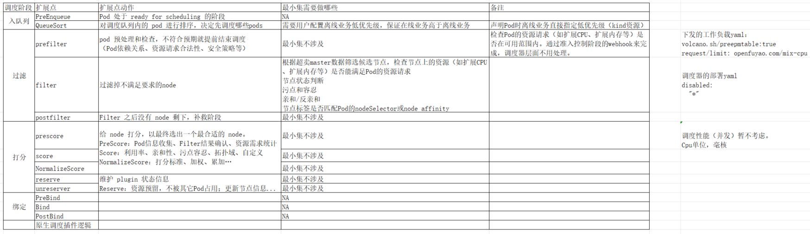
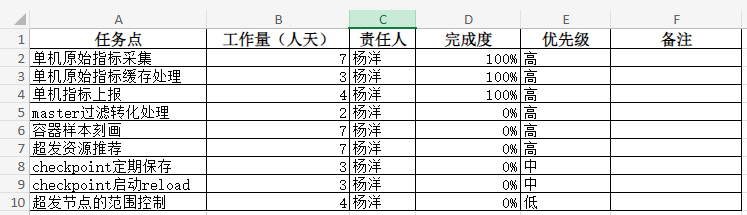
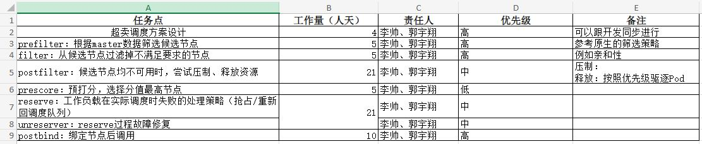
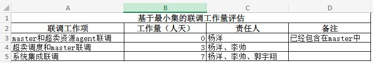
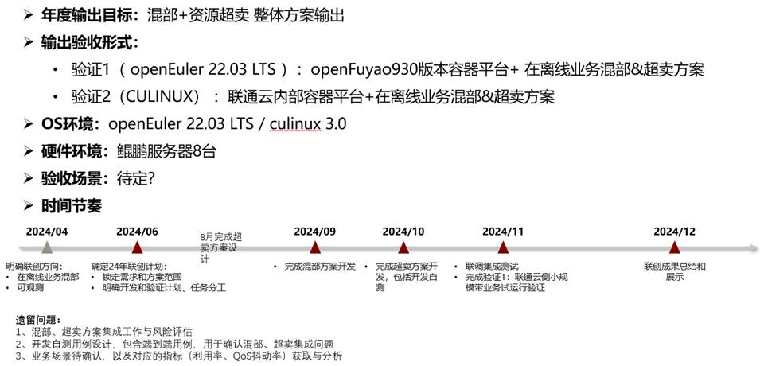

# SIG Colocation Meeting Notes

## 2024/11/25
- 与会人  
    张建津、郭宇翔、李帅、杨洋、陈伦、李哲伟、吴景、张超、李晓峰  
    
- 会议结论  
    * 遗留问题均已闭环。  
    * 开放原子开源基金会议题申报。  
        1、议题题目和演讲内容跟openEuler Summit 2024 保持一致。  
        2、作为单独议题申报，不跟volcano和NUMA亲和合并。  
        3、已经申报，等待结果。  
    * 测试策略  
	    1、功能化测试：华为主导，开发的串讲、测试例的审核  
	    2、场景化测试：联通云主导，建议安装openFuyao测试，环境安装华为搞  
	    3、测试计划：环境搭建（直接使用华为环境、联通云提供机器+华为安装openFuyao）、测试例设计、测试例执行、问题定位、测试结论。  
    * 超卖调度  
	    1、超卖最小集，默认所有节点运行oss-agent daemonset，所有节点可以超卖。  
	    2、noderesourceFit基本满足当前最小集诉求。  
	    3、将来结合更广泛的调度诉求，扩展超卖调度器能力。  

- 遗留问题  
    * 测试人员协调 —— 张建津  
	* 安排开发串讲 —— 李帅  
	* 邮件列表更新，李晓峰 —— 李帅  
	* 代码提交 —— 郭宇翔  

## 2024/11/18
- 与会人  
    王琦、张建津、郭宇翔、李帅、杨洋、陈伦、李哲伟、吴景、张超、潘捷  
    
- 会议结论  
    * 超卖资源管理内部联调OK。  
    * 超卖Pod管理内部联调基本OK，有个别问题需要本次会议讨论裁决。  
    * 扩展资源前缀问题：  
        问题描述：当前使用openfuyao.com/xxx作为扩展资源名称的前缀，但是这样K8s要求资源request和limit必须一致，否则Pod创建失败。  
        讨论结论：按照K8s建议规范，前缀采用kubernetes.io/xxx作为扩展资源前缀。  
    * NRI socket问题  
        问题描述：containerd重启的场景，NRI socket会断连，且从用户层面没有任何报错或提示。  
        讨论结论：containerd重启的场景，NRI socket应该刷新，NRI stub timeout应该在onclose的时候，restart重新建连。在socket断连期间创建的Pod（没有走NRI接口）需要想办法把这些Pod的cgroup文件修改为预期值，这个具体方案暂时未定，定时轮询作为备选。  
    * 目前hook仅仅是写入Pod cgroup file，未修改container cgroup file。  
        讨论结论：非问题，保持当前实现。  
    * 超卖调度任务梳理：  
    

- 遗留问题  
    * 邮件列表添加李哲伟和陈伦。  
    * 资源超卖仓库名称设置，采用“超卖简称+后缀”的方式，具体字符串需要确定。  

## 2024/11/11
- 与会人  
    王琦、张建津、郭宇翔、李帅、杨洋、张超、潘捷  

- 会议结论  
    * 超卖Pod管理部分，当前实现可以支撑最小集功能。目前还差cgroup文件冲突处理未完成。  
    * 超卖资源管理部分，agent已经开发完成，master基本开发流程意见打通，其它细节正在调试。  
    * openEuler Summit 2024云原生分论坛演讲材料审核。  

## 2024/10/28
- 与会人  
    线下meetup，会议地点：联通数科  
    王琦、张建津、郭宇翔、李帅、杨洋、潘捷、陈伦、王清珺、朱雪怡、郑钦文  

- 会议结论  
    * openEuler Summit 2024云原生分论坛演讲材料准备思路和任务划分。
        李帅负责背景介绍、总体解决方案和混部解决方案介绍，张建津负责资源超卖和案例部分介绍。
    * 项目最小集及工作量梳理  

## 2024/10/21
- 与会人  
    王琦、张建津、郭宇翔、李帅、杨洋、蔡舒豪、张超  

- 会议结论  
    * 资源超卖agent部分进展：  
        杨洋负责部分代码待合入仓库，同时go mod使用go 1.21版本；  
        宇翔负责部分NRI代码未完成，另外还需超卖安装部署启动，预计25号之前完成。挑战1030之前完成agent功能联调。  
    * master部分11月中旬完成，杨洋负责。  
    * 超卖调度部分计划11月启动。  
- 遗留问题  
    * 依赖梳理，确定联调时间。  
    * 确定基于典型场景的测试例，用于年终演示。  

## 2024/10/14
- 与会人  
    张建津、郭宇翔、李帅、杨洋、蔡舒豪、潘捷、吴景、谢足岳、宋立昂  

- 会议结论  
    * 资源超卖agent部分进展：杨洋代码OK；NRI代码未完成，另外还需超卖安装部署启动，预计20号之前完成。  
    * rubik网络隔离功能，预约时间跟openEuler内核团队负责网络隔离的同事交流，了解当前他们的诉求是否与我们契合。  
    * 编码规范相关文档完成之后发布到社区，到时根据规范进行代码规范性整改。  
- 遗留问题  
    * 整理混部和超卖特性的端口矩阵。  
    * go.mod中版本采用1.21，因为流水线后台编译时用的版本时1.21。  
    * kubernetes版本依赖确认。  

## 2024/09/30
- 例会暂停一次

## 2024/09/23
- 与会人  
    张建津、郭宇翔、李帅、张超、蔡舒豪、潘捷、郑钦文  

- 会议结论  
    * 超卖的准入控制和混部的准入控制，是否存在冲突。  
    * Init容器只要能保证运行就ok，可以暂时不考虑Init容器使用超卖资源。  
    * 一个Pod里同时存在原生资源和扩展资源，处理策略：直接webhook拒绝。  

## 2024/09/16
- 中秋节假期，sig组例会暂停一次。  

## 2024/09/09
- 与会人  
    王琦、杨洋、张建津、郭宇翔、李帅、张超、蔡舒豪、潘捷  

- 会议结论  
    * 资源超卖开发计划可以做细粒度分工，最好以人日或人周为单位规划工作量。  
    * topology管理，功能框架意见基本完成，根据业务继续实现。  
    * informer模块不用rubik的订阅机制。  
    * 混部和超卖的调度器，联合开发，9月底之前有初步选型方案。  

## 2024/09/02

- 会议结论  
    * 调度优先级，离线业务设置为负数。  
    * rubik不涉及驱逐。我们超卖也先不做驱逐，先参照rubik的OOM分级回收机制。  
    * 针对上次例会结论增加一条备注：  
      上次例会结论：preemptable标签/注解，先按照当前定义设计开发。之后混部和超卖讨论对其进行合理化改进。  
      本次例会加注：压制，preemptable标签/注解，从整体方案考虑。可以从我们上层业务诉求到rubik接口之间的映射。  
    * 相关会议材料已经上传至本目录docs文件夹下
 
- 遗留问题   
    * 联创的管理权限问题，找华兵讨论。  

## 2024/08/26

- 会议结论  
    * 网络隔离功能，目前看跟我们预期能力有差距，建议放低优先级，根据rubik能力及业务诉求评估我们的开发计划。后续对rubik社区能力提诉求，完善我们的诉求说明。  
    * 混部和超卖作为两个特性。  
    * premmptable标签/注解，先按照当前定义设计开发。之后混部和超卖讨论对其进行合理化改进。  
    * 超卖资源名称定义。openfuyao.com/oversubscription-cpu: 1000  
    * 离线不支持绑核。  
    * NUMA scheduler的时候，优先级看qos。  
 
- 遗留问题   
    * 舒豪加入混部+超卖仓库，给committer权限。—— 李帅  
    * 仓库管理员权限，跟王琦总汇报。—— 蔡舒豪  

## 2024/08/19

- 会议结论 & 下一步计划 
    * 整理对网络隔离的诉求，根据rubik当前网络隔离能力评估价值和优先级。  
    * 资源超卖设计评审。  
    * 资源超卖代码仓创建。  

## 2024/08/15

- 会议结论  
    * 资源超卖功能使用扩展资源进行超卖资源的统计和调度。  
    * 对客户暴露扩展资源还是原生资源。建议参考友商实现，暴露原生资源，在hook内部转换成扩展资源。  
    * 资源超卖设计原则，尽量避免对kubelet等K8s原生组件的侵入性修改。  
    * 资源超卖的调度、超卖资源画像管理、超卖agent等模块要合理划分，并明确模块之间的责任边界。  
    * 年度输出目标和路标节奏：  

 
- 遗留问题   
    * rubik代码fork到openFuyao社区，支撑网络隔离等特性的开发。——李帅
    * 代码编程规范输出进展跟踪。——李帅
    * rubik网络隔离只有出口流量隔离控制，收益待评估。通过收益来决定需求优先级。——张建津
    * 资源超卖模块间的责任边界要明确。——郭宇翔、杨洋

## 2024/08/05

- 会议结论&遗留问题  
    * rubik网络隔离专题培训。  
    * 资源超卖设计文档评审。  
    * 原生资源/扩展资源讨论。  
    * 需求列表导入社区，根据需求编号合入代码。  

## 2024/07/30

- 会议结论  
    * sig组和文件仓创建完成，开发者权限处理完成（个别有问题的已经单点处理完成）。  
    * 原则上对资源超卖总体设计思路没有异议。  
    * 资源超卖功能，需要考虑绑核场景。
    * 资源超卖功能在930之前完成agent部分，不过总体设计要端到端完成，包括调度逻辑。调度逻辑的设计要拉通讨论进行。
    * 节点的混部功能和超卖功能之间的关系，需要单独讨论。
 
- 遗留问题   
    * sig-colocation仓库目录结构设计，注意最好用英文。  
    * 筹备创建代码仓，评估是否需要单独针对colocation-agent单独建仓。  
    * 超卖资源统计上报，采用原生资源还是扩展资源，需要全流程梳理之后再讨论和决策。  

## 2024/07/22

- 会议结论  
    * 目前场景化验证用例和业务规格涉及客户等多方因素，暂未明确。闭环时间待定。  
    * 业务分级目前分两级，即在线和离线。根据类别汇总如下：  
        高实时性业务、普通业务、混部-在线、混部-离线  
        根据具体业务类型，暂时不做多级划分。之后如果有新的输入可以继续讨论。  
 
- 遗留问题   
    * openFuyao侧：  
        1、收集各开发人员的gitee账号和姓名、邮箱，汇总放到doc仓。  
        2、Git代码仓整理，包括设计文档等模板、联系方式归档、目录规划、例会材料等。  
        3、录屏信息安全风险确认  
    * 联通云侧：  
        1、下次SIG组例会输出资源超卖方案整体设计思路。  
        2、下次SIG组例会输出联创计划和关键节点路标。  

## 2024/07/16

- 会议结论  
    * 就在离线业务混部特性的任务分工达成一致：  
        1、openFuyao负责：前台界面、混部调度  
        2、联通云负责：QoS隔离保障（和Rubik协同）、资源超卖、业务级验证  
        3、双方各自负责对应条目的开发和集成
    * 运作机制：  
        1、为混部特性建立独立私仓，包括代码仓、资料仓等。双方在相同仓内共同开发，代码及资料相互可见。可根据实际需要增加特定私仓  
        2、例会机制：前期周例会，每周一下午进行。双方就方案设计、开发协同等细节紧密沟通  
        3、协作工具：微信群、邮件、会议工具等  
    * 业务级验证：  
        为完成年度联创目标，需针对目标典型业务场景，明确场景化验证用例和业务规格目标（如：CPU利用率 xx% -> yy%），以支撑业务级集成验证  
    * 大颗粒计划：  
        930集成版本ready，11月份完成业务级集成验证；Q4可同步启动第二阶段开发  

* 下一步计划   
    * openFuyao侧：  
        1、建立私仓，配置相关人员操作权限，满足开发需要  
        2、组织例会，对齐开发计划，评审关键方案设计  
        3、明确Rubik相关能力开发方式  
    * 联通云侧：  
        1、明确场景化验证用例和业务规格目标  
        2、明确阶段性开发计划  
    * 优先级多级管理的业务必要性评估  

