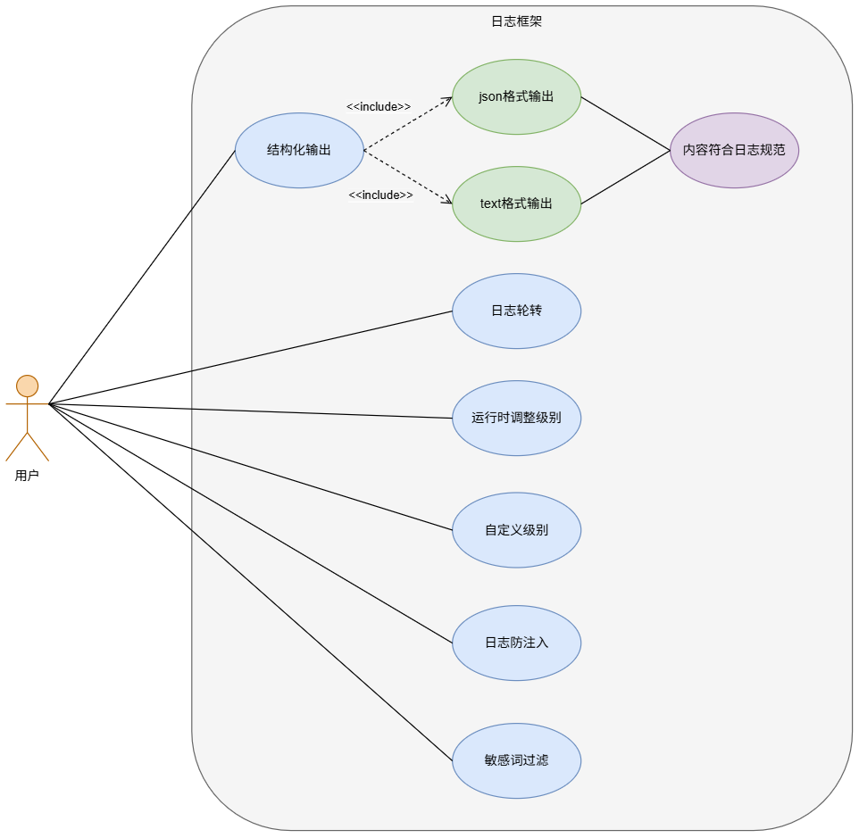
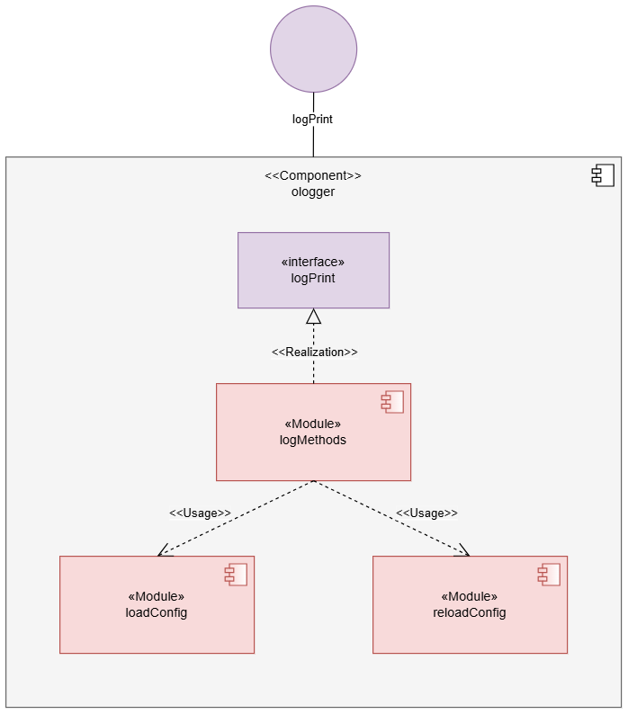

# ologger日志框架设计文档

## 概括

本项目旨在设计一个**通用化、可拓展的日志框架**，以统一支持社区各类组件的日志需求。在提供标准化、结构化的日志基础能力的同时，框架将保持灵活的扩展性，便于各组件根据自身场景进行定制化适配，实现日志功能的规范化管理与个性化输出。

## 动机

随着openFuyao社区生态的快速发展，其底层组件数量与复杂度持续攀升。当前，各组件采用高度个性化的日志实现方式，导致系统内部**日志格式碎片化、信息结构不统一**，为跨组件的运维诊断与日志分析带来了巨大障碍。同时，**现有的日志规范缺乏框架层面的强制约束与工具支持**，其执行完全依赖于开发者的个人理解，致使规范落地困难，系统可观测性建设与运维效率面临瓶颈。为保障社区在规模化协作下的长期健康发展，提升系统可维护性与问题排查效率，**构建一个统一、规范、高效的日志管理体系已成为当前亟待解决的核心基础设施需求。**

### 目标

提供一个日志框架，支持以下功能：

- **日志内容：**
    - 结构化输出，分为`json`格式输出和`text`格式输出
    - 包含日志级别，默认分为CRITICAL、ERROR、WARNING、INFO、DEBUG、TRACE六个级别
    - 包含时间，精确到秒，且可以配置时区（utc/local）
    - 包含打印日志的文件及行数信息
    - 包含当前进程的`pid`和当前主机的`ip`
    - 可拓展，可以根据具体记录的需求添加多个字段，以提供更加全面的信息

- **日志可轮转：**可根据日志文件最后修改日期和实际大小进行轮转
- **运行时调整级别**：可以在运行时动态调整日志内容输出级别
- **用户自定义级别：**日志框架支持用户自定义级别并将其注册到框架中，同时提供统一入口打印对应自定义级别的日志内容
- **日志防注入：**日志框架支持内容防注入，提高安全性
- **敏感词过滤机制：**日志框架支持敏感词过滤，同时允许用户自定义敏感词，保障信息安全

同时，本日志框架应尽量实现**简易日志库切换**，保证原仓库代码最小改动

### 非目标

从零打造完整日志库，完全自主研发所有满足社区日志规范的功能

## 提案

### 用户故事



- **结构化输出：**日志按指定格式输出，且可以按照开发特性要求增加键值对；日志内容将在控制台被打印，并被同步输出至指定路径下的日志文件（均可选，是否在控制台打印可通过`enable_console`配置项配置，是否输出至文件可通过`enable_file`配置项配置）

    - json格式输出：以json格式输出键值对

      ```json
      {"time":"2026-01-26T15:53:17+08:00","level":"INFO","source":{"function":"main","file":"main.go","line":40},"msg":"hello world\rhello world","pid":44248,"ip":"192.168.105.9","test":"hello world\nhello world"}
      ```

    - text格式输出：以text格式输出键值对

      ```text
      time=2026-01-26T17:05:46+08:00 level=INFO source=main.go:44 msg="你好\n你好" pid=121800 ip=192.168.105.9
      ```

- **日志轮转：**可根据日志文件最后修改日期和实际大小进行轮转

- **运行时调整级别：**可以在运行时动态调整日志内容输出级别

- **自定义级别：**用户可以根据开发特性要求自定义级别，并通过`custom_levels`配置项将其注册到`ologger`日志框架中

- **日志防注入：**防止攻击者通过`\n`等控制符破坏日志格式，构造虚假日志内容

- **敏感词过滤机制：**将敏感词字段对应的值进行模糊处理，同时允许用户自定义敏感词，保障信息安全

#### 故事1

当用户使用`ologger`日志框架时，可以在配置文件中设定选项以满足特性要求，配置文件示例如下：

```yaml
# ologger日志框架配置项
# 日志文件存储路径
path: bke.log
# 日志输出最低级别-默认为INFO
level: INFO
# 日志输出格式
format: json
# 时区
timezone: local
# 日志是否包含IP
include_ip: true
# 日志轮转-单个文件最大大小（MB）
max_size_mb: 100
# 日志轮转-保留的历史日志文件数量上限
max_backups: 30
# 日志轮转-日志文件的最大保留天数
max_age_days: 14
# 日志轮转-轮转后的旧日志是否压缩
compress: false
# 自定义级别
custom_levels:
  HINT: 1
  NIL: -9
  Fatal: 16
# 自定义清洗敏感词
sensitive_words:
  - secret

# ologger日志框架功能开关
# 日志是否输出至控制台
enable_console: true
# 日志是否输出至指定文件
enable_file: true
# 是否开启运行时动态调整日志级别
watch_level: true
# 清洗敏感词功能开关
enable_sanitize: true
```

与此同时，每一个配置项都有相对应的环境变量，可通过修改环境变量的值进行配置（并不支持动态调整级别时使用）

```powershell
export OLOGGER_CONFIG=/path/to/ologger.yaml
```

#### 故事2

当用户开启运行时动态调整日志级别后，通过修改配置文件中的`level`字段，可以实现运行时修改日志输出最低级别

### 逻辑视图



### 设计细节

#### 1、拓展日志框架

封装slog日志库，并拓展集成日志规范中需要实现的功能：

**1）日志轮转**

日志框架配置轮转参数，并调用`lumberjack`库实现具体功能

注：日志轮转配置项均有合理配置范围，具体如下：

```yaml
# 日志轮转-单个文件最大大小（MB）
max_size_mb: 100-10240
# 日志轮转-保留的历史日志文件数量上限
max_backups: 5-30
# 日志轮转-日志文件的最大保留天数
max_age_days: 1-14
# 日志轮转-轮转后的旧日志是否压缩
compress: true/false
```

若`compress`设定为`true`，每一个旧日志文件都会被压缩成`.gz`文件，以减少磁盘空间占用

**2）运行时调整级别**

通过`watch_level`配置项决定是否开启此功能，并在运行时通过调整`level`配置项来调整日志输出最低级别

注：如果`level`输入错误，默认不改变原配置，并打印`warning`日志；`level`默认配置为`INFO`级别，若首次配置`level`输入错误，`level`也会回退到`INFO`级别

```yaml
# 日志输出最低级别-默认为INFO
level: INFO
# 是否开启运行时动态调整日志级别
watch_level: true
```

提供修改日志level的接口，供应用程序调用：

```go
SetLevel(level string)
```

**3）用户自定义级别**

通过`custom_levels`配置项配置级别名称和等级，日志框架将自动完成对这些级别的注册

```yaml
# 自定义级别
custom_levels:
  HINT: 1
  NIL: -9
  Fatal: 16
```

注：

- 框架中默认级别如下，在自定义级别时不要发生等级冲突

```yaml
TRACE      →     -8
DEBUG      →     -4
INFO       →      0
WARNING    →      4
ERROR      →      8
CRITICAL   →      12
```

- 框架中自定义级别需通过统一入口打印日志

```go
log.Log(levelName string, msg string, args ...any)

log.Logf(levelName string, template string, args ...any)
```

- 框架中默认级别除统一入口外，还可以通过框架中集成的各级别特有的函数打印日志内容（此处以`INFO`级别为例）

```go
log.Info(msg string, args ...any)

log.Infof(template string, args ...any)
```

**4）日志打印**

- 打印至控制台，通过`enable_console`配置项配置

```yaml
# 日志是否输出至控制台
enable_console: true
```

- 打印至文件，通过`enable_file`配置项配置

```yaml
# 日志是否输出至指定文件
enable_file: true
```

注：

- 若开启打印至文件，但`path`为空，则回退至默认配置，输出至`bke.log`文件中
- 若`path`存在，则在日志文件不存在时会新建文件，否则自动创建目录和文件

#### 2、日志防注入

充分了解slog日志库已集成的功能及实现方式，确定slog日志库已支持对`\n`等控制符的转义，很好地支撑了日志防注入功能

#### 3、日志框架安全防护

**1）日志框架各配置项默认值**

```yaml
# ologger日志框架配置项
path: /var/log/bke.log
level: INFO
format: json
timezone: local
include_ip: true
max_size_mb: 100
max_backups: 30
max_age_days: 14
compress: true
custom_levels:
  HINT: 1
  NIL: -9
  Fatalf: 16
sensitive_words:
  - secret

# ologger日志框架功能开关
enable_console: true
enable_file: true
watch_level: true
enable_sanitize: true
```

配置生效级别：配置文件配置 > 环境变量配置 > 默认值

**2）文件权限**

配置文件权限为`644`，日志文件权限也为`644`，新建日志文件目录权限为`755`

- 若配置文件`chmod`执行异常，则会打印一条`warning`日志，配置将完全回退至默认值（或环境变量配置）
- 若日志文件`chmod`执行异常，错误将被忽略，日志正常写入，不影响程序运行

**3）配置项值异常**

提供`warning`日志信息：

```json
{"time":"2026-02-03T15:12:03+08:00","level":"WARNING","source":{"function":"doSlow","file":"C:/Program Files/Go/src/sync/once.go","line":78},"msg":"ologger config invalid, using default value","pid":104256,"ip":"192.168.105.9","item":"format","default":"json"}
```

**4）敏感词过滤机制**

- 默认过滤常见敏感词`pwd`、`passwd`、`password`，采用正则表达式进行匹配和内容清洗
- 提供敏感词自定义配置项`sensitive_words`，提供特性敏感词清洗
- 设置敏感词过滤功能开关`enable_sanitize`，在不需要该功能时及时关闭，提高日志框架性能
- 敏感词清洗大小写不敏感

示例如下：

```json
{"time":"2026-02-02T19:45:42+08:00","level":"INFO","source":{"function":"main","file":"main.go","line":48},"msg":"the PassWord=****** is correct","pid":136360,"ip":"192.168.105.9","Secret":"******"}
```

**5）其他注意事项**

- 在磁盘满的场景下自动关闭日志写入文件功能，防止机器重启影响业务

- 日志文件删除后，应及时新建对应文件，保证日志框架可用性

#### 4、兼容操作日志、审计日志

本日志框架将兼容openFuyao社区操作日志和审计日志，提供统一日志操作