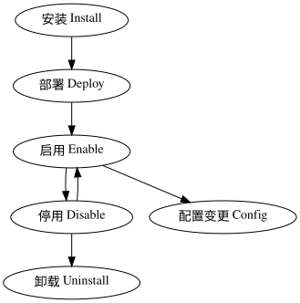

<!--
**Note:** When your OFEP is complete, all of these comment blocks should be removed.

** 你可以使用中文书写 ofep, 但请将模版中所有的英文层级标题保留。**

To get started with this template:

- [ ] **Make a copy of this template directory.**
  Copy this template into the owning SIG's directory and name it
  `NNNN-short-descriptive-title`, where `NNNN` is the gitee issue number (with no
  leading-zero padding) assigned to your enhancement above.
- [ ] **Fill out this file as best you can.**
  At minimum, you should fill in the "Summary" and "Motivation" sections.
  These should be easy if you've preflighted the idea of the OFEP with the
  appropriate SIG(s).
- [ ] **Create a PR for this OFEP.**
  Assign it to people in the SIG who are sponsoring this process.
- [ ] **Merge early and iterate.**
  Avoid getting hung up on specific details and instead aim to get the goals of
  the OFEP clarified and merged quickly. The best way to do this is to just
  start with the high-level sections and fill out details incrementally in
  subsequent PRs.

When editing OFEPS, aim for tightly-scoped, single-topic PRs to keep discussions
focused. If you disagree with what is already in a document, open a new PR
with suggested changes.

One OFEP corresponds to one "feature" or "enhancement" for its whole lifecycle.

The canonical place for the latest set of instructions (and the likely source
of this file) is [here](/proposals/NNNN-ofep-template/README.md).
-->

# OFEP-0001: 扩展组件管理

<!--
This is the title of your OFEP. Keep it short, simple, and descriptive. A good
title can help communicate what the OFEP is and should be considered as part of
any review.
-->

<!--
A table of contents is helpful for quickly jumping to sections of a OFEP and for
highlighting any additional information provided beyond the standard OFEP
template.
-->

## Release Signoff Checklist

<!--
**ACTION REQUIRED:** In order to merge code into a release, there must be an
issue in [kubesphere/project] referencing this OFEP and targeting a release
milestone **before the `Enhancement Freeze` of the targeted release**.

Check these off as they are completed for the Release Team to track. These
checklist items _must_ be updated for the enhancement to be released.
-->

Items marked with (R) are required *prior to targeting to a milestone / release*.

- [ ] (R) OFEP approvers have approved the OFEP
- [ ] (R) Design details are appropriately documented
- [ ] (R) Test proposal is in place

<!--
**Note:** This checklist is iterative and should be reviewed and updated every time this enhancement is being considered for a milestone.
-->

## Authors
<!--
Github IDs
-->

@hongming

## Summary

<!--
This section is incredibly important for producing high-quality, user-focused
documentation such as release notes or a development roadmap. It should be
possible to collect this information before implementation begins, in order to
avoid requiring implementors to split their attention between writing release
notes and implementing the feature itself. OFEP editors and SIG Docs
should help to ensure that the tone and content of the `Summary` section is
useful for a wide audience.

A good summary is probably at least a paragraph in length.
-->

本文档旨在定义扩展组件的概念、编排方式，并梳理其在整个生命周期中的管理方式，包括安装、卸载、跨集群调度和配置变更等流程。

## Motivation

<!--
This section is for explicitly listing the motivation, goals, and non-goals of
this OFEP.  Describe why the change is important and the benefits to users. 
-->

扩展组件是 openFuyao 系统架构中支持功能扩展和动态调整的重要模块。在复杂的分布式系统中，扩展组件的高效管理对系统的灵活性、可维护性和可扩展性具有至关重要的作用。

### Goals

<!--
List the specific goals of the OFEP. What is it trying to achieve? How will we
know that this has succeeded?
-->

1. 明确扩展组件的概念
2. 明确扩展组件的编排方式
3. 明确扩展组件的生命周期以及管理流程

### Non-Goals (Optional)

<!--
What is out of scope for this OFEP? Listing non-goals helps to focus discussion
and make progress.
-->

1. 扩展组件的开发

## Proposal

<!--
This is where we get down to the specifics of what the proposal actually is.
This should have enough detail that reviewers can understand exactly what
you're proposing, but should not include things like API designs or
implementation. What is the desired outcome and how do we measure success?.
The "Design Details" section below is for the real
nitty-gritty.
-->

### 扩展组件的定义

扩展组件（Extension）是独立的、可复用的功能模块，用于增强或扩展系统的基础功能。其特点包括：

1. 可插拔：组件可以动态加载、卸载，而不影响系统核心功能。
2. 独立性：每个组件应能独立于其他组件进行开发、测试和部署。
3. 可扩展性：通过添加新的组件来扩展系统的功能，而无需修改现有系统架构。
4. 配置化：每个组件具备独立的配置文件，支持通过配置管理对功能行为进行调整。

### 扩展组件的编排方式

在云原生架构中，扩展组件通常通过容器化技术与编排工具进行统一管理与调度。我们选择 Helm 作为扩展组件编排的基础，出于以下考虑：

1. 简化部署与管理
    - Helm 是 Kubernetes 生态中最常用的包管理工具，类似于 Linux 中的 apt 或 yum。它通过 Helm Chart 将扩展组件的应用、配置、依赖项、版本管理等打包成一个可重用的格式，简化了复杂系统的部署。
    - 完善的工具链：通过 helm sdk 命令可以轻松部署扩展组件。
    - 自动依赖管理：Helm 可以处理组件之间的依赖关系，确保所有依赖项在部署时自动安装或更新。
2. 强大的版本控制
    - Helm 支持版本管理，通过 Helm Charts 可以对扩展组件的不同版本进行管理和切换。
    - 升级与回滚：Helm 支持轻松升级组件（helm upgrade），并且在升级失败时，可以快速回滚到之前的版本（helm rollback），减少部署风险。
    - 历史记录：每次组件的安装、升级和回滚操作都会被记录，方便跟踪版本历史，确保问题追溯和解决的可操作性。
3. 灵活的配置管理
    - Helm 使用 values.yaml 文件来管理组件的配置参数，支持高度的配置自定义，方便灵活调整扩展组件的行为。
    - 参数化配置：通过 values.yaml 文件，可以使用变量灵活定义组件的配置，这使得同一个 Helm Chart 可以根据不同需求在多个环境中重复使用。
    - 集中化配置管理：Helm Chart 的配置文件可以集中管理，方便团队在大规模部署时统一配置和修改，减少手动修改配置的错误。
4. 社区支持与丰富的生态
    - Helm 拥有庞大的社区支持和丰富的开源 Helm Charts，这使得它成为 Kubernetes 生态中最流行的编排工具之一。
    - 丰富的官方与第三方 Charts：Helm 官方和社区维护了大量的 Helm Charts，可以直接使用或者基于它们进行二次开发，极大降低了从头开始编写 Charts 的成本。
    - 持续更新：由于社区活跃，Helm 本身以及大量的扩展组件 Charts 会得到定期维护和更新，确保使用的是最新稳定的版本。
5. 标准化与自动化支持
    - Helm Charts 提供了一种标准化的方式来定义和管理 Kubernetes 应用，减少了部署时因环境或操作差异引起的问题。
    - CI/CD 集成：Helm 非常适合与现代的持续集成/持续交付（CI/CD）工具（如 Jenkins、GitLab CI、ArgoCD 等）集成，实现自动化的组件部署、更新与回滚。
    - 与 GitOps 流程兼容：通过与 GitOps 模式（如 Flux、ArgoCD）的结合，可以实现基于 Git 仓库的声明式部署，确保 Kubernetes 集群与 Git 仓库的配置一致。
6. 跨集群和多环境支持
    - Helm 非常适合管理跨集群和多环境的应用部署，可以为不同的 Kubernetes 集群或命名空间提供统一的管理方案。
    - 跨集群部署：使用相同的 Helm Chart 及其配置文件（values.yaml），可以轻松将扩展组件部署到多个 Kubernetes 集群中，确保一致的部署方式。
    - 多环境支持：通过环境隔离和环境特定的 values.yaml 文件，Helm 允许为开发、测试、生产等不同环境灵活配置相同的扩展组件。
7. 安全与权限控制
    - Helm 支持 Kubernetes 的安全机制（如 RBAC），并通过 Helm 3 的客户端模式实现对权限的严格控制。
    - RBAC 集成：通过 Kubernetes 的 RBAC（Role-Based Access Control）机制，可以对 Helm 操作进行细粒度的权限控制，确保只有具备相应权限的用户可以安装、升级或删除扩展组件。
    - 集群安全：Helm 操作的权限直接继承于 Kubernetes 集群本身的用户权限模型，提升了安全性。
8. 可维护性与团队协作
    - Helm 的模板化和参数化设计使得维护扩展组件变得更简单，团队中的开发人员和运维人员可以通过 Helm Charts 协同工作。
    - 模块化和可复用性：通过 Helm Chart 可以将复杂的 Kubernetes 资源打包成模块，方便复用和共享。
    - 简化协作：开发和运维团队可以分工明确，开发人员可以专注于 Helm Charts 的开发，而运维人员可以专注于参数化配置和具体的集群管理，减少沟通成本和配置错误。

### 扩展组件管理的生命周期



### 安全性

在扩展组件的管理中，安全性和权限控制是重要的考量因素。需要确保组件的部署、调度和配置更新在受控的环境中进行，防止恶意组件或配置篡改影响系统安全。
身份认证与授权：通过集群的认证与授权机制（如RBAC）控制组件的访问权限，确保只有经过授权的用户或服务可以进行安装、卸载和调度操作。
安全隔离：组件应尽可能部署在隔离的命名空间或容器中，避免组件之间相互影响或攻击。

## Design Details

### 扩展组件的编排

使用开发者工具创建扩展组件包。使用 [Helm](https://helm.sh/zh/docs/topics/charts/) 对扩展组件进行编排，扩展组件包的目录结构：

```text
├── README.md
├── README_zh.md
├── charts             # 扩展组件的子 Chart，通常前后端扩展分为两个部分
│   ├── backend        # 扩展组件支持多集群调度，多集群模式下需要添加 agent tag
│   │   ├── Chart.yaml
│   │   ├── templates  # 模板文件
│   │   │   ├── NOTES.txt
│   │   │   ├── deployment.yaml
│   │   │   ├── extensions.yaml
│   │   │   ├── helps.tpl
│   │   │   └── service.yaml
│   │   └── values.yaml
│   └── frontend       # 前端扩展需要在 host 集群中部署，需要添加 extension tag
│       ├── Chart.yaml
│       ├── templates  # 模板文件
│       │   ├── NOTES.txt
│       │   ├── deployment.yaml
│       │   ├── extensions.yaml
│       │   ├── helps.tpl
│       │   └── service.yaml
│       └── values.yaml
├── extension.yaml     # extension 元数据声明文件
├── permissions.yaml   # 扩展组件安装时需要的资源授权
├── static             # 静态资源文件
│   ├── favicon.svg
│   └── screenshots
│       └── screenshot.png
└── values.yaml        # 扩展组件配置
```

#### extension.yaml 的定义

`extension.yaml` 文件中定义了扩展组件的元数据信息：

```yaml
apiVersion: v1
name: employee               # 扩展组件的名称（必填项）
version: 0.1.0               # 扩展组件的版本，须符合语义化版本规范（必填项）
displayName:                 # 扩展组件展示时使用的名称（必填项），Language Code 基于 ISO 639-1
  zh: 示例扩展组件
  en: Sample Extension
description:                 # 扩展组件展示时使用的描述（必填项）
  zh: 这是一个示例扩展组件，这是它的描述
  en: This is a sample extension, and this is its description
category: devops             # 扩展组件的分类（必填项）
keywords:                    # 关于扩展组件特性的一些关键字（可选项）
  - others
home: https://kubesphere.io  # 项目 home 页面的 URL（可选项）
sources:                     # 项目源码的 URL 列表（可选项）
  - https://github.com/kubesphere # 扩展组件仓库
docs: https://github.com/kubesphere # 扩展组件文档
kubeVersion: ">=1.19.0"      # 扩展组件兼容的 Kubernetes 版本限制（可选项）
ksVersion: ">=3.0.0"         # 扩展组件兼容的 KubeSphere 版本限制（可选项）
maintainers:                 # 扩展组件维护者（可选项）
  - name: "ks"
    email: "ks@kubesphere.io"
    url: "https://www.kubesphere.io"
provider:                    # 扩展组件提供商（必填项）
  zh:
    name: "青云科技"
    email: "ks@kubesphere.io"
    url: "https://www.qingcloud.com"
  en:
    name: "QingCloud"
    email: "ks@kubesphere.io"
    url: "https://www.qingcloud.com"
staticFileDirectory: static  # 扩展组件静态文件存放目录，图标和 README 引用的静态文件等需存放到该目录（必填项）
icon: ./static/favicon.svg   # 扩展组件展示时使用的图标，可以定义为本地的相对路径（必填项）
screenshots:                 # 扩展组件截图（可选项）
  - ./static/screenshots/screenshot.png
dependencies:                # 扩展组件依赖的 Helm Chart，语法与 Helm 的 Chart.yaml 中 dependencies 兼容（可选项）
  - name: extension
    tags:
      - extension
  - name: apiserver
    tags:
      - agent
# 扩展组件的安装模式，它可以是 HostOnly 或 Multicluster。
# HostOnly 模式下，扩展组件只会被安装到 host 集群。
# Multicluster 模式下 tag 中带有 agent  的 subchart 可以选择集群进行部署。    
installationMode: HostOnly
# 对其它扩展组件的依赖（可选项）
# externalDependencies:       
#   - name: a
#     type: extension
#     version: ">= 2.6.0"
#     required: true
#   - name: b
#     type: extension
#     version: ">= 2.2.0"
#     required: true
```

扩展组件包名作为扩展组件的唯一标识，需要遵循以下规则：

1. 包名只能包含小写字母、数字。
2. 最大长度 32 个字符。
3. 包名应该具有全球唯一性，以确保不与其他应用程序的包名发生冲突。

displayName、description 和 provider 字段支持国际化，Language Code 基于 [ISO 639-1](https://en.wikipedia.org/wiki/List_of_ISO_639-1_codes)，当浏览器、用户语言都无法匹配时，`en` 会作为的默认的语言区域。

扩展组件包是一个 Main Chart，可以在 KubeSphere 管理的集群中进行部署。通常扩展组件会被分为前端扩展和后端扩展两个部分，扩展组件支持多集群部署时，需要分别给前端扩展 Sub Chart 和后端扩展 Sub Chart（在 extension.yaml中）添加 `extension` 和 `agent` tag。前端扩展只会被部署到 host 集群，后端扩展允许选择集群进行调度。

#### 扩展组件的全局配置参数

扩展组件 `templates` 目录下包含了部署扩展组件时需要创建的资源。Helm Chart 编排规范及最佳实践请参考 <https://helm.sh/docs/>

扩展组件可以使用的全局参数：

| 参数                           | 说明                                     |
| ------------------------------ | ---------------------------------------- |
| `global.clusterInfo.name`      | 扩展组件安装所在的集群名称                |
| `global.clusterInfo.role`      | 扩展组件安装所在的集群角色                |
| `global.imageRegistry`          | 全局配置镜像仓库地址                     |

用法示例:

```yaml
      containers:
        - name: {{ .Chart.Name }}
          image: "{{ .Values.global.imageRegistry | default .Values.image.registry }}/{{ .Values.image.repository }}:{{ .Values.image.tag | default .Chart.AppVersion }}"
```

#### permissions.yaml 的定义

`permissions.yaml` 定义了扩展组件安装时所需要的资源授权：

```yaml
kind: ClusterRole
rules:  # 如果你的扩展组件需要创建、变更 Cluster 级别的资源，你需要编辑此授权规则
  - verbs:
      - 'create'
      - 'patch'
      - 'update'
    apiGroups:
      - 'extensions.openfuyao.com'
    resources:
      - '*'

---
kind: Role
rules:  # 如果你的扩展组件需要创建、变更 Namespace 级别的资源，你需要编辑此授权规则
  - verbs:
      - '*'
    apiGroups:
      - ''
      - 'apps'
      - 'batch'
      - 'app.k8s.io'
      - 'autoscaling'
    resources:
      - '*'
  - verbs:
      - '*'
    apiGroups:
      - 'networking.k8s.io'
    resources:
      - 'ingresses'
      - 'networkpolicies'
```

在定义扩展组件安装所需的资源授权时需要遵循以下规则：

1. 尽可能减少不必要的权限，只读权限够用就不要申请编辑创建权限，编辑创建权限够用就不要申请删除资源的权限。
2. 尽可能不要申请敏感权限，clusterrolebinding，rolebinding，secret，muutatingwebhookconfiguration 和 validatingwebhookconfiguration 等敏感资源的访问权限需要有明确的理由。
3. 能通过 resourceNames 限制资源范围的权限项不要使用通配符('*')。

相关文档：

1. <https://kubernetes.io/docs/reference/access-authn-authz/rbac/>
2. <https://helm.sh/docs/topics/rbac/>

### 扩展组件打包与分发

使用开发者工具将扩展组件打包为压缩文件，可以用于分发。

扩展组件可以基于文件、仓库进行分发。

### 扩展组件的管理

在安装扩展组件之前，首先需要借助开发者工具将扩展组件发布到 openFuyao 扩展组件市场中，通过以下 CRD 对扩展组件进行管理。

#### Extension

Extension 用于描述扩展组件及状态信息

```yaml
apiVersion: openfuyao.com/v1alpha1
kind: Extension
metadata:
  finalizers:
  - openfuyao.com/extension-protection
  labels:
    openfuyao.com/category: security
    openfuyao.com/managed: "true"
  name: gatekeeper
spec:
  created: "2024-09-13T01:10:23Z"
  description:
    en: Gatekeeper is a security policy management tool based on OPA
    zh: Gatekeeper 是一个基于 OPA 的安全策略管理工具
  displayName:
    en: Gatekeeper
    zh: Gatekeeper
  icon: data:image/svg+xml;base64,PHN2ZyB3aWR0aD0iNTYiIGhlaWdodD0iNTYiIHZpZXdCb3g9IjAgMCA1NiA1NiIgZmlsbD0ibm9uZSIgeG1sbnM9Imh0dHA6Ly93d3cudzMub3JnLzIwMDAvc3ZnIj48cGF0aCBkPSJNNTIuNSAxNi45MTdjMC00LjY2Ny04Ljc1LTE1LjE2Ny05LjMzMy0xNS43NSAyLjA5OCA5LjQ0NCAxLjgzNyA4LjAzNCAyLjE4OCAxMS4wNS4wOTMuNzk1LjEzMiAxLjYyLS4xODYgMi4zNTUtMS40NTcgMy4zNjUtNi42NyA1LjI2LTYuNjcgNS4yNmw4LjE2NiA3UzUyLjUgMjEgNTIuNSAxNi45MTh6bS00OSAwYzAtNC42NjcgOC43NS0xNS4xNjcgOS4zMzMtMTUuNzUtMi4wOTggOS40NDQtMS44MzggOC4wMzQtMi4xODggMTEuMDUtLjA5My43OTUtLjEzMiAxLjYyLjE4NiAyLjM1NSAxLjQ1NyAzLjM2NSA2LjY3IDUuMjYgNi42NyA1LjI2bC04LjE2NiA3UzMuNSAyMSAzLjUgMTYuOTE4eiIgZmlsbD0iI0JGQkZCRiIvPjxwYXRoIGQ9Ik0yOCAxMi4yNWM5LjE0NCAwIDE1Ljc4NCA2LjQyNyAxOC42NjcgMTQuNTgzdjE0cy01LjgzNCAyLjMzNC05LjMzNCA0LjY2N2MtMy41IDIuMzMzLTguNzUgOS4zMzMtOC43NSA5LjMzM0gyOFYxMi4yNXoiIGZpbGw9IiM1NjYzNjYiLz48cGF0aCBkPSJNMjggMTIuMjVjLTkuMTQ0IDAtMTUuNzg0IDYuNDI3LTE4LjY2NyAxNC41ODN2MTRzNS44MzQgMi4zMzQgOS4zMzQgNC42NjdjMy41IDIuMzMzIDguNzUgOS4zMzMgOC43NSA5LjMzM0gyOFYxMi4yNXoiIGZpbGw9IiM3RDkxOTkiLz48Y2lyY2xlIGN4PSIyOCIgY3k9IjI2LjgzMyIgcj0iMi4zMzMiIGZpbGw9IiNmZmYiLz48L3N2Zz4=
  provider:
    en:
      email: kubesphere@yunify.com
      name: QingCloud Technologies
      url: https://kubesphere.co/
    zh:
      email: kubesphere@yunify.com
      name: 北京青云科技股份有限公司
      url: https://kubesphere.com.cn/
status:
  clusterSchedulingStatuses:
    host:
      conditions:
      - lastTransitionTime: "2024-10-12T07:59:17Z"
        message: Install complete
        reason: InstallSuccessful
        status: "True"
        type: Installed
      - lastTransitionTime: "2024-10-12T07:59:16Z"
        message: The extension agent has been successfully initialized.
        reason: Initialized
        status: "True"
        type: Initialized
      configHash: c753917f60523bb4
      jobName: helm-executor-install-gatekeeper-agent-gfwgvq
      releaseName: gatekeeper-agent
      state: Installed
      stateHistory:
      - lastTransitionTime: "2024-10-12T07:59:16Z"
        state: Preparing
      - lastTransitionTime: "2024-10-12T07:59:16Z"
        state: Installing
      - lastTransitionTime: "2024-10-12T07:59:17Z"
        state: Installed
      targetNamespace: extension-gatekeeper
      version: 1.0.1
  conditions:
  - lastTransitionTime: "2024-10-12T07:59:08Z"
    message: Install complete
    reason: InstallSuccessful
    status: "True"
    type: Installed
  - lastTransitionTime: "2024-10-12T07:59:07Z"
    message: The extension gatekeeper has been successfully initialized.
    reason: Initialized
    status: "True"
    type: Initialized
  enabled: true
  installedVersion: 1.0.1
  plannedInstallVersion: 1.0.1
  recommendedVersion: 1.0.1
  state: Installed
  versions:
  - creationTimestamp: "2024-10-11T02:38:56Z"
    version: 1.0.1
```

### ExtensionVersion

ExtensionVersion 用于描述扩展组件的不同版本

```yaml
apiVersion: openfuyao.com/v1alpha1
kind: ExtensionVersion
metadata:
  labels:
    openfuyao.com/category: security
    openfuyao.com/extension-ref: gatekeeper
  name: gatekeeper-1.0.1
spec:
  category: security
  chartDataRef:
    key: chart.tgz
    name: extension-gatekeeper-1.0.1-chart
    namespace: kubesphere-system
  chartURL: https://extensions-museum.kubesphere-system.svc/charts/gatekeeper-1.0.1.tgz
  created: "2024-09-13T01:10:23Z"
  description:
    en: Gatekeeper is a security policy management tool based on OPA
    zh: Gatekeeper 是一个基于 OPA 的安全策略管理工具
  displayName:
    en: Gatekeeper
    zh: Gatekeeper
  docs: https://open-policy-agent.github.io/gatekeeper/website/docs/
  home: https://kubesphere.io
  icon: data:image/svg+xml;base64,PHN2ZyB3aWR0aD0iNTYiIGhlaWdodD0iNTYiIHZpZXdCb3g9IjAgMCA1NiA1NiIgZmlsbD0ibm9uZSIgeG1sbnM9Imh0dHA6Ly93d3cudzMub3JnLzIwMDAvc3ZnIj48cGF0aCBkPSJNNTIuNSAxNi45MTdjMC00LjY2Ny04Ljc1LTE1LjE2Ny05LjMzMy0xNS43NSAyLjA5OCA5LjQ0NCAxLjgzNyA4LjAzNCAyLjE4OCAxMS4wNS4wOTMuNzk1LjEzMiAxLjYyLS4xODYgMi4zNTUtMS40NTcgMy4zNjUtNi42NyA1LjI2LTYuNjcgNS4yNmw4LjE2NiA3UzUyLjUgMjEgNTIuNSAxNi45MTh6bS00OSAwYzAtNC42NjcgOC43NS0xNS4xNjcgOS4zMzMtMTUuNzUtMi4wOTggOS40NDQtMS44MzggOC4wMzQtMi4xODggMTEuMDUtLjA5My43OTUtLjEzMiAxLjYyLjE4NiAyLjM1NSAxLjQ1NyAzLjM2NSA2LjY3IDUuMjYgNi42NyA1LjI2bC04LjE2NiA3UzMuNSAyMSAzLjUgMTYuOTE4eiIgZmlsbD0iI0JGQkZCRiIvPjxwYXRoIGQ9Ik0yOCAxMi4yNWM5LjE0NCAwIDE1Ljc4NCA2LjQyNyAxOC42NjcgMTQuNTgzdjE0cy01LjgzNCAyLjMzNC05LjMzNCA0LjY2N2MtMy41IDIuMzMzLTguNzUgOS4zMzMtOC43NSA5LjMzM0gyOFYxMi4yNXoiIGZpbGw9IiM1NjYzNjYiLz48cGF0aCBkPSJNMjggMTIuMjVjLTkuMTQ0IDAtMTUuNzg0IDYuNDI3LTE4LjY2NyAxNC41ODN2MTRzNS44MzQgMi4zMzQgOS4zMzQgNC42NjdjMy41IDIuMzMzIDguNzUgOS4zMzMgOC43NSA5LjMzM0gyOFYxMi4yNXoiIGZpbGw9IiM3RDkxOTkiLz48Y2lyY2xlIGN4PSIyOCIgY3k9IjI2LjgzMyIgcj0iMi4zMzMiIGZpbGw9IiNmZmYiLz48L3N2Zz4=
  installationMode: Multicluster
  keywords:
  - security
  - gatekeeper
  - opa
  - admission webhook
  ksVersion: '>=4.1.2-0'
  kubeVersion: '>=1.19.0-0'
  provider:
    en:
      email: kubesphere@yunify.com
      name: QingCloud Technologies
      url: https://kubesphere.co/
    zh:
      email: kubesphere@yunify.com
      name: 北京青云科技股份有限公司
      url: https://kubesphere.com.cn/
  sources:
  - https://github.com/kubesphere-extensions/gatekeeper
  - https://github.com/open-policy-agent/gatekeeper
  version: 1.0.1
```

#### 扩展组件的生命周期

安装、部署、配置变更、启用、停用、卸载

#### installPlan

```yaml
apiVersion: openfuyao.com/v1alpha1
kind: InstallPlan
metadata:
  annotations:
    openfuyao.com/creator: admin
  finalizers:
  - openfuyao.com/installplan-protection
  generation: 13
  name: gatekeeper
spec:
  clusterScheduling:
    placement:
      clusters:
      - host
  config: |+
    global:
      imageRegistry: docker.io
    gatekeeper:
      replicas: 1
  enabled: true
  extension:
    name: gatekeeper
    version: 1.0.1
  upgradeStrategy: Manual
status:
  clusterSchedulingStatuses:
    host:
      conditions:
      - lastTransitionTime: "2024-10-12T07:59:17Z"
        message: Install complete
        reason: InstallSuccessful
        status: "True"
        type: Installed
      - lastTransitionTime: "2024-10-12T07:59:16Z"
        message: The extension agent has been successfully initialized.
        reason: Initialized
        status: "True"
        type: Initialized
      configHash: c753917f60523bb4
      jobName: helm-executor-install-gatekeeper-agent-gfwgvq
      releaseName: gatekeeper-agent
      state: Installed
      stateHistory:
      - lastTransitionTime: "2024-10-12T07:59:16Z"
        state: Preparing
      - lastTransitionTime: "2024-10-12T07:59:16Z"
        state: Installing
      - lastTransitionTime: "2024-10-12T07:59:17Z"
        state: Installed
      targetNamespace: extension-gatekeeper
      version: 1.0.1
  conditions:
  - lastTransitionTime: "2024-10-12T07:59:08Z"
    message: Install complete
    reason: InstallSuccessful
    status: "True"
    type: Installed
  - lastTransitionTime: "2024-10-12T07:59:07Z"
    message: The extension gatekeeper has been successfully initialized.
    reason: Initialized
    status: "True"
    type: Initialized
  configHash: c753917f60523bb4
  enabled: true
  jobName: helm-executor-install-gatekeeper-mpwh6p
  releaseName: gatekeeper
  state: Installed
  stateHistory:
  - lastTransitionTime: "2024-10-12T07:59:07Z"
    state: Preparing
  - lastTransitionTime: "2024-10-12T07:59:08Z"
    state: Installing
  - lastTransitionTime: "2024-10-12T07:59:08Z"
    state: Installed
  targetNamespace: extension-gatekeeper
  version: 1.0.1
```

## Impact Analysis

### Affected Components

### Dependencies

## Usage

### User Instructions
<!--
Provide instructions on how to use the new feature/function, including screenshots or examples if necessary.

This is NOT a formal user guide documentation, but should at least be enough to tell anyone how to enable and use this feature.

For example:
This feature can be enabled by setting xxx.enabled=true in values.yaml of the extension, install the extension, then login console and go to xxx page and you will see menu yyy.
-->

### API Documentation (Optional)

## Deployment

### Deployment Plan
<!--
Describe the deployment plan, including steps, timeline, and rollback procedures.
-->

### Post-Deployment Verification
<!--
Describe the steps to verify that the deployment was successful and that the feature/function is working as expected.

For example:
Run `kubectl get pod -n xxx`, if you see a pod yyy is running, it proves the new feature is successfully deployed.
-->

## Test Proposal
<!--
Please propose the major test scenarios to the Test Team, more is better.

This is NOT a formal test plan (aka user story test plan which should be designed and executed by the Test Team), the purpose is to highlight the user-facing changes and/or corner cases introduced by this feature to the Test Team, so they could be handled well.
-->

## Resource Consumption Analysis
<!--
Resource consumption analysis including CPU, RAM, disk, IO, PIDs, sockets, inodes etc. based on the feature design or expected code changes from developer perspective.
-->

## Security Considerations

Check the items if this feature applies:

- [ ] Creates nodePort service(s)
- [ ] Creates privileged container(s)
- [ ] Mounts and write root filesystem(including subdirectories) on the node
- [ ] Manages raw network interfaces
- [ ] Manages raw disk devices
- [ ] Requires cluster-admin permission

## Drawbacks

<!--
Why should this OFEP _not_ be implemented?
-->

## Alternatives

<!--
What other approaches did you consider, and why did you rule them out? These do
not need to be as detailed as the proposal, but should include enough
information to express the idea and why it was not acceptable.
-->