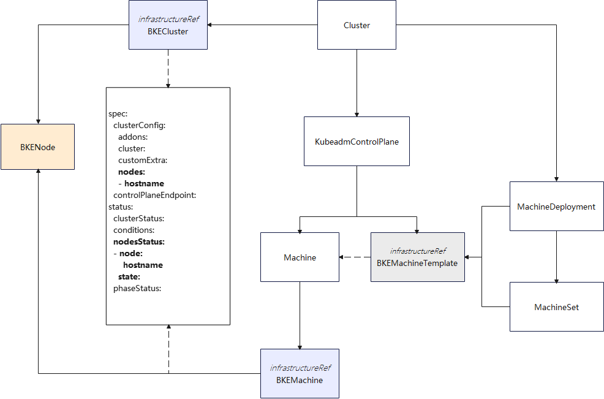
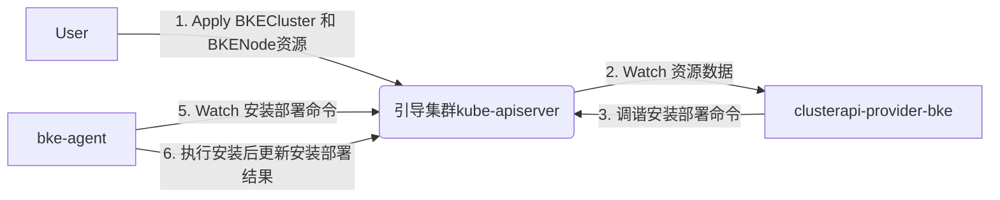

### 1 特性描述

#### 背景
当前在安装集群时，集群的节点信息均在BKECluster资源中，存在如下场景问题：
- 当集群的规模较大时，bkecluster单个资源就会过大，不利于运维，且集群调谐的性能会下降；
- 节点配置信息与集群信息资源存在耦合，支持节点配置修改能力时会导致代码架构耦合；
- 当多个节点资源发生变化时，需要进行遍历筛选，再进行调谐，性能较差，也不利于并行处理。

#### 目标
需要将BKECluster中的node信息拆分为单独的资源定义，实现BKECluster资源中的Node信息独立拆分，为后续更新节点配置信息做基础。

原始资源信息：

```yaml
apiVersion: bke.bocloud.com/v1beta1
kind: BKECluster
metadata:
  annotations:
  labels:
    cluster.x-k8s.io/cluster-name: bke-cluster
  name: bke-cluster
  namespace: bke-cluster
  ownerReferences:
spec:
  clusterConfig:
    cluster:
    customExtra:
    nodes:
    - hostname: m1
      ip: 10.44.244.99
      password: ""
      port: "22"
      role:
      - master/node
      - etcd
      username: root
  controlPlaneEndpoint:
status:
  agentStatus:
  clusterStatus: Unhealthy
  conditions:
  nodesStatus:
  - message: ""
    node:
      hostname: m1
      ip: 10.44.244.99
      password: ""
      port: "22"
      role:
      - master/node
      - etcd
      username: root
    state: NotReady
    stateCode: 15
  phase: EnsureCluster
  phaseStatus:
  ready: true
```

#### 1.1 依赖组件
不涉及

#### 1.2 License

Mulan PSL v2 License

### 2 需求场景威胁建模
资源信息暂未新增属性，不涉及新增威胁场景。

### 3 特性设计

#### 3.1 上下文/USE-CASE视图
关于Nodes信息的使用较多，在BKEClusterController和BKEMachineController中均涉及，对应的对象关系图如下：


资源拆分后要有关联关系，称拆出来的bkenode资源为bkecluster资源的子资源，代码中需要根据关联关系获取node信息，对资源进行调谐、调谐结果的状态更新和资源的调谐结果判断部分需要适配修改；涉及clusterapi-provider-bke、bkecommon和bkeagent。

**交互视图**


#### 3.2 具体需求要点
##### 3.2.1 BKECluster CRD修改

   删除Node相关信息，状态信息中不再保留Node的信息

   ```yaml
   apiVersion: bke.bocloud.com/v1beta1
   kind: BKECluster
   metadata:
     name: bke-cluster
     namespace: bke-cluster
   spec:
     clusterConfig:
       cluster:
       customExtra:
     controlPlaneEndpoint:
   status:
     agentStatus:
       replies: 1
       status: 1/1
       unavailableReplies: 0
     conditions:
     phase: 
     phaseStatus:
     ready: true
   ```

   

##### 3.2.2 独立 BKENode 资源定义：

   ```yaml
   apiVersion: bke.bocloud.com/v1beta1
   kind: BKENode
   metadata:
     name: master1
     namespace: test
     labels:
       cluster.x-k8s.io/cluster-name: test   # BKENode关联的BKECluster信息
   spec:
     hostname: master1
     ip: 10.44.244.99
     port: "22"
     username: root
     password: ImZLOVv+XLbmEwMim2yd0Q==
     role:
     - master/node
     - etcd
   status:
     state: NotReady
     stateCode: 15
     message: ""
   ```

   

##### 3.2.3 定义对应的RBAC权限

   ```yaml
   apiVersion: rbac.authorization.k8s.io/v1
   kind: ClusterRole
   metadata:
     name: bkecluster-manager-role
   rules:
   - apiGroups: ["bke.bocloud.com"]
     resources: ["bkenode"]
     verbs: ["get", "list", "watch", "create", "update", "patch", "delete"]
   ```

   
##### 3.2.4 资源获取方式变更
1. 当前，在代码中获取Node的方式为从bkecluster资源对象中获取Node属性，`bkeCluster.Spec.ClusterConfig.Nodes`，需要修改为从apiserver跟据label进行过滤筛选，获取BKENode(s)资源信息，需要增加相应的informer；
2. 获取后进行安装调谐的具体逻辑不变。


##### 3.2.5 资源状态判断
1. 原BKECluster.Status中不再存储所有节点信息，BKEClusterController中根据Node信息状态刷新Cluster状态和调谐的逻辑需要适配，原始通过`bkeCluster.Status.NodesStatus`获取节点信息和状态的，修改为直接获取BKENode，然后进行集群调谐状态的判断。


##### 3.2.6 BKECluster调谐逻辑适配
1. BKECluster和BKEMachine控制器中的关注Node资源的逻辑需要调整为根据BKENode资源事件通知来进行处理。

##### 3.2.7 集群生命周期管理服务适配
1. install-service主要用来下发集群安装的资源，对bkecommon也有依赖，在下发时需要针对新拆分的资源进行适配下发。
2. install-website为前端界面，下发的集群配置信息进行模板渲染，再下发到install-service，需要进行拆分下发。

#### 3.3 质量属性设计

##### 3.3.1 性能规格
不涉及

##### 3.3.2 可靠性设计
- 在安装部署流程中需要对BKENode的状态信息进行判断，避免重复下发命令；
- 在调谐中需要对资源调谐失败场景进行判断，并重新下发相关命令，直到调谐成功。

##### 3.3.3 安全/韧性/隐私设计
- 最小权限：新增资源增加对应的RBAC权限。

##### 3.3.4 兼容性设计
- 不需要考虑升级回滚场景，不涉及。

##### 3.3.5 可服务性设计
- 新增资源中包含状态信息、失败会包含详细信息等。

##### 3.3.6、可测试性设计

- 单元测试：Go 代码中对应新资源有详尽的单元测试覆盖。
- 集成测试：通过集成测试验证新资源能够完成集群的安装部署。

# 4、需求分解分配表

| 序号  | 模块名称 | Story名称 | Story描述 |
|:--- |:---- |:------- |:------- |
|     |      |         |         |
|     |      |         |         |

# 5、修改日志

| 版本  | 发布说明 |
|:--- |:---- |
|     |      |
|     |      |

# 6、参考目录