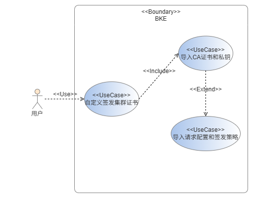
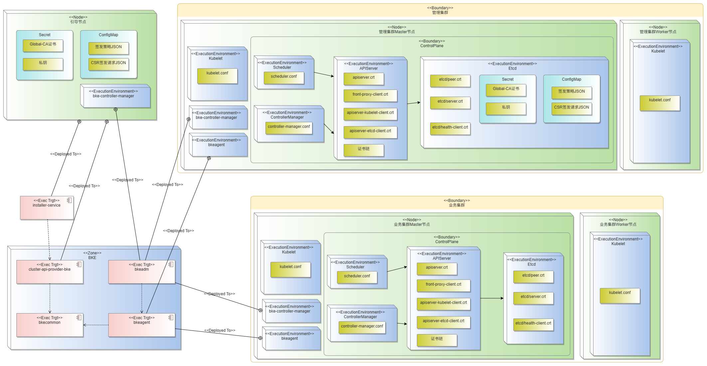
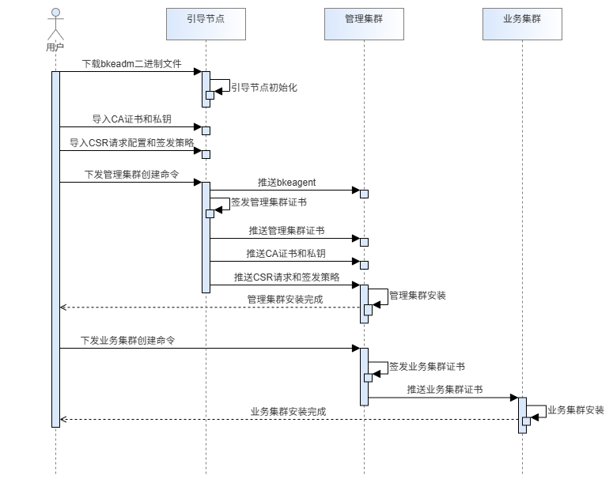
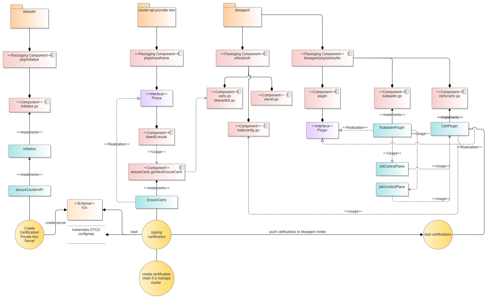
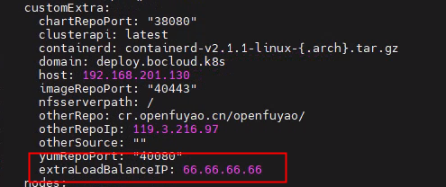
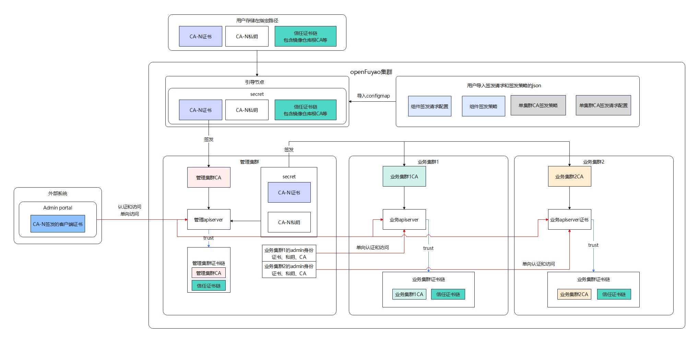
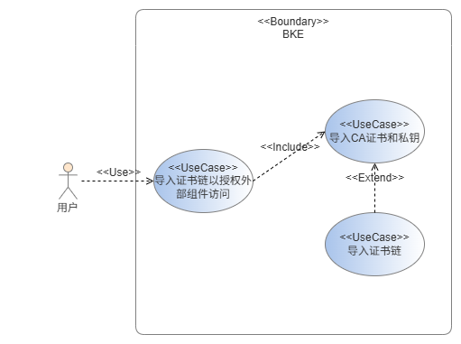
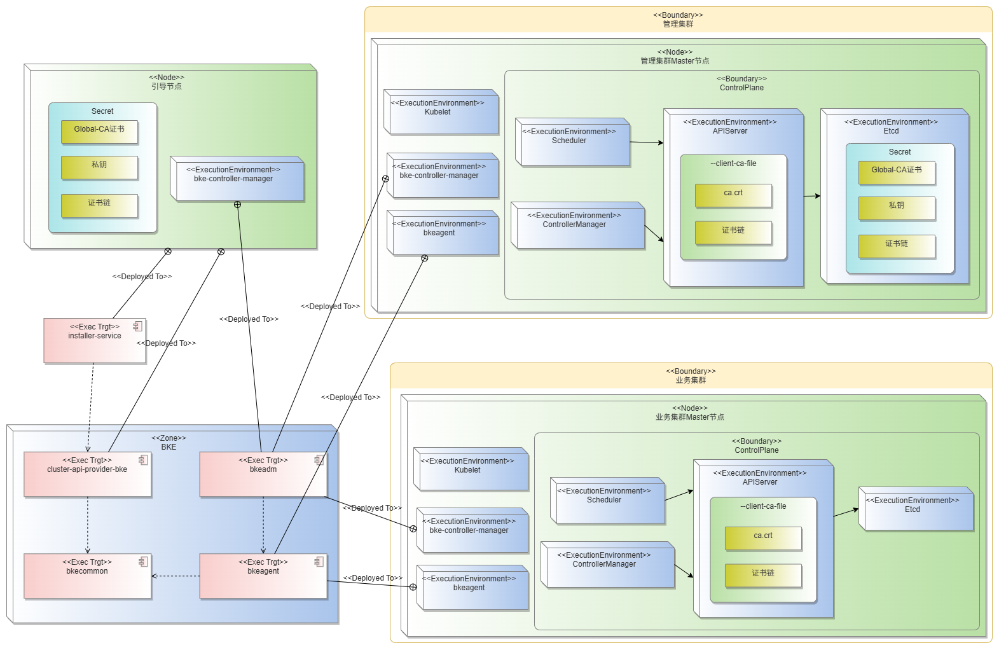
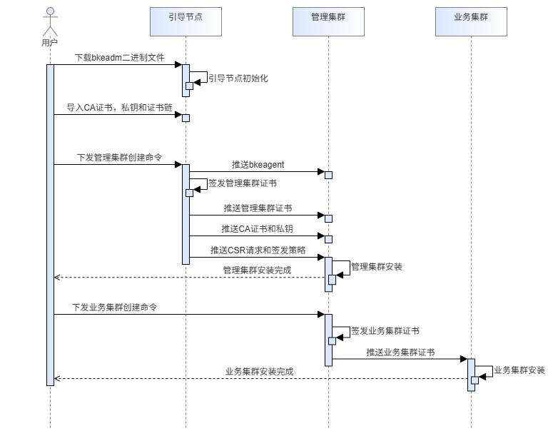
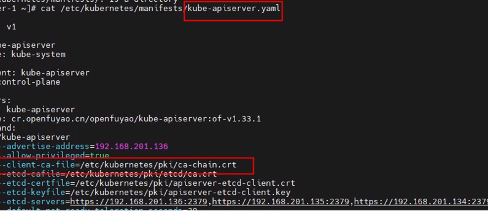

# 1、特性描述

## 1.1、受益人

| 角色     | 角色描述                       |
| -------- | ------------------------------ |
| 用户 | 使用BKE安装部署工具创建集群的用户 |

## 1.2、依赖组件

| 组件         | 组件描述 | 可获得性 |
|:---------- |:---- |:---- |
| Kubernetes | 1.33 | 必选   |

## 1.3、License

Mulan Permissive Software License, Version 2

# 2、需求说明

## 2.1、需求来源

当前，集群证书管理依赖于 Shell 脚本和 Ansible 脚本进行操作。这种传统方式的管理模式虽然能够实现证书的签发和管理，但在自动化、可扩展性和灵活性上存在一定的局限性。特别是在集群的部署和证书更新过程中，需要更高效、可靠的方式来实现自动化、声明式配置管理。

为了简化集群证书管理流程，并提高部署和替换证书的能力，需要一个更现代的解决方案，能够支持声明式配置并与现有的集群管理流程无缝集成。通过引入声明式配置管理，用户可以更加灵活地控制集群证书的生命周期，同时能够支持合作伙伴签发的根证书和私钥进行集群证书签发。

## 2.2、需求概述

​**目标**​：希望在集群搭建和管理过程中，支持使用由合作伙伴签发的根证书和私钥来签发集群内部的证书，并通过声明式方式进行证书的部署。

1. ​**合作伙伴签发的根证书和私钥支持**​：

* 在集群安装时，支持用户提供由合作伙伴签发的全局CA证书（global-ca.crt）和私钥（global-ca.key）。
* 使用这些根证书和私钥签发集群所需的内部证书，如 kube-apiserver、etcd、kube-scheduler 等。

2. ​**证书签发配置**​：

* 支持在集群部署过程中，自动化地使用提供的根证书签发集群内部证书，并确保证书符合用户自定义证书配置。

3. ​**API Server 挂载证书链支持外部组件访问**​：

* 支持用户提供证书链（包括根证书和中间证书），并在集群部署时将其挂载到 API Server。
* API Server 使用这些证书链与集群的 CA 一同授权外部组件安全访问集群。

## 2.3、需求分解

### 2.3.1、 需求点 1：支持用户证书和私钥导入并签发集群证书

* ​**功能概述**​：支持用户导入全局证书（global-ca.crt）和私钥（global-ca.key），然后利用这些用户提供的证书信息签发集群内部证书。全局证书（global-ca.crt）和私钥（global-ca.key）将保存在管理集群集中管控，业务集群的证书统一由管理集群签发并同步。
* ​**证书签发配置**​：在集群安装时，BKE 使用用户提供的全局证（Gobal CA）来签发集群CA证书，然后用集群CA证书签发集群组件证书，供集群组件（如 kube-apiserver、etcd、kube-scheduler 等）使用。
* ​**可配置参数**​：包括证书签发策略与 CSR 信息配置，支持通过 ConfigMap 导入配置。可配置项包括：
  * `hosts`​：列举证书可以匹配的域名或 IP 地址。
  * `CN`​：证书的公共名称。
  * `O`、`C`、`ST`、`L`、`OU`：这些是证书的 **Subject** 字段，标识证书的颁发主体。
  * `expiry`​：证书的有效期，通常设置为一年或者更长时间。
  * `key usage`：证书的基础用途，如是否用于数字签名或密钥加密。
  * `ext key usage`​：证书的扩展用途，如是否用于服务器认证或客户端认证。

---

### 2.3.2、 需求点 2：支持用户导入证书链以授权外部组件访问

* ​**功能概述**​：支持用户导入证书链，供 API Server 使用，以便授权外部组件访问集群。
* ​**证书链传递**​：用户导入证书链，并与集群ca.crt构成证书链，一同挂载到API Server的`--client-ca-file`上。
* ​**授权机制**​：API Server 在启动时挂载并使用用户提供的证书链与集群 CA，确保外部组件能够验证集群的身份并安全访问。

### 2.3.3、 需求点 3：支持用户配置外部负载均衡器

* ​**功能概述**​：支持用户配置外部负载均衡器，代替bke原本的haproxy和keepalive。
* ​**配置细节**​：API Server 需要在SAN字段写入负载均衡器的IP，同时生成的worker节点的kubeconfig的server字段要指向负载均衡器的IP。

# 3、特性功能设计

## 3.1 支持用户证书和私钥导入并签发集群证书

### 3.1.1 组件梳理图


### 3.1.2 USE-CASE


**说明：**

在该系统中，用户需要先 ​**导入CA证书和私钥**​，然后才能进行 ​**导入请求配置和签发策略**​。**导入请求配置和签发策略** 用例依赖于 **导入CA证书和私钥** 用例，确保用户在配置证书之前已经导入有效的证书。两者之间的关系通过 **`<<Extend>>`** 进行建模，表示证书配置始终包括导入证书操作，用户无法跳过导入CA证书和私钥的步骤。

### 3.1.3 部署视图



### 3.1.4 时序图



### 3.1.5 开发视图



### 3.1.6 用户导入设计

#### 步骤一：导入用户全局CA证书和私钥

##### **前置条件**

1. **证书私钥规格**

- 证书为X.509 公钥证书，必须具有CA签发功能
- 私钥格式必须为PKCS#1格式

2. **证书格式检查与转换**
   检查私钥格式

```bash
# 检查私钥是否为PKCS#1格式
openssl rsa -in <私钥文件> -text -noout
```

3. **格式转换（如需要）**
   如果您的私钥不是PKCS#1格式，请执行以下转换：

````bash
# 将私钥转换为PKCS#1格式
openssl rsa -in <原始私钥文件> -out <转换后的私钥文件>
````

##### 导入设计

在**引导节点创建之前**，将证书文件放置在指定路径：`/etc/openFuyao/certs/`，文件名固定为`global-ca.crt`和 `global-ca.key`，不可修改。

PEM、CRT和KEY格式本质上都是相同的PEM编码格式，只是文件扩展名不同，都可以正常使用，只要满足前置条件即可。

#### 步骤二：用户自定义导入签发策略和签发请求CSR

用户需要根据提供的 ​**ConfigMap 模板文件**​，填写并导入集群中所有组件所需的 **证书签发请求（CSR）** 和 **签发策略** 配置文件。

##### 文件组成说明

共需准备 ​**17 个 JSON 文件**​，分为两类：

###### 1. 证书签发请求（CSR）

* 共 **15 个 JSON 文件**
* 每个文件对应一个集群组件的证书签发请求（例如：apiserver、controller-manager、scheduler、kubelet 等）。
* 文件内容定义了该组件的证书主题信息（如 CN、O、SAN、用途等），用于向 CA 发起签发请求。

###### 2. 证书签发策略（Signing Policy）

* 共 ​**2 个 JSON 文件**​：
  1. **集群 CA 签发策略文件**
     * 定义集群根 CA 的签发规则和默认策略（`default` profile）。
  2. **组件签发策略文件**
     * 定义除集群 CA 以外所有 13 个组件的签发策略以及一个通用的默认策略（`default` profile）。
     * 这些策略存放在文件中的 `profiles` 字段下，每个 profile 对应一个组件证书的签发参数（有效期、用途、扩展属性等）。

##### 导入设计

在**引导节点创建之前**，将2个签发策略和15个签发请求CSR配置JSON文件一起存放在指定路径：`/etc/openFuyao/certs/cert_config/`。

#### 步骤三（可选）：为证书写入外部负载均衡器IP

用户如果需要配置bke外部负载均衡器，需要在bc.yaml中添加对应的值，具体操作为在`customExtra`下添加对应的key、value值，key值固定不可以修改，value值填写负载均衡器对应的IP，如下图：



## 3.2 支持用户导入证书链以授权外部组件访问

### 3.2.1 组件梳理图



### 3.2.2 USE-CASE


在该系统中，用户需要先 ​**导入CA证书和私钥**​，然后才能进行 ​**导入证书链**​。**导入证书链** 用例依赖于 **导入CA证书和私钥** 用例，确保用户在配置证书链之前已经导入有效的证书。两者之间的关系通过 **`<<Extend>>`** 进行建模，表示证书链始终包括导入证书操作，用户无法跳过导入CA证书和私钥的步骤。

### 3.2.3 部署视图



### 3.2.4 时序图



### 3.2.5 开发视图


### 3.2.6 用户导入设计

#### 导入用户证书链（前提：一起导入全局CA证书和私钥）

##### **前置条件**

1. **证书私钥规格**

- 证书为X.509 公钥证书，必须具有CA签发功能
- 私钥格式必须为PKCS#1格式

2. **证书格式检查与转换**
   检查私钥格式

```bash
# 检查私钥是否为PKCS#1格式
openssl rsa -in <私钥文件> -text -noout
```

3. **格式转换（如需要）**
   如果您的私钥不是PKCS#1格式，请执行以下转换：

````bash
# 将私钥转换为PKCS#1格式
openssl rsa -in <原始私钥文件> -out <转换后的私钥文件>
````

##### 导入设计

在**引导节点创建之前**，将证书文件放置在指定路径：`/etc/openFuyao/certs/`，文件名固定为`trust-chain.crt`，不可修改。

PEM、CRT和KEY格式本质上都是相同的PEM编码格式，只是文件扩展名不同，都可以正常使用，只要满足前置条件即可。

### 3.2.7 具体实现

用户导入证书链，将集群ca.crt与证书链合并名为`ca-chain.crt`的证书链，并挂载于/etc/kubernetes/manifests/kube-apiserver.yaml内的`--client-ca-file`。即将`/etc/kubernetes/pki/ca.crt`替换为证书链`/etc/kubernetes/pki/ca-chain.crt`。
如下图为替换结果：


# 4、修改日志

| 版本   | 发布时间 | 发布说明 |
| ------ | -------- | -------- |
| v0.1.0 | 2025.11.17       | 初稿发布 |

# 5、参考目录

1、kubernetes官方PKI证书配置要求：[https://kubernetes.io/zh-cn/docs/setup/best-practices/certificates/](https://kubernetes.io/zh-cn/docs/setup/best-practices/certificates/)


