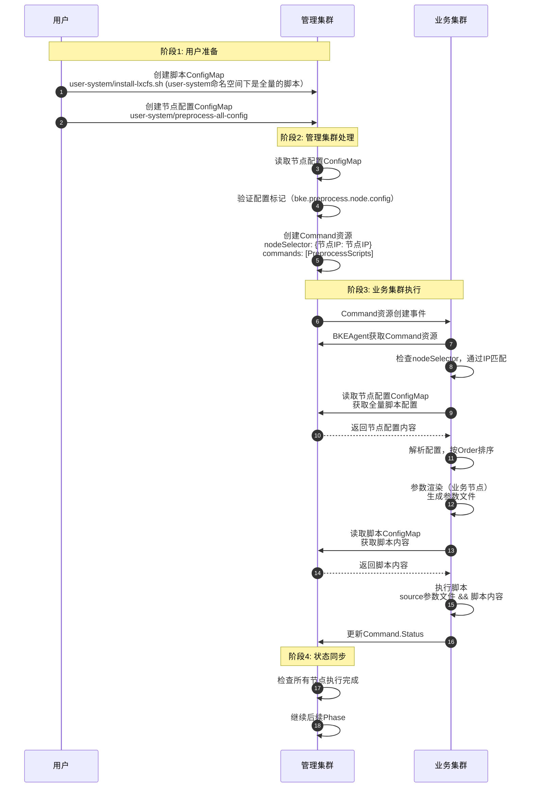

# 规格说明

**1、明确1月份规格**：

* 支持在集群创建的前置/后置处执行用户自定义脚本。**后置处理 和  前置处理 实现逻辑一致**，都是只有**shell**脚本。
* 支持传入脚本的执行顺序和脚本参数。**所有集群共用一批脚本**，**一个集群中所有节点执行同一批脚本**，且这批脚本**共用同一份**全量的脚本配置参数。
* 需要用户手动上传 n+2 份configmap ： **n个脚本内容**  和  **2份全量脚本配置参数**（前置1份，后置1份）  。具体而言，对于业务集群需要前置/后置处理，在管理集群手动创建 user-system命名空间，并上传相关的脚本和配置configmap（如果管理集群需要前置/后置处理，就创建引导节点的user-system命名空间，并在引导节点上传对应的脚本和配置configmap）。
* 1月份版本暂不支持脚本的节点选择性执行，不支持脚本的阻塞安装，不支持配置脚本的重试时间和次数。

* 已确认目标的参数校验白名单字段为：：**a-z A-Z 0-9 - _ / .  空格 ：#  =**，无其他形式参数输入。
* 需要用户手动将  **n个脚本内容**  和  **2份全量脚本配置参数**（前置1份，后置一份）  = 共n+2 份configmap   手动传到 管理集群的 user-system命名空间下。
* 1月份版本暂不支持脚本的节点选择性执行，不支持脚本的阻塞安装，不支持配置脚本的重试时间和次数。

* 已确认目标的参数校验白名单字段为：：**a-z A-Z 0-9 - _ / .  空格 ：#  =**，满足要求。

  

**2、后续版本规格待明确**：

- 不同集群是否要执行不同批次的脚本？

* 是否要支持每个节点有自己独立的一份全量脚本配置？（优先级：有全局共用的脚本配置优先使用，否则使用各个节点的脚本配置，只能2选1，且配置不覆盖？）。

* 是否有一批节点共用一套脚本配置参数的情形？分批次执行不同节点的脚本？

* 是否需要脚本执行失败阻塞安装？是否要有脚本执行的重试次数和重试时间？

  

***


# **前置处理**

## 概述

在bke中安装业务集群k8s支持用户自定义前置处理框架设计。

1. 两层过滤逻辑：

   ① 1月份版本，所有节点共用同一份配置文件，all，是集群级的一个全量脚本配置参数。n个脚本 + 1个全量配置参数     共 n+1 个 configmap。
   
   ② 后续支持每个节点一个全量的脚本配置参数，这个看进展是每个节点的全量脚本配置参数放在cm中（或放在每个节点的cr中）。   n个脚本 + m个节点的全量配置参数 = 共 n + m 个 configmap。
2. 整体逻辑：
   每个节点都下发全量的脚本配置文件，都在user-system命名空间下；只根据每个节点全量的脚本配置参数来确认脚本的具体执行情况。（满足不同节点执行不同脚本，及不同参数的情形）。

## 1. 完整时序图



说明：

* 脚本内容是集群级的资源，一个集群有一套全量的脚本，包含前置处理脚本和后置处理脚本，都在user-system命名空间下。
* 1月份版本前置处理所有节点共用一份全量的脚本配置参数，放在user-system/preprocess-config-all中。
* 1月份版本后置处理所有节点共用一份全量的脚本配置参数，放在user-system/postprocess-config-all中。
* 后续版本支持每个节点一个全量的脚本配置参数，作为节点级的资源，每个节点的脚本配置参数在user-system/process-config-<node.ip>中。
* 通过新增一个内置的command，在集群的每个节点上执行一个节点上的所需执行的全量脚本。在该command中封装了某个节点所需执行的所有脚本（包括脚本执行顺序选择、脚本是否执行、执行参数渲染、参数校验等操作）。

## 2. 配置设计

### 2.1 情形①：所有节点共用一份全量脚本配置 （1月份版本）

**配置ConfigMap**​：`user-system/preprocess-config-global`

```yaml
apiVersion: v1
kind: ConfigMap
metadata:
  name: preprocess-config-global
  namespace: user-system
  labels:
    bke.preprocess.config.type: "global"  # 全局配置
    bke.preprocess.config: "true"
data:
  config.json: |
    {
      "scripts": [
        {
          "scriptName": "install-lxcfs.sh",
          "order": 1,
          "enabled": true,
          "params": {
            "HTTP_REPO": "http://repo.example.com",
            "ROLE": "all"
          }
        },
        {
          "scriptName": "install-custom.sh",
          "order": 2,
          "enabled": true,
          "params": {
            "REPO": "http://custom-repo.example.com"
          }
        }
      ]
    }
```

### 2.2 情形②：各个节点独自配置ConfigMap （后续版本）

**命名规范**：`user-system/preprocess-config-<node-ip>`

**标记方式**：通过Label标记为脚本配置文件

```yaml
apiVersion: v1
kind: ConfigMap
metadata:
  name: preprocess-config-node-192.168.1.10
  namespace: user-system
  labels:
	bke.preprocess.config.type: "node"  # 节点配置
  	bke.preprocess.config: "true"
  	bke.preprocess.node.ip: "192.168.1.10"
data:
  config.json: |
    {
      "nodeIP": "192.168.1.10",
      "nodeHostname": "master1",
      "scripts": [
        {
          "scriptName": "install-lxcfs.sh",
          "order": 1,
          "enabled": true,
          "params": {
            "HTTP_REPO": "http://master-repo.example.com",
            "ROLE": "master",
            "MODE": "production"
          }
        },
        {
          "scriptName": "install-custom.sh",
          "order": 2,
          "enabled": true,
          "params": {
            "REPO": "http://custom-repo.example.com",
            "CUSTOM_PARAM": "value1"
          }
        },
        {
          "scriptName": "install-special.sh",
          "order": 3,
          "enabled": false,
          "params": {}
        }
      ]
    }
```

### 2.3 脚本内容ConfigMap

**命名规范**：`user-system/<script-name>`

**标记方式**：通过Label标记为脚本文件

```yaml
apiVersion: v1
kind: ConfigMap
metadata:
  name: install-lxcfs.sh
  namespace: user-system
  labels:
    bke.preprocess.script: "true"  # 标记为脚本文件
data:
  install-lxcfs.sh: |
    #!/bin/bash
    echo "NODE_IP: ${NODE_IP}"
    echo "HTTP_REPO: ${HTTP_REPO}"
    echo "ROLE: ${ROLE}"
    # 脚本内容...
```

### 2.4 配置结构定义

```go
// NodePreprocessConfig 节点前置处理配置
type NodePreprocessConfig struct {
    // NodeIP 节点IP（必需）
    NodeIP string `json:"nodeIP"`

    // NodeHostname 节点主机名（可选）
    NodeHostname string `json:"nodeHostname,omitempty"`

    // Scripts 脚本列表（必需）
    Scripts []ScriptConfig `json:"scripts"`
}

// ScriptConfig 脚本配置
type ScriptConfig struct {
    // ScriptName 脚本名称（必需）
    // 对应管理集群ConfigMap中的脚本名称：cluster-system/<script-name>
    ScriptName string `json:"scriptName"`

    // Order 执行顺序（必需，数字越小越先执行）
    Order int `json:"order"`

    // Params 脚本参数（可选）
    // 参数会通过环境变量传递给脚本
    Params map[string]string `json:"params,omitempty"`
}
```

说明：后续可以扩展阻塞安装、安装重试次数、重试时间等参数。

## 3. 执行机制设计

### 3.1 整体流程

```
用户创建节点配置ConfigMap（管理集群）
    ↓
管理集群Controller读取配置
    ↓
创建Command资源（管理集群）
    - nodeSelector: {节点IP: 节点IP}
    - commands: [执行前置处理脚本]
    ↓
业务节点BKEAgent Watch到Command资源
    ↓
检查nodeSelector，通过IP匹配
    ↓
执行前置处理脚本（业务节点）
    - 读取节点配置ConfigMap（管理集群）
    - 解析配置，按Order排序，过滤enabled=false
    - 对于每个脚本：
        - 参数渲染（业务节点）：生成参数文件
        - 读取脚本ConfigMap（管理集群）
        - 执行脚本（业务节点）：source参数文件 && 脚本内容
    ↓
更新执行状态到管理集群
```

### 3.2 关键设计点

1. **一个节点有一个配置ConfigMap**：从全局取 or  每个节点一个节点配置，包含该节点所有脚本的配置和参数
2. **一个节点一个Command资源**：每个节点创建一个Command资源，包含执行前置处理脚本的命令
3. **参数渲染在业务节点**：在业务节点上解析配置，生成参数文件
4. **脚本执行在业务节点**：在业务节点上按顺序执行脚本
5. **减少ConfigMap数量**：不再为每个脚本创建独立的参数ConfigMap

## 4. 详细步骤说明

### 4.1 阶段1：用户准备

**步骤1-2**：用户创建资源

- 用户创建脚本ConfigMap（包含脚本内容）
- 用户创建节点配置ConfigMap（包含节点需要执行的脚本列表和参数）

**关键点**：

- 所有资源创建在管理集群的`cluster-system` namespace
- 节点配置命名：`preprocess-config-<node-ip>`
- 节点配置通过Label标记：`bke.preprocess.node.config=true`
- 脚本ConfigMap通过Label标记：`bke.preprocess.script=true`

### 4.2 阶段2：管理集群处理

**步骤3-4**：读取和验证配置

- 读取节点配置ConfigMap
- 验证配置标记（`bke.preprocess.node.config=true`）

**步骤5**：创建Command资源

- 创建Command资源到管理集群
- nodeSelector使用节点IP匹配
- commands包含执行PreprocessScripts的命令

**关键点**：

- 每个节点创建一个Command资源
- Command资源包含执行PreprocessScripts的命令
- 不再为每个脚本创建独立的参数ConfigMap

### 4.3 阶段3：业务集群执行

**步骤6-8**：Command资源通知和匹配

- Command资源创建事件通知到业务集群
- BKEAgent获取Command资源，检查nodeSelector（通过IP匹配）

**步骤9-10**：读取配置和解析

- 读取节点配置ConfigMap，获取全量脚本配置
- 解析配置，按Order排序，过滤`enabled=false`

**步骤11-12**：参数渲染

- 在业务节点上进行参数渲染
- 生成参数文件：`/tmp/<script-name>-params-<node-ip>.env`

**步骤13-15**：脚本执行

- 读取脚本ConfigMap，获取脚本内容
- 执行脚本：`source参数文件 && 脚本内容`
- 更新Command.Status到管理集群

**关键点**：

- 参数渲染在业务节点完成（不创建ConfigMap）
- 脚本执行在业务节点完成
- 从管理集群读取配置和脚本

### 4.4 阶段4：状态同步

**步骤16-17**：状态同步和后续处理

- 管理集群检查所有节点执行完成
- 继续后续Phase（K8s安装等）

**关键点**：

- 所有节点执行完成后，继续后续安装流程
- 如果执行失败，可以阻塞后续安装

## 5. 参数渲染和执行边界

### 5.1 参数渲染（业务节点）

```
业务节点PreprocessPlugin
    ↓
读取节点配置ConfigMap（从管理集群）
    ↓
解析配置，提取脚本参数
    ↓
生成参数文件（业务节点）
    - 文件路径：/tmp/<script-name>-params-<node-ip>.env
    - 文件内容：键值对格式
```

### 5.2 脚本执行（业务节点）

```
业务节点PreprocessPlugin
    ↓
从管理集群读取脚本ConfigMap
    ↓
提取脚本内容
    ↓
执行脚本（业务节点）
    - source参数文件 && 脚本内容
    - 脚本可以访问环境变量
```

### 5.3 边界说明

**管理集群边界**：

- 配置存储（节点配置ConfigMap、脚本ConfigMap）
- Command资源管理
- 状态查询

**业务集群边界**：

- 参数渲染（生成参数文件）
- 脚本执行
- 状态更新

**跨边界交互**：

- BKEAgent连接到管理集群
- 从管理集群读取ConfigMap
- 更新状态到管理集群

## 6. 一个节点的一个脚本的参数渲染和执行流程

### 6.1 参数渲染（业务节点）

**输入**：节点配置ConfigMap中的脚本配置

```json
{
  "scriptName": "install-lxcfs.sh",
  "order": 1,
  "enabled": true,
  "params": {
    "HTTP_REPO": "http://master-repo.example.com",
    "ROLE": "master"
  }
}
```

**处理**：业务节点PreprocessPlugin

```go
// 1. 准备参数
params := make(map[string]string)
params["NODE_IP"] = nodeIP  // "192.168.1.10"（默认参数）

// 添加用户自定义参数
for key, value := range scriptConfig.Params {
    params[key] = value
}

// 2. 生成参数文件
paramFile := fmt.Sprintf("/tmp/%s-params-%s.env", scriptConfig.ScriptName, nodeIP)

// 3. 写入参数文件
f, _ := os.OpenFile(paramFile, os.O_RDWR|os.O_CREATE|os.O_TRUNC, 0666)
for key, value := range params {
    f.WriteString(fmt.Sprintf("%s=%s\n", key, value))
}
f.Close()
```

**输出**：参数文件（业务节点）

```bash
# /tmp/install-lxcfs.sh-params-192.168.1.10.env
NODE_IP=192.168.1.10
HTTP_REPO=http://master-repo.example.com
ROLE=master
```

### 6.2 脚本执行（业务节点）

**输入**：脚本ConfigMap和参数文件

**处理**：业务节点PreprocessPlugin

```go
// 1. 从管理集群读取脚本ConfigMap
scriptCM := &corev1.ConfigMap{}
p.K8sClient.Get(context.Background(),
    client.ObjectKey{Namespace: "cluster-system", Name: "install-lxcfs.sh"}, scriptCM)

// 2. 提取脚本内容
scriptContent := scriptCM.Data["install-lxcfs.sh"]

// 3. 执行脚本：source参数文件 && 脚本内容
command := fmt.Sprintf("source %s && %s", paramFile, scriptContent)
output, err := p.Exec.ExecuteCommandWithCombinedOutput("/bin/sh", "-c", command)
```

**脚本执行环境**：

```bash
# 在业务节点上执行
source /tmp/install-lxcfs.sh-params-192.168.1.10.env
# 环境变量已加载：
#   NODE_IP=192.168.1.10
#   HTTP_REPO=http://master-repo.example.com
#   ROLE=master

# 执行脚本
/bin/sh -c "#!/bin/bash
echo \"NODE_IP: ${NODE_IP}\"
echo \"HTTP_REPO: ${HTTP_REPO}\"
echo \"ROLE: ${ROLE}\"
# 脚本内容...
"
```

**输出**：脚本执行结果

- 脚本在业务节点本地执行
- 可以访问环境变量（从参数文件加载）
- 执行结果更新到管理集群的Command.Status

### 6.3 管理集群和业务集群边界

**管理集群边界**（配置存储）：

```
管理集群
    ↓
节点配置ConfigMap（管理集群）
    - 包含该节点所有脚本的配置和参数
    - Label: bke.preprocess.node.config=true
    ↓
脚本ConfigMap（管理集群）
    - 包含脚本内容
    - Label: bke.preprocess.script=true
    ↓
Command资源（管理集群）
    - nodeSelector: {节点IP: 节点IP}
    - commands: [PreprocessScripts]
```

**业务集群边界**（参数渲染和执行）：

```
业务节点
    ↓
读取节点配置ConfigMap（从管理集群）
    ↓
解析配置，提取脚本列表和参数
    ↓
参数渲染（业务节点）
    - 生成参数文件：/tmp/<script-name>-params-<node-ip>.env
    - 不创建ConfigMap
    ↓
读取脚本ConfigMap（从管理集群）
    ↓
执行脚本（业务节点）
    - source参数文件 && 脚本内容
    ↓
更新Command.Status（到管理集群）
```

**关键边界点**：

1. **配置存储**：节点配置ConfigMap和脚本ConfigMap存储在管理集群
2. **参数渲染**：在业务节点完成，生成参数文件（不创建ConfigMap）
3. **脚本执行**：在业务节点完成，从管理集群读取脚本内容
4. **状态更新**：执行状态更新到管理集群的Command.Status

## 7. 总结

### 7.1 核心流程

1. **用户准备**：创建脚本和节点配置ConfigMap
2. **管理集群处理**：读取配置，创建Command资源
3. **业务集群执行**：BKEAgent执行PreprocessScripts，读取配置，进行参数渲染和脚本执行
4. **状态同步**：管理集群检查完成，继续后续流程

### 7.2 关键特点

1. **节点级配置**：一个节点一个配置文件
2. **参数渲染在业务节点**：在业务节点上生成参数文件，不创建ConfigMap
3. **脚本执行在业务节点**：在业务节点上按顺序执行脚本
4. **减少ConfigMap数量**：从 `节点数 × 脚本数` 减少到 `节点数 + 脚本数`  or   `节点数+1`
5. **边界清晰**：配置存储在管理集群，参数渲染和执行在业务节点

