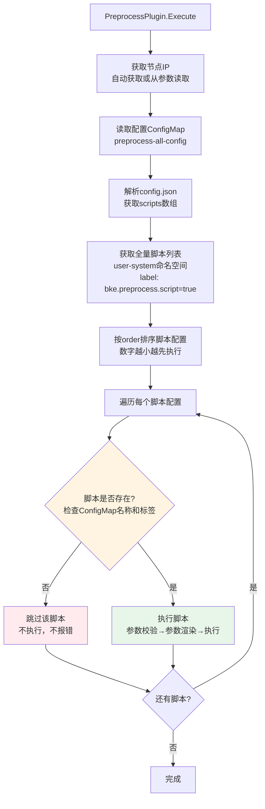

## 1. 概述

本文档详细说明前置处理中参数渲染的具体实现机制，以及节点上脚本选择逻辑的确定方式。本文档基于**单一全局配置**（`preprocess-all-config`）的场景进行说明。

## 2. ConfigMap示例

### 2.1 脚本ConfigMap示例

**脚本存储在****`user-system`****命名空间，每个脚本一个ConfigMap**

#### 示例1: install-lxcfs.sh

```YAML
apiVersion: v1
kind: ConfigMap
metadata:
  name: install-lxcfs.sh
  namespace: user-system
  labels:
    bke.preprocess.script: "true"  # 必需：标记为前置处理脚本
data:
  # Key必须与ConfigMap名称一致
  install-lxcfs.sh: |
    #!/bin/bash
    set -e
    
    echo "========================================="
    echo "Installing lxcfs on node: ${NODE_IP}"
    echo "HTTP Repository: ${HTTP_REPO}"
    echo "Node Role: ${ROLE}"
    echo "========================================="
    
    # 使用参数模板，执行时会被替换为实际值
    REPO_URL="${HTTP_REPO}/lxcfs"
    INSTALL_DIR="/opt/lxcfs"
    
    # 创建安装目录
    mkdir -p ${INSTALL_DIR}
    
    # 下载并安装lxcfs
    if [ "${ROLE}" = "master" ]; then
        echo "Installing lxcfs for master node..."
        wget -q ${REPO_URL}/lxcfs-master.tar.gz -O ${INSTALL_DIR}/lxcfs.tar.gz
    else
        echo "Installing lxcfs for worker node..."
        wget -q ${REPO_URL}/lxcfs-worker.tar.gz -O ${INSTALL_DIR}/lxcfs.tar.gz
    fi
    
    # 解压并安装
    tar -xzf ${INSTALL_DIR}/lxcfs.tar.gz -C ${INSTALL_DIR}
    
    echo "lxcfs installation completed successfully"
```

**关键点**：

- ConfigMap的`name`必须与脚本文件名一致（如`install-lxcfs.sh`）
- `data`中的key必须与ConfigMap名称一致（如`install-lxcfs.sh`）
- 脚本内容中包含参数模板，格式为`${PARAM_NAME}`（如`${NODE_IP}`, `${HTTP_REPO}`, `${ROLE}`）
- **必须添加标签**`bke.preprocess.script: "true"`，用于标识为前置处理脚本

#### 示例2: setup-custom-env.sh

```YAML
apiVersion: v1
kind: ConfigMap
metadata:
  name: setup-custom-env.sh
  namespace: user-system
  labels:
    bke.preprocess.script: "true"
data:
  setup-custom-env.sh: |
    #!/bin/bash
    set -e
    
    echo "Setting up custom environment..."
    echo "Node IP: ${NODE_IP}"
    echo "Custom Config Path: ${CONFIG_PATH}"
    echo "Environment: ${ENV}"
    
    # 创建配置目录
    mkdir -p ${CONFIG_PATH}
    
    # 根据环境设置不同的配置
    if [ "${ENV}" = "production" ]; then
        echo "Production environment detected"
        cp /etc/prod-config/* ${CONFIG_PATH}/
    else
        echo "Development environment detected"
        cp /etc/dev-config/* ${CONFIG_PATH}/
    fi
    
    echo "Custom environment setup completed"
```

### 2.2 配置ConfigMap示例（全局配置）

**配置存储在****`user-system`****命名空间，使用****`preprocess-all-config`****作为配置名称**

```YAML
apiVersion: v1
kind: ConfigMap
metadata:
  name: preprocess-all-config
  namespace: user-system
  labels:
    bke.preprocess.config.type: "global"
    bke.preprocess.config: "true"
data:
  # 配置JSON，key固定为config.json
  config.json: |
    {
      "scripts": [
        {
          "scriptName": "install-lxcfs.sh",
          "order": 1,
          "params": {
            "HTTP_REPO": "http://repo.example.com",
            "ROLE": "master"
          }
        },
        {
          "scriptName": "setup-custom-env.sh",
          "order": 2,
          "params": {
            "CONFIG_PATH": "/opt/custom-config",
            "ENV": "production"
          }
        },
        {
          "scriptName": "install-custom-tool.sh",
          "order": 3,
          "params": {
            "TOOL_VERSION": "v1.2.3",
            "INSTALL_DIR": "/usr/local/bin"
          }
        }
      ]
    }
```

**配置结构说明**：

| 字段                   | 类型                | 必需 | 说明                                     |
| ---------------------- | ------------------- | ---- | ---------------------------------------- |
| `scripts`              | `[]ScriptConfig`    | 是   | 脚本配置列表                             |
| `scripts[].scriptName` | `string`            | 是   | 脚本名称，必须与脚本ConfigMap的name一致  |
| `scripts[].order`      | `int`               | 是   | 执行顺序，数字越小越先执行               |
| `scripts[].params`     | `map[string]string` | 否   | 脚本参数，key对应脚本中的`${PARAM_NAME}` |

**关键点**：

- ConfigMap名称固定为`preprocess-all-config`（全局配置）
- `data`中的key固定为`config.json`
- `scripts`数组中的脚本按`order`字段排序执行
- `params`中的参数会替换脚本中对应的`${PARAM_NAME}`模板

## 3. 参数渲染实现详解

### 3.1 参数渲染流程

```mermaid
graph TB
    A["读取脚本ConfigMap"] --> B["提取脚本内容&#10;包含参数模板"]
    B --> C["读取配置ConfigMap&#10;preprocess-all-config"]
    C --> D["提取脚本参数&#10;scriptConfig.Params"]
    E["获取节点IP"] --> F["构建参数映射&#10;NODE_IP + 用户参数"]
    D --> F
    F --> G["参数校验&#10;白名单模式&#10;只允许: a-z A-Z 0-9 - _ / . 空格 : # ="]
    G --> H{"校验通过?"}
    H -->|否| I["返回错误&#10;终止执行"]
    H -->|是| J["正则匹配参数模板&#10;${PARAM_NAME}"]
    J --> K["替换模板为参数值"]
    K --> L["生成渲染后的脚本"]
    L --> M["执行脚本"]
    
    style G fill:#fff4e1
    style J fill:#e1f5ff
    style K fill:#e8f5e9
    style I fill:#ffebee
```



### 3.2 参数渲染核心实现

```Go
// renderScriptWithParams 参数渲染：将参数值替换到脚本模板中
func (p *PreprocessPlugin) renderScriptWithParams(scriptContent string, scriptConfig ScriptConfig, nodeIP string) (string, error) {
    // 1. 准备参数映射
    params := make(map[string]string)
    params["NODE_IP"] = nodeIP // 默认参数，自动注入
    
    // 添加用户自定义参数（从配置ConfigMap中读取）
    for key, value := range scriptConfig.Params {
        params[key] = value
    }
    
    // 2. 在脚本内容中查找参数模板（格式：${PARAM_NAME}）
    renderedScript := scriptContent
    
    // 使用正则表达式匹配 ${PARAM_NAME} 格式的参数模板
    // 正则规则：\$\{([a-zA-Z_][a-zA-Z0-9_]*)\}
    // - \$\{ 匹配字面量 "${"
    // - ([a-zA-Z_][a-zA-Z0-9_]*) 匹配参数名（字母/下划线开头，后跟字母/数字/下划线）
    // - \} 匹配字面量 "}"
    re := regexp.MustCompile(`\$\{([a-zA-Z_][a-zA-Z0-9_]*)\}`)
    
    // 3. 替换所有匹配的参数模板
    renderedScript = re.ReplaceAllStringFunc(renderedScript, func(match string) string {
        // 提取参数名（去掉 ${}）
        // match格式：${PARAM_NAME}
        // match[2:len(match)-1] 提取 PARAM_NAME
        paramName := match[2 : len(match)-1]
        
        // 如果参数存在，替换为参数值
        if value, ok := params[paramName]; ok {
            return value
        }
        
        // 如果参数不存在，保留原样（不替换）
        return match
    })
    
    return renderedScript, nil
}
```

**参数渲染详细步骤**：

1. **构建参数映射**：

```Go
params := map[string]string{
    "NODE_IP": "192.168.1.10",           // 自动注入（节点IP）
    "HTTP_REPO": "http://repo.example.com",  // 从配置读取
    "ROLE": "master",                     // 从配置读取
}
```

1. **正则匹配参数模板**：
   1. 正则表达式：`\$\{([a-zA-Z_][a-zA-Z0-9_]*)\}`
   2. 匹配所有形如 `${PARAM_NAME}` 的模板
   3. 提取参数名（如 `NODE_IP`, `HTTP_REPO`, `ROLE`）
2. **替换参数模板**：
   1. 如果参数存在：将 `${PARAM_NAME}` 替换为参数值
   2. 如果参数不存在：保留 `${PARAM_NAME}` 原样
3. **生成渲染后的脚本**：
   1. 所有匹配的参数模板都被替换为实际值
   2. 未匹配的模板保持原样

### 3.3 参数渲染示例

#### 输入：脚本内容（包含参数模板）

```Bash
#!/bin/bash
set -e

echo "Node IP: ${NODE_IP}"
echo "HTTP Repository: ${HTTP_REPO}"
echo "Node Role: ${ROLE}"
REPO_URL="${HTTP_REPO}/lxcfs"
```

#### 输入：配置参数

```JSON
{
  "scriptName": "install-lxcfs.sh",
  "order": 1,
  "params": {
    "HTTP_REPO": "http://repo.example.com",
    "ROLE": "master"
  }
}
```

#### 输入：节点IP

```Plaintext
192.168.1.10
```

#### 步骤1: 构建参数映射

```Go
params := map[string]string{
    "NODE_IP": "192.168.1.10",           // 自动注入
    "HTTP_REPO": "http://repo.example.com",  // 从配置读取
    "ROLE": "master",                     // 从配置读取
}
```

#### 步骤2: 正则匹配和替换

| 匹配项         | 参数名      | 参数值                    | 替换结果                  |
| -------------- | ----------- | ------------------------- | ------------------------- |
| `${NODE_IP}`   | `NODE_IP`   | `192.168.1.10`            | `192.168.1.10`            |
| `${HTTP_REPO}` | `HTTP_REPO` | `http://repo.example.com` | `http://repo.example.com` |
| `${ROLE}`      | `ROLE`      | `master`                  | `master`                  |

#### 输出：渲染后的脚本内容

```Bash
#!/bin/bash
set -e

echo "Node IP: 192.168.1.10"
echo "HTTP Repository: http://repo.example.com"
echo "Node Role: master"
REPO_URL="http://repo.example.com/lxcfs"
```

### 3.4 参数渲染规则

#### 规则1: 参数模板格式

- **格式**：`${PARAM_NAME}`
- **参数名规则**：
  - 必须以字母或下划线开头
  - 只能包含字母、数字、下划线
  - 正则表达式：`^[a-zA-Z_][a-zA-Z0-9_]*$`

**有效示例**：

- `${NODE_IP}` ✅
- `${HTTP_REPO}` ✅
- `${ROLE}` ✅
- `${CONFIG_PATH}` ✅

**无效示例**：

- `${NODE-IP}` ❌（包含连字符）
- `${123_PARAM}` ❌（以数字开头）
- `${PARAM.NAME}` ❌（包含点号）

#### 规则2: 参数来源优先级

1. **自动注入参数**：
   1. `NODE_IP`：当前节点IP（自动获取，无需配置）
2. **用户配置参数**：
   1. 从配置ConfigMap的`scripts[].params`中读取
   2. 优先级：配置中的参数 > 自动注入参数（如果同名，配置中的参数会覆盖自动注入参数）

#### 规则3: 参数不存在处理

- 如果脚本中存在`${PARAM_NAME}`模板，但配置中没有提供对应参数：
  - **保留原样**：`${PARAM_NAME}`不会被替换，保持原样
  - **执行时可能报错**：如果脚本依赖该参数，执行时会报错

**示例**：

```Bash
# 脚本内容
echo "Value: ${MISSING_PARAM}"

# 配置中没有MISSING_PARAM参数
# 渲染后
echo "Value: ${MISSING_PARAM}"  # 保持原样
```

#### 规则4: 参数值转义

- **当前实现**：直接替换，不进行转义
- **注意事项**：参数值不应包含特殊字符（通过参数校验保证）

**示例**：

```Bash
# 脚本内容
echo "Path: ${CONFIG_PATH}"

# 参数值
CONFIG_PATH="/opt/config"

# 渲染后
echo "Path: /opt/config"  # 直接替换
```

### 3.5 参数校验实现

**位置**：`pkg/job/builtin/preprocess/preprocess.go:248-279`

**校验规则**：

1. **参数名校验**：
   1. 只能包含字母、数字、下划线
   2. 必须以字母或下划线开头
   3. 正则表达式：`^[a-zA-Z_][a-zA-Z0-9_]*$`
2. **参数值校验**（**白名单模式**）：
   1. **允许的字符**：`a-z`, `A-Z`, `0-9`, `-`, `_`, `/`, `.`, 空格, `:`, `#`, `=`
   2. **校验方式**：使用正则表达式白名单模式，只允许上述字符
   3. **正则表达式**：`^[a-zA-Z0-9\-_/.\s:#=]*$`
   4. **禁止的字符**：除允许字符外的所有字符（包括命令注入字符：`;`, `&`, `|`, ```, `$`, `(`, `)`等）
   5. **禁止换行符和回车符**：`\n`, `\r`（空格允许，但换行符不允许）
   6. **禁止空字符**：`\x00`
   7. **限制长度**：最大4096字符

**校验时机**：

- 在参数渲染**之前**进行校验
- 如果校验失败，终止脚本执行，返回错误

**参数值校验实现**：

```Go
// validateParams 参数校验（防参数注入）
func (p *PreprocessPlugin) validateParams(params map[string]string) error {
    // 参数值白名单正则：只允许 a-z A-Z 0-9 - _ / . 空格 : # =
    allowedValuePattern := regexp.MustCompile(`^[a-zA-Z0-9\-_/.\s:#=]*$`)
    
    for key, value := range params {
        // 检查键名
        if !p.isValidParamName(key) {
            return errors.Errorf("invalid parameter name: %s", key)
        }
        
        // 检查值：使用白名单模式
        if !allowedValuePattern.MatchString(value) {
            return errors.Errorf("parameter %s contains invalid characters. Only a-z, A-Z, 0-9, -, _, /, ., space, :, #, = are allowed", key)
        }
        
        // 检查长度
        if len(value) > 4096 {
            return errors.Errorf("parameter %s is too long (max 4096 characters)", key)
        }
    }
    
    return nil
}
```

**允许的参数值示例**：

- ✅ `"http://repo.example.com"` - 包含 `:`, `/`, `.`
- ✅ `"/opt/custom-config"` - 包含 `/`, `-`
- ✅ `"production"` - 纯字母
- ✅ `"v1.2.3"` - 包含字母、数字、点号
- ✅ `"config path"` - 包含空格
- ✅ `"key=value"` - 包含 `=`
- ✅ `"#comment"` - 包含 `#`
- ❌ `"value;rm -rf /"` - 包含 `;`（命令注入字符）
- ❌ `"value&command"` - 包含 `&`（命令注入字符）
- ❌ `"value$(command)"` - 包含 `$` 和 `()`（命令注入字符）

## 4. 脚本选择逻辑详解

### 4.1 脚本选择流程



### 4.2 脚本选择核心逻辑

```Go
// Execute 执行前置处理脚本
func (p *PreprocessPlugin) Execute(commands []string) ([]string, error) {
    // 1. 获取节点IP（如果参数中没有提供，则自动获取）
    nodeIP := paramMap["nodeIP"]
    if nodeIP == "" {
        nodeIP, err = p.getCurrentNodeIP()  // 自动获取当前节点IP
    }
    
    // 2. 读取配置（全局配置：preprocess-all-config）
    config, err := p.loadConfig(nodeIP)
    // config.Scripts 包含配置ConfigMap中定义的所有脚本配置
    
    // 3. 获取全量脚本列表（从user-system命名空间）
    allScripts, err := p.getAllScripts()
    // allScripts 包含user-system命名空间下所有标记为脚本的ConfigMap名称
    // 通过标签 bke.preprocess.script=true 过滤
    
    // 4. 按Order排序脚本配置（数字越小越先执行）
    sort.Slice(config.Scripts, func(i, j int) bool {
        return config.Scripts[i].Order < config.Scripts[j].Order
    })
    
    // 5. 遍历每个脚本配置，执行脚本
    var results []string
    for _, scriptConfig := range config.Scripts {
        // 5.1 检查脚本是否存在（关键步骤！）
        // 脚本必须同时满足：
        //   a) 在配置ConfigMap的scripts数组中
        //   b) 在user-system命名空间中存在对应的ConfigMap
        //   c) ConfigMap有标签 bke.preprocess.script=true
        if !p.scriptExists(allScripts, scriptConfig.ScriptName) {
            continue  // 脚本不存在，跳过，不执行，不报错
        }
        
        // 5.2 执行脚本（包括参数校验、参数渲染、脚本执行）
        result, err := p.executeScript(scriptConfig, nodeIP)
        if err != nil {
            return nil, errors.Wrapf(err, "failed to execute script: %s", scriptConfig.ScriptName)
        }
        results = append(results, result)
    }
    
    return results, nil
}
```

**脚本选择逻辑详解**：

1. **配置驱动**：
   1. 脚本选择完全由配置ConfigMap（`preprocess-all-config`）中的`scripts`数组决定
   2. 只执行配置中列出的脚本
   3. 配置中没有的脚本，即使存在于user-system命名空间，也不会执行
2. **存在性检查**：
   1. 配置中的每个脚本都会检查是否在user-system命名空间中存在
   2. 检查方式：ConfigMap名称必须与`scriptName`完全一致（区分大小写）
   3. 检查标签：ConfigMap必须有标签`bke.preprocess.script: "true"`
3. **执行顺序**：
   1. 按照配置中的`order`字段从小到大排序
   2. `order`值越小，越先执行
4. **容错处理**：
   1. 如果配置中列出了脚本，但user-system命名空间中不存在对应的ConfigMap
   2. 该脚本会被跳过，不执行，不报错
   3. 继续执行下一个脚本

### 4.3 脚本存在性检查

```Go
// getAllScripts 获取全量脚本列表
func (p *PreprocessPlugin) getAllScripts() ([]string, error) {
    ctx := context.Background()
    
    // 列出user-system命名空间下所有标记为脚本的ConfigMap
    scriptList := &corev1.ConfigMapList{}
    if err := p.k8sClient.List(ctx, scriptList, 
        client.InNamespace("user-system"),
        client.MatchingLabels{"bke.preprocess.script": "true"}); err != nil {
        return nil, errors.Wrapf(err, "failed to list scripts")
    }
    
    var scripts []string
    for _, cm := range scriptList.Items {
        scripts = append(scripts, cm.Name)  // 收集ConfigMap名称
    }
    
    return scripts, nil
}

// scriptExists 检查脚本是否存在
func (p *PreprocessPlugin) scriptExists(allScripts []string, scriptName string) bool {
    for _, s := range allScripts {
        if s == scriptName {  // 精确匹配（区分大小写）
            return true
        }
    }
    return false
}
```

**脚本存在性检查流程**：

1. **获取全量脚本列表**：
   1. 查询条件：`namespace=user-system` + `label=bke.preprocess.script=true`
   2. 返回结果：所有符合条件的ConfigMap名称列表
2. **检查脚本是否存在**：
   1. 输入：配置中的`scriptName`（如`install-lxcfs.sh`）
   2. 检查方式：在`allScripts`列表中精确匹配（区分大小写）
   3. 返回：存在返回`true`，不存在返回`false`
3. **匹配规则**：
   1. **精确匹配**：ConfigMap名称必须与`scriptName`完全一致
   2. **区分大小写**：`install-lxcfs.sh` ≠ `Install-Lxcfs.sh`
   3. **必须存在标签**：ConfigMap必须有`bke.preprocess.script: "true"`标签

### 4.4 脚本选择规则

#### 规则1: 配置驱动

- **脚本选择依据**：配置ConfigMap中的`scripts`数组
- **执行顺序**：按照`order`字段从小到大排序
- **执行范围**：只执行配置中列出的脚本

**示例**：

```JSON
{
  "scripts": [
    {"scriptName": "script1.sh", "order": 2},
    {"scriptName": "script2.sh", "order": 1},
    {"scriptName": "script3.sh", "order": 3}
  ]
}
```

**执行顺序**：

1. `script2.sh` (order=1)
2. `script1.sh` (order=2)
3. `script3.sh` (order=3)

#### 规则2: 存在性检查

- **检查方式**：脚本名称必须在`user-system`命名空间中存在对应的ConfigMap
- **检查标签**：ConfigMap必须有标签`bke.preprocess.script: "true"`
- **匹配规则**：精确匹配（ConfigMap名称 = scriptName，区分大小写）

**执行逻辑**：

```Plaintext
如果配置中有脚本A，但user-system命名空间中没有对应的ConfigMap
  → 跳过脚本A，不执行，不报错

如果配置中有脚本B，且user-system命名空间中有对应的ConfigMap
  → 执行脚本B
```

#### 规则3: 脚本过滤逻辑

**完整过滤流程**：

```Go
// 伪代码
for each scriptConfig in config.Scripts (已按order排序) {
    // 步骤1: 检查脚本是否存在
    if scriptConfig.ScriptName not in allScripts {
        continue  // 跳过，不执行
    }
    
    // 步骤2: 执行脚本
    executeScript(scriptConfig)
}
```

**关键点**：

- **不存在的脚本会被跳过**：如果配置中列出了脚本，但user-system命名空间中没有对应的ConfigMap，该脚本会被跳过，不会报错
- **只执行存在的脚本**：只有同时满足以下条件的脚本才会被执行：
  - 在配置ConfigMap的`scripts`数组中
  - 在user-system命名空间中存在对应的ConfigMap
  - ConfigMap有标签`bke.preprocess.script: "true"`

### 4.5 脚本选择逻辑总结

| 条件  | 配置中有 | user-system中有 | ConfigMap标签正确 | 执行结果 | 说明                           |
| ----- | -------- | --------------- | ----------------- | -------- | ------------------------------ |
| 脚本A | ✅        | ✅               | ✅                 | ✅ 执行   | 完全匹配，执行脚本             |
| 脚本B | ✅        | ✅               | ❌                 | ⏭️ 跳过   | 缺少标签，不执行               |
| 脚本C | ✅        | ❌               | -                 | ⏭️ 跳过   | ConfigMap不存在，不执行        |
| 脚本D | ❌        | ✅               | ✅                 | ⏭️ 不执行 | 配置中没有，不执行（配置驱动） |
| 脚本E | ❌        | ❌               | -                 | ⏭️ 不执行 | 配置中没有，不执行             |

**核心原则**：

1. **配置驱动**：只执行配置ConfigMap（`preprocess-all-config`）中列出的脚本
2. **存在性检查**：配置中的脚本必须在user-system命名空间中存在对应的ConfigMap（带标签`bke.preprocess.script=true`）
3. **顺序执行**：按照配置中的`order`字段从小到大排序执行
4. **容错处理**：不存在的脚本会被跳过，不会报错，继续执行下一个脚本

## 5. 完整执行流程示例

### 5.1 输入数据

#### 配置ConfigMap（preprocess-all-config）

```YAML
apiVersion: v1
kind: ConfigMap
metadata:
  name: preprocess-all-config
  namespace: user-system
data:
  config.json: |
    {
      "scripts": [
        {
          "scriptName": "install-lxcfs.sh",
          "order": 1,
          "params": {
            "HTTP_REPO": "http://repo.example.com",
            "ROLE": "master"
          }
        },
        {
          "scriptName": "setup-custom-env.sh",
          "order": 2,
          "params": {
            "CONFIG_PATH": "/opt/custom-config",
            "ENV": "production"
          }
        }
      ]
    }
```

#### 脚本ConfigMap 1（install-lxcfs.sh）

```YAML
apiVersion: v1
kind: ConfigMap
metadata:
  name: install-lxcfs.sh
  namespace: user-system
  labels:
    bke.preprocess.script: "true"
data:
  install-lxcfs.sh: |
    #!/bin/bash
    set -e
    echo "Installing lxcfs on node: ${NODE_IP}"
    echo "HTTP Repository: ${HTTP_REPO}"
    echo "Node Role: ${ROLE}"
    REPO_URL="${HTTP_REPO}/lxcfs"
    echo "Repository URL: ${REPO_URL}"
```

#### 脚本ConfigMap 2（setup-custom-env.sh）

```YAML
apiVersion: v1
kind: ConfigMap
metadata:
  name: setup-custom-env.sh
  namespace: user-system
  labels:
    bke.preprocess.script: "true"
data:
  setup-custom-env.sh: |
    #!/bin/bash
    set -e
    echo "Setting up custom environment..."
    echo "Node IP: ${NODE_IP}"
    echo "Config Path: ${CONFIG_PATH}"
    echo "Environment: ${ENV}"
    mkdir -p ${CONFIG_PATH}
```

### 5.2 执行步骤

#### 步骤1: 读取配置

```Go
config := PreprocessConfig{
    Scripts: []ScriptConfig{
        {
            ScriptName: "install-lxcfs.sh",
            Order: 1,
            Params: map[string]string{
                "HTTP_REPO": "http://repo.example.com",
                "ROLE": "master",
            },
        },
        {
            ScriptName: "setup-custom-env.sh",
            Order: 2,
            Params: map[string]string{
                "CONFIG_PATH": "/opt/custom-config",
                "ENV": "production",
            },
        },
    },
}
```

#### 步骤2: 获取全量脚本列表

```Go
allScripts := []string{
    "install-lxcfs.sh",
    "setup-custom-env.sh",
}
```

#### 步骤3: 按Order排序（已排序）

```Go
// order=1: install-lxcfs.sh
// order=2: setup-custom-env.sh
```

#### 步骤4: 执行脚本1（install-lxcfs.sh）

**4.1 检查脚本是否存在**：

```Go
scriptExists(allScripts, "install-lxcfs.sh")  // true ✅
```

**4.2 读取脚本内容**：

```Bash
#!/bin/bash
set -e

echo "Installing lxcfs on node: ${NODE_IP}"
echo "HTTP Repository: ${HTTP_REPO}"
echo "Node Role: ${ROLE}"
REPO_URL="${HTTP_REPO}/lxcfs"
echo "Repository URL: ${REPO_URL}"
```

**4.3 参数校验**：

```Go
params := map[string]string{
    "HTTP_REPO": "http://repo.example.com",  // ✅ 通过（包含 : / .）
    "ROLE": "master",                         // ✅ 通过（纯字母）
}
validateParams(params)  // ✅ 通过
```

**4.4 参数渲染**：

```Go
params := map[string]string{
    "NODE_IP": "192.168.1.10",           // 自动注入
    "HTTP_REPO": "http://repo.example.com",
    "ROLE": "master",
}
```

**渲染后的脚本**：

```Bash
#!/bin/bash
set -e
echo "Installing lxcfs on node: 192.168.1.10"
echo "HTTP Repository: http://repo.example.com"
echo "Node Role: master"
REPO_URL="http://repo.example.com/lxcfs"
echo "Repository URL: http://repo.example.com/lxcfs"
```

**4.5 执行脚本**：

```Bash
/bin/sh -c "<渲染后的脚本内容>"
```

#### 步骤5: 执行脚本2（setup-custom-env.sh）

**5.1 检查脚本是否存在**：

```Go
scriptExists(allScripts, "setup-custom-env.sh")  // true ✅
```

**5.2 读取脚本内容**：

```Bash
#!/bin/bash
set -e
echo "Setting up custom environment..."
echo "Node IP: ${NODE_IP}"
echo "Config Path: ${CONFIG_PATH}"
echo "Environment: ${ENV}"
mkdir -p ${CONFIG_PATH}
```

**5.3 参数校验**：

```Go
params := map[string]string{
    "CONFIG_PATH": "/opt/custom-config",  // ✅ 通过（包含 / -）
    "ENV": "production",                   // ✅ 通过（纯字母）
}
validateParams(params)  // ✅ 通过
```

**5.4 参数渲染**：

```Go
params := map[string]string{
    "NODE_IP": "192.168.1.10",           // 自动注入
    "CONFIG_PATH": "/opt/custom-config",
    "ENV": "production",
}
```

**渲染后的脚本**：

```Bash
#!/bin/bash
set -e
echo "Setting up custom environment..."
echo "Node IP: 192.168.1.10"
echo "Config Path: /opt/custom-config"
echo "Environment: production"
mkdir -p /opt/custom-config
```

**5.5 执行脚本**：

```Bash
/bin/sh -c "<渲染后的脚本内容>"
```

### 5.3 执行结果

```Plaintext
执行脚本1: install-lxcfs.sh
  - 参数校验: ✅ 通过
  - 参数渲染: ✅
  - 执行结果: ✅ 成功

执行脚本2: setup-custom-env.sh
  - 参数校验: ✅ 通过
  - 参数渲染: ✅
  - 执行结果: ✅ 成功

总体结果: ✅ 所有脚本执行成功
```

## 6. 总结

### 6.1 参数渲染机制

1. **参数模板格式**：`${PARAM_NAME}`（正则：`\$\{([a-zA-Z_][a-zA-Z0-9_]*)\}`）
2. **参数来源**：
   1. 自动注入：`NODE_IP`（节点IP）
   2. 用户配置：从配置ConfigMap的`scripts[].params`中读取
3. **渲染流程**：读取脚本 → 构建参数映射 → 参数校验（白名单） → 正则匹配替换 → 生成渲染后脚本
4. **参数校验**：在渲染前进行，使用白名单模式，只允许：`a-z A-Z 0-9 - _ / . 空格 : # =`

### 6.2 脚本选择机制

1. **配置驱动**：只执行配置ConfigMap（`preprocess-all-config`）中列出的脚本
2. **存在性检查**：配置中的脚本必须在user-system命名空间中存在对应的ConfigMap（带标签`bke.preprocess.script=true`）
3. **执行顺序**：按照配置中的`order`字段从小到大排序执行
4. **容错处理**：不存在的脚本会被跳过，不会报错

### 6.3 关键设计

1. **单一全局配置**：使用`preprocess-all-config`作为配置名称
2. **脚本集中存储**：所有脚本存储在`user-system`命名空间
3. **标签标识**：脚本ConfigMap必须有标签`bke.preprocess.script: "true"`
4. **精确匹配**：脚本名称必须与ConfigMap名称完全一致（区分大小写）
5. **参数校验白名单**：只允许安全的字符，防止参数注入
