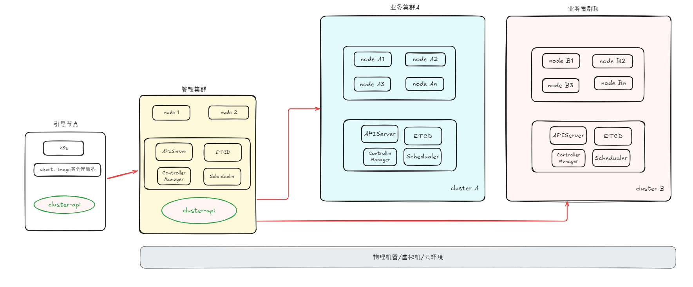
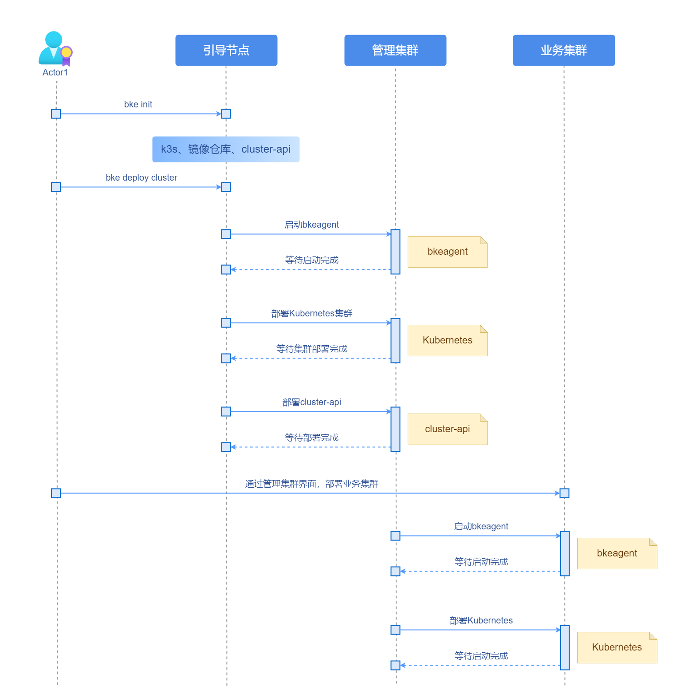
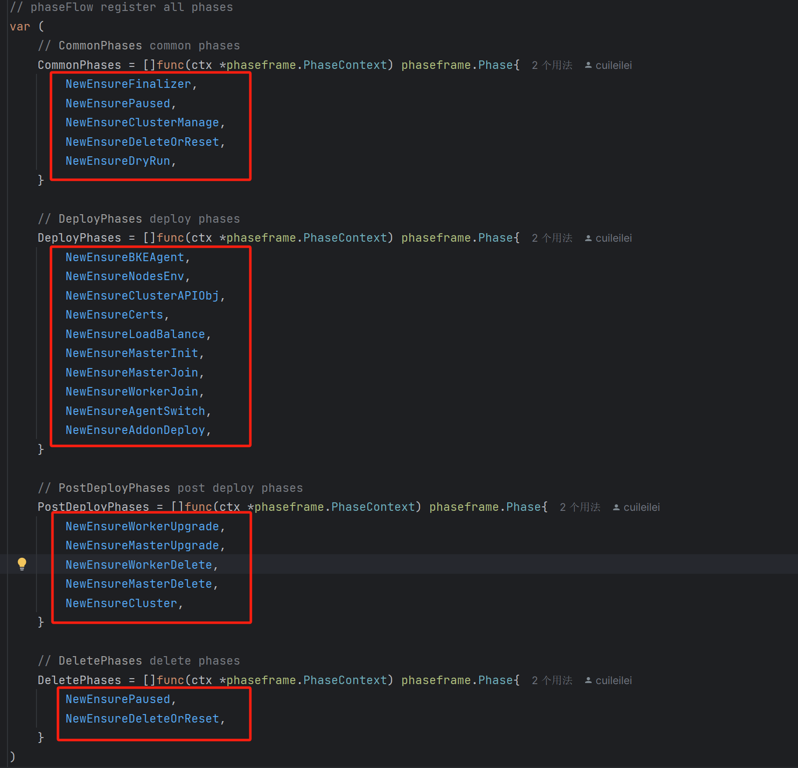
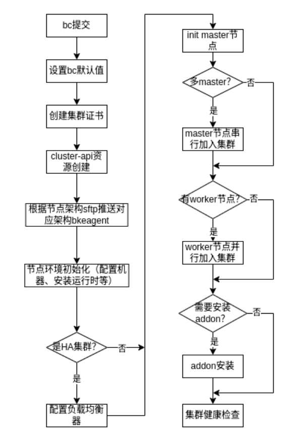
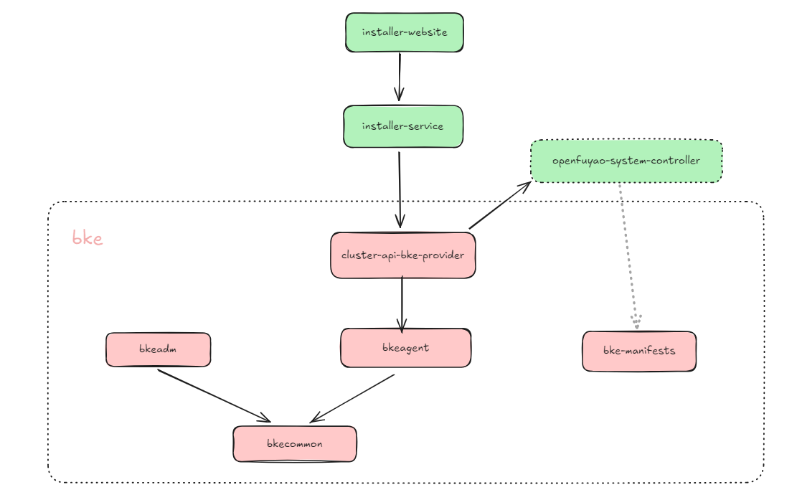
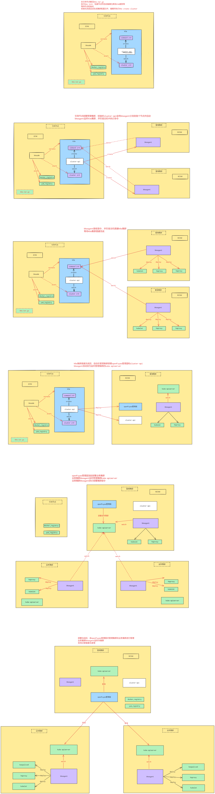
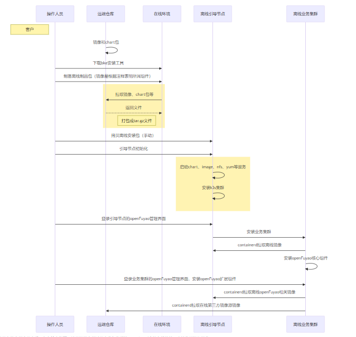

# openFuyao安装部署分析

**说明 openFuyao安装部署、 bke工具、 Cluster API机制 的关系 和  整体流程。**

## 一、引言

**目前有8个仓：5 +  1 + 2**

**① bke5个仓： bkeadm、 bkeagent、 cluster-api-provider-bke、 bkecommon、 bke-manifests**

* **cluster-api-provider-bke        **Cluster API管理k8s的provider，与官方的provider不完全一致，将多个provider放在了一起。添加了k8s生态组件和addon部署功能。
* **bkeagent            **bke自己实现的一个宿主机管理工具，运行在各个节点的二进制文件，托管于systemd，负责监听kube-apiserver crd资源，从⽽操作宿主机执行cluster-api-provider-bke 下发的指令。（指令分为：内置指令、k8s操作指令、SHELL指令）
* **bkeadm                **二进制工具，拉起镜像仓库、chart仓库、NFS服务端、HTTP服务、repo仓库，并安装k3s集群，在k3s集群内部署cluster-api与cluster-api-provider-bke
* **bkecommon             **bke的公共组件库，是上面几个仓的公共模块，项目不能直接运行，主要实现bkecluster.yaml解析、校验、转换等
* **bke-manifests        **按照一定的规范整合yaml资源，包含各个产品组件历次部署yaml

**② openfuyao-system-controller**    负责安装openFuyao核心组件

**③ installer-website、installer-service **   封装的管理集群创建业务集群的管理面

## 二、关于 Cluster API

请参照Cluster API的官方文档：https://cluster-api.sigs.k8s.io/

## 三、集群架构说明

说明目前openFuyao的 总体集群架构



**一共有三种类型集群类型：**

- **①引导节点**：为集群创建提供初始的基础设施和配置支持，目前是轻量级的k3s，拉起chart mesuem、docker registry等服务，存储需要的chart包和image镜像，用于离线使用。在线用不到。并安装cluster-api，用于拉起实际的管理集群
- **②管理集群**：一般是高可用的集群，为k8s，内置cluster-api，用于实际的业务集群创建和管理动作。统一发起、协调和管理业务集群（Workload Cluster）的全生命周期（创建、扩容、升级、删除），同时通过自身运行的 CAPI 核心控制器，监控并维护业务集群及其中节点的状态，确保业务集群按配置正常部署和运行（自身不直接承载业务负载，仅负责 “管控” 业务集群）
- **③业务集群**：实际进行业务部署的集群

**目前支持两种部署形态：**

- **①单个集群管理**：应用于一体机推理等场景，单个集群即可，满足简单扩容功能，部署引导节点和管理集群即可。管理集群实际部署业务。也支持引导节点共部署，同时部署k3s和k8s。
- **②多集群管理**：cluster-api的通用场景，引导节点、管理集群、业务集群严格分隔开，只有业务集群部署实际的业务

**部署时序图**



## 四、openFuyao 如何使用 Cluster API

**这里，bke使用了Cluster API这套框架，和Cluster API的标准组件，对集群和机器等资源进行抽象。对于资源操作的provider进行了实现。 bke 没有严格区分 Infrastructure Provider 、   Bootstrap provider、 Control Plane Provider ，而是都放在了cluster-api-provider-bke进行统一实现。**

**bke 具体的实现逻辑都放在了cluster-api-provider-bke仓中的phaseFlow 中**



**以创建过程为例，集群创建部署 以 cluster-api-provider-bke 和  bkeagent协作完成， bkeagent作为工作者，接受并执行cluster-api-provider-bke下发的指令。bkeagent以systemd service的形式运行在每个节点主机之中,通过连接管理集群的api-server 与 bke-controller进行通信。 bke将集群部署拆分为多阶段,阶段可复用并按一定顺序排列执行,整个部署流程大大小小共有12个步骤。**

**安装一个集群整体的部署流程图如下所示**


**这里我们openFuyao的核心组件就作为bke中定义的addon 在k8s组件安装好后最后进行安装。**

**设计到的步骤如下：**

**① EnsureCerts**

**证书生成，生成集群证书，并以secret保存到同bkecluster的namespace下 apiserver证书**

* apiserver证书
  包含以下sans `svc子网第一个ip`、`所有master节点IP`、`apiserver VIP`、`master.bocloud.com`、`kubernetes`、`kubernetes.default`、`kubernetes.default.svc`、`kubernetes.default.svc.cluster`、`kubernetes.default.svc.cluster.local`、`127.0.0.1`、`bc.Spec.ClusterConfig.Cluster.ApiServer.CertSANs中预先配置的IP或域名`
* etcd server证书
  包含以下sans `localhost`、`所有etcd节点IP`、`bc.Spec.ClusterConfig.Cluster.Etcd.ServerCertSANs中预先配置的IP或域名`
* etcd peer证书
  包含以下sans `localhost`、`所有etcd节点IP`、`bc.Spec.ClusterConfig.Cluster.Etcd.PeerCertSANs中预先配置的IP或域名`

**② EnsureClusterAPIObj   cluster-api资源创建**

**cluste-api资源创建，根据bkeCluster.spec内容生成以下cr资源	**`Cluster`、`KubeadmControlPlane`、`BKEMachineTemplate（controlplane）`、`MachineDeployment`、`BKEMachineTemplate（worker）`

**③ EnsureBKEAgent**

**从管理集群中推送bkegent到对应的节点上。agent推送使用ssh和sfpt操作主机，包含主机架构检测，agent推送与启动，ping agent三个步骤。**

agent推送使用ssh和sfpt操作主机，包含主机架构检测，agent推送与启动，ping agent三个步骤

* 主机架构检测
  
  ```
  echo $(uname -m | sed 's/x86_64/amd64/;s/aarch64/arm64/;s/^unknown$/amd64/')
  ```
* agent推送与启动
  获取管理集群的kubeconfig文件`kube-system/localkubeconfig Secret`内容，并写到每个节点的/etc/openFuyao/bkeagent/config文件中
  生成bkeagent的systemd service文件（agent的ntpserver就是在这配置）
  
  ```
  [Unit]
  Description= bkeagent
  After=network.target
  
  [Service]
  Environment="DEBUG=true"
  ExecStart=/usr/local/bin/bkeagent --kubeconfig=/etc/openFuyao/bkeagent/config --ntpserver=cn.pool.ntp.org:123
  KillMode=process
  RestartSec=5
  Restart=on-failure
  SuccessExitStatus=0
  
  [Install]
  WantedBy=multi-user.target
  ```
  
  sftp 拷贝对应架构的bkeagent二进制文件到主机`/usr/local/bin/bkeagent`
  sftp 拷贝bkeagent.service文件到主机`/etc/systemd/system/bkeagent.service`
  启动agent
  
  ```
  "systemctl daemon-reload 2>&1 >/dev/null",
  "systemctl enable bkeagent 2>&1 >/dev/null",
  "systemctl restart bkeagent 2>&1 >/dev/null",
  ```
* ping agent
  下发ping command到所有节点并等待agent修改status

**④ EnsureNodesEnv**

- **节点环境初始化，包含主机硬件资源检测，主机重置，环境设置，环境检查**
- **主机硬件资源检测**：主机操作系统检测（支持kylin，ubuntu，centos），资源检测（master 至少2c2g，worker未限制）
- **环境设置**：时间同步定时任务、修改hosts、kernel 参数修改和模块开启、关闭防火墙、关闭selinux、关闭swap、配置软件源、安装容器运行时、iptables规则设置、安装bke镜像仓库证书
- **环境检查**：根据上方设置内容检查

**⑤ EnsureLoadBalance 配置api-server负载均衡器**

* master节点开启内核模块 ip_vs ，ip_vs_wrr模块
* master 节点写入keepalived和haproxy配置文件
* master节点写入keepalived和haproxy静态pod yaml文件

**⑥ EnsureMasterInit**

* 下载对应版本kubectl二进制文件从http仓库中
* 从管理集群加载集群证书，并生成本地kubeconfig（server为主机ip:6443）
* 生成apiserver、controller-manager、scheduler、etcd静态pod yaml文件
* 下载apiserver、controller-manager、scheduler、etcd 、kubelet镜像
* 生成kubelet容器启动脚本和kubelet config文件，启动kubelet容器
  
  直到api-server能被访问（若是高可用集群则是通过设置的vip和端口进行连接），且能获取到该master节点在集群中的node资源，master初始化结束
  
  若有master节点需要加入，等待该节点的k8s组件的pod均running，下一master节点开始加入

**⑦ EnsureMasterJoin**

**其他master节点加入，步骤类似**

* 下载对应版本kubectl二进制文件从http仓库中
* 从管理集群加载集群证书，并生成本地kubeconfig（server为主机ip:6443）
* 生成apiserver、controller-manager、scheduler、etcd静态pod yaml文件
* 下载apiserver、controller-manager、scheduler、etcd 、kubelet镜像
* 生成kubelet容器启动脚本和kubelet config文件，启动kubelet容器
  
  直到能通过api-server查到该master节点在集群中的node资源，且该节点的k8s组件的pod均running，继续下一master节点开始加入

**⑧ EnsureWorkerJoin**

* 从管理集群加载集群ca证书，以及连接master的kubeconfig文件
* 下载kubelet镜像
* 生成kubelet容器启动脚本和kubelet config文件，启动kubelet容器

直到能通过api-server查到该worker节点在集群中的node资源，则算加入成功

**⑨ EnsureAddonDeploy**

- Addon安装，addon都遵循以下模式  渲染addon yaml文件→提交到远端集群 进行apply 执行。 **这里主要是openFuyao核心组件的安装，起openfuyao-system-controller这个pod，进行openFuyao 核心组件安装，具体的安装流程复用之前installer的安装脚本，进行核心组件的helm install安装。**

**⑩ EnsureCluster**

* 为worker节点设置"kubernetes.io/alert"标签
* 创建k8s-token secret
* 健康检查（只检查能通过远端集群api-server获取到的node节点）
  master节点需要 apiserver、controller-manager、scheduler、etcd容器处于running状态，node为ready状态，worker节点需要node为ready状态
  任一节点不满足上诉要求集群则不健康

## 五、openFuyao 安装说明

**调用关系如下：**

* **bke 进行k8s组件和网络等插件的安装**
* **openFuyao的核心组件作为bke定义的addon进行安装。将openfuyao-system-controller的deployment.yaml放到bke-manifests中，在最后addon安装时，依次执行安装核心组件的脚本**
* **管理面进行业务集群的生命周期管理**



**整个的安装流程可以大致描述如下：**



## 六、使用Cluster API 优势

* **基于 Kubernetes 声明式 API 风格**：设计简洁，自动化Kubernetes集群的部署和管理。通过使用声明性API和工具，统一管理模型：基础设施（虚拟机、网络、负载均衡）与 Kubernetes 组件（API Server、Scheduler 等）在同一管理平面中以相同方式声明和操作。
* **多云／混合云**：支持Provider 架构：CAPI 定义了 Infrastructure、Bootstrap、ControlPlane 三类 Provider，可灵活组合 AWS、Azure、GCP、vSphere、OpenStack等多种平台,同一套 YAML 定义可在任意支持的云或本地环境中复用，免除针对不同平台编写多套脚本
* **全周期生命管理**：创建／扩缩容／升级／删除：CAPI 控制器可自动执行集群的初次部署、节点扩缩容、Kubernetes 版本升级及集群卸载等操作简化操作，功能完善，且在不断迭代演进，支持更多扩展性 和功能。
* **自动化**：声明式API自动处理集群创建、配置和管理； **灵活**：支持多云平台和基础设施提供商，提供统一的接口来管理不同环境下的k8s集群。
* **使用广泛**： Cluster API是由 Kubernetes SIG 发起的项目，社区活跃度较高。截至2025.4.23 有 **1.4k Fork**  和  **3.8k Star,** 社区贡献者高达**577位**， 一直在稳步演进。目前已经被众多的主流公/私有云使用，社区的主要贡献者也来自这些公司，支持力度较大。且为现有K8s生命周期管理工具提供逐步采用cluster-api的过渡路径。Cluster API 已被多家云厂商和开源项目采用 :
  **公有云厂商**
  
  * **AWS: 通过 **`CAPA` (Cluster API Provider AWS) 支持。
  * **Azure: 通过 **`CAPZ` (Cluster API Provider Azure) 支持。
  * **Google Cloud: 通过 **`CAPG` (Cluster API Provider GCP) 支持。
  * **阿里云: 通过 **`CAPAlibaba` 支持（社区驱动）。
  
  **私有云/本地部署**
  
  * **vSphere: 通过 **`CAPV` (Cluster API Provider vSphere) 支持。
  * **Metal3: 通过 **`CAPM3` (Cluster API Provider Metal3) 支持裸金属服务器。
  * **OpenStack: 通过 **`CAPO` (Cluster API Provider OpenStack) 支持。
  
  **一些开源项目**
  
  * **openshift :安装部署在对接Cluster API**
  * **Rancher: 集成 Cluster API 管理边缘集群。**
  * **Tanzu:  VMware Tanzu 使用 Cluster API 管理 Kubernetes 生命周期。**
  * **Kubesphere: 青云支持基于 Cluster API 的多集群管理。**
  * **TKE：腾讯容器平台使用的是Cluster API**

**小结：Cluster API 在集群安装部署方面以其声明式、原生 Kubernetes、跨平台和全生命周期自动化等优势，成为大规模、多集群、持续交付场景下**的首选解决方案，比较适合**企业级使用 和 多云管理场景**。

## 七、相关问题

**架构说明**

**调用关系说明**

**证书问题**

目前用到的证书是3块： k3s、k8s、containerd

- k3s在使用时脚本动态生成
- k8s生成随整体安装调谐逻辑进行处理，在ensureCerts中，支持修改为自己的证书，改根证书rootCA
- containerd证书用于与本地镜像仓交互，拉取镜像使用。目前配置参数skip，不进行TLS校验。

**组件参数配置问题**
bke-manifests采⽤go template⽅式进⾏参数替换,所有的模板⽂件镜像地址采⽤统⼀的{{.repo}}image:tag格式,对应的参数也是通过模板进行预留。

bke-manifests 用模版进行配置，在bc 自定义crd中用param  进行解析，渲染填入，直接进行安装。所以关键是manifests 的 yaml 要和 bc param完全对应，并且预留好模版进行bc的解析渲染填入。

**离线安装**



## 八、全量配置

bke部署集群有一个唯一的配置文件，所有的后续部署均围绕该配置文件进行，部署文件的详细信息如下

该配置文件是k8s中的crd文件

* > 当执行完`bke init`后在`${BKE_WORKSPACE}/cluster`（默认`/bke/cluster`）目录下会生成该配置文件
  > 
  > 执行`bke config`在当前目录下生成该配置文件
* 如下介绍一下配置文件的详细信息

```
apiVersion: bke.bocloud.com/v1beta1
kind: BKECluster
metadata:
  name: bke-cluster
  namespace: bke-cluster
  # 所有注释不存在则都按默认值处理
  annotations:
    # 设置agent监听的集群 默认current
    # 可选值 current或bkecluster
    # 设置为bkecluster时会在当前配置的集群创建之后转移agent监听到新集群。
    # 一旦转移将失去对该BKECluster CRD所指集群的控制,即删除扩缩容等操作都将失效
    bke.bocloud.com/bkeagent-listener: current
    # 集群类型，默认空
    # 部署新集群为"",纳管老的bocloud部署的集群值为bocloud，纳管其他来源的k8s用other
    bke.bocloud.com/cluster-from: ""
    # 是否开启深度清理节点，默认为 true
    # 除移除k8s相关，还会额外清理容器运行时(docker containerd)
    bke.bocloud.com/deep-restore-node: "true"
    # 删除bc时是否忽略删除目标集群，默认为 true
    # 若为true则删除bc时不会删除目标集群，只会删除当前集群中的各种CR
    # 若为false则删除bc时会删除目标集群
    bke.bocloud.com/ignore-target-cluster-delete: "true"
    # 删除bc时是否忽略删除bc所在的namespace，默认为 true
    # 若为true则删除bc时不会删除bc所在的namespace
    # 若为false则删除bc时会删除bc所在的namespace
    # 若检测到该namespace下还有其他bc，即使设置为false也不会删除该namespace
    bke.bocloud.com/ignore-namespace-delete: "true"
    # 节点引导超时时间，默认10m
    # 该参数可影响环境检查的超时时间，以及单节点启动k8s组件的时间
    # 在网络条件不好时，可适当调高该值
    bke.bocloud.com/node-boot-wait-timeout: "10m"
    # 节点预约删除，节点删除是个危险的动作故增加此注释做二次确认，默认无
    # 删除节点时除从spec中将节点删除，还需将要删除的节点ip填入，多个ip之间使用‘,’分割
    # 两步操作少之其一都不会触发节点删除
    bke.bocloud.com/appointment-deleted-nodes: ""
    # 节点预约安装
    # 安装节点时,从spec中将节点信息填入,并在该注解中填入了节点ip,多个ip之间使用‘,’分割
    # 将不会对注解中存在ip的节点进行安装,直至将相关ip从注解中移除后才会安装
    bke.bocloud.com/appointment-add-nodes: ""
    # master节点是否可调度，默认false
    # 设置为false等同于在master节点加入集群后使用 kubectl conrdon node **
    bke.bocloud.com/master-schedulable: "false"
spec:
  # 可选 负载均衡地址，需要配置负载均衡器时再填
  controlPlaneEndpoint: # 详情见下方章节 负载均衡
    host: "HA IP" # 启动负载均衡器时，VIP 将设置为该值，且需要与Node列表中各个node IP同网段
    port: 36443 # 可选 int32类型 如只设置host没有port默认设置为36443
  pasue: false    # 此值为true会暂停集群操作，无法暂停正在运行的操作,eg: 正在扩容,扩容结束后不再进行其他操作
  dryRun: false   # 此值为true则仅做环境检查不安装k8s集群
  reset: false    # 此值为true则会删除bc，等同于kubectl delete bc 
  # kubernetes集群配置
  # 各个组件的镜像名称、镜像版本、启动参数配置（组件本身存在默认启动参数，配置的为额外的启动参数）
  clusterConfig:
    cluster:
      apiServer: # 详情见下方章节 kubernetes组件配置-kube-apiserver
        port: "6443" 
      controllerManager: # 详情见下方章节 kubernetes组件配置-kube-controller-manager
      etcd: # 详情见下方章节 kubernetes组件配置-etcd
        dataDir: /var/lib/openFuyao/etcd
      scheduler: # 详情见下方章节 kubernetes组件配置-kube-scheduler
        extraVolumes:
          - hostPath: /host/exam
            mountPath: /host/exam
            name: example
            pathType: Directory
            readOnly: true
      kubelet: # 详情见下方章节 kubernetes组件配置-kubelet
        manifestsDir: /etc/kubernetes/manifests
        # 可选,配置kubelet 数据目录,此处所示为默认配置，没有填写时将会自动设置
        # extraVolumes中配置一条name为kubelet-root-dir的才会生效否则会认为是普通的额外挂载
        extraVolumes:
          - name: kubelet-root-dir
            hostPath: /var/lib/kubelet
      # 配置容器运行时
      containerRuntime: # 详情见下方章节 容器运行时配置
        # 设置为containerd时请在下方customExtra字段中填写containerd版本，docker不用填写
        cri: containerd # 可选docker、containerd，默认containerd
        runtime: runc # 可选 runc、richrunc、kata，默认runc
        # docker、containerd配置文件额外参数
        # ps: 由于docker的containerd的配置文件格式不同，此处的key，value为定制参数
        param: 
          # 可选,CRI数据保存目录
          # cri为containerd时默认为/var/lib/containerd
          # cri为docker时默认为/var/lib/docker
          # 没有填写时将会自动设置
          data-root: /var/lib/containerd 
          # 可选，cgroup驱动
          # 默认为systemd，在麒麟V10 amr64系统上使用docker-engine时，将会强制使用cgroupfs
          cgroupDriver: systemd
      # 配置kubernetes版本，当各个k8s组件不配置版本时以此为准目前支持（v1.21.1、v1.23.17、v1.25.6）的集群部署
      # 可选 默认v1.25.6，支持1.21-1.29
      kubernetesVersion: v1.25.6
      # k8s证书在主机上的存放目录
      # 可选 默认/etc/kubernetes/pki
      certificatesDir: /etc/kubernetes/pki
      # 集群网络
      networking: # 详情见下方章节 网络配置
        dnsDomain: cluster.local
        podSubnet: 10.250.0.0/16
        serviceSubnet: 10.96.0.0/12
      # 可选 公网环境可采用公网ntpServer
      # 内网环境如果提供则填写上ntpServer
      # 默认从 configmap cluster-system / bke-config 中读取，详情见引导节点章节 
      ntpServer: cn.pool.ntp.org:123 
      # kubernetes集群部署所有的镜像来源于 deploy.bocloud.k8s:40443/kubernetes
      imageRepo: # 详情见下方章节 镜像仓库
        domain: deploy.bocloud.k8s
        port: "40443"
        prefix: kubernetes
      # 该http源（yum或apt源）会配置到所有的节点  
      httpRepo: # 详情见下方章节 yum仓库
        domain: deploy.bocloud.k8s
        port: "40080"
        prefix: ""
    # 配置所有节点的详细信息
    nodes: # 详情见下方章节 集群节点配置              
      - hostname: master-1  # 很明显三个master会自动组建高可用k8s集群
        ip: 172.100.200.10
        username: root      # 用户名密码是必须的，且保证ssh连接是通的，使用非root用户需要具有sudo免密权限
        password: password0 # 密码会被自动加密
        port: "22"
        # 配置该节点的角色，目前只支持master和etcd绑定在一个节点配置
        # 支持的角色类型 （master、node、master/node、etcd）
        # 注意使用mater和node同节点的角色是，需填写为 "master/node"形式，不可以分开填写
        role:               
          - master/node
          - etcd
      - hostname: master-2
        ip: 172.100.200.11
        username: root
        password: password1
        port: "22"
        role:
          - master
          - etcd
      - hostname: master-3
        ip: 172.100.200.12
        username: root
        password: password2
        port: "22"
        role:
          - master
          - etcd
      - hostname: worker-1
        ip: 172.100.200.13
        username: root
        password: password3
        port: "22"
        role:
          - node
      - hostname: worker-2
        ip: 172.100.200.14
        username: root
        password: password4
        port: "22"
        role:
          - node
      - hostname: worker-3
        ip: 172.100.200.15
        username: root
        password: password5
        port: "22"
        role:
          - node
    # Kubernetes生态组件，当k8s集群启动完成后将会按照顺序部署如下组件  
    addons:
      # 安装 kubeproxy时 version跟随spec中的k8s版本,
      # 如上述填写 "kubernetesVersion: v1.25.6",此处version也填写 v1.25.6
      - name: kubeproxy
        version: v1.25.6
        # 阻塞，即等待该组件启动完成后才会部署下边组件
        # 不填写时 默认为false
        block: true 
        param:      # 部署该组件需要的参数
          clusterNetworkMode: calico
      - name: calico
        param:
          calicoMode: bgp
        version: v3.25.0
      - name: coredns
        version: v1.10.1
    customExtra:
      # contaienrd是必须的，且value需要符合命名规则^containerd-([a-z0-9\\.]+)-([a-z0-9]+)-([a-z0-9\\.\\{\\}]+).tar.gz$
      containerd: containerd-1.6.16-linux-{.arch}.tar.gz
      # 可选，bkeagent-launcher-image纳管集群时使用的bkeagent-lancher镜像，未填写时将使用imageRepo中的镜像仓库生成镜像获取地址
      bkeagent-launcher-image: "deploy.bocloud.k8s:40443/kubernetes/bkeagent-launcher:latest"
      # 可选，设置master vip的route ID，设置负载均衡器后，且未填写该值，控制器将随机生成1-255的数字填写
      masterVirtualRouterId: '60'
      # 可选，设置beyondELB vip的route ID，beyondELB 组件中设置lbvip后，且未填写该值，控制器将随机生成1-255的数字填写
      ingressVirtualRouterId: '200'
      # 可选 设置环境初始化额外执行脚本，具体见下方环境初始化脚本
      envExtraExecScripts: "install-lxcfs.sh,install-nfsutils.sh,install-etcdctl.sh,install-helm.sh,install-calicoctl.sh,update-runc.sh"
```

