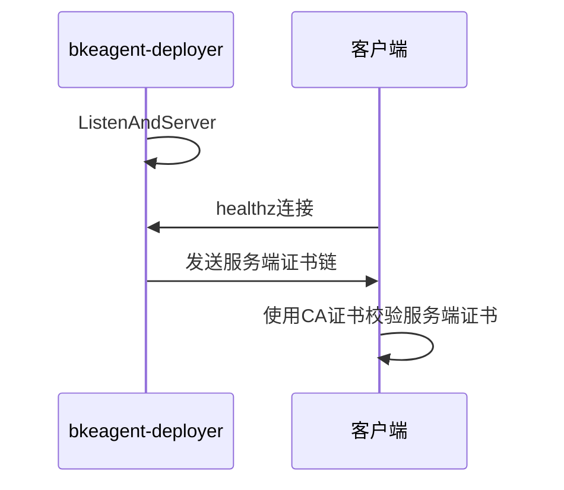

# 1、特性描述

健康检测机制优化旨在提供安全的健康检查接口，用于用户系统对接集群的pod和系统服务，探测其健康状态。

## 1.1、依赖组件

| 组件                       | 组件描述          | 可获得性 |
|:-------------------------|:--------------|:-----|
| bkecommon                | bke基础通用函数库    | 必选   |
| cluster-api-provider-bke | 集群安装部署调谐器     | 必选   |
| bkeadm                   | 引导集群初始化       | 必选   |
| bke-manifests            | 集群安装的yaml文件集合 | 必选   |
| installer-website        | 集群生命周期管理前端服务  | 必选   |
| installer-service        | 集群生命周期管理后端服务  | 必选   |

## 1.2、License

Mulan PSL v2 License。

# 2、需求场景威胁建模

提供HTTPS探针能力和bkeagent系统服务监听HTTPS端口。

# 3、特性设计

## 3.1、上下文/USE-CASE视图

_可应用架构设计，补充模块功能分析_

_包括主要业务流图，动态视角识别功能点_


上图展示了用户检测系统导入证书并使用证书开启HTTPS监听，用于用户系统的探测请求，识别服务的状态状态。

下图展示了单向TLS校验的流程。




## 3.2、模块设计

openFuyao安装的服务的健康检测列举如下：

| 集群类别 | pod/服务                  | 协议类型       | 备注                                   | 处理策略                            |
|------|-------------------------|------------|--------------------------------------|---------------------------------|
| 引导集群 | bke-controller-manager  | HTTP       | k3s容器拉起的pod，存在网络隔离，需要进入k3s容器再进行检查    | 只负责拉起管理集群，无须对接                  |
| 引导集群 | capi-controller-manager | HTTP       | 开源组件，此外也是k3s容器拉起的pod                 | 只负责拉起管理集群，无须对接                  |
|      |                         |            |                                      |                                 |
| 管理集群 | bke-controller-manager  | HTTPS      | openFuyao开发的pod                      | 提供HTTPS探测端口（9444端口，支持yaml配置）    |
| 管理集群 | capi-controller-manager | HTTP       | 开源组件，监听开启的是HTTP，需要嵌入修改监听HTTPS        | 提供HTTP探测端口                      |
| 管理集群 | bkeagent-deployer       | HTTPS      | openFuyao开发的pod                      | 提供HTTPS探测端口（8443端口，支持yaml配置）    |
| 管理集群 | bkeagent                | HTTP       | 系统服务                                 | 提供HTTP探测端口（58080端口，支持bc的yaml配置） |
| 管理集群 | etcd                    | HTTPS/HTTP | 2381端口，开源组件                          | 提供HTTPS探测端口                     |
| 管理集群 | kube-proxy              | HTTP       | 10256端口，开源组件                         | 提供HTTP探测端口                      |
| 管理集群 | kube-apiserver          | HTTPS      | 6443端口，开源组件                          | 提供HTTPS探测端口                     |
| 管理集群 | kube-controller-manager | HTTPS      | 10257端口，开源组件                         | 提供HTTPS探测端口                     |
| 管理集群 | kube-scheduler          | HTTPS      | 10259端口，开源组件                         | 提供HTTPS探测端口                     |
| 管理集群 | calico-kube-controllers | sh脚本       | /usr/bin/check-status  开源组件，需要嵌入修改代码 | 行内自行对接                          |
| 管理集群 | calico-node             | sh脚本       | /bin/calico-node  开源组件，需要嵌入修改代码      | 行内自行对接                          |
| 管理集群 | coredns                 | HTTP       | 开源组件，修改dns的configmap进行配置HTTPS        | 提供HTTP探测端口                      |
| 管理集群 | kubelet                 | HTTPS/HTTP | 10248端口(HTTP) 10250端口(HTTPS)，开源组件    | 提供HTTPS探测端口                     |
| 管理集群 | containerd              |            | 无                                    | 行内自行对接                          |
|      |                         |            |                                      |                                 |
| 业务集群 | bkeagent-deployer       | HTTPS      | openFuyao开发的pod                      | 提供HTTPS探测端口（8443端口，支持yaml配置）    |
| 业务集群 | bkeagent                | HTTP       | 系统服务                                 | 提供HTTP探测端口（58080端口，支持bc的yaml配置） |
| 业务集群 | etcd                    | HTTPS/HTTP | 2381端口，开源组件                          | 提供HTTPS探测端口                     |
| 业务集群 | kube-proxy              | HTTP       | 10256端口，开源组件                         | 提供HTTP探测端口                      |
| 业务集群 | kube-apiserver          | HTTPS      | 6443端口，开源组件                          | 提供HTTPS探测端口                     |
| 业务集群 | kube-controller-manager | HTTPS      | 10257端口，开源组件                         | 提供HTTPS探测端口                     |
| 业务集群 | kube-scheduler          | HTTPS      | 10259端口，开源组件                         | 提供HTTPS探测端口                     |
| 业务集群 | calico-kube-controllers | sh脚本       | /usr/bin/check-status 开源组件，需要嵌入修改代码  | 行内自行对接                          |
| 业务集群 | calico-node             | sh脚本       | /bin/calico-node 开源组件，需要嵌入修改代码       | 行内自行对接                          |
| 业务集群 | coredns                 | HTTP       | 开源组件，修改dns的configmap进行配置HTTPS        | 提供HTTP探测端口                      |
| 业务集群 | containerd              |            | 无                                    | 行内自行对接                          |
| 业务集群 | kubelet                 | HTTPS/HTTP | 10248端口(HTTP) 10250端口(HTTPS)，开源组件    | 提供HTTPS探测端口                     |

汇总如下：

1. 需要嵌入修改才能变更成HTTPS，保持上游社区使用HTTP：capi-controller-manager；
2. 需要变更安装yaml文件才能变更成HTTPS，建议保持HTTP：kube-proxy；
3. 变更配置即可变更成HTTPS，社区进行整改成HTTPS：coredns、kube-apiserver；
4. 已经满足要求，提供HTTPS的：etcd、kube-controller-manager、kube-scheduler、kubelet；
5. 未支持healthz的：containerd、calico-kube-controllers、calico-node；
6. **社区提供的pod，使用HTTPS：bkeagent-deployer、bke-controller-manager；**
7. **社区提供的系统服务，使用HTTP：bkeagent（支持监听端口可配置）；**

### 3.2.1、模块接口定义

_通过模块接口依赖图，识别模块接口，完善模块间的调用关系_

## 3.3、 Story分解

_结合3.1~3.2的分析，分解支持该特性所需要的Story，可以按照USE-CASE场景划分，也可以按照USE-CASE操作步骤划分_

### 3.3.1 bkeagent健康检查

bkeagent提供127.0.0.1本地IP、端口可配置的健康监听服务。

接口定义如下：

```go
// 启动健康监听服务端
func startHealthServer(port int, hc *healthChecker) error {}
// bkeagent可用性检查函数，通过其查看其监听的APIServer的版本来决定其是否可用
func (hc *healthChecker) checkHealth() (bool, string) {}
// 参数解析，添加 --health-port作为监听端口的输入，默认端口是58080
func parseFlags() config {}
// 启动函数，设置调谐器处理、健康监听函数
func run(cfg config) {}
// 入口函数
func main() {}
```

配置后如何使用：

```bash
curl -v http://127.0.0.1:port/healthz
```

端口支持可配置？在BKECluster这个CRD中新增AgentHealthPort配置字段，用于指定节点代理BKEAgent的健康检测端口。

```go
type Cluster struct {
	// NTPServer defines the ntp server information used for time synchronization
	// +required
	NTPServer string `json:"ntpServer,omitempty"` // 已有字段

	// AgentHealthPort defines the agent health port
	// +optional
	AgentHealthPort string `json:"agentHealthPort,omitempty"` // 新增字段
}
```

为了便于用户安装集群，再引导节点初始化完成后，会在引导节点的/bke/cluster/目录下生成BKECluster的样例文件。初始化时可以通过--agentHealthPort参数导入初始的端口号，如下命令：

```bash
bke init --agentHealthPort 58081 # 默认端口号是58080，可以通过参数导入
```

初始化完成后，会自动将端口号写入到cluster-system/bke-config的configmap中，后续通过openFuyao前端新建集群时installer-service会读取该configmap中的端口号做为节点代理的健康监听端口。

下面总结修改BKEAgent的健康监听端口：
- 前端部署的集群，需要修改cluster-system/bke-config这个configmap中的agentHealthPort字段，然后再进行集群部署。
- 后端部署的集群，需要修改BKECluster的spec.clusterConfig.cluster.agentHealthPort字段，然后再进行集群部署。

### 3.3.2 bkeagent-deployer

DaemonSet部署的节点Pod，在集群的每个节点上都会部署一个，在Pod启动时开启一个HTTPS服务端，使用的TLS证书的集群ca证书签发的，如下使用，默认使用的是8443端口，支持yaml中动态配置。

```bash
curl -v --cacert /etc/kubernetes/pki/ca.crt https://<node-ip>:8443/healthz

curl -v --cacert /etc/kubernetes/pki/ca.crt https://<node-ip>:8443/readyz
```

这个pod用于bkeagent升级使用。

### 3.3.3 bke-controller-manager

BKECluster这个CRD的调谐器Pod，会在引导集群和管理集群上部署，默认部署1副本，引导集群和管理集群通过参数使用不同的探针协议，引导集群使用HTTP协议，管理集群使用HTTPS协议。

HTTPS协议的探针也是使用集群ca证书签发的tls证书，默认使用的是9444端口，支持yaml中动态配置，如下使用：

```bash
curl -v -k https://<pod-ip>:9444/healthz

curl -v -k https://<pod-ip>:9444/readyz
```

由于ca证书中SAN没有pod ip，因此模拟的curl命令需要忽略证书校验。

### 3.3.4 k8s组件健康检查

#### kube-apiserver

APIServer监听的是主机的6443端口，使用的CA证书是/etc/kubernetes/pki/ca.crt，因此其就绪探针和存活探针如下调用：

```bash
curl -v --cacert /etc/kubernetes/pki/ca.crt https://node-ip:6443/readyz
curl -v --cacert /etc/kubernetes/pki/ca.crt https://node-ip:6443/healthz
```

#### kube-controller-manager

使用的健康检查端口是10257，使用的CA证书是/etc/kubernetes/pki/ca.crt，该pod默认配置只会有存活探针，如下调用：

```bash

curl -v --cacert /etc/kubernetes/pki/ca.crt https://node-ip:10257/healthz
```

需要做的点如下：

- kube-controller-manager启动指定证书，专门使用ca.crt签发的tls服务端证书

  ```yaml
  command:
      - kube-controller-manager
      # 指定 TLS 证书文件路径
      - --tls-cert-file=/etc/kubernetes/tls-server.crt
      # 指定 TLS 私钥文件路径，可选
      - --tls-cipher-suites=TLS_ECDHE_RSA_WITH_AES_128_GCM_SHA256,TLS_ECDHE_ECDSA_WITH_AES_128_GCM_SHA256
      # 指定 TLS 私钥文件路径，与证书配对的密钥
      - --tls-private-key-file=/etc/kubernetes/tls-server.key
  ```

  /etc/kubernetes/tls-server.crt这个证书是由/etc/kubernetes/pki/ca.crt签发的。

#### kube-scheduler

使用的健康检查端口是10259，使用的CA证书是/etc/kubernetes/pki/ca.crt，该pod默认只会有存活探针，如下调用：

```bash
curl -v --cacert /etc/kubernetes/pki/ca.crt https://node-ip:10259/healthz
```

需要做的点如下：

- kube-scheduler启动指定证书

  ```yaml
  command:
      - kube-controller-manager
      # 指定 TLS 证书文件路径
      - --tls-cert-file=/etc/kubernetes/tls-server.crt
      # 指定 TLS 私钥文件路径，可选
      - --tls-cipher-suites=TLS_ECDHE_RSA_WITH_AES_128_GCM_SHA256,TLS_ECDHE_ECDSA_WITH_AES_128_GCM_SHA256
      # 指定 TLS 私钥文件路径，与证书配对的密钥
      - --tls-private-key-file=/etc/kubernetes/tls-server.key
  ```

  /etc/kubernetes/tls-server.crt这个证书是由/etc/kubernetes/pki/ca.crt签发的。

#### etcd

使用的健康检查端口是2379，探针如下：

```bash
curl --cacert /etc/kubernetes/pki/etcd/ca.crt \
     --cert /etc/kubernetes/pki/etcd/healthcheck-client.crt \
     --key /etc/kubernetes/pki/etcd/healthcheck-client.key \
     https://127.0.0.1:2379/health
```


## 3.4、质量属性设计

### 3.4.1、性能规格

|规格名称|规格指标|
|:-------|:-------|
|内存占用|        |
|启动时间|        |
|响应时间|        |
|xxx     |        |

### 3.4.2、可靠性设计

### 3.4.3、安全/韧性/隐私设计

### 3.4.4、兼容性设计

### 3.4.5、可服务性设计

### 3.4.6、可测试性设计

## 3.5 开发自测试用例设计

下面是开发自测试用例，包含P0和P1级用例。

| 用例编号                           | 优先级 | 前置条件     | 步骤描述                                                     | 预期结果                                                     |
| ---------------------------------- | ------ | ------------ | ------------------------------------------------------------ | ------------------------------------------------------------ |
| 001-后端安装业务集群（默认端口）   | P0     | 在线安装     | 1、bke init初始化引导节点，预期结果1<br />2、安装1master业务集群，预期结果2和3 | 1、引导节点初始化成功，bke-controller-manager使用的是HTTP探针<br />2、bkeagent的状态正常，默认使用58080健康监听端口<br />3、bkeagent-deployer的状态正常，默认使用HTTPS协议监听8443端口 |
| 002-后端安装业务集群（自定义端口） | P0     | 在线安装     | 1、bke init初始化引导节点，预期结果1<br />2、修改bkeagent的健康监听端口然后安装1master业务集群1，预期结果2<br />3、修改/etc/openFuyao/addons/manifests/kubernetes/bkeagent-deployer/latest目录下的部署文件，让bkeagent-deployer使用自定义端端口并部署1master业务集群2，预期结果3 | 1、引导节点初始化成功，bke-controller-manager使用的是HTTP探针<br />2、bkeagent的状态正常，使用自定义的健康监听端口<br />3、bkeagent-deployer的状态正常，使用自定义的端口且是HTTPS协议 |
| 003-后端安装管理集群（默认端口）   | P1     | 在线安装     | 1、bke init初始化引导节点，预期结果1<br />2、安装1master管理集群，预期结果2、3和4<br />3、管理集群安装1master业务集群，预期结果5和6 | 1、引导节点初始化成功，bke-controller-manager使用的是HTTP探针<br />2、bkeagent的状态正常，默认使用58080健康监听端口<br />3、bkeagent-deployer的状态正常，默认使用HTTPS协议监听8443端口<br />4、bke-controller-manager使用HTTPS协议监听9444端口<br />5、bkeagent的状态正常，默认使用58080健康监听端口<br />6、bkeagent-deployer的状态正常，默认使用HTTPS协议监听8443端口 |
| 004-后端安装管理集群（自定义端口） | P1     | 在线安装     | 1、bke init初始化引导节点，预期结果1<br />2、修改bkeagent的健康监听端口然后安装1master管理集群1，预期结果2<br />3、修改/etc/openFuyao/addons/manifests/kubernetes/bkeagent-deployer/latest目录下的部署文件，让bkeagent-deployer使用自定义端口并部署1master管理集群2，预期结果3<br />4、修改/etc/openFuyao/addons/manifests/kubernetes/cluster-api/v1.4.3目录下的部署文件，让bke-controller-manager使用自定义端端口并部署1master管理集群3，预期结果4 | 1、引导节点初始化成功，bke-controller-manager使用的是HTTP探针<br />2、bkeagent的状态正常，使用自定义健康监听端口<br />3、bkeagent-deployer的状态正常，使用自定义的端口且是HTTPS协议<br />4、bke-controller-manager的状态正常，使用自定义的端口且是HTTPS协议 |
| 005-前端安装业务集群（默认端口）   | P0     | 在线安装     | 1、bke init初始化引导节点，预期结果1<br />2、安装1master业务集群，预期结果2和3 | 1、引导节点初始化成功，bke-controller-manager使用的是HTTP探针<br />2、bkeagent的状态正常，默认使用58080健康监听端口<br />3、bkeagent-deployer的状态正常，默认使用HTTPS协议监听8443端口 |
| 006-前端安装业务集群（自定义端口） | P0     | 在线安装     | 1、bke init初始化引导节点，预期结果1<br />2、kubectl edit修改cluster-system/bke-config的agentHealthPort字段，然后安装业务集群，预期结果2 | 1、引导节点初始化成功，bke-controller-manager使用的是HTTP探针<br />2、bkeagent的状态正常，使用自定义健康监听端口 |
| 007-k8s组件健康状态模拟检测        | P0     | 在线安装     | 1、bke init初始化引导节点，预期结果1<br />2、安装1master管理集群1，预期结果2、3、4和5<br />3、安装3master1work管理集群2，预期结果2、3、4和5<br />注意：k8s组件的模拟查询见3.3.4章节 | 1、引导节点初始化成功，bke-controller-manager使用的是HTTP探针<br />2、kube-scheduler监听10259端口<br />3、kube-controller-manager监听10257端口<br />4、kube-apiserver监听6443端口<br />5、etcd监听2379端口 |
| 008-bkeagent监听端口异常用例       | P1     | 引导节点就绪 | 1、nc -l 58080 &开启端口占用<br />2、使用默认配置端口拉业务集群1<br />3、pkill -f "nc -l 58080"，拉起业务集群2 | 1、ss -tlnp  \| grep 58080查询58080端口被nc占用<br />2、集群拉取失败，bkeagent启动失败，端口被占用<br />3、集群拉取成功 |

# 4、需求分解分配表

|序号 |模块名称|Story名称|Story描述|
|:----|:-------|:--------|:--------|
|     |        |         |         |
|     |        |         |         |

# 5、修改日志
|版本|发布说明|
|:---|:-------|
|    |        |
|    |        |

# 6、参考目录

