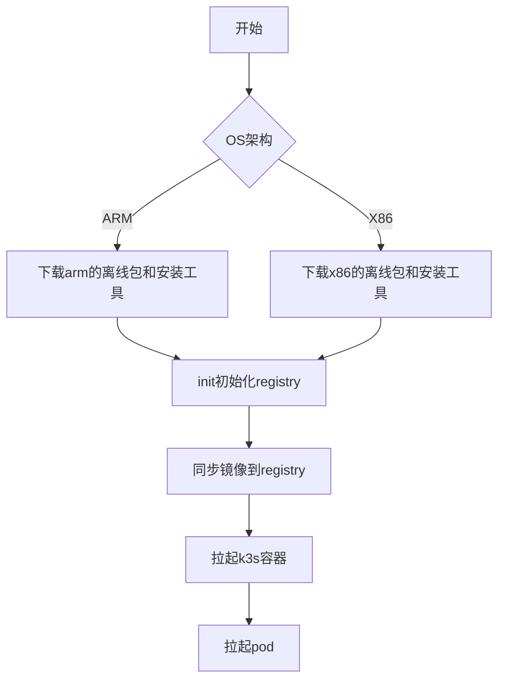
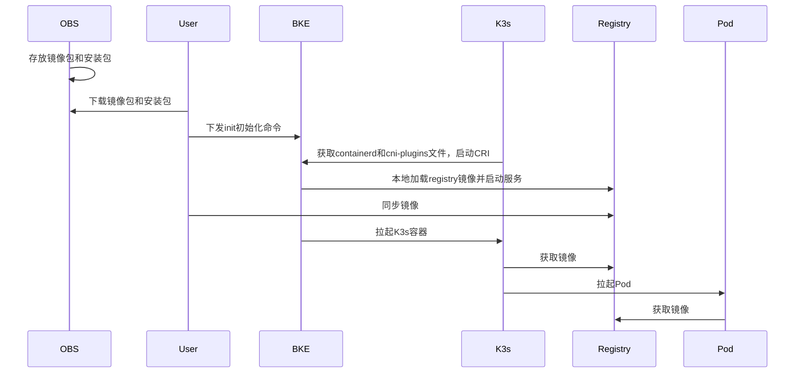

# 1、特性描述

引导节点安装优化，主要是方便用户，直接安装引导节点，而无须从在线镜像仓库获取镜像和在线二进制仓库获取二进制。

本需求旨在提供引导节点的安装优化，让在线安装时引导节点拉起的容器和pod最小集所需的镜像来自本地，使用的二进制也来自本地，而非远程仓库，减少仓库校验的处理逻辑。对于离线安装，因为离线安装包具有所有离线安装的镜像，就不需要使用到该特性在的功能。

故，该特性针对在线安装的优化。

## 1.1、依赖组件

| 组件   | 组件描述           | 可获得性 |
| :----- | :----------------- | :------- |
| bkeadm | 负责引导集群初始化 | 必选     |
|        |                    |          |

## 1.2、License

Mulan PSL v2 License。

# 2、需求场景威胁建模

_在需求场景分析阶段进行威胁建模可以有效提升系统的安全/韧性/隐私设计质量_

_该过程可选，建议下列特性进行需求场景威胁建模：_

- _安全功能特性，如认证、鉴权、审计等_
- _受攻击可能性大的特性，如跨信任域交互频繁的业务_
- _个人隐私相关特性，如涉及到个人隐私数据的收集、分析、处理、存储等_

# 3、特性设计

## 3.1、上下文/USE-CASE视图

_可应用架构设计，补充模块功能分析_

_包括主要业务流图，动态视角识别功能点_

下图展示了新的安装流程：



离线包的内容：

- registry镜像。

- 其他容器和k3s拉起的capi和bke-controller的pod所需镜像，如下：

  ```
  cr.openfuyao.cn/openfuyao/k3s                  v1.25.16-k3s4    ad701496e3d5    234.8MB    78.15MB
  cr.openfuyao.cn/openfuyao/chartmuseum          v0.16.2          cd98e1d089ab    80.84MB    24.71MB
  cr.openfuyao.cn/openfuyao/nginx_yum_repo       1.23.0-alpine    be8e2cde593c    27.66MB    10.19MB
  cr.openfuyao.cn/openfuyao/registry             2.8.1            dbaa3e69f563    27.55MB    9.794MB
  
  cr.openfuyao.cn/openfuyao/bke-manifests                                  latest      ee24146b1ea73       5.03MB
  cr.openfuyao.cn/openfuyao/cluster-api-provider-bke                       latest      2786c44b864c7       63.9MB
  cr.openfuyao.cn/openfuyao/cluster-api/cluster-api-controller             v1.4.3      f466968e74d41       33.6MB
  cr.openfuyao.cn/openfuyao/cluster-api/kubeadm-bootstrap-controller       v1.4.3      796ec5514df71       26.1MB
  cr.openfuyao.cn/openfuyao/cluster-api/kubeadm-control-plane-controller   v1.4.3      a9ac76f83c9f6       29MB
  cr.openfuyao.cn/openfuyao/mirrored-pause                                 3.6         94948ae336c59       299kB
  ```

- 二进制文件，以amd64架构为例如下（注：registry服务从本地导入镜像启动服务）：

  ```yaml
  files:
    - address: https://openfuyao.obs.cn-north-4.myhuaweicloud.com/registry/
      files:
        - fileName: registry.image-amd64
    - address: https://openfuyao.obs.cn-north-4.myhuaweicloud.com/containerd/containerd/releases/download/v2.1.1-origin/
      files:
        - fileName: containerd-v2.1.1-linux-amd64.tar.gz
    - address: https://openfuyao.obs.cn-north-4.myhuaweicloud.com/containernetworking/plugins/releases/download/v1.4.1/
      files:
        - fileName: cni-plugins-linux-amd64-v1.4.1.tgz
  ```

  

安装包的内容：bkeadm二进制安装工具。

## 3.2、模块设计

_通过时序图，数据流图等工具，分析特性的主要功能，实现功能的进一步划分_




### 3.2.1、模块接口定义

_通过模块接口依赖图，识别模块接口，完善模块间的调用关系_

## 3.3、 Story分解

_结合3.1~3.2的分析，分解支持该特性所需要的Stroy，可以按照USE-CASE场景划分，也可以按照USE-CASE操作步骤划分_

### 3.3.1 coredns安装

coredns的安装是用于给集群中访问提供dns服务，如果只是安装capi-controller-manager和bke-controller-manager，是不需要安装coredns的，因此该story用于控制coredns的安装时机，如果需要安装openFuyao的相关组件（提供用户登录管理等）才需要安装coredns。

### 3.3.2 镜像包构建

镜像包的内容有registry镜像和相关容器pod所需的镜像，其中前者是需要nerdctl导入，然后基于此拉起registry容器，后者是需要同步到registry仓库，供后续使用。

使用bke工具能进行镜像包的制备：

```yaml
repos:
  - architecture: # k3s集群镜像
      - amd64
    needDownload: true
    subImages:
      - sourceRepo: cr.openfuyao.cn/openfuyao
        targetRepo: kubernetes
        imageTrack: ""
        images:
          - name: nginx_yum_repo
            tag:
              - 1.23.0-alpine
          - name: chartmuseum
            tag:
              - v0.16.2
          - name: k3s
            tag:
              - v1.25.16-k3s4
          - name: mirrored-pause
            tag:
              - "3.6"
  - architecture: # k8s 组件
      - amd64
    needDownload: true
    subImages:
      - sourceRepo: cr.openfuyao.cn/openfuyao/kubernetes
        targetRepo: kubernetes/kubernetes
        images:
          - name: coredns
            tag:
              - v1.10.1
      - sourceRepo: cr.openfuyao.cn/openfuyao/cluster-api # cluster-api 组件
        targetRepo: kubernetes/cluster-api
        images:
          - name: cluster-api-controller
            tag:
              - v1.4.3
          - name: kubeadm-bootstrap-controller
            tag:
              - v1.4.3
          - name: kubeadm-control-plane-controller
            tag:
              - v1.4.3
  - architecture: # openfuyao组件
      - amd64
    needDownload: true
    subImages:
      - sourceRepo: cr.openfuyao.cn/openfuyao # 核心组件
        targetRepo: kubernetes
        images:
          - name: cluster-api-provider-bke  # kubernetes
            tag:
              - latest
          - name: bke-manifests  #   # kubernetes
            tag:
              - latest
patches:
  - address: https://openfuyao.obs.cn-north-4.myhuaweicloud.com/openFuyao/version-config/
    files:
      - fileName: VersionConfig-latest.yaml
files:
  - address: https://openfuyao.obs.cn-north-4.myhuaweicloud.com/registry/
    files:
      - fileName: registry.image-amd64
  - address: https://openfuyao.obs.cn-north-4.myhuaweicloud.com/containerd/containerd/releases/download/v2.1.1-origin/
    files:
      - fileName: containerd-v2.1.1-linux-amd64.tar.gz
  - address: https://openfuyao.obs.cn-north-4.myhuaweicloud.com/containernetworking/plugins/releases/download/v1.4.1/
    files:
      - fileName: cni-plugins-linux-amd64-v1.4.1.tgz
```

制备命令如下：

```bash
bke build patch -f bootstrap_arm.yaml -t image_arm64.tar.gz --strategy=oci
```


最后得到一个image_arm64.tar.gz文件，解压后目录结构如下：

```
image_arm64/
|-  manifests.yaml
|-  volumes/
|-  |-  oci-layout/
|-  |-  |-  blobs
|-  |-  |-  |-  ...
|-  |-  |-  index.json
|-  |-  |-  oci-layout
|-  |-  registry.image-arm64
|-  |-  cni-plugins-linux-amd64-v1.4.1.tgz
|-  |-  containerd-v2.1.1-linux-amd64.tar.gz
|-  |-  patches/
|-  |-  |-  VersionConfig-latest.yaml
```

在引导节点初始化时，新增参数来指定镜像包的绝对路径，未指定就按照原来的方式进行引导节点初始化，指定了就按照新的方式进行安装，新的方式只支持初始化不带openFuyao组件的引导集群，因此使用新的参数后原先的installConsole需要设置为false。

```go
initCmd.Flags().StringVar(&initOption.ImageFilePath, "imageFilePath", "", "image file path")
```

此外，该需求旨在优化在线安装，故该参数和otherRepo设为""是互斥的。

```go
var initCmd = &cobra.Command{
    PreRunE: func(cmd *cobra.Command, args []string) error {
        // 新增校验逻辑
        if initOption.ImageFilePath != "" {
			if initOption.InstallConsole {
				return errors.New("local image file and install console is mutually exclusive. ")
			}
			// offline deploy contains all local image, so two is exclusive.
			if initOption.OtherRepo == "" {
				return errors.New("local image file and offline deploy is mutually exclusive. ")
			}
			filename := strings.ToLower(initOption.ImageFilePath)
			if !strings.HasSuffix(filename, ".tar.gz") && !strings.HasSuffix(filename, ".tgz") {
				return errors.New("local image file is not tar.gz or tgz format")
			}
			_, err := os.Stat(initOption.ImageFilePath)
			if err != nil {
				return errors.New("local image file not exist")
			}
		}
    }
}
```

新的安装指令如下：

```bash
# 指定其他镜像仓和二进制仓
bke init --otherRepo cr.openfuyao.cn/openfuyao --otherSource http://192.168.100.48:8080 --installConsole=false --imageFilePath=/tmp/local_amd/image_amd64.tar.gz

# 在线安装，社区常用
bke init --otherRepo cr.openfuyao.cn/openfuyao --installConsole=false --imageFilePath=/tmp/local_amd/image_amd64.tar.gz

# 离线安装，保持不变
bke init
```


## 3.4、质量属性设计

### 3.4.1、性能规格

|规格名称|规格指标|
|:-------|:-------|
|内存占用|        |
|启动时间|        |
|响应时间|        |
|xxx     |        |

### 3.4.2、可靠性设计

### 3.4.3、安全/韧性/隐私设计

### 3.4.4、兼容性设计

### 3.4.5、可服务性设计

### 3.4.6、可测试性设计

可以使用下面命令模拟本地启动二进制源服务。

```bash
docker run -d \
  --name my-nginx \
  -p 8080:80 \
  -v /tmp/tmp/files:/usr/share/nginx/html \
  --restart always \
  nginx:latest
```

引导集群安装业务/管理集群时，会从files目录下获取二进制文件，因此，nginx源的目录结构如下：

```
/
|-  tmp
|-  |-  tmp
|-  |-  files
|-  |-  |-  files
|-  |-  |-  |-  containerd-v2.1.1-linux-amd64.tar.gz
|-  |-  |-  |-  containerd-v2.1.1-linux-arm64.tar.gz
|-  |-  |-  |-  kubectl-v1.33.1-of.2-amd64
|-  |-  |-  |-  kubectl-v1.33.1-of.2-arm64
|-  |-  |-  |-  kubelet-v1.33.1-of.2-amd64
|-  |-  |-  |-  kubelet-v1.33.1-of.2-arm64
|-  |-  |-  |-  ......
```


## 3.5 开发自测试用例设计

下面是开发自测试用例，包含P0和P1级用例。

| 用例编号         | 优先级 | 前置条件 | 步骤描述                                                     | 预期结果                                                     |
| ---------------- | ------ | -------- | ------------------------------------------------------------ | ------------------------------------------------------------ |
| 001-安装参数校验 | P0     |          | 1、bke init携带参数--installConsole和--imageFilePath<br />2、bke init携带参数--otherRepo和--imageFilePath<br />3、--imageFilePath参数校验 | 1、installConsole设置为true，无法安装，设置为false，可进行安装<br />2、otherRepo为空，无法安装，不为空，可进行安装<br />3、路径不对或者文件后缀不为tgz/tar.gz，无法安装 |
| 002-在线安装     | P0     |          | 1、使用oci格式制备最小集离线包<br />2、bke init在线安装引导节点最小集<br />3、部署业务集群 | 1、离线包制备成功<br />2、容器和pod拉起成功，且镜像来自本地镜像仓<br />3、业务集群部署成功 |
| 003-在线安装     | P1     |          | bke init直接安装，不使用最小集安装                           | 安装成功，镜像来自远程仓库                                   |


# 4、需求分解分配表

|序号 |模块名称|Story名称|Story描述|
|:----|:-------|:--------|:--------|
|     |        |         |         |
|     |        |         |         |

# 5、修改日志
|版本|发布说明|
|:---|:-------|
|    |        |
|    |        |

# 6、参考目录

