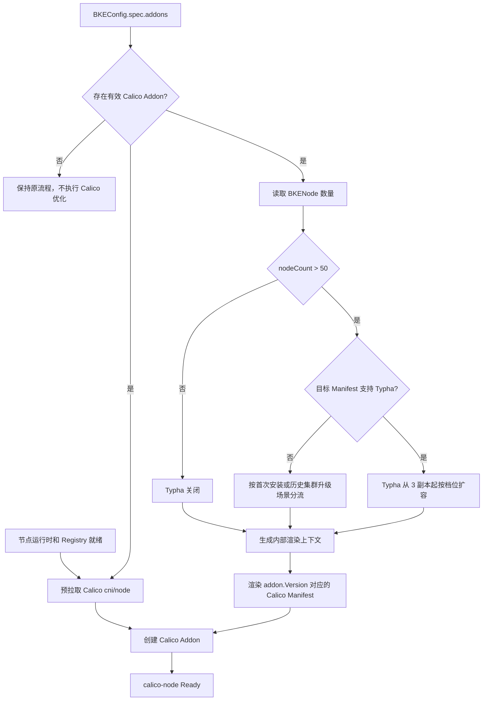
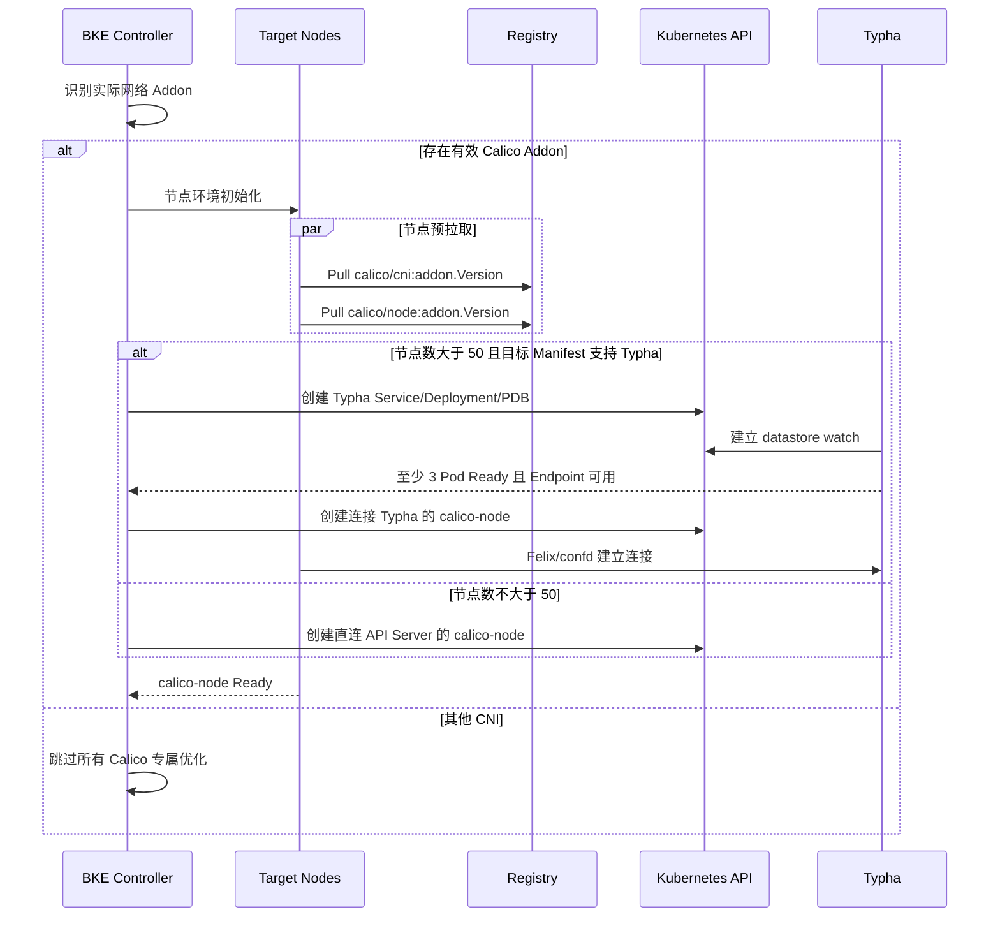
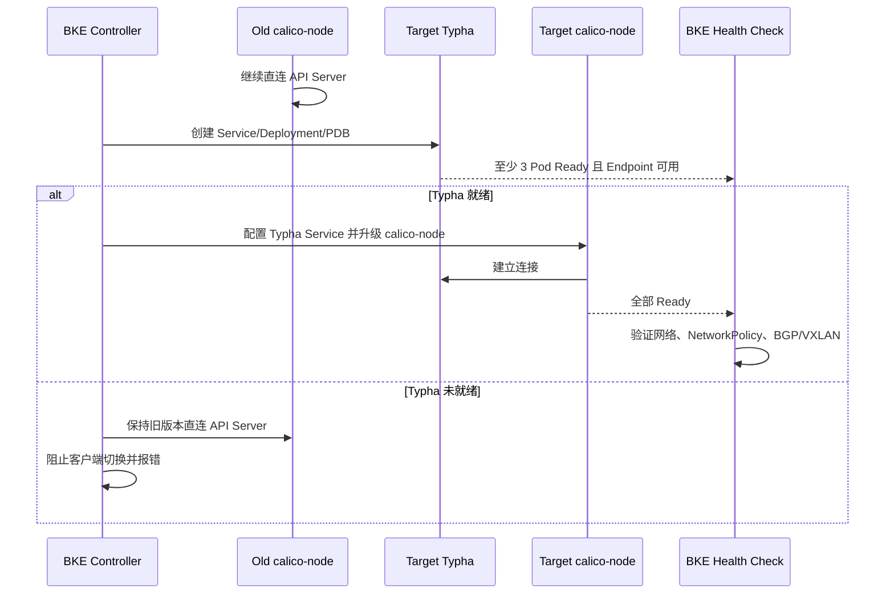
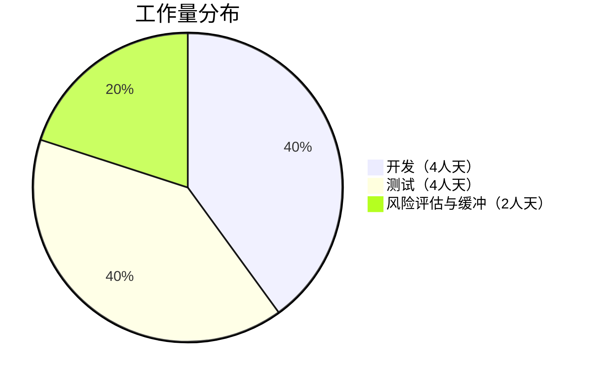
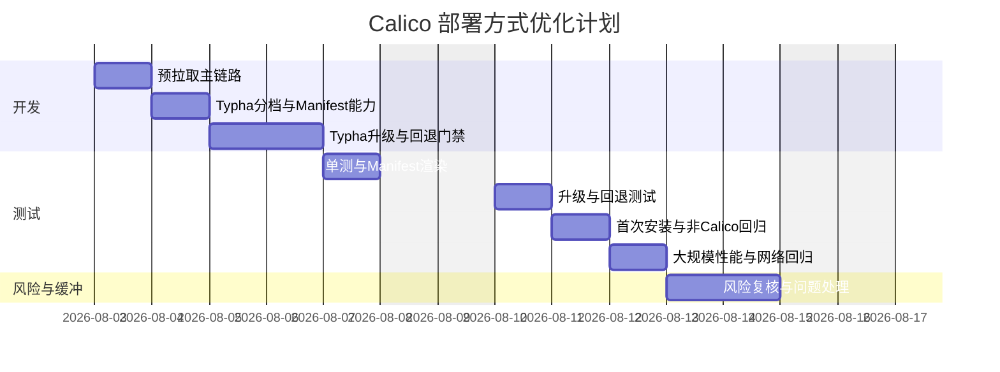

# Calico部署方式优化

## 摘要

本提案解决 BKE 在大规模节点集群中部署 Calico 耗时较长、控制面连接压力较大的问题。

优化范围保持在两个点：

1. 在 Calico Addon 创建前，为所有节点预拉取 `calico/cni` 和 `calico/node` 镜像
2. 节点数大于 50 时自动启用 Typha，并按集群规模计算副本数

本提案不绑定固定 Calico 版本。镜像版本从 Calico Addon 的 `version` 字段读取，Typha 和 `calico-node` 使用同一版本；对应的 `bke-manifests/kubernetes/calico/<version>/` 目录需要提供本提案定义的统一渲染参数。

本提案只在 `BKEConfig.spec.addons` 中存在有效的 `name: calico` Addon 时生效。如果用户选择其他网络插件或自行安装 CNI，BKE 不预拉取 Calico 镜像，也不生成 Typha 参数。

性能收益以端到端时间估算，预拉取耗时不从总时间中排除：

| 场景 | 当前方案 | 优化后预估 | 预估收益 |
| ------ | ------ | ------ | ------ |
| 大规模集群首次部署 | Addon 创建后现场拉取镜像 | 节点准备阶段预拉取，并通过 Typha 减少 API 压力 | 端到端耗时降低 **10%–30%** |

上述数据是设计预估，不是实测结论。实际结果受镜像仓库带宽、节点并发度、API Server 负载、Calico 数据面模式和节点资源影响，需要通过真实大规模集群验证。

## 动机

### 为什么需要这个？

BKE 创建 Calico DaemonSet 后，每个节点才开始准备 Calico 镜像并启动 `calico-node`。节点数量增加后，下列耗时会同时放大：

1. 大量节点同时拉取 `calico/cni` 和 `calico/node`，镜像仓库容易出现带宽和连接长尾
2. 每个 `calico-node` 直接与 Kubernetes API Server 建立 watch，增加 API Server 和客户端的同步压力

### 解决什么问题？

- 将 Calico 核心镜像准备纳入节点环境初始化主链路
- 使镜像失败可以提前暴露，而不是到 CNI 安装阶段才超时
- 在大规模集群中通过 Typha 减少 `calico-node` 对 API Server 的直接连接

### 可衡量目标

1. 使用 Calico 且节点数大于 50 时自动启用 Typha
2. Typha 从 3 个副本起步，并按节点规模递增
3. Calico Addon 创建前，所有目标节点已缓存 `calico/cni` 和 `calico/node`
4. 首次部署端到端耗时目标降低 10%–30%
5. 从不含 Typha 的低版本升级时，能够安全引入 Typha，且业务网络、NetworkPolicy 和 BGP/VXLAN 状态无回归

### 非目标

1. 本提案不解决镜像仓库自身的容量和高可用问题
2. 不引入 P2P 镜像分发系统
3. 不修改 Calico 数据面、BGP 或 VXLAN 实现
4. 不增加用户可见的 Typha 配置 API
5. 不改变 Calico 现有滚动升级并发策略
6. 不优化其他 CNI 的镜像分发或规模组件

## 提案

### 用户故事

**故事 1：大规模集群快速安装 Calico**

作为集群管理员，我希望 Calico 镜像在 Addon 创建前已经准备完成，避免大量 `calico-node` 在同一阶段竞争镜像仓库带宽。

**故事 2：大规模集群自动启用 Typha**

作为集群管理员，我希望节点数大于 50 时 BKE 自动部署足够的 Typha 副本，不需要手工修改 Calico 清单。

### 适用条件与网络插件分流

BKE 当前通过 `BKEConfig.spec.addons` 表达 Calico，没有独立的 `networkPlugin` 字段。因此本提案以 Addon 名称和版本作为触发条件：

`spec.addons` 是安装阶段的唯一事实来源。使用其他 CNI 时，用户必须从 BKEConfig 中删除 bkeadm 默认生成的 Calico Addon；如果配置中仍保留 `name: calico`，BKE 就会将该集群按 Calico 集群处理。BKE 不在安装期间猜测用户是否会在后续从外部安装其他 CNI。

```txt
查找 BKEConfig.spec.addons[name=calico]
    |
    +-- 不存在
    |      跳过 Calico 镜像预拉取
    |      跳过 Typha 参数生成
    |
    +-- 存在，但 version 为空
    |      配置校验失败，禁止猜测默认版本
    |
    +-- 存在且 version 有效
           执行本提案的全部优化
```

如果同一份配置出现多个 `name: calico` Addon，应在渲染前报错，避免使用不确定的版本和参数。installer-service 发布 Calico 版本时必须校验该 Manifest 是否具备完整的 Typha 模板和渲染键，Provider 根据校验结果在内部做首次安装和升级兼容性分流；不新增用户配置 API，也不通过版本号硬编码判断。

### 官方建议与默认选择

Calico 官方 Typha 部署指南给出的建议是：

- 超过 50 节点建议使用 Typha
- 超过 100 节点时，Kubernetes datastore 场景下 Typha 属于必要能力
- 按每 200 节点至少 1 个 Typha 副本估算容量
- 生产环境建议至少 3 个副本，降低故障和滚动升级影响
- 官方文档建议不超过 20 个副本

基于容量建议，openFuyao 采用如下默认计算方式：

```txt
nodeCount <= 50:
    allowTypha = false

nodeCount > 50:
    allowTypha = true
    typhaReplicas = min(20, max(3, ceil(nodeCount / 200)))
```

| 节点数 | 默认 Typha 副本 | 说明 |
| ------ | ------ | ------ |
| `<= 50` | 0 | 不启用 Typha |
| `51–600` | 3 | 生产环境默认起始副本数 |
| `601–800` | 4 | 按每 200 节点 1 副本递增 |
| `801–1000` | 5 | 按每 200 节点 1 副本递增 |
| `> 1000` | `ceil(N/200)`，最多 20 | 超过上限需要单独容量评估 |

本方案采用官方生产环境建议的 3 副本作为起点。当一个 Typha 副本故障或升级时，仍可保留 2 个可用副本，并通过 PDB、反亲和性和升级场景测试控制风险。对 Pod、NetworkPolicy 变更频繁或 Typha CPU 持续较高的集群，应根据监控结果调整内部副本计算策略。

### 注意事项/约束

1. 预拉取不会减少镜像总数据量，只是调整拉取时机并使失败更早可见
2. 端到端耗时必须从预拉取开始计算，不能只统计 Addon Apply 到 Ready
3. Typha 镜像版本必须与 `calico-node` 使用同一个 `addon.Version`
4. Typha 副本数必须小于节点数，否则滚动升级可能阻塞
5. 节点数不是单独触发条件；即使节点数大于 50，非 Calico 集群也必须完全跳过本提案
6. 使用其他 CNI 时必须从 BKEConfig 中移除默认 Calico Addon；同时配置 Calico 和另一个主 CNI 不在本提案的支持范围内
7. 低版本 Calico Manifest 可能没有 Typha；安装和升级必须以目标版本的 Manifest 能力为准，不能只按节点数强制渲染

### 实现方法

#### 优化 A：Calico 核心镜像预拉取

将 `image` scope 加入节点环境初始化主链路，并确保它位于容器运行时、镜像仓库和代理配置之后。

```txt
安装容器运行时
    -> 配置 Registry/代理
    -> 预拉取 calico/cni:<addon.Version>
    -> 预拉取 calico/node:<addon.Version>
    -> kubeadm 初始化/加入
    -> 创建 Calico Addon
```

`calico/typha` 和 `calico/kube-controllers` 仅部署少量副本，不默认分发到所有节点。当 Addon 列表中没有 Calico 时，返的 Calico 镜像列表为空；当 Calico `version` 为空时直接报错，不得猜测或补全默认版本。

#### 优化 B：Typha 自动启用与分档

Provider 只在当前 Addon 的 `name` 为 `calico` 且 `version` 非空时，才读取实际 BKENode 数量并生成 `allowTypha` 和 `typhaReplicas`。

使用当前 `addon.Version` 对应的 Manifest 能力：

- `001-typha.yaml` 渲染 Typha Deployment
- `002-calico.yaml` 渲染 Service、PDB、`typha_service_name` 和 `FELIX_TYPHAK8SSERVICENAME`
- Typha Deployment 保持滚动更新、PDB、反亲和性、300 秒优雅退出和健康检查

## 设计细节

### 接口兼容性

本提案无 API 变更：

- 不修改 BKECluster/BKEConfig CRD
- 不增加 BKEConfig 字段
- 不增加用户可见的 Calico Addon Param
- 不改变用户现有配置文件格式

Provider 根据实际 BKENode 数量和目标 Calico Manifest 能力计算 `allowTypha` 和 `typhaReplicas`，但这两个值只是 Provider 传给 Manifest 渲染器的内部上下文，不暴露为新的用户 API。

### 代码变更

#### 1. Provider：镜像预拉取

**仓库：`cluster-api-provider-bke`**

这项优化复用现有 `K8sEnvInit` 的 `image` scope。现有 `initImage()` 已经能够识别 Docker/containerd，遍历 `exportImageList()` 并调用 `EnsureImageExists()`；镜像不存在时拉取，已存在时跳过，拉取失败时返回错误。因此不需要新增镜像拉取器。

**结论：下述第 1、2 项修改同时落地后，会在节点上执行真实的镜像检查和拉取，不是只生成镜像列表。**

| 修改 | 作用 | 单独修改是否足够 |
| ------ | ------ | ------ |
| 在主命令中增加 `image` scope | 让节点环境初始化实际调用 `initImage()` | 否，没有 Calico 镜像列表时不会拉取 Calico |
| 将 Calico `cni/node` 加入 `exportImageList()` | 向 `initImage()` 提供当前 Addon 版本的镜像 | 否，没有 `image` scope 时该列表不会在首次安装主链路中被消费 |
| 停用旧的独立预拉取旁路 | 避免重复命令和失败被忽略 | 不是实现预拉取的必要条件，是主链路收敛和清理项 |

完整执行链路如下：

```txt
EnsureNodesEnv 为所有待初始化节点创建 Command
    -> 每个节点的 bkeagent 执行 K8sEnvInit
    -> 加载 BKEConfig 并识别当前节点角色
    -> 依次执行 runtime、registry、image scope
    -> image scope 调用 initImage()
    -> exportImageList() 返回该节点需要的 Calico 镜像
    -> Docker/containerd EnsureImageExists()
       -> 已存在：跳过
       -> 不存在：调用容器运行时的 Pull
       -> 拉取失败：Command 失败，EnsureNodesEnv 不完成
    -> EnsureNodesEnv 完成后才继续 kubeadm 和 EnsureAddonDeploy
```

因此，功能上只需 Provider 的两处核心改动：把 `image` scope 放入首次安装主链路，并让 `exportImageList()` 返回 Calico 镜像。现有 bkeagent、Docker/containerd executor 已具备实际拉取能力，无需再修改。

**1. 将 `image` 放入节点环境初始化主链路**

文件：`pkg/command/env.go`

```go
Command: []string{
    "K8sEnvInit",
    "init=true",
    "check=true",
    "scope=time,hosts,dns,kernel,firewall,selinux,swap,httpRepo,runtime,iptables,registry,image,extra",
    bkeConfigStr,
    extraHosts,
},
```

`image` 必须位于 `runtime` 和 `registry` 之后。主链路命令的 `BackoffIgnore` 保持 `false`，使镜像拉取失败阻断当前节点环境初始化，而不是继续到 Calico Addon 阶段后才超时。

**2. 根据实际 Calico Addon 生成镜像**

文件：`pkg/job/builtin/kubeadm/env/init.go`

```go
func exportCalicoNodeImages(cfg *bkev1beta1.BKEConfig) []string {
    for _, addon := range cfg.Addons {
        if addon.Name != "calico" || addon.Version == "" {
            continue
        }

        repo := bkeinit.BkeConfig(*cfg).ImageThirdRepo()
        return []string{
            fmt.Sprintf("%scalico/cni:%s", repo, addon.Version),
            fmt.Sprintf("%scalico/node:%s", repo, addon.Version),
        }
    }
    return nil
}
```

修改原有 `exportImageList()` 的节点角色分支：

```go
func (ep *EnvPlugin) exportImageList() []string {
    if ep.bkeConfig == nil {
        return nil
    }

    cfg := ep.bkeConfig
    // 保留原有 Kubernetes 控制面镜像导出逻辑。
    images := exportKubernetesImages(cfg)
    calicoImages := exportCalicoNodeImages(cfg)

    if ep.currenNode.IP == "" {
        return append(images, calicoImages...)
    }
    if ep.currenNode.IsWorker() {
        return calicoImages
    }
    return append(images, calicoImages...)
}
```

上述 `exportKubernetesImages()` 表示现有 `imagehelper.NewImageExporter(...).ExportImageList()` 逻辑，实际修改时保留原代码，无需再抽象新函数。最终行为是：

| 节点角色 | 配置 Calico | 未配置 Calico |
| ------ | ------ | ------ |
| master | Kubernetes 控制面镜像 + Calico `cni/node` | 仅 Kubernetes 控制面镜像 |
| worker | Calico `cni/node` | 空列表，不拉取 Calico 镜像 |

**3. 停用首次安装的旧预拉取旁路**

`pkg/command/env.go` 中还有 `createPrePullImageCommand()`，该命令单独执行 `scope=image`，排除第一个 master，并且设置了 `BackoffIgnore: true`。它存在三个问题：

1. 它与节点环境初始化是两个独立 Command，不能保证一定在 runtime 和 registry 就绪后执行
2. 失败被忽略，不能作为 Calico Addon 创建前的成功屏障
3. 当 `image` 已进入主链路后，如果这条旁路仍被启用，worker 可能同时收到两个镜像拉取命令

当前仓库的生产路径没有设置 `ENV.PrePullImage=true`，仅测试代码使用该字段，因此旧旁路现在并不是首次安装的可靠预拉取机制。

为避免改变导出的 Go 结构，本提案不直接删除 `ENV.PrePullImage`、`createPrePullImageCommand()` 和相关常量，只停止 `ENV.New()` 创建独立预拉取 Command，并将这些内部对象标记为 Deprecated。后续大版本再完成删除。

`ENV.New()` 中停止调用的分支如下：

```go
// 不再调用该分支；预拉取已由主 Command 的 image scope 执行。
if e.PrePullImage {
    e.createPrePullImageCommand(bkeConfigStr)
}
```

`pkg/job/builtin/kubeadm/command.go` 中的 `upgradePrePullImageCommand()` 用于集群升级，与首次安装不是同一路径，不删除。

**4. 测试修改**

- `pkg/command/env_test.go`：验证主链路 scope 包含 `registry,image`，且不再创建独立预拉取 Command
- `pkg/job/builtin/kubeadm/env/init_test.go`：验证 Calico 版本取自 `addon.Version`、worker/master 镜像列表、以及非 Calico 配置不返回 Calico 镜像

除上述文件外，预拉取功能不需修改 bkeagent、Docker/containerd executor、bkeadm 或 bke-manifests。

#### 2. Provider：规模默认参数

**仓库：`cluster-api-provider-bke`**

**文件：`pkg/kube/addon.go`**

```go
func calicoScaleDefaults(addon Product, nodeCount int) map[string]interface{} {
    if addon.Name != "calico" || addon.Version == "" {
        return nil
    }

    result := map[string]interface{}{
        "allowTypha":    "false",
        "typhaReplicas": "0",
    }
    if nodeCount <= 50 {
        return result
    }

    replicas := min(20, max(3, ceilDiv(nodeCount, 200)))
    result["allowTypha"] = "true"
    result["typhaReplicas"] = strconv.Itoa(replicas)
    return result
}
```

上述为逻辑示例，实际代码应复用仓库现有参数合并和校验方式。

#### 3. bkeadm：不写入会覆盖自动判断的默认值

**仓库：`bkeadm`**

**文件：`pkg/config/config.go`**

bkeadm 不再默认写入 `allowTypha=false` 和 `typhaReplicas=1`，避免生成值覆盖 Provider 的节点规模判断。这两个参数已经存在，本提案不新增 bkeadm 配置字段。

#### 4. Calico Manifest：Typha 能力与升级兼容

**仓库：`bke-manifests`**

**文件：`kubernetes/calico/<version>/<calico-manifest>.yaml`**

支持 Typha 的 Calico 版本使用与自身版本匹配的 Typha 实现，并统一由 `allowTypha` 和 `typhaReplicas` 控制是否渲染及副本数。

installer-service 发布 Calico 版本前，必须校验该版本目录是否同时包含 Typha Service、Deployment、PDB，以及 `typha_service_name`、`FELIX_TYPHAK8SSERVICENAME` 和副本数渲染能力。Provider 使用这一内部校验结果分流，不通过版本号硬编码推断，也不增加对外 API。能力分流如下：

| 场景 | `nodeCount <= 50` | `nodeCount > 50` |
| ------ | ------ | ------ |
| 目标 Manifest 支持 Typha | 不启用 Typha | 启用 Typha，副本数从 3 起步 |
| 首次安装，目标 Manifest 不支持 Typha | 保持原 Manifest | 在部署前返回明确的不支持错误，避免创建不满足大规模集群要求的新集群 |
| 已有低版本集群升级或回退，目标 Manifest 不支持 Typha | 保持原 Manifest | 走兼容路径并记录明确告警，保持 `calico-node` 直连 API Server，不渲染 Typha 参数 |

从不支持 Typha 的低版本升级到支持 Typha 的版本时，必须使用“先 Typha、后客户端”的两阶段顺序：

1. 保持旧 `calico-node` 直接连接 Kubernetes API Server
2. 先创建目标版本的 Typha Service、Deployment 和 PDB
3. 等待至少 3 个 Typha Pod Ready，并校验 Service Endpoint
4. 再渲染 `typha_service_name` 和 `FELIX_TYPHAK8SSERVICENAME`，触发 `calico-node` 使用 Typha
5. 等待全部 `calico-node` Ready，并验证网络、NetworkPolicy 和 BGP/VXLAN 状态

如果 Typha 未 Ready，必须阻止 `calico-node` 切换，保持旧版本直连 API Server。回退或降级到不支持 Typha 的版本时，顺序相反：先让 `calico-node` 切回直连 API Server，全部 Ready 后再删除 Typha 资源。

## 设计视图

### 1.1 系统架构



### 1.2 首次部署时序



### 1.3 低版本升级引入 Typha 时序



### 1.4 监控点

| 指标 | 作用 |
| ------ | ------ |
| 节点镜像预拉取耗时和失败数 | 识别 Registry、代理和长尾节点 |
| 从预拉取开始到全部 `calico-node` Ready | 统一端到端性能口径 |
| Typha Ready/期望副本数 | 验证 Typha 高可用 |
| Typha CPU、内存和客户端连接数 | 判断是否需要从每 200 节点调整为每 100 节点 |
| API Server watch 数、CPU 和请求延迟 | 验证 Typha 是否有效降低控制面压力 |
| Typha Service Endpoint 数 | 升级切换前验证 Typha 真正可用 |
| 跨节点连通和 NetworkPolicy 探测 | 验证 Typha 引入或升级没有破坏业务网络 |

### 测试计划

#### 当前验证状态

- 已在独立 PoC 仓库 `cluster-api-provider-bke-calico-scale` 同时实现两处核心改动：主链路增加 `image` scope，`exportImageList()` 向 master/worker 返回 Calico `cni/node`
- 已确认完整调用链：节点环境初始化 Command → `K8sEnvInit` → `image` scope → `initImage()` → `exportImageList()` → Docker/containerd `EnsureImageExists()` → 容器运行时 Pull
- `pkg/command` 单元测试已验证主命令包含 `registry,image`；`pkg/job/builtin/kubeadm/env` 测试代码已覆盖 Calico worker 镜像列表和非 Calico 空列表
- Provider 镜像预拉取 PoC 的 `pkg/command` 和 `pkg/job/builtin/kubeadm/env` 已通过 Linux arm64 编译检查
- 前期 Kind 实验已验证“节点中存在准确 Calico 镜像时，Calico Pod 启动不再发生现场镜像下载”的运行效果
- macOS 无法直接运行该两个测试包，因为仓库现有 executor 使用 Linux 专属 `SysProcAttr.Pdeathsig`
- 尚未完成“使用修改后的 Provider 驱动真实 bkeagent 执行完整 BKE 安装”的端到端验收。因此可以确认设计和 PoC 会触发真实拉取，但不将其表述为已合入主干或已完成发布验收

#### 单元和 Manifest 渲染测试

| 用例 | 期望结果 |
| ------ | ------ |
| Addon 列表不包含 Calico | Calico 镜像列表为空，不生成 Typha 参数 |
| 外部安装其他 CNI | BKE 保持原流程，不修改该 CNI 资源 |
| Calico `version` 为空 | 渲染前报错，不猜测默认版本 |
| 任意已发布 Calico 版本 | 镜像和 Manifest 均使用 `addon.Version` |
| 同时存在多个 Calico Addon | 渲染前报错 |
| 50 节点 | Typha 关闭 |
| 51 节点 | Typha 3 副本 |
| 100 节点 | Typha 3 副本 |
| 400 节点 | Typha 3 副本 |
| 401 节点 | Typha 3 副本 |
| 600 节点 | Typha 3 副本 |
| 601 节点 | Typha 4 副本 |
| 1000 节点 | Typha 5 副本 |
| 超大规模 | 默认 Typha 不超过 20 副本 |

同时验证每个对外发布的 Calico 版本渲染结果中包含：

- Typha Service、Deployment 和 PDB
- Typha 副本数、PDB、反亲和性和健康检查
- `calico-config.typha_service_name=calico-typha`
- `calico-node` 中的 `FELIX_TYPHAK8SSERVICENAME`

对不支持 Typha 的低版本 Manifest，分别验证：大于 50 节点的新集群在部署前得到明确错误；已有低版本集群升级或回退时不渲染 Typha 资源或环境变量，并且流程不因缺少 Typha 模板失败。

#### 端到端测试

至少使用一个 51 节点环境和一个 100 节点环境，每组性能数据至少执行 3 轮。

**首次部署对比：**

1. 修改前：无主链路预拉取，无自动 Typha
2. 修改后：预拉取 + 自动 Typha
3. 两组均从节点镜像准备前开始计时，到全部 `calico-node` Ready 结束
4. 同时记录 Registry 流量、API Server 负载和 Typha 连接数

**非 Calico 回归：**

1. 使用不包含 Calico Addon 的 BKEConfig 执行节点环境初始化
2. 确认节点不拉取任何 `calico/*` 镜像
3. 确认 Addon 渲染参数不包含 `allowTypha` 和 `typhaReplicas`
4. 确认 BKE 不查找、等待或健康检查 Calico 资源

**Typha 升级兼容性：**

| 用例 | 前置条件 | 期望结果 |
| ------ | ------ | ------ |
| 低版本无 Typha → 目标版本支持 Typha | 51/100 节点 | 先就绪 3 个 Typha，再切换 `calico-node`；全程网络无中断 |
| 低版本无 Typha → 目标版本仍无 Typha | 51/100 节点 | 保持直连 API Server，升级不因缺少 Typha 模板失败，产生明确告警 |
| 支持 Typha → 新版本支持 Typha | 51/100 节点 | Typha 和 `calico-node` 均升级成功，至少 2 个 Typha 持续可用 |
| Typha 无法 Ready | 注入错误镜像或调度失败 | 阻止 `calico-node` 切换，旧版本仍直连 API Server |
| 支持 Typha → 回退到无 Typha 版本 | 执行回退/降级 | 先切回 API Server，再删除 Typha，不出现 Felix 无可用端点 |
| 50 节点 → 51 节点 | 目标版本支持 Typha | 从不启用切换为 3 副本，顺序和健康门禁正确 |
| 51 节点 → 50 节点 | 目标版本支持 Typha | 先将 `calico-node` 切回 API Server，再停用 Typha |

所有升级用例全程持续执行 DNS、跨节点 TCP/UDP、Service 和 NetworkPolicy 探测，同时记录 Typha Ready 副本、Service Endpoint、Felix 连接和 API Server watch 数。

### 毕业标准

#### Alpha

- [ ] 预拉取、Typha 分档和 Manifest 能力分流代码完成
- [ ] 非 Calico 配置的分流和回归测试通过
- [ ] 50/51/600/601 节点边界单元测试通过
- [ ] 所有对外发布的 Calico Manifest 开启/关闭 Typha 渲染测试通过
- [ ] 不支持 Typha 的低版本 Manifest 兼容测试通过

#### Beta

- [ ] 51 和 100 节点首次部署验证通过
- [ ] 端到端部署耗时相比基线降低至少 10%
- [ ] 低版本无 Typha 到目标版本支持 Typha 的升级验证通过
- [ ] Typha 未 Ready 时能够阻止 `calico-node` 切换
- [ ] 升级期间网络和 NetworkPolicy 持续验证无失败

#### Stable

- [ ] Typha 资源、连接数和 API Server 指标无异常
- [ ] 升级、降级和排障文档完成

## 工作量评估

### 1. 开发工作量

| 模块 | 任务 | 预估人天 | 说明 |
| ------ | ------ | ------ | ------ |
| **镜像预拉取** | 将 `image` scope 接入节点环境初始化主链路，并按 Calico Addon 版本生成镜像列表 | 1 | 复用现有运行时镜像检查和拉取能力 |
| **Typha 分档** | 根据节点规模计算 Typha 开关和副本数，并识别目标 Manifest 能力 | 1 | 51–600 节点从 3 副本起步 |
| **升级兼容** | 实现低版本无 Typha 到支持 Typha 版本的两阶段升级和健康门禁 | 1 | Typha 就绪后再切换 `calico-node` |
| **回退处理** | 实现 Typha 引入失败、降级和回退顺序 | 1 | 先切回 API Server，再移除 Typha |
| **小计** | | **4** | |

### 2. 测试工作量

| 测试类型 | 任务 | 预估人天 | 说明 |
| ------ | ------ | ------ | ------ |
| **单元测试** | 镜像列表、节点规模边界和非 Calico 分流测试 | 1 | 覆盖 50/51/600/601 等边界 |
| **Manifest 测试** | Typha 开启、关闭及低版本无 Typha 的渲染测试 | 1 | 验证不同 Manifest 能力分流 |
| **升级测试** | 首次引入 Typha、连续升级、失败注入、降级和回退测试 | 1 | 全程运行网络与 NetworkPolicy 探测 |
| **性能回归** | 51/100 节点首次部署性能和网络回归 | 1 | 每组至少执行 3 轮并统计波动 |
| **小计** | | **4** | |

### 3. 风险评估与缓冲

| 风险 | 概率 | 影响 | 缓解措施 | 预留缓冲 |
| ------ | ------ | ------ | ------ | ------ |
| Registry 并发拉取形成新的长尾 | 中 | 中 | 限制并发、使用 Mirror，并统计包含预拉取的端到端耗时 | 0.5 天 |
| 3 个 Typha 副本的容量或调度结果不符合预期 | 中 | 高 | 监控连接数和资源使用率，执行单副本故障、反亲和性和升级验证 | 0.5 天 |
| 低版本缺少 Typha 导致升级或回退异常 | 中 | 高 | 按 Manifest 能力分流，验证两阶段切换和反向回退 | 0.5 天 |
| 大规模测试环境波动导致结果需要复测 | 中 | 中 | 固定环境和镜像状态，至少执行 3 轮并保留原始数据 | 0.5 天 |
| **总缓冲** | | | | **2 天** |

### 4. 总工作量汇总



| 类别 | 人天 | 占比 |
| ------ | ------ | ------ |
| 开发 | 4 | 40% |
| 测试 | 4 | 40% |
| 风险评估与缓冲 | 2 | 20% |
| **总计** | **10** | **100%** |

**调整后的总工作量：**

- 基础工作量：8 人天（开发 4 人天 + 测试 4 人天）
- 风险评估与缓冲：2 人天
- **最终工作量：10 人天，按 1 名全职人员折算约 2 周**

以上估算包含代码、单元测试、Manifest 渲染测试、升级兼容测试、风险处理和文档更新。估算前提是 51/100 节点环境和所需 Calico 版本已就绪，不包含环境申请等待时间。

### 5. 里程碑计划



| 里程碑 | 时间 | 交付物 | 验收标准 |
| ------ | ------ | ------ | ------ |
| **M1：代码完成** | 2026-08-03 至 2026-08-06 | 预拉取、Typha 分档、升级与回退门禁 | 单元测试通过，内部渲染参数正确 |
| **M2：测试验证** | 2026-08-07 至 2026-08-12 | Manifest、升降级、51/100 节点性能与网络回归结果 | 所有测试用例通过，原始数据完整 |
| **M3：风险收敛** | 2026-08-13 至 2026-08-14 | 风险复核、问题修复和文档更新 | 高风险项有结论，遗留问题和发布建议明确 |

### 升级/降级策略

**升级：**

1. 先部署 Typha 并确认期望副本全部 Ready
2. 再让 `calico-node` 连接 Typha
3. 升级期间持续检查 Typha、calico-node、BGP/VXLAN、DNS 和业务网络

**降级/回退：**

1. 关闭 Typha 前，先将 `calico-node` 切回直接连接 API Server
2. 确认所有 `calico-node` Ready 后再删除 Typha Deployment 和 Service
3. 回退预拉取不删除节点已有镜像，不影响正在运行的 Calico

## 缺点

1. **预拉取不减少总下载量**：Registry 带宽不足时，端到端收益可能很小。
2. **Typha 不是纯粹的 Ready 加速器**：它的主要价值是降低 API Server 和 Felix 的规模压力，只有现有瓶颈位于 API 同步时才会明显缩短 Ready 时间。
3. **3 副本增加资源占用**：51–600 节点集群会固定运行 3 个 Typha 副本，需要预留调度资源并验证反亲和性。
4. **分档是容量起点，不是精确结论**：Pod 数、策略变更率和 API Server 性能会影响 Typha 的实际负载。

## 所需基础设施

1. 至少一个 51 节点和一个 100 节点的测试环境
2. 可采集吞吐、连接数和错误率的 Registry 或 Mirror
3. API Server CPU、内存、watch 数和请求延迟监控
4. Typha CPU、内存、客户端连接和重平衡指标
5. Typha 引入和升降级全程运行的 DNS、Service、跨节点和 NetworkPolicy 探测
6. 统一的端到端计时工具，确保预拉取时间被计入部署总时间

## 参考资料

1. [BKE 控制器 API 限流优化与性能提升](https://gitcode.com/openFuyao/sig-installation/blob/791413b6a68a26db68b1b6aa35aa07a7c464a2bf/design/%E6%80%A7%E8%83%BD%E4%BC%98%E5%8C%96/BKE%E6%8E%A7%E5%88%B6%E5%99%A8API%E9%99%90%E6%B5%81%E4%BC%98%E5%8C%96%E4%B8%8E%E6%80%A7%E8%83%BD%E6%8F%90%E5%8D%87.md)
2. [Calico Typha overview](https://docs.tigera.io/calico/latest/reference/typha/overview)
3. [Calico on-premises deployment guidance](https://docs.tigera.io/calico/latest/getting-started/kubernetes/self-managed-onprem/onpremises)
4. `cluster-api-provider-bke/pkg/command/env.go`
5. `cluster-api-provider-bke/pkg/job/builtin/kubeadm/env/init.go`
6. `cluster-api-provider-bke/pkg/kube/addon.go`
7. `bke-manifests/kubernetes/calico/<version>/`
