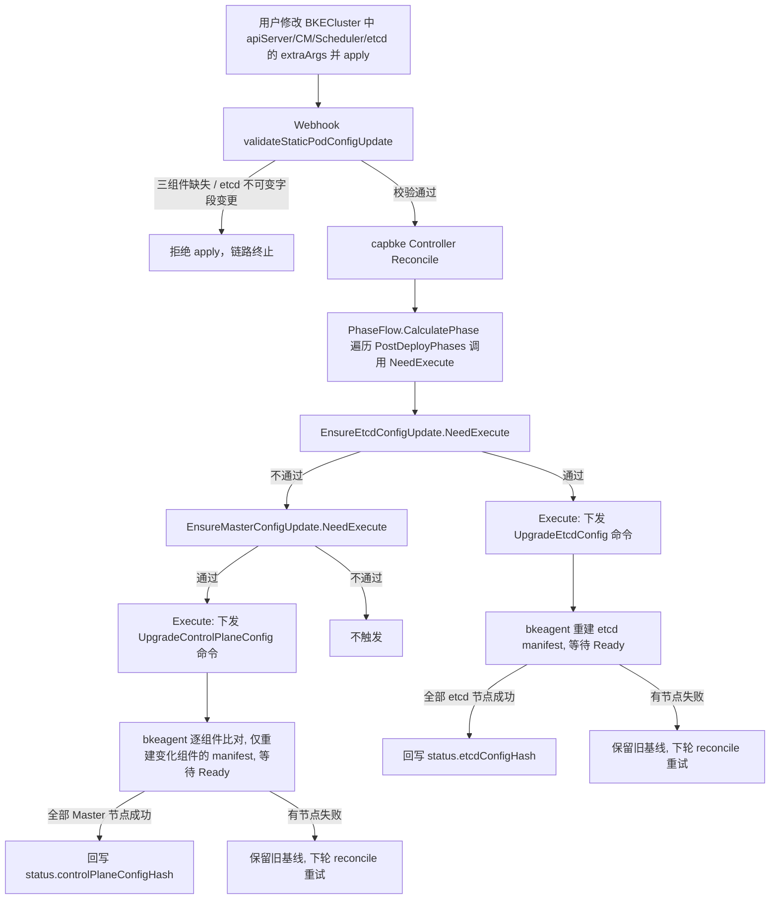

# 声明式集群静态 Pod 配置更新方案

> 对应 oFEP：ofep-0037《支持 BKECluster 中静态 pod 相关配置自识别与更新》
> 适用版本：alpha（v1.19 起）
> 涉及组件：capbke-controller、bkeagent（KubeadmPlugin）、BKECluster Webhook

---

## 1. 背景与要解决的问题

openFuyao 的管控面组件（`kube-apiserver` / `kube-controller-manager` / `kube-scheduler` / `etcd`）均以**静态 Pod** 形式部署。在漫长的 Kubernetes 版本生命周期内，运维侧频繁需要调整这些组件的启动参数（限流、FeatureGates、审计策略、etcd 心跳/选举超时、存储配额等），但 Kubernetes 版本本身极少升级。

特性合入前，capbke 只有"**版本变化**"这一种变更识别能力：

```go
if bkeCluster.Spec.ClusterConfig.Cluster.KubernetesVersion != bkeCluster.Status.KubernetesVersion {
    // 需要升级
}
```

由此产生的问题：

1. **只认版本，不认参数**：修改 `apiServer.extraArgs` 等静态 Pod 参数后，CR 被成功写入，但**不会触发任何更新动作**，节点上的 manifest 纹丝不动。
2. **唯一的生效途径是改版本号**：为了让参数生效，运维不得不"假升级"（改一个版本号触发整条升级链），代价是完整走一遍升级流程（含 etcd 备份、镜像替换、节点串行重启），风险与耗时远超"改一个参数"。
3. **无法做到组件级隔离**：即便触发，也是"一刀切"式刷新全部静态 Pod，改动 apiserver 一个参数也会连带重刷 controller-manager、scheduler。

---

## 2. 特性目标与非目标

### 2.1 目标

| 编号 | 目标 | 说明 |
| --- | --- | --- |
| G1 | 配置变化自识别 | 计算 BKECluster 期望配置的哈希，与 `status` 中记录的"**上次成功部署基线**"比对，自动识别静态 Pod 配置是否变化并触发更新 |
| G2 | 控制面与 etcd 分离 | 新增 `EnsureEtcdConfigUpdate` 与 `EnsureMasterConfigUpdate` 两个独立 phase，etcd 可独立检测、独立更新 |
| G3 | 控制面三组件相互独立 | 三个组件共用同一个 phase，但 bkeagent 侧**逐组件比对**，只重新生成"真正发生变化"的组件 manifest |
| G4 | 不可变字段保护 | etcd 的 `dataDir` / `serverCertSANs` / `peerCertSANs` 属引导期不可变配置，由 Webhook 拒绝变更，避免误触发破坏性重建 |
| G5 | 失败可重试 | 只有全部目标节点成功应用新 manifest 后才回写基线哈希；失败保留旧基线，下次 reconcile 仍能识别差异并重试 |

### 2.2 非目标

- 不支持配置**自动回滚**（可通过重新 apply 旧配置实现"回退"，见操作文档）。
- 不支持更新过程中保持管控面**不中断**（静态 Pod 重启本身会导致组件短暂不可用）。
- 不支持 `spec.clusterConfig.cluster` 下**非静态 Pod** 参数的自识别（如 `kubelet`、`networking`、各类 Repo、`containerRuntime` 等）。
- 不替代版本升级：Kubernetes / etcd **版本**变化仍由 `EnsureMasterUpgrade` / `EnsureEtcdUpgrade` 负责。

---

## 3. 特性前 / 特性后对比

| 维度 | 特性前（Before）                                                                           | 特性后（After） |
| --- |---------------------------------------------------------------------------------------| --- |
| 变更识别依据 | `kubernetesVersion`、`etcdVersion` 与 `status.kubernetesVersion`、`status.etcdVersion` 比对 | 新增两类**配置哈希**，与 `status` 中的成功基线比对 |
| 改参数是否生效 | ❌ 不生效（除非顺带改版本号触发完整升级）                                                                 | ✅ 直接触发配置更新链路 |
| 更新粒度 | 整条升级链：etcd 备份 + 镜像替换 + 全组件刷新                                                          | 仅重新渲染 manifest + 等待组件 Ready，**不做 etcd 备份**，不换镜像 |
| 组件隔离 | 无，统一刷                                                                                 | 控制面三组件逐组件比对，只刷变化的组件；etcd 独立一条链 |
| etcd 独立性 | 与管控面不在同一升级 phase，也是独立的`EnsureEtcdUpgrade`                                                               | 独立 `EnsureEtcdConfigUpdate` phase，支持 etcd 独立/外挂场景 |
| 状态记录 | `status.kubernetesVersion`、`status.etcdVersion`                                       | 新增 `status.controlPlaneConfigHash`(结构体)、`status.etcdConfigHash`(字符串) |
| 失败处理 | 升级失败后状态易丢失，难以自愈                                                                       | 基线只在全节点成功后回写，失败自动重试 |
| 参数校验 | 无                                                                                     | Webhook 拦截：管控面三组件必须同时存在；etcd 不可变字段禁止变更 |
| 可观测性 | 与版本升级混用同一组 reason                                                                     | 新增 `MasterConfigUpdating/Updated/Failed/Succeed` 与 `EtcdConfigUpdating/Updated/Failed/Succeed` 两组独立 reason，以及 `deployAction=k8s_config_update` 注解（区别于 `k8s_upgrade`） |

### 3.1 观察面速查

```bash
# 1) 集群当前所处的 phase 与 reason
kubectl get bc -A | grep -i  <bc-name>

# 2) 配置基线（上次成功部署的指纹）
kubectl get bkecluster <cluster> -n <ns> -o jsonpath='{.status.controlPlaneConfigHash}{"\n"}'
kubectl get bkecluster <cluster> -n <ns> -o jsonpath='{.status.etcdConfigHash}{"\n"}'

# 3) 下发给节点的命令
kubectl get command -l bke.bocloud.com/cluster-command -n <ns>

# 4) 静态 Pod 实际生效的启动参数
kubectl -n kube-system get pod kube-apiserver-<node> -o yaml | grep -A 60 'command:'
```

---

## 4. 核心设计

### 4.1 配置哈希（Config Hash）

在 `BKECluster.Status` 中新增两个字段，记录"**上次成功部署**"的配置指纹：

```go
// api/bkecommon/v1beta1/bkecluster_status.go
type ComponentConfigHash struct {
    APIServer         string `json:"apiServer,omitempty"`
    ControllerManager string `json:"controllerManager,omitempty"`
    Scheduler         string `json:"scheduler,omitempty"`
}

type BKEClusterStatus struct {
    // +optional
    ControlPlaneConfigHash ComponentConfigHash `json:"controlPlaneConfigHash,omitempty"`
    // +optional
    EtcdConfigHash string `json:"etcdConfigHash,omitempty"`
}
```

- 哈希算法：`sha256(json.Marshal(normalize(配置)))`，结构体字段顺序固定，`json` 序列化对 map 有序，保证不同时间/不同节点计算结果一致。
- 控制面哈希是**结构体**（三个组件各自一个哈希），用于后续逐组件差异判断；etcd 哈希是**单个字符串**。

### 4.2 参与哈希计算的字段

**控制面哈希** `CalculateComponentConfigHash`：

| 组件 | 字段 | 纳入哈希 | 是否真正生效 |
| --- | --- | :---: | :---: |
| `apiServer` | `extraArgs` | ✅ | ✅ |
| `apiServer` | `extraVolumes` | ✅ | ⚠️ 见下方说明 |
| `apiServer` | `certSANs` | ✅ | ⚠️ 见下方说明 |
| `apiServer` | `apiEndpoint`（host/port） | ✅ | ⚠️ 见下方说明 |
| `controllerManager` | `extraArgs` | ✅ | ✅ |
| `controllerManager` | `extraVolumes` | ✅ | ⚠️ 见下方说明 |
| `scheduler` | `extraArgs` | ✅ | ✅ |
| `scheduler` | `extraVolumes` | ✅ | ⚠️ 见下方说明 |
| `etcd` | 全部字段 | ❌ | 由 etcd 哈希独立处理 |

**etcd 哈希** `CalculateEtcdConfigHash`：

| 字段 | 纳入哈希 | 说明 |
| --- | :---: | --- |
| `etcd.extraArgs` | ✅ | 运行时可变，可安全重建 manifest |
| `etcd.extraVolumes` | ✅ | 运行时可变（当前不生效，见下） |
| `etcd.dataDir` | ❌ | 引导期不可变，Webhook 拒绝变更 |
| `etcd.serverCertSANs` | ❌ | 引导期不可变，Webhook 拒绝变更 |
| `etcd.peerCertSANs` | ❌ | 引导期不可变，Webhook 拒绝变更 |

> **⚠️ 重要说明（当前实现约束）**
>
> 上表中标记为"纳入哈希"的字段范围，是**哈希计算**的范围；但静态 Pod manifest 模板（`utils/bkeagent/mfutil/tmpl/k8s/*.yaml.tmpl`）当前**只渲染 `extraArgs`**，`extraVolumes`、`certSANs`、`apiEndpoint` 等字段社区侧尚未落地渲染逻辑。
>
> 因此：
> - **实际能对节点产生效果、且被完整支持的字段只有 `extraArgs`（管控面三组件 + etcd）**；
> - 修改 `extraVolumes` / `certSANs` / `apiEndpoint` **会**改变哈希并触发更新流程，但重新生成的 manifest 内容不变（组件会被无意义重启一次），属于"空转"；
> - 运维时应**只调整 `extraArgs`**，避免产生无效变更与不必要的管控面抖动。

**明确不纳入任何哈希的字段**：`kubernetesVersion`、`etcdVersion`、`kubelet.*`、`networking.*`、`httpRepo` / `imageRepo` / `chartRepo`、`containerRuntime`、`containerdConfigRef`、`openFuyaoVersion`、`containerdVersion`、`certificatesDir`、`ntpServer`、`agentHealthPort`、`labels`。修改这些字段**不会**触发静态 Pod 配置更新。

### 4.3 新增的 phase / 常量 / 命令

| 类别 | 名称 | 位置 |
| --- | --- | --- |
| Phase（控制器侧） | `EnsureEtcdConfigUpdate`、`EnsureMasterConfigUpdate` | 注册在 `pkg/phaseframe/phases/list.go` 的 `PostDeployPhases`，**etcd 在管控面之前**执行 |
| Phase（命令侧） | `UpgradeControlPlaneConfig`、`UpgradeEtcdConfig` | `api/capbke/v1beta1/bkecluster_consts.go`、`utils/const.go` |
| Reason | `MasterConfigUpdating` / `MasterConfigUpdated` / `MasterConfigUpdateFailed` / `MasterConfigUpdateSucceed` | `utils/capbke/constant/constants.go` |
| Reason | `EtcdConfigUpdating` / `EtcdConfigUpdated` / `EtcdConfigUpdateFailed` / `EtcdConfigUpdateSucceed` | 同上 |
| 命令参数 | `controlPlaneConfigOldHash` / `controlPlaneConfigNewHash`（JSON 序列化的哈希结构体） | 仅 `EnsureMasterConfigUpdate` 下发，**其他 phase 不受影响** |

### 4.4 基线哈希的初始化

`EnsureCluster.performHealthCheck` 中紧跟 `updateClusterVersionStatus` 之后调用 `initializeConfigHashes`：当 `status.controlPlaneConfigHash` / `status.etcdConfigHash` 为空时，用当前 Spec 计算并回写，作为后续变更检测的基线。

由此产生一条重要行为：**基线为空时两个 phase 都不会触发**。这保证了
- 新建/纳管中的集群不会在部署阶段被误刷静态 Pod；
- 存量集群升级到含本特性的新版本后，需**先经过一次健康检查**（`EnsureCluster`）建立基线，之后修改参数才会触发更新。

---

## 5. 完整触发链

### 5.1 总览



### 5.2 链路 A：管控面（`EnsureMasterConfigUpdate`）

| 步骤 | 位置 | 动作 |
| --- | --- | --- |
| 1 | 用户 | 修改 `spec.clusterConfig.cluster.apiServer/controllerManager/scheduler.extraArgs`，`kubectl apply` BKECluster |
| 2 | Webhook `validateStandBKECluster` → `validateStaticPodConfigUpdate` | ① `apiServer` / `controllerManager` / `scheduler` 三者必须**同时存在**，任一为空则拒绝；② 若 etcd 不可变字段（`dataDir`/`serverCertSANs`/`peerCertSANs`）发生变化则拒绝。不通过 → apply 失败，链路终止 |
| 3 | capbke Controller | 感知 BKECluster 变更 → `Reconcile` → `PhaseFlow.CalculatePhase(old, new)` 依次调用各 phase 的 `NeedExecute` |
| 4 | `EnsureEtcdConfigUpdate.NeedExecute` | 先判定 etcd（见链路 B）。etcd 未变化则跳过 |
| 5 | `EnsureMasterConfigUpdate.NeedExecute` | 全部满足才返回 true：<br>① `DefaultNeedExecute`<br>② 控制面已初始化且能取到 BKENodes<br>③ **`kubernetesVersion` 未变化** 且 **`etcdVersion` 未变化**<br>④ 存在 Master 节点<br>⑤ `desiredHash` 非空<br>⑥ `status.controlPlaneConfigHash` 非空（基线已建立）<br>⑦ `!reflect.DeepEqual(status.controlPlaneConfigHash, desiredHash)` |
| 6 | `EnsureMasterConfigUpdate.Execute` | `reconcileMasterConfigUpdate()` |
| 7 | `reconcileMasterConfigUpdate` | 取全部 Master 节点；`oldHash = status.controlPlaneConfigHash`，`newHash = CalculateComponentConfigHash(spec)` |
| 8 | `updateMasterConfig` | **逐 Master 节点串行**：创建 Command（`phase=UpgradeControlPlaneConfig`，携带 `controlPlaneConfigOldHash` / `controlPlaneConfigNewHash`）→ `upgrade.Wait()` 等待该节点完成；任一节点失败即中断返回 |
| 9 | 节点 bkeagent `KubeadmPlugin.Execute` | `case UpgradeControlPlaneConfig` → `execUpgradeControlPlaneConfig` → 反序列化两个哈希结构体 → `updateControlPlaneConfig(old, new)` |
| 10 | `updateControlPlaneConfig` | ① 记录三组件当前 Pod Hash；② `ComponentConfigHashChangedComponents(old,new)` 得出变化组件集合；③ 按 `kube-apiserver → kube-controller-manager → kube-scheduler` 顺序遍历：未变化则跳过（日志 `config unchanged, skip`），变化则 `upgradeControlPlaneManifestCommand(component)` 重新渲染 `/etc/kubernetes/manifests/<component>.yaml`（`extraArgs` 以 `--key=value` 追加，与模板内置参数冲突时 **last-wins，用户参数覆盖默认值**）→ `waitComponentReady`（等 Pod Hash 变化 + Pod Running） |
| 11 | `reconcileMasterConfigUpdate` | **全部** Master 节点成功后，回写 `status.controlPlaneConfigHash = newHash`；若有节点失败，保留旧基线，下轮 reconcile 继续触发重试 |

### 5.3 链路 B：etcd（`EnsureEtcdConfigUpdate`）

| 步骤 | 位置 | 动作 |
| --- | --- | --- |
| 1 | 用户 | 修改 `spec.clusterConfig.cluster.etcd.extraArgs` 并 apply |
| 2 | Webhook | 同链路 A 步骤 2；额外校验 etcd 不可变字段**禁止变更** |
| 3 | `EnsureEtcdConfigUpdate.NeedExecute` | 全部满足才返回 true：<br>① `DefaultNeedExecute`<br>② 控制面已初始化且能取到 BKENodes<br>③ **`etcdVersion` 与 `kubernetesVersion` 未变化**<br>④ 存在 etcd 角色节点（**外置 etcd 场景因无 etcd BKENode 而不触发**）<br>⑤ `desiredHash` 非空（Spec 未配置 etcd 可变配置则不触发）<br>⑥ `status.etcdConfigHash` 非空<br>⑦ `desiredHash != status.etcdConfigHash` |
| 4 | `EnsureEtcdConfigUpdate.Execute` | `reconcileEtcdConfigUpdate()` |
| 5 | `updateEtcdConfig` | **逐 etcd 节点串行**：创建 Command（`phase=UpgradeEtcdConfig`，**不携带哈希参数**）→ `upgrade.Wait()` 等待完成 |
| 6 | 节点 bkeagent | `case UpgradeEtcdConfig` → `execUpgradeEtcdConfig` → `updateEtcdConfig()` |
| 7 | `updateEtcdConfig` | ① 记录 etcd 当前 Pod Hash；② 重新渲染 `/etc/kubernetes/manifests/etcd.yaml`（`extraArgs` 以 `--key=value` 追加，last-wins）；③ `waitComponentReady(etcd, oldHash)` 等待 Hash 变化且 Pod Running |
| 8 | `reconcileEtcdConfigUpdate` | 全部 etcd 节点成功后回写 `status.etcdConfigHash = desiredHash`；失败保留旧基线并重试 |

### 5.4 两条链的关系

- `PostDeployPhases` 中 `NewEnsureEtcdConfigUpdate` 排在 `NewEnsureMasterConfigUpdate` **之前**，因此同一 apply 中 etcd 与管控面参数同时变更时，**etcd 先更新**。
- 两条链**互不依赖、互不携带对方的参数**，可单独触发也可同时触发。
- 任一链执行时，`kubernetesVersion` / `etcdVersion` 一旦变化，两个配置更新 phase 都会让位，交由 `EnsureMasterUpgrade` / `EnsureEtcdUpgrade` 处理完整版本升级（版本升级会顺带完成配置更新）。

---

## 6. 关键约束与保护机制

### 6.1 Webhook 拦截（`webhooks/capbke/bkecluster.go`）

| 校验 | 规则 | 目的 |
| --- | --- | --- |
| 管控面三组件非空 | `apiServer` / `controllerManager` / `scheduler` 必须同时存在 | 防止误删某个组件配置导致哈希被"清空"却仍然触发更新，造成破坏性行为 |
| etcd 不可变字段 | `dataDir` / `serverCertSANs` / `peerCertSANs` 在更新场景禁止变更 | 这些字段变更需要重建控制面而非运维更新，直接拒绝并提示需重新部署 |

被拒绝时返回 `Invalid` 错误，`kubectl apply` 直接失败，不会产生任何部分写入。

### 6.2 基线保护（失败不丢状态）

- 基线哈希**只在全部目标节点成功后**回写。
- 中途失败 → 旧基线保留 → 下一轮 reconcile 仍能识别差异 → 自动重试。
- 基线不存在（新建/首次纳管/存量集群刚升级）→ 不触发，避免创建阶段误刷静态 Pod。

### 6.3 更新语义约束

- **不做 etcd 备份**（与版本升级不同，纯配置更新不触发备份动作）。
- **逐节点串行**：前一个节点成功才下发下一个节点的命令。
- **不保证管控面不中断**：静态 Pod 重建期间对应组件短暂不可用，请在业务低峰执行。
- **组件级最小化**：管控面三组件独立判断，只刷新真正变化的组件。

### 6.4 ⚠️ 参数有效性无法由程序保证，需人工核对

本特性**只负责"识别配置变化并重新下发 manifest"**，不校验参数语义。以下风险需人工把关：

1. **参数名/取值错误**：如 `--max-requests-inflight` 拼错、取值越界，Webhook 与哈希计算都不会报错，但节点上组件会因非法参数启动失败（CrashLoopBackOff），`waitComponentReady` 超时后命令失败。
2. **覆盖内置参数**：`extraArgs` 与模板内置参数冲突时 **用户参数 last-wins 覆盖默认值**（如覆盖 `--secure-port`、`--data-dir` 等），可能直接导致管控面不可用。
3. **etcd 危险参数**：`etcd.extraArgs` 中的 `--heartbeat-interval`、`--election-timeout`、`--quota-backend-bytes` 等需结合集群规模与网络质量评估；etcd 异常会直接导致整个集群不可写。
4. **无变更演练/校验能力**：当前无 dry-run、无参数白名单、无预检查。

**建议操作规范**：

- 先在**测试集群**验证参数，确认组件能正常 Ready 后再上生产；
- 一次只改**一个组件的一类参数**，便于定位；
- apply 前逐条核对参数名与取值（对照对应 Kubernetes 版本的官方参数文档）；
- apply 后**立即**按操作文档的验证章节确认组件 Ready、集群健康；
- 出现异常按操作文档的"回退方法"重新 apply 旧配置。

---

## 7. 兼容性与影响面

| 项目 | 说明 |
| --- | --- |
| 存量集群 | 升级到含本特性的版本后，基线哈希为空，需经过一次 `EnsureCluster` 健康检查建立基线；基线建立前不会触发配置更新 |
| 无配置变更 | 哈希一致 → 不触发 → 与特性前行为一致，无额外开销 |
| 版本升级场景 | 版本变化时两个配置更新 phase 显式让位，版本升级链路行为不变 |
| 其他 phase | 新增的 `controlPlaneConfigOldHash` / `controlPlaneConfigNewHash` 命令参数仅 `EnsureMasterConfigUpdate` 携带，其余 phase 命令不受影响 |
| CRD 变更 | `status` 新增两个字段，需同步更新 CRD（`config/crd/bases/bke.bocloud.com_bkeclusters.yaml`、bkeadm 与 manifest 仓库中的 `cluster-api-bke.yaml`） |
| 组件影响面 | `kube-apiserver`、`kube-controller-manager`、`kube-scheduler`、`etcd` |

---

## 8. 代码位置索引

| 内容 | 文件 |
| --- | --- |
| 哈希计算与不可变字段判定 | `pkg/phaseframe/phaseutil/hash.go` |
| 管控面配置更新 phase | `pkg/phaseframe/phases/ensure_master_config_update.go` |
| etcd 配置更新 phase | `pkg/phaseframe/phases/ensure_etcd_config_update.go` |
| Phase 注册（顺序） | `pkg/phaseframe/phases/list.go` |
| 基线哈希初始化 | `pkg/phaseframe/phases/ensure_cluster.go` → `initializeConfigHashes` |
| 命令参数扩展 | `pkg/command/upgrade.go`、`pkg/phaseframe/phases/ensure_worker_upgrade.go`（`CreateUpgradeCommandParams`） |
| bkeagent 执行分支 | `pkg/job/builtin/kubeadm/kubeadm.go`（`execUpgradeControlPlaneConfig` / `execUpgradeEtcdConfig` / `updateControlPlaneConfig` / `updateEtcdConfig`） |
| Webhook 校验 | `webhooks/capbke/bkecluster.go` → `validateStaticPodConfigUpdate` |
| Phase / Reason 常量 | `api/capbke/v1beta1/bkecluster_consts.go`、`utils/const.go`、`utils/capbke/constant/constants.go` |
| 静态 Pod manifest 模板 | `utils/bkeagent/mfutil/tmpl/k8s/*.yaml.tmpl`、`utils/bkeagent/mfutil/render.go` |

---

## 9. 配套操作文档

- [ensure_etcd_config_update 操作指导](../../docs/zh/user_case/static_pod_configuration_update_guide/ensure_etcd_config_update_operation_guide.md)
- [ensure_master_config_update 操作指导](../../docs/zh/user_case/static_pod_configuration_update_guide/ensure_master_config_update_operation_guide.md)
