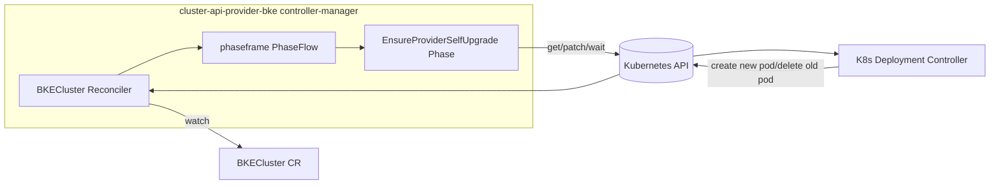
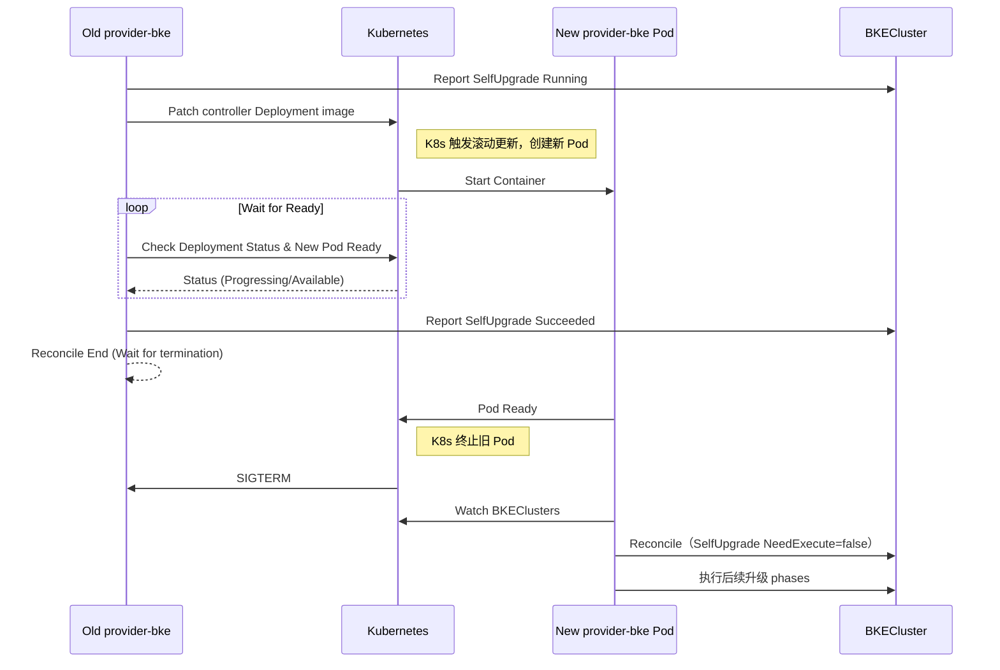

cluster-api-provider-bke 自升级

# 1、特性描述

需求点：

1. 自升级流程处理，cluster-api-provider-bke新增phase阶段处理；

2. 验证cluster-api-provider-bke升级成功后，其他组件的升级能否继续执行。

要点：
- 在升级流程中，引入一个新的 phase：EnsureProviderSelfUpgrade，用于对管理集群中的 cluster-api-provider-bke（controller-manager Deployment）进行自升级。
- 触发条件来自补丁流程：根据 BKECluster.Spec.ClusterConfig.Cluster.OpenFuyaoVersion，从本地 ConfigMap 读取 patch 配置文件路径（patchFile.\<version>），通过 phaseutil.GetPatchConfig 解析到“provider 的新镜像 tag”。当“目标镜像”与“当前 Deployment 镜像”不一致时触发自升级。
- 升级动作仅操作 K8s 原生资源：patch 自身 Deployment → 利用 K8s 原生滚动升级机制（RollingUpdate）调起新 Pod → 等待新 Pod Ready（并且 Deployment Available 达标）→ 写入阶段成功。
- 旧 Pod 的退出完全交给 K8s Deployment Controller 处理，不主动执行 os.Exit(0)。
- 新 Pod 启动后，基于 NeedExecute 判定（镜像已一致）自动跳过自升级，继续执行其他升级 phase。
- 非目标：不在此阶段修改 CR/CRD；不依赖节点命令与 Agent。

## 1.1、依赖组件

| 组件         | 组件描述 | 可获得性 |
|:---------- |:---- |:---- |
| Kubernetes | 1.33 | 必选   |
|            |      |      |
|            |      |      |

## 1.2、License

Mulan PSL v2 License

# 2、需求场景威胁建模

- 镜像异常导致新 Pod 启不来：等待达标超时 → 本阶段 Failed → 旧 Pod 不退出，系统可回滚镜像后重试。
- 误触发升级：触发条件仅由 openFuyaoVersion→patch 配置驱动，且 NeedExecute 基于“镜像不一致”幂等保护。
- 升级链路中断：单副本、滚动策略默认确保新 Pod Ready 后再删旧 Pod；依赖 K8s 自身机制保证高可用。
- ConfigMap/patch 缺失或解析失败：NeedExecute=false 或 Execute 报错，记录原因，旧进程不退出。

# 3、特性设计

## 3.1、上下文/USE-CASE视图

_可应用架构设计，补充模块功能分析_

基本流：

1. 用户变更 openFuyaoVersion；
2. Reconcile 触发 → phases 列表计算；
3. PostDeployPhases 首个阶段：EnsureProviderSelfUpgrade；
4. 解析 patch 配置 → 得到 provider 目标镜像；
5. 若镜像不一致：patch 自身 Deployment → 等到新 Pod Ready、Deployment Available；
6. Report 成功 → 本次 Reconcile 结束；
7. K8s Deployment Controller 检测到 Spec 变更，创建新 ReplicaSet 启动新 Pod，待新 Pod Ready 后 Terminate 旧 Pod；
8. 新 Pod 启动、就绪后再次 Reconcile → NeedExecute=false（镜像已一致）→ 执行剩余升级阶段（launcher/containerd/k8s/组件等）。

定位自身 Deployment：

- 固定：namespace=cluster-system，name=bke-controller-manager，container=manager；
- cluster.x-k8s.io/provider=infrastructure-bke 且 control-plane=controller-manager；
- 最后回退：根据当前 Pod Owner（ReplicaSet→Deployment）反查得到名称。

等待达标判据：

- Deployment.Status.UpdatedReplicas == Spec.Replicas;
- Deployment.Status.AvailableReplicas == Spec.Replicas;
- 存在至少一个使用“目标镜像”的 Pod 且 Ready=True;

交互视图：

## 3.2、模块设计

_通过时序图，数据流图等工具，分析特性的主要功能，实现功能的进一步划分_

- 模块与文件定位
  
  - 新增 phase：EnsureProviderSelfUpgrade（pkg/phaseframe/phases/ensureProviderSelfUpgrade.go）
  - phase 列表插入：list.go，将 EnsureProviderSelfUpgrade 作为 PostDeployPhases 的第一个
  - 升级执行：phaseutil/xxx.go（获取当前镜像、patch 镜像、等待 Deployment/Pod Ready）
  - 复用补丁读取：phaseutil/upgrade.go（GetPatchConfig）

- Phase 放置顺序
  
  - PostDeployPhases = [EnsureProviderSelfUpgrade, EnsureContainerdUpgrade, EnsureWorkerUpgrade, EnsureMasterUpgrade, EnsureWorkerDelete, EnsureMasterDelete, EnsureComponentUpgrade, EnsureCluster]

- NeedExecute 
  
  - “需不需要执行本阶段”：返回 true 表示执行，false 表示跳过。
  - 本特性中 NeedExecute 条件：
    - 满足 NormalNeedExecute（非删除、非暂停、非 DryRun）;
    - 管理集群场景；
    - 从 GetPatchConfig 解析到 provider 目标镜像；
    - 当前 Deployment 镜像 != 目标镜像（镜像名不带 tag/digest 比对）。

- Execute 
  
  - 仅做 K8s 原生操作：
    - patch Deployment（更新 manager 容器镜像；必要时给 PodTemplate 打时间戳注解保证滚动）;
    - 等待 Deployment Available 与新 Pod Ready（使用目标镜像）;
  - 成功返回 ctrl.Result{Requeue:true}（短路本轮），失败返回 error。

- PostHook 
  
  - DefaultPostHook 先 Report 成功；
  - 不执行主动退出操作，等待 K8s 终止旧 Pod。

- 避免死循环的关键
  
  - 新 Pod 再次 Reconcile 同一 BKECluster 时，NeedExecute 会比较“当前镜像（已是目标值）== 目标镜像”，返回 false，从而跳过自升级，进入后续升级 phase。

- 时序图

### 3.2.1、模块接口定义

_通过模块接口依赖图，识别模块接口，完善模块间的调用关系_

- EnsureProviderSelfUpgrade（Phase）
  
  - NeedExecute(old, new) bool
    - 数据源：phaseutil.GetPatchConfig（通过 ConfigMap key: patchFile.\<openFuyaoVersion> 获取路径）
    - 解析目标镜像；读取当前 Deployment 镜像；比较是否不一致
  - Execute() (ctrl.Result, error)
    - PatchDeploymentImage(ns, name, container="manager", targetImage)
    - WaitDeploymentAvailable(ns, name) + WaitNewPodReady(ns, deploymentSelector, targetImage)
  - PostHook(err error) error
    - err==nil 时，正常返回，不执行 os.Exit

- phaseutil
  
  - GetDeploymentImage(ns, name, container) (string, error)
  - PatchDeploymentImage(ns, name, container, image) error
  - WaitDeploymentAvailable(ns, name, timeout) error
  - WaitNewPodReady(ns, selector, targetImage, timeout) error

## 3.3、 Story分解

_结合3.1~3.2的分析，分解支持该特性所需要的Stroy，可以按照USE-CASE场景划分，也可以按照USE-CASE操作步骤划分_

### 3.3.1 Story设计

_功能描述_

_验收标准_

_接口清单_

_以类图的方式描述Story的需求，以时序图的方式描述Story的实现过程_

- Story-1：新增自升级 Phase
  - 功能描述：实现 EnsureProviderSelfUpgrade，包含 NeedExecute/Execute/PostHook
  - 验收标准：
    - 镜像不一致时触发；一致时跳过
    - 成功后 Report Succeeded，返回 Requeue
    - 失败时旧进程不退出
  - 接口清单：见 3.2.1
- Story-2：PatchConfig 集成
  - 功能描述：从 ConfigMap（key: patchFile.\<openFuyaoVersion>）读取文件路径，调用 GetPatchConfig 解析；从 Repos/SubImages/Images 里定位 provider-bke 镜像与目标 tag/digest（依据镜像名或 usedPodInfo 指定的 PodPrefix/Namespace）
  - 验收标准：能准确解析出 cluster-api-provider-bke 的目标镜像；无配置时不触发且可观测
- Story-3：Deployment 镜像对比与滚动
  - 功能描述：读取当前 Deployment 镜像，与目标镜像比对；patch 更新镜像；支持 template 注解触发滚动
  - 验收标准：单/多副本条件下，Deployment 更新且新 Pod Ready
- Story-4：等待达标与退出策略
  - 功能描述：等待 Deployment Available、目标镜像 Pod Ready；（可选）Lease 迁移；
  - 验收标准：稳定无“继续执行后续 phase”的情况；新 Pod 启动后能继续完成剩余升级
- Story-5：Phase 顺序调整
  - 功能描述：在 list.go 中，将 EnsureProviderSelfUpgrade 插入 PostDeployPhases 的第一个
  - 验收标准：升级流始终先执行自升级
- Story-7：可测试性/单测与集成
  - 功能描述：用 envtest/fake client 覆盖 NeedExecute/Execute/等待条件；Exiter 可注入；集成验证真实滚动
  - 验收标准：单测覆盖核心分支；手工/集成测试通过完整链路

## 3.4、质量属性设计

### 3.4.1、性能规格

| 规格名称 | 规格指标              |
|:---- |:----------------- |
| 内存占用 | 不引入新常驻对象          |
| 启动时间 | 无影响               |
| 响应时间 | 升级等待默认 ≤5 分钟（可配置） |

### 3.4.2、可靠性设计

- 幂等：NeedExecute 基于镜像对比
- 回退：失败不退出旧进程；允许回滚镜像后重试

### 3.4.3、安全/韧性/隐私设计

- 最小 RBAC：仅限 deployments/pods 必要动作
- 日志与事件可观测：记录目标/当前镜像、等待进度、失败原因

### 3.4.4、兼容性设计

- 支持镜像 tag 或 digest；支持单副本 RollingUpdate

### 3.4.5、可服务性设计

- 统一 PhaseName 与中文名；指标记录 Phase 时长

### 3.4.6、可测试性设计

- 等待条件与 Patch 行为可模拟
- 可手动集成测试

# 4、需求分解分配表

| 序号  | 模块名称 | Story名称 | Story描述 |
|:--- |:---- |:------- |:------- |
|     |      |         |         |
|     |      |         |         |

# 5、修改日志

| 版本  | 发布说明 |
|:--- |:---- |
|     |      |
|     |      |

# 6、参考目录
