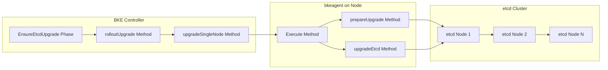
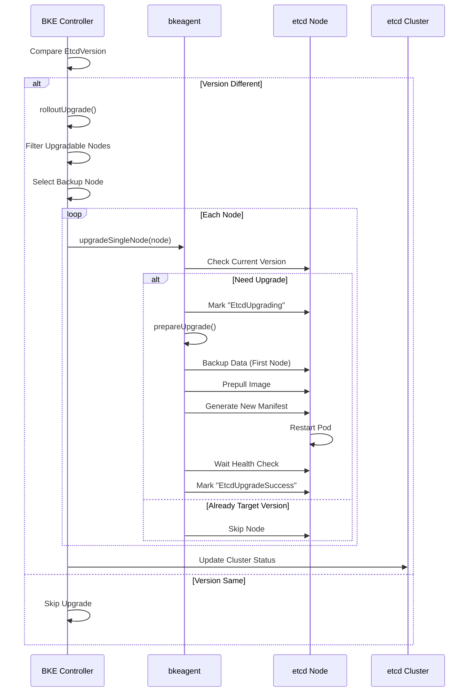

# 1、特性描述

实现 **OpenFuyao业务集群etcd组件的滚动升级**，通过新增 **`EnsureEtcdUpgrade`** 阶段，将etcd组件的版本升级过程自动化执行，确保在升级过程中集群的持续可用性，同时保障数据的安全性和一致性。

## 1.1、依赖组件

| 组件 | 组件描述 | 可获得性 |
|:---|:-------|:-------|
| cluster-api-provider-bke | 集群管理API | 必选 |
| bkeagent | 节点代理组件 | 必选 |
| Docker/Containerd | 容器运行时 | 必选 |
| etcd | 分布式键值存储 | 必选 |

## 1.2、License

Mulan PSL v2 License

# 2、需求场景威胁建模

| 威胁场景 | 风险分析 | 应对措施 |
|:---------|:-------|:-------|
| **数据丢失风险** | etcd升级过程中可能因意外中断导致数据损坏或丢失 | **备份策略**：升级前对第一个etcd节点执行数据备份，确保数据安全 |
| **集群不可用** | 多节点同时升级可能导致etcd集群quorum丢失，使集群不可用 | **滚动升级**：采用串行升级方式，每次只升级一个节点，确保集群稳定性 |
| **升级失败** | 升级过程中出现错误导致节点无法恢复 | **失败处理**：记录详细错误信息，标记失败节点，中止后续节点升级，保留现场便于问题诊断 |

# 3、特性设计

## 3.1、上下文/USE-CASE视图

**基本流（etcd升级场景）：**

1. 用户变更 `Spec.ClusterConfig.Cluster.EtcdVersion` 触发升级
2. `EnsureEtcdUpgrade` 阶段检测到版本差异
3. 执行滚动升级流程，逐个升级etcd节点
4. 每个节点执行备份、升级、验证流程
5. 升级完成后更新集群状态

**交互视图：**

## 3.2、模块设计

- **编排层**：`EnsureEtcdUpgrade` 阶段负责整体升级流程控制
  - `rolloutUpgrade()` 方法实现完整的滚动升级逻辑
  - `upgradeSingleNode()` 方法处理单个节点的升级
  - `upgradeEtcd()` 方法执行实际的升级操作

- **执行层**：`bkeagent` 负责具体的升级任务执行
  - `prepareUpgrade()` 方法执行升级前的准备工作
  - `upgradeEtcd()` 方法执行核心升级逻辑
  - `needUpgradeEtcd()` 方法检查是否需要升级
  - `waitComponentReady()` 方法等待组件就绪

- **状态管理**：实时更新节点和集群的升级状态
  - `EtcdUpgrading`：升级进行中
  - `EtcdUpgradeSuccess`：升级成功
  - `EtcdUpgradeFailed`：升级失败

### 3.2.1、模块接口定义

| 接口/函数 | 模块定位 | 功能描述 | 核心逻辑 |
|:---|:---|:---|:---|
| **EnsureEtcdUpgrade** | `controller` | etcd升级主控阶段 | 比较版本差异，触发升级流程，执行滚动升级 |
| **rolloutUpgrade** | `controller` | 滚动升级主逻辑 | 过滤可升级节点，确定备份节点，逐个升级节点 |
| **upgradeSingleNode** | `controller` | 单节点升级控制 | 检查版本，标记状态，执行升级，更新结果 |
| **upgradeEtcd** | `bkeagent` | etcd升级执行 | 创建升级命令，执行升级，等待健康检查 |
| **prepareUpgrade** | `bkeagent` | 升级前准备 | 备份数据，备份配置，预拉取镜像，获取Pod Hash |
| **needUpgradeEtcd** | `bkeagent` | 版本检查 | 比较当前版本与目标版本 |

## 3.3、 Story分解

### 3.3.1 Story设计

**Story-1：升级触发与版本比较**
- 功能描述：实现版本比较逻辑，检测是否需要执行etcd升级
- 验收标准：能够准确比较 `Spec.ClusterConfig.Cluster.EtcdVersion` 和 `Status.EtcdVersion`，触发升级流程
- 接口清单：`EnsureEtcdUpgrade.NeedExecute()`

**Story-2：滚动升级流程**
- 功能描述：实现完整的滚动升级逻辑，确保集群在升级过程中的可用性
- 验收标准：按顺序逐个升级etcd节点，每次只升级一个节点，确保集群稳定性
- 接口清单：`rolloutUpgrade()`

**Story-3：单节点升级**
- 功能描述：处理单个etcd节点的升级流程
- 验收标准：检查节点版本，标记升级状态，执行升级操作，更新节点状态
- 接口清单：`upgradeSingleNode()`

**Story-4：升级准备**
- 功能描述：执行升级前的准备工作，包括数据备份和镜像预拉取
- 验收标准：完成etcd数据备份、集群配置备份、预拉取新版本镜像
- 接口清单：`prepareUpgrade()`

**Story-5：升级执行与验证**
- 功能描述：执行etcd升级并验证升级结果
- 验收标准：生成新版本manifest，等待pod重启，验证版本和健康状态
- 接口清单：`upgradeEtcd()`, `waitComponentReady()`

**时序图**

**类图**

## 3.4、质量属性设计

### 3.4.1、性能规格

| 规格名称 | 规格指标 |
|:-------|:-------|
| 内存占用 |  |
| 启动时间 |  |
| 响应时间 |  |
| 升级总耗时 |  |

### 3.4.2、可靠性设计

- **滚动升级**：每次只升级一个节点，确保etcd集群始终保持多数派可用
- **备份机制**：在升级第一个节点前执行数据备份，确保数据安全
- **健康检查**：升级后等待健康检查通过才继续下一个节点
- **状态追踪**：实时更新节点和集群的升级状态，便于故障排查

### 3.4.3、安全/韧性/隐私设计

- **数据安全**：升级前对etcd数据进行备份，防止数据丢失
- **访问控制**：确保只有授权的控制器和服务账户可以执行升级操作
- **审计日志**：记录升级过程中的关键操作和状态变更

### 3.4.4、兼容性设计

- **版本兼容**：支持向后兼容的etcd版本升级

### 3.4.5、可服务性设计

- **日志记录**：记录升级过程中的详细日志，便于问题诊断

### 3.4.6、可测试性设计

- **单元测试**：对各个升级步骤进行单元测试

# 4、需求分解分配表

| 序号 | 模块名称 | Story名称 | Story描述 |
|:----|:-------|:--------|:--------|
| 1 | controller | 升级触发与版本比较 | 实现版本比较逻辑，检测是否需要执行etcd升级 |
| 2 | controller | 滚动升级流程 | 实现完整的滚动升级逻辑，确保集群在升级过程中的可用性 |
| 3 | controller | 单节点升级 | 处理单个etcd节点的升级流程 |
| 4 | bkeagent | 升级准备 | 执行升级前的准备工作，包括数据备份和镜像预拉取 |
| 5 | bkeagent | 升级执行与验证 | 执行etcd升级并验证升级结果 |

# 5、修改日志

| 版本 | 发布说明 |
|:---|:-------|
|      |        |

# 6、参考目录
