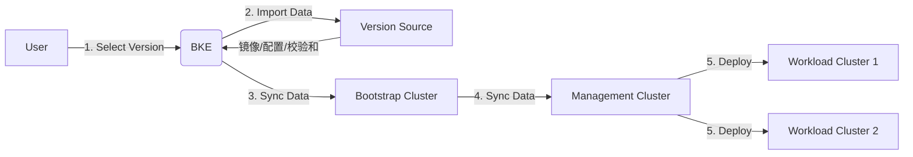
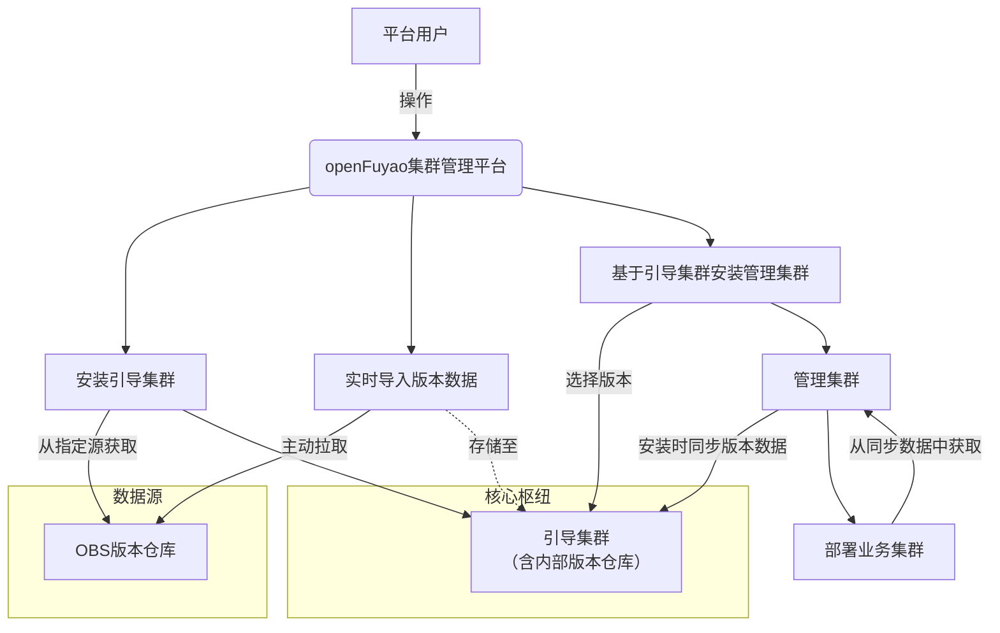
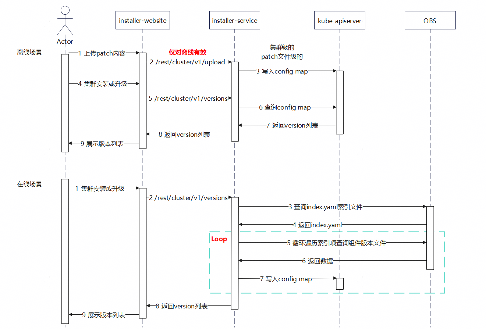
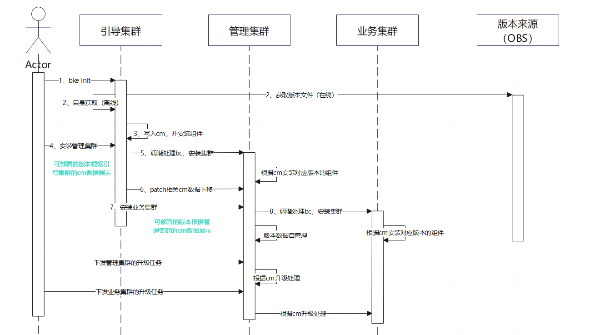
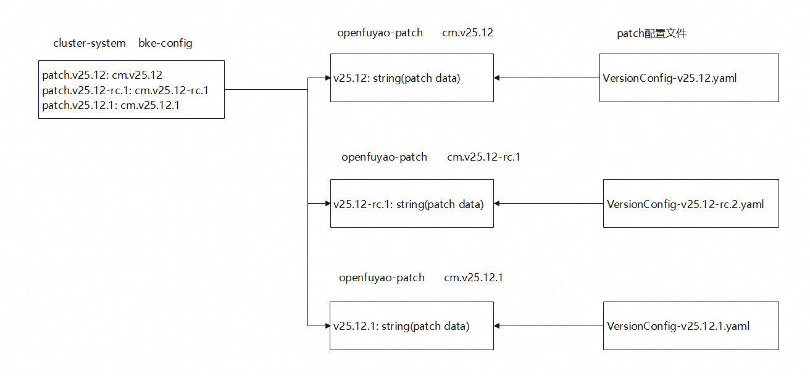
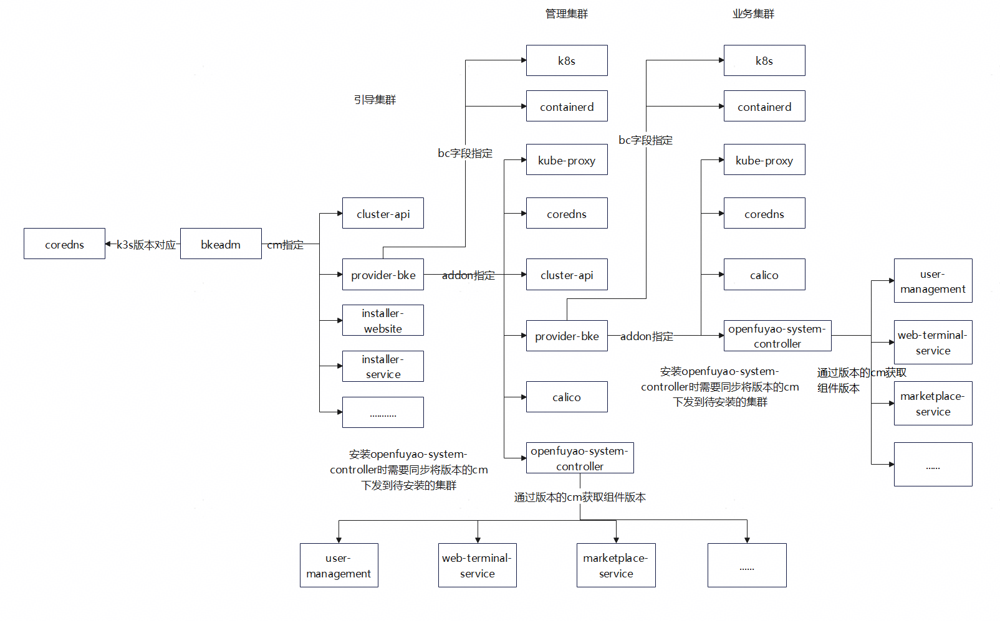

# 1、特性描述

背景：

1. 版本数据存储在文件中，当使用节点与文件所在节点非一个时，存在找不到的问题。
2. openFuyao的版本强依赖于社区版本，每次社区版本发布都需要变更组件版本，不利于组件版本维护。
3. 社区版本只有稳定发布版本，没有候选版本和补丁版本，不利于社区功能的对外发布和呈现。

需求点：

1. 版本数据存储从文件迁移到集群config map。
2. openFuyao集群组件独立发布和维护。
3. openFuyao版本定义与升级路径控制。

## 1.1、依赖组件

| 组件                          | 组件描述                        | 可获得性 |
|:----------------------------|:----------------------------|:-----|
| Kubernetes                  | 集群核心组件，当前版本v1.33.1          | 必选   |
| openfuyao-system-controller | 负责拉起管理集群和业务集群的openFuyao核心组件 | 可选   |
| bkeadm                      | 负责拉起引导集群的openFuyao核心组件      | 必选   |

## 1.2、License

Mulan PSL v2 License。

# 2、需求场景威胁建模

- bkeadm提供默认的openFuyao核心组件版本，当引导节点拉起时未提供版本配置，就会使用默认的配置，不影响引导节点的功能。
- openfuyao-system-controller提供默认的openFuyao核心组件版本，当集群拉起未提供配置，会使用默认的配置，不影响集群的部署。
- bkeadm提供版本和版本来源参数，用于指定引导节点的部署版本，提供自定义修改能力。
- 离线场景下，installer-service服务提供前端导入版本配置信息。
- 在线场景下，installer-service服务提供环境变量修改版本来源，支持自定义修改为用户可访问的网址。

# 3、特性设计

## 3.1、上下文/USE-CASE视图

版本配置数据流如下。



USE-CASE如下。



## 3.2、模块设计

下图展示了版本配置数据的上传和使用。



下图展示了集群的安装和升级流程，也就是版本数据是如何使用的。



涉及到的组件列举如下。

| 组件名称                        | 类型                | 核心职责                                    | 部署模式                                 |
|-----------------------------|-------------------|-----------------------------------------|--------------------------------------|
| bkeadm                      | 安装cli             | 为用户提供操作入口，安装引导集群。                       | 在用户本地运行的二进制命令行工具。                    |
| cluster-api-provider-bke    | BKECluster调谐器     | 主控制器监听BKECluster资源，协调集群的生命周期（创建、升级、删除）。 | 以Deployment部署在引导集群和管理集群，监听ApiServer。 |
| installer-service           | 集群生命周期管理后端        | 作为前端和K8s之间的中间层，提供中间修改BKECluster资源的能力。   | 以Deployment部署在引导集群和管理集群。             |
| installer-website           | 集群生命周期管理前端        | 为用户提供可视化的集群生命周期管理。                      | 以Deployment部署在引导集群和管理集群。             |
| openfuyao-system-controller | openFuyao核心组件安装引擎 | 将openFuyao核心组件汇总，提供统一的安装入口。             | 以Deployment部署在管理集群和业务集群。             |

### 3.2.1、模块接口定义

下面分组件介绍各自的接口。

1. bkeadm

   下面是安装引导集群的openFuyao组件使用到的接口。

   ```sh
   # pkg/initialize/bkeconsole/utils.sh
   # 从版本config map中提取组件的chart版本和镜像版本
   function generate_var()
   
   # 从版本config map中提取镜像tag并变更到要安装的yaml文件中
   function update_image_tag_from_cm()
   ```

   下面是安装引导集群的必须pod使用的接口。

   ```go
   // pkg/initialize/bkeconfig/config.go
   // 将版本配置信息写入到集群的config map
   func SetPatchConfig(version, yamlFilePath, cfgName string) error
   
   // pkg/initialize/initialize.go
   // 离线安装引导集群，从离线包中读取版本文件并创建集群config map
   func (op *Options) offlineGenerateDeployCM() error
   // 在线安装引导集群，从配置的版本来源读物版本文件并创建集群config map
   func (op *Options) onlineGenerateDeployCM() error
   // 从config map中提取镜像tag
   func (op *Options) getClusterAPIVersion(string, string) (string, string)
   ```

   此外新增了bke init命令的两个参数，用于指定安装引导集群的版本和版本来源。

   ```go
   type Options struct {
   	OFVersion      string   `json:"OFVersion"`  // 默认值取bkeadm的版本
   	VersionUrl     string   `json:"versionUrl"` // 默认值取OBS对外发布的版本
   
   	// Dependency Injection，用于ut用例编写
   	FS               afero.Fs
   	DownloadFunc     func(url, dest string) error
   	SetPatchConfigFn func(version, path, key string) error
   	K8sClient        k8s.KubernetesClient
   }
   ```

2. cluster-api-provider-bke

   ```go
   // pkg/phaseframe/phases/ensureAddonDeploy.go
   // 安装管理集群时，从引导集群迁移版本的config map数据
   func (e *EnsureAddonDeploy) createClusterAPIPatchconfigCm() error
   // 集群安装openFuyao核心组件时，上层集群下发config map数据
   func (e *EnsureAddonDeploy) distributePatchCM() error
   
   // pkg/phaseframe/phases/ensure_component_upgrade.go
   // 获取版本信息的config map
   func (e *EnsureComponentUpgrade) getPatchConfig() (*phaseutil.PatchConfig, error)
   ```

3. openfuyao-system-controller

   ```sh
   # util.sh
   # 从版本config map中提取组件的chart版本和镜像版本
   function generate_var()
   
   # 从版本config map中提取镜像tag并变更到要安装的yaml文件中
   function update_image_tag_from_cm()
   ```
   
4. installer-service

   ```go
   // pkg/api/clustermanage/handler.go
   // route func 获取升级版本列表
   func (h *Handler) getUpgradeOpenFuyaoVersions(request *restful.Request, response *restful.Response)
   
   // pkg/installer/cluster.go
   // 将版本配置数据加入到config map
   func addPatchesToConfigMap(clientset kubernetes.Interface, version, content string) (string, string, error)
   // 获取可升级的版本列表
   func (c *installerClient) GetOpenFuyaoUpgradeVersions(currentVersion string) ([]string, error)
   
   // pkg/installer/utils.go
   // 根据集群中的config map数据修改BKECluster中的addon配置
   func patchAddonsInfo(c *installerClient, obj *unstructured.Unstructured) error
   ```

## 3.3、 Story分解

### 3.3.1 版本配置从文件迁移到cm

- 背景介绍

  版本配置存储在文件中，installer-service能上传版本配置（离线）、从远端触发获取版本配置（在线），在补丁升级时调谐器会读取版本文件，获取组件版本，然后进行升级处理。

  存在问题：版本配置文件和调谐器不在一个节点时（比如高可用集群），会导致集群升级时无法读取到版本配置，导致升级失败。

- 功能描述

  将版本配置从文件存储移动到集群ApiServer中，这样就不需要版本配置文件在调谐器所在的节点，只要能连接ApiServer，调谐器就能正常处理集群的升级。



### 3.3.2 版本升级列表控制

- 背景介绍

  过往openFuyao社区只会发布季度版本，比如v25.09这种，不会发布候选版本和补丁版本。用户平时就只能获取到季度版本，不利于需求的及时体验和问题发现。

- 功能描述

  openFuyao社区提供季度版本、候选版本和补丁版本。

  - 组件版本：组件仓库可编译的最小单位即组件，其对应的Semantic Version就是组件版本，按照MAJOR.MINOR.PATCH演进。

  - 社区版本：社区发布的版本，包含候选版本（Release Candidate，简称RC）、正式版本和补丁版本，比如v25.12-rc.2、v25.12、v25.12.1等。

  - LTS版本：每年1230发布的社区版本称为LTS版本。

  - 可安装版本：候选版本和正式版本。

  - 可升级版本：更高的可安装版本和补丁版本。

    openFuyao版本由若干个组件组成，因此会有openFuyao版本和组件版本的对应关系，这个称为versionconfig，在release-manager仓库进行管理。其结果和内容如下所示：

    ```yaml
    registry:
      imageAddress: cr.openfuyao.cn/openfuyao/registry:2.8.1
      architecture:
        - amd64
        - arm64
    openFuyaoVersion: v25.12-rc.2   # openFuyao版本
    kubernetesVersion: v1.33.1.of.1 # k8s版本
    containerdVersion: v2.1.1       # containerd版本
    repos:
      - architecture:
          - amd64
          - arm64
        isKubernetes: false
        needDownload: true
        subImages:
          - sourceRepo: cr.openfuyao.cn/openfuyao/coredns
            targetRepo: kubernetes/kubernetes
            images:
              - name: coredns
                usedPodInfo:
                  - podPrefix: coredns
                    namespace: kube-system
                tag:
                  - v1.10.2  # 集群的coredns版本
    files:
      - address: https://openfuyao.obs.cn-north-4.myhuaweicloud.com/kubernetes/kubernetes/releases/download/of-v1.33.1/bin/linux/arm64/
        files:
          - fileName: kubectl
            fileAlias: kubectl-v1.33.1-of.1-arm64
          - fileName: kubelet
            fileAlias: kubelet-v1.33.1-of.1-arm64
      - address: https://openfuyao.obs.cn-north-4.myhuaweicloud.com/kubernetes/kubernetes/releases/download/of-v1.33.1/bin/linux/amd64/
        files:
          - fileName: kubectl
            fileAlias: kubectl-v1.33.1-of.1-amd64
          - fileName: kubelet
            fileAlias: kubelet-v1.33.1-of.1-amd64
      - address: https://openfuyao.obs.cn-north-4.myhuaweicloud.com/containerd/containerd/releases/download/v2.1.1-origin/
        files:
          - fileName: containerd-v2.1.1-linux-amd64.tar.gz
          - fileName: containerd-v2.1.1-linux-arm64.tar.gz
    addons:
      - name: cluster-api
        version: v1.4.3
        param:
          providerVersion: 1.0.1
          manifestsVersion: 1.0.1
      - name: kubeproxy
        version: v1.33.1-of.1
      - name: calico
        version: v3.27.3
      - name: coredns
        version: v1.10.1
      - name: openfuyao-system-controller
        version: v1.0.1
        param:
          tagVersion: 1.0.1
      - name: bkeagent-deployer
        version: v1.0.1
        param:
          tagVersion: 1.0.1
    openFuyaoCharts:
      - name: oauth-webhook
        chartVersion: 1.0.1
        tagVersion: 1.0.1
    ```

- 接口清单

  installer-service将可安装版本和可升级版本拆分，两个API查询，如下。

  ```go
  func registerUpgradeRoutes(webService *restful.WebService, h *Handler) {
  	webService.Route(webService.GET("/versions").
  		Doc("get available versions of openFuyao").
  		To(h.getOpenFuyaoVersions)) // 查询可直接安装版本列表
  
  	webService.Route(webService.POST("/upgrade-versions").
  		Doc("get available upgrade versions of openFuyao").
  		To(h.getUpgradeOpenFuyaoVersions)) // 查询可升级版本列表
  }
  ```

  注意：latest版本是可直接安装版本，不能作为升级操作的起点和终点版本。

  下面举例能进行升级的版本返回列表。

  预设：当前版本列表是[latest, v25.09, v25.10-rc.2, v25.10, v25.10.2, v25.12, v25.12-rc.1, v25.12.2, v25.12.3]。

  | 当前版本        | 可升级版本列表                                    |
  |-------------|--------------------------------------------|
  | v25.09      | [v25.10-rc.2, v25.10, v25.12, v25.12-rc.1] |
  | v25.10      | [v25.10, v25.12, v25.12-rc.1]              |
  | v25.10-rc.2 | [v25.120, v25.10, v25.12, v25.12-rc.1]     |
  | v25.12      | [v25.12.2, v25.12.3]                       |
  | v25.12-rc.1 | [v25.12, v25.12.2, v25.12.3]               |
  | v25.12.2    | [v25.12.3]                                 |
  | v25.12.3    | []                                         |
  | latest      | []                                         |

### 3.3.3 openFuyao版本独立安装

- 背景介绍

  openFuyao部署的集群中包含有openFuyao组件和三方组件，前者的版本随着openFuyao版本进行更新，后者沿用开源的版本号。这样的话openFuyao组件就需要随着版本进行变更，对于有些未发生变动的代码也需要进行版本更新，这无疑增加了版本发布的工作量。

- 功能描述

  openFuyao组件的版本各自独立维护更新，sig小组进行独立开发和发布，只需要在openFuyao版本中对应组件版本，也就是前面介绍的VersionConfig文件。

- 组件安装

  引导集群的版本使用bke安装工具指定，管理集群的版本随着引导集群下发的版本信息确定，业务集群的版本就是管理集群来进行控制。

  

## 3.4、质量属性设计

### 3.4.1、性能规格

| 规格名称 | 规格指标 |
|:-----|:-----|
| 内存占用 |      |
| 启动时间 |      |
| 响应时间 |      |
| xxx  |      |

### 3.4.2、可靠性设计

下面是代码中一些可靠性保证：

1. bkeadm安装引导集群时，可以通过参数指定版本和版本来源，缺省时就会使用bkeadm编译时导入配置。
2. 引导集群安装管理集群时，会同步下发版本的cm到管理集群的ApiServer，管理集群安装openFuyao核心组件时会从cm中读取组件版本进行安装，当cm下发失败时，会使用默认的版本；管理集群安装业务集群也是类似的处理。
3. 离线场景支持前端导入版本信息，在线场景支持环境变量修改版本信息来源。

### 3.4.3、安全/韧性/隐私设计

不涉及到安全。

### 3.4.4、兼容性设计

采用缺省值兼容前续版本。

### 3.4.5、可服务性设计

支持可安装版本和补丁版本的数据合并，然后进行直接安装。

### 3.4.6、可测试性设计

支持环境变量配置版本信息来源，方便测试验证。

# 4、需求分解分配表

| 序号 | 模块名称                                                                                         | Story名称         | Story描述         |
|:---|:---------------------------------------------------------------------------------------------|:----------------|:----------------|
| 01 | bkeadm<br />cluster-api-provider-bke<br />installer-service                                  | 版本配置从文件迁移到cm    | 支持版本配置信息存储在集群中  |
| 02 | installer-website<br />cluster-api-provider-bke<br />installer-service                       | 版本升级列表控制        | 分开升级版本列表和安装版本列表 |
| 03 | bkeadm<br />cluster-api-provider-bke<br />installer-service<br />openfuyao-system-controller | openFuyao版本独立安装 | 支持组件独立开发、发布和维护  |

# 5、修改日志
|版本|发布说明|
|:---|:-------|
|    |        |
|    |        |

# 6、参考目录

