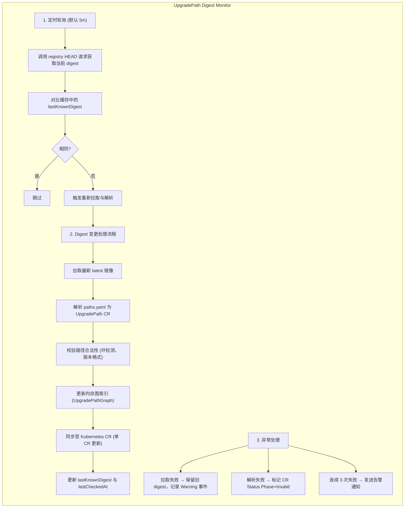
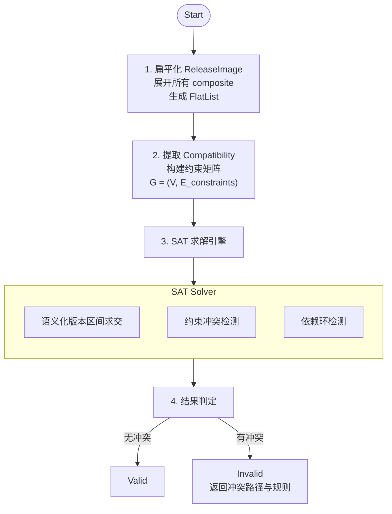
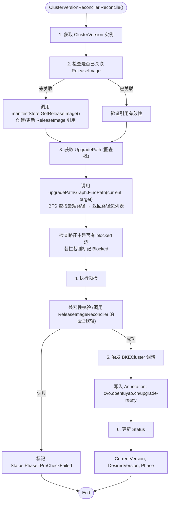
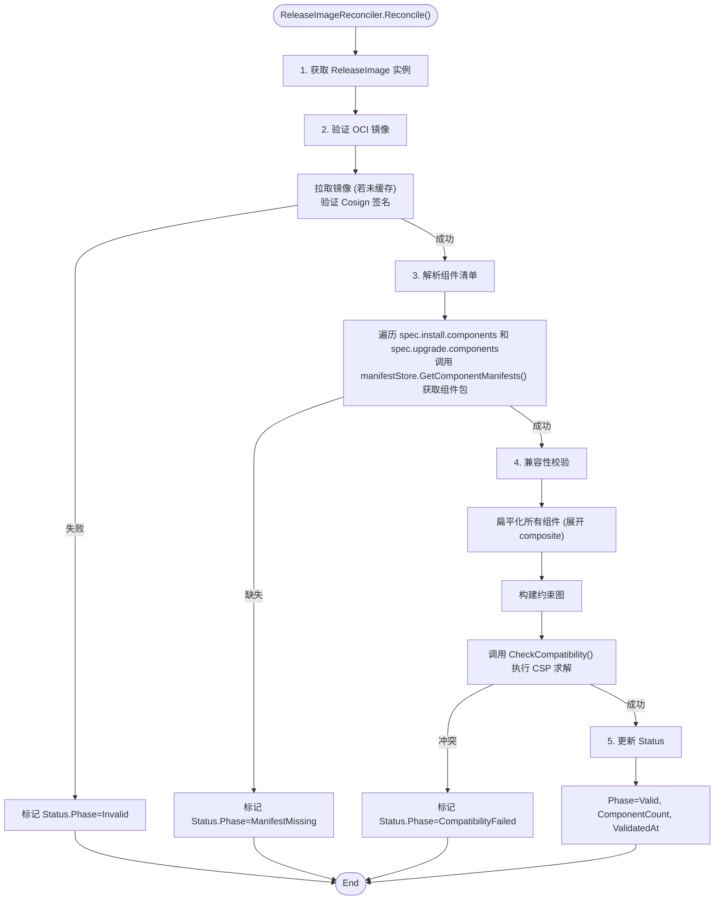
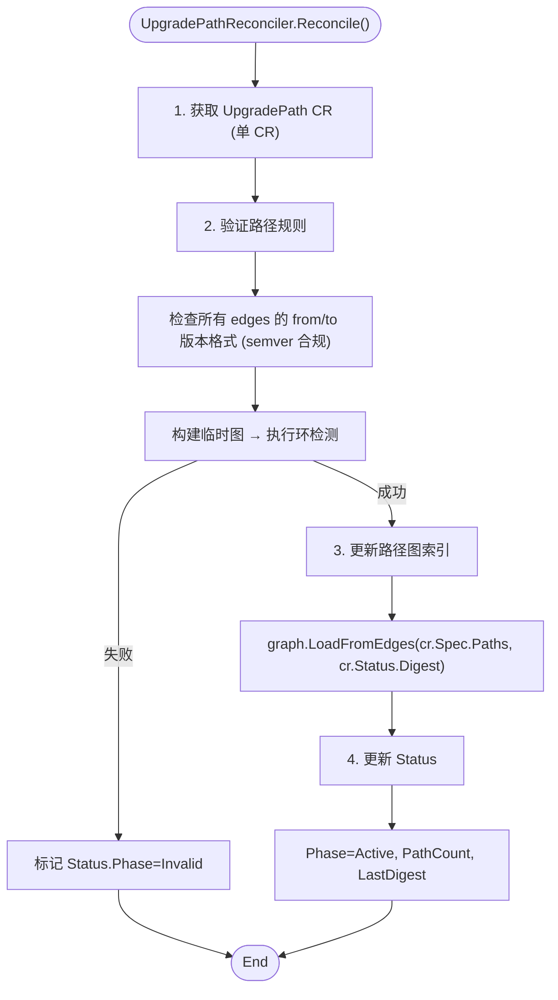
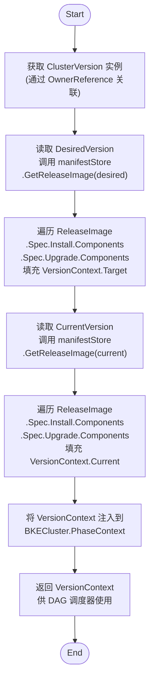
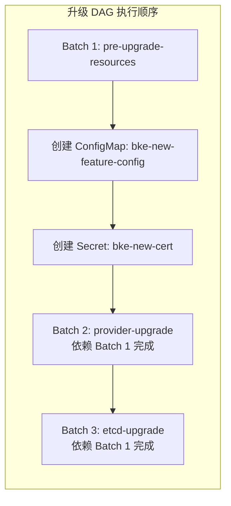
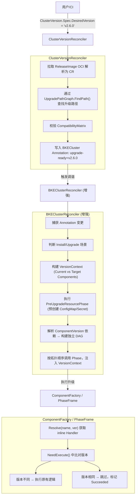
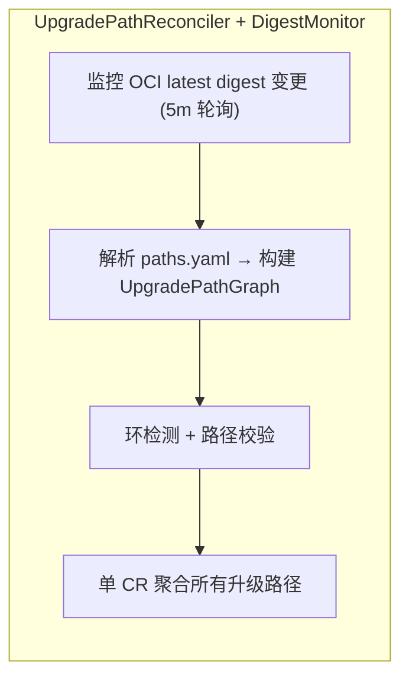

# 基于 ClusterVersion/ReleaseImage/UpgradePath 的声明式集群版本升级

| 字段 | 值 |
|------|-----|
| **标题** | 声明式集群版本管理：基于 ClusterVersion/ReleaseImage/UpgradePath 的 DAG 驱动升级方案 |
| **状态** | `provisional` |
| **类型** | Feature |
| **作者** | openFuyao Team |
| **创建日期** | 2026-05-09 |
| **依赖** | 现有 PhaseFrame 架构、bke-manifests 镜像构建流程、CAPI v1beta1 |

## 1. 摘要

本提案引入 `ClusterVersion`、`ReleaseImage` 与 `UpgradePath` 三个核心 CRD，借鉴 OpenShift CVO 声明式版本管理理念，结合 OCI 镜像分发版本清单，实现 openFuyao 集群的版本升级。方案保持 `BKEClusterReconciler` 为主调度器，通过解析 `ReleaseImage` 构建独立的 **安装 DAG** 与 **升级 DAG**，按拓扑顺序调用 Phase。Phase 升级决策完全复用现有 `NeedExecute()` 、`Execute()`接口，通过注入版本上下文比对当前与目标版本。`bke-manifests` 提供 `ComponentVersion` 清单，支持叶子/组合组件、兼容性约束、依赖拓扑、升级策略及 `inline` 代码引用。架构彻底解耦，支持组件独立演进、平滑迁移与商业化生产级高可用。

## 2. 动机

### 2.1 现状痛点

| 问题 | 现状 | 影响 |
| ------ | ------ | ------ |
| **版本概念缺失** | 版本信息散落在 `BKECluster.Spec` 各字段 | 无法回答"集群当前是什么版本"，升级缺乏统一声明入口 |
| **命令式编排** | Phase 执行顺序硬编码，依赖手动状态判断 | 无法并行、失败难定位、回滚成本高、升级路径固定 |
| **清单分散** | 组件版本与部署文件未集中管理 | 升级时难以追溯版本包含的组件及对应配置 |
| **兼容性盲区** | 组件间版本依赖无集中校验 | 易出现 K8s 与 Etcd/Containerd 版本不兼容导致集群不可用 |
| **耦合度高** | 版本管理与集群生命周期强绑定 | 新增组件或修改升级策略需侵入核心控制器 |

### 2.2 目标

1. 定义 `ClusterVersion`、`ReleaseImage`、`UpgradePath` CRD 及 1:1 关联关系。
2. 设计 `ComponentVersion` 数据结构，支持叶子/组合组件、`inline` 模式、兼容性/依赖约束、升级策略。
3. 实现基于 OCI 的 `ReleaseImage` 与 `UpgradePath` 动态拉取、解析与校验。
4. 在 `BKEClusterReconciler` 中实现独立的安装/升级 DAG 构建与调度引擎。
5. 改造核心 Phase 为 YAML 清单或注册至 `ComponentFactory`，复用 `NeedExecute()` 实现版本比对。
6. 提供从旧版本（无新 CRD）到新版本的平滑迁移方案。

### 2.3 非目标

1. 不替换 CAPI 核心控制器（KCP/MD）的节点生命周期管理。
2. 不修改 `bke-manifests` 现有构建与分发流程。
3. 不在此阶段实现 UI/CLI 交互层或多集群版本同步。
4. 不重写现有 Phase 核心执行逻辑，仅增强触发决策层与上下文注入。

## 3. 范围与约束

### 3.1 范围

| 范围 | 说明 |
| ------ | ------ |
| CRD 定义与注册 | `ClusterVersion`、`ReleaseImage`、`UpgradePath` API 定义 |
| `bke-manifests` 扩展 | 新增 `ComponentVersion` 元数据规范与目录结构 |
| 控制器实现 | 版本声明器、清单验证器、DAG 调度器 |
| 升级路径与兼容性 | 规则引擎、拦截机制、约束求解算法 |
| Phase 适配 | `NeedExecute` 上下文注入、`inline` 映射、`Version()` 接口、ComponentFactory 注册 |

### 3.2 约束

| 约束 | 说明 |
| ------ | ------ |
| **1:1 映射** | 单集群活跃状态下，1 个 `ClusterVersion` 严格对应 1 个 `ReleaseImage` |
| **清单不可变** | `ReleaseImage.Spec` 创建后不可修改 |
| **向后兼容** | 必须支持从现有 `BKECluster` 平滑迁移，Feature Gate 控制开关 |
| **离线环境** | 所有资源通过 OCI/本地缓存提供，支持断网降级 |
| **接口复用** | **严禁新增 `ShouldUpgrade()` 接口**，必须复用 `NeedExecute()` |

## 4. 提案设计

### 4.1 资源属性与关联关系

```txt
┌─────────────────────────────────────────────────────────────────┐
│                        BKECluster                               │
│  (集群实例，生命周期管理)                                         │
└──────────────────────────┬──────────────────────────────────────┘
                           │ 1:1 (OwnerReference)
                           ▼
┌──────────────────────────────────────────────────────────────────┐
│                      ClusterVersion                              │
│  spec.desiredVersion: v2.6.0                                     │
│  status.currentVersion: v2.5.0                                   │
└──────────────────────────┬───────────────────────────────────────┘
                           │ 1:1 引用
                           ▼
┌──────────────────────────────────────────────────────────────────┐
│                       ReleaseImage                               │
│  spec.version: v2.6.0                                            │
│  spec.install.components: [{name: k8s, ver: v1.29.0}, ...]       │
│  spec.upgrade.components: [{name: provider, ver: v1.2.0}, ...]   │
└──────────────────────────┬───────────────────────────────────────┘
                           │ 按 (name,version) 定位
                           ▼
┌──────────────────────────────────────────────────────────────────┐
│              bke-manifests (ComponentVersion 定义)               │
│  bke-manifests/kubernetes/v1.29.0/component.yaml                 │
│  bke-manifests/provider-upgrade/v1.0.0/component.yaml            │
└──────────────────────────────────────────────────────────────────┘

┌──────────────────────────────────────────────────────────────────┐
│                       UpgradePath                                │
│  spec.paths: [{from: v2.5.0, to: v2.6.0, blocked: false}]        │
└──────────────────────────────────────────────────────────────────┘
```

### 4.2 ComponentVersion 数据结构设计

```yaml
apiVersion: cvo.openfuyao.cn/v1beta1
kind: ComponentVersion
metadata:
  name: kubernetes-v1.29.0
spec:
  name: kubernetes
  type: composite
  version: v1.29.0
  inline:
    handler: EnsureKubernetesUpgrade
    version: v1.0
  subComponents:
    - name: kube-apiserver
      version: v1.29.0
  compatibility:
    constraints:
      - component: etcd
        rule: ">=3.5.10"
  dependencies:
    - name: etcd
      phase: Upgrade
  upgradeStrategy:
    mode: Batch
    batchSize: 1
    timeout: "30m"
    failurePolicy: FailFast  # FailFast | Continue | Rollback
```

FailurePolicy 设计说明：

- FailFast（默认）：当前组件升级失败，立即终止整个 DAG 执行，标记 UpgradeFailed。
- Continue：跳过失败组件，记录 Warning，继续执行后续无依赖组件。适用于非核心组件。
- Rollback：触发该组件的降级/卸载逻辑，恢复至上一稳定版本后继续 DAG。适用于核心组件。

**Go 结构体定义**：

```go
package v1beta1

import (
	metav1 "k8s.io/apimachinery/pkg/apis/meta/v1"
)

// +kubebuilder:object:root=true
// +kubebuilder:subresource:status

// ComponentVersion is the Schema for the componentversions API
type ComponentVersion struct {
	metav1.TypeMeta   `json:",inline"`
	metav1.ObjectMeta `json:"metadata,omitempty"`

	Spec   ComponentVersionSpec   `json:"spec,omitempty"`
	Status ComponentVersionStatus `json:"status,omitempty"`
}

// ComponentVersionSpec defines the desired state of ComponentVersion
type ComponentVersionSpec struct {
	Name            string              `json:"name"`
	Type            ComponentType       `json:"type"`
	Version         string              `json:"version"`
	Inline          *InlineSpec         `json:"inline,omitempty"`
	SubComponents   []SubComponent      `json:"subComponents,omitempty"`
	Compatibility   CompatibilitySpec   `json:"compatibility,omitempty"`
	Dependencies    []Dependency        `json:"dependencies,omitempty"`
	UpgradeStrategy UpgradeStrategySpec `json:"upgradeStrategy,omitempty"`
	Resources       []ResourceSpec      `json:"resources,omitempty"`
}

// ComponentType defines the type of component installation
type ComponentType string

const (
	ComponentTypeYAML    ComponentType = "yaml"
	ComponentTypeHelm    ComponentType = "helm"
	ComponentTypeInline  ComponentType = "inline"
	ComponentTypeBinary  ComponentType = "binary"
)

// InlineSpec defines the inline handler configuration
type InlineSpec struct {
	Handler string `json:"handler"`
	Version string `json:"version"`
}

// SubComponent defines a sub-component reference
type SubComponent struct {
	Name    string `json:"name"`
	Version string `json:"version"`
}

// CompatibilitySpec defines compatibility constraints
type CompatibilitySpec struct {
	Constraints []Constraint `json:"constraints,omitempty"`
}

// Constraint defines a single compatibility constraint
type Constraint struct {
	Component string `json:"component"`
	Rule      string `json:"rule"`
}

// Dependency defines a dependency on another component
type Dependency struct {
	Name  string `json:"name"`
	Phase string `json:"phase,omitempty"`
}

// UpgradeStrategySpec defines the upgrade strategy for the component
type UpgradeStrategySpec struct {
	Mode          string `json:"mode,omitempty"`
	BatchSize     int    `json:"batchSize,omitempty"`
	Timeout       string `json:"timeout,omitempty"`
	FailurePolicy string `json:"failurePolicy,omitempty"`
}

// ResourceSpec defines a Kubernetes resource to be applied
type ResourceSpec struct {
	Kind       string            `json:"kind"`
	APIVersion string            `json:"apiVersion"`
	Namespace  string            `json:"namespace,omitempty"`
	Name       string            `json:"name"`
	Labels     map[string]string `json:"labels,omitempty"`
	Data       map[string]string `json:"data,omitempty"`
	StringData map[string]string `json:"stringData,omitempty"`
	Manifest   string            `json:"manifest,omitempty"`
}

// ComponentVersionStatus defines the observed state of ComponentVersion
type ComponentVersionStatus struct {
	Phase      string             `json:"phase,omitempty"`
	Conditions []metav1.Condition `json:"conditions,omitempty"`
}

// +kubebuilder:object:root=true

// ComponentVersionList contains a list of ComponentVersion
type ComponentVersionList struct {
	metav1.TypeMeta `json:",inline"`
	metav1.ListMeta `json:"metadata,omitempty"`
	Items           []ComponentVersion `json:"items"`
}

func init() {
	SchemeBuilder.Register(&ComponentVersion{}, &ComponentVersionList{})
}
```

### 4.3 ComponentFactory 与 Phase 重构设计

**ComponentFactory 设计**：

```go
type ComponentFactory struct {
    mu       sync.RWMutex
    registry map[string]ComponentInstance // key: "{name}@{version}"
}

type ComponentInstance struct {
    Name    string
    Version string
    Handler PhaseExecutor // 注册的即为 inline 模式，无需 ExecutionMode
}

func (f *ComponentFactory) Register(name, version string, handler PhaseExecutor) {
    f.mu.Lock()
    defer f.mu.Unlock()
    key := fmt.Sprintf("%s@%s", name, version)
    f.registry[key] = ComponentInstance{Name: name, Version: version, Handler: handler}
}

func (f *ComponentFactory) Resolve(name, version string) (*ComponentInstance, error) {
    key := fmt.Sprintf("%s@%s", name, version)
    if inst, ok := f.registry[key]; ok {
        return &inst, nil
    }

    return nil, fmt.Errorf("component %s@%s not found", name, version)
}
```

**Phase 重构清单**：

| Phase 名称 | 重构方式 | bke-manifests 映射 | 接口增强 |
| --------- | ------- | ------------- | ----- |
| `EnsureProviderSelfUpgrade` | 转为 YAML 清单 | `provider-upgrade/v1.0.0/component.yaml` | 无 |
| `EnsureAgentUpgrade` | 转为 YAML 清单 | `bkeagent-upgrade/v1.0.0/component.yaml` | 无 |
| 其他代码 Phase | 增加 `Version()` 接口，注册至 Factory | 不生成 YAML | `Version() string`, `NeedExecute()` 增强 |

> - EnsureComponentUpgrade中的kube-proxy,coredns单独在bke-manifest抽取成组件。(建议方案)
>   - 备选方案(不建议)：EnsureComponentUpgrade复用原来的Addon设计，也使用inline模式，但需重构通过修改镜像Tag的升级机制，即通过组件(名称,版本)到bke-manifest中找到组件的清单进行应用。
>   - 备选方案缺陷：丢失kube-proxy,coredns的组件版本信息。
> - EnsureEtcdUpgrade为修改静态Pod yaml，同时还有逐节点升级的逻辑，这部分也暂时不动

### 4.4 bke-manifests 目录与 OCI 镜像设计

#### 4.4.1 bke-manifests 目录规范

```txt
bke-manifests/
├── kubernetes/
│   ├── v1.28.0/
│   │   └── component.yaml
│   └── v1.29.0/
│       └── component.yaml
├── etcd/
│   └── v3.5.12/
│       └── component.yaml
└── provider-upgrade/
    └── v1.0.0/
        └── component.yaml
```

#### 4.4.2 ReleaseImage OCI 样例 (YAML)

```yaml
version: "v2.6.0"
install:
  components:
    - name: kubernetes
      version: v1.29.0
    - name: etcd
      version: v3.5.12
upgrade:
  components:
    - name: pre-upgrade-resources
      version: v1.0.0
    - name: provider-upgrade
      version: v1.2.0
```

#### 4.4.3 UpgradePath OCI 样例与单 CR 映射设计

**设计原则**：UpgradePath OCI 镜像对应**单个 CR**，而非多个 CR。所有升级路径定义聚合在一个 `UpgradePath` 资源中，方便用户通过 `kubectl get upgradepath` 统一查看与管理。

**OCI 镜像结构**：

```yaml
# OCI 镜像内的 paths.yaml (对应单个 UpgradePath CR)
apiVersion: cvo.openfuyao.cn/v1beta1
kind: UpgradePath
metadata:
  name: openfuyao-upgrade-paths
  annotations:
    cvo.openfuyao.cn/oci-digest: "sha256:abc123..."
spec:
  paths:
    - from: "v2.4.0"
      to: "v2.5.0"
      blocked: false
      deprecated: false
    - from: "v2.5.0"
      to: "v2.6.0"
      blocked: false
      deprecated: false
    - from: "v2.4.0"
      to: "v2.6.0"
      blocked: true
      deprecated: false
      notes: "Direct upgrade blocked, please upgrade via v2.5.0"
```

**Latest 镜像 Digest 监控设计**：

由于 UpgradePath 使用 `:latest` 标签，需要持续监控镜像 digest 变更以获取最新路径定义。

**监控机制**：



#### 4.4.4 UpgradePath 数据结构设计

**单 CR 聚合设计**：所有升级路径定义在单个 `UpgradePath` CR 中，通过 `spec.paths` 数组存储多条路径边。

**设计原则**：`UpgradePath` 不仅定义版本间的**流转关系**（图），还集中管理所有**可用版本清单**（节点列表）。这使得前端或 CLI 可以通过单一资源获取所有可安装和可升级的版本信息。

**CRD 定义**：

```yaml
apiVersion: cvo.openfuyao.cn/v1beta1
kind: UpgradePath
metadata:
  name: openfuyao-upgrade-paths
spec: 
  # [新增] 全局版本列表，用于支持 GET /versions 接口
  versions:
    - version: "v2.4.0"
      installable: true        # 是否支持作为新集群的初始版本
      deprecated: true         # 是否已废弃（不推荐新安装）
      notes: "Legacy version, please use v2.5.0+"
    - version: "v2.5.0"
      installable: true
      deprecated: false
    - version: "v2.6.0"
      installable: true        # 推荐版本
      deprecated: false

  # 原有的路径边定义
  paths:
    - from: "v2.4.0"
      to: "v2.5.0"
      blocked: false
      deprecated: true
    - from: "v2.5.0"
      to: "v2.6.0"
      blocked: false
      deprecated: false
    - from: "v2.4.0"
      to: "v2.6.0"
      blocked: true
      notes: "Direct upgrade blocked, please upgrade via v2.5.0"
status:
  phase: Active
  lastDigest: "sha256:abc123..."
  lastCheckedAt: "2026-05-09T10:00:00Z"
  pathCount: 3
```

**Go 结构体定义**：

```go
type UpgradePathSpec struct {
	Versions []VersionEntry    `json:"versions,omitempty"`
    Paths  []UpgradePathEdge   `json:"paths"`
}

// VersionEntry 定义单个版本的信息
type VersionEntry struct {
    Version         string `json:"version"`
    Installable     bool   `json:"installable"`     // 是否可用于全新安装
    Deprecated      bool   `json:"deprecated"`      // 是否已废弃
    Notes           string `json:"notes,omitempty"` // 备注信息
}

// UpgradePathEdge 表示图中的一条边（单条升级路径）
type UpgradePathEdge struct {
    From        string        `json:"from"`
    To          string        `json:"to"`
    Blocked     bool          `json:"blocked,omitempty"`
    Deprecated  bool          `json:"deprecated,omitempty"`
    PreCheck    []CheckStep   `json:"preCheck,omitempty"`
    PostCheck   []CheckStep   `json:"postCheck,omitempty"`
    Notes       string        `json:"notes,omitempty"`
}

type CheckStep struct {
    Name     string `json:"name"`
    Required bool   `json:"required,omitempty"`
}

type UpgradePathStatus struct {
    Phase         UpgradePathPhase `json:"phase"`
    LastDigest    string           `json:"lastDigest,omitempty"`
    LastCheckedAt *metav1.Time     `json:"lastCheckedAt,omitempty"`
    PathCount     int              `json:"pathCount,omitempty"`
    Conditions    []metav1.Condition `json:"conditions,omitempty"`
}

type UpgradePathPhase string

const (
    PhaseActive     UpgradePathPhase = "Active"
    PhaseBlocked    UpgradePathPhase = "Blocked"
    PhaseInvalid    UpgradePathPhase = "Invalid"
)
```

**UpgradePathEdge 设计说明**：

- 每条 `UpgradePathEdge` 代表升级图中的一条有向边
- `From` 和 `To` 定义边的起点和终点（版本节点）
- `Blocked` 标记该边是否被拦截
- `Deprecated` 标记该路径是否已废弃（仍可用但不推荐）
- `PreCheck/PostCheck` 定义升级前后的检查步骤

**功能支持说明**：

1.  **获取可安装列表 (`GET /versions`)**：
    *   **逻辑**：查询 `UpgradePath` 资源，遍历 `spec.versions` 列表，筛选出 `installable == true` 的条目。
    *   **优势**：版本列表与升级路径解耦，管理员可以在同一个资源中配置哪些版本允许新装，哪些版本仅允许升级。

2.  **获取可升级版本 (`GET /upgrade-versions`)**：
    *   **逻辑**：结合 `spec.versions` 和 `spec.paths`。
    *   先找到当前版本在 `versions` 中的位置。
    *   再从 `paths` 中查找 `from == currentVersion` 且 `blocked == false` 的所有 `to` 版本。
    *   最后校验 `to` 版本是否在 `versions` 列表中且未被标记为 `deprecated`（除非允许）。

3.  **OCI 镜像同步**：
    *   `UpgradePath` 对应的 OCI 镜像中需包含 `paths.yaml`被 `UpgradePathReconciler` 解析并更新到 CR 中。

### 4.5 升级路径与兼容性算法设计

**组件扁平化与兼容性检查算法**：

1. **收集与扁平化**：遍历 `ReleaseImage` 中所有组件，若为 `composite` 类型，递归展开 `subComponents` 至叶子组件列表 `FlatList`。
2. **构建约束图**：为 `FlatList` 中每个组件解析 `compatibility.constraints`，构建有向约束图 `G=(V,E)`。
3. **SAT 求解具体过程**：
   - **变量转换**：将每个组件版本转换为语义化版本约束集合。例如 `etcd: ">=3.5.10"` 转换为区间 `[3.5.10, ∞)`。
   - **区间求交**：对同一组件的多个约束进行区间交集运算。若交集为空，则直接判定冲突。
   - **依赖图遍历**：按拓扑顺序遍历组件，将已解析的版本代入后续组件的约束中。若出现 `A requires B>=x` 但 `B` 已锁定为 `<x` 的版本，则触发回溯或报错。
   - **最终赋值**：若所有约束均满足且无环，返回 `Valid`；否则返回冲突组件对与具体规则。
4. **预检拦截**：在 `ReleaseImageReconciler` 中执行静态校验；在 `BKEClusterReconciler` DAG 执行前执行运行时校验。

**兼容性算法流程图**：



#### 4.5.1 SAT/CSP 兼容性求解设计

**选型**：采用 `github.com/Masterminds/semver/v3` 进行语义化版本解析与约束匹配，结合轻量级 **CSP（约束满足问题）回溯算法**。K8s 生态中版本依赖本质是 CSP 而非布尔 SAT，回溯求解更贴合实际。

**规则语法**：
支持语义化版本约束：`>=`, `<=`, `>`, `<`, `=`, `!=`, 区间 `>=1.0.0 <2.0.0`。

**使用方法**：

1. **变量定义**：每个组件为一个变量，定义域为其可用版本列表。
2. **约束转换**：将 `rule: ">=3.5.10"` 转换为 `semver.Constraints` 对象。
3. **拓扑排序**：按 `dependencies` 构建有向无环图，确定变量赋值顺序。
4. **约束传播与回溯**：
   - 按拓扑序依次为组件分配版本。
   - 每次分配后，检查该组件的 `constraints` 是否与已分配的其他组件版本冲突。
   - 若冲突，回溯至上一个组件尝试其他版本；若所有版本均冲突，返回 `Invalid` 并输出冲突路径。

**代码实现**：

```go
func CheckCompatibility(components []ComponentRef, manifestStore *ManifestStore) error {
    // 1. 解析所有组件的 constraints
    constraints := make(map[string][]*semver.Constraints)
    for _, comp := range components {
        cv := manifestStore.Get(comp.Name, comp.Version)
        for _, c := range cv.Spec.Compatibility.Constraints {
            constraint, err := semver.NewConstraint(c.Rule)
            if err != nil { return err }
            constraints[c.Component] = append(constraints[c.Component], constraint)
        }
    }
    // 2. 校验实际版本是否满足约束
    for compName, consList := range constraints {
        actualVer := getComponentVersion(compName) // 从集群状态获取
        ver, err := semver.NewVersion(actualVer)
        if err != nil { return err }
        for _, c := range consList {
            if !c.Check(ver) {
                return fmt.Errorf("component %s version %s violates constraint %s", compName, actualVer, c.Original())
            }
        }
    }
    return nil
}
```

#### 4.5.2 manifestStore 实现

**设计思路**：`ManifestStore` 作为版本清单的统一访问层，承担以下职责

1. **抽象存储后端**：屏蔽本地文件系统与 OCI 远程仓库的差异，提供统一的组件清单获取接口
2. **多级缓存策略**：采用 `sync.Map` 实现内存缓存，避免重复解析 YAML 和拉取 OCI 镜像
3. **降级机制**：优先从本地 `/etc/bke/manifests` 加载，失败后降级至 OCI 拉取，支持离线环境运行
4. **线程安全**：所有缓存操作使用原子操作，支持高并发 Reconcile 循环访问
5. **多文件支持**：组件目录下包含 `component.yaml`（元数据）与多个资源清单文件（rbac.yaml、configmap.yaml、deployment.yaml 等）
6. **模板渲染**：所有 YAML 文件支持 Go template 语法，加载时统一渲染

**组件目录结构**：

```txt
bke-manifests/
└── kubernetes/
    └── v1.29.0/
        ├── component.yaml          # 组件元数据（版本、依赖、策略）
        ├── 01-crd.yaml             # CRD 定义（数字前缀控制顺序）
        ├── 02-rbac.yaml            # RBAC 资源（ServiceAccount/Role/ClusterRoleBinding）
        ├── 03-configmap.yaml       # ConfigMap 配置
        ├── 04-secret.yaml          # Secret 资源（可选）
        ├── 05-deployment.yaml      # Deployment/StatefulSet/DaemonSet
        └── 06-service.yaml         # Service 资源
```

**文件命名与排序规则**：

清单文件按**文件名称自然序（字母顺序）**排序后依次应用。推荐使用**数字前缀**明确控制应用顺序，确保依赖关系正确：

| 前缀 | 文件示例 | 说明 |
| ---- | -------- | ---- |
| `01-` | `01-crd.yaml` | CRD 优先创建，后续资源才能引用自定义资源类型 |
| `02-` | `02-rbac.yaml` | RBAC 权限配置，为后续工作负载提供访问控制 |
| `03-` | `03-configmap.yaml` | ConfigMap 配置，工作负载启动前需就绪 |
| `04-` | `04-secret.yaml` | Secret 敏感数据，如证书、密钥 |
| `05-` | `05-deployment.yaml` | Deployment/StatefulSet/DaemonSet 工作负载 |
| `06-` | `06-service.yaml` | Service/Ingress 网络暴露 |

**设计优势**：
- **灵活性**：清单维护者可通过调整文件名前缀自由控制应用顺序，无需修改代码
- **可读性**：文件名即文档，目录结构清晰展示资源创建顺序
- **可扩展**：新增资源类型只需添加文件并分配合适前缀，无需更新硬编码优先级表

**架构设计**：

```txt
┌─────────────────────────────────────────────────────────┐
│                    Caller (Reconciler)                  │
└────────────────────────┬────────────────────────────────┘
                         │ GetComponentManifests(name, version, ctx)
                         ▼
┌─────────────────────────────────────────────────────────┐
│                   ManifestStore                         │
│  ┌───────────────────────────────────────────────────┐  │
│  │ 1. 检查内存缓存 (sync.Map)                         │  │
│  │    ├─ Hit → 克隆副本                              │  │
│  │    └─ Miss → 继续                                 │  │
│  └───────────────────────┬───────────────────────────┘  │
│                          │                               │
│  ┌───────────────────────▼───────────────────────────┐  │
│  │ 2. 尝试本地文件系统                                │  │
│  │    /etc/bke/manifests/{name}/{version}/           │  │
│  │    ├─ 扫描目录下所有 *.yaml 文件                   │  │
│  │    ├─ 解析 component.yaml 为元数据                 │  │
│  │    ├─ 解析其余 YAML 为资源清单列表                 │  │
│  │    └─ 写入缓存 → 继续                             │  │
│  └───────────────────────┬───────────────────────────┘  │
│                          │                               │
│  ┌───────────────────────▼───────────────────────────┐  │
│  │ 3. OCI 远程拉取                                   │  │
│  │    registry/openfuyao-release:{version}           │  │
│  │    ├─ 拉取镜像 → 提取组件目录 layer                │  │
│  │    ├─ 遍历目录下所有 *.yaml 文件                   │  │
│  │    ├─ 写入缓存 → 继续                             │  │
│  │    └─ 失败 → 返回错误                             │  │
│  └───────────────────────┬───────────────────────────┘  │
│                          │                               │
│  ┌───────────────────────▼───────────────────────────┐  │
│  │ 4. 模板渲染 (若传入 TemplateContext)               │  │
│  │    ├─ 渲染 component.yaml 元数据                   │  │
│  │    ├─ 按依赖顺序排序资源清单 (CRD→RBAC→CM→Deploy) │  │
│  │    ├─ 逐个渲染 {{.xxx}} 占位符                     │  │
│  │    └─ 返回渲染后的清单列表                         │  │
│  └───────────────────────────────────────────────────┘  │
└─────────────────────────────────────────────────────────┘
```

**代码实现**：

```go
// pkg/manifest/store.go

// ResourceManifest 表示单个渲染后的资源清单
type ResourceManifest struct {
    FileName string // 原始文件名 (rbac.yaml, deployment.yaml 等)
    Content  []byte // 渲染后的 YAML 内容
    Objects  []unstructured.Unstructured // 解析后的 K8s 对象列表
}

// ComponentPackage 组件完整包（元数据 + 资源清单列表）
type ComponentPackage struct {
    Metadata  *ComponentVersion   // component.yaml 元数据
    Manifests []ResourceManifest  // 按依赖顺序排序的资源清单
}

// ManifestStore 清单存储
type ManifestStore struct {
    cache     *sync.Map // key: "{name}@{version}" -> *ComponentPackage
    ociClient *oci.Client
    localPath string    // 本地 manifest 根目录，默认 /etc/bke/manifests
}

// GetComponentManifests 获取组件完整包（含元数据与所有资源清单）
func (s *ManifestStore) GetComponentManifests(name, version string, ctx *TemplateContext) (*ComponentPackage, error) {
    key := fmt.Sprintf("%s@%s", name, version)
    
    // 1. 尝试从缓存加载
    if val, ok := s.cache.Load(key); ok {
        pkg := val.(*ComponentPackage)
        if ctx != nil {
            return s.renderPackage(pkg, ctx)
        }
        return pkg, nil
    }
    
    // 2. 尝试从本地 bke-manifests 目录加载
    compDir := fmt.Sprintf("%s/%s/%s", s.localPath, name, version)
    if _, err := os.Stat(compDir); err == nil {
        pkg, err := s.loadFromLocal(compDir)
        if err == nil {
            s.cache.Store(key, pkg)
            if ctx != nil {
                return s.renderPackage(pkg, ctx)
            }
            return pkg, nil
        }
    }
    
    // 3. 降级：从 OCI 拉取组件目录
    img, err := s.ociClient.Pull(fmt.Sprintf("registry/openfuyao-release:%s", version))
    if err != nil { return nil, err }
    
    pkg, err := s.loadFromOCI(img, name, version)
    if err != nil { return nil, err }
    
    s.cache.Store(key, pkg)
    if ctx != nil {
        return s.renderPackage(pkg, ctx)
    }
    return pkg, nil
}

// loadFromLocal 从本地目录加载组件包
func (s *ManifestStore) loadFromLocal(compDir string) (*ComponentPackage, error) {
    entries, err := os.ReadDir(compDir)
    if err != nil { return nil, err }
    
    pkg := &ComponentPackage{}
    var manifestFiles []string
    
    for _, entry := range entries {
        if !strings.HasSuffix(entry.Name(), ".yaml") {
            continue
        }
        
        filePath := filepath.Join(compDir, entry.Name())
        data, err := os.ReadFile(filePath)
        if err != nil { continue }
        
        if entry.Name() == "component.yaml" {
            cv := &ComponentVersion{}
            if err := yaml.Unmarshal(data, cv); err == nil {
                pkg.Metadata = cv
            }
        } else {
            manifestFiles = append(manifestFiles, entry.Name())
        }
    }
    
    // 按依赖顺序排序清单
    pkg.Manifests = s.sortManifests(manifestFiles, compDir)
    return pkg, nil
}

// loadFromOCI 从 OCI 镜像加载组件包
func (s *ManifestStore) loadFromOCI(img *oci.Image, name, version string) (*ComponentPackage, error) {
    prefix := fmt.Sprintf("%s/%s/", name, version)
    layers, err := img.GetLayersByPrefix(prefix)
    if err != nil { return nil, err }
    
    pkg := &ComponentPackage{}
    var manifestFiles []string
    
    for _, layer := range layers {
        fileName := strings.TrimPrefix(layer.Path, prefix)
        if !strings.HasSuffix(fileName, ".yaml") {
            continue
        }
        
        if fileName == "component.yaml" {
            cv := &ComponentVersion{}
            if err := yaml.Unmarshal(layer.Content, cv); err == nil {
                pkg.Metadata = cv
            }
        } else {
            manifestFiles = append(manifestFiles, fileName)
            // 缓存单个清单
            s.cacheManifest(fmt.Sprintf("%s@%s:%s", name, version, fileName), layer.Content)
        }
    }
    
    pkg.Manifests = s.sortManifests(manifestFiles, "")
    return pkg, nil
}

// sortManifests 按文件名称自然序排序清单文件
func (s *ManifestStore) sortManifests(files []string, baseDir string) []ResourceManifest {
    // 读取文件内容并解析
    var manifests []ResourceManifest
    for _, file := range files {
        var data []byte
        if baseDir != "" {
            data, _ = os.ReadFile(filepath.Join(baseDir, file))
        }
        
        // 解析 YAML 为 unstructured 对象
        objects, _ := parseYAMLObjects(data)
        
        manifests = append(manifests, ResourceManifest{
            FileName: file,
            Content:  data,
            Objects:  objects,
        })
    }
    
    // 按文件名称自然序排序（字母顺序）
    // 文件名建议使用前缀数字控制顺序，如 01-crd.yaml, 02-rbac.yaml
    sort.Slice(manifests, func(i, j int) bool {
        return manifests[i].FileName < manifests[j].FileName
    })
    
    return manifests
}

// renderPackage 渲染整个组件包
func (s *ManifestStore) renderPackage(pkg *ComponentPackage, ctx *TemplateContext) (*ComponentPackage, error) {
    rendered := &ComponentPackage{
        Metadata:  pkg.Metadata,
        Manifests: make([]ResourceManifest, len(pkg.Manifests)),
    }
    
    // 渲染元数据
    if pkg.Metadata != nil {
        rendered.Metadata, _ = s.renderTemplate(pkg.Metadata, ctx)
    }
    
    // 渲染每个清单文件
    for i, manifest := range pkg.Manifests {
        renderedContent, err := s.renderYAMLContent(manifest.Content, ctx)
        if err != nil {
            return nil, fmt.Errorf("failed to render %s: %w", manifest.FileName, err)
        }
        
        objects, _ := parseYAMLObjects(renderedContent)
        rendered.Manifests[i] = ResourceManifest{
            FileName: manifest.FileName,
            Content:  renderedContent,
            Objects:  objects,
        }
    }
    
    return rendered, nil
}

// parseYAMLObjects 解析 YAML 内容为 K8s 对象列表（支持多文档）
func parseYAMLObjects(data []byte) ([]unstructured.Unstructured, error) {
    var objects []unstructured.Unstructured
    docs := bytes.Split(data, []byte("\n---\n"))
    
    for _, doc := range docs {
        if len(bytes.TrimSpace(doc)) == 0 {
            continue
        }
        
        var obj unstructured.Unstructured
        if err := yaml.Unmarshal(doc, &obj); err == nil && obj.GetKind() != "" {
            objects = append(objects, obj)
        }
    }
    
    return objects, nil
}

// renderTemplate 渲染 ComponentVersion 元数据模板
func (s *ManifestStore) renderTemplate(cv *ComponentVersion, ctx *TemplateContext) (*ComponentVersion, error) {
    data, err := yaml.Marshal(cv)
    if err != nil {
        return nil, err
    }
    
    renderedData, err := s.renderYAMLContent(data, ctx)
    if err != nil {
        return nil, err
    }
    
    rendered := &ComponentVersion{}
    if err := yaml.Unmarshal(renderedData, rendered); err != nil {
        return nil, fmt.Errorf("failed to unmarshal rendered template: %w", err)
    }
    
    return rendered, nil
}

// renderYAMLContent 渲染任意 YAML 内容模板（通用方法）
func (s *ManifestStore) renderYAMLContent(data []byte, ctx *TemplateContext) ([]byte, error) {
    if ctx == nil || len(data) == 0 {
        return data, nil
    }
    
    tmpl, err := template.New("manifest").Funcs(template.FuncMap{
        "default": func(val, def string) string {
            if val == "" { return def }
            return val
        },
        "lower": strings.ToLower,
        "upper": strings.ToUpper,
    }).Parse(string(data))
    if err != nil {
        return nil, fmt.Errorf("failed to parse template: %w", err)
    }
    
    var buf bytes.Buffer
    if err := tmpl.Execute(&buf, ctx); err != nil {
        return nil, fmt.Errorf("failed to render template: %w", err)
    }
    
    return buf.Bytes(), nil
}

func (s *ManifestStore) GetReleaseImage(version string) (*ReleaseImage, error) {
    key := fmt.Sprintf("release-image@%s", version)
    if val, ok := s.cache.Load(key); ok {
        return val.(*ReleaseImage), nil
    }
    
    // 1. 尝试从本地加载 release.yaml
    localPath := fmt.Sprintf("%s/release-%s.yaml", s.localPath, version)
    if data, err := os.ReadFile(localPath); err == nil {
        ri := &ReleaseImage{}
        if err := yaml.Unmarshal(data, ri); err == nil {
            s.cache.Store(key, ri)
            return ri, nil
        }
    }
    
    // 2. 降级：从 OCI 拉取
    img, err := s.ociClient.Pull(fmt.Sprintf("registry/openfuyao-release:%s", version))
    if err != nil { return nil, err }
    
    // 优先读取 release.yaml layer，否则解析 config
    layer, err := img.GetLayerByPath("release.yaml")
    if err != nil {
        // fallback: 解析 OCI config 为 ReleaseImage
        cfg, err := img.ConfigFile()
        if err != nil { return nil, err }
        ri := &ReleaseImage{}
        if err := json.Unmarshal(cfg.Config.Labels["release-spec"], ri); err != nil {
            return nil, err
        }
        s.cache.Store(key, ri)
        return ri, nil
    }
    
    ri := &ReleaseImage{}
    if err := yaml.Unmarshal(layer.Content, ri); err != nil { return nil, err }
    
    s.cache.Store(key, ri)
    return ri, nil
}
```

**ApplyManifests 应用接口**：

```go
// pkg/manifest/applier.go

// ManifestApplier 清单应用器
type ManifestApplier struct {
    client client.Client
    logger logr.Logger
}

// ApplyManifests 按顺序应用组件清单（等价于 kubectl apply）
func (a *ManifestApplier) ApplyManifests(ctx context.Context, manifests []ResourceManifest) error {
    for _, manifest := range manifests {
        a.logger.Info("Applying manifest", "file", manifest.FileName)
        
        for _, obj := range manifest.Objects {
            if err := a.applyObject(ctx, &obj); err != nil {
                return fmt.Errorf("failed to apply %s/%s: %w", 
                    obj.GetKind(), obj.GetName(), err)
            }
        }
    }
    return nil
}

// applyObject 应用单个对象（幂等操作）
func (a *ManifestApplier) applyObject(ctx context.Context, obj *unstructured.Unstructured) error {
    // 设置注解标记用于追踪
    annotations := obj.GetAnnotations()
    if annotations == nil {
        annotations = make(map[string]string)
    }
    annotations["cvo.openfuyao.cn/managed-by"] = "manifest-store"
    obj.SetAnnotations(annotations)
    
    // 尝试更新，若不存在则创建
    existing := &unstructured.Unstructured{}
    existing.SetGroupVersionKind(obj.GroupVersionKind())
    err := a.client.Get(ctx, client.ObjectKey{
        Namespace: obj.GetNamespace(),
        Name:      obj.GetName(),
    }, existing)
    
    if err != nil && apierrors.IsNotFound(err) {
        return a.client.Create(ctx, obj)
    }
    
    // 保留不可变字段
    obj.SetResourceVersion(existing.GetResourceVersion())
    obj.SetUID(existing.GetUID())
    return a.client.Update(ctx, obj)
}

// DeleteManifests 删除组件清单（用于回滚或卸载）
func (a *ManifestApplier) DeleteManifests(ctx context.Context, manifests []ResourceManifest) error {
    // 反向删除（与创建顺序相反）
    for i := len(manifests) - 1; i >= 0; i-- {
        manifest := manifests[i]
        for _, obj := range manifest.Objects {
            if err := a.client.Delete(ctx, &obj); err != nil && !apierrors.IsNotFound(err) {
                return err
            }
        }
    }
    return nil
}
```

#### 4.5.2.1 TemplateContext 模板渲染模块

**设计思路**：组件 YAML 文件中可使用 Go template 语法声明变量占位符，在加载时由 `TemplateContext` 注入实际值。支持集群上下文、网络配置、节点信息等动态渲染。

**支持的变量类别**：

| 变量类别 | 示例变量 | 说明 |
| -------- | -------- | ---- |
| **集群上下文** | `{{.ClusterName}}`、`{{.Namespace}}`、`{{.ClusterUID}}` | 集群标识信息 |
| **版本信息** | `{{.KubernetesVersion}}`、`{{.EtcdVersion}}`、`{{.ProviderVersion}}` | 目标组件版本 |
| **网络配置** | `{{.PodCIDR}}`、`{{.ServiceCIDR}}`、`{{.DNSDomain}}` | 集群网络参数 |
| **节点信息** | `{{.ControlPlaneReplicas}}`、`{{.WorkerNodeCount}}`、`{{.NodeArch}}` | 节点规模与架构 |
| **环境配置** | `{{.Region}}`、`{{.AvailabilityZone}}`、`{{.Environment}}` | 部署环境信息 |
| **自定义变量** | `{{.Custom.*}}` | 用户通过 Annotation 传入的自定义变量 |

**ComponentVersion YAML 模板示例**：

```yaml
apiVersion: cvo.openfuyao.cn/v1beta1
kind: ComponentVersion
metadata:
  name: kubernetes-{{.KubernetesVersion}}
spec:
  name: kubernetes
  version: {{.KubernetesVersion}}
  inline:
    handler: EnsureKubernetesUpgrade
    version: v1.0
  resources:
    - kind: ConfigMap
      apiVersion: v1
      namespace: {{.Namespace}}
      name: k8s-config-{{.ClusterName}}
      data:
        cluster-uid: "{{.ClusterUID}}"
        region: "{{.Region}}"
        pod-cidr: "{{.PodCIDR}}"
        service-cidr: "{{.ServiceCIDR}}"
```

**TemplateContext 数据结构**(根据业务需要注入需要的变量)：

```go
// pkg/manifest/template.go
type TemplateContext struct {
    ClusterName          string            `json:"clusterName"`
    Namespace            string            `json:"namespace"`
    ClusterUID           string            `json:"clusterUID"`
    KubernetesVersion    string            `json:"kubernetesVersion"`
    EtcdVersion          string            `json:"etcdVersion"`
    ProviderVersion      string            `json:"providerVersion"`
    PodCIDR              string            `json:"podCIDR"`
    ServiceCIDR          string            `json:"serviceCIDR"`
    DNSDomain            string            `json:"dnsDomain"`
    ControlPlaneReplicas int               `json:"controlPlaneReplicas"`
    WorkerNodeCount      int               `json:"workerNodeCount"`
    NodeArch             string            `json:"nodeArch"`
    Region               string            `json:"region"`
    AvailabilityZone     string            `json:"availabilityZone"`
    Environment          string            `json:"environment"`
    Custom               map[string]string `json:"custom,omitempty"`
}

// BuildTemplateContext 从 BKECluster 实例构建 TemplateContext
func BuildTemplateContext(bc *bkev1beta1.BKECluster) *TemplateContext {
    return &TemplateContext{
        ClusterName:          bc.Name,
        Namespace:            bc.Namespace,
        ClusterUID:           string(bc.UID),
        KubernetesVersion:    bc.Spec.KubernetesVersion,
        EtcdVersion:          bc.Spec.EtcdVersion,
        ProviderVersion:      bc.Status.ProviderVersion,
        PodCIDR:              bc.Spec.Networking.PodCIDR,
        ServiceCIDR:          bc.Spec.Networking.ServiceCIDR,
        DNSDomain:            bc.Spec.Networking.DNSDomain,
        ControlPlaneReplicas: bc.Spec.ControlPlane.Replicas,
        WorkerNodeCount:      bc.Spec.WorkerNodeCount,
        NodeArch:             bc.Spec.NodeArchitecture,
        Region:               bc.Spec.Region,
        AvailabilityZone:     bc.Spec.AvailabilityZone,
        Environment:          bc.Labels["environment"],
        Custom:               extractCustomAnnotations(bc),
    }
}

// extractCustomAnnotations 从 BKECluster 注解中提取自定义变量
func extractCustomAnnotations(bc *bkev1beta1.BKECluster) map[string]string {
    custom := make(map[string]string)
    for k, v := range bc.Annotations {
        if strings.HasPrefix(k, "cvo.openfuyao.cn/custom-") {
            key := strings.TrimPrefix(k, "cvo.openfuyao.cn/custom-")
            custom[key] = v
        }
    }
    return custom
}
```

**模板渲染核心方法实现**（位于 `pkg/manifest/store.go`）：

```go
// renderTemplate 渲染 ComponentVersion 元数据模板
func (s *ManifestStore) renderTemplate(cv *ComponentVersion, ctx *TemplateContext) (*ComponentVersion, error) {
    data, err := yaml.Marshal(cv)
    if err != nil {
        return nil, err
    }
    
    renderedData, err := s.renderYAMLContent(data, ctx)
    if err != nil {
        return nil, err
    }
    
    rendered := &ComponentVersion{}
    if err := yaml.Unmarshal(renderedData, rendered); err != nil {
        return nil, fmt.Errorf("failed to unmarshal rendered template: %w", err)
    }
    
    return rendered, nil
}

// renderYAMLContent 渲染任意 YAML 内容模板（通用方法）
func (s *ManifestStore) renderYAMLContent(data []byte, ctx *TemplateContext) ([]byte, error) {
    if ctx == nil || len(data) == 0 {
        return data, nil
    }
    
    tmpl, err := template.New("manifest").Funcs(template.FuncMap{
        "default": func(val, def string) string {
            if val == "" { return def }
            return val
        },
        "lower": strings.ToLower,
        "upper": strings.ToUpper,
    }).Parse(string(data))
    if err != nil {
        return nil, fmt.Errorf("failed to parse template: %w", err)
    }
    
    var buf bytes.Buffer
    if err := tmpl.Execute(&buf, ctx); err != nil {
        return nil, fmt.Errorf("failed to render template: %w", err)
    }
    
    return buf.Bytes(), nil
}
```

**TemplateContext 在 BKECluster 控制器中的调用位置**：

```txt
┌──────────────────────────────────────────────────────────────────┐
│ BKEClusterReconciler.Reconcile()                                 │
├──────────────────────────────────────────────────────────────────┤
│ 1. 获取 BKECluster 实例                                          │
│ 2. 检查 ClusterVersion Annotation (upgrade-ready)                │
│    └─ 若无升级请求 → 返回                                        │
│ 3. 构建 VersionContext (版本比对上下文)                          │
│ 4. 构建 TemplateContext (模板渲染上下文) ◀──── 调用位置 1        │
│    └─ tmplCtx := manifest.BuildTemplateContext(bc)               │
│ 5. 判断 Install/Upgrade 场景                                     │
│ 6. 解析 ReleaseImage 获取组件列表                                │
│ 7. 构建 DAG (依赖图)                                             │
│ 8. 执行 DAG ◀────────────────────────────────────────────────────┤
│    └─ executeDAG(ctx, bc, dag, tmplCtx)                          │
│       │                                                          │
│       ├─ 遍历 DAG 拓扑批次                                       │
│       ├─ 对每个组件:                                             │
│       │   ├─ GetComponentManifests(name, ver, tmplCtx)◀─用位置 2 │
│       │   │   └─ 内部调用 renderPackage(pkg, tmplCtx)            │
│       │   │       └─ renderTemplate(cv, ctx)  ◀─ 渲染元数据      │
│       │   │       └─ renderYAMLContent(data, ctx) ◀─ 渲染清单    │
│       │   ├─ ApplyManifests(ctx, pkg.Manifests)                  │
│       │   └─ Phase.Execute()                                     │
│       └─ 返回执行结果                                            │
│ 9. 更新 ClusterVersion Status                                    │
└──────────────────────────────────────────────────────────────────┘
```

**调用链路代码示例**：

```go
// controllers/bkecluster_controller.go
func (r *BKEClusterReconciler) Reconcile(ctx context.Context, req ctrl.Request) (ctrl.Result, error) {
    bc := &bkev1beta1.BKECluster{}
    if err := r.Get(ctx, req.NamespacedName, bc); err != nil {
        return ctrl.Result{}, client.IgnoreNotFound(err)
    }
    
    // 检查是否有升级请求
    if !r.isUpgradeReady(bc) {
        return ctrl.Result{}, nil
    }
    
    // 构建版本上下文
    vCtx := r.buildVersionContext(bc)
    
    // 构建模板渲染上下文 ◀──── 调用位置 1
    tmplCtx := manifest.BuildTemplateContext(bc)
    
    // 解析 ReleaseImage 获取组件列表
    ri, err := r.manifestStore.GetReleaseImage(bc.Spec.TargetVersion)
    if err != nil {
        return ctrl.Result{}, err
    }
    
    // 构建 DAG
    dag := r.buildDAG(ri, vCtx)
    
    // 执行 DAG (内部会调用模板渲染)
    if err := r.executeDAG(ctx, bc, dag, tmplCtx); err != nil {
        return ctrl.Result{}, err
    }
    
    return ctrl.Result{}, nil
}

// executeDAG 执行 DAG 调度
func (r *BKEClusterReconciler) executeDAG(ctx context.Context, bc *bkev1beta1.BKECluster, dag *topology.DAG, tmplCtx *manifest.TemplateContext) error {
    for _, batch := range dag.TopologicalSort() {
        for _, compName := range batch {
            compRef := dag.GetComponent(compName)
            
            // 获取组件完整包（内部会调用模板渲染）◀──── 调用位置 2
            pkg, err := r.manifestStore.GetComponentManifests(compName, compRef.Version, tmplCtx)
            if err != nil {
                return err
            }
            
            // 应用资源清单
            if err := r.manifestApplier.ApplyManifests(ctx, pkg.Manifests); err != nil {
                return err
            }
            
            // 执行 Phase 逻辑
            // ...
        }
    }
    return nil
}
```

**模板渲染在整体流程中的位置**：

```txt
┌─────────────────────────────────────────────────────────┐
│         ManifestStore.GetComponentManifests()           │
├─────────────────────────────────────────────────────────┤
│ 1. 检查内存缓存 (sync.Map)                              │
│    ├─ Hit → 克隆 ComponentPackage                       │
│    └─ Miss → 继续                                       │
│                                                         │
│ 2. 尝试本地文件系统                                     │
│    /etc/bke/manifests/{name}/{version}/                 │
│    ├─ 扫描所有 *.yaml 文件                              │
│    ├─ 解析 component.yaml → Metadata                    │
│    ├─ 解析其余 YAML → Manifests 列表                    │
│    └─ 写入缓存 → 继续                                   │
│                                                         │
│ 3. OCI 远程拉取                                         │
│    registry/openfuyao-release:{version}                 │
│    ├─ 拉取镜像 → 提取组件目录 layer                     │
│    ├─ 遍历目录下所有 *.yaml 文件                        │
│    ├─ 写入缓存 → 继续                                   │
│    └─ 失败 → 返回错误                                   │
│                                                         │
│ 4. 模板渲染 (若传入 TemplateContext)                    │
│    ├─ renderPackage(pkg, ctx)                           │
│    │   ├─ renderTemplate(cv, ctx) → 渲染元数据          │
│    │   └─ 遍历 Manifests:                               │
│    │       └─ renderYAMLContent(data, ctx) → 渲染清单   │
│    └─ 返回渲染后的 ComponentPackage                     │
└─────────────────────────────────────────────────────────┘
```

#### 4.5.3 UpgradePath 图模型与路径查找算法

**设计思路**：UpgradePath 本质是一个**有向图 (Directed Graph)**，其中：

- **节点 (Vertex)**：版本号（如 v2.4.0, v2.5.0, v2.6.0）
- **边 (Edge)**：升级路径 `UpgradePathEdge`，携带 blocked/deprecated/preCheck 等属性
- **路径查找**：在图中寻找从 `from` 到 `to` 的可达路径，优先选择最短路径

**图模型设计**：

```txt
                    UpgradePath Graph
         ┌──────────────────────────────────┐
         │                                  │
    ┌────▼────┐      ┌────▼────┐      ┌────▼────┐
    │ v2.4.0  │────▶│ v2.5.0  │─────▶│ v2.6.0  │
    │         │  edge│         │  edge│         │
    └─────────┘      └─────────┘      └─────────┘
         │                                ▲
         │                                │
         │          ┌─────────────┐       │
         └────────▶│  (blocked)  │───────┘
                    └─────────────┘
              v2.4.0 → v2.6.0 direct edge (blocked)
```

**路径查找算法 (BFS 最短路径)**：

```txt
┌─────────────────────────────────────────────────────────┐
│ FindUpgradePath(from, to)                               │
├─────────────────────────────────────────────────────────┤
│ 1. 初始化                                                │
│    ├─ queue ← [(from, [from])]                          │
│    ├─ visited ← {from}                                  │
│    └─ parentMap ← map[string]string                     │
│                                                         │
│ 2. BFS 遍历                                              │
│    while queue not empty:                               │
│      ├─ curr, path ← dequeue(queue)                     │
│      ├─ if curr == to: return path (找到最短路径)        │
│      ├─ for each edge in graph.GetEdgesFrom(curr):      │
│        ├─ if edge.Blocked: continue                     │
│        ├─ nextVer := edge.To                            │
│        ├─ if nextVer in visited: continue               │
│        ├─ visited.Add(nextVer)                          │
│        ├─ parentMap[nextVer] = curr                     │
│        └─ enqueue(queue, (nextVer, path + [nextVer]))   │
│                                                         │
│ 3. 路径重建                                              │
│    └─ 从 to 沿 parentMap 回溯到 from，反转得到完整路径   │
│                                                         │
│ 4. 未找到                                                │
│    └─ return nil, "no valid upgrade path"               │
└─────────────────────────────────────────────────────────┘
```

**代码实现**：

```go
// pkg/upgrade/graph.go

// UpgradePathGraph 升级路径图
type UpgradePathGraph struct {
    mu    sync.RWMutex
    Nodes map[string]*VersionNode   // version -> 节点信息
    Edges map[string][]*UpgradeEdge // fromVersion -> 出边列表（邻接表）
}

type VersionNode struct {
    Version         string
    Installable     bool   // 是否支持全新安装（由 ReleaseImage 元数据推导）
    Deprecated      bool   // 版本是否已废弃
}

type UpgradeEdge struct {
    Target     string
    Blocked    bool   // 路径是否被硬拦截
    Deprecated bool   // 路径是否已废弃（软警告，默认允许通行）
}

func NewUpgradePathGraph() *UpgradePathGraph {
    return &UpgradePathGraph{
        adj: make(map[string][]UpgradePathEdge),
    }
}

// LoadFromEdges 从边列表构建图
func (g *UpgradePathGraph) LoadFromEdges(edges []UpgradePathEdge, digest string) {
    g.mu.Lock()
    defer g.mu.Unlock()
    
    g.adj = make(map[string][]UpgradePathEdge)
    for _, edge := range edges {
        g.adj[edge.From] = append(g.adj[edge.From], edge)
        // 确保目标节点也存在
        if _, ok := g.adj[edge.To]; !ok {
            g.adj[edge.To] = []UpgradePathEdge{}
        }
    }
    g.digest = digest
}

// FindPath BFS 查找最短升级路径
func (g *UpgradePathGraph) FindPath(from, to string) ([]UpgradePathEdge, error) {
    g.mu.RLock()
    defer g.mu.RUnlock()
    
    if from == to {
        return nil, nil
    }
    
    // BFS
    type queueItem struct {
        version string
        path    []UpgradePathEdge
    }
    
    queue := []queueItem{{version: from, path: []UpgradePathEdge{}}}
    visited := map[string]bool{from: true}
    
    for len(queue) > 0 {
        curr := queue[0]
        queue = queue[1:]
        
        if curr.version == to {
            return curr.path, nil
        }
        
        for _, edge := range g.adj[curr.version] {
            if edge.Blocked || edge.Deprecated {
                continue
            }
            if visited[edge.To] {
                continue
            }
            visited[edge.To] = true
            newPath := append(append([]UpgradePathEdge{}, curr.path...), edge)
            queue = append(queue, queueItem{version: edge.To, path: newPath})
        }
    }
    
    return nil, fmt.Errorf("no valid upgrade path from %s to %s", from, to)
}

// GetAllVersions 获取图中所有版本节点
func (g *UpgradePathGraph) GetAllVersions() []string {
    g.mu.RLock()
    defer g.mu.RUnlock()
    
    versions := make([]string, 0, len(g.adj))
    for v := range g.adj {
        versions = append(versions, v)
    }
    return versions
}

// HasVersion 检查版本是否存在于图中
func (g *UpgradePathGraph) HasVersion(ver string) bool {
    g.mu.RLock()
    defer g.mu.RUnlock()
    _, ok := g.adj[ver]
    return ok
}

// DetectCycle 检测图中是否存在环 (DFS)
func (g *UpgradePathGraph) DetectCycle() error {
    g.mu.RLock()
    defer g.mu.RUnlock()
    
    visited := make(map[string]bool)
    recStack := make(map[string]bool)
    
    var dfs func(node string) bool
    dfs = func(node string) bool {
        visited[node] = true
        recStack[node] = true
        
        for _, edge := range g.adj[node] {
            if !visited[edge.To] {
                if dfs(edge.To) {
                    return true
                }
            } else if recStack[edge.To] {
                return true
            }
        }
        
        recStack[node] = false
        return false
    }
    
    for node := range g.adj {
        if !visited[node] {
            if dfs(node) {
                return fmt.Errorf("cycle detected in upgrade path graph")
            }
        }
    }
    return nil
}
```


#### 4.5.3.2 场景化查询接口设计
为支撑安装、升级、校验三大核心业务场景，在 `UpgradePathGraph` 上定义标准化查询接口。接口仅负责读取，不修改图状态，与原有写入逻辑完全解耦。

```go
// pkg/upgrade/finder.go

// UpgradePathFinder 升级路径查询标准接口
type UpgradePathFinder interface {
    // 场景1：安装场景 - 查找所有支持全新安装的版本
    GetInstallableVersions() []string

    // 场景2：升级场景 - 获取当前版本可直接升级的目标版本列表
    GetUpgradeableVersions(currentVersion string) []string

    // 场景3：校验场景 - 指定当前与目标版本，返回所有合法的升级路径序列
    FindValidPaths(currentVersion, targetVersion string) ([][]string, error)
}
```

#### 4.5.3.3 算法实现（挂载至 `UpgradePathGraph`）
```go
// 场景1：安装场景
func (g *UpgradePathGraph) GetInstallableVersions() []string {
    g.mu.RLock()
    defer g.mu.RUnlock()

    var versions []string
    for v, n := range g.Nodes {
        if n.Installable && !n.Deprecated {
            versions = append(versions, v)
        }
    }
    return versions
}

// 场景2：升级场景
func (g *UpgradePathGraph) GetUpgradeableVersions(currentVersion string) []string {
    g.mu.RLock()
    defer g.mu.RUnlock()

    edges := g.Edges[currentVersion]
    var targets []string
    for _, e := range edges {
        if !e.Blocked { // 仅拦截 Blocked 路径，Deprecated 路径允许通行（可配合日志告警）
            targets = append(targets, e.Target)
        }
    }
    return targets
}

// 场景3：校验场景（DFS 回溯查找所有合法路径）
func (g *UpgradePathGraph) FindValidPaths(currentVersion, targetVersion string) ([][]string, error) {
    g.mu.RLock()
    defer g.mu.RUnlock()

    if _, ok := g.Nodes[currentVersion]; !ok {
        return nil, fmt.Errorf("current version %s not found in upgrade graph", currentVersion)
    }
    if _, ok := g.Nodes[targetVersion]; !ok {
        return nil, fmt.Errorf("target version %s not found in upgrade graph", targetVersion)
    }
    if currentVersion == targetVersion {
        return [][]string{{currentVersion}}, nil
    }

    var allPaths [][]string
    var dfs func(node string, path []string, visited map[string]bool)
    dfs = func(node string, path []string, visited map[string]bool) {
        if node == targetVersion {
            p := make([]string, len(path))
            copy(p, path)
            allPaths = append(allPaths, p)
            return
        }

        visited[node] = true
        for _, edge := range g.Edges[node] {
            if edge.Blocked || visited[edge.Target] {
                continue // 拦截路径或防环直接跳过
            }
            dfs(edge.Target, append(path, edge.Target), visited)
        }
        visited[node] = false // 回溯
    }

    dfs(currentVersion, []string{currentVersion}, make(map[string]bool))
    return allPaths, nil
}
```

#### 4.5.3.4 算法说明与复杂度分析
| 场景 | 算法策略 | 时间复杂度 | 空间复杂度 | 业务用途 |
|------|----------|------------|------------|----------|
| **安装场景** | 遍历节点过滤 `Installable=true` | `O(V)` | `O(1)` | 集群初始化、版本选择器渲染、离线安装引导 |
| **升级场景** | 邻接表直接查询 + `Blocked` 过滤 | `O(E_out)` | `O(1)` | 升级向导展示、API 预检、灰度版本推荐 |
| **校验场景** | DFS 回溯 + 路径收集 + 防环剪枝 | `O(P·V)` | `O(V)` | 目标版本合法性校验、审计日志记录、升级计划生成 |
*(注：`V`=版本节点数，`E_out`=单节点出边数，`P`=合法路径总数。升级图通常为稀疏 DAG，实际查询耗时 `<1ms`)*


### 4.6 控制器架构与逻辑

#### 4.6.1 控制器概览

| 控制器 | 核心职责 | 协同方式 |
| ---- | ---- | ------ |
| **ClusterVersionReconciler** | 版本声明管理、ReleaseImage/UpgradePath OCI 拉取与解析、触发 BKECluster 调谐 | 更新 BKECluster Annotation `cvo.openfuyao.cn/upgrade-ready` |
| **ReleaseImageReconciler** | 清单校验、兼容性矩阵验证、bke-manifests 路径验证、状态标记 | 独立调谐，更新 `Status.Phase` |
| **UpgradePathReconciler** | 路径图构建、Digest 监控、环检测、提供 `FindPath()` 接口 | 维护 UpgradePathGraph，供 CV 调用 |
| **BKEClusterReconciler** (增强) | 监听版本变更、构建 VersionContext、预创建资源、DAG 调度、Phase 桥接、状态回写 | 直接 Watch CV；从 ComponentFactory 获取 Phase；更新 CV Status |

#### 4.6.2 ClusterVersionReconciler 详细设计

**职责**：

- 监听 `ClusterVersion` 资源变更
- 根据 `Spec.DesiredVersion` 拉取并解析对应的 `ReleaseImage` 和 `UpgradePath`
- 执行升级路径合法性校验
- 触发 `BKECluster` 调谐流程

**调谐流程**：



**核心代码**：

```go
func (r *ClusterVersionReconciler) Reconcile(ctx context.Context, req ctrl.Request) (ctrl.Result, error) {
    cv := &cvoapi.ClusterVersion{}
    if err := r.Get(ctx, req.NamespacedName, cv); err != nil {
        return ctrl.Result{}, client.IgnoreNotFound(err)
    }

    // 1. 解析 ReleaseImage
    
    // 2. 验证升级路径 (图查找)
    pathEdges, err := r.upgradePathStore.FindPath(cv.Status.CurrentVersion, cv.Spec.DesiredVersion)
    if err != nil {
        return r.updateStatus(ctx, cv, cvoapi.PhaseBlocked, "no valid upgrade path")
    }
    
    // 检查路径中是否有被拦截的边
    for _, edge := range pathEdges {
        if edge.Blocked {
            return r.updateStatus(ctx, cv, cvoapi.PhaseBlocked, fmt.Sprintf("upgrade path blocked at %s", edge.From))
        }
    }

    // 3. 触发 BKECluster 调谐
    bc := &bkev1beta1.BKECluster{}
    if err := r.Get(ctx, cv.OwnerRef, bc); err != nil {
        return ctrl.Result{}, err
    }
    if bc.Annotations == nil {
        bc.Annotations = make(map[string]string)
    }
    bc.Annotations["cvo.openfuyao.cn/upgrade-ready"] = cv.Spec.DesiredVersion
    r.Update(ctx, bc)

    return r.updateStatus(ctx, cv, cvoapi.PhaseReady, "")
}
```


#### 4.6.2.1 多跳升级路径调谐流程设计

**场景说明**：当集群从 v2.4.0 升级到 v2.6.0 时，UpgradePath 图返回多跳路径：`v2.4.0 → v2.5.0 → v2.6.0`。系统利用 Kubernetes 控制器的自然调谐循环，通过更新 `CurrentVersion` 触发下一次 Reconcile，逐跳完成升级。

**调谐流程设计**：

```txt
┌─────────────────────────────────────────────────────────────────┐
│ ClusterVersionReconciler 多跳升级调谐流程（基于自然调谐循环）   │ 
├─────────────────────────────────────────────────────────────────┤
│ 1. 获取 ClusterVersion 实例                                     │
│ 2. 检查是否已到达目标版本                                       │
│    ├─ CurrentVersion == DesiredVersion → 升级完成，返回         │
│    └─ CurrentVersion != DesiredVersion → 继续                   │
│ 3. 计算升级路径                                                 │
│    ├─ pathEdges = upgradePathGraph.FindPath(current, target)    │
│    └─ 例: [v2.4.0→v2.5.0, v2.5.0→v2.6.0]                        │
│ 4. 获取第一跳目标版本                                           │
│    ├─ firstHop = pathEdges[0]                                   │
│    └─ hopTarget = firstHop.To                                   │
│ 5. 执行当前跳升级                                               │
│    ├─ 获取 hopTarget 对应的 ReleaseImage                        │
│    ├─ 执行兼容性校验                                            │
│    └─ 写入 BKECluster Annotation: upgrade-ready=hopTarget       │
│ 6. 等待 BKECluster 完成当前跳升级                               │
│    ├─ 监听 BKECluster.Status.Version = hopTarget                │
│    └─ 或监听 Annotation: upgrade-completed=hopTarget            │
│ 7. 当前跳完成处理                                               │
│    ├─ 更新 cv.Status.CurrentVersion = hopTarget                 │
│    ├─ 记录已完成跳到 cv.Status.UpgradeHistory                   │
│    └─ 返回 requeue → 触发下一次 Reconcile                       │
│ 8. 下一次 Reconcile                                             │
│    ├─ CurrentVersion 已更新为 hopTarget                         │
│    ├─ 重新计算路径 (hopTarget → DesiredVersion)                 │
│    └─ 重复步骤 3-7，直到 CurrentVersion == DesiredVersion       │
└─────────────────────────────────────────────────────────────────┘
```

**设计优势**：

1. **利用自然调谐循环**：通过更新 `CurrentVersion` 触发下一次 Reconcile，无需手动维护 `CurrentHopIndex`
2. **状态简单**：只需记录 `UpgradeHistory`，无需复杂的进度追踪结构
3. **容错性强**：任意跳失败后，控制器重启或重新调谐时会自动从当前 `CurrentVersion` 继续
4. **可观测性好**：每次 Reconcile 只处理一跳，日志清晰，便于排查问题

#### 4.6.3 ReleaseImageReconciler 详细设计

**职责**：

- 监听 `ReleaseImage` 资源变更
- 验证 OCI 镜像完整性与签名
- 解析并校验 `bke-manifests` 中所有组件清单
- 执行兼容性矩阵验证
- 更新 `Status.Phase` 标记校验结果

**调谐流程**：



**核心代码**：

```go
func (r *ReleaseImageReconciler) Reconcile(ctx context.Context, req ctrl.Request) (ctrl.Result, error) {
    ri := &cvoapi.ReleaseImage{}
    if err := r.Get(ctx, req.NamespacedName, ri); err != nil {
        return ctrl.Result{}, client.IgnoreNotFound(err)
    }

    // 1. 验证 OCI 签名
    if err := r.verifyOCISignature(ctx, ri); err != nil {
        return r.updateStatus(ctx, ri, cvoapi.PhaseInvalid, err.Error())
    }

    // 2. 解析并验证所有组件
    var components []ComponentRef
    for _, comp := range ri.Spec.Install.Components {
        components = append(components, ComponentRef{Name: comp.Name, Version: comp.Version})
    }
    for _, comp := range ri.Spec.Upgrade.Components {
        components = append(components, ComponentRef{Name: comp.Name, Version: comp.Version})
    }

    // 3. 扁平化 composite 组件
    flatList, err := r.flattenComponents(components)
    if err != nil {
        return r.updateStatus(ctx, ri, cvoapi.PhaseInvalid, err.Error())
    }

    // 4. 兼容性校验
    if err := CheckCompatibility(flatList, r.manifestStore); err != nil {
        return r.updateStatus(ctx, ri, cvoapi.PhaseCompatibilityFailed, err.Error())
    }

    return r.updateStatus(ctx, ri, cvoapi.PhaseValid, "")
}
```

#### 4.6.4 UpgradePathReconciler 详细设计

**职责**：

- 监听 `UpgradePath` 资源变更（单 CR 包含所有路径）
- 解析 OCI 镜像并监控 digest 变更
- 构建并维护升级路径图 (UpgradePathGraph)
- 提供路径查询接口供其他控制器调用

**调谐流程**：



**核心代码**：

```go
func (r *UpgradePathReconciler) Reconcile(ctx context.Context, req ctrl.Request) (ctrl.Result, error) {
    up := &cvoapi.UpgradePath{}
    if err := r.Get(ctx, req.NamespacedName, up); err != nil {
        return ctrl.Result{}, client.IgnoreNotFound(err)
    }

    // 1. 验证所有路径边
    for _, edge := range up.Spec.Paths {
        if _, err := semver.NewVersion(edge.From); err != nil {
            return r.updateStatus(ctx, up, cvoapi.PhaseInvalid, "invalid from version")
        }
        if _, err := semver.NewVersion(edge.To); err != nil {
            return r.updateStatus(ctx, up, cvoapi.PhaseInvalid, "invalid to version")
        }
    }

    // 2. 构建图并检测环
    tempGraph := NewUpgradePathGraph()
    tempGraph.LoadFromEdges(up.Spec.Paths, "")
    if err := tempGraph.DetectCycle(); err != nil {
        return r.updateStatus(ctx, up, cvoapi.PhaseInvalid, err.Error())
    }

    // 3. 更新全局图索引
    r.graph.LoadFromEdges(up.Spec.Paths, up.Status.LastDigest)

    return r.updateStatus(ctx, up, cvoapi.PhaseActive, "")
}

func (r *UpgradePathReconciler) FindPath(from, to string) ([]cvoapi.UpgradePathEdge, error) {
    return r.graph.FindPath(from, to)
}
```

#### 4.6.5 BKEClusterReconciler 增强设计

**核心代码片段 (DAG 调度与 Factory 调用)**：

```go
func (r *BKEClusterReconciler) executeDAG(ctx context.Context, bc *bkev1beta1.BKECluster, dag *topology.DAG, scenario string) error {
    vCtx := r.buildVersionContext(bc)
    tmplCtx := manifest.BuildTemplateContext(bc)
    
    for _, batch := range dag.TopologicalSort() {
        var errs []error
        for _, compName := range batch {
            compRef := dag.GetComponent(compName)
            
            // 从 ManifestStore 获取组件完整包（元数据 + 所有资源清单）
            pkg, err := r.manifestStore.GetComponentManifests(compName, compRef.Version, tmplCtx)
            if err != nil {
                errs = append(errs, err)
                continue
            }
            
            // 执行分支判断：inline 组件走 Phase 逻辑，其余走清单 Apply 逻辑
            if compRef.Inline != nil {
                // Inline 组件：通过 ComponentFactory 获取 Phase 实例执行
                inst, err := r.componentFactory.Resolve(compName, compRef.Version)
                if err != nil {
                    errs = append(errs, err)
                    continue
                }
                
                inst.Handler.SetVersionContext(vCtx)
                inst.Handler.SetComponentPackage(pkg)
                if !inst.Handler.NeedExecute(nil, bc) {
                    continue
                }
                if err := inst.Handler.Execute(ctx); err != nil {
                    errs = append(errs, fmt.Errorf("%s inline phase: %w", compName, err))
                    if compRef.Strategy.FailurePolicy == "FailFast" { 
                        return kerrors.NewAggregate(errs) 
                    }
                }
            } else {
                // 非 Inline 组件：通过 ManifestApplier 应用 YAML 清单
                if len(pkg.Manifests) > 0 {
                    if err := r.manifestApplier.ApplyManifests(ctx, pkg.Manifests); err != nil {
                        errs = append(errs, fmt.Errorf("%s apply manifests: %w", compName, err))
                        if compRef.Strategy.FailurePolicy == "FailFast" { 
                            return kerrors.NewAggregate(errs) 
                        }
                    }
                }
            }
        }
        if len(errs) > 0 { return kerrors.NewAggregate(errs) }
    }
    return nil
}
```

### 4.7 升级流程与 NeedExecute 复用设计

**严格不新增 `ShouldUpgrade()` 接口**。改造现有 Phase 的 `NeedExecute(old, new)`：

```go
func (p *EnsureEtcdUpgrade) NeedExecute(old, new *bkev1beta1.BKECluster) bool {
    if !p.BasePhase.DefaultNeedExecute(old, new) { return false }

    if featuregate.UpgradeReady(new) {
        ctx := p.GetVersionContext()
        if ctx == nil { return false }

        cur := ctx.Current["etcd"]
        tgt := ctx.Target["etcd"]
        if cur == tgt || tgt == "" {
            p.Log.V(4).Info("Component version unchanged, skipping")
            return false
        }
        p.Log.Info("Declarative Upgrade triggered: %s -> %s", cur, tgt)
        return true
    }
    return p.isEtcdNeedUpgrade(old, new)
}

// Version：返回组件版本
func (p *EnsureEtcdUpgrade) Version() string {
    return p.Ctx.BKECluster.Status.EtcdVersion
}
```

#### 4.7.1 **升级门闩与 Context 实现**

> **实现说明（当前代码）**：声明式升级 DAG 的执行门闩仅为 BKECluster 注解 `cvo.openfuyao.cn/upgrade-ready`（由 ClusterVersionReconciler 在校验通过后写入）。历史上设计的 `--declarative-upgrade` 全局 flag 与 `cvo.openfuyao.cn/declarative-upgrade` 注解已移除，不再参与门禁判断。

```go
// pkg/featuregate/features.go
func UpgradeReady(obj client.Object) (string, bool) {
    if obj == nil {
        return "", false
    }
    v, ok := annotation.HasAnnotation(obj, UpgradeReadyAnnotationKey)
    v = strings.TrimSpace(v)
    return v, ok && v != ""
}

// controllers/capbke/bkecluster_upgrade_dag.go
func (r *BKEClusterReconciler) shouldUseDeclarativeUpgrade(bkeCluster *bkev1beta1.BKECluster) bool {
    _, ok := featuregate.UpgradeReady(bkeCluster)
    return ok
}

// pkg/phaseframe/context.go
func (p *BasePhase) GetVersionContext() *VersionContext {
    // 从 PhaseContext 中获取注入的版本上下文
    if p.Ctx == nil { return nil }
    return p.Ctx.VersionContext
}
```

#### 4.7.2  VersionContext 数据结构与构建过程

```go
// pkg/upgrade/context.go
type VersionContext struct {
    mu      sync.RWMutex
    Current map[string]string // 组件名 -> 当前运行版本
    Target  map[string]string // 组件名 -> 目标期望版本
}

func NewVersionContext() *VersionContext {
    return &VersionContext{
        Current: make(map[string]string),
        Target:  make(map[string]string),
    }
}

func (vc *VersionContext) SetCurrent(name, ver string) {
    vc.mu.Lock(); defer vc.mu.Unlock()
    vc.Current[name] = ver
}
func (vc *VersionContext) SetTarget(name, ver string) {
    vc.mu.Lock(); defer vc.mu.Unlock()
    vc.Target[name] = ver
}
func (vc *VersionContext) GetTarget(name string) string {
    vc.mu.RLock(); defer vc.mu.RUnlock()
    return vc.Target[name]
}
```

**构建过程**：

```txt
┌─────────────────────────────────────────────────────────────┐
│ BKEClusterReconciler.buildVersionContext(bc)                │
├─────────────────────────────────────────────────────────────┤
│ 1. 获取 ClusterVersion                                      │
│    └─ cv := GetClusterVersionForBKECluster(bc)              │
│                                                             │
│ 2. 构建 Target 版本映射                                      │
│    ├─ desiredVer := cv.Spec.DesiredVersion                  │
│    ├─ targetRI := manifestStore.GetReleaseImage(desiredVer) │
│    ├─ for each component in targetRI.Spec.Upgrade:          │
│    │   vCtx.SetTarget(component.Name, component.Version)    │
│    └─ for each component in targetRI.Spec.Install:          │
│        vCtx.SetTarget(component.Name, component.Version)    │
│                                                             │
│ 3. 构建 Current 版本映射                                     │
│    ├─ currentVer := cv.Status.CurrentVersion                │
│    ├─ currentRI := manifestStore.GetReleaseImage(currentVer)│
│    ├─ for each component in currentRI.Spec.Upgrade:         │
│    │   vCtx.SetCurrent(component.Name, component.Version)   │
│    └─ for each component in currentRI.Spec.Install:         │
│        vCtx.SetCurrent(component.Name, component.Version)   │
│                                                             │
│ 4. 注入到 PhaseContext                                       │
│    └─ bc.PhaseContext.VersionContext = vCtx                 │
│                                                             │
│ 5. 返回 VersionContext                                       │
└─────────────────────────────────────────────────────────────┘
```

**流程图**：



#### 4.7.3 升级前资源预创建扩展机制

**场景描述**：新版本引入的资源（如 ConfigMap、Secret、CRD 等）在旧版本中不存在，需要在升级过程中预先创建，否则后续 Phase 可能因依赖缺失而失败。

**设计思路**：将资源预创建设计为标准的 **inline Phase 组件**，在 `ReleaseImage` 的 `upgrade.components` 中声明，通过 DAG 依赖关系确保在其他组件之前执行。完全复用现有 `ComponentFactory` 和 `NeedExecute()` 机制，无需额外调度逻辑。

**架构设计**：

```txt
┌─────────────────────────────────────────────────────────┐
│              ReleaseImage 升级组件声明                    │
├─────────────────────────────────────────────────────────┤
│ upgrade:                                                 │
│   components:                                            │
│     - name: pre-upgrade-resources  ◀──── 新增组件        │
│       version: v1.0.0                                    │
│     - name: provider-upgrade                             │
│       version: v1.2.0                                    │
│     - name: etcd-upgrade                                 │
│       version: v3.5.12                                   │
│                                                          │
│  DAG 执行顺序:                                           │
│  pre-upgrade-resources → provider-upgrade → etcd-upgrade │
└─────────────────────────────────────────────────────────┘
```

**ComponentVersion 定义**：

```yaml
# bke-manifests/pre-upgrade-resources/v1.0.0/component.yaml
apiVersion: cvo.openfuyao.cn/v1beta1
kind: ComponentVersion
metadata:
  name: pre-upgrade-resources-v1.0.0
spec:
  name: pre-upgrade-resources
  type: leaf
  version: v1.0.0
  inline:
    handler: EnsurePreUpgradeResources
    version: v1.0
  dependencies: []  # 无依赖，确保最先执行
  upgradeStrategy:
    mode: Batch
    batchSize: 1
    timeout: "10m"
    failurePolicy: FailFast
  resources:
    - kind: ConfigMap
      apiVersion: v1
      namespace: kube-system
      name: bke-new-feature-config
      data:
        feature-flag: "enabled"
    - kind: Secret
      apiVersion: v1
      namespace: kube-system
      name: bke-new-cert
      stringData:
        tls.crt: "..."
        tls.key: "..."
```

**Go 结构体扩展**：

```go
// ComponentVersionSpec 扩展
type ComponentVersionSpec struct {
    Name            string              `json:"name"`
    Type            ComponentType       `json:"type"`
    Version         string              `json:"version"`
    Inline          *InlineSpec         `json:"inline,omitempty"`
    SubComponents   []SubComponent      `json:"subComponents,omitempty"`
    Compatibility   CompatibilitySpec   `json:"compatibility,omitempty"`
    Dependencies    []Dependency        `json:"dependencies,omitempty"`
    UpgradeStrategy UpgradeStrategySpec `json:"upgradeStrategy,omitempty"`
    Resources       []ResourceSpec      `json:"resources,omitempty"`  // 新增
}

// ResourceSpec 定义需要创建的资源
type ResourceSpec struct {
    Kind       string            `json:"kind"`
    APIVersion string            `json:"apiVersion"`
    Namespace  string            `json:"namespace,omitempty"`
    Name       string            `json:"name"`
    Labels     map[string]string `json:"labels,omitempty"`
    Data       map[string]string `json:"data,omitempty"`
    StringData map[string]string `json:"stringData,omitempty"`
    Manifest   string            `json:"manifest,omitempty"`
}
```

**Inline Handler 实现**：

```go
// pkg/phase/preupgraderesources/ensure.go
type EnsurePreUpgradeResources struct {
    *phaseframe.BasePhase
    client client.Client
}

func (p *EnsurePreUpgradeResources) Name() string {
    return "EnsurePreUpgradeResources"
}

func (p *EnsurePreUpgradeResources) Version() string {
    return "v1.0"
}

func (p *EnsurePreUpgradeResources) NeedExecute(old, new *bkev1beta1.BKECluster) bool {
    if !p.BasePhase.DefaultNeedExecute(old, new) {
        return false
    }
    
    vCtx := p.GetVersionContext()
    if vCtx == nil {
        return false
    }
    
    // 仅当目标版本包含此组件时执行
    return vCtx.Target["pre-upgrade-resources"] != ""
}

func (p *EnsurePreUpgradeResources) Execute(ctx context.Context) error {
    // 从 ComponentVersion 获取资源清单
    resources := p.GetComponentVersion().Spec.Resources
    if len(resources) == 0 {
        p.Log.V(4).Info("No pre-upgrade resources defined, skipping")
        return nil
    }
    
    // 按依赖顺序排序 (CRD → ConfigMap → Secret → ...)
    sorted := p.sortResourcesByKind(resources)
    
    for _, res := range sorted {
        if err := p.provisionResource(ctx, res); err != nil {
            return fmt.Errorf("failed to provision %s/%s: %w", res.Kind, res.Name, err)
        }
        p.Log.Info("Provisioned pre-upgrade resource", "kind", res.Kind, "name", res.Name)
    }
    
    return nil
}

func (p *EnsurePreUpgradeResources) provisionResource(ctx context.Context, spec ResourceSpec) error {
    switch spec.Kind {
    case "ConfigMap":
        return p.provisionConfigMap(ctx, spec)
    case "Secret":
        return p.provisionSecret(ctx, spec)
    case "CustomResourceDefinition":
        return p.provisionCRD(ctx, spec)
    default:
        return p.provisionFromManifest(ctx, spec)
    }
}

func (p *EnsurePreUpgradeResources) provisionConfigMap(ctx context.Context, spec ResourceSpec) error {
    cm := &corev1.ConfigMap{
        ObjectMeta: metav1.ObjectMeta{
            Name:      spec.Name,
            Namespace: spec.Namespace,
            Labels:    spec.Labels,
        },
        Data: spec.Data,
    }
    
    err := p.client.Create(ctx, cm)
    if apierrors.IsAlreadyExists(err) {
        return nil // 幂等：已存在则跳过
    }
    return err
}

func (p *EnsurePreUpgradeResources) provisionSecret(ctx context.Context, spec ResourceSpec) error {
    secret := &corev1.Secret{
        ObjectMeta: metav1.ObjectMeta{
            Name:      spec.Name,
            Namespace: spec.Namespace,
            Labels:    spec.Labels,
        },
        StringData: spec.StringData,
    }
    
    err := p.client.Create(ctx, secret)
    if apierrors.IsAlreadyExists(err) {
        return nil
    }
    return err
}

func (p *EnsurePreUpgradeResources) sortResourcesByKind(resources []ResourceSpec) []ResourceSpec {
    // 按依赖优先级排序：CRD > ConfigMap > Secret > 其他
    kindPriority := map[string]int{
        "CustomResourceDefinition": 0,
        "ConfigMap":                1,
        "Secret":                   2,
    }
    
    sort.Slice(resources, func(i, j int) bool {
        pi := kindPriority[resources[i].Kind]
        pj := kindPriority[resources[j].Kind]
        return pi < pj
    })
    
    return resources
}
```

**注册到 ComponentFactory**：

```go
// cmd/manager/main.go
func main() {
    // ... 初始化控制器
    
    // 注册预创建资源 Phase
    componentFactory.Register(
        "EnsurePreUpgradeResources",
        "v1.0",
        &preupgraderesources.EnsurePreUpgradeResources{
            BasePhase: basePhase,
            Client:    mgr.GetClient(),
        },
    )
}
```

**ReleaseImage 中的引用**：

```yaml
# ReleaseImage OCI 定义
version: "v2.6.0"
install:
  components:
    - name: kubernetes
      version: v1.29.0
    - name: etcd
      version: v3.5.12
upgrade:
  components:
    - name: pre-upgrade-resources  # 最先执行
      version: v1.0.0
    - name: provider-upgrade
      version: v1.2.0
    - name: etcd-upgrade
      version: v3.5.12
```

**在 DAG 中的执行流程**：



**NeedExecute 触发逻辑**：

```go
func (p *EnsurePreUpgradeResources) NeedExecute(old, new *bkev1beta1.BKECluster) bool {
    // 1. 基础检查：集群状态是否允许升级
    if !p.BasePhase.DefaultNeedExecute(old, new) {
        return false
    }
    
    // 2. 版本上下文检查：目标版本是否包含此组件
    vCtx := p.GetVersionContext()
    if vCtx == nil {
        return false
    }
    
    currentVer := vCtx.Current["pre-upgrade-resources"]
    targetVer := vCtx.Target["pre-upgrade-resources"]
    
    // 3. 版本不同或首次安装时执行
    if currentVer != targetVer {
        p.Log.Info("Pre-upgrade resources triggered", 
            "current", currentVer, "target", targetVer)
        return true
    }
    
    return false
}
```

**扩展新资源类型**：

如需支持新的资源类型，只需在 `provisionResource` 中添加 case 分支：

```go
func (p *EnsurePreUpgradeResources) provisionResource(ctx context.Context, spec ResourceSpec) error {
    switch spec.Kind {
    case "ConfigMap":
        return p.provisionConfigMap(ctx, spec)
    case "Secret":
        return p.provisionSecret(ctx, spec)
    case "CustomResourceDefinition":
        return p.provisionCRD(ctx, spec)
    case "ServiceAccount":  // 新增类型
        return p.provisionServiceAccount(ctx, spec)
    default:
        return p.provisionFromManifest(ctx, spec)
    }
}
```

### 4.8 集群删除与资源清理设计

本章节定义基于声明式架构的集群全生命周期终结流程。与安装/升级流程类似，删除流程同样依赖 DAG 调度与统一安装器，但执行逻辑为**逆拓扑排序**，以确保资源依赖关系的正确解除。

#### 4.8.1 触发机制 (installer-service)

`installer-service` 作为用户交互入口，将删除操作抽象为对 `BKECluster` 资源的声明式删除，而非直接执行清理脚本。

**API 规格与行为**：
- **接口**: `DELETE /rest/cluster/v1/clusters/{cluster-name}`
- **逻辑**:
  1. `installer-service` 接收删除请求。
  2. 调用 Kubernetes Client 执行 `Delete` 操作删除 `BKECluster` 实例。
  3. Kubernetes 为资源设置 `DeletionTimestamp`，集群进入 **Terminating** 状态。
  4. **级联删除**: 由于 `ClusterVersion` 等资源通过 `OwnerReference` 关联到 `BKECluster`，K8s 垃圾回收机制 (GC) 会自动触发这些子资源的删除请求。
  5. **异步响应**: API 立即返回成功（表示删除意图已接收），用户可通过查询接口监控集群状态直至资源彻底消失。

**installer-service 侧实现**：
```go
// pkg/installer/cluster.go
func (c *installerClient) DeleteCluster(clusterName string) (*httputil.ResponseJson, int) {
    // 1. 触发删除：K8s 将设置 DeletionTimestamp，进入 Terminating 状态
    err := c.dynamicClient.Resource(gvr).Namespace(clusterName).Delete(context.Background(), clusterName, metav1.DeleteOptions{})
    if err != nil {
        // 处理 404 等错误
        return httputil.GetResponseJson(constant.ServerError, err.Error(), nil), http.StatusInternalServerError
    }
    
    zlog.Infof("Triggered deletion for BKECluster %s", clusterName)
    // 2. 返回成功，实际清理由 Controller 异步执行
    return httputil.GetDefaultSuccessResponseJson(), http.StatusOK
}
```

#### 4.8.2 卸载 DAG 构建 (Reverse Topology)

当 `BKEClusterReconciler` 检测到 `BKECluster` 的 `DeletionTimestamp` 非空且包含 Finalizer 时，启动卸载调度引擎。

**核心原则**：卸载顺序必须是安装顺序的**严格逆序** (Reverse Topological Sort)。

**算法逻辑**：
1.  **获取当前状态**: 读取 `ClusterVersion.Status.CurrentVersion`，获取对应的 `ReleaseImage`（明确当前集群安装了哪些组件）。
2.  **构建反向图**: 基于 `ReleaseImage` 中定义的组件依赖关系 $G=(V, E)$，构建反向图 $G'=(V, E')$。
    *   若安装依赖为 $A \to B$ (A 依赖 B，安装时先 B 后 A)。
    *   则卸载依赖为 $B \to A$ (卸载时先 A 后 B)。
3.  **拓扑排序**: 对 $G'$ 进行拓扑排序，生成卸载批次 (Uninstall Batches)。

**示例**：
| 阶段 | 执行顺序 (Batch) | 说明 |
| :--- | :--- | :--- |
| **安装** | `Etcd` $\to$ `K8s` $\to$ `Addons` | 依赖方向：Addons 依赖 K8s，K8s 依赖 Etcd |
| **卸载** | `Addons` $\to$ `K8s` $\to$ `Etcd` | 逆序执行：先清理上层应用，再清理底层设施 |

#### 4.8.3 资源清理执行 (InstallerRegistry Uninstall)

卸载流程复用 `InstallerRegistry`，调用各组件安装器的 `Uninstall` 方法，实现多类型组件的统一清理。

**统一卸载接口**：
```go
// pkg/manifest/installer.go
type ComponentInstaller interface {
    // ... Install methods ...
    
    // Uninstall 卸载组件
    Uninstall(ctx context.Context, pkg *ComponentPackage) error
}
```

**各类型卸载策略**：

| 组件类型 | 卸载实现策略 | 示例 |
| :--- | :--- | :--- |
| **YAML** | 按文件**逆序**执行 `kubectl delete -f` | 先删 Deployment，再删 Service，最后删 CRD |
| **Helm** | 调用 Helm SDK 执行 `helm uninstall` | 自动清理 Release 关联的 K8s 资源 |
| **Inline** | 调用 Phase 的 `Delete()` 方法 | 清理外部资源 (如 LB DNS 记录、云盘快照) |
| **Binary** | 执行卸载脚本 | 运行 `uninstall.sh` 清理二进制文件与服务 |

#### 4.8.4 Finalizer 与状态机管理

为防止资源泄漏，删除流程受 Finalizer 保护，并具备状态反馈机制。

**Finalizer 机制**：
1.  **注入**: 创建 `BKECluster` 时，注入 `bke.openfuyao.cn/cleanup` Finalizer。
2.  **拦截**: 当用户调用删除 API 时，K8s 仅标记删除，只要 Finalizer 存在，资源对象就不会从 Etcd 中物理移除。
3.  **释放**: `BKEClusterReconciler` 完成所有组件卸载后，移除该 Finalizer，K8s 完成最终清理。

**异常处理与强制删除**：
- **卸载失败**: 若某组件卸载失败 (如 `Uninstall` 返回 error)，Reconciler 暂停流程，更新 `BKECluster.Status` 为 `TerminatingFailed` 并记录错误日志。
- **强制删除**: 提供 `--force` 选项 (通过 Annotation `bke.openfuyao.cn/force-delete: "true"`)，跳过失败的组件卸载步骤，直接移除 Finalizer (适用于节点已丢失等极端场景)。

**删除流程图**：
```text
┌─────────────────────────────────────────────────────────────┐
│  BKEClusterReconciler (Deletion Logic)                      │
├─────────────────────────────────────────────────────────────┤
│ 1. 检测 DeletionTimestamp != nil                            │
│    └─ 若 Finalizer 不存在 → 结束                            │
│                                                             │
│ 2. 获取当前版本 ReleaseImage                                │
│    └─ 若无法获取 (如 CV 已被删) → 使用默认卸载清单/强制清理  │
│                                                             │
│ 3. 构建卸载 DAG (Reverse Topology)                          │
│    └─ Addons -> K8s -> Etcd -> Pre-reqs                    │
│                                                             │
│ 4. 执行卸载批次                                             │
│    └─ InstallerRegistry.UninstallComponent()                │
│       ├─ 成功 → 标记组件 Status=Deleted                     │
│       └─ 失败 → 标记 Status=DeleteFailed, 暂停并报错        │
│                                                             │
│ 5. 清理关联资源                                             │
│    └─ 清理 ClusterVersion (若 GC 未处理)                    │
│                                                             │
│ 6. 移除 Finalizer                                           │
│    └─ K8s 物理删除 BKECluster 对象                          │
└─────────────────────────────────────────────────────────────┘
```

## 5. 平滑升级方案（旧版到新版）

### 5.1 自动迁移方案

1. **部署新 CRD 与控制器（FeatureGate 关闭）**：部署 API 与控制器，`DeclarativeUpgrade=false`，保持原有逻辑。
2. **自动创建 ClusterVersion**：`BKEClusterReconciler` 检测到无 CV 关联时，自动创建 CV 实例，`DesiredVersion` 与 `CurrentVersion` 填充为当前 `BKECluster.Spec.OpenFuyaoVersion`。
3. **开启 FeatureGate 切换**：运维开启开关，后续变更由新流程接管。

### 5.2 手工提前构建方案

为支持更可控的灰度与预检，支持手工提前构建 `ReleaseImage` 与 `UpgradePath`：

1. **手工构建 ReleaseImage** oci镜像，并上传到仓库。
   - 内容包含目标版本的所有组件清单。控制器解析后标记 `Status.Phase=Valid`。
2. **手工构建 UpgradePath**
   - 定义从旧版本到新版本的升级路径，支持从旧版本往新版本升级。

## 6. 异常场景、性能、安全与可扩展性设计

### 6.1 异常场景处理

| 异常 | 处理机制 |
| -- | ------ |
| OCI 镜像拉取失败 | 指数退避重试（3次）；本地 ConfigMap fallback；`ReleaseImage` 标记 `Invalid` 并阻断升级 |
| DAG 存在环路 | 拓扑排序前执行 Tarjan 环检测；超时强制中断并记录 `CycleDetected` 事件 |
| Phase 执行失败 | 记录详细 `History`；支持 `AllowDowngrade=true` 自动回滚；提供 `--skip-failed-component` 紧急开关 |
| 上下文注入丢失 | `NeedExecute` 增加 nil 保护；单元测试覆盖上下文生命周期；Feature Gate 灰度 |

### 6.2 性能设计

- **缓存层**：OCI 镜像 Config、`UpgradePath` 规则、`ComponentVersion` 元数据均使用 LRU 缓存（TTL 5m）。
- **异步解析**：OCI 拉取与 DAG 构建采用 goroutine 池，避免阻塞 Reconcile 循环。
- **批量调度**：`Batch` 模式支持并发执行非依赖组件，利用 `errgroup` 控制最大并发数（默认 10）。
- **超时控制**：单 Phase 执行超时默认 30m，可配置；DAG 全局超时 4h。

### 6.3 安全设计

- **镜像签名**：OCI 镜像强制使用 Cosign 签名验证，未通过校验拒绝加载。
- **RBAC 最小权限**：控制器仅授予 `get/list/watch` 自身 CRD 与 `patch` BKECluster 的权限。
- **敏感数据**：证书、kubeconfig 等通过 K8s Secrets 存储，传输全程 mTLS。
- **审计日志**：全链路操作记录至 K8s AuditLog。

### 6.4 可扩展性设计

- **水平扩展**：控制器支持 Leader Election ，支持多实例部署。
- **插件化 Phase**：通过 `ComponentFactory` 注册机制，第三方组件可动态注入 YAML 或 Go 插件。
- **多架构支持**：OCI 镜像支持 `linux/amd64`, `linux/arm64` 多架构清单，自动匹配节点架构。

## 7. 工作量评估

| 阶段 | 任务内容 | 工作量 (人天) | 说明 |
| ----- | ------ | --------- | ------ |
| **1. CRD 与 API** | CV/RI/UP/ComponentVersion 定义、Webhook、DeepCopy | 10 | 新手需学习 kubebuilder 脚手架、CRD 验证规则、不可变字段约束 |
| **2. OCI 解析层** | `go-containerregistry` 集成、Config 解析、缓存机制 | 15 | 镜像分层拉取、鉴权配置、离线 fallback 调试耗时较长 |
| **3. 控制器开发** | CV/RI/UP 控制器逻辑、状态机、Annotation 协同机制 | 18 | controller-runtime 调谐循环、Watch 过滤、Reconcile 幂等性设计 |
| **4. DAG 引擎** | 依赖图构建、拓扑排序、FailurePolicy 分支、并发调度 | 14 | 图算法实现、环检测、并发安全与超时控制易出 Bug |
| **5. Phase 适配** | 2 个 Phase YAML 化、`Version()` 接口、`NeedExecute` 改造、Factory 注册 | 10 | 上下文注入调试、旧逻辑兼容、单元测试覆盖 |
| **6. CSP/SAT 求解** | 约束解析、回溯算法实现、兼容性校验集成 | 8 | 语义化版本库使用、约束冲突路径追踪、边界条件处理 |
| **7. E2E 验证** | 补丁升级、跨版本升级、失败回滚、OCI 降级、预创建资源、多场景集成验证 | 15 | 需搭建真实集群环境、模拟各种异常场景、验证升级全流程 |
| **8. 迁移与测试** | 旧版平滑迁移、OCI 预构建流水线、压测、安全扫描 | 12 | 新手编写集成测试与 Mock 较慢，需反复联调 |
| **总计** | | **102 人天** | 含代码评审、联调缓冲、文档编写 |

## 8. 架构图与流程图

### 8.1 控制器协同架构图





## 9. 测试计划与验收标准

| 测试类型 | 覆盖场景 |
| ------ | ----- |
| **单元测试** | DAG 拓扑排序、兼容性矩阵校验、`NeedExecute` 分支逻辑、OCI 解析 |
| **集成测试** | CV ↔ RI ↔ BKECluster 状态联动、Annotation 触发机制、Phase 注册表映射 |
| **E2E 测试** | 补丁升级、跨版本升级、单组件独立升级、失败中断与回滚、OCI 缺失降级 |
| **兼容性测试** | Feature Gate 关闭时旧流程正常运行；新旧版本混合状态平滑过渡 |

**毕业标准**：

- **Alpha**: CRD 注册，控制器可启动，日志验证清单解析与路径查找正确。
- **Beta**: 接管升级流程，与旧 Phase 并行运行，结果对比验证，E2E 通过率 >95%。
- **GA**: 全量切换，移除旧版本硬编码调度逻辑，支持生产环境灰度发布。

## 10. 风险与缓解

| 风险 | 影响 | 缓解措施 |
| ------ | ------ | ------- |
| OCI 镜像拉取失败或解析错误 | 升级阻塞 | 指数退避重试；本地 ConfigMap fallback；`ReleaseImage` 提前标记 `Invalid` |
| 依赖图存在环路 | DAG 构建死锁 | 拓扑排序前执行环检测算法；超时强制中断并记录 `CycleDetected` 事件 |
| 兼容性校验误报/漏报 | 升级中断或集群不稳定 | 提供 `--skip-compatibility-check` 紧急开关；规则支持热更新；记录详细审计日志 |
| Phase 上下文注入丢失 | 升级决策错误 | `NeedExecute` 增加 nil 保护；单元测试覆盖上下文生命周期；Feature Gate 灰度 |

## 11. 安装与升级完整 CR 执行样例

### 11.1 场景说明

本样例展示从 **新建集群安装 v2.5.0** 到 **升级到 v2.6.0** 的完整 CR 流转过程。

### 11.2 阶段一：新建集群安装 (v2.5.0)

#### 步骤 1：创建 UpgradePath（全局升级路径定义）

```yaml
# upgradepath.yaml
apiVersion: cvo.openfuyao.cn/v1beta1
kind: UpgradePath
metadata:
  name: openfuyao-upgrade-paths
spec:
  paths:
    - from: "v2.4.0"
      to: "v2.5.0"
      blocked: false
      deprecated: true
    - from: "v2.5.0"
      to: "v2.6.0"
      blocked: false
      deprecated: false
    - from: "v2.4.0"
      to: "v2.6.0"
      blocked: true
      notes: "Direct upgrade blocked, please upgrade via v2.5.0"
status:
  phase: Active
  lastDigest: "sha256:abc123..."
  pathCount: 3
```

> **注意**：UpgradePath 是集群级别的资源（scope: Cluster），无需指定 namespace。

#### 步骤 2：创建 ReleaseImage v2.5.0（安装清单）

```yaml
# releaseimage-v2.5.0.yaml
apiVersion: cvo.openfuyao.cn/v1beta1
kind: ReleaseImage
metadata:
  name: release-v2.5.0
  annotations:
    cvo.openfuyao.cn/oci-digest: "sha256:def456..."
spec:
  version: "v2.5.0"
  install:
    components:
      - name: kubernetes
        version: v1.28.0
      - name: etcd
        version: v3.5.10
      - name: bke-provider
        version: v1.0.0
  upgrade:
    components:
      - name: pre-upgrade-resources
        version: v1.0.0
      - name: provider-upgrade
        version: v1.1.0
      - name: etcd-upgrade
        version: v3.5.10
status:
  phase: Valid
  componentCount: 6
  validatedAt: "2026-05-09T10:00:00Z"
```

> **注意**：ReleaseImage 是集群级别的资源（scope: Cluster），无需指定 namespace。

#### 步骤 3：创建 BKECluster 与 ClusterVersion（触发安装）

```yaml
# bkecluster.yaml
apiVersion: infra.openfuyao.cn/v1beta1
kind: BKECluster
metadata:
  name: prod-cluster-01
  namespace: default
spec:
  kubernetesVersion: v1.28.0
  etcdVersion: v3.5.10
  networking:
    podCIDR: "10.244.0.0/16"
    serviceCIDR: "10.96.0.0/12"
    dnsDomain: "cluster.local"
  controlPlane:
    replicas: 3
  region: cn-hangzhou
  availabilityZone: cn-hangzhou-a
---
# clusterversion.yaml
apiVersion: cvo.openfuyao.cn/v1beta1
kind: ClusterVersion
metadata:
  name: prod-cluster-01-version
  ownerReferences:
    - apiVersion: infra.openfuyao.cn/v1beta1
      kind: BKECluster
      name: prod-cluster-01
      uid: <bkecluster-uid>
spec:
  clusterName: prod-cluster-01
  desiredVersion: v2.5.0
status:
  currentVersion: ""
  desiredVersion: v2.5.0
  phase: Installing
  installProgress:
    currentComponent: kubernetes
    completedComponents:
      - etcd
    totalComponents: 3
```

> **注意**：ClusterVersion 是集群级别的资源（scope: Cluster），无需指定 namespace，通过 `spec.clusterName` 关联到具体的 BKECluster。

**安装执行流程**：

```txt
1. ClusterVersionReconciler 检测到 desiredVersion=v2.5.0 已设置
2. 验证 ReleaseImage.Status.Phase=Valid，标记 upgrade-ready Annotation
3. BKEClusterReconciler 检测到 Annotation，判断为 Install 场景
4. 构建 VersionContext (Current 为空，Target 从 ReleaseImage 解析)
5. 构建 TemplateContext (从 BKECluster 提取网络、区域等配置)
6. 解析 ReleaseImage.Spec.Install.Components 构建安装 DAG
7. 按拓扑顺序执行组件:
   ├─ etcd (先执行，无依赖)
   │   ├─ GetComponentManifests("etcd", "v3.5.10", tmplCtx)
   │   ├─ ApplyManifests(01-crd.yaml, 02-rbac.yaml, 03-statefulset.yaml)
   │   └─ 标记 Succeeded
   ├─ kubernetes (依赖 etcd)
   │   ├─ GetComponentManifests("kubernetes", "v1.28.0", tmplCtx)
   │   ├─ ApplyManifests(01-crd.yaml, 02-rbac.yaml, 03-configmap.yaml, 04-deployment.yaml)
   │   └─ 标记 Succeeded
   └─ bke-provider (依赖 kubernetes)
       ├─ GetComponentManifests("bke-provider", "v1.0.0", tmplCtx)
       ├─ ApplyManifests(01-rbac.yaml, 02-deployment.yaml, 03-service.yaml)
       └─ 标记 Succeeded
8. 更新 ClusterVersion.Status:
   ├─ currentVersion: v2.5.0
   ├─ phase: Installed
   └─ installProgress: completed
```

### 11.3 阶段二：升级到 v2.6.0

#### 步骤 4：创建 ReleaseImage v2.6.0（目标版本清单）

```yaml
# releaseimage-v2.6.0.yaml
apiVersion: cvo.openfuyao.cn/v1beta1
kind: ReleaseImage
metadata:
  name: release-v2.6.0
  annotations:
    cvo.openfuyao.cn/oci-digest: "sha256:ghi789..."
spec:
  version: "v2.6.0"
  install:
    components:
      - name: kubernetes
        version: v1.29.0
      - name: etcd
        version: v3.5.12
      - name: bke-provider
        version: v1.2.0
  upgrade:
    components:
      - name: pre-upgrade-resources
        version: v1.0.0
        inline:
          handler: EnsurePreUpgradeResources
          version: v1.0
      - name: provider-upgrade
        version: v1.2.0
        inline:
          handler: EnsureProviderUpgrade
          version: v1.0
      - name: etcd-upgrade
        version: v3.5.12
        inline:
          handler: EnsureEtcdUpgrade
          version: v1.0
status:
  phase: Valid
  componentCount: 6
  validatedAt: "2026-05-10T08:00:00Z"
```

#### 步骤 5：更新 ClusterVersion 触发升级

```yaml
# 更新 clusterversion.yaml
apiVersion: cvo.openfuyao.cn/v1beta1
kind: ClusterVersion
metadata:
  name: prod-cluster-01-version
spec:
  clusterName: prod-cluster-01
  desiredVersion: v2.6.0          # 从 v2.5.0 改为 v2.6.0
status:
  currentVersion: v2.5.0          # 保持当前版本
  desiredVersion: v2.6.0
  phase: Upgrading
  upgradeProgress:
    currentComponent: pre-upgrade-resources
    completedComponents: []
    totalComponents: 3
    path:
      - from: v2.5.0
        to: v2.6.0
```

**升级执行流程**：

```txt
1. ClusterVersionReconciler 检测到 desiredVersion 从 v2.5.0 变更为 v2.6.0
2. 调用 UpgradePathGraph.FindPath("v2.5.0", "v2.6.0") 获取路径
   ├─ 返回: [{from: v2.5.0, to: v2.6.0, blocked: false}]
   └─ 路径合法，继续
3. 验证 ReleaseImage v2.6.0.Status.Phase=Valid
4. 执行兼容性校验 (CSP 求解器)
   ├─ 检查 kubernetes v1.29.0 与 etcd v3.5.12 兼容性
   └─ 通过
5. 标记 BKECluster Annotation: cvo.openfuyao.cn/upgrade-ready=v2.6.0
6. BKEClusterReconciler 检测到 Annotation，判断为 Upgrade 场景
7. 构建 VersionContext:
   ├─ Current: {kubernetes: v1.28.0, etcd: v3.5.10, bke-provider: v1.0.0}
   └─ Target:  {kubernetes: v1.29.0, etcd: v3.5.12, bke-provider: v1.2.0}
8. 构建 TemplateContext (复用 BKECluster 配置)
9. 解析 ReleaseImage.Spec.Upgrade.Components 构建升级 DAG
10. 按拓扑顺序执行组件:
    ├─ pre-upgrade-resources (inline 组件，最先执行)
    │   ├─ GetComponentManifests("pre-upgrade-resources", "v1.0.0", tmplCtx)
    │   ├─ Inline 分支: compRef.Inline != nil
    │   ├─ ComponentFactory.Resolve("EnsurePreUpgradeResources", "v1.0", inline)
    │   ├─ NeedExecute() → true (targetVer != currentVer)
    │   ├─ Execute():
    │   │   ├─ 创建 ConfigMap: bke-new-feature-config
    │   │   └─ 创建 Secret: bke-new-cert
    │   └─ 标记 Succeeded
    ├─ provider-upgrade (inline 组件)
    │   ├─ GetComponentManifests("provider-upgrade", "v1.2.0", tmplCtx)
    │   ├─ Inline 分支: compRef.Inline != nil
    │   ├─ ComponentFactory.Resolve("EnsureProviderUpgrade", "v1.0", inline)
    │   ├─ NeedExecute() → true (v1.0.0 → v1.2.0)
    │   ├─ Execute():
    │   │   ├─ 滚动更新 bke-provider Deployment
    │   │   └─ 验证 Provider 健康状态
    │   └─ 标记 Succeeded
    └─ etcd-upgrade (inline 组件)
        ├─ GetComponentManifests("etcd-upgrade", "v3.5.12", tmplCtx)
        ├─ Inline 分支: compRef.Inline != nil
        ├─ ComponentFactory.Resolve("EnsureEtcdUpgrade", "v1.0", inline)
        ├─ NeedExecute() → true (v3.5.10 → v3.5.12)
        ├─ Execute():
        │   ├─ 执行 etcd 备份
        │   ├─ 逐个滚动升级 etcd Pod
        │   └─ 验证 etcd 集群健康
        └─ 标记 Succeeded
11. 更新 ClusterVersion.Status:
    ├─ currentVersion: v2.6.0
    ├─ phase: Upgraded
    └─ upgradeProgress: completed
12. 清除 BKECluster Annotation: cvo.openfuyao.cn/upgrade-ready
```

### 11.3.1 阶段三：多跳升级场景 (v2.4.0 → v2.6.0)

#### 场景说明

集群当前版本为 **v2.4.0**，目标升级到 **v2.6.0**。UpgradePath 图计算出的最短路径为：

```
v2.4.0 → v2.5.0 → v2.6.0
```

共 **2 跳**，利用 Kubernetes 控制器自然调谐循环逐跳执行。

#### 步骤 1：UpgradePath 定义（包含多跳路径）

```yaml
# upgradepath.yaml
apiVersion: cvo.openfuyao.cn/v1beta1
kind: UpgradePath
metadata:
  name: openfuyao-upgrade-paths
spec:
  paths:
    - from: "v2.4.0"
      to: "v2.5.0"
      blocked: false
      deprecated: false
    - from: "v2.5.0"
      to: "v2.6.0"
      blocked: false
      deprecated: false
    - from: "v2.4.0"
      to: "v2.6.0"
      blocked: true
      notes: "Direct upgrade blocked, requires v2.5.0 as stepping stone"
status:
  phase: Active
  lastDigest: "sha256:multi123..."
  pathCount: 3
```

#### 步骤 2：创建 ReleaseImage v2.5.0 和 v2.6.0

```yaml
# releaseimage-v2.5.0.yaml
apiVersion: cvo.openfuyao.cn/v1beta1
kind: ReleaseImage
metadata:
  name: release-v2.5.0
  annotations:
    cvo.openfuyao.cn/oci-digest: "sha256:abc123..."
spec:
  version: "v2.5.0"
  install:
    components:
      - name: kubernetes
        version: v1.28.0
      - name: etcd
        version: v3.5.10
  upgrade:
    components:
      - name: provider-upgrade
        version: v1.1.0
        inline:
          handler: EnsureProviderUpgrade
          version: v1.0
      - name: etcd-upgrade
        version: v3.5.10
        inline:
          handler: EnsureEtcdUpgrade
          version: v1.0
status:
  phase: Valid
---
# releaseimage-v2.6.0.yaml
apiVersion: cvo.openfuyao.cn/v1beta1
kind: ReleaseImage
metadata:
  name: release-v2.6.0
  annotations:
    cvo.openfuyao.cn/oci-digest: "sha256:def456..."
spec:
  version: "v2.6.0"
  install:
    components:
      - name: kubernetes
        version: v1.29.0
      - name: etcd
        version: v3.5.12
  upgrade:
    components:
      - name: provider-upgrade
        version: v1.2.0
        inline:
          handler: EnsureProviderUpgrade
          version: v1.0
      - name: etcd-upgrade
        version: v3.5.12
        inline:
          handler: EnsureEtcdUpgrade
          version: v1.0
status:
  phase: Valid
```

#### 步骤 3：更新 ClusterVersion 触发多跳升级

```yaml
# clusterversion.yaml (初始状态)
apiVersion: cvo.openfuyao.cn/v1beta1
kind: ClusterVersion
metadata:
  name: prod-cluster-01-version
spec:
  clusterName: prod-cluster-01
  desiredVersion: v2.6.0          # 目标版本
status:
  currentVersion: v2.4.0          # 当前版本
  desiredVersion: v2.6.0
  phase: Upgrading
  upgradeHistory: []
```

**多跳升级执行流程（基于自然调谐循环）**：

```txt
【第一次 Reconcile：执行第 1 跳 v2.4.0 → v2.5.0】

1. ClusterVersionReconciler 检测到:
   ├─ CurrentVersion: v2.4.0
   └─ DesiredVersion: v2.6.0
   └─ CurrentVersion != DesiredVersion → 继续
2. 计算升级路径:
   └─ FindPath("v2.4.0", "v2.6.0") → [v2.4.0→v2.5.0, v2.5.0→v2.6.0]
3. 获取第一跳目标: hopTarget = v2.5.0
4. 检查 BKECluster 状态:
   ├─ 若 Version == v2.5.0 → 第 1 跳已完成，更新 CurrentVersion，触发下一次 Reconcile
   └─ 若 Version != v2.5.0 → 继续
5. 触发第 1 跳升级:
   ├─ 写入 Annotation: upgrade-ready=v2.5.0
   └─ 写入 Annotation: upgrade-hop=v2.4.0→v2.5.0
6. BKEClusterReconciler 执行 v2.5.0 升级 DAG:
   ├─ provider-upgrade (v1.0.0 → v1.1.0)
   └─ etcd-upgrade (v3.5.9 → v3.5.10)
7. BKECluster 升级完成，更新 Status.Version=v2.5.0

【第二次 Reconcile：执行第 2 跳 v2.5.0 → v2.6.0】
(CurrentVersion 变更触发新的 Reconcile)

8. ClusterVersionReconciler 检测到:
   ├─ CurrentVersion: v2.5.0 (已更新)
   └─ DesiredVersion: v2.6.0
   └─ CurrentVersion != DesiredVersion → 继续
9. 重新计算升级路径:
   └─ FindPath("v2.5.0", "v2.6.0") → [v2.5.0→v2.6.0]
10. 获取第一跳目标: hopTarget = v2.6.0
11. 检查 BKECluster 状态:
    ├─ 若 Version == v2.6.0 → 第 2 跳已完成，更新 CurrentVersion，触发下一次 Reconcile
    └─ 若 Version != v2.6.0 → 继续
12. 触发第 2 跳升级:
    ├─ 写入 Annotation: upgrade-ready=v2.6.0
    └─ 写入 Annotation: upgrade-hop=v2.5.0→v2.6.0
13. BKEClusterReconciler 执行 v2.6.0 升级 DAG:
    ├─ provider-upgrade (v1.1.0 → v1.2.0)
    └─ etcd-upgrade (v3.5.10 → v3.5.12)
14. BKECluster 升级完成，更新 Status.Version=v2.6.0

【第三次 Reconcile：升级完成】
(CurrentVersion 变更触发新的 Reconcile)

15. ClusterVersionReconciler 检测到:
    ├─ CurrentVersion: v2.6.0 (已更新)
    └─ DesiredVersion: v2.6.0
    └─ CurrentVersion == DesiredVersion → 升级完成
16. 更新 ClusterVersion.Status:
    ├─ phase: Upgraded
    └─ upgradeHistory: [{v2.4.0→v2.5.0}, {v2.5.0→v2.6.0}]
17. 清除 BKECluster Annotation: upgrade-ready, upgrade-hop
```

**多跳升级状态流转表**：

| Reconcile 次数 | CurrentVersion | DesiredVersion | 计算路径 | 执行跳 | BKECluster Annotation | 说明 |
| -------------- | -------------- | -------------- | -------- | ------ | --------------------- | ---- |
| 第 1 次 | v2.4.0 | v2.6.0 | v2.4.0→v2.5.0→v2.6.0 | v2.4.0→v2.5.0 | upgrade-ready=v2.5.0 | 执行第 1 跳 |
| 第 2 次 | v2.5.0 | v2.6.0 | v2.5.0→v2.6.0 | v2.5.0→v2.6.0 | upgrade-ready=v2.6.0 | 执行第 2 跳 |
| 第 3 次 | v2.6.0 | v2.6.0 | - | - | 无 | 升级完成 |

### 11.4 CR 关联关系图

```txt
┌─────────────────────────────────────────────────────────────────┐
│                        BKECluster                               │
│  name: prod-cluster-01                                          │
│  spec.kubernetesVersion: v1.29.0 (升级后)                       │
│  spec.etcdVersion: v3.5.12 (升级后)                             │
└──────────────────────────┬──────────────────────────────────────┘
                           │ OwnerReference (1:1)
                           ▼
┌──────────────────────────────────────────────────────────────────┐
│                      ClusterVersion                              │
│  name: prod-cluster-01-version                                   │
│  spec.desiredVersion: v2.6.0                                     │
│  status.currentVersion: v2.6.0                                   │
│  status.phase: Upgraded                                          │
└──────────────────────────────────────────────────────────────────┘
                                                               │
                                                               │ 引用
                                                               ▼
┌───────────────────────────────────────────────────────────────────┐
│                       ReleaseImage                                │
│  name: release-v2.6.0                                             │
│  spec.version: v2.6.0                                             │
│  spec.install.components: [{kubernetes: v1.29.0}, {etcd: v3.5.12}]│
│  spec.upgrade.components: [{pre-upgrade-resources}, {provider},   │
│                            {etcd-upgrade}]                        │
└───────────────────────────────────────────────────────────────────┘
       │                                                           
       │ 按 (name, version) 定位                                   
       ▼                                                           
┌──────────────────────────────────────────────────────────────────┐
│              bke-manifests (ComponentVersion)                    │
│  kubernetes/v1.29.0/component.yaml                               │
│  etcd/v3.5.12/component.yaml                                     │
│  pre-upgrade-resources/v1.0.0/component.yaml                     │
└──────────────────────────────────────────────────────────────────┘

┌──────────────────────────────────────────────────────────────────┐
│                       UpgradePath                                │
│  name: openfuyao-upgrade-paths                                   │
│  spec.paths: [{v2.5.0→v2.6.0, blocked: false}]                   │
│  status.phase: Active                                            │
└──────────────────────────────────────────────────────────────────┘
```

### 11.5 关键状态流转

| 阶段 | ClusterVersion.Status.Phase | BKECluster.Annotation | 说明 |
| ---- | --------------------------- | --------------------- | ---- |
| 初始 | `Pending` | 无 | 新集群，未关联版本 |
| 安装中 | `Installing` | 无 | 正在执行安装 DAG |
| 安装完成 | `Installed` | 无 | 所有组件安装成功 |
| 就绪 | `Ready` | 无 | `CurrentVersion` == `DesiredVersion`，等待升级 |
| 预检中 | `PreChecking` | 无 | 校验升级路径与兼容性 |
| 升级请求 | `PreChecking` | 无 | 用户修改 desiredVersion，开始预检 |
| 预检拦截 | `Blocked` | 无 | 升级路径不存在或被拦截 |
| 预检失败 | `PreCheckFailed` | 无 | 组件兼容性校验失败 |
| 升级中 | `Upgrading` | `upgrade-ready=v2.6.0` | 预检通过，正在执行升级 DAG |
| 升级完成 | `Upgraded` | 无 (已清除) | 升级 DAG 执行成功，即将转为 Ready |

## 12. 附录：CRD 定义

本节提供 `ClusterVersion`、`ReleaseImage` 和 `UpgradePath`的完整 Kubernetes CRD (CustomResourceDefinition) YAML 定义。

### 12.1 ClusterVersion CRD

```yaml
apiVersion: apiextensions.k8s.io/v1
kind: CustomResourceDefinition
metadata:
  name: clusterversions.cvo.openfuyao.cn
spec:
  group: cvo.openfuyao.cn
  names:
    kind: ClusterVersion
    listKind: ClusterVersionList
    plural: clusterversions
    singular: clusterversion
    shortNames:
      - cv
  scope: Cluster
  versions:
    - name: v1beta1
      served: true
      storage: true
      schema:
        openAPIV3Schema:
          type: object
          properties:
            spec:
              type: object
              properties:
                clusterName:
                  type: string
                  description: "Name of the BKECluster this ClusterVersion belongs to"
                desiredVersion:
                  type: string
                  description: "Target version for the cluster"
            status:
              type: object
              properties:
                currentVersion:
                  type: string
                  description: "Current version of the cluster"
                phase:
                  type: string
                  enum: ["Pending", "Installing", "Installed", "Ready", "PreChecking", "Upgrading", "Upgraded", "Blocked", "PreCheckFailed", "Failed"]
                upgradeHistory:
                  type: array
                  items:
                    type: object
                    properties:
                      from: { type: string }
                      to: { type: string }
                      startedAt: { type: string, format: date-time }
                      completedAt: { type: string, format: date-time }
                      status: { type: string, enum: ["Succeeded", "Failed", "RolledBack"] }
                conditions:
                  type: array
                  items:
                    type: object
                    properties:
                      type: { type: string }
                      status: { type: string, enum: ["True", "False", "Unknown"] }
                      reason: { type: string }
                      message: { type: string }
                      lastTransitionTime: { type: string, format: date-time }
```

### 12.2 ReleaseImage CRD

```yaml
apiVersion: apiextensions.k8s.io/v1
kind: CustomResourceDefinition
metadata:
  name: releaseimages.cvo.openfuyao.cn
spec:
  group: cvo.openfuyao.cn
  names:
    kind: ReleaseImage
    listKind: ReleaseImageList
    plural: releaseimages
    singular: releaseimage
    shortNames:
      - ri
  scope: Cluster
  versions:
    - name: v1beta1
      served: true
      storage: true
      schema:
        openAPIV3Schema:
          type: object
          properties:
            spec:
              type: object
              properties:
                version: { type: string }
                install:
                  type: object
                  properties:
                    components:
                      type: array
                      items:
                        type: object
                        properties:
                          name: { type: string }
                          version: { type: string }
                upgrade:
                  type: object
                  properties:
                    components:
                      type: array
                      items:
                        type: object
                        properties:
                          name: { type: string }
                          version: { type: string }
                          inline:
                            type: object
                            properties:
                              handler: { type: string }
                              version: { type: string }
            status:
              type: object
              properties:
                phase:
                  type: string
                  enum: ["Valid", "Invalid", "ManifestMissing", "CompatibilityFailed"]
                componentCount: { type: integer }
                validatedAt: { type: string, format: date-time }
```

### 12.3 UpgradePath CRD

```yaml
apiVersion: apiextensions.k8s.io/v1
kind: CustomResourceDefinition
metadata:
  name: upgradepaths.cvo.openfuyao.cn
spec:
  group: cvo.openfuyao.cn
  names:
    kind: UpgradePath
    listKind: UpgradePathList
    plural: upgradepaths
    singular: upgradepath
    shortNames:
      - up
  scope: Cluster
  versions:
    - name: v1beta1
      served: true
      storage: true
      schema:
        openAPIV3Schema:
          type: object
          properties:
            spec:
              type: object
              properties:
                # [新增] 全局版本列表，用于支持获取可安装列表 (GET /versions)
                versions:
                  type: array
                  items:
                    type: object
                    properties:
                      version: { type: string }
                      installable: { type: boolean, default: true }    # 是否可作为新集群初始版本
                      deprecated: { type: boolean, default: false }    # 是否已废弃
                      notes: { type: string }
                paths:
                  type: array
                  items:
                    type: object
                    properties:
                      from: { type: string }
                      to: { type: string }
                      blocked: { type: boolean }
                      deprecated: { type: boolean }
                      notes: { type: string }
                      preCheck:
                        type: array
                        items:
                          type: object
                          properties:
                            name: { type: string }
                            required: { type: boolean }
            status:
              type: object
              properties:
                phase: { type: string, enum: ["Active", "Invalid"] }
                lastDigest: { type: string }
                pathCount: { type: integer }
                lastCheckedAt: { type: string, format: date-time }
```

## 13. installer-service 重构方案

本章节详述 `installer-service` 的重构方案，旨在将系统从**命令式运维**转型为**声明式任务管理**，实现升级路径智能规划、兼容性自动预检及全链路状态可观测。

### 13.1 重构背景与目标

#### 13.1.1 现状痛点
*   **命令式触发**：直接 Patch `BKECluster` 字段，缺乏对升级意图的高级抽象。
*   **路径盲区**：升级路径硬编码，无法处理多跳升级或拦截非法路径。
*   **缺乏预检**：无组件兼容性校验，易导致升级失败。
*   **状态黑盒**：升级过程缺乏细粒度状态反馈，仅能知道成功或失败。

#### 13.1.2 重构目标
1.  **声明式 API**：通过创建/更新 `ClusterVersion` CR 触发升级，实现意图与执行解耦。
2.  **智能路径规划**：基于 `UpgradePath` 图自动计算最短路径，支持多跳升级。
3.  **全链路可观测**：支持异步状态跟踪。
4.  **平滑迁移**：通过 Feature Gate 控制，支持新旧模式双轨运行，向后兼容。

### 13.2 总体架构设计

#### 13.2.1 逻辑分层

```text
┌─────────────────────────────────────────────────────────────────────────────────────┐
│                                    Client / Frontend                                │
└─────────────────────────────────────────────────────────────────────────────────────┘
        │ HTTP Request (JSON)
        ▼
┌─────────────────────────────────────────────────────────────────────────────────────┐
│                                API Layer (Handler)                                  │
│  • /clusters/{name}/upgrade (POST)    • /clusters/{name}/upgrade-status (GET)       │
│  • /clusters/{name}/upgrade/cancel (POST)  • /versions (GET)                        │
└─────────────────────────────────────────────────────────────────────────────────────┘
        │
        ▼
┌─────────────────────────────────────────────────────────────────────────────────────┐
│                              Service Layer (New)                                    │
│  ┌──────────────────────┐  ┌──────────────────────┐  ┌──────────────────────────┐   │
│  │   UpgradeService     │  │   VersionService     │  │   StatusService          │   │
│  │ • SubmitUpgrade      │  │ • GetInstallableList │  │ • GetUpgradeProgress     │   │
│  │ • CancelUpgrade      │  │ • GetUpgradePaths    │  │ • CancelTask             │   │
│  └──────────┬───────────┘  └──────────┬───────────┘  └──────────────────────────┘   │
└─────────────┼──────────────────────────┼────────────────────────────────────────────┘
              │                          │
              ▼                          ▼
┌──────────────────────────┐  ┌──────────────────────────────────────────────────────┐
│   PreCheck Engine        │  │            ClusterVersion Client                     │
│  • Path Finder (BFS)     │  │  • Create/Update ClusterVersion CR                   │
│  • Compatibility Solver  │  │  • Watch/Get Status                                  │
│    (CSP)                 │  └──────────────────────────────────────────────────────┘
└──────────────────────────┘
```

#### 13.2.2 核心交互流程
1.  **提交升级**：用户调用 `/upgrade`，`UpgradeService` 解析目标版本。
2.  **智能预检**：查询 `UpgradePath` 图计算路径，运行 CSP 求解器检查组件版本约束。
3.  **任务创建**：预检通过后，创建 `ClusterVersion` CR，声明 `DesiredVersion`。
4.  **异步执行**：`cluster-api-provider-bke` 控制器监听 CR 变更，执行 DAG 调度升级。
5.  **状态反馈**：用户通过 `/upgrade-status` 查询 `ClusterVersion.Status` 获取实时进度。

### 13.3 API 接口规范变更

#### 13.3.1 升级集群 (核心变更)
*   **接口**: `POST /rest/cluster/v1/clusters/{cluster-name}/upgrade`
*   **现状**: 直接 Patch `BKECluster` 的 `openFuyaoVersion` 字段。
*   **重构目标**: 创建/更新 `ClusterVersion` CR，触发声明式调和。
*   **设计约束**: 由于升级任务与集群实例是 1:1 强绑定关系，**集群名称 (`cluster-name`) 即为唯一的任务标识**。前端可直接通过路径中的集群名称进行状态轮询。

*   **请求体扩展**:
    ```json
    {
      "version": "v2.6.0",
      "skipPreCheck": false,
      "failurePolicy": "FailFast"
    }
    ```

*   **响应体变更**:
    ```json
    {
      "code": 200,
      "message": "success",
      "data": {
        "currentVersion": "v2.5.0",
        "targetVersion": "v2.6.0",
        "hopCount": 1,
        "path": ["v2.5.0", "v2.6.0"],
        "preCheck": { "pathValid": true, "compatibilityOK": true }
      }
    }
    ```
#### 13.3.1.1 设计思路与代码实现

**设计思路：隐式任务标识**
在声明式架构中，升级任务与集群实例是 1:1 强绑定关系。因此，设计上遵循以下原则：
*   **集群即任务**：API 路径中的 `{cluster-name}` 即为唯一的任务标识。前端直接通过集群名称即可轮询状态。
*   **资源映射**：后端通过内部约定（如 `ClusterVersion` 命名为 `{clusterName}`）将集群与版本控制资源关联，但对 API 调用者透明。
*   **幂等性**：无论请求多少次，只要目标版本一致，操作结果一致，不会产生重复任务。

**代码实现**

**1. Service 层 (`pkg/installer/upgrade_service.go`)**

核心逻辑实现，包含 CR 操作（不再返回 TaskID）。

```go
// SubmitUpgrade 提交升级请求
func (s *upgradeServiceImpl) SubmitUpgrade(ctx context.Context, clusterName string, req UpgradeRequest) (*UpgradeResponse, error) {
    // 1. 获取当前集群信息
    bc := &bkev1beta1.BKECluster{}
    if err := s.client.Get(ctx, types.NamespacedName{Name: clusterName, Namespace: clusterName}, bc); err != nil {
        return nil, fmt.Errorf("failed to get BKECluster: %w", err)
    }
    currentVersion := bc.Spec.ClusterConfig.Cluster.OpenFuyaoVersion

    // 2. 执行预检 (除非显式跳过)
    var preCheckResult *PreCheckResult
    if !req.SkipPreCheck {
        res, err := s.preCheckEngine.Run(ctx, clusterName, currentVersion, req.Version)
        if err != nil {
            return nil, fmt.Errorf("pre-check failed: %w", err)
        }
        preCheckResult = res
        // 如果预检不通过，直接返回错误，不创建任务
        if !preCheckResult.PathValid || !preCheckResult.CompatibilityOK {
            return &UpgradeResponse{
                CurrentVersion: currentVersion,
                TargetVersion:  req.Version,
                PreCheck:       preCheckResult,
            }, fmt.Errorf("upgrade blocked: %s", preCheckResult.BlockedReason)
        }
    }

    // 3. 创建或更新 ClusterVersion CR (内部使用 clusterName 派生名称)
    if err := s.ensureClusterVersion(ctx, clusterName, req, bc); err != nil {
        return nil, fmt.Errorf("failed to submit upgrade task: %w", err)
    }

    // 4. 构造响应
    hopCount := 1 
    path := []string{currentVersion, req.Version}
    if preCheckResult != nil && preCheckResult.Path != nil {
        hopCount = len(preCheckResult.Path) - 1
        path = preCheckResult.Path
    }

    return &UpgradeResponse{
        CurrentVersion: currentVersion,
        TargetVersion:  req.Version,
        HopCount:       hopCount,
        Path:           path,
        PreCheck:       preCheckResult,
    }, nil
}

// ensureClusterVersion 处理 ClusterVersion 的创建或更新
func (s *upgradeServiceImpl) ensureClusterVersion(ctx context.Context, clusterName string, req UpgradeRequest, owner *bkev1beta1.BKECluster) error {
	// 内部命名约定: {clusterName} (集群名称即任务标识)
	// ClusterVersion 是集群级别资源，无需指定 namespace
	cvName := fmt.Sprintf("%s", clusterName)
	cv := &cvoapi.ClusterVersion{}
	cvKey := types.NamespacedName{Name: cvName}

	err := s.client.Get(ctx, cvKey, cv)
	
	mutateFn := func() error {
		if err := controllerutil.SetControllerReference(owner, cv, s.client.Scheme()); err != nil {
			return err
		}
		cv.Spec.ClusterName = clusterName
		cv.Spec.DesiredVersion = req.Version
		if cv.Annotations == nil {
			cv.Annotations = make(map[string]string)
		}
		if req.FailurePolicy != "" {
			cv.Annotations["cvo.openfuyao.cn/failure-policy"] = req.FailurePolicy
		}
		return nil
	}

	if apierrors.IsNotFound(err) {
		cv.Name = cvName
		_, err := controllerutil.CreateOrUpdate(ctx, s.client, cv, mutateFn)
		return err
	} else if err != nil {
		return err
	}
	
	_, err = controllerutil.CreateOrUpdate(ctx, s.client, cv, mutateFn)
	return err
}
```

**2. Handler 层 (`pkg/api/clustermanage/handler.go`)**

负责 HTTP 协议转换。

```go
// upgradeCluster 处理 POST /clusters/{cluster-name}/upgrade
func (h *Handler) upgradeCluster(request *restful.Request, response *restful.Response) {
    req := installer.UpgradeRequest{}
    if err := request.ReadEntity(&req); err != nil {
        zlog.Errorf("Read upgrade entity failed: %v", err)
        response.WriteHeaderAndEntity(http.StatusBadRequest, httputil.GetParamsEmptyErrorResponseJson())
        return
    }

    if req.Version == "" {
        response.WriteHeaderAndEntity(http.StatusBadRequest, httputil.GetParamsEmptyErrorResponseJson())
        return
    }

    clusterName := request.PathParameter("cluster-name")
    zlog.Infof("Submitting upgrade for cluster: %s to version %s", clusterName, req.Version)

    // 调用 Service 层
    resp, err := h.upgradeService.SubmitUpgrade(request.Request.Context(), clusterName, req)
    if err != nil {
        if isPreCheckError(err) {
            response.WriteHeaderAndEntity(http.StatusBadRequest, httputil.GetResponseJson(constant.PreCheckFailed, err.Error(), resp))
        } else {
            zlog.Errorf("upgrade cluster failed: %v", err)
            response.WriteHeaderAndEntity(http.StatusInternalServerError, httputil.GetDefaultServerFailureResponseJson())
        }
        return
    }

    // 成功返回 (无 TaskID)
    res := httputil.GetDefaultSuccessResponseJson()
    res.Data = resp
    response.WriteHeaderAndEntity(http.StatusOK, res)
}
```
#### 13.3.2 获取可升级版本 (逻辑替换)
*   **接口**: `GET /rest/cluster/v1/clusters/{cluster-name}/upgrade-versions`
*   **现状**: 基于硬编码 SemVer 规则过滤 ConfigMap/OBS 中的版本。
*   **重构目标**: 基于 `UpgradePath` CR 的图算法计算合法路径。
*   **逻辑变更**: 查询 `UpgradePath` 资源，从当前版本节点出发进行 BFS 搜索，过滤 `blocked` 边。
*   **响应变更**: 返回的不仅是版本号，包含 `hopCount` (跳数) 和 `path` (路径详情)。

#### 13.3.3 获取可安装版本 (数据源迁移)
*   **接口**: `GET /rest/cluster/v1/versions`
*   **现状**: 获取所有主版本，用于新建集群。
*   **重构目标**: 从 `UpgradePath` CR 的 `spec.versions` 列表中获取。
*   **逻辑变更**: 筛选 `spec.versions` 中 `installable: true` 且 `deprecated: false` 的版本。

#### 13.3.4 查询升级状态 (新增)
*   **接口**: `GET /rest/cluster/v1/clusters/{cluster-name}/upgrade-status`
*   **功能**: 查询 `ClusterVersion` 的实时状态。
*   **设计约束**: 由于升级任务与集群实例是 1:1 强绑定关系，**集群名称 (`cluster-name`) 即为唯一的任务标识**。后端通过内部约定（`ClusterVersion` 命名为 `{clusterName}`）自动定位对应的版本控制资源。
*   **响应示例**:
    ```json
    {
      "code": 200,
      "message": "success",
      "data": {
        "clusterName": "prod-cluster-01",
        "phase": "Upgrading",
        "currentHop": 1,
        "totalHops": 1,
        "currentStep": "EnsureEtcdUpgrade",
        "completedSteps": ["EnsureProviderSelfUpgrade"],
        "startedAt": "2026-05-20T10:00:00Z",
        "errorMessage": ""
      }
    }
    ```
	
#### 13.3.5 取消升级任务 (新增)
*   **接口**: `POST /rest/cluster/v1/clusters/{cluster-name}/upgrade/cancel`
*   **功能**: 中断正在进行的升级。
*   **逻辑**: 给 `ClusterVersion` 添加取消 Annotation，控制器检测到后停止 DAG 执行并尝试回滚。

#### 13.3.6 废弃与适配接口
*   **上传补丁文件 (`POST /patches`)**: **建议废弃**。新版本通过 `ReleaseImage` CR 和 OCI 镜像管理版本清单。离线环境应提供导入 OCI 镜像或手动创建 `ReleaseImage` CR 的管理接口。
*   **自动升级准备 (`POST /clusters/{name}/auto-upgrade`)**: **建议重构**。升级前的准备工作应作为 DAG 中的一个 Phase，由 Agent 执行。此接口可改为触发准备任务或完全移除。

### 13.4 核心数据结构定义

在 `pkg/installer/types.go` 中新增：

```go
type UpgradeRequest struct {
    Version       string `json:"version"`
    SkipPreCheck  bool   `json:"skipPreCheck,omitempty"`
    FailurePolicy string `json:"failurePolicy,omitempty"` // FailFast, Continue, Rollback
}

type UpgradeResponse struct {
    TaskID         string          `json:"taskID"`
    CurrentVersion string         `json:"currentVersion"`
    TargetVersion  string         `json:"targetVersion"`
    HopCount       int            `json:"hopCount"`
    Path           []string       `json:"path,omitempty"`
    PreCheck       *PreCheckResult `json:"preCheck,omitempty"`
}

type PreCheckResult struct {
    PathValid       bool   `json:"pathValid"`
    CompatibilityOK bool   `json:"compatibilityOK"`
    BlockedReason   string `json:"blockedReason,omitempty"`
}

type UpgradeStatusResponse struct {
    TaskID         string   `json:"taskID"`
    Phase          string   `json:"phase"`
    CurrentHop     int      `json:"currentHop"`
    TotalHops      int      `json:"totalHops"`
    CurrentStep    string   `json:"currentStep"`
    CompletedSteps []string `json:"completedSteps"`
    StartedAt      string   `json:"startedAt"`
    CompletedAt    string   `json:"completedAt,omitempty"`
    ErrorMessage   string   `json:"errorMessage,omitempty"`
}
```

### 13.5 平滑迁移策略

#### 13.5.1 升级触发方式
声明式升级不再依赖 Feature Gate 或全局 flag。触发链为：修改 `ClusterVersion.spec.desiredVersion` → ClusterVersionReconciler 校验 UpgradePath 并写入 `cvo.openfuyao.cn/upgrade-ready` → BKEClusterReconciler 执行 DAG。

#### 13.5.2 双模式运行
在 `UpgradeOpenFuyao` 中根据集群是否已接入 ClusterVersion 分发请求：
```go
func (c *installerClient) UpgradeOpenFuyao(clusterName string, version string) error {
    if c.hasClusterVersion(clusterName) {
        return c.declarativeUpgrade(clusterName, version) // 新模式：Patch ClusterVersion.spec.desiredVersion
    }
    return c.legacyUpgrade(clusterName, version) // 旧模式：Patch BKECluster
}
```

#### 13.5.3 自动补全 ClusterVersion
对于存量集群，`cluster-api-provider-bke` 控制器在检测到 `BKECluster` 无关联 `ClusterVersion` 时，自动创建对应的 `ClusterVersion` 实例，确保新旧逻辑无缝衔接。

