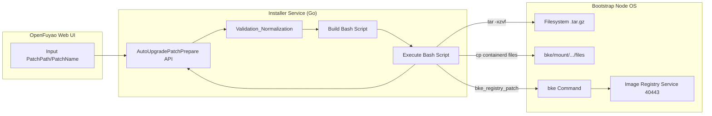
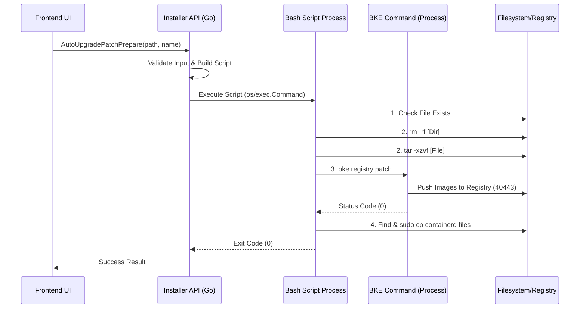
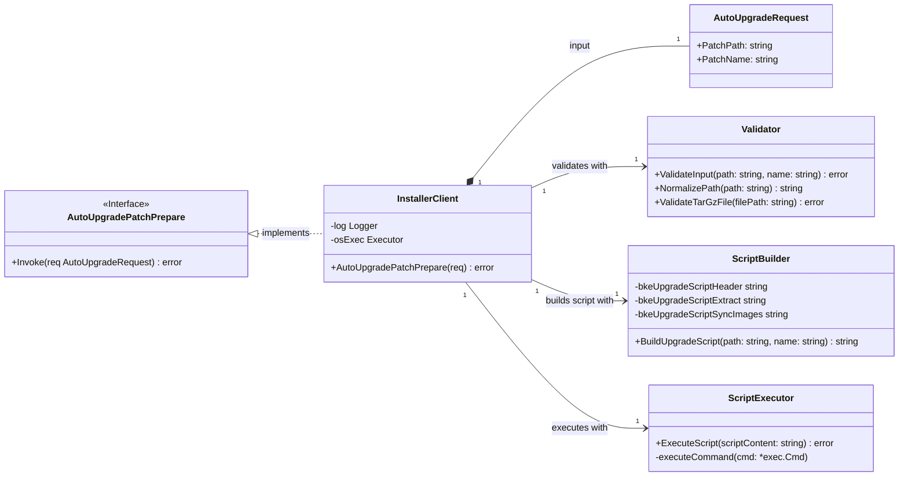

### 1、特性描述

#### 目标

实现 **OpenFuyao业务集群离线补丁升级** 场景下的资源准备自动化，通过新增 **`AutoUpgradePatchPrepare`** 接口，将离线补丁包的解压、镜像同步、二进制文件拷贝等手动操作抽象并自动化执行，从而简化用户操作，提升离线部署的可靠性。

#### 要点

-   **新增接口**：提供 `AutoUpgradePatchPrepare(patchPath, patchName)` 接口。
-   **核心逻辑**：后端通过构建并执行一个 Bash 脚本，实现以下原子操作：
    1.  文件校验（存在性、格式）。
    2.  解压补丁包（`.tar.gz`）。
    3.  使用 `bke registry patch` 命令将镜像同步到引导节点的私有镜像源（目标为 `deploy.bocloud.k8s:40443`）。
    4.  使用 `cp` 命令将特定的二进制文件（当前仅识别包含 `containerd` 的文件）拷贝到 `/bke/mount/source_registry/files` 目录。
-   **安全性**：接口调用前需对输入参数进行严格的路径和文件名规范化和校验，防止路径遍历和命令注入。
-   **幂等性**：该接口是准备工作，其核心操作（镜像同步、文件覆盖）本身具有幂等性或覆盖特性，重复执行不应造成逻辑错误。

#### 1.1、依赖组件

| 组件 | 组件描述 | 可获得性 |
|:--- |:--- |:--- |
| **BKE Admin (`bke`)** | 用于执行镜像同步 (`bke registry patch`) 命令的工具。 | 必选 |
| **Docker Engine** | 引导节点上需要运行 Docker，且配置 Insecure Registry，以支持私有镜像源服务。 | 必选 |
| **Bash** | 脚本执行环境。 | 必选 |

#### 1.2、License

Mulan PSL v2 License 

### 2、需求场景威胁建模

| 威胁场景           | 风险分析 | 应对措施 |
|:---------------|:--- |:--- |
| **路径遍历/命令注入**  | 用户输入 `patchPath` 或 `patchName` 包含恶意~~字符或相对路径，导致执行非预期的文件操作。 | **代码防御**：`normalizePath` 和 `normalizeFileName` 函数进行严格清洗，去除 `..`, `/`, `|`, `&`, `;` 等可疑字符。 |
| **文件不存在/格式错误** | 用户输入路径或文件不存在，或文件不是有效的 `.tar.gz` 格式。 | **代码防御**：`validateTarGzFile` 在执行脚本前校验文件存在性、是否为常规文件，并校验 Gzip 和 Tar 格式。 |
| **权限不足**       | 后端服务（或执行的 Bash 脚本）没有足够的权限执行 `tar`, `bke`, 或 `cp` 到 `/bke/mount/source_registry/files`。 | **脚本/部署要求**：**明确要求** 运行服务的用户或 Bash 脚本中的特定命令（如 `cp`）需具备 **sudo/root 权限**。 |
| **镜像同步失败**     | 镜像源服务未启动，或 `bke registry patch` 命令执行失败。 | **脚本防御**：Bash 脚本使用 `set -eo pipefail` 和 `$?` 检查，失败则打印错误信息并 `exit 1`，旧进程不会继续。 |
| **二次解压残留**     | 脚本执行失败后，解压目录未清理，导致下次重试失败。 | **脚本防御**：脚本第 2 步在解压前强制执行 `rm -rf "${PATCH_DIR}"` 清理旧目录。 |

### 3、特性设计

#### 3.1、上下文/USE-CASE视图

**基本流（离线升级场景）：**

1.  运维人员制备离线补丁包 (`patchV1.tar.gz`) 并将其上传到引导节点指定路径（如 `/data/patches`）。
2.  用户通过 OpenFuyao 前端管理界面输入补丁包的 **路径** (`/data/patches`) 和 **名称** (`patchV1`)。
3.  前端调用 **`AutoUpgradePatchPrepare`** 接口。
4.  后端服务执行 **Go 语言校验逻辑**（路径/文件名规范化、格式校验）。
5.  Go 服务构建并执行包含 **4 个核心步骤** 的 Bash 脚本。
6.  脚本成功执行后，返回成功状态。
7.  用户继续执行基线版本安装、然后升级到补丁版本。

**交互视图：**

#### 3.2、模块设计

-   **文件定位**：该特性主要集中在 `installer-service/pkg/installer` 包中。
    -   `AutoUpgradePatchPrepare` 函数：接口入口。
    -   `validatePatchFiles` 系列函数：负责安全和格式校验。
    -   `buildUpgradeScript` 函数：负责生成 Bash 脚本。
-   **执行环境**：Bash 脚本通过 `os/exec.Command("bash", "-c", scriptContent)` 同步执行。
-   **退出策略**：脚本内部通过 `set -eo pipefail` 确保任何命令失败都立即退出，并将错误返回给 Go 服务。Go 服务捕获错误后，将详细的脚本输出作为错误信息返回给调用方。

#### 3.2.1、模块接口定义

| 接口/函数 | 模块定位 | 功能描述 | 核心逻辑 |
|:--- |:--- |:--- |:--- |
| **AutoUpgradePatchPrepare** | `installerClient` | 对外暴露的自动化准备接口。 | 调用 `validatePatchFiles` -> 调用 `buildUpgradeScript` -> 调用 `executeUpgradeScript`。 |
| **validatePatchFiles** | `pkg/installer` | 路径和文件格式安全校验。 | 规范化输入；检查路径非空、目录存在；检查文件为有效 `.tar.gz` 格式。 |
| **buildUpgradeScript** | `pkg/installer` | 组装最终执行的 Bash 脚本。 | 拼接 `header`, `fileCheck`, `extract`, `syncImages`, `copyFiles` 5个脚本片段。 |
| **executeUpgradeScript** | `pkg/installer` | 执行脚本并处理结果。 | `exec.Command("bash", "-c", ...)`；捕获 `CombinedOutput`。 |

#### 3.3、 Story分解

_结合3.1~3.2的分析，分解支持该特性所需要的Stroy，可以按照USE-CASE场景划分，也可以按照USE-CASE操作步骤划分_

### 3.3.1 Story设计

_功能描述_

_验收标准_

_接口清单_

_以类图的方式描述Story的需求，以时序图的方式描述Story的实现过程_

**时序图**

| 序号 | Story 名称 | 功能描述 | 验收标准 |
|:--- |:--- |:--- |:--- |
| **Story-1** | **核心脚本构建与执行** | 实现 `buildUpgradeScript` 和 `executeUpgradeScript`，确保脚本能正确解压、同步镜像和拷贝文件。 | 脚本能成功完成 4 个步骤；执行失败时能返回包含脚本输出的错误信息。 |
| **Story-2** | **输入安全与校验** | 实现 `validatePatchFiles` 及相关的路径和文件校验函数（`normalizePath`, `validateTarGzFormat` 等）。 | 任意输入恶意路径或文件名时，被校验函数拒绝并返回明确的错误信息；能准确识别非 `.tar.gz` 或不存在的文件。 |
| **Story-3** | **镜像同步逻辑** | 实现脚本中 `bke registry patch` 命令的调用，确保镜像能正确同步到 `deploy.bocloud.k8s:40443`。 | 脚本输出显示镜像同步成功；目标仓库中能查到新版本的镜像。 |
| **Story-4** | **文件拷贝逻辑** | 实现脚本中 `find` 和 `sudo cp -f` 的调用，确保包含 `containerd` 的二进制文件被拷贝到 `/bke/mount/source_registry/files`。 | 目标目录下出现补丁版本中对应的 `containerd` 文件；`sudo` 权限问题得到解决（或文档明确说明）。 |
| **Story-5** | **接口集成与测试** | 实现 `AutoUpgradePatchPrepare` 接口的完整调用流程和集成测试。 | 前端调用接口时，能准确反映后端操作的成功/失败状态；单测覆盖校验逻辑。 |

**类图**

#### 3.4、质量属性设计

### 3.4.1、性能规格

| 规格名称 | 规格指标 | 描述 |
|:--- |:--- |:--- |
| **响应时间** | 依赖补丁包大小 | 脚本执行时间主要取决于补丁包解压和镜像同步耗时，预计在分钟级。 |
| **资源占用** | 临时峰值 | 解压和镜像同步时，会产生 CPU、I/O 和内存的临时峰值，无常驻新对象。 |

### 3.4.2、可靠性设计

-   **幂等性**：重复调用接口时，由于脚本内部包含目录清理 (`rm -rf`)、镜像同步的覆盖机制以及文件强制拷贝 (`cp -f`)，操作结果应保持一致。
-   **鲁棒性**：脚本内部通过 `set -eo pipefail` 确保任何一步失败，后续步骤立即停止并返回失败，避免了部分资源同步成功的情况。
-   **回退**：接口失败时，不会对已安装的集群造成影响，用户只需解决权限/文件问题后重试即可。

### 3.4.3、安全/韧性/隐私设计

-   **路径安全**：通过 Go 代码中的 `normalizePath` 和 `normalizeFileName` 严格校验输入，防止路径遍历和命令注入攻击。
-   **最小权限**：需明确执行 Bash 脚本所需的最低权限；文件拷贝到系统目录 (`/bke/mount/source_registry/files`) 时，使用 `sudo cp -f` 限定操作。
-   **日志与事件**：通过 `zlog` 记录脚本的启动、成功、以及详细的失败输出，提高可观测性和排障效率。

### 3.4.4、兼容性设计

-   **操作系统兼容**：脚本使用标准的 Bash 语法和常用工具 (`tar`, `cp`, `find`)，确保在引导节点的 Linux 环境下兼容。
-   **BKE Tool 依赖**：依赖 `bke` 工具的版本兼容性，确保 `bke registry patch` 命令稳定可用。

### 3.4.5、可服务性设计

-   **错误信息**：接口失败时，返回给前端的错误信息应包含完整的脚本输出，便于运维人员快速定位失败原因。

### 3.4.6、可测试性设计

-   **单元测试**：Go 代码中的校验逻辑 (`validatePatchFiles` 系列) 应有详尽的单元测试覆盖。
-   **集成测试**：通过集成测试验证 `AutoUpgradePatchPrepare` 接口在模拟的引导节点环境中，能够准确完成文件操作和镜像同步。
# 4、需求分解分配表

| 序号  | 模块名称 | Story名称 | Story描述 |
|:--- |:---- |:------- |:------- |
|     |      |         |         |
|     |      |         |         |

# 5、修改日志

| 版本  | 发布说明 |
|:--- |:---- |
|     |      |
|     |      |

# 6、参考目录
