# BKE状态机问题分析与优化重构方案

## 目录

- [1. 摘要](#1-摘要)
- [2. 动机](#2-动机)
  - [2.1 存在的问题分析](#21-存在的问题分析)
  - [2.2 状态管理器设计问题](#22-状态管理器设计问题)
  - [2.3 Phase状态管理问题](#23-Phase状态管理问题)
  - [2.4 并发安全问题](#24-并发安全问题)
  - [2.5 状态可观测性问题](#25-状态可观测性问题)
  - [2.6 代码可维护性问题](#26-代码可维护性问题)
- [3. 范围与约束](#3-范围与约束)
  - [3.1 范围](#31-范围)
  - [3.2 约束](#32-约束)
  - [3.3 非目标](#33-非目标)
- [4. 提案设计](#4-提案设计)
  - [4.0 问题与解决方案总览](#40-问题与解决方案总览)
  - [4.1 状态字段整合方案](#41-状态字段整合方案)
  - [4.2 状态转换引擎方案](#42-状态转换引擎方案)
  - [4.3 状态管理方案](#43-状态管理方案)
  - [4.4 事件追踪方案](#44-事件追踪方案)
  - [4.5 设计远景：混合模型架构](#45-设计远景混合模型架构)
- [5. 综合重构方案](#5-综合重构方案)
  - [5.1 整体架构](#51-整体架构)
  - [5.2 阶段一：状态字段整合（核心，必须）](#52-阶段一状态字段整合核心必须)
    - [5.2.1 实施步骤](#521-实施步骤)
    - [5.2.2 工作量与交付物](#522-工作量与交付物)
    - [5.2.3 验收标准](#523-验收标准)
  - [5.3 阶段二：状态转换引擎（推荐）](#53-阶段二状态转换引擎推荐)
    - [5.3.1 实施步骤](#531-实施步骤)
    - [5.3.2 工作量与交付物](#532-工作量与交付物)
    - [5.3.3 验收标准](#533-验收标准)
  - [5.4 阶段三：状态管理增强（推荐）](#54-阶段三状态管理增强推荐)
    - [5.4.1 实施步骤](#541-实施步骤)
    - [5.4.2 工作量与交付物](#542-工作量与交付物)
    - [5.4.3 验收标准](#543-验收标准)
  - [5.5 阶段四：事件追踪系统（可选）](#55-阶段四事件追踪系统可选)
    - [5.5.1 实施步骤](#551-实施步骤)
    - [5.5.2 工作量与交付物](#552-工作量与交付物)
    - [5.5.3 验收标准](#553-验收标准)
  - [5.6 总工作量汇总与里程碑](#56-总工作量汇总与里程碑)
    - [5.6.1 工作量汇总](#561-工作量汇总)
    - [5.6.2 关键里程碑](#562-关键里程碑)
    - [5.6.3 风险与回滚](#563-风险与回滚)
  - [5.7 面向目标架构的演进路径](#57-面向目标架构的演进路径)
  - [5.8 本方案与混合模型远景对比](#58-本方案与混合模型远景对比)
  - [5.9 关键文件变更清单](#59-关键文件变更清单)
- [6. 迁移策略](#6-迁移策略)
  - [6.1 向后兼容策略](#61-向后兼容策略)
- [7. 测试策略](#7-测试策略)
  - [7.1 单元测试](#71-单元测试设计点)
  - [7.2 集成测试](#72-集成测试设计点)
  - [7.3 Engine 与 StatusManager 协作测试设计点](#73-Engine-与-StatusManager-协作测试设计点)
  - [7.4 状态转换完整性测试设计点](#74-状态转换完整性测试设计点)
  - [7.5 事件追踪测试设计点](#75-事件追踪测试设计点)
- [8. 性能优化建议](#8-性能优化建议)
  - [8.1 减少锁竞争](#81-减少锁竞争)
  - [8.2 异步事件记录](#82-异步事件记录)
- [9. 风险管理](#9-风险管理)
  - [9.1 回滚方案](#91-回滚方案)
  - [9.2 灰度策略](#92-灰度策略)
  - [9.3 监控告警](#93-监控告警)
- [10. DFX 设计实现](#10-dfx-设计实现)
  - [10.1 DFX 总览](#101-dfx-总览)
  - [10.2 可测试性设计（DFT）](#102-可测试性设计dft)
  - [10.3 可诊断性设计（DFD）](#103-可诊断性设计dfd)
  - [10.4 可运维性设计（DFS）](#104-可运维性设计dfs)
  - [10.5 可靠性设计（DFR）](#105-可靠性设计dfr)
  - [10.6 性能设计（DFP）](#106-性能设计dfp)
  - [10.7 安全性设计（DFNS）](#107-安全性设计dfns)
  - [10.8 兼容性设计（DFC）](#108-兼容性设计dfc)
- [附录](#附录)
  - [A. 术语表](#a-术语表)
  - [B. 问题总结](#b-问题总结)

## 1. 摘要

> **章节摘要**：本章概述 BKE 状态机的核心问题（三字段职责重叠、状态转换逻辑分散、状态管理器缺陷、可观测性不足）和分阶段重构方案（状态字段整合、状态转换引擎、状态管理、事件追踪），以及预期收益和设计远景。

本提案针对 BKE 集群状态机存在的核心问题进行全面分析和重构设计：

**核心问题**：

- **三字段职责重叠**：`Phase`、`ClusterStatus`、`ClusterHealthState` 三个状态字段语义重叠率高达 50%-56%，导致状态管理混乱
- **状态转换逻辑分散**：28 个状态转换点分布在 6 个文件中，11 个独立的 `handleCluster*Phase` 函数缺乏统一管理
- **状态管理器缺陷**：全局单例内存泄漏、固定重试次数（10次）、并发不安全（int 非原子操作）、Failed 状态覆盖不全（3/8）
- **可观测性不足**：缺乏状态转换事件记录和可视化支持

**重构方案**（分阶段实施）：

- **阶段一（核心）**：状态字段整合 —— 以 `ClusterStatus` 为单一数据源，`Phase` 和 `ClusterHealthState` 标记为 Deprecated 并自动同步，提供生命周期阶段映射函数，支持向三层状态机架构平滑演进
- **阶段二（增强）**：引入状态转换引擎（58 条规则），替代 11 个分散的 `handleCluster*Phase` 函数
- **阶段三（增强）**：状态管理（StatusManagerV2），支持按状态索引重试策略、自动过期清理、原子计数器，覆盖全部 8 种 Failed 状态
- **阶段四（可选）**：事件追踪，支持内存/持久化存储和多格式导出

**预期收益**：状态字段从 3 个减少到 1 个，状态转换规则集中管理，Failed 覆盖从 3/8 提升至 8/8，代码圈复杂度从 15 降至 8 以下，总工作量 73 天。

**设计远景**：本提案的设计决策面向混合模型架构（驱动模型 + 聚合模型，三层状态机）演进。通过确立 `ClusterStatus` 为单一数据源、引入状态转换表引擎、实现分层重试机制、提供生命周期阶段映射，为未来实现操作驱动的 LifecyclePhase 和自底向上的 HealthStatus 聚合奠定基础，确保 BKE 状态机架构具备前瞻性和可扩展性。

## 2. 动机

> **章节摘要**：本章详细分析现有状态机的 7 类问题：状态转换逻辑分散（28 个转换点）、三字段职责重叠（50%-56% 重叠率）、状态管理器设计缺陷（内存泄漏、固定重试）、Phase 状态管理问题、并发安全问题、状态可观测性不足、代码可维护性差。

### 2.1 存在的问题分析

**问题描述**:

- 状态转换逻辑分散在`phase_flow.go`的多个`handleCluster*Phase`函数中
- 缺乏统一的状态转换表和转换规则定义
- 状态转换条件隐含在代码逻辑中，难以理解和维护

**代码示例**:

```go
// 当前实现：分散的状态转换函数
func handleClusterInitPhase(ctx *PhaseContext, err error) {
    if err != nil {
        ctx.BKECluster.Status.ClusterStatus = ClusterInitializationFailed
    } else {
        ctx.BKECluster.Status.ClusterStatus = ClusterInitializing
    }
}

func handleClusterScaleMasterUpPhase(ctx *PhaseContext, err error) {
    if err != nil {
        ctx.BKECluster.Status.ClusterStatus = ClusterScaleFailed
    } else {
        ctx.BKECluster.Status.ClusterStatus = ClusterMasterScalingUp
    }
}
// ... 11个类似的函数
```

**问题影响**:

- 新增状态需要修改多处代码
- 状态转换规则难以验证
- 缺乏状态转换的可视化支持

#### 2.1.1 状态转换逻辑位置清单

通过对代码库的全面搜索，梳理出所有状态转换逻辑的分布位置：

##### 2.1.1.1 核心状态转换函数（phase_flow.go）

**文件**: `pkg/phaseframe/phases/phase_flow.go`

| 行号 | 函数名 | 状态转换 | 说明 |
| ------ | -------- | --------- | ------ |
| 301-309 | `calculatingClusterPreStatusByPhase` | → ClusterChecking | Phase执行前的状态计算 |
| 311-320 | `calculatingClusterPostStatusByPhase` | 根据Phase结果 | Phase执行后的状态计算 |
| 322-356 | `calculateClusterStatusByPhase` | 分发到各handle函数 | 核心调度函数 |
| 359-365 | `handleClusterInitPhase` | → Initializing/InitializationFailed | 初始化阶段 |
| 368-374 | `handleClusterScaleMasterUpPhase` | → MasterScalingUp/ScaleFailed | Master扩容 |
| 377-383 | `handleClusterScaleWorkerUpPhase` | → WorkerScalingUp/ScaleFailed | Worker扩容 |
| 386-392 | `handleClusterDeletePhase` | → Deleting/DeleteFailed | 删除阶段 |
| 395-401 | `handleClusterPausedPhase` | → Paused/PauseFailed | 暂停阶段 |
| 404-410 | `handleClusterDryRunPhase` | → DryRun/DryRunFailed | DryRun阶段 |
| 413-419 | `handleClusterAddonsPhase` | → DeployingAddon/DeployAddonFailed | Addon部署 |
| 422-428 | `handleClusterUpgradePhase` | → Upgrading/UpgradeFailed | 升级阶段 |
| 431-437 | `handleClusterScaleMasterDownPhase` | → MasterScalingDown/ScaleFailed | Master缩容 |
| 440-446 | `handleClusterScaleWorkerDownPhase` | → WorkerScalingDown/ScaleFailed | Worker缩容 |
| 449-455 | `handleClusterManagePhase` | → Managing/ManageFailed | 纳管阶段 |

**总计**: 11个状态转换处理函数

##### 2.1.1.2 状态管理器（statusmanager.go）

**文件**: `pkg/statusmanage/statusmanager.go`

| 行号 | 函数/逻辑 | 状态转换 | 说明 |
| ------ | ---------- | --------- | ------ |
| 121-228 | `recordBKEClusterStatus` | 状态记录和恢复 | 核心状态管理逻辑 |
| 169 | `SetLatestNormalState` | 记录正常状态 | 保存最后一次正常状态 |
| 183 | `SetLatestFailedState` | 记录失败状态 | 保存最后一次失败状态 |
| 196 | 状态回退 | Failed → LatestNormalState | 失败重试时回退到正常状态 |
| 206-213 | ClusterHealthState转换 | Deploying → DeployFailed等 | 超过重试次数后的状态转换 |

**关键逻辑**:

- 失败计数和重试机制（默认10次）
- 状态回退：失败时回退到 LatestNormalState
- 超过重试次数后设置 ClusterHealthState

##### 2.1.1.3 集群健康状态转换（ensure_cluster.go）

**文件**: `pkg/phaseframe/phases/ensure_cluster.go`

| 行号 | 位置 | 状态转换 | 说明 |
| ------ | ------ | --------- | ------ |
| 319 | 条件检查 | ClusterHealthState == Deploying | 检查部署状态 |
| 373 | 健康检查失败 | → Unhealthy | 集群不健康 |
| 399 | 健康检查成功 | → Healthy | 集群健康 |

##### 2.1.1.4 其他控制器中的状态转换

###### 2.1.1.4.1 bkecluster_controller.go

**文件**: `controllers/capbke/bkecluster_controller.go`

| 行号 | 函数 | 状态转换 | 说明 |
| ------ | ------ | --------- | ------ |
| 199-220 | `handleClusterStatus` | 状态更新 | 控制器状态处理 |
| 807 | 直接赋值 | ClusterHealthState | 设置健康状态 |

###### 2.1.1.4.2 bkecluster_upgrade_dag.go

**文件**: `controllers/capbke/bkecluster_upgrade_dag.go`

| 行号 | 位置 | 状态转换 | 说明 |
| ------ | ------ | --------- | ------ |
| 310 | 升级流程 | ClusterStatus = status | 升级状态设置 |

###### 2.1.1.4.3 ensure_delete_or_reset.go

**文件**: `pkg/phaseframe/phases/ensure_delete_or_reset.go`

| 行号 | 位置 | 状态转换 | 说明 |
| ------ | ------ | --------- | ------ |
| 179 | 删除流程 | → ClusterDeleting | 删除状态设置 |

###### 2.1.1.4.4 context.go

**文件**: `pkg/phaseframe/context.go`

| 行号 | 位置 | 状态转换 | 说明 |
| ------ | ------ | --------- | ------ |
| 252 | 上下文处理 | → ClusterDeleting | 删除状态设置 |

##### 2.1.1.5 状态定义（bkecluster_consts.go）

**文件**: `api/capbke/v1beta1/bkecluster_consts.go`

###### 2.1.1.5.1 ClusterStatus 定义（152-182行）

```go
ClusterReady, ClusterUnhealthy, ClusterUnknown, ClusterChecking
ClusterPaused, ClusterPauseFailed
ClusterDryRun, ClusterDryRunFailed
ClusterInitializing, ClusterInitializationFailed
ClusterUpgrading, ClusterUpgradeFailed
ClusterMasterScalingUp, ClusterMasterScalingDown
ClusterWorkerScalingUp, ClusterWorkerScalingDown
ClusterScaleFailed
ClusterDeployingAddon, ClusterDeployAddonFailed
ClusterManaging, ClusterManageFailed
ClusterDeleting, ClusterDeleteFailed
```

###### 2.1.1.5.2 ClusterHealthState 定义（222-230行）

```go
Deploying, DeployFailed
Upgrading, UpgradeFailed
Managing, ManageFailed
Unhealthy, Healthy
Deleting
```

##### 2.1.1.6 状态转换逻辑分布统计

| 文件 | 状态转换点数量 | 主要职责 |
| ------ | -------------- | --------- |
| phase_flow.go | 14个 | Phase级别的状态转换 |
| statusmanager.go | 5个 | 状态记录、恢复、重试 |
| ensure_cluster.go | 3个 | 健康状态转换 |
| bkecluster_controller.go | 2个 | 控制器状态处理 |
| 其他文件 | 4个 | 特定场景状态设置 |
| **总计** | **28个** | - |

##### 2.1.1.7 问题总结

**状态转换逻辑分散的具体表现**:

1. **11个独立的 handleCluster*Phase 函数**（phase_flow.go:359-455）
   - 每个函数独立处理一种Phase的状态转换
   - 缺乏统一的状态转换规则定义

2. **状态回退逻辑隐藏在 statusmanager.go**（196-226行）
   - LatestNormalState 恢复逻辑
   - 失败计数和重试逻辑
   - ClusterHealthState 转换逻辑

3. **直接状态赋值分散在多个文件**
   - ensure_cluster.go: 3处
   - ensure_delete_or_reset.go: 1处
   - context.go: 1处
   - bkecluster_controller.go: 2处

4. **缺乏统一的状态转换表**
    - 没有集中定义所有合法的状态转换
    - 状态转换条件隐含在代码逻辑中
    - 难以验证状态转换的合法性

#### 2.1.2 ClusterStatus、ClusterHealthState 和 Phase 职责重叠问题

**问题描述**：

`ClusterStatus`、`ClusterHealthState` 和 `Phase` 三个状态字段存在严重的语义重叠和职责不清问题，导致状态管理混乱、维护成本高。

**字段定义**（[bkecluster_status.go:281-287](file:///cluster-api-provider-bke/api/bkecommon/v1beta1/bkecluster_status.go#L281-L287)）：

```go
type BKEClusterStatus struct {
    // Phase is the current phase of the cluster.
    Phase BKEClusterPhase `json:"phase,omitempty"`
    
    // ClusterStatus is the current operate status of the cluster.
    ClusterStatus ClusterStatus `json:"clusterStatus,omitempty"`
    
    // ClusterHealthState
    ClusterHealthState ClusterHealthState `json:"clusterHealthState,omitempty"`
}
```

**三个字段概览**：

| 字段 | 枚举值数量 | 职责 | 问题 |
| ------ | ---------- | ------ | ------ |
| **Phase** | 12 个 | 表达"正在执行哪个 Phase" | 与 ClusterStatus 重叠 50% |
| **ClusterStatus** | 22 个 | 表达"集群当前处于什么操作状态" | 与 ClusterHealthState 重叠 56% |
| **ClusterHealthState** | 9 个 | 表达"集群健康状态" | 与 ClusterStatus 重叠 56% |

##### 2.1.2.1 ClusterStatus 与 ClusterHealthState 重叠分析

**枚举值对比**：

| ClusterStatus（22个值） | ClusterHealthState（9个值） | 重叠情况 |
| ------------------------ | --------------------------- | --------- |
| `ClusterUpgrading` | `Upgrading` | ❌ **完全重复** |
| `ClusterUpgradeFailed` | `UpgradeFailed` | ❌ **完全重复** |
| `ClusterManaging` | `Managing` | ❌ **完全重复** |
| `ClusterManageFailed` | `ManageFailed` | ❌ **完全重复** |
| `ClusterUnhealthy` | `Unhealthy` | ❌ **完全重复** |
| `ClusterDeployingAddon` | `Deploying` | ⚠️ 语义相近 |
| `ClusterDeployAddonFailed` | `DeployFailed` | ⚠️ 语义相近 |

**重叠率**：9个值中有5个完全重复，重叠率 **56%**

**问题分析**：

1. **语义重叠**：两个字段都包含 `Upgrading/UpgradeFailed`、`Managing/ManageFailed`、`Unhealthy`
2. **职责不清**：`ClusterStatus` 注释为 "current operate status"，`ClusterHealthState` 无注释
3. **使用场景混乱**：
   - `ClusterStatus` 用于 phase_flow.go 的状态转换
   - `ClusterHealthState` 用于 statusmanager.go 的失败处理
   - 但两者都表达相同的操作状态

**代码示例 - 职责混乱**：

```go
// phase_flow.go - 使用 ClusterStatus
func handleClusterUpgradePhase(ctx *phaseframe.PhaseContext, err error) {
    if err != nil {
        ctx.BKECluster.Status.ClusterStatus = bkev1beta1.ClusterUpgradeFailed
    } else {
        ctx.BKECluster.Status.ClusterStatus = bkev1beta1.ClusterUpgrading
    }
}

// statusmanager.go - 使用 ClusterHealthState
switch sr.CurrentClusterState {
case bkev1beta1.Upgrading:
    bkeCluster.Status.ClusterHealthState = bkev1beta1.UpgradeFailed
case bkev1beta1.Managing:
    bkeCluster.Status.ClusterHealthState = bkev1beta1.ManageFailed
}
```

##### 2.1.2.2 Phase 与 ClusterStatus 重叠分析

**Phase 枚举值**（12个）：

```go
InitControlPlane, JoinControlPlane, JoinWorker
FakeInitControlPlane, FakeJoinControlPlane, FakeJoinWorker
FailedBootstrapNode
UpgradeControlPlane, UpgradeWorker, UpgradeEtcd
ClusterReadyOld
Scale
```

**映射关系**：

| Phase | ClusterStatus | 重叠程度 |
| ------- | --------------- | --------- |
| `InitControlPlane` | `Initializing` | ❌ **完全重叠** |
| `JoinControlPlane` | `Initializing` | ❌ **完全重叠** |
| `JoinWorker` | `Initializing` | ❌ **完全重叠** |
| `UpgradeControlPlane` | `Upgrading` | ❌ **完全重叠** |
| `UpgradeWorker` | `Upgrading` | ❌ **完全重叠** |
| `UpgradeEtcd` | `Upgrading` | ❌ **完全重叠** |
| `Scale` | `ScalingMasterNodesUp/Down` 或 `ScalingWorkerNodesUp/Down` | ⚠️ **部分重叠** |
| `FailedBootstrapNode` | `InitializationFailed` | ⚠️ **语义相近** |

**重叠率**：12 个 Phase 中有 6 个与 ClusterStatus 完全重叠，重叠率 **50%**

**问题分析**：

1. **职责重叠**：Phase 和 ClusterStatus 都在表达"当前正在做什么"
2. **映射关系隐式且分散**：Phase → ClusterStatus 的映射关系没有明确定义，而是分散在多个 `handleCluster*Phase` 函数中
3. **状态不一致风险**：Phase 和 ClusterStatus 可能被独立设置，导致状态不一致

**代码示例 - 职责重叠**：

```go
// phaseframe/base.go:318 - 设置 Phase
func (b *BasePhase) handleRunningStatus(...) {
    bkeCluster.Status.Phase = phaseName
}

// phase_flow.go:359-455 - 设置 ClusterStatus
func handleClusterInitPhase(ctx *phaseframe.PhaseContext, err error) {
    if err != nil {
        ctx.BKECluster.Status.ClusterStatus = bkev1beta1.ClusterInitializationFailed
    } else {
        ctx.BKECluster.Status.ClusterStatus = bkev1beta1.ClusterInitializing
    }
}
```

##### 2.1.2.3 状态定义合理性问题

除了职责重叠外，`ClusterStatus` 和 `ClusterHealthState` 还存在 7 个深层次的合理性问题：

###### 问题 1：ClusterHealthState 不是"纯健康状态"

字段名为 `ClusterHealthState`，但实际混入了**操作状态**：

```go
// bkecluster_consts.go:222-230
Deploying, DeployFailed      // ← 操作状态，不是健康状态
Upgrading, UpgradeFailed     // ← 操作状态
Managing, ManageFailed       // ← 操作状态
Unhealthy, Healthy           // ← 真正的健康状态
Deleting                     // ← 操作状态
```

真正的"健康状态"应仅有 `Healthy` / `Unhealthy` / `Unknown`。`Deploying`/`Upgrading` 等是"正在做什么"（操作），不是"健康状况如何"（健康）。

`setClusterHealthStatus`（`bkecluster_controller.go:757-774`）在 Reconcile 入口根据操作类型设置 `ClusterHealthState`，进一步证明它实际是操作状态而非健康状态：

```go
// bkecluster_controller.go:757-774
func (r *BKEClusterReconciler) setClusterHealthStatus(...) {
    if flags.DeployFlag || flags.DeployFailedFlag {
        markBKEClusterHealthyStatus(bkeCluster, bkev1beta1.Deploying)  // ← 操作类型设置"健康状态"
    }
    if flags.UpgradeFlag || flags.UpgradeFailedFlag {
        markBKEClusterHealthyStatus(bkeCluster, bkev1beta1.Upgrading)
    }
    // ...
}
```

###### 问题 2：ClusterHealthState 缺失关键状态

`ClusterStatus` 有但 `ClusterHealthState` 无对应的状态：

| 缺失状态 | ClusterStatus 中的对应 | 影响 |
| ---------- | ---------------------- | ------ |
| `Scaling` / `ScaleFailed` | `ClusterMasterScalingUp/Down`、`ClusterWorkerScalingUp/Down`、`ClusterScaleFailed` | 扩缩容时 `ClusterHealthState` 不变，用户无法从健康状态判断正在扩缩容 |
| `DeleteFailed` | `ClusterDeleteFailed` | 删除失败后 `ClusterHealthState` 仍为 `Deleting`，无法表达删除失败 |
| `Unknown` | `ClusterUnknown` | 无"未知健康"状态，新集群或状态丢失时无法表达 |
| `Paused` / `DryRun` | `ClusterPaused` / `ClusterDryRun` | 暂停/DryRun 时健康状态无变化 |

###### 问题 3：ClusterStatus 混合了三种不同维度的状态

`ClusterStatus` 的 22 个值实际混合了三个维度：

| 维度 | 值 | 说明 |
| ------ | ----- | ------ |
| **健康状态** | `ClusterReady`, `ClusterUnhealthy`, `ClusterUnknown`, `ClusterChecking` | 描述集群"是否健康" |
| **操作进行中** | `ClusterInitializing`, `ClusterUpgrading`, `ClusterMasterScalingUp`, `ClusterWorkerScalingUp`, `ClusterMasterScalingDown`, `ClusterWorkerScalingDown`, `ClusterDeployingAddon`, `ClusterManaging`, `ClusterDeleting`, `ClusterDryRun`, `ClusterPaused` | 描述集群"正在做什么" |
| **操作失败** | `ClusterInitializationFailed`, `ClusterUpgradeFailed`, `ClusterScaleFailed`, `ClusterDeployAddonFailed`, `ClusterManageFailed`, `ClusterDeleteFailed`, `ClusterPauseFailed`, `ClusterDryRunFailed` | 描述操作"失败了吗" |

三个维度塞进一个枚举导致：`ClusterReady`（健康）和 `ClusterInitializing`（操作中）是互斥的，但它们在同一层级——从 `ClusterInitializing` 到 `ClusterReady` 的转换隐含了"操作完成"和"健康检查通过"两个语义。

###### 问题 4：两个状态机边界不清，通过 statusmanager 桥接导致耦合

**"两个状态机"指的是**：

1. **ClusterStatus 状态机**：由 `phase_flow.go` 的 11 个 `handle*Phase` 函数管理，负责集群操作状态的转换（如 Initializing、Upgrading、ScaleFailed 等 22 个状态）
2. **ClusterHealthState 状态机**：由 `setClusterHealthStatus`（controller:757）和 `ensure_cluster.go:373,399` 管理，负责集群健康状态的转换（如 Deploying、Upgrading、Healthy、Unhealthy 等 9 个状态）

两个状态机各自独立转换，通过 `statusmanager.go:121-228` 桥接：

```go
// statusmanager.go:163 — 用 ClusterHealthState 作为 CurrentClusterState
sr.SetCurrentClusterState(bkeCluster.Status.ClusterHealthState)

// statusmanager.go:195-196 — 失败时恢复 ClusterStatus 到 LatestNormalState
bkeCluster.Status.ClusterStatus = confv1beta1.ClusterStatus(sr.LatestNormalState)

// statusmanager.go:204-216 — 超过重试次数后，用 CurrentClusterState 映射设置 ClusterHealthState
switch sr.CurrentClusterState {
case bkev1beta1.Deploying:
    bkeCluster.Status.ClusterHealthState = bkev1beta1.DeployFailed
case bkev1beta1.Upgrading:
    bkeCluster.Status.ClusterHealthState = bkev1beta1.UpgradeFailed
}
```

**问题**：

- `ClusterStatus` 由 `phase_flow.go` 的 11 个 `handle*Phase` 函数设置
- `ClusterHealthState` 由 `setClusterHealthStatus`（controller:757）和 `ensure_cluster.go:373,399` 设置
- `statusmanager.go` 在失败重试逻辑中同时修改两者
- 三处代码各自维护各自的状态转换，没有统一的状态转换表

###### 问题 5：Failed 状态粒度不对称

`ClusterStatus` 有 8 个 `*Failed` 状态，`ClusterHealthState` 只有 3 个 `*Failed` 状态。`statusmanager.go:165` 用 `strings.HasSuffix(state, "Failed")` 判断失败状态——这个逻辑能正确识别所有 8 个 `ClusterStatus` 的 Failed 状态，但 `ClusterHealthState` 的映射只能覆盖 3 种（Deploy/Upgrade/Manage），其余 5 种 Failed 状态（Scale/Delete/Pause/DryRun/Addon）在超过重试次数后不会更新 `ClusterHealthState`：

```go
// statusmanager.go:204-216 — default 分支为空，5 种失败状态无法映射
switch sr.CurrentClusterState {
case bkev1beta1.Deploying:
    bkeCluster.Status.ClusterHealthState = bkev1beta1.DeployFailed
case bkev1beta1.Upgrading:
    bkeCluster.Status.ClusterHealthState = bkev1beta1.UpgradeFailed
case bkev1beta1.Managing:
    bkeCluster.Status.ClusterHealthState = bkev1beta1.ManageFailed
default:
    // ← 空分支: Scaling/Deleting/Paused/DryRun/Addon 失败时 ClusterHealthState 不更新
}
```

###### 问题 6：缺乏面向未来的统一生命周期模型

业界最佳实践（如 OpenShift CVO、Cluster API）和 BKE 自身演进方向均指向统一的三层生命周期状态机模型：

```
集群层（Cluster Lifecycle）：Pending → Installing → Running → Upgrading → Scaling → Managing → RollingBack → Deleting → Deleted → Failed
节点层（Node Lifecycle）：Pending → Provisioned → Ready → Upgrading → RollingBack → Deleting → Deleted → Failed
组件层（Component Lifecycle）：Pending → Installing → Installed → Upgrading → RollingBack → Deleting → Deleted → Failed
```

三层模型的核心设计思想是**混合模型**：

- **驱动模型（自上而下）**：决定集群"正在做什么"（LifecyclePhase）
- **聚合模型（自底向上）**：决定集群"健康状况如何"（HealthStatus）

每个层级使用单一的生命周期状态（LifecyclePhase）作为数据源，将"操作进行中"、"操作失败"、"健康状态"分离为独立维度。

当前代码仍维护 `ClusterStatus` + `ClusterHealthState` 两个并行状态，缺乏统一的生命周期抽象，无法支撑三层聚合模型的实现。

##### 2.1.2.4 综合问题分析

**核心问题**：

1. **三个字段职责重叠**：Phase、ClusterStatus、ClusterHealthState 都在表达集群状态，导致开发者难以理解应该使用哪个字段
2. **状态转换逻辑分散**：状态转换逻辑分散在多个文件和函数中，增加维护成本
3. **状态不一致风险**：三个字段可能被独立设置，容易出现状态不一致
4. **缺乏统一的生命周期抽象**：三个字段缺乏统一的生命周期抽象，无法支撑向三层状态机架构的演进

**问题总结**：

| 问题 | 严重程度 | 根因 |
| ------ | --------- | ------ |
| 三个字段语义严重重叠 | 高 | 三个类型描述同一信息的不同粒度 |
| ClusterHealthState 非纯健康状态 | 高 | 命名与内容不符，混入操作状态 |
| ClusterHealthState 缺失关键状态 | 中 | 扩缩容/删除失败无健康状态表达 |
| ClusterStatus 三维度混合 | 中 | 操作/健康/失败塞进一个枚举 |
| 状态机边界不清 | 高 | 三处独立转换 + statusmanager 桥接 |
| Failed 粒度不对称 | 中 | 8 vs 3，5 种失败无法映射 |
| 缺乏生命周期抽象 | 中 | 双状态设计无法支撑三层状态机架构演进 |

**影响**：

- 开发者难以理解应该使用哪个字段
- 状态转换逻辑分散在多个字段中，增加维护成本
- 容易出现状态不一致（Phase=InitControlPlane 但 ClusterStatus=Ready）
- 向三层状态机架构演进时成本高昂

**核心结论**：`ClusterStatus`、`ClusterHealthState` 和 `Phase` 的根本问题是**职责边界模糊**——三者都在描述"集群当前在做什么 + 是否健康 + 是否失败"，但粒度不同、覆盖面不同、转换逻辑分散在三处。合理的做法是按三层生命周期状态机的方向统一为单一生命周期状态机，将"操作进行中"、"操作失败"、"健康状态"分离为独立维度，而非维护三个重叠的枚举。

### 2.2 状态管理器设计问题

**问题描述**:

#### 2.2.1 全局单例导致内存泄漏风险

```go
var BKEClusterStatusManager = NewStatusManager()  // 全局单例

type StatusManager struct {
    BKEClusterStatusMap map[string]*StatusRecord  // 无限增长
    BKENodesStatusMap   map[string]map[string]*StatusRecord
}
```

**问题**:

- 集群删除后，状态记录可能未被清理
- 长期运行的管理集群会积累大量无用状态记录
- 缺乏状态记录的自动过期机制

#### 2.2.2 失败重试机制不够灵活

```go
const DefaultAllowedFailedCount = 10  // 固定值

func (sr *StatusRecord) AllowFailed() bool {
    return sr.StatusCount < ReconcileAllowedFailedCount
}
```

**问题**:

- 所有Phase使用相同的失败次数限制
- 无法针对不同Phase设置不同的重试策略
- 缺乏指数退避机制

#### 2.2.3 状态回退逻辑复杂

```go
// 复杂的状态回退逻辑
if sr.AllowFailed() {
    bkeCluster.Status.ClusterStatus = confv1beta1.ClusterStatus(sr.LatestNormalState)
    sr.NeedRequeue = true
} else {
    // 超过限制后的处理逻辑
    if sr.CurrentClusterState != bkev1beta1.Unhealthy && 
       sr.CurrentClusterState != bkev1beta1.Healthy {
        // 根据ClusterHealthState设置不同的Failed状态
        switch sr.CurrentClusterState {
        case bkev1beta1.Deploying:
            bkeCluster.Status.ClusterHealthState = bkev1beta1.DeployFailed
        case bkev1beta1.Upgrading:
            bkeCluster.Status.ClusterHealthState = bkev1beta1.UpgradeFailed
        // ...
        }
    }
}
```

**问题**:

- 状态回退逻辑与业务逻辑高度耦合
- 难以理解状态回退的完整流程
- 缺乏状态回退失败的兜底机制

### 2.3 Phase状态管理问题

**问题描述**:

#### 2.3.1 Phase历史记录限制

```go
const MaxPhaseStatusHistory = 20  // 最多保留20个

// 移除成功后除了失败的phase
if len(p.ctx.BKECluster.Status.PhaseStatus) > MaxPhaseStatusHistory {
    p.ctx.BKECluster.Status.PhaseStatus = 
        p.ctx.BKECluster.Status.PhaseStatus[len-MaxPhaseStatusHistory:]
}
```

**问题**:

- 可能丢失重要的Phase执行历史
- 无法追溯长时间运行集群的完整历史
- 调试和问题排查困难

#### 2.3.2 Phase执行顺序硬编码

```go
var FullPhasesRegisFunc = append(append(
    CommonPhases,
    DeployPhases...,
), PostDeployPhases...)
```

**问题**:

- Phase执行顺序固定，缺乏灵活性
- 无法动态调整Phase执行顺序
- 难以支持条件性的Phase跳过

### 2.4 并发安全问题

**问题描述**:

#### 2.4.1 潜在的死锁风险

```go
func (b *StatusManager) recordBKEClusterStatus(bkeCluster *BKECluster) {
    b.cmux.Lock()  // 获取锁
    defer b.cmux.Unlock()
    
    // 在持有锁的情况下调用其他函数
    sr := b.BKEClusterStatusMap[key]
    if sr.AllowFailed() {  // 可能触发其他操作
        bkeCluster.Status.ClusterStatus = ...
    }
}
```

**问题**:

- 在持有锁的情况下修改外部对象状态
- 可能与其他锁产生死锁
- 锁的粒度过大

#### 2.4.2 竞态条件

```go
// 状态记录和状态回退之间存在竞态
if sr.AllowFailed() {
    bkeCluster.Status.ClusterStatus = sr.LatestNormalState  // 读取LatestNormalState
    sr.NeedRequeue = true
}
```

**问题**:

- LatestNormalState可能在读取后被修改
- 缺乏原子性保证
- 可能导致状态不一致

### 2.5 状态可观测性问题

**问题描述**:

- 缺乏状态转换事件记录
- 难以追踪状态转换历史
- 缺乏状态机可视化支持
- 无法导出状态转换日志用于分析

### 2.6 代码可维护性问题

**问题描述**:

- 状态转换逻辑与业务逻辑耦合
- 缺乏状态机测试工具
- 状态定义分散在多个文件
- 缺乏状态机的文档生成工具

## 3. 范围与约束

> **章节摘要**：本章明确重构方案的范围（状态字段整合、映射函数、状态转换引擎、状态管理、事件追踪）、约束（向后兼容、渐进式迁移、前瞻性设计、接口兼容）和非目标（不删除旧字段、不实现三层聚合、不修改 PhaseFlow 执行逻辑）。

### 3.1 范围

| 范围 | 说明 |
| ------ | ------ |
| **状态字段整合** | 以 `ClusterStatus` 为单一数据源，`Phase`/`ClusterHealthState` 标记 Deprecated |
| **映射函数** | 新增 `MapPhaseToClusterStatus`、`MapClusterHealthStateToClusterStatus`、`MapToLifecyclePhase` 等 |
| **状态转换引擎** | 新增 `pkg/phaseframe/statemachine/` 包，58 条转换规则，替代 11 个 handle 函数 |
| **状态管理** | `StatusManagerV2`：按状态索引重试策略、自动过期清理、原子计数器、覆盖全部 8 种 Failed |
| **事件追踪** | 状态转换事件记录与查询（基础版内存存储，增强版 K8s Event 持久化） |

### 3.2 约束

| 约束 | 说明 |
| ------ | ------ |
| **向后兼容** | `Phase` 和 `ClusterHealthState` 字段保留，标记 Deprecated，自动同步 |
| **渐进式迁移** | 分阶段实施，阶段一（状态字段整合）必须，阶段二（引擎+管理器）可选 |
| **前瞻性设计** | 提供 `MapToLifecyclePhase` 映射函数，支持向三层状态机架构平滑演进 |
| **接口兼容** | StatusManagerV2 保持所有公开方法签名不变，8 个调用点零修改 |

### 3.3 非目标

1. 不在此阶段移除 `Phase` 和 `ClusterHealthState` 字段定义（仅标记 Deprecated）
2. 不在此阶段实现三层状态机聚合（组件层→节点层→集群层），但预留扩展接口
3. 不修改 PhaseFlow 的执行逻辑，仅重构状态转换部分
4. 不替换现有 SSH 推送机制

## 4. 提案设计

> **章节摘要**：本章详细描述 4 个重构方案：状态字段整合方案（以 ClusterStatus 为单一数据源）、状态转换引擎（58 条规则）、状态管理（StatusManagerV2）、事件追踪（内存/持久化存储），以及面向三层状态机架构的设计远景。

### 4.0 问题与解决方案总览

本节总结第 2 章列出的所有问题，并说明每个问题在提案设计中的解决方案。

#### 4.0.1 2.1 节问题与解决方案对比

| 2.1 节问题 | 对应提案章节 | 解决方案 | 状态 |
|-----------|------------|---------|------|
| **状态转换逻辑分散**：28 个状态转换点分布在 6 个文件中，11 个独立的 `handleCluster*Phase` 函数 | 4.2 节（状态转换引擎） | 使用状态转换引擎，集中管理所有转换规则，删除 11 个分散的函数 | ✅ 已解决 |
| **缺乏统一管理**：没有统一的状态转换表和转换规则定义 | 4.2 节（状态转换引擎） | 定义 `Transition` 结构体，通过 `registerClusterTransitions` 函数统一注册 58 条规则 | ✅ 已解决 |
| **条件隐含**：状态转换条件隐含在代码逻辑中，难以理解和维护 | 4.2 节（状态转换引擎） | 使用 `Condition` 函数，将条件显式化，便于理解和测试 | ✅ 已解决 |

#### 4.0.2 2.2 节问题与解决方案对比

| 2.2 节问题 | 对应提案章节 | 解决方案 | 状态 |
|-----------|------------|---------|------|
| **三字段职责重叠**：`Phase`、`ClusterStatus`、`ClusterHealthState` 语义重叠率高达 50%-56% | 4.1 节（状态字段整合） | 以 `ClusterStatus` 为单一数据源，`Phase` 和 `ClusterHealthState` 标记为 Deprecated | ✅ 已解决 |
| **状态管理器内存泄漏**：全局单例无清理机制 | 4.3 节（状态管理） | 新增 `StatusCleaner`，自动清理过期记录（24 小时过期） | ✅ 已解决 |
| **固定重试次数**：全局固定 10 次重试 | 4.3 节（状态管理） | 按 `ClusterStatus` 索引，支持不同重试策略和退避策略 | ✅ 已解决 |
| **并发不安全**：`int` 计数器非原子操作 | 4.3 节（状态管理） | 使用 `int32` + `atomic.AddInt32`，确保并发安全 | ✅ 已解决 |
| **Failed 状态覆盖不全**：只覆盖 3/8 种 Failed 状态 | 4.3 节（状态管理） | 覆盖全部 8 种 Failed 状态 | ✅ 已解决 |

#### 4.0.3 2.3-2.6 节问题与解决方案对比

| 问题章节 | 问题描述 | 对应提案章节 | 解决方案 | 状态 |
|---------|---------|------------|---------|------|
| 2.3 | **Phase 状态管理问题**：Phase 历史记录限制、执行顺序硬编码 | 4.1 节（状态字段整合） | 使用 `ClusterStatus` 替代 `Phase`，提供映射函数 | ✅ 已解决 |
| 2.4 | **并发安全问题**：潜在的死锁风险、竞态条件 | 4.3 节（状态管理） | 使用 `sync.RWMutex` 和原子操作，确保并发安全 | ✅ 已解决 |
| 2.5 | **状态可观测性不足**：缺乏状态转换事件记录 | 4.4 节（事件追踪） | 提供 `EventStore` 接口，支持事件记录和查询 | ✅ 已解决 |
| 2.6 | **代码可维护性差**：代码圈复杂度高（15） | 4.2 节（状态转换引擎） | 使用状态转换引擎替代分散逻辑，降低圈复杂度至 8 以下 | ✅ 已解决 |

#### 4.0.4 4.2 节额外解决的问题

4.2 节（状态转换引擎）不仅解决了 2.1 节的问题，还预防了以下潜在问题：

| 潜在问题 | 解决方案 |
|---------|---------|
| **扩展困难**：新增状态需要修改多处代码 | 新增状态只需添加转换规则，无需修改多处代码 |
| **难以验证**：状态转换规则难以验证完整性 | 规则集中定义，便于验证和测试 |
| **缺乏可视化**：无法生成状态机文档和可视化图表 | 规则集中定义，可生成可视化图表 |

#### 4.0.5 总结

**所有 2.1-2.6 节列出的问题都在提案设计中得到了解决**：

- **4.1 节（状态字段整合）**：解决"用什么字段表达状态"的问题
- **4.2 节（状态转换引擎）**：解决"状态如何转换"的问题
- **4.3 节（状态管理）**：解决内存泄漏、灵活重试、并发安全等问题
- **4.4 节（事件追踪）**：提供可观测性支持

提案设计不仅解决了现有问题，还预防了未来可能出现的问题（如扩展困难、难以验证等），确保 BKE 状态机架构具备前瞻性和可扩展性。

### 4.1 状态字段整合方案

#### 4.1.1 设计思路

##### 4.1.1.1 核心设计理念

**问题本质**：

- 当前存在三个状态字段：`Phase`、`ClusterStatus`、`ClusterHealthState`
- 三个字段职责重叠，都在表达"集群当前在做什么 + 是否健康 + 是否失败"
- 导致状态管理混乱、维护成本高、容易出现不一致

**解决思路**：

- **统一状态表达**：使用单一的 `ClusterStatus` 字段表达所有状态信息
- **保持兼容性**：`Phase` 和 `ClusterHealthState` 字段标记为 Deprecated，但不删除
- **代码重构**：所有新代码只使用 `ClusterStatus` 字段
- **提供映射机制**：通过映射函数实现字段间的转换，为未来迁移做准备

##### 4.1.1.2 设计原则

| 原则 | 说明 | 实现方式 |
| ------ | ------ | ---------- |
| **最小改动原则** | 尽量保持现有代码结构不变 | 只修改必要的代码，不重构整个框架 |
| **向后兼容原则** | 确保外部消费者不受影响 | 保留旧字段，标记为 Deprecated |
| **渐进式迁移原则** | 分阶段实施，降低风险 | 当前实施阶段 1（准备阶段），后续阶段在未来实施 |
| **单一数据源原则** | 代码中只使用一个字段 | 所有新代码只使用 ClusterStatus |

##### 4.1.1.3 设计目标

| 目标 | 衡量指标 | 预期结果 |
| ------ | ---------- | ---------- |
| **简化状态管理** | 代码中使用的状态字段数量 | 从 3 个减少到 1 个 |
| **提高代码可维护性** | 代码行数 | 减少约 200 行 |
| **保持兼容性** | 外部消费者影响 | 无影响（字段保留） |
| **前瞻性设计** | 映射函数覆盖率 | 100% |

#### 4.1.2 重构内容

##### 4.1.2.1 统一同步机制

**同步策略**：

- `ClusterStatus` 为主字段（Single Source of Truth）
- `Phase` 和 `ClusterHealthState` 为派生字段（Derived Fields）
- 所有状态变更必须通过统一同步函数保证一致性

**同步函数**：

```go
// SyncStatusFields 统一同步函数
// 在设置 ClusterStatus 后调用，自动同步 Phase 和 ClusterHealthState
func SyncStatusFields(cluster *bkev1beta1.BKECluster) {
    cluster.Status.Phase = MapClusterStatusToPhase(cluster.Status.ClusterStatus)
    cluster.Status.ClusterHealthState = MapClusterStatusToClusterHealthState(cluster.Status.ClusterStatus)
}
```

**Setter 方法**：

```go
// SetClusterStatus 设置 ClusterStatus 并自动同步派生字段
// 推荐使用此方法替代直接设置 Status.ClusterStatus
func (c *bkev1beta1.BKECluster) SetClusterStatus(status bkev1beta1.ClusterStatus) {
    c.Status.ClusterStatus = status
    SyncStatusFields(c)
}
```

**同步时机**：

1. **立即同步**：在设置 ClusterStatus 后立即调用 `SyncStatusFields` 或使用 `SetClusterStatus`
2. **Reconcile 结束时验证**：在 Reconcile 结束时验证字段一致性
3. **状态读取时派生**：读取旧字段时，如果为空则从 ClusterStatus 派生

**一致性验证**：

```go
// ValidateStatusConsistency 验证状态字段一致性
func ValidateStatusConsistency(cluster *bkev1beta1.BKECluster) error {
    var errors []string
    
    // 1. 验证 ClusterStatus 不为空
    if cluster.Status.ClusterStatus == "" {
        errors = append(errors, "ClusterStatus 为空")
    }
    
    // 2. 验证 Phase 一致性
    expectedPhase := MapClusterStatusToPhase(cluster.Status.ClusterStatus)
    if cluster.Status.Phase != expectedPhase {
        errors = append(errors, fmt.Sprintf(
            "Phase 不一致: 期望 %s, 实际 %s",
            expectedPhase, cluster.Status.Phase,
        ))
    }
    
    // 3. 验证 ClusterHealthState 一致性
    expectedHealthState := MapClusterStatusToClusterHealthState(cluster.Status.ClusterStatus)
    if cluster.Status.ClusterHealthState != expectedHealthState {
        errors = append(errors, fmt.Sprintf(
            "ClusterHealthState 不一致: 期望 %s, 实际 %s",
            expectedHealthState, cluster.Status.ClusterHealthState,
        ))
    }
    
    if len(errors) > 0 {
        return fmt.Errorf("状态不一致: %s", strings.Join(errors, "; "))
    }
    
    return nil
}
```

**同步失败处理**：

| 失败场景 | 处理策略 | 说明 |
|---------|---------|------|
| 映射函数返回空值 | 使用默认值 + 记录警告日志 | 不阻断流程 |
| 字段类型不匹配 | 记录错误日志 + 发送告警 | 跳过同步 |
| 并发更新冲突 | 使用 Patch 机制 + 重试（最多 3 次） | 超过重试次数记录错误 |

**使用规范**：

1. **所有状态变更必须通过统一函数**：使用 `SetClusterStatus()` 方法或调用 `SyncStatusFields()` 函数
2. **所有派生字段必须从 ClusterStatus 派生**：禁止直接设置 Phase 或 ClusterHealthState
3. **所有同步点必须使用相同的策略**：PhaseFlow、StatusManager、Controller、Webhook 等所有层统一使用

##### 4.1.2.2 API 层重构

**重构内容**：

- 为 `Phase` 字段添加 Deprecated 注释
- 为 `ClusterHealthState` 字段添加 Deprecated 注释
- 保留 `ClusterStatus` 字段定义
- 新增 `LastInProgressState` 字段：记录失败时的进行中状态，用于重试时判断恢复目标

**文件清单**：

- `api/bkecommon/v1beta1/bkecluster_status.go`：修改字段注释，新增 LastInProgressState 字段

**修改方案**：

**文件：`api/bkecommon/v1beta1/bkecluster_status.go`**

修改位置：第 277-287 行

修改前：

```go
// Phase is the current phase of the cluster.
// +optional
Phase BKEClusterPhase `json:"phase,omitempty"`

// ClusterStatus is the current operate status of the cluster.
// +optional
ClusterStatus ClusterStatus `json:"clusterStatus,omitempty"`

// ClusterHealthState
// +optional
ClusterHealthState ClusterHealthState `json:"clusterHealthState,omitempty"`
```

修改后：

```go
// Phase is the current phase of the cluster.
//
// Deprecated: This field is deprecated and will be removed in a future version.
// Use ClusterStatus instead. The Phase field is maintained for backward compatibility
// and is automatically synchronized with ClusterStatus.
// +optional
Phase BKEClusterPhase `json:"phase,omitempty"`

// ClusterStatus is the current operate status of the cluster.
// This is the single source of truth for cluster status.
// +optional
ClusterStatus ClusterStatus `json:"clusterStatus,omitempty"`

// ClusterHealthState
//
// Deprecated: This field is deprecated and will be removed in a future version.
// Use ClusterStatus instead. The ClusterHealthState field is maintained for backward
// compatibility and is automatically synchronized with ClusterStatus.
// +optional
ClusterHealthState ClusterHealthState `json:"clusterHealthState,omitempty"`

// LastInProgressState is the last in-progress state before failure.
// This field is used to determine the recovery target when retrying from a failed state.
// For example, if MasterScalingUp fails, LastInProgressState = MasterScalingUp,
// and the retry will recover to MasterScalingUp (not WorkerScalingUp).
// +optional
LastInProgressState ClusterStatus `json:"lastInProgressState,omitempty"`
```

**LastInProgressState 设计说明**：

| 场景 | 设置时机 | 值 | 用途 |
|------|---------|-----|------|
| Master 扩容失败 | TriggerError 转换时 | MasterScalingUp | 重试时恢复到 MasterScalingUp |
| Worker 扩容失败 | TriggerError 转换时 | WorkerScalingUp | 重试时恢复到 WorkerScalingUp |
| Master 缩容失败 | TriggerError 转换时 | MasterScalingDown | 重试时恢复到 MasterScalingDown |
| Worker 缩容失败 | TriggerError 转换时 | WorkerScalingDown | 重试时恢复到 WorkerScalingDown |

**设计原则**：

- **语义清晰**：记录"失败时的进行中状态"，不是"进入进行中状态前的正常状态"
- **持久化存储**：存储在 Cluster.Status 中，重启不丢失
- **自动设置**：在错误转换时（TriggerError）由引擎自动设置，无需业务代码干预

##### 4.1.2.3 映射函数层重构

**重构内容**：

- 新增 `MapPhaseToClusterStatus` 函数：将 Phase 映射到 ClusterStatus
- 新增 `MapClusterHealthStateToClusterStatus` 函数：将 ClusterHealthState 映射到 ClusterStatus
- 新增 `MapClusterStatusToPhase` 函数：将 ClusterStatus 映射到 Phase（用于向后兼容）
- 新增 `MapClusterStatusToClusterHealthState` 函数：将 ClusterStatus 映射到 ClusterHealthState（用于向后兼容）
- 新增 `MapToLifecyclePhase` 函数：将 ClusterStatus 映射到统一生命周期阶段（面向三层状态机架构的集群层投影）

**信息丢失说明**：

映射过程中存在信息丢失，使用时需注意：

| 映射函数 | 信息丢失场景 | 处理方式 |
|---------|-------------|---------|
| `MapPhaseToClusterStatus` | 多个 Phase 映射到同一个 ClusterStatus（如 InitControlPlane、JoinControlPlane、JoinWorker 都映射到 ClusterInitializing） | 丢失具体 Phase 信息，如需保留请使用 Phase 字段 |
| `MapClusterHealthStateToClusterStatus` | ClusterHealthState 的 9 个值映射到 ClusterStatus 的 22 个值，存在一对多映射 | 使用默认映射，如需精确映射请检查业务逻辑 |
| `MapClusterStatusToPhase` | ClusterStatus 的 22 个值映射到 Phase 的 12 个值，存在多对一映射 | 丢失细粒度状态信息，仅用于向后兼容 |
| `MapClusterStatusToClusterHealthState` | ClusterStatus 的 22 个值映射到 ClusterHealthState 的 9 个值，存在多对一映射 | 丢失细粒度状态信息，仅用于向后兼容 |
| `MapToLifecyclePhase` | ClusterStatus 的 22 个值映射到 LifecyclePhase 的 6 个值，存在多对一映射 | 丢失细粒度状态信息，用于三层状态机架构演进 |

**使用建议**：

1. **新代码**：优先使用 `ClusterStatus` 字段，避免使用已废弃的 `Phase` 和 `ClusterHealthState` 字段
2. **向后兼容**：如需支持旧版本 API，使用 `MapClusterStatusToPhase` 和 `MapClusterStatusToClusterHealthState` 函数
3. **未来演进**：使用 `MapToLifecyclePhase` 函数为三层状态机架构做准备
4. **信息完整性**：如需保留完整的状态信息，请同时使用 `ClusterStatus`、`Phase` 和 `ClusterHealthState` 三个字段

**文件清单**：

- `pkg/phaseframe/mapper.go`：新增映射函数文件
- `pkg/phaseframe/mapper_test.go`：新增映射函数单元测试

**修改方案**：

**文件：`pkg/phaseframe/mapper.go`（新增）**

```go
package phaseframe

import (
 confv1beta1 "gopkg.openfuyao.cn/cluster-api-provider-bke/api/bkecommon/v1beta1"
 bkev1beta1 "gopkg.openfuyao.cn/cluster-api-provider-bke/api/capbke/v1beta1"
)

// MapPhaseToClusterStatus 将 Phase 映射到 ClusterStatus
// 用于替代原有的 Phase 字段，统一使用 ClusterStatus 作为状态表达
func MapPhaseToClusterStatus(phase confv1beta1.BKEClusterPhase, err error) bkev1beta1.ClusterStatus {
 switch phase {
 case bkev1beta1.InitControlPlane, bkev1beta1.JoinControlPlane, bkev1beta1.JoinWorker:
  if err != nil {
   return bkev1beta1.ClusterInitializationFailed
  }
  return bkev1beta1.ClusterInitializing
 
 case bkev1beta1.UpgradeControlPlane, bkev1beta1.UpgradeWorker, bkev1beta1.UpgradeEtcd:
  if err != nil {
   return bkev1beta1.ClusterUpgradeFailed
  }
  return bkev1beta1.ClusterUpgrading
 
 case bkev1beta1.Scale:
  if err != nil {
   return bkev1beta1.ClusterScaleFailed
  }
  // 注意：Scale Phase 既用于扩容也用于缩容，但 Phase 字段本身不携带方向信息。
  // 此处返回 ClusterInitializing 作为占位状态，实际方向由 Engine 的转换规则
  // 根据 trigger（EnsureMasterJoin/EnsureWorkerJoin/EnsureMasterDelete/EnsureWorkerDelete）决定。
  // 新代码应使用 Engine 的转换规则，本函数仅用于向后兼容场景。
  return bkev1beta1.ClusterInitializing
 
 case bkev1beta1.FailedBootstrapNode:
  return bkev1beta1.ClusterInitializationFailed
 
 case bkev1beta1.ClusterReadyOld:
  return bkev1beta1.ClusterReady
 
 default:
  return bkev1beta1.ClusterUnknown
 }
}

// MapClusterHealthStateToClusterStatus 将 ClusterHealthState 映射到 ClusterStatus
// 用于替代原有的 ClusterHealthState 字段
func MapClusterHealthStateToClusterStatus(healthState confv1beta1.ClusterHealthState) bkev1beta1.ClusterStatus {
 switch healthState {
 case bkev1beta1.Deploying:
  return bkev1beta1.ClusterDeployingAddon
 case bkev1beta1.DeployFailed:
  return bkev1beta1.ClusterDeployAddonFailed
 case bkev1beta1.Upgrading:
  return bkev1beta1.ClusterUpgrading
 case bkev1beta1.UpgradeFailed:
  return bkev1beta1.ClusterUpgradeFailed
 case bkev1beta1.Managing:
  return bkev1beta1.ClusterManaging
 case bkev1beta1.ManageFailed:
  return bkev1beta1.ClusterManageFailed
 case bkev1beta1.Unhealthy:
  return bkev1beta1.ClusterUnhealthy
 case bkev1beta1.Healthy:
  return bkev1beta1.ClusterReady
 case bkev1beta1.Deleting:
  return bkev1beta1.ClusterDeleting
 default:
  return bkev1beta1.ClusterUnknown
 }
}

// MapClusterStatusToPhase 将 ClusterStatus 映射到 Phase
// 用于向后兼容，保持 Phase 字段与 ClusterStatus 同步
func MapClusterStatusToPhase(status bkev1beta1.ClusterStatus) confv1beta1.BKEClusterPhase {
 switch status {
 case bkev1beta1.ClusterInitializing, bkev1beta1.ClusterInitializationFailed:
  return bkev1beta1.InitControlPlane
 case bkev1beta1.ClusterUpgrading, bkev1beta1.ClusterUpgradeFailed:
  return bkev1beta1.UpgradeControlPlane
 case bkev1beta1.ClusterMasterScalingUp, bkev1beta1.ClusterMasterScalingDown,
  bkev1beta1.ClusterWorkerScalingUp, bkev1beta1.ClusterWorkerScalingDown,
  bkev1beta1.ClusterScaleFailed:
  return bkev1beta1.Scale
 case bkev1beta1.ClusterReady:
  return bkev1beta1.ClusterReadyOld
 default:
  return ""
 }
}

// MapClusterStatusToClusterHealthState 将 ClusterStatus 映射到 ClusterHealthState
// 用于向后兼容，保持 ClusterHealthState 字段与 ClusterStatus 同步
func MapClusterStatusToClusterHealthState(status bkev1beta1.ClusterStatus) confv1beta1.ClusterHealthState {
 switch status {
 case bkev1beta1.ClusterDeployingAddon:
  return bkev1beta1.Deploying
 case bkev1beta1.ClusterDeployAddonFailed:
  return bkev1beta1.DeployFailed
 case bkev1beta1.ClusterUpgrading:
  return bkev1beta1.Upgrading
 case bkev1beta1.ClusterUpgradeFailed:
  return bkev1beta1.UpgradeFailed
 case bkev1beta1.ClusterManaging:
  return bkev1beta1.Managing
 case bkev1beta1.ClusterManageFailed:
  return bkev1beta1.ManageFailed
 case bkev1beta1.ClusterUnhealthy:
  return bkev1beta1.Unhealthy
 case bkev1beta1.ClusterReady:
  return bkev1beta1.Healthy
 case bkev1beta1.ClusterDeleting:
  return bkev1beta1.Deleting
 default:
  return ""
 }
}

// MapToLifecyclePhase 将 ClusterStatus 映射到统一生命周期阶段
// 面向三层状态机架构的集群层投影，支持向自底向上的状态聚合模型演进
func MapToLifecyclePhase(status bkev1beta1.ClusterStatus) string {
 // LifecyclePhase 定义（集群层，面向三层状态机架构）：
 // - Creating: 集群创建中（节点加入、Agent 推送、组件安装）
 // - Running: 集群运行中（所有组件就绪，服务可用）
 // - Upgrading: 集群升级中（版本变更中）
 // - Scaling: 集群扩缩容中（节点增减）
 // - RollingBack: 集群回滚中（升级失败后恢复）
 // - Failed: 集群失败（需要人工介入）
 // - Deleting: 集群删除中
 
 switch status {
 case bkev1beta1.ClusterInitializing:
  return "Creating"
 case bkev1beta1.ClusterReady:
  return "Running"
 case bkev1beta1.ClusterUpgrading:
  return "Upgrading"
 case bkev1beta1.ClusterMasterScalingUp, bkev1beta1.ClusterMasterScalingDown,
  bkev1beta1.ClusterWorkerScalingUp, bkev1beta1.ClusterWorkerScalingDown:
  return "Scaling"
 case bkev1beta1.ClusterDeleting:
  return "Deleting"
 case bkev1beta1.ClusterInitializationFailed, bkev1beta1.ClusterUpgradeFailed,
  bkev1beta1.ClusterScaleFailed, bkev1beta1.ClusterDeployAddonFailed,
  bkev1beta1.ClusterManageFailed, bkev1beta1.ClusterDeleteFailed,
  bkev1beta1.ClusterPauseFailed, bkev1beta1.ClusterDryRunFailed:
  return "Failed"
 default:
  return ""
 }
}
```

##### 4.1.2.4 PhaseFlow 框架层重构

**重构内容**：

- 修改 `phaseframe/base.go`：在设置 ClusterStatus 的同时，同步设置 Phase 和 ClusterHealthState（向后兼容）
- 修改 `phaseframe/phases/ensure_paused.go`：使用 ClusterStatus 替代 Phase
- 修改 `phaseframe/context.go`：使用 ClusterStatus 替代 Phase

**文件清单**：

- `pkg/phaseframe/base.go`：修改 handleRunningStatus 方法
- `pkg/phaseframe/phases/ensure_paused.go`：修改 Phase 检查逻辑
- `pkg/phaseframe/context.go`：修改日志输出

**修改方案**：

**文件：`pkg/phaseframe/base.go`**

修改位置：第 316-327 行

修改前：

```go
func (b *BasePhase) handleRunningStatus(status []confv1beta1.PhaseState, phaseName confv1beta1.BKEClusterPhase, bkeCluster *bkev1beta1.BKECluster) []confv1beta1.PhaseState {
    bkeCluster.Status.Phase = phaseName
    // ... 其他逻辑
    return status
}
```

修改后：

```go
func (b *BasePhase) handleRunningStatus(status []confv1beta1.PhaseState, phaseName confv1beta1.BKEClusterPhase, bkeCluster *bkev1beta1.BKECluster) []confv1beta1.PhaseState {
    // 使用 SetClusterStatus 统一设置状态并自动同步派生字段
    bkeCluster.SetClusterStatus(MapPhaseToClusterStatus(phaseName, nil))
    
    // ... 其他逻辑
    return status
}
```

**文件：`pkg/phaseframe/phases/ensure_paused.go`**

修改位置：第 162 行

修改前：

```go
if params.BKECluster.Status.Phase == bkev1beta1.Scale || 
   params.BKECluster.Status.Phase == bkev1beta1.UpgradeControlPlane || 
   params.BKECluster.Status.Phase == bkev1beta1.UpgradeWorker {
    // 执行暂停逻辑
}
```

修改后：

```go
// 使用 ClusterStatus 替代 Phase
if params.BKECluster.Status.ClusterStatus == bkev1beta1.ClusterMasterScalingUp ||
   params.BKECluster.Status.ClusterStatus == bkev1beta1.ClusterMasterScalingDown ||
   params.BKECluster.Status.ClusterStatus == bkev1beta1.ClusterWorkerScalingUp ||
   params.BKECluster.Status.ClusterStatus == bkev1beta1.ClusterWorkerScalingDown ||
   params.BKECluster.Status.ClusterStatus == bkev1beta1.ClusterUpgrading {
    // 执行暂停逻辑
}
```

**文件：`pkg/phaseframe/context.go`**

修改位置：第 242 行

修改前：

```go
log.Info("waiting for phase to complete", "phase", bkeCluster.Status.Phase)
```

修改后：

```go
log.Info("waiting for phase to complete", "status", bkeCluster.Status.ClusterStatus)
```

##### 4.1.2.5 状态管理层重构

**重构内容**：

- 修改 `pkg/statusmanage/statusmanager.go`：使用 ClusterStatus 替代 ClusterHealthState
- 在设置 ClusterStatus 的同时，同步设置 ClusterHealthState（向后兼容）

**文件清单**：

- `pkg/statusmanage/statusmanager.go`：修改 5 处代码

**修改方案**：

**文件：`pkg/statusmanage/statusmanager.go`**

修改位置 0：StatusRecord 结构体定义（第 40 行附近）

修改前：

```go
type StatusRecord struct {
    LatestNormalState   string
    LatestFailedState   string
    StatusCount         int32
    NeedRequeue         bool
    CurrentClusterState confv1beta1.ClusterHealthState  // 原类型
}
```

修改后：

```go
type StatusRecord struct {
    LatestNormalState   string
    LatestFailedState   string
    StatusCount         int32
    NeedRequeue         bool
    CurrentClusterState bkev1beta1.ClusterStatus  // 改为 ClusterStatus
}
```

修改位置 1：第 163 行

修改前：

```go
sr.SetCurrentClusterState(bkeCluster.Status.ClusterHealthState)
```

修改后：

```go
// 使用 ClusterStatus 作为当前状态
sr.SetCurrentClusterState(bkeCluster.Status.ClusterStatus)
```

修改位置 2：第 206-212 行

修改前：

```go
switch sr.CurrentClusterState {
case bkev1beta1.Deploying:
    bkeCluster.Status.ClusterHealthState = bkev1beta1.DeployFailed
    msg = string(bkev1beta1.DeployFailed)
case bkev1beta1.Upgrading:
    bkeCluster.Status.ClusterHealthState = bkev1beta1.UpgradeFailed
    msg = string(bkev1beta1.UpgradeFailed)
case bkev1beta1.Managing:
    bkeCluster.Status.ClusterHealthState = bkev1beta1.ManageFailed
    msg = string(bkev1beta1.ManageFailed)
}
```

修改后：

```go
// 使用 SetClusterStatus 统一设置状态并自动同步派生字段
switch sr.CurrentClusterState {
case bkev1beta1.ClusterDeployingAddon:
    bkeCluster.SetClusterStatus(bkev1beta1.ClusterDeployAddonFailed)
    msg = string(bkev1beta1.ClusterDeployAddonFailed)
case bkev1beta1.ClusterUpgrading:
    bkeCluster.SetClusterStatus(bkev1beta1.ClusterUpgradeFailed)
    msg = string(bkev1beta1.ClusterUpgradeFailed)
case bkev1beta1.ClusterManaging:
    bkeCluster.SetClusterStatus(bkev1beta1.ClusterManageFailed)
    msg = string(bkev1beta1.ClusterManageFailed)
}
```

##### 4.1.2.6 控制器层重构

**重构内容**：

- 修改 `controllers/capbke/bkecluster_controller.go`：使用 ClusterStatus 替代 ClusterHealthState
- 在设置 ClusterStatus 的同时，同步设置 ClusterHealthState（向后兼容）

**文件清单**：

- `controllers/capbke/bkecluster_controller.go`：修改 markBKEClusterHealthyStatus 函数

**修改方案**：

**文件：`controllers/capbke/bkecluster_controller.go`**

修改位置：第 805-807 行

修改前：

```go
func markBKEClusterHealthyStatus(bkeCluster *bkev1beta1.BKECluster, status confv1beta1.ClusterHealthState) {
    bkeCluster.Status.ClusterHealthState = status
}
```

修改后：

```go
func markBKEClusterHealthyStatus(bkeCluster *bkev1beta1.BKECluster, status confv1beta1.ClusterHealthState) {
    // 使用 SetClusterStatus 统一设置状态并自动同步派生字段
    bkeCluster.SetClusterStatus(MapClusterHealthStateToClusterStatus(status))
}
```

##### 4.1.2.7 Webhook 层重构

**重构内容**：

- 修改 `webhooks/capbke/bkecluster.go`：使用 ClusterStatus 替代 ClusterHealthState

**文件清单**：

- `webhooks/capbke/bkecluster.go`：修改 2 处代码

**修改方案**：

**文件：`webhooks/capbke/bkecluster.go`**

修改位置 1：第 174 行

修改前：

```go
if newBKECluster.Status.ClusterHealthState == bkev1beta1.Deploying {
    // 执行部署逻辑
}
```

修改后：

```go
// 使用 ClusterStatus 替代 ClusterHealthState
if newBKECluster.Status.ClusterStatus == bkev1beta1.ClusterDeployingAddon {
    // 执行部署逻辑
}
```

修改位置 2：第 646 行

修改前：

```go
if newBKECluster.Status.ClusterHealthState != bkev1beta1.Healthy {
    // 执行健康检查逻辑
}
```

修改后：

```go
// 使用 ClusterStatus 替代 ClusterHealthState
if newBKECluster.Status.ClusterStatus != bkev1beta1.ClusterReady {
    // 执行健康检查逻辑
}
```

##### 4.1.2.8 其他文件重构

**重构内容**：

- 修改 `pkg/phaseframe/phases/ensure_cluster.go`：使用 ClusterStatus 替代 ClusterHealthState
- 修改 `pkg/phaseframe/phases/ensure_nodes_env.go`：使用 ClusterStatus 替代 ClusterHealthState
- 修改 `pkg/phaseframe/phases/ensure_bke_agent.go`：使用 ClusterStatus 替代 ClusterHealthState
- 修改 `pkg/mergecluster/bkecluster.go`：使用 ClusterStatus 替代 ClusterHealthState

**文件清单**：

- `pkg/phaseframe/phases/ensure_cluster.go`：修改 3 处代码
- `pkg/phaseframe/phases/ensure_nodes_env.go`：修改 1 处代码
- `pkg/phaseframe/phases/ensure_bke_agent.go`：修改 1 处代码
- `pkg/mergecluster/bkecluster.go`：修改 1 处代码

**修改方案**：

**文件：`pkg/phaseframe/phases/ensure_cluster.go`**

修改位置 1：第 319 行

修改前：

```go
if bkeCluster.Status.ClusterHealthState == bkev1beta1.Deploying && !phaseutil.ClusterEndDeployedWithContext(ctx, c, e.Ctx.Cluster, bkeCluster, bkeNodes) {
    // 执行部署逻辑
}
```

修改后：

```go
// 使用 ClusterStatus 替代 ClusterHealthState
if bkeCluster.Status.ClusterStatus == bkev1beta1.ClusterDeployingAddon && !phaseutil.ClusterEndDeployedWithContext(ctx, c, e.Ctx.Cluster, bkeCluster, bkeNodes) {
    // 执行部署逻辑
}
```

修改位置 2：第 373 行

修改前：

```go
bkeCluster.Status.ClusterHealthState = bkev1beta1.Unhealthy
```

修改后：

```go
// 使用 SetClusterStatus 统一设置状态并自动同步派生字段
bkeCluster.SetClusterStatus(bkev1beta1.ClusterUnhealthy)
```

修改位置 3：第 399 行

修改前：

```go
bkeCluster.Status.ClusterHealthState = bkev1beta1.Healthy
```

修改后：

```go
// 使用 SetClusterStatus 统一设置状态并自动同步派生字段
bkeCluster.SetClusterStatus(bkev1beta1.ClusterReady)
```

**文件：`pkg/phaseframe/phases/ensure_nodes_env.go`**

修改位置：第 337 行

修改前：

```go
if bkeCluster.Status.ClusterHealthState == bkev1beta1.Deploying && len(failedNodes) > 0 {
    // 执行节点环境检查逻辑
}
```

修改后：

```go
// 使用 ClusterStatus 替代 ClusterHealthState
if bkeCluster.Status.ClusterStatus == bkev1beta1.ClusterDeployingAddon && len(failedNodes) > 0 {
    // 执行节点环境检查逻辑
}
```

**文件：`pkg/phaseframe/phases/ensure_bke_agent.go`**

修改位置：第 575 行

修改前：

```go
if bkeCluster.Status.ClusterHealthState == bkev1beta1.Deploying && len(failedNodesInfo) > 0 {
    // 执行 BKE Agent 检查逻辑
}
```

修改后：

```go
// 使用 ClusterStatus 替代 ClusterHealthState
if bkeCluster.Status.ClusterStatus == bkev1beta1.ClusterDeployingAddon && len(failedNodesInfo) > 0 {
    // 执行 BKE Agent 检查逻辑
}
```

**文件：`pkg/mergecluster/bkecluster.go`**

修改位置：第 442 行

修改前：

```go
params.CombinedCluster.Status.ClusterHealthState = newBKECuster.Status.ClusterHealthState
```

修改后：

```go
// 使用 SetClusterStatus 统一设置状态并自动同步派生字段
params.CombinedCluster.SetClusterStatus(newBKECuster.Status.ClusterStatus)
```

##### 4.1.2.9 测试层重构

**重构内容**：

- 更新所有测试用例：使用 ClusterStatus 替代 Phase 和 ClusterHealthState
- 新增映射函数单元测试：测试所有映射逻辑
- 新增集成测试：测试完整的集群生命周期

**文件清单**：

- `*_test.go`：更新所有测试用例

**测试覆盖**：

- 单元测试：映射函数 100% 覆盖
- 集成测试：集群创建、升级、删除流程
- 端到端测试：完整的 BKE 系统测试

### 4.2 状态转换引擎方案

**解决的问题**：

| 问题 | 具体表现 |
|------|---------|
| **逻辑分散** | 28 个状态转换点分布在 6 个文件中，11 个独立的 `handleCluster*Phase` 函数 |
| **缺乏统一管理** | 没有统一的状态转换表和转换规则定义 |
| **条件隐含** | 状态转换条件隐含在代码逻辑中，难以理解和维护 |
| **扩展困难** | 新增状态需要修改多处代码 |
| **难以验证** | 状态转换规则难以验证完整性 |
| **缺乏可视化** | 无法生成状态机文档和可视化图表 |

**与 4.1 节的关系**：

- **4.1 节（状态字段整合）**：解决"用什么字段表达状态"的问题（统一为 ClusterStatus）
- **4.2 节（状态转换引擎）**：解决"状态如何转换"的问题（集中管理转换逻辑）

两者是**互补关系**，4.1 是基础，4.2 是在 4.1 基础上的增强。

**设计思路**: 在状态字段整合的基础上，使用状态转换引擎统一定义所有状态转换规则，集中管理状态转换逻辑。

#### 4.2.1 状态转换规则设计

**设计原则**：

1. **单一数据源**：所有转换规则通过 `registerClusterTransitions` 函数编程式注册，不维护声明式表
2. **Trigger 区分操作类型**：
   - `phaseName`（如 `EnsureMasterJoinName`）：Phase 开始执行（pre-hook）
   - `TriggerPhaseComplete`：Phase 执行成功（post-hook，err==nil）
   - `TriggerError`：Phase 执行失败（post-hook，err!=nil）
   - `TriggerRetry`：重试操作（StatusManager 触发）
3. **Condition 前置检查**：转换规则可附带 `Condition` 函数，不满足条件时跳过该规则
4. **向后兼容**：未找到匹配规则时返回 `nil`，不阻断流程

**Transition 结构体**（定义见 4.2.3 节 `engine.go`）：

```go
type Transition struct {
    FromState bkev1beta1.ClusterStatus
    ToState   bkev1beta1.ClusterStatus
    Trigger   string
    Condition func(*ConditionContext) bool  // 转换前置条件（可选）
    Action    func(*bkev1beta1.BKECluster) error // 转换动作（可选）
}
```

**规则冲突检查**：

经过系统检查，所有转换规则不存在冲突。关键设计保证：

1. **不同 Trigger**：同一 FromState 下的多条规则使用不同的 Trigger
2. **不同 FromState**：同一 Trigger 下的多条规则使用不同的 FromState
3. **Condition 互斥**：ScaleFailed 的 4 条重试规则通过 `LastInProgressState` 区分，每个 Condition 函数检查不同的值

| 状态 | Trigger | 规则数 | 是否有冲突 | 说明 |
|------|---------|-------|-----------|------|
| Unknown | EnsureFinalizer/Certs/... | 8 | ✅ 无 | 不同 Trigger |
| Initializing | TriggerPhaseComplete | 1 | ✅ 无 | 单规则 |
| Initializing | EnsureCluster | 1 | ✅ 无 | 单规则 |
| Ready | EnsureCluster/MasterJoin/... | 17 | ✅ 无 | 不同 Trigger |
| Checking | TriggerPhaseComplete | 1 | ✅ 无 | 单规则 |
| MasterScalingUp/Down | TriggerPhaseComplete | 各1 | ✅ 无 | 不同 FromState |
| WorkerScalingUp/Down | TriggerPhaseComplete | 各1 | ✅ 无 | 不同 FromState |
| Upgrading | TriggerPhaseComplete/EnsurePaused/TriggerError | 3 | ✅ 无 | 不同 Trigger |
| DeployingAddon | TriggerPhaseComplete | 1 | ✅ 无 | 单规则 |
| Managing | TriggerPhaseComplete | 1 | ✅ 无 | 单规则 |
| Paused | TriggerPhaseComplete | 1 | ✅ 无 | 单规则 |
| DryRun | TriggerPhaseComplete | 1 | ✅ 无 | 单规则 |
| 各进行中状态 | TriggerError | 各1 | ✅ 无 | 不同 FromState |
| **ScaleFailed** | **TriggerRetry** | **4** | **✅ 无** | **通过 LastInProgressState 区分** |
| InitializationFailed | TriggerRetry | 1 | ✅ 无 | 单规则 |
| UpgradeFailed | TriggerRetry | 1 | ✅ 无 | 单规则 |
| DeployAddonFailed | TriggerRetry | 1 | ✅ 无 | 单规则 |
| ManageFailed | TriggerRetry | 1 | ✅ 无 | 单规则 |

**使用 LastInProgressState 解决 ScaleFailed 冲突**：

ScaleFailed 状态存在一个特殊问题：多个进行中状态（MasterScalingUp/Down、WorkerScalingUp/Down）都可能转换到同一个 ScaleFailed 状态，导致重试时无法区分恢复目标。

**解决方案**：使用 `LastInProgressState` 字段记录失败前的进行中状态。

```go
// 错误转换时，引擎自动设置 LastInProgressState
if effectiveTrigger == TriggerError {
    cluster.Status.LastInProgressState = currentState  // 如 MasterScalingUp
}

// 重试规则通过 Condition 检查 LastInProgressState
{bkev1beta1.ClusterScaleFailed, bkev1beta1.ClusterMasterScalingUp, IsMasterScaleUpRetry}
{bkev1beta1.ClusterScaleFailed, bkev1beta1.ClusterWorkerScalingUp, IsWorkerScaleUpRetry}

// Condition 函数
func IsMasterScaleUpRetry(cc *ConditionContext) bool {
    return cc.BKECluster.Status.LastInProgressState == bkev1beta1.ClusterMasterScalingUp
}
```

**执行流程示例**：

| 步骤 | 状态 | LastInProgressState | 说明 |
|------|------|---------------------|------|
| 1 | Ready | - | 初始状态 |
| 2 | MasterScalingUp | - | Pre-hook 触发 |
| 3 | ScaleFailed | MasterScalingUp | Post-hook 失败，引擎自动设置 |
| 4 | MasterScalingUp | MasterScalingUp | 重试，IsMasterScaleUpRetry=true，匹配第一条规则 |

**设计优势**：

- **无冲突**：每个 Condition 函数检查不同的值，互斥
- **持久化**：存储在 Cluster.Status 中，重启不丢失
- **自动化**：引擎在错误转换时自动设置，无需业务代码干预

**转换规则统计**（完整规则见 4.2.3 节 `registerClusterTransitions` 函数）：

| 阶段 | 规则数 | Trigger 类型 | 说明 |
| ------ | -------- | ------------ | ------ |
| 初始化 | 11 | phaseName/TriggerPhaseComplete/TriggerError/TriggerRetry | Unknown→Initializing（8个Phase）+ 成功/失败/重试 |
| 健康检查 | 4 | phaseName/TriggerPhaseComplete/TriggerError | Checking 状态的前后转换 |
| Addon 部署 | 4 | phaseName/TriggerPhaseComplete/TriggerError/TriggerRetry | Ready→Deploying→Ready/Failed + 重试 |
| Master 扩容 | 4 | phaseName/TriggerPhaseComplete/TriggerError/TriggerRetry | Ready→ScalingUp→Ready/Failed + 重试 |
| Worker 扩容 | 4 | phaseName/TriggerPhaseComplete/TriggerError/TriggerRetry | Ready→ScalingUp→Ready/Failed + 重试 |
| Master 缩容 | 4 | phaseName/TriggerPhaseComplete/TriggerError/TriggerRetry | Ready→ScalingDown→Ready/Failed + 重试 |
| Worker 缩容 | 4 | phaseName/TriggerPhaseComplete/TriggerError/TriggerRetry | Ready→ScalingDown→Ready/Failed + 重试 |
| 升级 | 10 | phaseName/TriggerPhaseComplete/TriggerError/TriggerRetry | 旧路径5 + DAG路径2 + 成功/失败/重试 |
| 纳管 | 4 | phaseName/TriggerPhaseComplete/TriggerError/TriggerRetry | Ready→Managing→Ready/Failed + 重试 |
| 暂停 | 4 | phaseName/TriggerPhaseComplete/TriggerError | Ready/Upgrading→Paused→Ready/Failed |
| DryRun | 3 | phaseName/TriggerPhaseComplete/TriggerError | Ready→DryRun→Ready/Failed |
| 删除 | 2 | phaseName/TriggerError | 入口→Deleting→Failed |
| **总计** | **58** | | |

**Trigger 类型说明**：

- `phaseName`：Phase 开始执行（pre-hook）
- `TriggerPhaseComplete`：Phase 执行成功（post-hook，err==nil）
- `TriggerError`：Phase 执行失败（post-hook，err!=nil）
- `TriggerRetry`：重试操作（StatusManager 触发）

#### 4.2.2 状态机引擎实现

**设计思路**：

状态机引擎的核心职责是根据当前状态和触发器，查找匹配的转换规则，执行状态转换。设计遵循以下原则：

1. **Trigger 区分操作类型**：`phaseName`（开始执行）、`TriggerPhaseComplete`（成功）、`TriggerError`（失败）、`TriggerRetry`（重试）
2. **err 参数决定 Trigger**：`err != nil` 时使用 `TriggerError`，`err == nil` 时使用 `TriggerPhaseComplete`
3. **Condition 控制转换**：匹配规则后先检查 `Condition`，不满足则跳过（如 `IsClusterReady`）
4. **Action 转换动作**：条件满足后执行 `Action`，失败则返回错误
5. **LastInProgressState 自动记录**：错误转换时自动记录失败前的进行中状态，用于重试时判断恢复目标
6. **未找到匹配规则时返回 nil**：向后兼容，某些 Phase 可能不需要状态转换

**核心设计要点**：

> **注意**：引擎的完整实现代码见 4.2.3 节 `registerClusterTransitions` 函数。此处仅说明核心设计要点。

**调用行为验证**：

| 调用场景 | 调用方式 | effectiveTrigger | 匹配规则 | 目标状态 |
| --------- | --------- | ----------------- | --------- | --------- |
| Pre-hook | `Transition(cluster, "EnsureUpgrade", nil)` | `"EnsureUpgrade"` | `{Ready → Upgrading, "EnsureUpgrade"}` | `ClusterUpgrading` |
| Post-hook 成功 | `Transition(cluster, TriggerPhaseComplete, nil)` | `TriggerPhaseComplete` | `{Upgrading → Ready, TriggerPhaseComplete}` | `ClusterReady` |
| Post-hook 失败 | `Transition(cluster, TriggerError, err)` | `TriggerError` | `{Upgrading → UpgradeFailed, TriggerError}` | `ClusterUpgradeFailed` |
| 重试 | `Transition(cluster, TriggerRetry, nil)` | `TriggerRetry` | `{UpgradeFailed → Upgrading, TriggerRetry}` | `ClusterUpgrading` |

以升级阶段为例，转换表匹配验证：

```go
// Pre-hook（trigger="EnsureUpgrade"）
{ClusterReady, ClusterUpgrading, "EnsureUpgrade", needUpgrade, nil},

// Post-hook 成功（trigger=TriggerPhaseComplete）
{ClusterUpgrading, ClusterReady, TriggerPhaseComplete, isUpgradeComplete, nil},

// Post-hook 失败（trigger=TriggerError）
{ClusterUpgrading, ClusterUpgradeFailed, TriggerError, nil, nil},

// 重试（trigger=TriggerRetry）
{ClusterUpgradeFailed, ClusterUpgrading, TriggerRetry, nil, nil},
```

**设计优势**：

- **规则集中管理**：状态转换规则集中定义，易于理解和维护
- **条件验证**：支持状态转换条件验证（Condition 函数）
- **可视化支持**：易于生成状态机文档和可视化图表
- **测试友好**：便于单元测试
- **简化状态管理**：只使用 ClusterStatus，简化了状态管理逻辑
- **Trigger 设计清晰**：区分"操作类型"（开始/成功/失败/重试），不区分"哪个 Phase"
- **err 参数正确使用**：根据 err 选择 TriggerError 或 TriggerPhaseComplete，确保成功/失败路径正确分离
- **Phase 执行历史分离**：状态机只关心状态转换，Phase 执行历史通过事件系统记录

#### 4.2.3 Transition 替换原有业务逻辑

##### 4.2.3.1 调用链对比

**当前代码调用链**：

```txt
PhaseFlow.Execute()
  → calculatingClusterPreStatusByPhase(phase)     // pre-hook
    → calculateClusterStatusByPhase(phase, nil)    // 分发器
      → handleCluster*Phase(ctx, nil)              // 11个处理函数之一
  → phase.Execute()                                // 执行业务逻辑
  → calculatingClusterPostStatusByPhase(phase, err) // post-hook
    → calculateClusterStatusByPhase(phase, err)    // 分发器
      → handleCluster*Phase(ctx, err)              // 11个处理函数之一
```

**重构后调用链**：

```txt
PhaseFlow.Execute()
  → engine.Transition(cluster, nodes, phaseName, nil)              // pre-hook：设置"进行中"状态
  → phase.Execute()                                                // 执行业务逻辑（不变）
  → engine.Transition(cluster, nodes, TriggerPhaseComplete, err)   // post-hook：
      // err==nil → effectiveTrigger=TriggerPhaseComplete → 匹配成功规则（如 Upgrading→Ready）
      // err!=nil → effectiveTrigger=TriggerError         → 匹配失败规则（如 Upgrading→UpgradeFailed）
```

> **关键设计**：`err` 参数决定 `effectiveTrigger` 的值。当 `err != nil` 时，`effectiveTrigger` 被替换为 `TriggerError`，从而匹配转换表中的失败规则（如 `{ClusterUpgrading, ClusterUpgradeFailed, TriggerError}`）。这确保了 pre-hook 和 post-hook 的调用虽然使用相同的 `trigger` 参数，但因为 `err` 不同，会匹配到不同的转换规则，实现成功/失败路径的正确分离。

##### 4.2.3.2 Trigger 的作用说明

**Trigger 的核心作用**：区分"操作类型"，而不是"哪个 Phase 执行"。

| Trigger 类型 | 含义 | 使用场景 |
|-------------|------|---------|
| `phaseName`（如 `EnsureMasterInit`） | Phase 开始执行 | pre-hook：设置"进行中"状态 |
| `TriggerPhaseComplete` | Phase 执行成功 | post-hook（err==nil）：转换到"完成"状态 |
| `TriggerError` | Phase 执行失败 | post-hook（err!=nil）：转换到"失败"状态 |
| `TriggerRetry` | 重试操作 | StatusManager 重试时：从"失败"恢复到"进行中" |

**为什么 post-hook 成功时使用 `TriggerPhaseComplete` 而不是 `phaseName`？**

1. **语义一致性**：状态机只关心"阶段是否完成"，不关心"哪个 Phase 完成"
2. **与 TriggerError/TriggerRetry 一致**：失败和重试都是统一触发器，成功也应该统一
3. **Condition 控制转换**：状态转换由 `Condition` 函数决定（如 `IsClusterReady`），不是由 `Trigger` 决定
4. **减少规则数量**：不需要为每个 Phase 注册成功规则

**示例：初始化阶段**

```txt
8 个 Phase 依次执行：EnsureFinalizer → EnsureCerts → ... → EnsureAgentSwitch

每个 Phase 的 post-hook 都使用 TriggerPhaseComplete：
- EnsureFinalizer 成功 → TriggerPhaseComplete → IsClusterReady=false → 保持 Initializing
- EnsureCerts 成功 → TriggerPhaseComplete → IsClusterReady=false → 保持 Initializing
- ...
- EnsureAgentSwitch 成功 → TriggerPhaseComplete → IsClusterReady=true → 转换到 Ready
```

**Phase 执行历史如何记录？**

状态机不记录 Phase 执行历史，而是通过事件系统记录：

```go
type PhaseExecutionEvent struct {
    PhaseName   string     // 如 "EnsureMasterInit"
    StartTime   time.Time
    EndTime     time.Time
    Success     bool
    Error       string
}
```

##### 4.2.3.3 需要重构的代码清单

**第一层：直接替换（删除 11 个 handle 函数 + 分发器）**

| 文件 | 行号 | 当前代码 | 重构动作 |
| ------ | ------ | --------- | --------- |
| `phase_flow.go` | 322-356 | `calculateClusterStatusByPhase` | **删除**，替换为 `engine.Transition()` |
| `phase_flow.go` | 359-365 | `handleClusterInitPhase` | **删除**，规则移入转换表 |
| `phase_flow.go` | 368-374 | `handleClusterScaleMasterUpPhase` | **删除** |
| `phase_flow.go` | 377-383 | `handleClusterScaleWorkerUpPhase` | **删除** |
| `phase_flow.go` | 386-392 | `handleClusterDeletePhase` | **删除** |
| `phase_flow.go` | 395-401 | `handleClusterPausedPhase` | **删除** |
| `phase_flow.go` | 404-410 | `handleClusterDryRunPhase` | **删除** |
| `phase_flow.go` | 413-419 | `handleClusterAddonsPhase` | **删除** |
| `phase_flow.go` | 422-428 | `handleClusterUpgradePhase` | **删除** |
| `phase_flow.go` | 431-437 | `handleClusterScaleMasterDownPhase` | **删除** |
| `phase_flow.go` | 440-446 | `handleClusterScaleWorkerDownPhase` | **删除** |
| `phase_flow.go` | 449-455 | `handleClusterManagePhase` | **删除** |
| `phase_flow.go` | 301-309 | `calculatingClusterPreStatusByPhase` | **修改**，调用 `engine.Transition(phase, nil)` |
| `phase_flow.go` | 311-320 | `calculatingClusterPostStatusByPhase` | **修改**，调用 `engine.Transition(phase, err)` |

##### 4.2.3.4 重构后代码

**文件：`pkg/phaseframe/phases/phase_flow.go`（重构后）**

```go
// Phase 名称常量
const (
    EnsureClusterName            = "EnsureCluster"
    EnsureMasterJoinName         = "EnsureMasterJoin"
    EnsureWorkerJoinName         = "EnsureWorkerJoin"
    EnsureMasterDeleteName       = "EnsureMasterDelete"
    EnsureWorkerDeleteName       = "EnsureWorkerDelete"
    EnsureAddonDeployName        = "EnsureAddonDeploy"
    EnsureClusterManageName      = "EnsureClusterManage"
    EnsurePausedName             = "EnsurePaused"
    EnsureDryRunName             = "EnsureDryRun"
    EnsureDeleteOrResetName      = "EnsureDeleteOrReset"
    EnsureAgentUpgradeName       = "EnsureAgentUpgrade"
    EnsureContainerdUpgradeName  = "EnsureContainerdUpgrade"
    EnsureMasterUpgradeName      = "EnsureMasterUpgrade"
    EnsureWorkerUpgradeName      = "EnsureWorkerUpgrade"
    EnsureComponentUpgradeName   = "EnsureComponentUpgrade"
    EnsurePreUpgradeResourcesName = "EnsurePreUpgradeResources"
    EnsureEtcdUpgradeName        = "EnsureEtcdUpgrade"
)

// Phase 名称列表
var (
    ClusterInitPhaseNames = []string{
        "EnsureFinalizer",
        "EnsureCerts",
        "EnsureClusterAPIObj",
        "EnsureMasterInit",
        "EnsureBKEAgent",
        "EnsureNodesEnv",
        "EnsureLoadBalance",
        "EnsureAgentSwitch",
    }
    
    ClusterUpgradePhaseNames = []string{
        EnsureAgentUpgradeName,
        EnsureContainerdUpgradeName,
        EnsureMasterUpgradeName,
        EnsureWorkerUpgradeName,
        EnsureComponentUpgradeName,
    }
    
    DeclarativeClusterUpgradePhaseNames = []string{
        EnsurePreUpgradeResourcesName,
        EnsureEtcdUpgradeName,
    }
)

// 全局状态机引擎实例（延迟初始化）
var clusterEngine *statemachine.Engine
var engineOnce sync.Once

// GetClusterEngine 返回集群状态机引擎（单例）
func GetClusterEngine() *statemachine.Engine {
    engineOnce.Do(func() {
        clusterEngine = statemachine.NewEngine(nil, nil)
        registerClusterTransitions(clusterEngine)
    })
    return clusterEngine
}

// registerClusterTransitions 注册所有集群状态转换规则
// 设计原则：
// - Trigger 区分操作类型，不区分具体 Phase：
//   - phaseName（如 EnsureMasterJoinName）：Phase 开始执行（pre-hook）
//   - TriggerPhaseComplete：Phase 执行成功（post-hook，err==nil）
//   - TriggerError：Phase 执行失败（post-hook，err!=nil）
//   - TriggerRetry：重试操作（StatusManager 触发）
// - Condition 用于前置条件检查（如 isClusterReady），不满足时跳过该规则
// - 未找到匹配规则时返回 nil（向后兼容）
func registerClusterTransitions(e *statemachine.Engine) {
    // ===== 初始化阶段：Unknown → Initializing =====
    for _, name := range ClusterInitPhaseNames {
        e.AddTransition(statemachine.Transition{
            FromState: bkev1beta1.ClusterUnknown,
            ToState:   bkev1beta1.ClusterInitializing,
            Trigger:   string(name),
        })
    }
    // 初始化成功 → Ready（需要检查集群就绪）
    e.AddTransition(statemachine.Transition{
        FromState: bkev1beta1.ClusterInitializing,
        ToState:   bkev1beta1.ClusterReady,
        Trigger:   statemachine.TriggerPhaseComplete,
        Condition: statemachine.IsClusterReady,
    })

    // ===== 健康检查阶段 =====
    // EnsureCluster pre-hook：从 Ready 或 Initializing 进入 Checking
    e.AddTransition(statemachine.Transition{
        FromState: bkev1beta1.ClusterReady,
        ToState:   bkev1beta1.ClusterChecking,
        Trigger:   string(EnsureClusterName),
    })
    e.AddTransition(statemachine.Transition{
        FromState: bkev1beta1.ClusterInitializing,
        ToState:   bkev1beta1.ClusterChecking,
        Trigger:   string(EnsureClusterName),
    })
    // EnsureCluster post-hook 成功：Checking → Ready（需要健康检查通过）
    e.AddTransition(statemachine.Transition{
        FromState: bkev1beta1.ClusterChecking,
        ToState:   bkev1beta1.ClusterReady,
        Trigger:   statemachine.TriggerPhaseComplete,
        Condition: statemachine.IsClusterHealthy,
    })

    // ===== 扩容阶段 =====
    // Master 扩容（需要检查是否需要扩容）
    e.AddTransition(statemachine.Transition{
        FromState: bkev1beta1.ClusterReady,
        ToState:   bkev1beta1.ClusterMasterScalingUp,
        Trigger:   string(EnsureMasterJoinName),
        Condition: statemachine.NeedMasterScaleUp,
    })
    e.AddTransition(statemachine.Transition{
        FromState: bkev1beta1.ClusterReady,
        ToState:   bkev1beta1.ClusterWorkerScalingUp,
        Trigger:   string(EnsureWorkerJoinName),
        Condition: statemachine.NeedWorkerScaleUp,
    })
    e.AddTransition(statemachine.Transition{
        FromState: bkev1beta1.ClusterReady,
        ToState:   bkev1beta1.ClusterMasterScalingDown,
        Trigger:   string(EnsureMasterDeleteName),
        Condition: statemachine.NeedMasterScaleDown,
    })
    e.AddTransition(statemachine.Transition{
        FromState: bkev1beta1.ClusterReady,
        ToState:   bkev1beta1.ClusterWorkerScalingDown,
        Trigger:   string(EnsureWorkerDeleteName),
        Condition: statemachine.NeedWorkerScaleDown,
    })
    // 扩缩容完成 → Ready（需要检查扩缩容是否完成）
    for _, state := range []bkev1beta1.ClusterStatus{
        bkev1beta1.ClusterMasterScalingUp, bkev1beta1.ClusterMasterScalingDown,
        bkev1beta1.ClusterWorkerScalingUp, bkev1beta1.ClusterWorkerScalingDown,
    } {
        e.AddTransition(statemachine.Transition{
            FromState: state,
            ToState:   bkev1beta1.ClusterReady,
            Trigger:   statemachine.TriggerPhaseComplete,
            Condition: statemachine.IsScaleComplete,
        })
    }

    // ===== 升级阶段 =====
    // 升级开始（需要检查是否需要升级）
    for _, name := range ClusterUpgradePhaseNames {
        e.AddTransition(statemachine.Transition{
            FromState: bkev1beta1.ClusterReady,
            ToState:   bkev1beta1.ClusterUpgrading,
            Trigger:   string(name),
            Condition: statemachine.NeedUpgrade,
        })
    }
    for _, name := range DeclarativeClusterUpgradePhaseNames {
        e.AddTransition(statemachine.Transition{
            FromState: bkev1beta1.ClusterReady,
            ToState:   bkev1beta1.ClusterUpgrading,
            Trigger:   string(name),
            Condition: statemachine.NeedUpgrade,
        })
    }
    // 升级完成 → Ready（需要检查升级是否完成）
    e.AddTransition(statemachine.Transition{
        FromState: bkev1beta1.ClusterUpgrading,
        ToState:   bkev1beta1.ClusterReady,
        Trigger:   statemachine.TriggerPhaseComplete,
        Condition: statemachine.IsUpgradeComplete,
    })

    // ===== Addon 部署阶段 =====
    e.AddTransition(statemachine.Transition{
        FromState: bkev1beta1.ClusterReady,
        ToState:   bkev1beta1.ClusterDeployingAddon,
        Trigger:   string(EnsureAddonDeployName),
        Condition: statemachine.NeedDeployAddon,
    })
    e.AddTransition(statemachine.Transition{
        FromState: bkev1beta1.ClusterDeployingAddon,
        ToState:   bkev1beta1.ClusterReady,
        Trigger:   statemachine.TriggerPhaseComplete,
        Condition: statemachine.IsAddonComplete,
    })

    // ===== 纳管阶段 =====
    e.AddTransition(statemachine.Transition{
        FromState: bkev1beta1.ClusterReady,
        ToState:   bkev1beta1.ClusterManaging,
        Trigger:   string(EnsureClusterManageName),
        Condition: statemachine.NeedManage,
    })
    e.AddTransition(statemachine.Transition{
        FromState: bkev1beta1.ClusterManaging,
        ToState:   bkev1beta1.ClusterReady,
        Trigger:   statemachine.TriggerPhaseComplete,
        Condition: statemachine.IsManageComplete,
    })

    // ===== 暂停阶段 =====
    // 进入暂停（从 Ready 或 Upgrading 状态）
    e.AddTransition(statemachine.Transition{
        FromState: bkev1beta1.ClusterReady,
        ToState:   bkev1beta1.ClusterPaused,
        Trigger:   string(EnsurePausedName),
        Condition: statemachine.NeedPause,
    })
    e.AddTransition(statemachine.Transition{
        FromState: bkev1beta1.ClusterUpgrading,
        ToState:   bkev1beta1.ClusterPaused,
        Trigger:   string(EnsurePausedName),
        Condition: statemachine.NeedPause,
    })
    // 恢复暂停（使用 TriggerPhaseComplete，与其他阶段一致）
    e.AddTransition(statemachine.Transition{
        FromState: bkev1beta1.ClusterPaused,
        ToState:   bkev1beta1.ClusterReady,
        Trigger:   statemachine.TriggerPhaseComplete,
        Condition: statemachine.IsResume,
    })

    // ===== DryRun 阶段 =====
    e.AddTransition(statemachine.Transition{
        FromState: bkev1beta1.ClusterReady,
        ToState:   bkev1beta1.ClusterDryRun,
        Trigger:   string(EnsureDryRunName),
        Condition: statemachine.NeedDryRun,
    })
    e.AddTransition(statemachine.Transition{
        FromState: bkev1beta1.ClusterDryRun,
        ToState:   bkev1beta1.ClusterReady,
        Trigger:   statemachine.TriggerPhaseComplete,
        Condition: statemachine.IsDryRunComplete,
    })

    // ===== 删除阶段 =====
    e.AddTransition(statemachine.Transition{
        FromState: bkev1beta1.ClusterReady,
        ToState:   bkev1beta1.ClusterDeleting,
        Trigger:   string(EnsureDeleteOrResetName),
        Condition: statemachine.NeedDelete,
    })

    // ===== 错误转换（err!=nil → effectiveTrigger=TriggerError）=====
    errorMappings := map[bkev1beta1.ClusterStatus]bkev1beta1.ClusterStatus{
        bkev1beta1.ClusterInitializing:      bkev1beta1.ClusterInitializationFailed,
        bkev1beta1.ClusterMasterScalingUp:   bkev1beta1.ClusterScaleFailed,
        bkev1beta1.ClusterMasterScalingDown: bkev1beta1.ClusterScaleFailed,
        bkev1beta1.ClusterWorkerScalingUp:   bkev1beta1.ClusterScaleFailed,
        bkev1beta1.ClusterWorkerScalingDown: bkev1beta1.ClusterScaleFailed,
        bkev1beta1.ClusterUpgrading:         bkev1beta1.ClusterUpgradeFailed,
        bkev1beta1.ClusterDeployingAddon:    bkev1beta1.ClusterDeployAddonFailed,
        bkev1beta1.ClusterManaging:          bkev1beta1.ClusterManageFailed,
        bkev1beta1.ClusterPaused:            bkev1beta1.ClusterPauseFailed,
        bkev1beta1.ClusterDryRun:            bkev1beta1.ClusterDryRunFailed,
        bkev1beta1.ClusterDeleting:          bkev1beta1.ClusterDeleteFailed,
        bkev1beta1.ClusterChecking:          bkev1beta1.ClusterUnhealthy,
    }
    for from, to := range errorMappings {
        e.AddTransition(statemachine.Transition{
            FromState: from,
            ToState:   to,
            Trigger:   statemachine.TriggerError,  // 失败统一使用 TriggerError
        })
    }

    // ===== 重试转换（Failed → 进行中状态，使用 TriggerRetry）=====
    // 使用 LastInProgressState 判断恢复目标，避免 Condition 冲突
    retryMappings := []struct {
        from, to  bkev1beta1.ClusterStatus
        condition func(*bkev1beta1.BKECluster) bool
    }{
        {bkev1beta1.ClusterInitializationFailed, bkev1beta1.ClusterInitializing, nil},
        // ScaleFailed 恢复：根据 LastInProgressState 判断是 Master 还是 Worker
        {bkev1beta1.ClusterScaleFailed, bkev1beta1.ClusterMasterScalingUp, statemachine.IsMasterScaleUpRetry},
        {bkev1beta1.ClusterScaleFailed, bkev1beta1.ClusterMasterScalingDown, statemachine.IsMasterScaleDownRetry},
        {bkev1beta1.ClusterScaleFailed, bkev1beta1.ClusterWorkerScalingUp, statemachine.IsWorkerScaleUpRetry},
        {bkev1beta1.ClusterScaleFailed, bkev1beta1.ClusterWorkerScalingDown, statemachine.IsWorkerScaleDownRetry},
        {bkev1beta1.ClusterUpgradeFailed, bkev1beta1.ClusterUpgrading, nil},
        {bkev1beta1.ClusterDeployAddonFailed, bkev1beta1.ClusterDeployingAddon, nil},
        {bkev1beta1.ClusterManageFailed, bkev1beta1.ClusterManaging, nil},
    }
    for _, m := range retryMappings {
        e.AddTransition(statemachine.Transition{
            FromState: m.from,
            ToState:   m.to,
            Trigger:   statemachine.TriggerRetry,  // 重试统一使用 TriggerRetry
            Condition: m.condition,
        })
    }
}

// calculatingClusterPreStatusByPhase 重构后
func calculatingClusterPreStatusByPhase(phase phaseframe.Phase) error {
    ctx := phase.GetPhaseContext()

    // 所有 Phase 统一通过状态机引擎转换
    // Pre-hook 使用 phaseName 作为 Trigger，设置"进行中"状态
    return GetClusterEngine().Transition(ctx.BKECluster, ctx.BKENodes, string(phase.Name()), nil)
}

// calculatingClusterPostStatusByPhase 重构后
func calculatingClusterPostStatusByPhase(phase phaseframe.Phase, err error) error {
    defer func() {
        ctx := phase.GetPhaseContext()
        if ctx.BKECluster.Status.ClusterStatus != bkev1beta1.ClusterUnknown {
            annotation.SetAnnotation(ctx.BKECluster, annotation.StatusRecordAnnotationKey, "")
        }
    }()

    ctx := phase.GetPhaseContext()

    // Post-hook 成功：使用 TriggerPhaseComplete，匹配成功规则
    // Post-hook 失败：使用 TriggerError，匹配失败规则
    // 注意：Trigger 区分"操作类型"（成功/失败/重试），不区分"哪个 Phase"
    // Phase 执行历史通过事件系统记录
    if err != nil {
        return GetClusterEngine().Transition(ctx.BKECluster, ctx.BKENodes, statemachine.TriggerError, err)
    }
    return GetClusterEngine().Transition(ctx.BKECluster, ctx.BKENodes, statemachine.TriggerPhaseComplete, nil)
}

// ===== 以下函数全部删除 =====
// 删除: calculateClusterStatusByPhase (原 322-356 行)
// 删除: handleClusterInitPhase (原 359-365 行)
// 删除: handleClusterScaleMasterUpPhase (原 368-374 行)
// 删除: handleClusterScaleWorkerUpPhase (原 377-383 行)
// 删除: handleClusterDeletePhase (原 386-392 行)
// 删除: handleClusterPausedPhase (原 395-401 行)
// 删除: handleClusterDryRunPhase (原 404-410 行)
// 删除: handleClusterAddonsPhase (原 413-419 行)
// 删除: handleClusterUpgradePhase (原 422-428 行)
// 删除: handleClusterScaleMasterDownPhase (原 431-437 行)
// 删除: handleClusterScaleWorkerDownPhase (原 440-446 行)
// 删除: handleClusterManagePhase (原 449-455 行)
```

**第二层：新增文件**

| 文件 | 说明 |
| ------ | ------ |
| `pkg/phaseframe/statemachine/engine.go` | Engine 实现（Transition 方法） |
| `pkg/phaseframe/statemachine/transitions.go` | ClusterStateTransitionTable 定义（58 条规则） |
| `pkg/phaseframe/statemachine/conditions.go` | Condition 函数（isClusterReady, needUpgrade 等） |
| `pkg/phaseframe/statemachine/engine_test.go` | 引擎单元测试 |
| `pkg/phaseframe/statemachine/transitions_test.go` | 转换表完整性测试 |

##### 4.2.3.5 新增文件代码

**文件：`pkg/phaseframe/statemachine/engine.go`**

```go
package statemachine

import (
    "context"
    "fmt"
    "sync"
    "time"

    "sigs.k8s.io/controller-runtime/pkg/client"

    bkev1beta1 "gopkg.openfuyao.cn/cluster-api-provider-bke/api/capbke/v1beta1"
)

// 特殊触发器常量
const (
    TriggerError         = "Error"         // Phase 执行失败时的触发器
    TriggerPhaseComplete = "PhaseComplete" // Phase 执行成功完成时的触发器
    TriggerRetry         = "Retry"         // StatusManager 重试时的触发器
)

// Transition 状态转换规则
type Transition struct {
    FromState bkev1beta1.ClusterStatus
    ToState   bkev1beta1.ClusterStatus
    Trigger   string
    Condition func(*ConditionContext) bool  // 转换前置条件（可选）
    Action    func(*bkev1beta1.BKECluster) error // 转换动作（可选）
}

// TransitionEvent 状态转换事件
type TransitionEvent struct {
    Timestamp    time.Time
    Cluster      string
    FromState    bkev1beta1.ClusterStatus
    ToState      bkev1beta1.ClusterStatus
    Trigger      string
    Error        error
    Duration     time.Duration  // 转换耗时
    ErrorMessage string         // 错误信息（如果失败）
}

// EventStore 事件存储接口
type EventStore interface {
    Record(event TransitionEvent) error
    Query(filter EventFilter) ([]TransitionEvent, error)
}

// Engine 状态机引擎
type Engine struct {
    transitions []Transition
    eventStore  EventStore
    mux         sync.RWMutex
    // 上下文信息，用于构造 ConditionContext
    client      client.Client
    ctx         context.Context
}

// Option Engine 选项
type Option func(*Engine)

// WithEventStore 设置事件存储
func WithEventStore(store EventStore) Option {
    return func(e *Engine) {
        e.eventStore = store
    }
}

// NewEngine 创建状态机引擎
func NewEngine(client client.Client, ctx context.Context, opts ...Option) *Engine {
    e := &Engine{
        transitions: make([]Transition, 0),
        eventStore:  NewInMemoryEventStore(1000),  // 默认使用内存存储
        client:      client,
        ctx:         ctx,
    }
    
    // 应用选项
    for _, opt := range opts {
        opt(e)
    }
    
    return e
}

// AddTransition 添加转换规则
func (e *Engine) AddTransition(t Transition) {
    e.mux.Lock()
    defer e.mux.Unlock()
    e.transitions = append(e.transitions, t)
}

// Transition 执行状态转换
// err 参数决定 effectiveTrigger：
//   - err==nil → effectiveTrigger=trigger → 匹配成功规则
//   - err!=nil → effectiveTrigger="Error" → 匹配失败规则
func (e *Engine) Transition(cluster *bkev1beta1.BKECluster, bkeNodes bkev1beta1.BKENodes, trigger string, err error) error {
    startTime := time.Now()
    currentState := cluster.Status.ClusterStatus

    // 根据 err 决定实际触发器
    effectiveTrigger := trigger
    if err != nil {
        effectiveTrigger = TriggerError
    }

    // 构造 ConditionContext
    condCtx := &ConditionContext{
        Client:     e.client,
        Ctx:        e.ctx,
        BKECluster: cluster,
        BKENodes:   bkeNodes,
    }

    e.mux.RLock()
    defer e.mux.RUnlock()

    // 查找匹配的转换规则
    for _, trans := range e.transitions {
        if trans.FromState == currentState && trans.Trigger == effectiveTrigger {
            // 检查转换前置条件
            if trans.Condition != nil && !trans.Condition(condCtx) {
                continue
            }

            // 执行转换动作
            if trans.Action != nil {
                if actionErr := trans.Action(cluster); actionErr != nil {
                    return actionErr
                }
            }

            // 应用新状态
            cluster.Status.ClusterStatus = trans.ToState

            // 错误转换时，记录失败前的进行中状态
            // 用于重试时判断恢复目标（如区分 MasterScalingUp 还是 WorkerScalingUp 失败）
            if effectiveTrigger == TriggerError {
                cluster.Status.LastInProgressState = currentState
            }

            // 记录转换事件
            duration := time.Since(startTime)
            e.recordTransition(cluster, trans, err, duration)
            return nil
        }
    }

    // 未找到匹配规则时，记录警告但不返回错误（向后兼容）
    // 某些 Phase 可能不需要状态转换（如 EnsureCluster 的 pre-hook）
    return nil
}

// recordTransition 记录转换事件
func (e *Engine) recordTransition(cluster *bkev1beta1.BKECluster, trans Transition, err error, duration time.Duration) {
    event := TransitionEvent{
        Timestamp:    time.Now(),
        Cluster:      fmt.Sprintf("%s/%s", cluster.Namespace, cluster.Name),
        FromState:    trans.FromState,
        ToState:      trans.ToState,
        Trigger:      trans.Trigger,
        Error:        err,
        Duration:     duration,
        ErrorMessage: getErrorMessage(err),
    }
    
    _ = e.eventStore.Record(event)
}

// getErrorMessage 获取错误信息
func getErrorMessage(err error) string {
    if err == nil {
        return ""
    }
    return err.Error()
}

// GetHistory 获取转换历史（简单版本，按集群名称过滤）
func (e *Engine) GetHistory(clusterName string) []TransitionEvent {
    return e.QueryHistory(EventFilter{ClusterName: clusterName})
}

// EventFilter 事件查询过滤器
type EventFilter struct {
    ClusterName string                    // 按集群名称过滤
    StartTime   time.Time                 // 按开始时间过滤
    EndTime     time.Time                 // 按结束时间过滤
    FromState   bkev1beta1.ClusterStatus  // 按源状态过滤
    ToState     bkev1beta1.ClusterStatus  // 按目标状态过滤
    Trigger     string                    // 按触发器过滤
    Success     *bool                     // 按成功/失败过滤
}

// QueryHistory 查询转换历史（高级版本，支持多维度过滤）
func (e *Engine) QueryHistory(filter EventFilter) []TransitionEvent {
    result, _ := e.eventStore.Query(filter)
    return result
}

// matchesFilter 检查事件是否匹配过滤条件
func matchesFilter(event TransitionEvent, filter EventFilter) bool {
    if filter.ClusterName != "" && event.Cluster != filter.ClusterName {
        return false
    }
    if !filter.StartTime.IsZero() && event.Timestamp.Before(filter.StartTime) {
        return false
    }
    if !filter.EndTime.IsZero() && event.Timestamp.After(filter.EndTime) {
        return false
    }
    if filter.FromState != "" && event.FromState != filter.FromState {
        return false
    }
    if filter.ToState != "" && event.ToState != filter.ToState {
        return false
    }
    if filter.Trigger != "" && event.Trigger != filter.Trigger {
        return false
    }
    if filter.Success != nil {
        eventSuccess := event.Error == nil
        if eventSuccess != *filter.Success {
            return false
        }
    }
    return true
}

// GetTransitions 获取所有转换规则
func (e *Engine) GetTransitions() []Transition {
    e.mux.RLock()
    defer e.mux.RUnlock()
    return append([]Transition{}, e.transitions...)
}
```

**文件：`pkg/phaseframe/statemachine/engine_test.go`**

```go
package statemachine

import (
    "errors"
    "testing"

    bkev1beta1 "gopkg.openfuyao.cn/cluster-api-provider-bke/api/capbke/v1beta1"
    "github.com/stretchr/testify/assert"
)

func TestEngine_Transition(t *testing.T) {
    engine := NewEngine(nil, nil)

    // 注册测试转换规则
    engine.AddTransition(Transition{
        FromState: bkev1beta1.ClusterUnknown,
        ToState:   bkev1beta1.ClusterInitializing,
        Trigger:   "EnsureFinalizer",
    })
    engine.AddTransition(Transition{
        FromState: bkev1beta1.ClusterInitializing,
        ToState:   bkev1beta1.ClusterReady,
        Trigger:   TriggerPhaseComplete,
    })
    engine.AddTransition(Transition{
        FromState: bkev1beta1.ClusterInitializing,
        ToState:   bkev1beta1.ClusterInitializationFailed,
        Trigger:   TriggerError,
    })

    tests := []struct {
        name          string
        initialState  bkev1beta1.ClusterStatus
        trigger       string
        err           error
        expectedState bkev1beta1.ClusterStatus
    }{
        {
            name:          "pre-hook: Unknown → Initializing",
            initialState:  bkev1beta1.ClusterUnknown,
            trigger:       "EnsureFinalizer",
            err:           nil,
            expectedState: bkev1beta1.ClusterInitializing,
        },
        {
            name:          "post-hook success: Initializing → Ready",
            initialState:  bkev1beta1.ClusterInitializing,
            trigger:       TriggerPhaseComplete,
            err:           nil,
            expectedState: bkev1beta1.ClusterReady,
        },
        {
            name:          "post-hook error: Initializing → InitializationFailed",
            initialState:  bkev1beta1.ClusterInitializing,
            trigger:       "EnsureFinalizer", // 任意 trigger
            err:           errors.New("init failed"),
            expectedState: bkev1beta1.ClusterInitializationFailed,
        },
    }

    for _, tt := range tests {
        t.Run(tt.name, func(t *testing.T) {
            cluster := &bkev1beta1.BKECluster{
                Status: bkev1beta1.BKEClusterStatus{
                    ClusterStatus: tt.initialState,
                },
            }

            err := engine.Transition(cluster, nil, tt.trigger, tt.err)
            assert.NoError(t, err)
            assert.Equal(t, tt.expectedState, cluster.Status.ClusterStatus)
        })
    }
}

func TestEngine_TransitionHistory(t *testing.T) {
    engine := NewEngine(nil, nil)
    engine.AddTransition(Transition{
        FromState: bkev1beta1.ClusterUnknown,
        ToState:   bkev1beta1.ClusterInitializing,
        Trigger:   "EnsureFinalizer",
    })

    cluster := &bkev1beta1.BKECluster{
        Status: bkev1beta1.BKEClusterStatus{
            ClusterStatus: bkev1beta1.ClusterUnknown,
        },
    }
    cluster.Name = "test-cluster"
    cluster.Namespace = "default"

    _ = engine.Transition(cluster, nil, "EnsureFinalizer", nil)

    history := engine.GetHistory("default/test-cluster")
    assert.Len(t, history, 1)
    assert.Equal(t, bkev1beta1.ClusterUnknown, history[0].FromState)
    assert.Equal(t, bkev1beta1.ClusterInitializing, history[0].ToState)
}
```

**文件：`pkg/phaseframe/statemachine/transitions_test.go`**

```go
package statemachine

import (
    "testing"

    bkev1beta1 "gopkg.openfuyao.cn/cluster-api-provider-bke/api/capbke/v1beta1"
    "github.com/stretchr/testify/assert"
)

func TestErrorMappingsCoverage(t *testing.T) {
    // 验证所有 Failed 状态都有对应的错误转换规则
    engine := NewEngine(nil, nil)

    // 注册错误转换（模拟 phase_flow.go 中的注册逻辑）
    errorMappings := map[bkev1beta1.ClusterStatus]bkev1beta1.ClusterStatus{
        bkev1beta1.ClusterInitializing:      bkev1beta1.ClusterInitializationFailed,
        bkev1beta1.ClusterMasterScalingUp:   bkev1beta1.ClusterScaleFailed,
        bkev1beta1.ClusterMasterScalingDown: bkev1beta1.ClusterScaleFailed,
        bkev1beta1.ClusterWorkerScalingUp:   bkev1beta1.ClusterScaleFailed,
        bkev1beta1.ClusterWorkerScalingDown: bkev1beta1.ClusterScaleFailed,
        bkev1beta1.ClusterUpgrading:         bkev1beta1.ClusterUpgradeFailed,
        bkev1beta1.ClusterDeployingAddon:    bkev1beta1.ClusterDeployAddonFailed,
        bkev1beta1.ClusterManaging:          bkev1beta1.ClusterManageFailed,
        bkev1beta1.ClusterPaused:            bkev1beta1.ClusterPauseFailed,
        bkev1beta1.ClusterDryRun:            bkev1beta1.ClusterDryRunFailed,
        bkev1beta1.ClusterDeleting:          bkev1beta1.ClusterDeleteFailed,
        bkev1beta1.ClusterChecking:          bkev1beta1.ClusterUnhealthy,
    }

    for from, to := range errorMappings {
        engine.AddTransition(Transition{
            FromState: from,
            ToState:   to,
            Trigger:   TriggerError,
        })
    }

    // 验证每个错误转换都能正确触发
    for from, expectedTo := range errorMappings {
        cluster := &bkev1beta1.BKECluster{
            Status: bkev1beta1.BKEClusterStatus{
                ClusterStatus: from,
            },
        }

        err := engine.Transition(cluster, nil, "any-trigger", assert.AnError)
        assert.NoError(t, err)
        assert.Equal(t, expectedTo, cluster.Status.ClusterStatus,
            "Error transition from %s should go to %s", from, expectedTo)
    }
}
```

**第三层：关联修改（状态设置点）**

| 文件 | 行号 | 当前逻辑 | 重构动作 |
| ------ | ------ | --------- | --------- |
| `statusmanager.go` | 163 | `SetCurrentClusterState(ClusterHealthState)` | 改为 `SetCurrentClusterState(ClusterStatus)` |
| `statusmanager.go` | 196 | 恢复 `ClusterStatus = LatestNormalState` | 通过 `engine.Transition("Retry")` 统一处理 |
| `statusmanager.go` | 206-216 | switch 设置 `ClusterHealthState` | 删除，由转换表统一处理 |
| `ensure_cluster.go` | 319 | 检查 `ClusterHealthState == Deploying` | 改为检查 `ClusterStatus == ClusterDeployingAddon` |
| `ensure_cluster.go` | 373 | 设置 `ClusterHealthState = Unhealthy` | 改为 `engine.Transition("EnsureCluster", err)` |
| `ensure_cluster.go` | 399 | 设置 `ClusterHealthState = Healthy` | 改为 `engine.Transition("EnsureCluster", nil)` |
| `bkecluster_controller.go` | 757-774 | `setClusterHealthStatus` | 改为通过 engine 设置 ClusterStatus |
| `bkecluster_controller.go` | 805-807 | `markBKEClusterHealthyStatus` | 改为 `engine.Transition()` |
| `ensure_paused.go` | 162 | 检查 `Phase == Scale/Upgrade` | 改为检查 `ClusterStatus` |
| `ensure_nodes_env.go` | 337 | 检查 `ClusterHealthState == Deploying` | 改为检查 `ClusterStatus` |
| `ensure_bke_agent.go` | 575 | 检查 `ClusterHealthState == Deploying` | 改为检查 `ClusterStatus` |
| `mergecluster/bkecluster.go` | 442 | 同步 `ClusterHealthState` | 改为同步 `ClusterStatus` |
| `bkecluster_upgrade_dag.go` | 92-113 | 直接 `patchClusterStatus` | 改为 `engine.Transition()` |
| `context.go` | 252 | 直接设置 `ClusterDeleting` | 改为 `engine.Transition("EnsureDeleteOrReset", nil)` |
| `webhooks/capbke/bkecluster.go` | 174, 646 | 检查 `ClusterHealthState` | 改为检查 `ClusterStatus` |

##### 4.2.3.6 重构后代码

**文件：`pkg/statusmanage/statusmanager.go`**

```go
// 修改位置 1：第 163 行
// 修改前：
// sr.SetCurrentClusterState(bkeCluster.Status.ClusterHealthState)
// 修改后：
sr.SetCurrentClusterState(bkeCluster.Status.ClusterStatus)

// 修改位置 2：第 196 行
// 修改前：
// bkeCluster.Status.ClusterStatus = confv1beta1.ClusterStatus(sr.LatestNormalState)
// 修改后：（保持不变，但语义更清晰）
bkeCluster.Status.ClusterStatus = confv1beta1.ClusterStatus(sr.LatestNormalState)

// 修改位置 3：第 204-216 行
// 修改前：
// switch sr.CurrentClusterState {
// case bkev1beta1.Deploying:
//     bkeCluster.Status.ClusterHealthState = bkev1beta1.DeployFailed
// case bkev1beta1.Upgrading:
//     bkeCluster.Status.ClusterHealthState = bkev1beta1.UpgradeFailed
// case bkev1beta1.Managing:
//     bkeCluster.Status.ClusterHealthState = bkev1beta1.ManageFailed
// default:
// }
// 修改后：（覆盖全部 8 种 Failed 状态）
switch sr.CurrentClusterState {
case bkev1beta1.ClusterDeployingAddon:
    bkeCluster.Status.ClusterStatus = bkev1beta1.ClusterDeployAddonFailed
    msg = string(bkev1beta1.ClusterDeployAddonFailed)
case bkev1beta1.ClusterUpgrading:
    bkeCluster.Status.ClusterStatus = bkev1beta1.ClusterUpgradeFailed
    msg = string(bkev1beta1.ClusterUpgradeFailed)
case bkev1beta1.ClusterManaging:
    bkeCluster.Status.ClusterStatus = bkev1beta1.ClusterManageFailed
    msg = string(bkev1beta1.ClusterManageFailed)
case bkev1beta1.ClusterMasterScalingUp, bkev1beta1.ClusterMasterScalingDown,
    bkev1beta1.ClusterWorkerScalingUp, bkev1beta1.ClusterWorkerScalingDown:
    bkeCluster.Status.ClusterStatus = bkev1beta1.ClusterScaleFailed
    msg = string(bkev1beta1.ClusterScaleFailed)
case bkev1beta1.ClusterDeleting:
    bkeCluster.Status.ClusterStatus = bkev1beta1.ClusterDeleteFailed
    msg = string(bkev1beta1.ClusterDeleteFailed)
case bkev1beta1.ClusterPaused:
    bkeCluster.Status.ClusterStatus = bkev1beta1.ClusterPauseFailed
    msg = string(bkev1beta1.ClusterPauseFailed)
case bkev1beta1.ClusterDryRun:
    bkeCluster.Status.ClusterStatus = bkev1beta1.ClusterDryRunFailed
    msg = string(bkev1beta1.ClusterDryRunFailed)
case bkev1beta1.ClusterChecking:
    bkeCluster.Status.ClusterStatus = bkev1beta1.ClusterUnhealthy
    msg = string(bkev1beta1.ClusterUnhealthy)
}

// 向后兼容：同步设置 ClusterHealthState
bkeCluster.Status.ClusterHealthState = MapClusterStatusToClusterHealthState(bkeCluster.Status.ClusterStatus)
```

**文件：`pkg/phaseframe/phases/ensure_cluster.go`**

```go
// 修改位置 1：第 319 行
// 修改前：
// if bkeCluster.Status.ClusterHealthState == bkev1beta1.Deploying && !phaseutil.ClusterEndDeployedWithContext(...) {
// 修改后：
if bkeCluster.Status.ClusterStatus == bkev1beta1.ClusterDeployingAddon && !phaseutil.ClusterEndDeployedWithContext(ctx, c, e.Ctx.Cluster, bkeCluster, bkeNodes) {
    return errors.Errorf("cluster %s is deploying, can not check health", bkeCluster.Name)
}

// 修改位置 2：第 372-373 行（performHealthCheck 中的健康检查失败）
// 修改前：
// bkeCluster.Status.ClusterStatus = bkev1beta1.ClusterUnhealthy
// bkeCluster.Status.ClusterHealthState = bkev1beta1.Unhealthy
// 修改后：（删除直接赋值，改为返回 error 由 engine post-hook 处理）
// 不再设置状态，直接返回 error
log.Warn(constant.ClusterUnhealthyReason, err.Error())
log.Error("ensureCluster CheckClusterHealth func err is %s", err.Error())

if updateErr := mergecluster.UpdateModifiedBKENodes(ctx, c, bkeNodes); updateErr != nil {
    log.Warn(constant.InternalErrorReason, "Failed to update BKENode status: %v", updateErr)
}
return err  // 由 engine post-hook 设置为 ClusterUnhealthy

// 修改位置 3：第 398-399 行（performHealthCheck 中的健康检查成功）
// 修改前：
// bkeCluster.Status.ClusterStatus = bkev1beta1.ClusterReady
// bkeCluster.Status.ClusterHealthState = bkev1beta1.Healthy
// 修改后：（删除直接赋值，改为返回 nil 由 engine post-hook 处理）
// 不再设置状态，直接返回 nil
if err := e.Report("", false); err != nil {
    log.Error("ensureCluster err is %s", err.Error())
    return err
}
return nil  // 由 engine post-hook 设置为 ClusterReady
```

**文件：`controllers/capbke/bkecluster_controller.go`**

```go
// 修改位置 1：第 757-774 行（setClusterHealthStatus）
// 修改前：
// func (r *BKEClusterReconciler) setClusterHealthStatus(bkeCluster *bkev1beta1.BKECluster, flags ClusterHealthStatusFlags) {
//     if flags.DeployFlag || flags.DeployFailedFlag {
//         markBKEClusterHealthyStatus(bkeCluster, bkev1beta1.Deploying)
//     }
//     ...
// }
// 修改后：（改为设置 ClusterStatus，同时同步 ClusterHealthState）
func (r *BKEClusterReconciler) setClusterHealthStatus(bkeCluster *bkev1beta1.BKECluster, flags ClusterHealthStatusFlags) {
    if flags.DeployFlag || flags.DeployFailedFlag {
        bkeCluster.Status.ClusterStatus = bkev1beta1.ClusterDeployingAddon
        bkeCluster.Status.ClusterHealthState = bkev1beta1.Deploying
    }
    if flags.UpgradeFlag || flags.UpgradeFailedFlag {
        bkeCluster.Status.ClusterStatus = bkev1beta1.ClusterUpgrading
        bkeCluster.Status.ClusterHealthState = bkev1beta1.Upgrading
    }
    if flags.ManageFlag || flags.ManageFailedFlag {
        bkeCluster.Status.ClusterStatus = bkev1beta1.ClusterManaging
        bkeCluster.Status.ClusterHealthState = bkev1beta1.Managing
    }
    if phaseutil.IsDeleteOrReset(bkeCluster) {
        bkeCluster.Status.ClusterStatus = bkev1beta1.ClusterDeleting
        bkeCluster.Status.ClusterHealthState = bkev1beta1.Deleting
    }
}

// 修改位置 2：第 805-807 行（markBKEClusterHealthyStatus）
// 修改前：
// func markBKEClusterHealthyStatus(bkeCluster *bkev1beta1.BKECluster, status confv1beta1.ClusterHealthState) {
//     bkeClusterLogger().Infof("Marking cluster %s status as %s", utils.ClientObjNS(bkeCluster), status)
//     bkeCluster.Status.ClusterHealthState = status
//     condition.ConditionMark(bkeCluster, bkev1beta1.ClusterHealthyStateCondition, ...)
// }
// 修改后：（同时设置 ClusterStatus 和 ClusterHealthState）
func markBKEClusterHealthyStatus(bkeCluster *bkev1beta1.BKECluster, status confv1beta1.ClusterHealthState) {
    bkeClusterLogger().Infof("Marking cluster %s status as %s", utils.ClientObjNS(bkeCluster), status)
    bkeCluster.Status.ClusterHealthState = status
    // 向后兼容：同步设置 ClusterStatus
    bkeCluster.Status.ClusterStatus = MapClusterHealthStateToClusterStatus(status)
    condition.ConditionMark(bkeCluster, bkev1beta1.ClusterHealthyStateCondition,
        confv1beta1.ConditionTrue, string(status), "")
}
```

**文件：`pkg/phaseframe/phases/ensure_paused.go`**

```go
// 修改位置：第 162 行
// 修改前：
// if params.BKECluster.Status.Phase == bkev1beta1.Scale || params.BKECluster.Status.Phase == bkev1beta1.UpgradeControlPlane || params.BKECluster.Status.Phase == bkev1beta1.UpgradeWorker {
// 修改后：
if params.BKECluster.Status.ClusterStatus == bkev1beta1.ClusterMasterScalingUp ||
    params.BKECluster.Status.ClusterStatus == bkev1beta1.ClusterMasterScalingDown ||
    params.BKECluster.Status.ClusterStatus == bkev1beta1.ClusterWorkerScalingUp ||
    params.BKECluster.Status.ClusterStatus == bkev1beta1.ClusterWorkerScalingDown ||
    params.BKECluster.Status.ClusterStatus == bkev1beta1.ClusterUpgrading {
    return nil
}
```

**文件：`pkg/phaseframe/phases/ensure_nodes_env.go`**

```go
// 修改位置：第 337 行
// 修改前：
// if bkeCluster.Status.ClusterHealthState == bkev1beta1.Deploying && len(failedNodes) > 0 {
// 修改后：
if bkeCluster.Status.ClusterStatus == bkev1beta1.ClusterDeployingAddon && len(failedNodes) > 0 {
```

**文件：`pkg/phaseframe/phases/ensure_bke_agent.go`**

```go
// 修改位置：第 575 行
// 修改前：
// if bkeCluster.Status.ClusterHealthState == bkev1beta1.Deploying && len(failedNodesInfo) > 0 {
// 修改后：
if bkeCluster.Status.ClusterStatus == bkev1beta1.ClusterDeployingAddon && len(failedNodesInfo) > 0 {
```

**文件：`pkg/mergecluster/bkecluster.go`**

```go
// 修改位置：第 442 行
// 修改前：
// params.CombinedCluster.Status.ClusterHealthState = newBKECuster.Status.ClusterHealthState
// params.CombinedCluster.Status.ClusterStatus = newBKECuster.Status.ClusterStatus
// 修改后：（以 ClusterStatus 为主，同步 ClusterHealthState）
params.CombinedCluster.Status.ClusterStatus = newBKECuster.Status.ClusterStatus
params.CombinedCluster.Status.ClusterHealthState = newBKECuster.Status.ClusterHealthState
params.CombinedCluster.Status.Conditions = newBKECuster.Status.Conditions
```

**文件：`controllers/capbke/bkecluster_upgrade_dag.go`**

```go
// 修改位置：第 92 行和第 113 行
// 修改前：
// if err := r.patchClusterStatus(newCluster, bkev1beta1.ClusterUpgrading); err != nil {
// ...
// _ = r.patchClusterStatus(newCluster, bkev1beta1.ClusterUpgradeFailed)
// 修改后：（保持不变，因为 patchClusterStatus 直接设置 ClusterStatus）
// 这些是直接设置 ClusterStatus 的操作，不需要通过 engine
if err := r.patchClusterStatus(newCluster, bkev1beta1.ClusterUpgrading); err != nil {
    return ctrl.Result{}, err
}
// ...
_ = r.patchClusterStatus(newCluster, bkev1beta1.ClusterUpgradeFailed)
```

**文件：`pkg/phaseframe/context.go`**

```go
// 修改位置：第 252 行
// 修改前：
// bkeCluster.Status.ClusterStatus = bkev1beta1.ClusterDeleting
// 修改后：（保持不变，因为这是直接设置 ClusterStatus 的操作）
bkeCluster.Status.ClusterStatus = bkev1beta1.ClusterDeleting
```

**文件：`webhooks/capbke/bkecluster.go`**

```go
// 修改位置 1：第 174 行
// 修改前：
// if newBKECluster.Status.ClusterHealthState == bkev1beta1.Deploying {
// 修改后：
if newBKECluster.Status.ClusterStatus == bkev1beta1.ClusterDeployingAddon {

// 修改位置 2：第 646 行
// 修改前：
// if newBKECluster.Status.ClusterHealthState != bkev1beta1.Healthy {
// 修改后：
if newBKECluster.Status.ClusterStatus != bkev1beta1.ClusterReady {
```

##### 4.2.3.7 Condition 函数提取

Condition 函数（如 `needUpgrade`、`isClusterReady`）需要从现有代码中提取。当前这些条件隐含在 Phase 的 `NeedExecute()` 方法中。重构时需要：

| Condition 函数 | 当前逻辑位置 | 提取方式 |
| --------------- | ------------- | --------- |
| `needMasterScaleUp` | `EnsureMasterJoin.NeedExecute()` | 检查 spec 中 master 数量 > status 中 master 数量 |
| `needWorkerScaleUp` | `EnsureWorkerJoin.NeedExecute()` | 检查 spec 中 worker 数量 > status 中 worker 数量 |
| `needMasterScaleDown` | `EnsureMasterDelete.NeedExecute()` | 检查 spec 中 master 数量 < status 中 master 数量 |
| `needWorkerScaleDown` | `EnsureWorkerDelete.NeedExecute()` | 检查 spec 中 worker 数量 < status 中 worker 数量 |
| `needUpgrade` | 各升级 Phase 的 `NeedExecute()` | 检查 VersionContext target ≠ current |
| `isClusterReady` | `EnsureCluster.Execute()` | 检查所有节点 Ready + 健康检查通过 |
| `isClusterHealthy` | `EnsureCluster.Execute()` | 检查 etcd/kube-apiserver 等组件健康 |
| `isScaleComplete` | 各扩缩容 Phase 的 `NeedExecute()` | 检查所有节点版本一致 |
| `isUpgradeComplete` | 各升级 Phase 的 `NeedExecute()` | 检查所有组件版本达标 |
| `needDelete` | `EnsureDeleteOrReset.NeedExecute()` | 检查 DeletionTimestamp 非空 |
| `needPause` | `EnsurePaused.NeedExecute()` | 检查 pause annotation |
| `needManage` | `EnsureClusterManage.NeedExecute()` | 检查纳管标志 |
| `needDeployAddon` | `EnsureAddonDeploy.NeedExecute()` | 检查 Addon 配置 |
| `isAddonComplete` | `EnsureAddonDeploy.NeedExecute()` | 检查 Addon 部署完成 |
| `isManageComplete` | `EnsureClusterManage.NeedExecute()` | 检查纳管完成 |
| `isResume` | `EnsurePaused.NeedExecute()` | 检查 pause annotation 已移除 |
| `isDryRunComplete` | `EnsureDryRun.NeedExecute()` | 检查 DryRun 完成 |
| `isMasterScaleUpRetry` | StatusManager | 检查 LastInProgressState == MasterScalingUp |
| `isMasterScaleDownRetry` | StatusManager | 检查 LastInProgressState == MasterScalingDown |
| `isWorkerScaleUpRetry` | StatusManager | 检查 LastInProgressState == WorkerScalingUp |
| `isWorkerScaleDownRetry` | StatusManager | 检查 LastInProgressState == WorkerScalingDown |

##### 4.2.3.8 提取后的代码

**文件：`pkg/phaseframe/statemachine/conditions.go`**

```go
package statemachine

import (
    "context"

    "sigs.k8s.io/controller-runtime/pkg/client"

    bkev1beta1 "gopkg.openfuyao.cn/cluster-api-provider-bke/api/capbke/v1beta1"
    "gopkg.openfuyao.cn/cluster-api-provider-bke/pkg/phaseframe/phases/phaseutil"
    "gopkg.openfuyao.cn/cluster-api-provider-bke/pkg/upgrade"
    "gopkg.openfuyao.cn/cluster-api-provider-bke/utils/capbke/annotation"
    "gopkg.openfuyao.cn/cluster-api-provider-bke/utils/capbke/clusterutil"
    "gopkg.openfuyao.cn/cluster-api-provider-bke/pkg/bkeaddon"
)

// ConditionContext 条件检查上下文
type ConditionContext struct {
    Client     client.Client
    Ctx        context.Context
    BKECluster *bkev1beta1.BKECluster
    BKENodes   bkev1beta1.BKENodes
}

// NeedMasterScaleUp 检查是否需要 Master 扩容
// 提取自 EnsureMasterJoin.NeedExecute()
func NeedMasterScaleUp(cc *ConditionContext) bool {
    nodes := phaseutil.GetNeedJoinMasterNodesWithBKENodes(cc.BKECluster, cc.BKENodes)
    return len(nodes) > 0
}

// NeedWorkerScaleUp 检查是否需要 Worker 扩容
// 提取自 EnsureWorkerJoin.NeedExecute()
func NeedWorkerScaleUp(cc *ConditionContext) bool {
    nodes := phaseutil.GetNeedJoinWorkerNodesWithBKENodes(cc.BKECluster, cc.BKENodes)
    return nodes.Length() > 0
}

// NeedMasterScaleDown 检查是否需要 Master 缩容
// 提取自 EnsureMasterDelete.NeedExecute()
func NeedMasterScaleDown(cc *ConditionContext) bool {
    nodes := phaseutil.GetNeedDeleteMasterNodes(cc.Ctx, cc.Client, cc.BKECluster)
    return nodes.Length() > 0
}

// NeedWorkerScaleDown 检查是否需要 Worker 缩容
// 提取自 EnsureWorkerDelete.NeedExecute()
func NeedWorkerScaleDown(cc *ConditionContext) bool {
    nodes := phaseutil.GetNeedDeleteWorkerNodes(cc.Ctx, cc.Client, cc.BKECluster)
    return nodes.Length() > 0
}

// NeedUpgrade 检查是否需要升级
// 提取自 EnsureMasterUpgrade.NeedExecute() / EnsureWorkerUpgrade.NeedExecute()
func NeedUpgrade(cc *ConditionContext) bool {
    // 检查集群状态
    if cc.BKECluster.Status.ClusterStatus == bkev1beta1.ClusterUnhealthy ||
        cc.BKECluster.Status.ClusterStatus == bkev1beta1.ClusterUnknown {
        return false
    }

    // 检查版本上下文
    vc := upgrade.NewVersionContext(cc.BKECluster)
    if vc == nil {
        return false
    }

    // 遍历所有组件，检查是否需要升级
    components := []string{
        upgrade.ComponentKubernetesMaster,
        upgrade.ComponentKubernetesWorker,
        "etcd",
        "kube-apiserver",
        "kube-controller-manager",
        "kube-scheduler",
    }
    for _, component := range components {
        target := vc.GetTarget(component)
        current := vc.GetCurrent(component)
        if target != "" && target != current {
            return true
        }
    }

    return false
}

// IsClusterReady 检查集群是否就绪
// 提取自 EnsureCluster.ensureClusterReady()
func IsClusterReady(cc *ConditionContext) bool {
    // 检查所有节点是否 Ready
    for _, node := range cc.BKENodes {
        if node.Status.State != bkev1beta1.NodeReady {
            return false
        }
    }
    return true
}

// IsClusterHealthy 检查集群是否健康
// 提取自 EnsureCluster.runHealthChecks()
func IsClusterHealthy(cc *ConditionContext) bool {
    // 健康检查由 remoteClient.CheckClusterHealth 执行
    // 这里只检查基本条件
    return cc.BKECluster.Status.ClusterStatus != bkev1beta1.ClusterUnhealthy
}

// IsScaleComplete 检查扩缩容是否完成
// 提取自各扩缩容 Phase 的 NeedExecute()
func IsScaleComplete(cc *ConditionContext) bool {
    // 检查是否还有待加入/删除的节点
    masterJoin := phaseutil.GetNeedJoinMasterNodesWithBKENodes(cc.BKECluster, cc.BKENodes)
    masterDelete := phaseutil.GetNeedDeleteMasterNodes(cc.Ctx, cc.Client, cc.BKECluster)
    workerJoin := phaseutil.GetNeedJoinWorkerNodesWithBKENodes(cc.BKECluster, cc.BKENodes)
    workerDelete := phaseutil.GetNeedDeleteWorkerNodes(cc.Ctx, cc.Client, cc.BKECluster)

    pendingNodes := len(masterJoin) == 0 && masterDelete.Length() == 0 &&
        workerJoin.Length() == 0 && workerDelete.Length() == 0

    // 检查 Master/Worker 节点数量是否符合预期
    masterCountMatch := countNodesByRole(cc.BKECluster, "master") == cc.BKECluster.Spec.ClusterConfig.Cluster.MasterCount
    workerCountMatch := countNodesByRole(cc.BKECluster, "worker") == cc.BKECluster.Spec.ClusterConfig.Cluster.WorkerCount

    return pendingNodes && masterCountMatch && workerCountMatch
}

// IsUpgradeComplete 检查升级是否完成
// 提取自各升级 Phase 的 NeedExecute()
func IsUpgradeComplete(cc *ConditionContext) bool {
    // 检查所有组件版本是否达标
    vc := upgrade.NewVersionContext(cc.BKECluster)
    if vc == nil {
        return true // 无版本上下文，认为完成
    }

    // 检查 kubernetes-master
    if target := vc.GetTarget(upgrade.ComponentKubernetesMaster); target != "" {
        if current := vc.GetCurrent(upgrade.ComponentKubernetesMaster); current != target {
            return false
        }
    }

    // 检查 kubernetes-worker
    if target := vc.GetTarget(upgrade.ComponentKubernetesWorker); target != "" {
        if current := vc.GetCurrent(upgrade.ComponentKubernetesWorker); current != target {
            return false
        }
    }

    // 检查控制面组件版本（etcd, kube-apiserver, kube-controller-manager, kube-scheduler）
    controlPlaneComponents := []string{"etcd", "kube-apiserver", "kube-controller-manager", "kube-scheduler"}
    targetVersion := cc.BKECluster.Spec.ClusterConfig.Cluster.KubernetesVersion
    for _, comp := range controlPlaneComponents {
        if current := vc.GetCurrent(comp); current != "" && current != targetVersion {
            return false
        }
    }

    return true
}

// NeedDelete 检查是否需要删除集群
// 提取自 EnsureDeleteOrReset.NeedExecute()
func NeedDelete(cc *ConditionContext) bool {
    return !cc.BKECluster.DeletionTimestamp.IsZero() || cc.BKECluster.Spec.Reset
}

// NeedPause 检查是否需要暂停集群
// 提取自 EnsurePaused.NeedExecute()
func NeedPause(cc *ConditionContext) bool {
    v, ok := annotation.HasAnnotation(cc.BKECluster, annotation.BKEClusterPauseAnnotationKey)
    flag := ok && v == "true"
    return cc.BKECluster.Spec.Pause != flag
}

// NeedManage 检查是否需要纳管集群
// 提取自 EnsureClusterManage.NeedExecute()
func NeedManage(cc *ConditionContext) bool {
    return !clusterutil.IsBKECluster(cc.BKECluster) && !clusterutil.FullyControlled(cc.BKECluster)
}

// NeedDeployAddon 检查是否需要部署 Addon
// 提取自 EnsureAddonDeploy.NeedExecute()
func NeedDeployAddon(cc *ConditionContext) bool {
    if cc.BKECluster.Spec.ClusterConfig == nil {
        return false
    }
    _, ok := bkeaddon.CompareBKEConfigAddon(cc.BKECluster.Status.AddonStatus, cc.BKECluster.Spec.ClusterConfig.Addons)
    return ok
}

// IsAddonComplete 检查 Addon 部署是否完成
// 提取自 EnsureAddonDeploy.NeedExecute()
func IsAddonComplete(cc *ConditionContext) bool {
    if cc.BKECluster.Spec.ClusterConfig == nil {
        return true
    }
    _, ok := bkeaddon.CompareBKEConfigAddon(cc.BKECluster.Status.AddonStatus, cc.BKECluster.Spec.ClusterConfig.Addons)
    return !ok // 不需要部署 = 完成
}

// IsManageComplete 检查纳管是否完成
// 提取自 EnsureClusterManage.NeedExecute()
func IsManageComplete(cc *ConditionContext) bool {
    return clusterutil.IsBKECluster(cc.BKECluster) || clusterutil.FullyControlled(cc.BKECluster)
}

// IsResume 检查是否恢复集群
// 提取自 EnsurePaused.NeedExecute()
func IsResume(cc *ConditionContext) bool {
    v, ok := annotation.HasAnnotation(cc.BKECluster, annotation.BKEClusterPauseAnnotationKey)
    flag := ok && v == "true"
    return cc.BKECluster.Spec.Pause == flag // 期望状态与注解一致 = 恢复
}

// IsDryRunComplete 检查 DryRun 是否完成
// 提取自 EnsureDryRun.NeedExecute()
func IsDryRunComplete(cc *ConditionContext) bool {
    return !cc.BKECluster.Spec.DryRun
}

// IsMasterScaleUpRetry 检查 Master 扩容重试条件
// 使用 LastInProgressState 判断失败前的进行中状态
func IsMasterScaleUpRetry(cc *ConditionContext) bool {
    return cc.BKECluster.Status.LastInProgressState == bkev1beta1.ClusterMasterScalingUp
}

// IsMasterScaleDownRetry 检查 Master 缩容重试条件
// 使用 LastInProgressState 判断失败前的进行中状态
func IsMasterScaleDownRetry(cc *ConditionContext) bool {
    return cc.BKECluster.Status.LastInProgressState == bkev1beta1.ClusterMasterScalingDown
}

// IsWorkerScaleUpRetry 检查 Worker 扩容重试条件
// 使用 LastInProgressState 判断失败前的进行中状态
func IsWorkerScaleUpRetry(cc *ConditionContext) bool {
    return cc.BKECluster.Status.LastInProgressState == bkev1beta1.ClusterWorkerScalingUp
}

// IsWorkerScaleDownRetry 检查 Worker 缩容重试条件
// 使用 LastInProgressState 判断失败前的进行中状态
func IsWorkerScaleDownRetry(cc *ConditionContext) bool {
    return cc.BKECluster.Status.LastInProgressState == bkev1beta1.ClusterWorkerScalingDown
}

// countNodesByRole 按角色统计节点数量
func countNodesByRole(cluster *bkev1beta1.BKECluster, role string) int {
    count := 0
    for _, node := range cluster.Status.Nodes {
        if node.Role == role {
            count++
        }
    }
    return count
}
```

**状态验证说明**：状态转换的前置条件验证已整合到转换表的 `Condition` 字段中（见 2.2.2 节 `conditions.go`），不再需要独立的验证器。这种设计确保：

1. **单一数据源**：所有转换规则集中在一处定义
2. **精确匹配**：通过 `FromState + Trigger` 精确匹配，避免歧义
3. **统一失败处理**：所有失败路径统一走 `Error` 触发器

#### 4.2.4 状态机图

##### 状态分类

| 类别 | 状态 | 数量 |
| --- | --- | --- |
| **初始/终态** | Unknown, Ready, Unhealthy | 3 |
| **进行中状态** | Initializing, Checking, MasterScalingUp, MasterScalingDown, WorkerScalingUp, WorkerScalingDown, Upgrading, DeployingAddon, Managing, Paused, DryRun, Deleting | 12 |
| **失败状态** | InitializationFailed, ScaleFailed, UpgradeFailed, DeployAddonFailed, ManageFailed, PauseFailed, DryRunFailed, DeleteFailed | 8 |

##### 状态转换图（Mermaid）

```mermaid
stateDiagram-v2
    direction TB
    
    %% 初始状态
    [*] --> Unknown : 集群创建
    
    %% ===== 初始化流程 =====
    Unknown --> Initializing : EnsureFinalizer/Certs/ClusterAPIObj/MasterInit/BKEAgent/NodesEnv/LoadBalance/AgentSwitch
    Initializing --> Ready : PhaseComplete [IsClusterReady]
    Initializing --> Checking : EnsureCluster
    Checking --> Ready : PhaseComplete [IsClusterHealthy]
    
    %% ===== 从 Ready 出发的操作 =====
    Ready --> MasterScalingUp : EnsureMasterJoin [NeedMasterScaleUp]
    Ready --> WorkerScalingUp : EnsureWorkerJoin [NeedWorkerScaleUp]
    Ready --> MasterScalingDown : EnsureMasterDelete [NeedMasterScaleDown]
    Ready --> WorkerScalingDown : EnsureWorkerDelete [NeedWorkerScaleDown]
    Ready --> Upgrading : EnsureAgentUpgrade/ContainerdUpgrade/MasterUpgrade/WorkerUpgrade/ComponentUpgrade/PreUpgradeResources/EtcdUpgrade [NeedUpgrade]
    Ready --> DeployingAddon : EnsureAddonDeploy [NeedDeployAddon]
    Ready --> Managing : EnsureClusterManage [NeedManage]
    Ready --> Paused : EnsurePaused [NeedPause]
    Ready --> DryRun : EnsureDryRun [NeedDryRun]
    Ready --> Deleting : EnsureDeleteOrReset [NeedDelete]
    
    %% ===== 操作完成回到 Ready =====
    MasterScalingUp --> Ready : PhaseComplete [IsScaleComplete]
    MasterScalingDown --> Ready : PhaseComplete [IsScaleComplete]
    WorkerScalingUp --> Ready : PhaseComplete [IsScaleComplete]
    WorkerScalingDown --> Ready : PhaseComplete [IsScaleComplete]
    Upgrading --> Ready : PhaseComplete [IsUpgradeComplete]
    DeployingAddon --> Ready : PhaseComplete [IsAddonComplete]
    Managing --> Ready : PhaseComplete [IsManageComplete]
    Paused --> Ready : PhaseComplete [IsResume]
    DryRun --> Ready : PhaseComplete [IsDryRunComplete]
    
    %% ===== 特殊路径 =====
    Upgrading --> Paused : EnsurePaused [NeedPause]
    
    %% ===== 错误转换（Error）=====
    Initializing --> InitializationFailed : Error
    MasterScalingUp --> ScaleFailed : Error
    MasterScalingDown --> ScaleFailed : Error
    WorkerScalingUp --> ScaleFailed : Error
    WorkerScalingDown --> ScaleFailed : Error
    Upgrading --> UpgradeFailed : Error
    DeployingAddon --> DeployAddonFailed : Error
    Managing --> ManageFailed : Error
    Paused --> PauseFailed : Error
    DryRun --> DryRunFailed : Error
    Deleting --> DeleteFailed : Error
    Checking --> Unhealthy : Error
    
    %% ===== 重试转换（Retry）=====
    InitializationFailed --> Initializing : Retry
    ScaleFailed --> MasterScalingUp : Retry [IsMasterScaleUpRetry]
    ScaleFailed --> MasterScalingDown : Retry [IsMasterScaleDownRetry]
    ScaleFailed --> WorkerScalingUp : Retry [IsWorkerScaleUpRetry]
    ScaleFailed --> WorkerScalingDown : Retry [IsWorkerScaleDownRetry]
    UpgradeFailed --> Upgrading : Retry
    DeployAddonFailed --> DeployingAddon : Retry
    ManageFailed --> Managing : Retry
```



##### 完整转换规则表

###### 初始化阶段（10 条规则）

| FromState | Trigger | Condition | ToState | 说明 |
| --- | --- | --- | --- | --- |
| Unknown | EnsureFinalizer | - | Initializing | 初始化 Phase 1 |
| Unknown | EnsureCerts | - | Initializing | 初始化 Phase 2 |
| Unknown | EnsureClusterAPIObj | - | Initializing | 初始化 Phase 3 |
| Unknown | EnsureMasterInit | - | Initializing | 初始化 Phase 4 |
| Unknown | EnsureBKEAgent | - | Initializing | 初始化 Phase 5 |
| Unknown | EnsureNodesEnv | - | Initializing | 初始化 Phase 6 |
| Unknown | EnsureLoadBalance | - | Initializing | 初始化 Phase 7 |
| Unknown | EnsureAgentSwitch | - | Initializing | 初始化 Phase 8 |
| Initializing | PhaseComplete | IsClusterReady | Ready | 初始化成功 |
| Initializing | Error | - | InitializationFailed | 初始化失败 |

###### 健康检查阶段（4 条规则）

| FromState | Trigger | Condition | ToState | 说明 |
| --- | --- | --- | --- | --- |
| Ready | EnsureCluster | - | Checking | 健康检查入口 |
| Initializing | EnsureCluster | - | Checking | 初始化后健康检查 |
| Checking | PhaseComplete | IsClusterHealthy | Ready | 健康检查通过 |
| Checking | Error | - | Unhealthy | 健康检查失败 |

###### 扩缩容阶段（12 条规则）

| FromState | Trigger | Condition | ToState | 说明 |
| --- | --- | --- | --- | --- |
| Ready | EnsureMasterJoin | NeedMasterScaleUp | MasterScalingUp | Master 扩容 |
| Ready | EnsureWorkerJoin | NeedWorkerScaleUp | WorkerScalingUp | Worker 扩容 |
| Ready | EnsureMasterDelete | NeedMasterScaleDown | MasterScalingDown | Master 缩容 |
| Ready | EnsureWorkerDelete | NeedWorkerScaleDown | WorkerScalingDown | Worker 缩容 |
| MasterScalingUp | PhaseComplete | IsScaleComplete | Ready | Master 扩容完成 |
| MasterScalingDown | PhaseComplete | IsScaleComplete | Ready | Master 缩容完成 |
| WorkerScalingUp | PhaseComplete | IsScaleComplete | Ready | Worker 扩容完成 |
| WorkerScalingDown | PhaseComplete | IsScaleComplete | Ready | Worker 缩容完成 |
| MasterScalingUp | Error | - | ScaleFailed | Master 扩容失败 |
| MasterScalingDown | Error | - | ScaleFailed | Master 缩容失败 |
| WorkerScalingUp | Error | - | ScaleFailed | Worker 扩容失败 |
| WorkerScalingDown | Error | - | ScaleFailed | Worker 缩容失败 |

###### 升级阶段（9 条规则）

| FromState | Trigger | Condition | ToState | 说明 |
| --- | --- | --- | --- | --- |
| Ready | EnsureAgentUpgrade | NeedUpgrade | Upgrading | Agent 升级 |
| Ready | EnsureContainerdUpgrade | NeedUpgrade | Upgrading | Containerd 升级 |
| Ready | EnsureMasterUpgrade | NeedUpgrade | Upgrading | Master 升级 |
| Ready | EnsureWorkerUpgrade | NeedUpgrade | Upgrading | Worker 升级 |
| Ready | EnsureComponentUpgrade | NeedUpgrade | Upgrading | 组件升级 |
| Ready | EnsurePreUpgradeResources | NeedUpgrade | Upgrading | 声明式升级前准备 |
| Ready | EnsureEtcdUpgrade | NeedUpgrade | Upgrading | Etcd 升级 |
| Upgrading | PhaseComplete | IsUpgradeComplete | Ready | 升级完成 |
| Upgrading | Error | - | UpgradeFailed | 升级失败 |

###### Addon 部署阶段（3 条规则）

| FromState | Trigger | Condition | ToState | 说明 |
| --- | --- | --- | --- | --- |
| Ready | EnsureAddonDeploy | NeedDeployAddon | DeployingAddon | 开始部署 Addon |
| DeployingAddon | PhaseComplete | IsAddonComplete | Ready | Addon 部署完成 |
| DeployingAddon | Error | - | DeployAddonFailed | Addon 部署失败 |

###### 纳管阶段（3 条规则）

| FromState | Trigger | Condition | ToState | 说明 |
| --- | --- | --- | --- | --- |
| Ready | EnsureClusterManage | NeedManage | Managing | 开始纳管 |
| Managing | PhaseComplete | IsManageComplete | Ready | 纳管完成 |
| Managing | Error | - | ManageFailed | 纳管失败 |

###### 暂停阶段（4 条规则）

| FromState | Trigger | Condition | ToState | 说明 |
| --- | --- | --- | --- | --- |
| Ready | EnsurePaused | NeedPause | Paused | 从 Ready 暂停 |
| Upgrading | EnsurePaused | NeedPause | Paused | 从 Upgrading 暂停 |
| Paused | PhaseComplete | IsResume | Ready | 恢复暂停 |
| Paused | Error | - | PauseFailed | 暂停操作失败 |

###### DryRun 阶段（3 条规则）

| FromState | Trigger | Condition | ToState | 说明 |
| --- | --- | --- | --- | --- |
| Ready | EnsureDryRun | NeedDryRun | DryRun | 开始 DryRun |
| DryRun | PhaseComplete | IsDryRunComplete | Ready | DryRun 完成 |
| DryRun | Error | - | DryRunFailed | DryRun 失败 |

###### 删除阶段（2 条规则）

| FromState | Trigger | Condition | ToState | 说明 |
| --- | --- | --- | --- | --- |
| Ready | EnsureDeleteOrReset | NeedDelete | Deleting | 开始删除 |
| Deleting | Error | - | DeleteFailed | 删除失败 |

###### 重试转换（8 条规则）

| FromState | Trigger | Condition | ToState | 说明 |
| --- | --- | --- | --- | --- |
| InitializationFailed | Retry | - | Initializing | 初始化重试 |
| ScaleFailed | Retry | IsMasterScaleUpRetry | MasterScalingUp | Master 扩容重试 |
| ScaleFailed | Retry | IsMasterScaleDownRetry | MasterScalingDown | Master 缩容重试 |
| ScaleFailed | Retry | IsWorkerScaleUpRetry | WorkerScalingUp | Worker 扩容重试 |
| ScaleFailed | Retry | IsWorkerScaleDownRetry | WorkerScalingDown | Worker 缩容重试 |
| UpgradeFailed | Retry | - | Upgrading | 升级重试 |
| DeployAddonFailed | Retry | - | DeployingAddon | Addon 部署重试 |
| ManageFailed | Retry | - | Managing | 纳管重试 |

##### 规则统计

| 阶段 | 规则数 | 说明 |
| --- | --- | --- |
| 初始化 | 10 | 8 个 Phase + 成功 + 失败 |
| 健康检查 | 4 | 2 个入口 + 成功 + 失败 |
| 扩缩容 | 12 | 4 个入口 + 4 个完成 + 4 个失败 |
| 升级 | 9 | 7 个 Phase + 完成 + 失败 |
| Addon 部署 | 3 | 入口 + 完成 + 失败 |
| 纳管 | 3 | 入口 + 完成 + 失败 |
| 暂停 | 4 | 2 个入口 + 恢复 + 失败 |
| DryRun | 3 | 入口 + 完成 + 失败 |
| 删除 | 2 | 入口 + 失败 |
| 重试 | 8 | 8 种失败状态的重试路径 |
| **总计** | **58** | - |

> **说明**：上表统计的是核心转换规则。完整的 58 条规则包括初始化、健康检查、扩缩容、升级、Addon 部署、纳管、暂停、DryRun、删除、错误转换和重试转换。

### 4.3 状态管理方案

**设计思路**：

- **职责划分**：StatusManager 负责状态记录和重试计数，Engine 负责状态转换和重试策略
- **删除状态伪装逻辑**：由 Engine 统一管理，简化 StatusManager 职责
- **简化数据结构**：删除 RetryPolicy 字段，重试策略由 Engine 管理
- **保持接口兼容性**：所有公开方法签名不变，8 个调用点零修改

#### 4.3.1 数据结构设计

##### StatusRecordV2（简化版）

```go
// StatusRecordV2 简化后的状态记录
type StatusRecordV2 struct {
    // 基本信息
    CurrentClusterState bkev1beta1.ClusterStatus
    LatestFailedState   string
    LatestNormalState   string
    
    // 重试计数（供 Engine 查询）
    StatusCount         int32
    
    // 控制信息
    NeedRequeue         bool
    
    // 时间信息
    LastUpdateTime      time.Time
    ExpireTime          time.Time
}

// NewStatusRecordV2 创建状态记录
func NewStatusRecordV2() *StatusRecordV2 {
    return &StatusRecordV2{
        LastUpdateTime: time.Now(),
        ExpireTime:     time.Now().Add(24 * time.Hour),
    }
}

// Inc 增加重试计数（原子操作）
func (r *StatusRecordV2) Inc() {
    atomic.AddInt32(&r.StatusCount, 1)
}

// Reset 重置状态记录
func (r *StatusRecordV2) Reset() {
    r.StatusCount = 0
    r.LatestFailedState = ""
}

// Equal 检查是否与指定状态相同
func (r *StatusRecordV2) Equal(state string) bool {
    return r.LatestFailedState == state
}
```

**删除的字段**：

- `RetryPolicy`（由 Engine 管理）

##### StatusManagerV2

```go
// StatusManagerV2 简化后的状态管理器
type StatusManagerV2 struct {
    cmux sync.RWMutex
    nmux sync.RWMutex

    BKEClusterStatusMap map[string]*StatusRecordV2
    BKENodesStatusMap   map[string]map[string]*StatusRecordV2

    cleaner *StatusCleaner
}

// NewStatusManagerV2 创建状态管理器
func NewStatusManagerV2() *StatusManagerV2 {
    sm := &StatusManagerV2{
        BKEClusterStatusMap: map[string]*StatusRecordV2{},
        BKENodesStatusMap:   map[string]map[string]*StatusRecordV2{},
    }
    sm.cleaner = &StatusCleaner{
        cleanupInterval: 1 * time.Hour,
        manager:         sm,
        stopCh:          make(chan struct{}),
    }
    go sm.cleaner.Start()
    return sm
}
```

#### 4.3.2 核心方法实现

##### SetStatus（入口方法）

```go
// SetStatus 记录集群和节点状态（接口签名不变）
func (b *StatusManagerV2) SetStatus(bkeCluster *bkev1beta1.BKECluster, bkeNodes bkev1beta1.BKENodes) {
    b.recordBKEClusterStatus(bkeCluster)
    b.recordBKENodesStatus(bkeCluster, bkeNodes)
}
```

##### recordBKEClusterStatus（简化版）

```go
// recordBKEClusterStatus 记录集群状态（简化版，删除状态伪装逻辑）
func (b *StatusManagerV2) recordBKEClusterStatus(bkeCluster *bkev1beta1.BKECluster) {
    if _, ok := annotation.HasAnnotation(bkeCluster, annotation.StatusRecordAnnotationKey); !ok {
        return
    }
    defer annotation.RemoveAnnotation(bkeCluster, annotation.StatusRecordAnnotationKey)

    log := statusLogger.With("bkeCluster", utils.ClientObjNS(bkeCluster))

    state := string(bkeCluster.Status.ClusterStatus)
    if state == "" {
        return
    }
    key := utils.ClientObjNS(bkeCluster)

    b.cmux.Lock()
    defer b.cmux.Unlock()

    sr := b.BKEClusterStatusMap[key]

    defer func() {
        if sr.LatestFailedState != "" {
            log.Debugf("(cluster) Latest FailedState %s count: %d, Latest NormalState %s",
                sr.LatestFailedState, sr.StatusCount, sr.LatestNormalState)
        }
    }()

    if sr == nil {
        sr = NewStatusRecordV2()
        b.BKEClusterStatusMap[key] = sr
    }

    sr.LastUpdateTime = time.Now()

    // 不记录暂停状态
    if state == string(bkev1beta1.ClusterPaused) {
        log.Debugf("(cluster) ClusterPaused, skip record status")
        sr.NeedRequeue = false
        return
    }

    // 使用 ClusterStatus
    sr.CurrentClusterState = bkeCluster.Status.ClusterStatus

    failedState := strings.HasSuffix(state, "Failed")

    // 正常的状态
    if !failedState {
        sr.LatestNormalState = state
        sr.NeedRequeue = false
        return
    }

    // 失败的状态
    if sr.Equal(state) {
        atomic.AddInt32(&sr.StatusCount, 1)
        log.Debugf("(cluster) Equal latest FailedState %s, count inc to %d", state, sr.StatusCount)
    } else {
        sr.Reset()
        sr.LatestFailedState = state
        atomic.AddInt32(&sr.StatusCount, 1)
        log.Infof("(cluster) Refresh latest FailedState %s", state)
    }

    // 删除状态伪装逻辑：由 Engine 统一管理
    // 只记录状态和重试计数，不修改 bkeCluster.Status.ClusterStatus
    sr.NeedRequeue = true
}
```

**删除的逻辑**：

- 状态伪装：恢复到 LatestNormalState（约 10 行）
- 超过重试次数，设置最终失败状态（约 40 行）

##### recordBKENodesStatus（保留）

```go
func (b *StatusManagerV2) recordBKENodesStatus(bkeCluster *bkev1beta1.BKECluster, bkeNodes bkev1beta1.BKENodes) {
    if bkeNodes == nil || len(bkeNodes) == 0 {
        return
    }
    log := statusLogger.With("bkeCluster", utils.ClientObjNS(bkeCluster))

    key := utils.ClientObjNS(bkeCluster)

    b.nmux.Lock()
    defer b.nmux.Unlock()

    nodesStatusMap := b.BKENodesStatusMap[key]

    if nodesStatusMap == nil {
        nodesStatusMap = map[string]*StatusRecordV2{}
        b.BKENodesStatusMap[key] = nodesStatusMap
    }

    for i := range bkeNodes {
        b.recordSingleNodeState(&bkeNodes[i], nodesStatusMap, bkeNodes, log)
    }
}
```

##### recordSingleNodeState（简化版）

```go
func (b *StatusManagerV2) recordSingleNodeState(
    bkeNode *confv1beta1.BKENode, nodesStatusMap map[string]*StatusRecordV2,
    bkeNodes bkev1beta1.BKENodes, log *log.Logger,
) {
    nodeIP := bkeNode.Spec.IP
    if !bkeNodes.GetNodeStateFlag(nodeIP, bkev1beta1.NodeStateNeedRecord) {
        return
    }
    defer bkeNodes.UnmarkNodeStateFlag(nodeIP, bkev1beta1.NodeStateNeedRecord)

    state := string(bkeNode.Status.State)
    if state == "" {
        return
    }

    if nodesStatusMap == nil {
        return
    }

    failedState := strings.HasSuffix(state, "Failed")
    sr := nodesStatusMap[nodeIP]

    defer func() {
        if sr.LatestFailedState != "" {
            log.Debugf("(node %s) Latest FailedState %s count: %d, Latest NormalState %s",
                phaseutil.NodeInfo(bkeNode.ToNode()), sr.LatestFailedState, sr.StatusCount, sr.LatestNormalState)
        }
    }()

    if sr == nil {
        sr = NewStatusRecordV2()
        nodesStatusMap[nodeIP] = sr
    }

    sr.LastUpdateTime = time.Now()

    // 正常的状态
    if !failedState {
        sr.LatestNormalState = state
        return
    }

    // 失败的状态
    if sr.Equal(state) {
        atomic.AddInt32(&sr.StatusCount, 1)
        log.Debugf("(node %s) Equal latest FailedState %s, count inc to %d",
            phaseutil.NodeInfo(bkeNode.ToNode()), state, sr.StatusCount)
    } else {
        sr.Reset()
        sr.LatestFailedState = state
        atomic.AddInt32(&sr.StatusCount, 1)
        log.Infof("(node %s) Refresh latest FailedState %s",
            phaseutil.NodeInfo(bkeNode.ToNode()), state)
    }

    // 删除状态伪装逻辑：由 Engine 统一管理
    // 只记录状态和重试计数，不修改节点状态
    sr.NeedRequeue = true
}
```

##### GetCtrlResult（保留）

```go
// GetCtrlResult 获取控制结果（接口签名不变）
func (b *StatusManagerV2) GetCtrlResult(bkeCluster *bkev1beta1.BKECluster) ctrl.Result {
    if bkeCluster.Status.ClusterStatus == bkev1beta1.ClusterPaused {
        return ctrl.Result{}
    }

    b.cmux.RLock()
    defer b.cmux.RUnlock()

    key := utils.ClientObjNS(bkeCluster)
    sr := b.BKEClusterStatusMap[key]

    if sr == nil {
        return ctrl.Result{}
    }

    return ctrl.Result{Requeue: sr.NeedRequeue}
}
```

##### GetNodesResult（保留）

```go
// GetNodesResult 获取节点结果（接口签名不变）
func (b *StatusManagerV2) GetNodesResult(bkeCluster *bkev1beta1.BKECluster, nodeIP string) bool {
    b.nmux.RLock()
    defer b.nmux.RUnlock()

    key := utils.ClientObjNS(bkeCluster)

    if sr, ok := b.BKENodesStatusMap[key]; ok {
        if sr[nodeIP] == nil {
            return true
        }
        return sr[nodeIP].NeedRequeue
    }

    return true
}
```

#### 4.3.3 新增查询方法（供 Engine 使用）

##### GetRetryCount

```go
// GetRetryCount 获取重试计数（供 Engine 查询）
func (b *StatusManagerV2) GetRetryCount(cluster *bkev1beta1.BKECluster) int32 {
    b.cmux.RLock()
    defer b.cmux.RUnlock()

    key := utils.ClientObjNS(cluster)
    sr := b.BKEClusterStatusMap[key]
    if sr == nil {
        return 0
    }
    return sr.StatusCount
}
```

##### GetLatestNormalState

```go
// GetLatestNormalState 获取最后正常状态（供 Engine 查询）
func (b *StatusManagerV2) GetLatestNormalState(cluster *bkev1beta1.BKECluster) string {
    b.cmux.RLock()
    defer b.cmux.RUnlock()

    key := utils.ClientObjNS(cluster)
    sr := b.BKEClusterStatusMap[key]
    if sr == nil {
        return ""
    }
    return sr.LatestNormalState
}
```

##### ResetRetryCount

```go
// ResetRetryCount 重置重试计数（Engine 在状态转换成功后调用）
func (b *StatusManagerV2) ResetRetryCount(cluster *bkev1beta1.BKECluster) {
    b.cmux.Lock()
    defer b.cmux.Unlock()

    key := utils.ClientObjNS(cluster)
    sr := b.BKEClusterStatusMap[key]
    if sr != nil {
        sr.StatusCount = 0
    }
}
```

#### 4.3.4 内存清理机制

##### StatusCleaner

```go
// StatusCleaner 状态清理器
type StatusCleaner struct {
    cleanupInterval time.Duration
    manager         *StatusManagerV2
    stopCh          chan struct{}
}

// Start 启动清理器
func (c *StatusCleaner) Start() {
    ticker := time.NewTicker(c.cleanupInterval)
    defer ticker.Stop()
    for {
        select {
        case <-ticker.C:
            c.cleanupExpiredRecords()
        case <-c.stopCh:
            return
        }
    }
}
```

##### cleanupExpiredRecords

```go
func (c *StatusCleaner) cleanupExpiredRecords() {
    now := time.Now()

    c.manager.cmux.Lock()
    for key, record := range c.manager.BKEClusterStatusMap {
        if now.After(record.ExpireTime) {
            delete(c.manager.BKEClusterStatusMap, key)
        }
    }
    c.manager.cmux.Unlock()

    c.manager.nmux.Lock()
    for key, nodesMap := range c.manager.BKENodesStatusMap {
        for nodeIP, record := range nodesMap {
            if now.After(record.ExpireTime) {
                delete(nodesMap, nodeIP)
            }
        }
        if len(nodesMap) == 0 {
            delete(c.manager.BKENodesStatusMap, key)
        }
    }
    c.manager.nmux.Unlock()
}
```

#### 4.3.5 缓存清理方法

```go
// RemoveClusterStatusManagerCache 清理集群和节点缓存
func (b *StatusManagerV2) RemoveClusterStatusManagerCache(bkeCluster *bkev1beta1.BKECluster) {
    b.RemoveBKEClusterStatusCache(bkeCluster)
    b.RemoveNodesStatusCache(bkeCluster)
}

// RemoveBKEClusterStatusCache 清理集群缓存
func (b *StatusManagerV2) RemoveBKEClusterStatusCache(bkeCluster *bkev1beta1.BKECluster) {
    b.cmux.Lock()
    defer b.cmux.Unlock()
    log := statusLogger.With("bkeCluster", utils.ClientObjNS(bkeCluster))
    key := utils.ClientObjNS(bkeCluster)
    delete(b.BKEClusterStatusMap, key)
    log.Infof("cluster %s status already removed from status manager cache", key)
}

// RemoveNodesStatusCache 清理节点缓存
func (b *StatusManagerV2) RemoveNodesStatusCache(bkeCluster *bkev1beta1.BKECluster) {
    b.nmux.Lock()
    defer b.nmux.Unlock()
    log := statusLogger.With("bkeCluster", utils.ClientObjNS(bkeCluster))
    key := utils.ClientObjNS(bkeCluster)
    delete(b.BKENodesStatusMap, key)
    log.Infof("cluster %s nodes status already removed from status manager cache", key)
}

// RemoveSingleNodeStatusCache 清理单个节点缓存
func (b *StatusManagerV2) RemoveSingleNodeStatusCache(bkeCluster *bkev1beta1.BKECluster, nodeIP string) {
    b.nmux.Lock()
    defer b.nmux.Unlock()

    log := statusLogger.With("bkeCluster", utils.ClientObjNS(bkeCluster))
    key := utils.ClientObjNS(bkeCluster)
    nodesStatusMap := b.BKENodesStatusMap[key]
    if nodesStatusMap == nil {
        return
    }
    delete(nodesStatusMap, nodeIP)
    log.Infof("node %s status already removed from status manager cache", nodeIP)
}
```

#### 4.3.6 Engine 与 StatusManager 协作

##### 4.3.6.1 职责划分

| 职责 | 负责组件 | 说明 |
| ------ | --------- | ------ |
| **状态记录** | StatusManager | 记录集群和节点的状态变化 |
| **重试计数** | StatusManager | 记录失败状态的连续出现次数（StatusCount） |
| **内存清理** | StatusManager | 定期清理过期的状态记录 |
| **控制结果** | StatusManager | 提供 GetCtrlResult 方法，决定是否需要 Requeue |
| **节点状态管理** | StatusManager | 管理 BKENodesStatusMap |
| **状态转换** | Engine | 根据当前状态和 Trigger，查找匹配的转换规则 |
| **条件检查** | Engine | 执行 Condition 函数，判断是否满足转换条件 |
| **重试策略** | Engine | 根据 ClusterStatus 提供不同的重试策略 |
| **状态伪装** | Engine | 在重试次数内，将 Failed 状态伪装为 LatestNormalState |
| **LastInProgressState** | Engine | 错误转换时记录失败前的进行中状态 |

##### 4.3.6.2 协作流程

Engine 与 StatusManager 的协作流程如下：

1. **状态转换前**：Engine 准备执行状态转换
2. **状态转换中**：Engine 调用 `applyTransition` 执行转换
3. **状态转换后**：
   - 如果转换成功：Engine 调用 `StatusManager.ResetRetryCount()` 重置重试计数
   - 如果转换失败：Engine 调用 `StatusManager.IncRetryCount()` 增加重试计数
4. **重试决策**：Engine 在处理 `TriggerRetry` 时，查询 StatusManager 的重试计数，决定是否允许重试

##### 4.3.6.3 代码示例

```go
// Engine 中的 Transition 方法
func (e *Engine) Transition(cluster *bkev1beta1.BKECluster, bkeNodes bkev1beta1.BKENodes, trigger string, err error) error {
    startTime := time.Now()
    currentState := cluster.Status.ClusterStatus

    // 根据 err 决定实际触发器
    effectiveTrigger := trigger
    if err != nil {
        effectiveTrigger = TriggerError
    }

    // 构造 ConditionContext
    condCtx := &ConditionContext{
        Client:     e.client,
        Ctx:        e.ctx,
        BKECluster: cluster,
        BKENodes:   bkeNodes,
    }

    e.mux.RLock()
    defer e.mux.RUnlock()

    // 查找匹配的转换规则
    for _, trans := range e.transitions {
        if trans.FromState == currentState && trans.Trigger == effectiveTrigger {
            // 检查转换前置条件
            if trans.Condition != nil && !trans.Condition(condCtx) {
                continue
            }

            // 执行转换动作
            if trans.Action != nil {
                if actionErr := trans.Action(cluster); actionErr != nil {
                    return actionErr
                }
            }

            // 应用新状态
            cluster.Status.ClusterStatus = trans.ToState

            // 错误转换时，记录失败前的进行中状态
            if effectiveTrigger == TriggerError {
                cluster.Status.LastInProgressState = currentState
            }

            // 记录转换事件
            duration := time.Since(startTime)
            e.recordTransition(cluster, trans, err, duration)
            
            // 与 StatusManager 协作：更新重试计数
            if err == nil {
                // 转换成功，重置重试计数
                e.statusManager.ResetRetryCount(cluster)
            } else {
                // 转换失败，增加重试计数
                e.statusManager.IncRetryCount(cluster)
            }
            
            return nil
        }
    }

    return nil
}

// Engine 处理 Retry trigger
func (e *Engine) handleRetry(cluster *bkev1beta1.BKECluster, trigger string) error {
    // 1. 获取重试计数
    retryCount := e.statusManager.GetRetryCount(cluster)
    
    // 2. 获取重试策略（从 Engine 内部配置）
    policy := e.getRetryPolicy(cluster.Status.ClusterStatus)
    
    // 3. 判断是否允许重试
    if retryCount >= policy.MaxRetryCount {
        // 超过重试次数，保持 Failed 状态
        return nil
    }
    
    // 4. 找到从当前 Failed 状态出发的 Retry 规则
    retryTransition := e.findRetryTransition(cluster.Status.ClusterStatus)
    if retryTransition == nil {
        return nil
    }
    
    // 5. 执行状态转换
    return e.applyTransition(cluster, retryTransition)
}
```

##### 4.3.6.4 Engine 处理 Retry trigger

```go
func (e *Engine) handleRetry(cluster *bkev1beta1.BKECluster, trigger string) error {
    // 1. 获取重试计数
    retryCount := e.statusManager.GetRetryCount(cluster)
    
    // 2. 获取重试策略（从 Engine 内部配置）
    policy := e.getRetryPolicy(cluster.Status.ClusterStatus)
    
    // 3. 判断是否允许重试
    if retryCount >= policy.MaxRetryCount {
        // 超过重试次数，保持 Failed 状态
        return nil
    }
    
    // 4. 找到从当前 Failed 状态出发的 Retry 规则
    // 例如: ClusterUpgradeFailed → ClusterUpgrading (trigger="Retry")
    retryTransition := e.findRetryTransition(cluster.Status.ClusterStatus)
    if retryTransition == nil {
        return nil
    }
    
    // 5. 执行状态转换
    return e.applyTransition(cluster, retryTransition)
}
```

##### Engine 内部重试策略配置

```go
// Engine 内部重试策略配置
var clusterRetryPolicies = map[bkev1beta1.ClusterStatus]RetryPolicy{
    bkev1beta1.ClusterInitializationFailed: {
        MaxRetryCount:   5,
        BackoffStrategy: BackoffExponential,
        InitialDelay:    10 * time.Second,
        MaxDelay:        5 * time.Minute,
    },
    bkev1beta1.ClusterUpgradeFailed: {
        MaxRetryCount:   10,
        BackoffStrategy: BackoffExponential,
        InitialDelay:    5 * time.Second,
        MaxDelay:        2 * time.Minute,
    },
    bkev1beta1.ClusterScaleFailed: {
        MaxRetryCount:   5,
        BackoffStrategy: BackoffLinear,
        InitialDelay:    10 * time.Second,
        MaxDelay:        5 * time.Minute,
    },
    bkev1beta1.ClusterDeployAddonFailed: {
        MaxRetryCount:   10,
        BackoffStrategy: BackoffLinear,
        InitialDelay:    5 * time.Second,
        MaxDelay:        2 * time.Minute,
    },
    bkev1beta1.ClusterManageFailed: {
        MaxRetryCount:   10,
        BackoffStrategy: BackoffLinear,
        InitialDelay:    5 * time.Second,
        MaxDelay:        2 * time.Minute,
    },
    bkev1beta1.ClusterDeleteFailed: {
        MaxRetryCount:   3,
        BackoffStrategy: BackoffExponential,
        InitialDelay:    30 * time.Second,
        MaxDelay:        10 * time.Minute,
    },
    bkev1beta1.ClusterPauseFailed: {
        MaxRetryCount:   5,
        BackoffStrategy: BackoffLinear,
        InitialDelay:    5 * time.Second,
        MaxDelay:        1 * time.Minute,
    },
    bkev1beta1.ClusterDryRunFailed: {
        MaxRetryCount:   5,
        BackoffStrategy: BackoffLinear,
        InitialDelay:    5 * time.Second,
        MaxDelay:        1 * time.Minute,
    },
}
```

##### 删除的代码

**1. 删除 ClusterStatusRetryPolicies 配置**（约 100 行）：

```go
// 删除以下配置
var ClusterStatusRetryPolicies = map[bkev1beta1.ClusterStatus]RetryPolicy{
    bkev1beta1.ClusterInitializationFailed: {...},
    bkev1beta1.ClusterUpgradeFailed: {...},
    // ... 其他状态
}

// 删除以下方法
func GetRetryPolicy(status bkev1beta1.ClusterStatus) RetryPolicy {
    // ...
}
```

**2. 删除状态伪装逻辑**（约 50 行）：

```go
// 删除以下逻辑
// 状态伪装：恢复到 LatestNormalState
if sr.AllowFailed() {
    bkeCluster.Status.ClusterStatus = confv1beta1.ClusterStatus(sr.LatestNormalState)
    sr.NeedRequeue = true
    return
}

// 超过重试次数，设置最终失败状态
if sr.CurrentClusterState != bkev1beta1.ClusterUnhealthy &&
    sr.CurrentClusterState != bkev1beta1.ClusterReady {
    // ... 8 种 Failed 状态的 switch 语句
}
```

#### 4.3.7 与原代码的关键差异

| 维度 | 原代码 (`StatusManager`) | 新代码 (`StatusManagerV2`) |
| ------ | --------------------------- | --------------------------- |
| **状态记录类型** | `StatusRecord`（含 RetryPolicy） | `StatusRecordV2`（删除 RetryPolicy） |
| **重试策略** | 按 `ClusterStatus` 索引，支持不同策略 | 由 Engine 统一管理 |
| **状态伪装** | StatusManager 负责伪装 | 由 Engine 统一管理 |
| **退避策略** | 支持 None/Linear/Exponential | 由 Engine 统一管理 |
| **内存泄漏** | `StatusCleaner` 自动清理过期记录 | 保留 |
| **过期时间** | 24 小时自动过期 | 保留 |
| **并发安全** | `int32` + `atomic.AddInt32` | 保留 |
| **代码行数** | 约 600 行 | 约 400 行（减少约 200 行） |

#### 4.3.8 实施步骤

```txt
步骤 1: 替换 staterecords.go
  ├── 新增 StatusRecordV2（删除 RetryPolicy 字段）
  └── 删除 ClusterStatusRetryPolicies 配置

步骤 2: 替换 statusmanager.go
  ├── 新增 StatusManagerV2
  ├── 删除状态伪装逻辑
  ├── 新增 GetRetryCount/GetLatestNormalState/ResetRetryCount 方法
  ├── 修改 BKEClusterStatusManager = NewStatusManagerV2()
  └── 保留所有公开方法签名

步骤 3: Engine 集成
  ├── 在 Engine 中添加 clusterRetryPolicies 配置
  ├── 在 Engine 中添加 handleRetry 方法
  └── 在 Engine 的 Transition 方法中集成状态伪装逻辑

步骤 4: 验证
  ├── 运行所有现有测试
  ├── 验证 8 个调用点零修改
  ├── 验证重试计数正确性
  └── 验证内存泄漏修复
```

#### 4.3.9 优势与风险

**优势**：

| 优势 | 说明 |
| ------ | ------ |
| **职责清晰** | StatusManager 只负责状态记录和重试计数，Engine 负责状态转换和重试策略 |
| **代码简化** | 删除约 200 行代码（重试策略配置 + 状态伪装逻辑） |
| **易于维护** | 重试策略集中在 Engine 中，便于统一管理 |
| **向后兼容** | 保持所有公开方法签名不变，8 个调用点零修改 |
| **内存清理** | 保留 StatusCleaner 自动清理过期记录 |

**风险**：

| 风险 | 缓解措施 |
| ------ | ------ |
| **Engine 复杂度增加** | Engine 需要管理重试策略，但这是合理的职责扩展 |
| **状态伪装逻辑变更** | 需要充分测试，确保重试行为与原来一致 |
| **接口变更** | 新增的查询方法需要确保线程安全 |

### 4.4 事件追踪方案

**设计思路**: 提供 `EventStore` 接口的默认内存实现，作为 Engine 的可选组件。Engine 默认使用 `InMemoryEventStore`，也可以通过 `WithEventStore` 选项替换为其他实现。

> **与 4.2.3 节的关系**：4.2.3 节的 `engine.go` 定义了 `EventStore` 接口和事件记录机制，本节提供默认的内存实现 `InMemoryEventStore`，并说明使用场景和最佳实践。

#### 4.4.1 使用场景

| 场景 | 说明 | 示例 |
| ------ | ------ | ------ |
| **故障排查** | 查询状态转换历史，定位问题 | 集群卡在 Upgrading 状态，查询事件发现最后一次转换失败 |
| **状态审计** | 合规审计和变更追踪 | 查询某个集群在过去 24 小时内的所有状态变更 |
| **性能分析** | 识别性能瓶颈 | 统计 Upgrading 状态的平均持续时间，发现升级过程耗时过长 |
| **问题复现** | 通过事件历史复现问题场景 | 根据事件历史中的触发器和状态序列，在测试环境中复现相同的问题 |

#### 4.4.2 InMemoryEventStore 实现

```go
package statemachine

import (
    "sync"
    "time"
)

// InMemoryEventStore 内存事件存储（默认实现）
type InMemoryEventStore struct {
    events  []TransitionEvent
    maxSize int
    mux     sync.RWMutex
}

// NewInMemoryEventStore 创建内存事件存储
func NewInMemoryEventStore(maxSize int) *InMemoryEventStore {
    return &InMemoryEventStore{
        events:  make([]TransitionEvent, 0),
        maxSize: maxSize,
    }
}

// Record 记录事件
func (s *InMemoryEventStore) Record(event TransitionEvent) error {
    s.mux.Lock()
    defer s.mux.Unlock()
    
    // 如果超过最大容量，移除最旧的事件
    if len(s.events) >= s.maxSize {
        s.events = s.events[1:]
    }
    
    s.events = append(s.events, event)
    return nil
}

// Query 查询事件
func (s *InMemoryEventStore) Query(filter EventFilter) ([]TransitionEvent, error) {
    s.mux.RLock()
    defer s.mux.RUnlock()
    
    var result []TransitionEvent
    for _, event := range s.events {
        if matchesFilter(event, filter) {
            result = append(result, event)
        }
    }
    return result, nil
}
```

#### 4.4.3 使用方式

**1. 创建 Engine（自动使用默认 EventStore）**

```go
// 方式 1：使用默认内存存储（推荐）
engine := NewEngine(client, ctx)

// 方式 2：自定义 EventStore
customStore := NewInMemoryEventStore(5000)
engine := NewEngine(client, ctx, WithEventStore(customStore))
```

**2. 事件记录（自动触发）**

```go
// 事件记录是自动的，在状态转换时触发
err := engine.Transition(cluster, nodes, trigger, err)
// 内部会自动调用 e.eventStore.Record(event)
// 无需手动调用
```

**3. 查询事件**

```go
// 查询某个集群的所有事件
events := engine.QueryHistory(EventFilter{
    ClusterName: "default/my-cluster",
})

// 查询某个集群的失败事件
failed := false
events := engine.QueryHistory(EventFilter{
    ClusterName: "default/my-cluster",
    Success:     &failed,
})

// 查询某个时间段内的事件
events := engine.QueryHistory(EventFilter{
    ClusterName: "default/my-cluster",
    StartTime:   time.Now().Add(-1 * time.Hour),
    EndTime:     time.Now(),
})

// 查询特定状态转换的事件
events := engine.QueryHistory(EventFilter{
    ClusterName: "default/my-cluster",
    FromState:   bkev1beta1.ClusterReady,
    ToState:     bkev1beta1.ClusterUpgrading,
})
```

#### 4.4.4 错误处理

事件记录失败时的处理策略：

- **当前实现**：忽略错误（`_ = e.eventStore.Record(event)`）
- **原因**：事件记录失败不应影响状态转换的核心逻辑
- **建议**：
  - 记录日志：在 `recordTransition` 方法中添加错误日志
  - 暴露监控指标：统计事件记录失败次数，便于运维监控

**示例代码**：

```go
func (e *Engine) recordTransition(cluster *BKECluster, trans Transition, err error, duration time.Duration) {
    event := TransitionEvent{
        Timestamp:    time.Now(),
        Cluster:      fmt.Sprintf("%s/%s", cluster.Namespace, cluster.Name),
        FromState:    trans.FromState,
        ToState:      trans.ToState,
        Trigger:      trans.Trigger,
        Error:        err,
        Duration:     duration,
        ErrorMessage: getErrorMessage(err),
    }
    
    if recordErr := e.eventStore.Record(event); recordErr != nil {
        // 记录日志，但不影响状态转换
        log.Warn("failed to record transition event", "error", recordErr)
    }
}
```

#### 4.4.5 性能考虑

- **事件记录开销**：事件记录是同步的，但开销很小（只是追加到切片）
- **内存占用**：如果 maxSize 设置合理（1000-10000），内存占用可控
- **查询性能**：查询操作是 O(n)，n 为事件数量，建议在 maxSize 设置时考虑查询性能
- **并发安全**：使用 `sync.RWMutex` 保证并发安全，读多写少场景下性能良好

**性能建议**：

| 场景 | 推荐 maxSize | 说明 |
| ------ | ------------- | ------ |
| 开发测试 | 1000 | 足够调试使用，内存占用小 |
| 生产环境（小规模） | 5000 | 平衡查询性能和内存占用 |
| 生产环境（大规模） | 10000 | 需要频繁查询历史事件 |

#### 4.4.6 配置说明

**maxSize 推荐设置**：

- 默认值：1000（适合大多数场景）
- 可通过代码参数设置：`NewInMemoryEventStore(5000)`
- 建议通过配置文件或环境变量设置，便于运维调整

**配置示例**：

```go
// 从环境变量读取配置
maxSizeStr := os.Getenv("EVENT_STORE_MAX_SIZE")
maxSize := 1000 // 默认值
if maxSizeStr != "" {
    if size, err := strconv.Atoi(maxSizeStr); err == nil {
        maxSize = size
    }
}

eventStore := NewInMemoryEventStore(maxSize)
engine := NewEngine(client, ctx, WithEventStore(eventStore))
```

**优势**:

- **简化设计**：只提供内存存储实现，删除持久化和多格式导出
- **默认行为**：Engine 默认使用 `InMemoryEventStore`，无需额外配置
- **灵活扩展**：可以通过 `WithEventStore` 选项替换为其他实现
- **故障排查**：支持按集群、时间、状态、触发器等多维度查询
- **状态审计**：记录完整的状态转换历史，支持变更追踪
- **性能分析**：记录转换耗时（`Duration` 字段），支持性能瓶颈识别
- **易于集成**：通过 `EventStore` 接口，可以轻松替换为其他存储实现

**暂不实现的功能**:

- **PersistentEventStore**：Kubernetes Event 持久化（未来可扩展）
- **多格式导出**：CSV、Graphviz 导出（未来可扩展）

#### 4.4.7 监控指标

建议暴露以下 Prometheus 指标，便于运维监控：

| 指标名称 | 类型 | 说明 |
| --------- | ------ | ------ |
| `bke_state_machine_events_recorded_total` | Counter | 事件记录总数 |
| `bke_state_machine_events_record_errors_total` | Counter | 事件记录失败总数 |
| `bke_state_machine_event_queries_total` | Counter | 事件查询总数 |
| `bke_state_machine_event_store_size` | Gauge | 当前事件存储大小 |

**监控示例**：

```go
// 在 InMemoryEventStore 中添加监控指标
type InMemoryEventStore struct {
    events  []TransitionEvent
    maxSize int
    mux     sync.RWMutex
    
    // 监控指标
    recordedTotal   prometheus.Counter
    recordErrors    prometheus.Counter
    queriesTotal    prometheus.Counter
    storeSize       prometheus.Gauge
}

func (s *InMemoryEventStore) Record(event TransitionEvent) error {
    s.mux.Lock()
    defer s.mux.Unlock()
    
    if len(s.events) >= s.maxSize {
        s.events = s.events[1:]
    }
    
    s.events = append(s.events, event)
    s.recordedTotal.Inc()
    s.storeSize.Set(float64(len(s.events)))
    return nil
}
```

### 4.5 设计远景：混合模型架构

本提案的设计决策面向混合模型架构演进，确保 BKE 状态机具备前瞻性和可扩展性。目标架构采用**混合模型**，将状态管理分为两个独立的模型：**驱动模型**（决定集群"正在做什么"）和**聚合模型**（决定集群"健康状况如何"）。

#### 4.5.1 混合模型架构

**核心原则**：

- **驱动模型（自上而下）**：由用户操作驱动状态转换，决定 `LifecyclePhase`（生命周期阶段）
- **聚合模型（自底向上）**：由下层状态聚合出上层健康状态，决定 `HealthStatus`（健康状态）
- **两个模型各司其职，互不干扰**

```txt
┌─────────────────────────────────────────────────────────────────────────────┐
│                         混合模型架构                                         │
├─────────────────────────────────────────────────────────────────────────────┤
│                                                                             │
│  ┌─────────────────────────────────────────────────────────────────────┐   │
│  │                    驱动模型（自上而下）                               │   │
│  │                                                                     │   │
│  │  用户操作 → 集群状态 → 节点状态 → 组件状态                             │   │
│  │                                                                     │   │
│  │  决定：LifecyclePhase（生命周期阶段）                                 │   │
│  │  - Pending, Installing, Running, Upgrading, Scaling, Managing,      │   │
│  │    RollingBack, Deleting, Deleted, Failed                           │   │
│  └─────────────────────────────────────────────────────────────────────┘   │
│                                                                            │
│  ┌─────────────────────────────────────────────────────────────────────┐   │
│  │                    聚合模型（自底向上）                               │   │
│  │                                                                     │   │
│  │  组件状态 → 节点状态 → 集群状态                                       │   │
│  │                                                                     │   │
│  │  决定：HealthStatus（健康状态）                                      │   │
│  │  - Healthy, Degraded, Unhealthy, Unknown                            │   │
│  └─────────────────────────────────────────────────────────────────────┘   │
│                                                                             │
└─────────────────────────────────────────────────────────────────────────────┘
```

#### 4.5.2 三层状态机模型（目标架构）

**设计原则**：

- **单一职责**：每层状态只描述该层的生命周期阶段
- **正交性**：生命周期状态（LifecyclePhase）与健康状态（HealthStatus）相互独立
- **完整性**：覆盖所有必要的生命周期阶段，包括失败状态

```txt
┌─────────────────────────────────────────────────────────────────────────────┐
│                    集群层 (Cluster Lifecycle)                               │
│  Pending → Installing → Running → Upgrading → Scaling → Managing →         │
│  RollingBack → Deleting → Deleted → Failed                                 │
└────────────────────────────────────────────────────────────────────────────┘
                                     │ 聚合
                                     ▼
┌─────────────────────────────────────────────────────────────────────────────┐
│                    节点层 (Node Lifecycle)                                  │
│  Pending → Provisioned → Ready → Upgrading → RollingBack → Deleting →      │
│  Deleted → Failed                                                          │
└────────────────────────────────────────────────────────────────────────────┘
                                     │ 聚合
                                     ▼
┌─────────────────────────────────────────────────────────────────────────────┐
│                    组件层 (Component Lifecycle)                             │
│  Pending → Installing → Installed → Upgrading → RollingBack → Deleting →   │
│  Deleted → Failed                                                          │
└────────────────────────────────────────────────────────────────────────────┘
```

#### 4.5.3 生命周期阶段与操作模式的关系

##### 核心概念区分

| 概念 | 定义 | 特点 | 示例 |
| ------ | ------ | ------ | ------ |
| **生命周期阶段** | 集群从创建到删除的主要阶段 | 互斥、有序、不可跳过 | Pending → Installing → Running → Upgrading → Deleting → Deleted |
| **操作模式** | 临时的操作状态，不改变生命周期 | 可叠加、可随时切换、不影响生命周期 | Paused（暂停）、DryRun（测试） |

##### 关系模型

```txt
┌─────────────────────────────────────────────────────────────┐
│                    生命周期阶段（LifecyclePhase）             │
│  ┌──────┐  ┌──────────┐  ┌─────────┐  ┌──────────┐  ┌─────┐ │
│  │Pend- │→ │Installing│→ │ Running │→ │Upgrading │→ │Delet│ │
│  │ing   │  │          │  │         │  │          │  │ing  │ │
│  └──────┘  └──────────┘  └─────────┘  └──────────┘  └─────┘ │
│       ↑           ↑            ↑            ↑           ↑   │
│       │           │            │            │           │   │
│       └───────────┴────────────┴────────────┴───────────┘   │
│                          │                                  │
│                    操作模式（可叠加）                         │
│                    ┌──────────┐                             │
│                    │ Paused   │ ← 可以在任何阶段暂停          │
│                    │ DryRun   │ ← 可以在任何阶段测试          │
│                    └──────────┘                             │
└─────────────────────────────────────────────────────────────┘
```

##### 关键设计原则

**原则 1：生命周期阶段是主状态，操作模式是附加状态**

- **生命周期阶段**：通过 `status.lifecyclePhase` 表达
- **操作模式**：通过 `status.conditions` 表达
- **关系**：操作模式不影响生命周期阶段的转换

**示例**：

```yaml
# 场景：集群在 Running 阶段被暂停
status:
  lifecyclePhase: Running  # 主状态：运行中
  conditions:
  - type: Paused
    status: "True"
    reason: UserRequested
    message: "Cluster is paused by user"
```

**原则 2：操作模式可以在任何生命周期阶段激活**

| 生命周期阶段 | 可以暂停？ | 可以 DryRun？ | 说明 |
| ------------ | ---------- | ------------- | ------ |
| Pending | ✅ | ✅ | 等待安装时可以暂停或测试 |
| Installing | ✅ | ✅ | 安装过程中可以暂停或测试 |
| Running | ✅ | ✅ | 运行中可以暂停或测试 |
| Upgrading | ✅ | ✅ | 升级中可以暂停或测试 |
| Scaling | ✅ | ✅ | 扩缩容中可以暂停或测试 |
| Managing | ✅ | ✅ | 纳管中可以暂停或测试 |
| RollingBack | ✅ | ✅ | 回滚中可以暂停或测试 |
| Deleting | ✅ | ✅ | 删除中可以暂停或测试 |
| Deleted | ❌ | ❌ | 已删除，无法操作 |
| Failed | ✅ | ✅ | 失败状态可以暂停或测试 |

**原则 3：操作模式不影响状态机转换规则**

状态机转换规则只关心生命周期阶段，不关心操作模式：

```go
// 状态转换规则示例
{
    FromState: ClusterLifecycleRunning,
    ToState:   ClusterLifecycleUpgrading,
    Trigger:   "EnsureUpgrade",
    Condition: func(cc *ConditionContext) bool {
        // 只检查生命周期阶段，不检查 Paused 状态
        return cc.BKECluster.Spec.DesiredVersion != cc.BKECluster.Status.CurrentVersion
    },
}
```

**控制器行为**：

- 如果 `spec.paused = true`，控制器**跳过**状态转换
- 如果 `spec.paused = false`，控制器**执行**状态转换
- 状态机规则本身不变

##### 使用场景示例

**场景 1：Running 阶段暂停**

```yaml
spec:
  paused: true

status:
  lifecyclePhase: Running
  conditions:
  - type: Paused
    status: "True"
    reason: UserRequested
    message: "Cluster is paused by user"
    lastTransitionTime: "2024-01-01T00:00:00Z"
```

**行为**：

- 生命周期阶段保持 `Running`
- 控制器跳过所有 Reconcile 逻辑
- 可以通过 `spec.paused = false` 恢复

**场景 2：Upgrading 阶段暂停**

```yaml
spec:
  paused: true

status:
  lifecyclePhase: Upgrading
  conditions:
  - type: Upgrading
    status: "True"
    reason: VersionUpgrade
    message: "Upgrading from v1.28 to v1.29"
  - type: Paused
    status: "True"
    reason: UserRequested
    message: "Cluster is paused during upgrade"
```

**行为**：

- 生命周期阶段保持 `Upgrading`
- 升级操作暂停
- 恢复后继续升级

**场景 3：DryRun 测试升级**

```yaml
spec:
  desiredVersion: "v1.29.0"
  dryRun: true

status:
  lifecyclePhase: Running  # 生命周期阶段不变
  conditions:
  - type: DryRun
    status: "True"
    reason: TestingUpgrade
    message: "Testing upgrade to v1.29.0"
```

**行为**：

- 生命周期阶段保持 `Running`
- 控制器执行 DryRun 逻辑（不实际升级）
- 返回升级可行性报告

##### 与 Kubernetes 标准的关系

**Kubernetes 标准模式**：

| 字段 | 用途 | 示例 |
| ------ | ------ | ------ |
| `status.phase` | 主要生命周期阶段 | Running, Failed |
| `status.conditions` | 详细状态和操作模式 | Available, Paused, Progressing |
| `spec.paused` | 控制是否暂停 | true/false |

**Cluster API 实现**：

```yaml
# Cluster API 的 Cluster 对象
status:
  phase: Provisioned  # 主要生命周期阶段
  conditions:
  - type: Available
    status: "True"
  - type: Paused
    status: "True"
    reason: UserRequested
```

##### 设计优势

1. **符合 Kubernetes 最佳实践**：
   - 使用标准的 `phase` + `conditions` 模式
   - 与 Cluster API 保持一致

2. **保持状态机简洁**：
   - 生命周期阶段只有 10 个状态
   - 操作模式通过 Condition 灵活表达

3. **灵活性和可扩展性**：
   - 可以在任何生命周期阶段激活操作模式
   - 可以轻松添加新的操作模式（如 Maintenance、Debug）

4. **向后兼容**：
   - 通过映射函数可以兼容旧状态（ClusterPaused → Running + Paused Condition）

##### 实施建议

**API 设计**：

```go
type BKEClusterSpec struct {
    // 生命周期相关字段
    DesiredVersion string `json:"desiredVersion,omitempty"`
    
    // 操作模式字段
    Paused bool `json:"paused,omitempty"`
    DryRun bool `json:"dryRun,omitempty"`
}

type BKEClusterStatus struct {
    // 生命周期阶段
    LifecyclePhase LifecyclePhase `json:"lifecyclePhase"`
    
    // 操作进度
    OperationProgress *OperationProgress `json:"operationProgress,omitempty"`
    
    // 健康状态
    HealthStatus *HealthStatus `json:"healthStatus,omitempty"`
    
    // 条件（包括操作模式）
    Conditions []metav1.Condition `json:"conditions,omitempty"`
}
```

**控制器逻辑**：

```go
func (r *Reconciler) Reconcile(ctx context.Context, req ctrl.Request) (ctrl.Result, error) {
    cluster := &BKECluster{}
    if err := r.Get(ctx, req.NamespacedName, cluster); err != nil {
        return ctrl.Result{}, err
    }
    
    // 检查是否暂停
    if cluster.Spec.Paused {
        // 更新 Paused Condition
        r.updateCondition(cluster, ConditionPaused, metav1.ConditionTrue, "Paused", "Cluster is paused")
        // 跳过 Reconcile
        return ctrl.Result{}, nil
    }
    
    // 检查是否 DryRun
    if cluster.Spec.DryRun {
        // 更新 DryRun Condition
        r.updateCondition(cluster, ConditionDryRun, metav1.ConditionTrue, "DryRun", "Cluster is in dry-run mode")
        // 执行 DryRun 逻辑
        return r.dryRunReconcile(ctx, cluster)
    }
    
    // 正常 Reconcile
    return r.normalReconcile(ctx, cluster)
}
```

##### 总结

**生命周期阶段**和**操作模式**是两个独立但相关的概念：

| 维度 | 生命周期阶段 | 操作模式 |
| ------ | ------------ | --------- |
| **表达字段** | `status.lifecyclePhase` | `status.conditions` |
| **控制字段** | 状态机规则 | `spec.paused`、`spec.dryRun` |
| **特点** | 互斥、有序、不可跳过 | 可叠加、可随时切换 |
| **影响** | 决定集群的主要阶段 | 影响控制器行为，不影响生命周期 |
| **示例** | Running, Upgrading, Deleting | Paused, DryRun |

**关系**：操作模式是生命周期阶段的**附加状态**，可以在任何生命周期阶段激活，但不改变生命周期阶段的转换规则。

#### 4.5.4 本提案的铺垫作用

| 本提案设计 | 混合模型对应 | 铺垫作用 |
| ----------- | -------------- | --------- |
| `ClusterStatus` 单一数据源 | 集群层 LifecyclePhase | 确立单一数据源原则，为集群层投影奠定基础 |
| 状态转换表引擎（58 条规则） | 三层状态机引擎 | 集中管理状态转换规则，为三层引擎设计奠定基础 |
| StatusManagerV2 分层重试 | OperationProgress + 人工介入 | 按状态索引重试策略，为操作进度追踪奠定基础 |
| `MapToLifecyclePhase` 映射函数 | 兼容性映射（目标架构 → 旧字段） | 22 个 ClusterStatus 归约为 10 个 LifecyclePhase |
| 事件系统 | HealthStatus 聚合器 | 状态转换事件记录，为健康状态聚合奠定基础 |
| Paused/DryRun 通过 Condition 表达 | 操作模式与生命周期分离 | 符合 Kubernetes 最佳实践，保持状态机简洁 |

#### 4.5.5 演进路径（面向目标架构的四层演进）

1. **当前层**：ClusterStatus 单一数据源（本提案阶段一）
2. **增强层**：状态转换表引擎 + 分层重试（本提案阶段二三）
3. **桥梁层**：OperationProgress + HealthStatus（新增，连接本提案与目标架构的关键）
4. **目标层**：混合模型（驱动模型 + 聚合模型，三层状态机）

## 5. 综合重构方案

> **章节摘要**：本章从整体架构、分阶段实施计划、总工作量估算、验收标准、演进路径五个维度，综合描述 BKE 状态机的重构方案。重构分为四个阶段，与第 4 章提案设计的四个部分一一对应：阶段一（状态字段整合，对应 4.1 节）确立 `ClusterStatus` 为单一数据源；阶段二（状态转换引擎，对应 4.2 节）集中管理 58 条转换规则；阶段三（状态管理增强，对应 4.3 节）引入 StatusManagerV2；阶段四（事件追踪系统，对应 4.4 节）提供状态转换事件记录与查询。总工作量 73 天，面向三层状态机架构（驱动模型 + 聚合模型）平滑演进。

### 5.1 整体架构

重构后的系统由四个核心组件构成，分为四个实施阶段，与第 4 章提案设计一一对应：

```txt
┌─────────────────────────────────────────────────────────────────────────────┐
│                        BKE 状态机重构整体架构                                │
├─────────────────────────────────────────────────────────────────────────────┤
│                                                                             │
│  ┌─────────────────────────────────────────────────────────────────────┐   │
│  │              阶段一：状态字段整合（4.1 节，必须）                      │   │
│  │                                                                     │   │
│  │  Phase(Deprecated) ──┐                                              │   │
│  │                      ├──→ ClusterStatus（单一数据源，22 个枚举值）    │   │
│  │  ClusterHealthState  │    + LastInProgressState                     │   │
│  │  (Deprecated) ───────┘                                              │   │
│  │                      │                                              │   │
│  │                      ▼                                              │   │
│  │              映射函数层（mapper.go）                                  │   │
│  │              MapPhaseToClusterStatus / MapClusterHealthStateTo...    │   │
│  │              MapClusterStatusToPhase / MapClusterStatusTo...         │   │
│  │              MapToLifecyclePhase / SyncStatusFields                  │   │
│  └─────────────────────────────────────────────────────────────────────┘   │
│                              │                                              │
│                              ▼                                              │
│  ┌─────────────────────────────────────────────────────────────────────┐   │
│  │              阶段二：状态转换引擎（4.2 节）                            │   │
│  │                                                                     │   │
│  │  Engine ──→ Transition Table(58 条规则) ──→ Condition Functions(21) │   │
│  │           替代 11 个 handleCluster*Phase 函数                        │   │
│  └─────────────────────────────────────────────────────────────────────┘   │
│                              │                                              │
│                              ▼                                              │
│  ┌─────────────────────────────────────────────────────────────────────┐   │
│  │              阶段三：状态管理增强（4.3 节）                            │   │
│  │                                                                     │   │
│  │  StatusManagerV2 ──→ StatusRecordV2(原子计数) ──→ StatusCleaner     │   │
│  │                    覆盖全部 8 种 Failed 状态       (24h 自动过期)     │   │
│  └─────────────────────────────────────────────────────────────────────┘   │
│                              │                                              │
│                              ▼                                              │
│  ┌─────────────────────────────────────────────────────────────────────┐   │
│  │              阶段四：事件追踪系统（4.4 节）                            │   │
│  │                                                                     │   │
│  │  EventStore 接口 ──→ InMemoryEventStore ──→ EventFilter/Query       │   │
│  │                      多维度查询：集群名称、时间范围、状态、触发器       │   │
│  └─────────────────────────────────────────────────────────────────────┘   │
│                                                                             │
│  ┌─────────────────────────────────────────────────────────────────────┐   │
│  │              设计远景：混合模型架构（4.5 节）                          │   │
│  │                                                                     │   │
│  │  驱动模型（自上而下）          聚合模型（自底向上）                    │   │
│  │  用户操作 → LifecyclePhase    组件 → 节点 → 集群 → HealthStatus     │   │
│  └─────────────────────────────────────────────────────────────────────┘   │
│                                                                             │
└─────────────────────────────────────────────────────────────────────────────┘
```

**组件与章节对应关系**：

| 阶段 | 组件 | 对应设计章节 | 职责 | 必要性 |
| ------ | ------ | --------- | ------ | ------ |
| **阶段一** | ClusterStatus 单一数据源 + 映射函数层 | 4.1 节 | 统一状态表达，替代三字段并行 | **必须** |
| **阶段二** | 状态转换引擎 | 4.2 节 | 58 条规则集中管理，替代 11 个 handle 函数 | 推荐 |
| **阶段三** | StatusManagerV2 | 4.3 节 | 状态记录 + 重试计数 + 自动清理 | 推荐 |
| **阶段四** | 事件追踪系统 | 4.4 节 | 状态转换事件记录与多维度查询 | 可选 |

### 5.2 阶段一：状态字段整合（核心，必须）

**目标**：解决 Phase、ClusterStatus、ClusterHealthState 三个字段的职责重叠问题（重叠率 50%-56%），确立 `ClusterStatus` 为单一数据源。

**对应设计章节**：4.1 节（状态字段整合方案）

**核心策略**：

- `ClusterStatus` 为单一数据源（Single Source of Truth）
- `Phase` 和 `ClusterHealthState` 标记为 Deprecated，保留字段定义，自动同步
- 所有新代码只使用 `ClusterStatus`，通过 `SetClusterStatus()` 统一设置并自动同步派生字段
- 提供 `MapToLifecyclePhase` 映射函数，为三层状态机架构演进做准备

#### 5.2.1 实施步骤

**步骤 1：API 层与映射函数（3 天）**

| 操作 | 文件 | 说明 |
| ------ | ------ | ------ |
| 修改 | `api/bkecommon/v1beta1/bkecluster_status.go` | Phase/ClusterHealthState 标记 Deprecated，新增 LastInProgressState 字段 |
| 新增 | `pkg/phaseframe/mapper.go` | 5 个映射函数 + SyncStatusFields + ValidateStatusConsistency |
| 新增 | `pkg/phaseframe/mapper_test.go` | 映射函数单元测试，100% 覆盖 |

**步骤 2：PhaseFlow 框架层重构（5 天）**

| 操作 | 文件 | 修改点 | 说明 |
| ------ | ------ | ------ | ------ |
| 修改 | `pkg/phaseframe/base.go` | 316-327 行 | `handleRunningStatus` 改用 `SetClusterStatus(MapPhaseToClusterStatus(...))` |
| 修改 | `pkg/phaseframe/phases/ensure_paused.go` | 162 行 | Phase 检查改为 ClusterStatus 检查（5 个状态替代 3 个 Phase） |
| 修改 | `pkg/phaseframe/context.go` | 242 行 | 日志输出从 `phase` 改为 `status` |

**步骤 3：状态管理层重构（3 天）**

| 操作 | 文件 | 修改点 | 说明 |
| ------ | ------ | ------ | ------ |
| 修改 | `pkg/statusmanage/statusmanager.go` | 40 行 | StatusRecord.CurrentClusterState 类型改为 `ClusterStatus` |
| 修改 | `pkg/statusmanage/statusmanager.go` | 163 行 | `SetCurrentClusterState(ClusterStatus)` 替代 `ClusterHealthState` |
| 修改 | `pkg/statusmanage/statusmanager.go` | 206-212 行 | switch 分支改用 ClusterStatus 枚举值，调用 `SetClusterStatus` |

**步骤 4：控制器层与 Webhook 层重构（3 天）**

| 操作 | 文件 | 修改点 | 说明 |
| ------ | ------ | ------ | ------ |
| 修改 | `controllers/capbke/bkecluster_controller.go` | 805-807 行 | `markBKEClusterHealthyStatus` 同时设置 ClusterStatus |
| 修改 | `webhooks/capbke/bkecluster.go` | 174 行 | `ClusterHealthState == Deploying` → `ClusterStatus == ClusterDeployingAddon` |
| 修改 | `webhooks/capbke/bkecluster.go` | 646 行 | `ClusterHealthState != Healthy` → `ClusterStatus != ClusterReady` |

**步骤 5：其他文件重构（3 天）**

| 操作 | 文件 | 修改点 | 说明 |
| ------ | ------ | ------ | ------ |
| 修改 | `pkg/phaseframe/phases/ensure_cluster.go` | 319 行 | `ClusterHealthState == Deploying` → `ClusterStatus == ClusterDeployingAddon` |
| 修改 | `pkg/phaseframe/phases/ensure_cluster.go` | 373 行 | 改用 `SetClusterStatus(ClusterUnhealthy)` |
| 修改 | `pkg/phaseframe/phases/ensure_cluster.go` | 399 行 | 改用 `SetClusterStatus(ClusterReady)` |
| 修改 | `pkg/phaseframe/phases/ensure_nodes_env.go` | 337 行 | `ClusterHealthState == Deploying` → `ClusterStatus == ClusterDeployingAddon` |
| 修改 | `pkg/phaseframe/phases/ensure_bke_agent.go` | 575 行 | `ClusterHealthState == Deploying` → `ClusterStatus == ClusterDeployingAddon` |
| 修改 | `pkg/mergecluster/bkecluster.go` | 442 行 | 改用 `SetClusterStatus` 统一同步 |

**步骤 6：测试验证与回归测试（5 天）**

| 操作 | 说明 |
| ------ | ------ |
| 更新 | 所有 `*_test.go` 测试用例，使用 ClusterStatus 替代 Phase 和 ClusterHealthState |
| 验证 | `ValidateStatusConsistency` 在 Reconcile 结束时验证字段一致性 |
| 验证 | 所有现有测试通过，外部消费者无感知 |
| 回归 | 完整的集群生命周期回归测试（创建、升级、扩缩容、删除） |

#### 5.2.2 工作量与交付物

| 步骤 | 工作量 | 交付物 |
| ------ | ------ | ------ |
| 步骤 1：API 层与映射函数 | 3 天 | mapper.go + mapper_test.go + 字段 Deprecated 标记 |
| 步骤 2：PhaseFlow 框架层 | 5 天 | base.go + ensure_paused.go + context.go 修改 |
| 步骤 3：状态管理层 | 3 天 | statusmanager.go 5 处修改 |
| 步骤 4：控制器与 Webhook | 3 天 | controller + webhook 3 处修改 |
| 步骤 5：其他文件 | 3 天 | ensure_cluster.go 等 4 个文件 6 处修改 |
| 步骤 6：测试验证与回归 | 5 天 | 测试用例更新 + 一致性验证 + 回归测试 |
| **合计** | **22 天** | - |

#### 5.2.3 验收标准

| 验收项 | 标准 | 验证方式 |
| ------ | ------ | ------ |
| 单一数据源 | 所有新代码只使用 `ClusterStatus`，不直接设置 `Phase`/`ClusterHealthState` | 代码审查 + grep 检查 |
| 向后兼容 | `Phase` 和 `ClusterHealthState` 字段保留，标记 Deprecated，自动同步 | 外部消费者无感知 |
| 映射函数覆盖 | `MapPhaseToClusterStatus`、`MapClusterHealthStateToClusterStatus`、`MapClusterStatusToPhase`、`MapClusterStatusToClusterHealthState`、`MapToLifecyclePhase` 100% 覆盖 | 单元测试 |
| 一致性验证 | `ValidateStatusConsistency` 在 Reconcile 结束时通过 | 集成测试 |
| 测试通过 | 所有现有测试和新增映射函数测试通过 | CI/CD |
| LastInProgressState | 错误转换时自动设置，持久化存储 | 单元测试 |

### 5.3 阶段二：状态转换引擎（推荐）

**目标**：引入状态转换引擎，集中管理 58 条转换规则，替代 11 个分散的 `handleCluster*Phase` 函数，降低代码圈复杂度。

**对应设计章节**：4.2 节（状态转换引擎方案）

#### 5.3.1 实施步骤

**步骤 1：Engine 核心实现（5 天）**

| 操作 | 文件 | 说明 |
| ------ | ------ | ------ |
| 新增 | `pkg/phaseframe/statemachine/engine.go` | Engine 核心：Transition 方法、事件记录、历史查询、EventStore 接口 |
| 新增 | `pkg/phaseframe/statemachine/engine_test.go` | 引擎单元测试（Transition、Condition、Action） |

**步骤 2：转换规则注册（4 天）**

| 操作 | 文件 | 说明 |
| ------ | ------ | ------ |
| 新增 | `pkg/phaseframe/statemachine/transitions.go` | `registerClusterTransitions` 注册 58 条转换规则 |
| 新增 | `pkg/phaseframe/statemachine/transitions_test.go` | 转换表完整性测试（规则覆盖 + 冲突检查 + 死胡同检查） |

**步骤 3：Condition 函数提取（5 天）**

| 操作 | 文件 | 说明 |
| ------ | ------ | ------ |
| 新增 | `pkg/phaseframe/statemachine/conditions.go` | 21 个 Condition 函数（从各 Phase 的 NeedExecute/Execute 提取） |
| 新增 | `conditions_test.go` | 各 Condition 函数单元测试 |

**步骤 4：phase_flow.go 重构与集成（5 天）**

| 操作 | 文件 | 说明 |
| ------ | ------ | ------ |
| 修改 | `pkg/phaseframe/phases/phase_flow.go` | 删除 11 个 `handleCluster*Phase` 函数 + 分发器，改用 `engine.Transition()` |
| 修改 | 关联文件 | ensure_cluster.go、ensure_paused.go 等状态检查改用 ClusterStatus |

**步骤 5：集成测试与回归（5 天）**

| 操作 | 说明 |
| ------ | ------ |
| 验证 | 完整集群生命周期端到端测试（创建、升级、扩缩容、删除） |
| 验证 | 失败恢复与重试路径验证 |
| 验证 | 双轨并行模式验证（`USE_STATE_MACHINE_ENGINE` 开关） |

#### 5.3.2 工作量与交付物

| 步骤 | 工作量 | 交付物 |
| ------ | ------ | ------ |
| 步骤 1：Engine 核心实现 | 5 天 | engine.go + engine_test.go |
| 步骤 2：转换规则注册 | 4 天 | transitions.go + transitions_test.go |
| 步骤 3：Condition 函数提取 | 5 天 | conditions.go + conditions_test.go |
| 步骤 4：phase_flow.go 重构 | 5 天 | phase_flow.go 重构 + 关联文件修改 |
| 步骤 5：集成测试与回归 | 5 天 | 端到端测试 + 双轨验证 |
| **合计** | **24 天** | - |

#### 5.3.3 验收标准

| 验收项 | 标准 | 验证方式 |
| ------ | ------ | ------ |
| 转换规则集中管理 | 58 条规则全部在 `registerClusterTransitions` 中定义 | 代码审查 |
| 11 个 handle 函数删除 | `calculateClusterStatusByPhase` 及 11 个 `handleCluster*Phase` 全部删除 | grep 检查 |
| Failed 覆盖 | 全部 8 种 Failed 状态有对应的错误转换和重试转换规则 | `TestErrorMappingsCoverage` 测试 |
| 规则无冲突 | 同一 FromState + Trigger 下不存在多条匹配规则（Condition 互斥除外） | `TestRuleConflictCheck` 测试 |
| 死胡同检查 | 除 Failed/Deleted 外，每个非终态至少有一条出边 | `TestNoDeadEndStates` 测试 |
| 向后兼容 | 环境变量 `USE_STATE_MACHINE_ENGINE=false` 可回退到旧逻辑 | 灰度验证 |
| 测试通过 | 所有现有测试和新增测试通过 | CI/CD |

### 5.4 阶段三：状态管理增强（推荐）

**目标**：引入 StatusManagerV2，解决全局单例内存泄漏、固定重试次数、并发不安全、Failed 状态覆盖不全（3/8）等问题。

**对应设计章节**：4.3 节（状态管理方案）

#### 5.4.1 实施步骤

**步骤 1：StatusRecordV2 实现（3 天）**

| 操作 | 文件 | 说明 |
| ------ | ------ | ------ |
| 修改 | `pkg/statusmanage/staterecords.go` | 新增 `StatusRecordV2`（删除 RetryPolicy 字段，由 Engine 管理），`int32` + `atomic.AddInt32` 确保并发安全 |
| 新增 | `staterecords_test.go` | StatusRecordV2 单元测试（Inc/Reset/Equal 原子操作验证） |

**步骤 2：StatusManagerV2 实现（5 天）**

| 操作 | 文件 | 说明 |
| ------ | ------ | ------ |
| 修改 | `pkg/statusmanage/statusmanager.go` | 新增 `StatusManagerV2`：删除状态伪装逻辑，新增 `GetRetryCount`/`GetLatestNormalState`/`ResetRetryCount` 方法，覆盖全部 8 种 Failed 状态 |
| 新增 | `statusmanager_test.go` | StatusManagerV2 单元测试（状态记录、重试计数、接口兼容性） |

**步骤 3：StatusCleaner 实现（3 天）**

| 操作 | 文件 | 说明 |
| ------ | ------ | ------ |
| 新增 | StatusCleaner 逻辑 | 自动清理过期记录（24 小时过期，1 小时清理间隔） |
| 新增 | StatusCleaner 测试 | 清理逻辑测试（过期删除、未过期保留、空 map 清理） |

**步骤 4：集成测试与回归（5 天）**

| 操作 | 说明 |
| ------ | ------ |
| 验证 | 8 个调用点零修改验证 |
| 验证 | 并发安全验证（`go test -race`） |
| 验证 | 内存泄漏验证（长时间运行后检查 map 大小） |
| 回归 | 失败重试路径端到端验证 |

#### 5.4.2 工作量与交付物

| 步骤 | 工作量 | 交付物 |
| ------ | ------ | ------ |
| 步骤 1：StatusRecordV2 | 3 天 | staterecords.go + staterecords_test.go |
| 步骤 2：StatusManagerV2 | 5 天 | statusmanager.go + statusmanager_test.go |
| 步骤 3：StatusCleaner | 3 天 | StatusCleaner + 清理测试 |
| 步骤 4：集成测试与回归 | 5 天 | 接口兼容 + 并发安全 + 内存泄漏验证 |
| **合计** | **16 天** | - |

#### 5.4.3 验收标准

| 验收项 | 标准 | 验证方式 |
| ------ | ------ | ------ |
| 接口兼容 | 所有公开方法签名不变，8 个调用点零修改 | 编译通过 + 集成测试 |
| 内存清理 | 过期记录（24 小时）被自动清理 | `TestStatusCleaner` 测试 |
| 并发安全 | `int32` + `atomic.AddInt32`，无竞态条件 | `go test -race` |
| Failed 覆盖 | 全部 8 种 Failed 状态有对应的重试处理 | 集成测试 |
| 代码精简 | 删除状态伪装逻辑，代码行数减少约 200 行 | 代码审查 |

### 5.5 阶段四：事件追踪系统（可选）

**目标**：提供状态转换事件记录与多维度查询能力，提升状态机可观测性。

**对应设计章节**：4.4 节（事件追踪方案）

#### 5.5.1 实施步骤

**步骤 1：EventStore 接口与 InMemoryEventStore 实现（3 天）**

| 操作 | 文件 | 说明 |
| ------ | ------ | ------ |
| 新增 | `pkg/phaseframe/statemachine/eventstore.go` | `EventStore` 接口 + `InMemoryEventStore` 默认实现（maxSize=1000，自动淘汰最旧事件） |
| 新增 | `eventstore_test.go` | Record/Query 单元测试 + 容量限制测试 |

**步骤 2：EventFilter 多维度查询（3 天）**

| 操作 | 文件 | 说明 |
| ------ | ------ | ------ |
| 新增 | `eventstore.go` 内 | `EventFilter` 结构体 + `matchesFilter` 函数（集群名称、时间范围、状态、触发器、成功/失败） |
| 新增 | `eventstore_test.go` | 多维度查询测试 |

**步骤 3：Engine 集成与监控指标（3 天）**

| 操作 | 文件 | 说明 |
| ------ | ------ | ------ |
| 修改 | `engine.go` | 集成 EventStore，状态转换时自动记录事件 |
| 新增 | Prometheus 指标 | `bke_state_machine_events_recorded_total` 等监控指标 |

**步骤 4：集成测试（2 天）**

| 操作 | 说明 |
| ------ | ------ |
| 验证 | 事件自动记录（FromState/ToState/Trigger/Duration） |
| 验证 | 多维度查询正确性 |
| 验证 | 容量限制（超过 maxSize 淘汰最旧事件） |

#### 5.5.2 工作量与交付物

| 步骤 | 工作量 | 交付物 |
| ------ | ------ | ------ |
| 步骤 1：EventStore 实现 | 3 天 | eventstore.go + eventstore_test.go |
| 步骤 2：EventFilter 查询 | 3 天 | EventFilter + matchesFilter + 查询测试 |
| 步骤 3：Engine 集成与监控 | 3 天 | engine.go 集成 + Prometheus 指标 |
| 步骤 4：集成测试 | 2 天 | 事件记录 + 查询 + 容量验证 |
| **合计** | **11 天** | - |

#### 5.5.3 验收标准

| 验收项 | 标准 | 验证方式 |
| ------ | ------ | ------ |
| 事件记录 | 状态转换时自动记录事件，包含 FromState/ToState/Trigger/Duration | `TestEngine_TransitionHistory` 测试 |
| 事件查询 | 支持按集群名称、时间范围、状态、触发器等多维度查询 | `TestInMemoryEventStore` 测试 |
| 容量限制 | 超过 maxSize 时自动淘汰最旧事件 | 容量测试 |
| 监控指标 | Prometheus 指标正确暴露 | 指标验证 |

### 5.6 总工作量汇总与里程碑

#### 5.6.1 工作量汇总

| 阶段 | 内容 | 对应章节 | 工作量 | 必要性 |
| ------ | ------ | --------- | ------ | ------ |
| 阶段一 | 状态字段整合 | 4.1 节 | 22 天 | **必须** |
| 阶段二 | 状态转换引擎 | 4.2 节 | 24 天 | 推荐 |
| 阶段三 | 状态管理增强 | 4.3 节 | 16 天 | 推荐 |
| 阶段四 | 事件追踪系统 | 4.4 节 | 11 天 | 可选 |
| **总计** | | | **73 天** | - |

> **说明**：阶段二和阶段三存在依赖关系（StatusManagerV2 需要与 Engine 协作），建议按顺序实施。阶段四可与阶段三并行开发。实际工作量可能因团队熟悉度和并行开发而有所变化。

#### 5.6.2 关键里程碑

| 里程碑 | 时间 | 交付物 | 验收标准 |
| ------ | ------ | ------ | ------ |
| **M1：状态字段整合完成** | 第 22 天 | ClusterStatus 单一数据源 + 映射函数 | 所有测试通过，外部消费者无感知，Deprecated 字段自动同步 |
| **M2：状态转换引擎上线** | 第 46 天 | Engine + 58 条规则 + 21 个 Condition | 11 个 handle 函数删除，规则无冲突，Failed 覆盖 8/8 |
| **M3：StatusManagerV2 上线** | 第 62 天 | StatusManagerV2 + StatusCleaner | 接口兼容，内存清理正常，并发安全 |
| **M4：事件追踪上线** | 第 73 天 | InMemoryEventStore + 查询接口 | 事件自动记录，多维度查询可用 |

#### 5.6.3 风险与回滚

| 阶段 | 风险 | 回滚方案 |
| ------ | ------ | ------ |
| 阶段一 | Deprecated 字段同步异常 | `ValidateStatusConsistency` 检测 + 日志告警，字段保留可随时回退 |
| 阶段二 | 引擎规则匹配错误 | 环境变量 `USE_STATE_MACHINE_ENGINE=false` 切换回旧逻辑 |
| 阶段三 | StatusManagerV2 行为变更 | 全局变量改回 `NewStatusManager()` |
| 阶段四 | 事件记录性能问题 | EventStore 为可选组件，可禁用 |

### 5.7 面向目标架构的演进路径

**当前方案定位**：

- 针对 PhaseFlow 的改进，解决 Phase、ClusterStatus、ClusterHealthState 三个字段的职责重叠问题
- 确立 `ClusterStatus` 为单一数据源，为混合模型的集群层投影奠定基础
- 通过生命周期阶段映射函数，支持向混合模型架构平滑演进

**混合模型远景**（详见 4.5 节）：

- **驱动模型（自上而下）**：决定集群"正在做什么"（LifecyclePhase）
  - 集群层：Pending → Installing → Running → Upgrading → Scaling → Managing → RollingBack → Deleting → Deleted → Failed
  - 节点层：Pending → Provisioned → Ready → Upgrading → RollingBack → Deleting → Deleted → Failed
  - 组件层：Pending → Installing → Installed → Upgrading → RollingBack → Deleting → Deleted → Failed
- **聚合模型（自底向上）**：决定集群"健康状况如何"（HealthStatus）
  - 健康级别：Healthy / Degraded / Unhealthy / Unknown
  - 聚合规则：组件状态 → 节点健康 → 集群健康

**演进映射表（提案组件 → 目标组件）**：

| 提案组件 | 目标组件 | 演进成本 | 可复用度 | 说明 |
| --------- | --------- | --------- | --------- | ------ |
| ClusterStatus（22 个值） | LifecyclePhase（10 个值） | 低 | 100% | `MapToLifecyclePhase` 映射函数已存在 |
| 状态转换引擎（58 条规则） | 三层状态机引擎 | 中 | 60% | 引擎框架可复用，需扩展节点层/组件层转换规则 |
| StatusManagerV2 | OperationProgress | 低 | 40% | 重试机制可复用，需添加操作追踪字段 |
| 事件系统 | HealthStatus 聚合器 | 中 | 30% | 事件记录可复用，需添加健康聚合逻辑 |
| 映射函数 | 兼容性映射（目标架构 → 旧字段） | 低 | 90% | 反向映射函数已设计 |
| 重试机制 | 人工介入机制 | 低 | - | 添加基于 OperationType 的恢复决策 |
| **总体可复用度** | | | **约 60%** | |

**演进策略（四层演进）**：

| 阶段 | 内容 | 工作量 | 风险 | 说明 |
| ------ | ------ | ------ | ------ | ------ |
| **阶段一** | 状态字段整合 | 22 天 | 低 | 必须实施，解决当前职责重叠，确立单一数据源 |
| **阶段二** | 状态转换引擎 | 24 天 | 低 | 推荐实施，集中管理转换规则，替代分散函数 |
| **阶段三** | 状态管理增强 | 16 天 | 低 | 推荐实施，解决内存泄漏和并发安全问题 |
| **阶段四** | 事件追踪系统 | 11 天 | 低 | 可选实施，提升可观测性 |
| **阶段五** | 桥梁层 | 15 天 | 中 | 引入 OperationProgress + HealthStatus，逐步分离生命周期与健康状态 |
| **阶段六** | 目标层 | 30 天 | 中 | 实现完整混合模型（驱动模型 + 聚合模型，三层状态机） |
| **总计** | | **118 天** | - | 分阶段实施，每阶段独立可交付，风险可控 |

**本提案的铺垫作用**：

| 本提案设计 | 混合模型对应 | 铺垫作用 |
| ----------- | -------------- | ------ |
| `ClusterStatus` 单一数据源 | 集群层 LifecyclePhase | 确立单一数据源原则，为集群层投影奠定基础 |
| 状态转换表引擎（58 条规则） | 三层状态机引擎 | 集中管理状态转换规则，为三层引擎设计奠定基础 |
| StatusManagerV2 分层重试 | OperationProgress + 人工介入 | 按状态索引重试策略，为操作进度追踪奠定基础 |
| `MapToLifecyclePhase` 映射函数 | 兼容性映射（目标架构 → 旧字段） | 22 个 ClusterStatus 归约为 10 个 LifecyclePhase |
| 事件系统 | HealthStatus 聚合器 | 状态转换事件记录，为健康状态聚合奠定基础 |
| Paused/DryRun 通过 Condition 表达 | 操作模式与生命周期分离 | 符合 Kubernetes 最佳实践，保持状态机简洁 |

**成本优化策略**：

1. **渐进式演进**：每个阶段独立可交付，可根据实际情况决定是否继续演进
2. **最大化复用**：充分利用本提案的代码和设计理念，减少重复开发
3. **兼容性保障**：通过兼容性映射确保向后兼容，降低迁移风险
4. **灰度发布**：每个阶段都支持灰度发布，逐步验证新架构的正确性

### 5.8 本方案与混合模型远景对比

| 维度 | 本方案（渐进式重构） | 混合模型远景 |
| ------ | ------------------- | ------------------------------------------ |
| **定位** | 面向当下，解决现有问题 | 面向未来，目标架构 |
| **状态模型** | ClusterStatus 单一字段（22 个值） | LifecyclePhase（10 个值）+ HealthStatus（4 个级别） |
| **架构模型** | 单层（集群层） | 混合模型（驱动模型 + 聚合模型，三层状态机） |
| **迁移方式** | 标记 Deprecated，自动同步 | Feature Gate + 双写 + 兼容性映射 |
| **时间线** | 立即实施（73 天） | 18 个月（分六阶段演进） |

### 5.9 关键文件变更清单

| 文件路径 | 操作 | 说明 |
| --------- | ------ | ------ |
| `api/bkecommon/v1beta1/bkecluster_status.go` | 修改 | 字段标记 Deprecated |
| `pkg/phaseframe/mapper.go` | **新增** | 映射函数 |
| `pkg/phaseframe/mapper_test.go` | **新增** | 映射函数测试 |
| `pkg/phaseframe/base.go` | 修改 | handleRunningStatus 使用 ClusterStatus |
| `pkg/phaseframe/phases/phase_flow.go` | 修改 | 删除 11 个 handle 函数，使用 engine |
| `pkg/phaseframe/phases/ensure_cluster.go` | 修改 | 3 处 ClusterHealthState → ClusterStatus |
| `pkg/phaseframe/phases/ensure_paused.go` | 修改 | Phase 检查 → ClusterStatus 检查 |
| `pkg/phaseframe/phases/ensure_nodes_env.go` | 修改 | 1 处 |
| `pkg/phaseframe/phases/ensure_bke_agent.go` | 修改 | 1 处 |
| `pkg/phaseframe/context.go` | 修改 | 日志输出 |
| `pkg/statusmanage/staterecords.go` | 修改 | StatusRecordV2 |
| `pkg/statusmanage/statusmanager.go` | 修改 | StatusManagerV2 |
| `controllers/capbke/bkecluster_controller.go` | 修改 | markBKEClusterHealthyStatus |
| `webhooks/capbke/bkecluster.go` | 修改 | 2 处 |
| `pkg/mergecluster/bkecluster.go` | 修改 | 1 处 |
| `pkg/phaseframe/statemachine/engine.go` | **新增** | 状态机引擎 |
| `pkg/phaseframe/statemachine/transitions.go` | **新增** | 58 条转换规则 |
| `pkg/phaseframe/statemachine/conditions.go` | **新增** | Condition 函数 |
| `pkg/phaseframe/statemachine/engine_test.go` | **新增** | 引擎测试 |
| `pkg/phaseframe/statemachine/transitions_test.go` | **新增** | 转换表测试 |

## 6. 迁移策略

> **章节摘要**：本章描述向后兼容策略，包括双轨并行（通过环境变量控制新旧逻辑切换）和渐进式替换（分 4 个阶段逐步启用新逻辑）两种方式，确保零风险切换和向后兼容。

### 6.1 向后兼容策略

**策略一：双轨并行（推荐）**

在重构期间，保留原有的 `handleCluster*Phase` 函数，同时启用新的状态转换引擎。通过配置开关控制使用哪种方式：

```go
// 配置开关（通过环境变量或配置文件）
var UseStateMachineEngine = os.Getenv("USE_STATE_MACHINE_ENGINE") == "true"

// calculatingClusterPreStatusByPhase 重构后
func calculatingClusterPreStatusByPhase(phase phaseframe.Phase) error {
    ctx := phase.GetPhaseContext()
    
    if UseStateMachineEngine {
        // 新方式：使用状态转换引擎
        return GetClusterEngine().Transition(ctx.BKECluster, ctx.BKENodes, string(phase.Name()), nil)
    }
    
    // 旧方式：使用分散的处理函数（向后兼容）
    return calculateClusterStatusByPhase(phase, nil)
}

// calculatingClusterPostStatusByPhase 重构后
func calculatingClusterPostStatusByPhase(phase phaseframe.Phase, err error) error {
    ctx := phase.GetPhaseContext()
    
    if UseStateMachineEngine {
        // 新方式：使用状态转换引擎
        return GetClusterEngine().Transition(ctx.BKECluster, ctx.BKENodes, string(phase.Name()), err)
    }
    
    // 旧方式：使用分散的处理函数（向后兼容）
    return calculateClusterStatusByPhase(phase, err)
}
```

**策略二：渐进式替换**

按阶段逐步替换，每个阶段完成后验证：

1. **阶段 1**：新增 `statemachine` 包，实现 `Engine` 和 `Transition`
2. **阶段 2**：在测试环境启用 `USE_STATE_MACHINE_ENGINE=true`
3. **阶段 3**：在生产环境灰度发布（10% 流量）
4. **阶段 4**：全量启用，删除旧代码

**优势**：

- 零风险切换：可随时回退到旧方式
- 渐进式验证：逐步确认新方式的正确性
- 向后兼容：不影响现有功能

**策略三：面向目标架构的演进兼容**

本提案的设计决策已充分考虑向混合模型的演进，确保最小化演进成本：

**1. ClusterStatus → LifecyclePhase 映射**

本提案的 `MapToLifecyclePhase` 函数将 22 个 ClusterStatus 值归约为 10 个 LifecyclePhase 值，为目标架构的兼容性映射奠定基础：

| ClusterStatus（22 个值） | LifecyclePhase（10 个值） | 说明 |
| ------------------------- | ------------------------- | ------ |
| ClusterUnknown, ClusterChecking | Pending | 等待/检查状态 |
| ClusterInitializing | Installing | 安装状态 |
| ClusterReady | Running | 运行状态 |
| ClusterUpgrading | Upgrading | 升级状态 |
| ClusterMasterScalingUp, ClusterWorkerScalingUp, ClusterMasterScalingDown, ClusterWorkerScalingDown | Scaling | 扩缩容状态 |
| ClusterManaging | Managing | 纳管状态 |
| ClusterPaused | Running | 暂停状态（目标架构中暂停通过注解实现，不属于生命周期阶段） |
| ClusterDeleting | Deleting | 删除状态 |
| ClusterDeleted | Deleted | 已删除状态 |
| ClusterInitializationFailed, ClusterScaleFailed, ClusterDeleteFailed, ClusterPauseFailed, ClusterDryRunFailed, ClusterDeployAddonFailed, ClusterUpgradeFailed, ClusterManageFailed | Failed | 所有失败状态 |

**映射信息丢失处理策略**：

22 个 ClusterStatus 映射到 10 个 LifecyclePhase 时，存在信息丢失。目标架构通过以下机制补偿：

| 丢失的信息 | 补偿机制 | 说明 |
| ----------- | --------- | ------ |
| Master/Worker 扩容区分 | `OperationProgress.CurrentStage` | 通过操作进度字段记录具体操作类型 |
| Master/Worker 缩容区分 | `OperationProgress.CurrentStage` | 同上 |
| 具体失败原因 | `OperationProgress.LastFailure` | 通过失败记录字段保存详细错误信息 |
| 暂停状态 | 注解 `bke.bocloud.com/paused` | 暂停不属于生命周期阶段，通过注解实现 |
| 健康检查状态 | `HealthStatus.Overall` | 健康状态独立表达，不与生命周期混合 |

**设计原则**：目标架构将"操作类型"、"失败原因"、"健康状态"分离为独立字段，避免将所有信息塞入单一枚举。

**演进成本总结**：

| 演进阶段 | 工作量 | 风险 | 说明 |
| --------- | ------- | ------ | ------ |
| 本提案阶段一（状态字段整合） | 22 天 | 低 | 必须实施，解决当前问题 |
| 本提案阶段二（状态转换引擎） | 24 天 | 低 | 推荐实施，集中管理转换规则 |
| 本提案阶段三（状态管理增强） | 16 天 | 低 | 推荐实施，解决内存泄漏和并发安全 |
| 本提案阶段四（事件追踪系统） | 11 天 | 低 | 可选实施，提升可观测性 |
| 桥梁层（OperationProgress + HealthStatus） | 15 天 | 中 | 关键过渡阶段 |
| 目标层（完整混合模型） | 30 天 | 中 | 最终目标架构 |
| **总计** | **118 天** | - | 分阶段实施，风险可控 |

## 7. 测试策略

> **章节摘要**：本章描述测试策略的设计点，包括单元测试、集成测试、协作测试、完整性测试和事件追踪测试，确保重构方案的正确性和稳定性。

### 7.1 单元测试设计点

**状态转换表测试**：

- 验证所有 58 条转换规则的正确性
- 测试每条规则的 FromState、Trigger、ToState 映射
- 测试 err 参数决定 effectiveTrigger 的逻辑
- 覆盖成功路径和失败路径

**Condition 函数测试**：

- 测试所有 Condition 函数的返回值
- 验证 IsClusterReady、NeedUpgrade、IsScaleComplete 等函数
- 测试边界条件（如节点数量为 0、版本相同等）

**Engine 方法测试**：

- 测试 Transition 方法的状态转换逻辑
- 测试 AddTransition 方法的规则注册
- 测试 QueryHistory 方法的事件查询

### 7.2 集成测试设计点

**端到端状态转换测试**：

- 模拟完整的集群生命周期（Pending → Installing → Running → Upgrading → Deleting）
- 验证每个阶段的状态转换正确性
- 测试多 Phase 连续执行的状态累积

**失败恢复测试**：

- 模拟 Phase 执行失败，验证状态转换到 Failed 状态
- 测试重试机制，验证状态从 Failed 恢复到进行中状态
- 验证重试次数耗尽后的状态暴露

**并发测试**：

- 模拟多个 Reconcile 循环并发执行
- 验证状态更新的线程安全性
- 测试 StatusRecordV2 的原子操作

### 7.3 Engine 与 StatusManager 协作测试设计点

**状态伪装测试**：

- 验证重试次数内状态被伪装为 LatestNormalState
- 测试外部消费者看到的是伪装后的状态
- 验证 NeedRequeue 标志的正确性

**状态暴露测试**：

- 验证重试次数耗尽后状态暴露为真实失败状态
- 测试 NeedRequeue 标志变为 false
- 验证状态不再被伪装

**协作流程测试**：

- 测试 Engine 转换到失败状态后，StatusManager 的观察和伪装
- 验证 StatusManager 的重试计数逻辑
- 测试状态恢复后的协作流程

### 7.4 状态转换完整性测试设计点

**规则覆盖测试**：

- 验证所有 58 条转换规则都有对应的测试用例
- 测试每条规则的可触发性
- 验证规则注册的正确性

**死胡同状态测试**：

- 验证没有死胡同状态（除了 Failed 和 Deleted）
- 测试每个非终态都有至少一条出边
- 验证状态机的连通性

**状态完整性测试**：

- 验证所有状态都被正确定义
- 测试状态枚举值的完整性
- 验证状态转换规则的覆盖度

### 7.5 事件追踪测试设计点

**InMemoryEventStore 测试**：

- 测试 Record 方法的事件记录
- 测试 Query 方法的过滤逻辑（按集群名称、时间范围、状态等）
- 测试容量限制（超过 maxSize 时移除最旧事件）

**Engine 事件记录测试**：

- 验证状态转换时自动记录事件
- 测试事件包含正确的 FromState、ToState、Trigger、Error、Duration
- 验证失败转换记录错误信息

**事件查询测试**：

- 测试按集群名称查询事件
- 测试按时间范围查询事件
- 测试按状态转换查询事件
- 验证查询结果的正确性和完整性

**监控指标测试**：

- 验证事件记录总数的统计
- 测试事件记录失败次数的统计
- 测试事件查询次数的统计
- 验证事件存储大小的统计

## 8. 性能优化建议

> **章节摘要**：本章提供性能优化建议，包括减少锁竞争（使用分段锁）和异步事件记录（使用 channel 异步写入），提升系统性能和响应速度。

### 8.1 减少锁竞争

```go
// 使用分段锁减少竞争
type ShardedStatusManager struct {
    shards []*StatusManagerShard
    shardCount int
}

type StatusManagerShard struct {
    mux    sync.RWMutex
    records map[string]*StatusRecordV2
}

func (m *ShardedStatusManager) getShard(key string) *StatusManagerShard {
    hash := fnv.New32a()
    hash.Write([]byte(key))
    return m.shards[int(hash.Sum32())%m.shardCount]
}
```

### 8.2 异步事件记录

```go
// 异步事件记录器
type AsyncEventRecorder struct {
    eventCh chan StateTransitionEvent
    store   EventStore
}

func (r *AsyncEventRecorder) Start() {
    go func() {
        for event := range r.eventCh {
            _ = r.store.Record(event)
        }
    }()
}

func (r *AsyncEventRecorder) Record(event StateTransitionEvent) {
    select {
    case r.eventCh <- event:
        // 成功发送
    default:
        // channel满，丢弃事件（或记录警告）
    }
}
```

## 9. 风险管理

> **章节摘要**：本章描述风险管理策略，包括回滚方案（各阶段的回滚方式）、灰度策略（分 4 个阶段逐步启用新逻辑）、监控告警（Prometheus 告警规则），确保重构过程可控和可观测。

### 9.1 回滚方案

| 场景 | 回滚方式 |
| ------ | --------- |
| 阶段一（状态字段整合） | 旧字段保留，可随时回退到直接使用旧字段 |
| 阶段二（状态机引擎） | 环境变量 `USE_STATE_MACHINE_ENGINE=false` 切换回旧逻辑 |
| 阶段三（StatusManagerV2） | 全局变量改回 `NewStatusManager()` |

### 9.2 灰度策略

```txt
阶段 1: 新增 statemachine 包，不影响现有逻辑
  └─ Feature Gate 关闭

阶段 2: 测试环境启用
  └─ USE_STATE_MACHINE_ENGINE=true

阶段 3: 生产环境灰度（10% 流量）
  └─ 通过注解控制哪些集群使用新状态机

阶段 4: 全量启用，删除旧代码
```

### 9.3 监控告警

```yaml
# Prometheus 告警规则
- alert: HighStateTransitionRate
  expr: rate(bke_state_machine_transitions_total[5m]) > 10
  for: 5m
  labels:
    severity: warning
  annotations:
    summary: "状态转换频率异常"

- alert: StateMachineTransitionFailed
  expr: rate(bke_state_machine_transition_errors_total[5m]) > 0
  for: 1m
  labels:
    severity: critical
  annotations:
    summary: "状态转换失败"
```

## 10. DFX 设计实现

> **章节摘要**：本章从可测试性、可诊断性、可运维性、可靠性、性能、安全性和兼容性七个维度，说明 BKE 状态机重构方案在 DFX（Design for Excellence）方面的设计实现，确保重构后的状态机具备生产级质量属性。

### 10.1 DFX 总览

| DFX 类型 | 缩写 | 核心验证目标 |
| --- | --- | --- |
| 可测试性设计 | DFT | 组件易于自动化测试、易于外部探测、无需侵入改造即可验证状态 |
| 可诊断性设计 | DFD | 正常/异常场景输出足够观测信息，支撑快速定位根因，降低 MTTR |
| 可运维性设计 | DFS | 适配云原生标准运维流程：部署、升级、回滚、配置变更、扩缩容 |
| 可靠性设计 | DFR | 异常环境、资源波动、进程异常、网络异常下具备容错、自愈、隔离能力 |
| 性能设计 | DFP | 资源开销可控、长期运行稳定、高负载不雪崩，无资源泄漏 |
| 安全性设计 | DFNS | 镜像扫描、Pod 安全策略、零信任、CVE 修复 |
| 兼容性设计 | DFC | OS、架构、k8s 版本、硬件矩阵兼容性 |

### 10.2 可测试性设计（DFT）

**核心验证目标**：组件易于自动化测试、易于外部探测、无需侵入改造即可验证状态

**本方案实现措施**：

- **状态转换引擎可探测**：Engine 提供 `GetTransitions()` 方法，支持外部查询所有转换规则，便于验证规则完整性
- **状态一致性验证**：`ValidateStatusConsistency()` 函数可在任意时刻验证 ClusterStatus、Phase、ClusterHealthState 三字段一致性
- **事件系统支持测试回放**：InMemoryEventStore 记录完整的状态转换历史（FromState/ToState/Trigger/Duration），支持测试回放和验证
- **Mock 注入机制**：状态机引擎支持通过 `WithEventStore()` 选项注入 Mock 实现，便于单元测试隔离
- **双轨并行验证**：通过环境变量 `USE_STATE_MACHINE_ENGINE` 控制新旧逻辑切换，支持灰度验证

### 10.3 可诊断性设计（DFD）

**核心验证目标**：正常/异常场景输出足够观测信息，支撑快速定位根因，降低 MTTR

**本方案实现措施**：

- **结构化日志**：所有状态转换输出结构化日志，包含 `cluster`、`fromState`、`toState`、`trigger`、`duration`、`error` 字段
- **事件追踪系统**：InMemoryEventStore 记录每次状态转换的完整上下文，支持按集群名称、时间范围、状态、触发器多维度查询
- **LastInProgressState 字段**：错误转换时自动记录失败前的进行中状态，便于分析失败原因和恢复目标
- **状态转换历史查询**：`Engine.QueryHistory(EventFilter)` 支持按时间范围、状态转换路径过滤事件

### 10.4 可运维性设计（DFS）

**核心验证目标**：适配云原生标准运维流程：部署、升级、回滚、配置变更、扩缩容

**本方案实现措施**：

- **Kubernetes 原生设计**：状态机基于 CRD（BKECluster）实现，符合 Kubernetes 声明式 API 和控制器模式
- **灰度发布支持**：通过环境变量 `USE_STATE_MACHINE_ENGINE` 和注解控制新旧逻辑切换
- **扩缩容适配**：状态转换引擎支持动态注册转换规则，便于扩展新的操作类型

### 10.5 可靠性设计（DFR）

**核心验证目标**：异常环境、资源波动、进程异常、网络异常下具备容错、自愈、隔离能力

**本方案实现措施**：

- **重试机制**：StatusManagerV2 支持按 ClusterStatus 索引的重试策略（Exponential/Linear），覆盖全部 8 种 Failed 状态
- **内存泄漏防护**：StatusCleaner 自动清理过期记录（24 小时过期，1 小时清理间隔）
- **并发安全**：使用 `int32` + `atomic.AddInt32` 确保原子操作，`sync.RWMutex` 保护共享资源
- **状态隔离**：每个集群独立的状态记录（`BKEClusterStatusMap[key]`），避免跨集群影响
- **错误隔离**：事件记录失败不影响状态转换核心逻辑（`_ = e.eventStore.Record(event)`）
- **LastInProgressState 持久化**：失败前的进行中状态存储在 Cluster.Status 中，重启不丢失

### 10.6 性能设计（DFP）

**核心验证目标**：资源开销可控、长期运行稳定、高负载不雪崩，无资源泄漏

**本方案实现措施**：

- **状态转换引擎优化**：使用 `sync.RWMutex` 读写锁，读多写少场景下性能优良
- **事件存储容量控制**：InMemoryEventStore 设置 maxSize（默认 1000），自动淘汰最旧事件
- **状态记录过期清理**：StatusCleaner 定期清理过期记录，防止内存无限增长
- **轻量级数据结构**：StatusRecordV2 删除冗余字段（RetryPolicy），减少内存占用

### 10.7 安全性设计（DFNS）

**核心验证目标**：镜像扫描、Pod 安全策略、零信任、CVE 修复

**本方案实现措施**：不涉及

### 10.8 兼容性设计（DFC）

**核心验证目标**：OS、架构、k8s 版本、硬件矩阵兼容性

**本方案实现措施**：

- **API 向后兼容**：Phase 和 ClusterHealthState 字段标记 Deprecated 但保留，自动同步到 ClusterStatus

## 附录

### A. 术语表

#### 核心概念

| 术语 | 英文 | 定义 | 使用场景 |
| ------ | ------ | ------ | --------- |
| **ClusterStatus** | Cluster Status | 集群操作状态，重构后的单一数据源，包含 22 个枚举值 | 所有状态管理场景 |
| **ClusterHealthState** | Cluster Health State | 集群健康状态（Deprecated），包含 9 个枚举值，将被 ClusterStatus 替代 | 向后兼容场景 |
| **Phase** | Phase | 集群阶段（Deprecated），包含 12 个枚举值，将被 ClusterStatus 替代 | 向后兼容场景 |
| **LifecyclePhase** | Lifecycle Phase | 统一生命周期状态，面向三层状态机架构的演进目标，包含 10 个枚举值（Pending/Installing/Running/Upgrading/Scaling/Managing/RollingBack/Deleting/Deleted/Failed） | 三层状态机架构 |

#### 状态管理机制

| 术语 | 英文 | 定义 | 使用场景 |
| ------ | ------ | ------ | --------- |
| **状态伪装** | State Masking | StatusManager 在重试期间将 Failed 状态临时替换为 LatestNormalState，对外隐藏真实失败状态的机制 | 重试机制设计 |
| **状态回退** | State Rollback | 从 Failed 状态回退到 LatestNormalState 的过程，用于重试期间恢复集群状态 | 重试机制实现 |
| **LatestNormalState** | Latest Normal State | 最后一次正常状态记录，用于状态回退时恢复到正常状态 | 状态回退机制 |
| **LatestFailedState** | Latest Failed State | 最后一次失败状态记录，用于判断失败模式 | 失败分析 |

#### 状态转换机制

| 术语 | 英文 | 定义 | 使用场景 |
| ------ | ------ | ------ | --------- |
| **Transition** | Transition | 状态转换规则，定义 FromState、ToState、Trigger、Condition、Action | 状态转换表 |
| **effectiveTrigger** | Effective Trigger | 引擎实际使用的触发器，err!=nil 时被替换为 "Error" | 状态转换引擎 |
| **Trigger** | Trigger | 触发状态转换的事件，如 Phase 名称、Error、PhaseComplete、Retry | 状态转换规则 |
| **Condition** | Condition | 状态转换的前置条件检查函数，返回 bool 值 | 状态转换规则 |

#### 重试机制

| 术语 | 英文 | 定义 | 使用场景 |
| ------ | ------ | ------ | --------- |
| **RetryPolicy** | Retry Policy | 重试策略配置，包含 MaxRetryCount、BackoffStrategy、InitialDelay、MaxDelay | 重试机制设计 |
| **BackoffStrategy** | Backoff Strategy | 退避策略类型：None（无退避）、Linear（线性退避）、Exponential（指数退避） | 重试间隔控制 |
| **StatusManager** | Status Manager | 状态管理器，负责状态记录、重试计数、状态回退 | 状态管理 |
| **StatusManagerV2** | Status Manager V2 | 改进的状态管理器，支持按状态索引重试策略、自动过期清理、原子计数器 | 重构后实现 |

#### 架构设计

| 术语 | 英文 | 定义 | 使用场景 |
| ------ | ------ | ------ | --------- |
| **Feature Gate** | Feature Gate | 功能开关，控制新特性的启用，支持灰度发布 | 迁移策略 |
| **双写** | Dual Write | 同时写入新旧字段，保证兼容性 | 向后兼容 |
| **三层状态机** | Three-Layer State Machine | 集群层→节点层→组件层的分层状态机架构 | 远景设计 |
| **StateAggregator** | State Aggregator | 状态聚合器，负责自底向上的状态聚合（组件→节点→集群） | 三层状态机 |

#### 事件系统

| 术语 | 英文 | 定义 | 使用场景 |
| ------ | ------ | ------ | --------- |
| **TransitionEvent** | Transition Event | 状态转换事件，记录状态转换的时间、集群、源状态、目标状态、触发器、错误、耗时 | 事件记录 |
| **EventStore** | Event Store | 事件存储接口，支持内存存储和持久化存储 | 事件管理 |
| **InMemoryEventStore** | In-Memory Event Store | 内存事件存储，用于短期存储和开发调试，默认容量 1000 条 | 开发测试 |
| **EventFilter** | Event Filter | 事件查询过滤器，支持按集群、时间、状态、触发器等多维度过滤 | 事件查询 |

#### 映射函数

| 术语 | 英文 | 定义 | 信息丢失 |
| ------ | ------ | ------ | --------- |
| **MapPhaseToClusterStatus** | Phase to ClusterStatus Mapper | 将 Phase 映射到 ClusterStatus | 多个 Phase 映射到同一个 ClusterStatus |
| **MapClusterHealthStateToClusterStatus** | HealthState to ClusterStatus Mapper | 将 ClusterHealthState 映射到 ClusterStatus | 存在一对多映射 |
| **MapClusterStatusToPhase** | ClusterStatus to Phase Mapper | 将 ClusterStatus 映射到 Phase（向后兼容） | 丢失细粒度状态信息 |
| **MapClusterStatusToClusterHealthState** | ClusterStatus to HealthState Mapper | 将 ClusterStatus 映射到 ClusterHealthState（向后兼容） | 丢失细粒度状态信息 |
| **MapToLifecyclePhase** | ClusterStatus to LifecyclePhase Mapper | 将 ClusterStatus 映射到 LifecyclePhase（三层状态机演进） | 丢失细粒度状态信息 |

#### 概念关系图

```txt
┌─────────────────────────────────────────────────────────────────┐
│                        状态字段层次                              │
├─────────────────────────────────────────────────────────────────┤
│                                                                 │
│  ┌──────────────┐    ┌──────────────────┐    ┌──────────────┐   │
│  │   Phase      │    │ ClusterStatus    │    │ClusterHealth │   │
│  │ (Deprecated) │───▶│  (单一数据源)     │◀──│   State      │   │
│  │   12个值     │    │    22个值         │    │ (Deprecated) │   │
│  └──────────────┘    └────────┬─────────┘    │    9个值     │   │
│                               │              └──────────────┘   │
│                               │                                 │
│                               ▼                                 │
│                    ┌──────────────────┐                         │
│                    │ LifecyclePhase   │                         │
│                    │  (三层状态机)     │                         │
│                    │    10个值         │                         │
│                    └──────────────────┘                         │
│                                                                 │
└─────────────────────────────────────────────────────────────────┘

┌─────────────────────────────────────────────────────────────────┐
│                      状态转换机制                                │
├─────────────────────────────────────────────────────────────────┤
│                                                                 │
│  ┌──────────────┐         ┌──────────────┐                      │
│  │  Transition  │────────▶│   Engine     │                     │
│  │  (转换规则)   │         │  (状态机引擎) │                     │
│  │  - FromState │         │  - 规则匹配   │                     │
│  │  - ToState   │         │  - 条件检查   │                     │
│  │  - Trigger   │         │  - 动作执行   │                     │
│  │  - Condition │         │  - 事件记录   │                     │
│  │  - Action    │         └──────────────┘                     │
│  └──────────────┘                                              │
│                                                                │
└────────────────────────────────────────────────────────────────┘

┌─────────────────────────────────────────────────────────────────┐
│                        重试机制                                  │
├─────────────────────────────────────────────────────────────────┤
│                                                                 │
│  ┌──────────────┐         ┌──────────────┐                      │
│  │StatusManager │────────▶│ RetryPolicy  │                     │
│  │  (状态管理器) │         │  (重试策略)   │                     │
│  │  - 状态记录   │         │  - MaxRetry  │                     │
│  │  - 失败计数   │         │  - Backoff   │                     │
│  │  - 状态回退   │         │  - Delay     │                     │
│  └──────┬───────┘         └──────────────┘                     │
│         │                                                      │
│         ▼                                                      │
│  ┌──────────────┐                                              │
│  │状态伪装/回退  │                                              │
│  │ - 临时隐藏    │                                              │
│  │ - 恢复到正常  │                                              │
│  └──────────────┘                                              │
│                                                                │
└────────────────────────────────────────────────────────────────┘

┌─────────────────────────────────────────────────────────────────┐
│                        事件系统                                  │
├─────────────────────────────────────────────────────────────────┤
│                                                                 │
│  ┌──────────────┐          ┌──────────────┐                     │
│  │   Engine     │────────▶│StateTransition│                    │
│  │  (状态机引擎) │         │   Event       │                     │
│  └──────────────┘         │  (状态转换事件)│                     │
│                           └──────┬───────┘                      │
│                                  │                              │
│                                  ▼                              │
│                    ┌──────────────────────┐                     │
│                    │     EventStore       │                     │
│                    │    (事件存储接口)     │                     │
│                    │  - InMemory          │                     │
│                    │  - Persistent        │                     │
│                    └──────────────────────┘                     │
│                                                                 │
└─────────────────────────────────────────────────────────────────┘

┌─────────────────────────────────────────────────────────────────┐
│                      三层状态机架构                              │
├─────────────────────────────────────────────────────────────────┤
│                                                                 │
│  ┌────────────────────────────────────────────────────────┐     │
│  │              集群层 (Cluster Lifecycle)                 │    │
│  │  Creating → Running → Upgrading → Scaling → Failed     │    │
│  └────────────────────────┬───────────────────────────────┘    │
│                           │ 聚合                               │
│                           ▼                                    │
│  ┌────────────────────────────────────────────────────────┐    │
│  │              节点层 (Node Lifecycle)                   │    │
│  │  Pending → Provisioned → Ready → Upgrading → Failed    │    │
│  └────────────────────────┬───────────────────────────────┘    │
│                           │ 聚合                               │
│                           ▼                                    │
│  ┌────────────────────────────────────────────────────────┐    │
│  │              组件层 (Component Lifecycle)               │   │
│  │  Pending → Installing → Installed → Upgrading → Failed│    │
│  └────────────────────────────────────────────────────────┘   │
│                                                               │
└───────────────────────────────────────────────────────────────┘
```

### B. 问题总结

| 问题类型 | 具体问题 | 影响程度 | 解决方案 |
| --------- | --------- | --------- | --------- |
| 设计问题 | 三字段语义严重重叠 | 高 | 阶段一：状态字段整合 |
| 设计问题 | 状态转换逻辑分散（28 个转换点） | 高 | 阶段二：状态转换引擎 |
| 设计问题 | 状态管理器内存泄漏 | 高 | 阶段三：StatusManagerV2 |
| 设计问题 | Failed 状态覆盖不全（3/8） | 中 | 阶段三：8 种 Failed 全覆盖 |
| 实现问题 | 并发安全隐患（int 非原子） | 高 | 阶段三：atomic.AddInt32 |
| 实现问题 | 重试机制不灵活 | 中 | 阶段三：按状态索引重试策略 |
| 可观测性 | 缺乏状态转换事件 | 中 | 阶段四：事件系统 |
| 可维护性 | 代码圈复杂度高（15） | 中 | 阶段二：引擎替代分散逻辑 |
