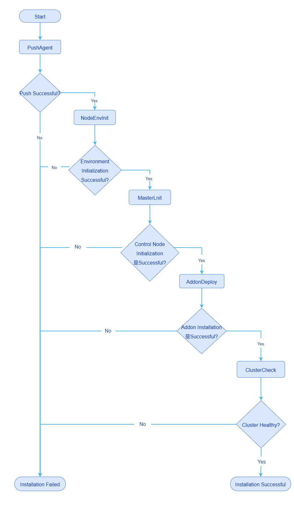

# Cluster Deployment Issue Diagnosis Guide

This document provides preliminary guidance for diagnosing and locating issues during cluster deployment using the openFuyao cluster installation tool.

## Background Information

The bke cluster installation tool provided by the openFuyao community offers the following functions.

- Bootstrap node initialization: uses nerdctl to bring up containers such as k3s, registry, and nginx. The k3s container further brings up a k3s cluster using the built-in default flannel network plugin, while the registry and nginx containers serve as the image source and file source services respectively.
- The bootstrap cluster brings up the management cluster and the business cluster, using the calico network plugin to assign Pod IP addresses, with containerd as the runtime to bring up containers.
- The management cluster brings up the business cluster.

## Prerequisites

Clusters deployed using the bke cluster installation tool from the openFuyao community.

## Usage Restrictions

None.

## Usage Scenarios

- Offline installation package preparation failure.
- Bootstrap node initialization failure.
- Bootstrap cluster K8s cluster deployment failure.

## Reference Documents

For detailed questions related to installation and deployment, please refer to the [Installation and Deployment FAQ](./FAQ.md).

## Offline Installation Package Preparation Failure

When using the openFuyao installation tool to deploy a cluster in an offline environment, the offline installation package must be prepared in advance.

### Common Issues and Information Collection

The offline installation package preparation process is non-interruptible and completed in a single pass. When an interruption occurs, it indicates a preparation failure. The main diagnostic input information is as follows.

- Terminal echo logs near the interruption point during the offline package preparation process.
- Run `docker pull cr.openfuyao.cn/openfuyao/installer-service:latest` to manually pull the image and provide the terminal echo result.

## Bootstrap Node Initialization Failure

Execute the following command to perform bootstrap node initialization.

```bash
# Online environment. If you do not need to install the openFuyao management plane, you can add the parameter --installConsole=false
bke init --onlineImage cr.openfuyao.cn/openfuyao/bke-online-installed:latest

# Offline environment. If you do not need to install the openFuyao management plane, you can add the parameter --installConsole=false
bke init
```

After the bootstrap cluster is successfully installed, you can execute the following commands to view the container and cluster Pod information.

```bash
# View the containers brought up by nerdctl. All container statuses should be UP
nerdctl ps -a
# You can use the following command to enter a specific container
nerdctl exec -it <container-id> -- sh

# View the Pod information of the k3s cluster. The kubeconfig will be copied from /etc/rancher/k3s/k3s.yaml to /root/.kube/config
kubectl get pod -A -owide
# Note: If the k8s cluster brought up by the k3s cluster is co-deployed, use the following command to view the pods of the k3s cluster
kubectl --kubeconfig /etc/rancher/k3s/k3s.yaml get pod -A -owide
```

### Common Issues and Information Collection

This section introduces some common errors and the diagnostic input information that needs to be collected.

#### nerdctl Container Startup Failure

Bootstrap node initialization uses nerdctl to bring up containers, described as follows.

- bocloud_nfs_registry: provides network file management functionality, currently unused, startup failure does not affect operations.
- bocloud_chart_registry: provides chart package source service, a local http chart source, commonly used as the chart source during offline installation.
- bocloud_yum_registry: provides file source service, essentially an nginx server, required for both online and offline installation.
- bocloud_image_registry: provides image source service, used as the image source during offline installation.
- kubernetes: k3s container, used to subsequently bring up cluster Pods, defaults to the flannel network plugin.

If a container fails to start, the main diagnostic input information is as follows.

- The echo logs output to the terminal during the init initialization process.
- `nerdctl ps a` provides container status information.
- `nerdctl inspect container-id` provides detailed information about the abnormal container.

#### k3s Cluster Pod Startup Failure

After the k3s container starts successfully, the k3s cluster Pods are subsequently deployed. A brief introduction by namespace is provided below.

- `openfuyao-system`: the namespace where openFuyao components reside, mainly including authentication, user management, plugin management, console, and cluster management related Pods, which can be optionally deployed.
- `ingress-nginx`: provides the ingress entry service, works with the Pods in the `openfuyao-system` namespace to provide the openFuyao management plane functionality.
- `kube-system`: this namespace only contains coredns, which works with the Pods in the `openfuyao-system` namespace to provide the openFuyao management plane functionality.
- `cluster-system`: deploys cluster-api reconciler related Pods, providing cluster management capabilities, must be deployed.

If a Pod fails to start, the main diagnostic input information is as follows.

- `kubectl get pod -A -owide` provides Pod status information.
- `kubectl logs -n ns pod-name` provides log information of the abnormal Pod.

## Bootstrap Cluster Installing K8s Cluster

Execute the following command to install the K8s cluster.

```bash
# Use the backend to install the K8s cluster. Replace the files specified by the -f and -n parameters as needed
bke cluster create -f /bke/cluster/1master-cluster.yaml -n /bke/cluster/1master-node.yaml

# Install using the openFuyao management plane on the bootstrap node. Log in directly to https://<bootstrap-node-ip>:30010 and enter the cluster information to perform the installation
```

The simplified flow of the bootstrap cluster installing a K8s cluster is as follows.

**Figure 1** Simplified flow of the bootstrap cluster installing a K8s cluster



After the K8s cluster is successfully installed, you can execute the following commands to view the container and cluster Pod information.

```bash
# View the containers brought up by containerd. Each node can only view the containers on its own node
crictl ps -a

# View the Pod information of the k8s cluster
kubectl get pod -A -owide
```

### Common Issues and Information Collection

Execute `kubectl get bc -A` on the bootstrap node to view the cluster status and determine the current failure stage.

#### PuashAgent Failure

The bootstrap cluster pushes the bkeagent node agent to each node of the cluster to be installed. bkeagent runs as a system service and listens to the APIServer of the bootstrap cluster.

If pushing bkeagent fails, the main diagnostic input information is as follows.

- The logs of the `bke-controller-manager-xxxxxx` Pod on the bootstrap node, obtained by executing the following command.

  ```bash
  # Note: bke-controller-manager-xxxxxx needs to be replaced with the actual Pod name
  kubectl logs -n cluster-system bke-controller-manager-xxxxxx -c manager
  ```

- The bkeagent logs on each node of the cluster. For new versions, the log path is `/var/log/openFuayo/bkeagent.log`; for v25.12 and earlier versions, the log path is `/var/log/bkeagent.log`.

#### NodeEnvInit Failure

After bkeagent is successfully pushed, the bootstrap cluster dispatches commands (a custom CRD). When the bkeagent on the node detects the commands, it performs environment initialization operations, mainly as follows.

- Install containerd.
- Download scripts and perform prerequisite operations.
- Set kernel parameters.

When environment initialization fails, it is mainly due to containerd installation failure. The main diagnostic input information is as follows.

- `systemctl status containerd` to query the containerd status.
- `journalctl -xu containerd -n 200` to view the containerd service logs.
- The bkeagent logs on each node of the cluster. For new versions, the log path is `/var/log/openFuayo/bkeagent.log`; for v25.12 and earlier versions, the log path is `/var/log/bkeagent.log`.

#### MasterInit Failure

After environment initialization succeeds, the management node initialization operation continues, with the main operations as follows.

- Generate static Pod yaml files in the `/etc/kubernetes/manifests` directory, including etcd, kube-apiserver, kube-controller-manager, and kube-scheduler.
- Install kubelet.
- Pre-pull the images of k8s components, including etcd, kube-apiserver, kube-controller-manager, and kube-scheduler.

When MasterInit fails, the main diagnostic input information is as follows.

- Execute the command `systemctl status kubelet` to query the kubelet status.
- Execute the command `journalctl -xu kubelet -n 200` to view the kubelet service logs.
- Execute the command `crictl images` to query the pre-pulled images, and `crictl ps -a` to view the container status.
- Execute the command `crictl logs container-id` to query the logs of the abnormal container.

#### AddonDeploy Failure

After the management node initialization succeeds, addons continue to be installed. The K8s cluster brought up by openFuyao brings up Pods at the addon granularity. Common community addons include calico, coredns, bkeagent-deployer, cluster-api, and openfuyao-system-controller. User-defined addons can also be installed. This operation obtains the addon yaml file from the bke-controller-manager Pod on the bootstrap node, renders the parameters, and delivers it to the APIServer through the k8sClient of the K8s cluster, thereby bringing up the corresponding Pods.

When AddonDeploy fails, the main diagnostic input information is as follows.

- The logs of the `bke-controller-manager-xxxxxx` Pod on the bootstrap node, obtained by executing the following command.

  ```bash
  # Note: bke-controller-manager-xxxxxx needs to be replaced with the actual Pod name
  kubectl logs -n cluster-system bke-controller-manager-xxxxxx -c manager
  ```

- Execute the following commands on the K8s cluster nodes to view information.

  ```bash
  # View Pod information
  kubectl get pod -A -owide
  
  # View Pod logs. Replace ns-name with the actual namespace and pod-name with the actual Pod name
  kubectl logs -n ns-name pod-name
  
  # View detailed Pod information. Replace ns-name with the actual namespace and pod-name with the actual Pod name
  kubectl describe pod -n ns-name pod-name
  ```
