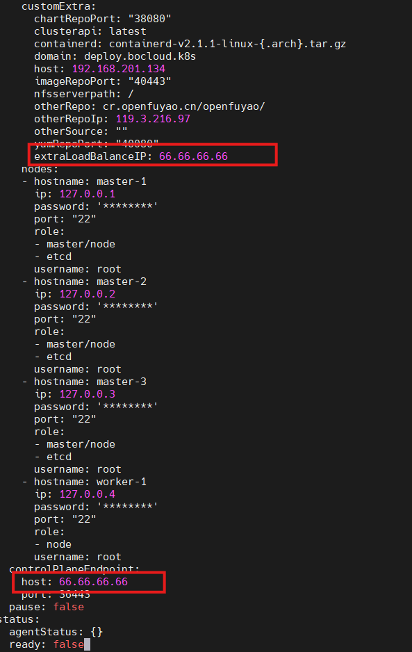

# Using Custom Cluster Certificates

## Background Information

openFuyao supports using custom CA certificates to issue certificates for all components within the Kubernetes cluster, in order to meet enterprise-level security compliance requirements. By importing the user's global CA certificate, private key, and certificate chain, as well as configuring certificate issuance policies and Certificate Signing Requests (CSR), full control over the cluster certificate system can be achieved.

This guide is based on the official Kubernetes PKI certificate configuration requirements, reference documentation: [https://kubernetes.io/zh-cn/docs/setup/best-practices/certificates/](https://kubernetes.io/zh-cn/docs/setup/best-practices/certificates/).

A total of 15 PKI certificates are required within the Kubernetes cluster for secure communication and identity authentication between different components. For detailed certificate configuration information, please refer to [Appendix: PKI Certificate Configuration Table](./using_custom_cluster_certificates.md#pki-certificate-configuration-table).

## Prerequisites

Before starting to configure custom certificates, ensure the following conditions are met:

1. **Certificate Private Key Specification Requirements**
   
   - Certificate type: Must be an X.509 public key certificate with CA signing capability.
   - Private key format: Must be in PKCS#1 format.

   If not satisfied, use the following command to check the private key format and convert it:
   
   ```bash
   # Check whether the private key is in PKCS#1 format
   openssl rsa -in <private-key-file> -text -noout
   ```
   
   ```bash
   # Convert the private key to PKCS#1 format
   openssl rsa -in <original-private-key-file> -out <converted-private-key-file>
   ```
2. **File Preparation**
   
   - Global CA certificate file (`global-ca.crt`) is ready
   - Global CA private key file (`global-ca.key`) is ready
   - **(Optional)** Certificate chain file (`trust-chain.crt`)
     - If this file is not provided, apiserver will mount `ca.crt` by default.
   - **(Optional)** 17 JSON configuration files (2 signing policy files + 15 CSR configuration files)
     - If these configuration files are not provided, the system will use the built-in default signing policy.
3. **Timing of Operation**
   
   - The required certificate files (`global-ca.crt` and `global-ca.key`) must be imported **before bootstrap node initialization**.
   - The optional certificate chain file and configuration files (if needed) should also be imported **before bootstrap node initialization**.
   - The target paths and permission requirements are as follows (operations must be performed with an account that has `sudo` privileges):
     - Global CA certificate and private key directory: `/etc/openFuyao/certs/` (must be able to create the directory and write `global-ca.crt`, `global-ca.key`, and optionally `trust-chain.crt`)
     - Certificate signing policy and CSR configuration directory: `/etc/openFuyao/certs/cert_config/` (optional; must be able to create the directory and write the corresponding JSON configuration files)
     - It is recommended to tighten the directory permissions to `700` and the certificate and private key file permissions to `600`, ensuring that only the file owner can read and write.

## Usage Restrictions

When configuring and importing custom certificate signing policies and signing requests, please pay attention to the following restrictions:

1. **File Names Cannot Be Modified**
   
   - The CSR request file name of each component and the corresponding signing policy file name are the basis for system identification. **The file names must be consistent with the templates**.
   - If a file name is changed, the system will not be able to correctly match the corresponding component configuration when loading the ConfigMap, resulting in certificate issuance failure or component startup exceptions.
2. **CN (Common Name) and O (Organization) Fields Must Be Configured Correctly**
   
   - These two fields directly affect Kubernetes' **certificate-based identity authentication** and **RBAC authorization**.
   - They must be filled in strictly according to the cluster specifications, otherwise the components will not be able to pass the API Server's authentication. See [Appendix: PKI Certificate Configuration Table](./using_custom_cluster_certificates.md#pki-certificate-configuration-table).
   - If the CN/O is configured incorrectly, components or users will not be able to pass certificate identity authentication, manifesting as connection being rejected (e.g., "Unauthorized" or "x509: certificate signed by unknown authority").
3. **Signing Policy (profiles) Names Must Be Consistent with Components**
   
   - Each signing policy name in the `profiles` field should correspond to the actual component name.
   - If the names do not match, the component will not be able to find the correct signing configuration, and certificate generation will fail.
4. **Certificate Usage (keyUsage / extKeyUsage) Configuration Must Be Correct**
   
   - Incorrect usage configuration will result in TLS handshake failure between components and cluster communication interruption.
5. **Default Signing Policy (default profile) Must Be Included**
   
   - If the `default` policy is missing, some requests using default signing rules (such as node joining or automatic signing) will be rejected.
6. **CA Signing Policy File Must Not Contain Errors**
   
   - The CA is the root of the entire cluster certificate system. If the CA signing policy is configured incorrectly, all subordinate component certificates will not be able to be issued, causing control plane services (API Server, Scheduler, Controller Manager, etc.) to fail to start.
7. **kubelet Certificate CN Field Restriction**
   
   - The CN field of `kubelet-kubeconfig-csr.json` must be `system:node:<nodeName>`.
   - The value of `<nodeName>` must exactly match the node name value provided when kubelet registers with the apiserver.
   - In high availability scenarios, different nodes have different name values, and bke will automatically configure the corresponding node name for the CN field of the kubelet certificate.
8. **Load Balancer Must Be Prepared in Advance**
   
   - If users want to configure an external load balancer, they need to prepare the load balancer in advance, and then write the corresponding IP address into the bc.yaml file, otherwise cluster node startup will be blocked.

## Operation Steps

**1. Import User Global CA Certificate, Private Key, and Certificate Chain**

1.1 **Prepare Certificate Files**
   - The following two files must be prepared:
     - `global-ca.crt`: Global CA certificate
     - `global-ca.key`: Global CA private key (must be in PKCS#1 format)
   - **(Optional)** `trust-chain.crt`: Certificate chain file
     - If this file is not provided, the system will use `global-ca.crt` as the certificate chain, and apiserver will mount `ca.crt`

1.2 **Place Certificate Files** 
   - **Before bootstrap node initialization**, place the certificate files in the specified path: `/etc/openFuyao/certs/`
   - File names are fixed and cannot be modified:
     - `global-ca.crt` (required)
     - `global-ca.key` (required)
     - `trust-chain.crt` (optional)
     > **Note:**
     > 
     > - PEM, CRT, and KEY formats are essentially the same PEM encoding format, just with different file extensions. They can all be used normally, as long as the prerequisites are met.
     > - If `trust-chain.crt` is not provided, the system will automatically use `global-ca.crt` as the certificate chain.

**2. Import Certificate Signing Policy and Signing Request CSR (Optional)**

> **Note:**
> 
> This step is optional. If these configuration files are not provided, the system will use the built-in default signing policy.

2.1 **File Composition Description**

To customize certificate signing policies and CSR configurations, a total of **17 JSON files** need to be prepared, divided into two categories:

- **Certificate Signing Request (CSR)**

   - A total of **15 JSON files**
   - Each file corresponds to a certificate signing request for a cluster component (e.g., apiserver, controller-manager, scheduler, kubelet, etc.).
   - The file content defines the certificate subject information (such as CN, O, SAN, usages, etc.) for the component, used to initiate a signing request to the CA.

- **Certificate Signing Policy**

   - A total of **2 JSON files**:
   - **Cluster CA signing policy file** (`cluster-ca-policy.json`): Defines the signing rules and default policy (`default` profile) for the cluster root CA.
   - **Component signing policy file** (`sign-policy.json`): Defines the signing policies for all 14 components other than the cluster CA, plus a general default policy (`default` profile). These policies are stored in the `profiles` field of the file, where each profile corresponds to the signing parameters (validity period, usages, extended attributes, etc.) for a component certificate.

2.2 **Import Configuration Files**

**Before bootstrap node initialization**, place the 2 signing policy files and 15 signing request CSR configuration JSON files together in the specified path: `/etc/openFuyao/certs/cert_config/`.

> **Note:**
> 
> If these configuration files are not provided, the system will use the built-in default signing policy, so no manual configuration is required.

2.3 **Configuration File Templates**

The following are template examples of the certificate configuration files (these templates are for reference only). When it involves component permissions, please modify the Organization (abbreviated as **O**) field in the certificate subject according to the specifications to match the RBAC authorization requirements of the target component; the recommended CN/O values for each component are in [Appendix: PKI Certificate Configuration Table](./using_custom_cluster_certificates.md#pki-certificate-configuration-table).

**Configuration File List:**

| No. | File Name                                                                                                                               | Type | Description |
|------|-----------------------------------------------------------------------------------------------------------------------------------|------|------|
| 1 | cluster-ca-policy.json                 | Signing Policy | Cluster CA signing policy configuration |
| 2 | cluster-ca-csr.json                       | CSR Configuration | Cluster CA certificate signing request |
| 3 | sign-policy.json                           | Signing Policy | Cluster component signing policy configuration |
| 4 | apiserver-csr.json                  | CSR Configuration | API Server certificate signing request |
| 5 | apiserver-etcd-client-csr.json | CSR Configuration | API Server etcd client certificate signing request |
| 6 | front-proxy-client-csr.json | CSR Configuration | Front Proxy client certificate signing request |
| 7 | apiserver-kubelet-client-csr.json | CSR Configuration | API Server kubelet client certificate signing request |
| 8 | front-proxy-ca-csr.json    | CSR Configuration | Front Proxy CA certificate signing request |
| 9 | etcd-ca-csr.json                | CSR Configuration | Etcd CA certificate signing request |
| 10 | etcd-server-csr.json               | CSR Configuration | Etcd Server certificate signing request |
| 11 | etcd-healthcheck-client-csr.json | CSR Configuration | Etcd health check client certificate signing request |
| 12 | etcd-peer-csr.json                     | CSR Configuration | Etcd Peer certificate signing request |
| 13 | admin-kubeconfig-csr.json | CSR Configuration | Admin Kubeconfig certificate signing request |
| 14 | kubelet-kubeconfig-csr.json | CSR Configuration | Kubelet Kubeconfig certificate signing request |
| 15 | controller-manager-csr.json | CSR Configuration | Controller Manager certificate signing request |
| 16 | scheduler-csr.json                            | CSR Configuration | Scheduler certificate signing request |
| 17 | kube-proxy-csr.json                           | CSR Configuration | Kube-proxy certificate signing request |


**2.3.1. Cluster CA Signing Policy Configuration `cluster-ca-policy.json`**

```JSON
{
  "signing": {
    "default": {
      "usages": ["cert sign", "crl sign"],
      "expiry": "87600h",
      "ca_constraint": {
        "is_ca": true,
        "max_path_len": 0
      }
    },
    "profiles": {
      "ca": {
        "usages": ["cert sign", "crl sign"],
        "expiry": "87600h",
        "ca_constraint": {
          "is_ca": true,
          "max_path_len_zero": true
        }
      }
    }
  }
}
```


**2.3.2. Cluster CA CSR Configuration `cluster-ca-csr.json`**

```JSON
{
     "CN": "kubernetes",
     "C": "CN",
     "ST": "Beijing",
     "L": "Beijing",
     "OU": "Kubernetes",
     "key": {
       "algo": "rsa",
       "size": 3072
     },
     "hosts": ["kubernetes", "kubernetes.default"]
}
```


**2.3.3. Cluster Component Signing Policy Configuration `sign-policy.json`**

```JSON
{
  "signing": {
    "default": {
      "usages": ["digital signature", "key encipherment"],
      "expiry": "87600h"
    },
    "profiles": {
      "ca": {
        "usages": ["cert sign", "crl sign"],
        "expiry": "87600h",
        "ca_constraint": {
          "is_ca": true,
          "max_path_len": 0
        }
      },
      "apiserver": {
        "usages": ["digital signature", "key encipherment", "server auth"],
        "expiry": "87600h"
      },
      "apiserver-etcd-client": {
        "usages": ["digital signature", "key encipherment", "client auth"],
        "expiry": "87600h"
      },
      "apiserver-kubelet-client": {
        "usages": ["digital signature", "key encipherment", "client auth"],
        "expiry": "87600h"
      },
      "front-proxy-client": {
        "usages": ["digital signature", "key encipherment", "client auth"],
        "expiry": "87600h"
      },
      "front-proxy-ca": {
        "usages": ["cert sign", "crl sign"],
        "expiry": "87600h",
        "ca_constraint": {
          "is_ca": true,
          "max_path_len": 1
        }
      },
      "etcd/ca": {
        "usages": ["cert sign", "crl sign"],
        "expiry": "87600h",
        "ca_constraint": {
          "is_ca": true,
          "max_path_len": 1
        }
      },
      "etcd/server": {
        "usages": ["digital signature", "key encipherment", "server auth", "client auth"],
        "expiry": "87600h"
      },
      "etcd/peer": {
        "usages": ["digital signature", "key encipherment", "server auth", "client auth"],
        "expiry": "87600h"
      },
      "etcd/healthcheck-client": {
        "usages": ["digital signature", "key encipherment", "client auth"],
        "expiry": "87600h"
      },
      "controller-manager": {
        "usages": ["digital signature", "key encipherment", "client auth"],
        "expiry": "87600h"
      },
      "scheduler": {
        "usages": ["digital signature", "key encipherment", "client auth"],
        "expiry": "87600h"
      },
      "kubelet": {
        "usages": ["digital signature", "key encipherment", "server auth", "client auth"],
        "expiry": "87600h"
      },
      "admin": {
        "usages": ["digital signature", "key encipherment", "client auth"],
        "expiry": "87600h"
      },
      "kube-proxy": {
        "usages": ["digital signature", "key encipherment", "client auth"],
        "expiry": "87600h"
      }
    }
  }
}
```


**2.3.4. API Server CSR Configuration `apiserver-csr.json`**

```JSON
{
  "CN": "kube-apiserver",
  "C": "CN",
  "ST": "Beijing",
  "L": "Beijing",
  "OU": "Kubernetes",
  "key": {
    "algo": "rsa",
    "size": 3072
  },
  "hosts": [
    "kubernetes",
    "kubernetes.default",
    "kubernetes.default.svc",
    "kubernetes.default.svc.cluster.local",
    "10.0.0.1"
  ]
}
```


**2.3.5. API Server Etcd Client CSR Configuration `apiserver-etcd-client-csr.json`**

```JSON
{
     "CN": "kube-apiserver-etcd-client",
     "C": "CN",
     "ST": "Beijing",
     "L": "Beijing",
     "OU": "Kubernetes",
     "key": {
       "algo": "rsa",
       "size": 3072
     },
     "hosts": []
}
```


**2.3.6. Front Proxy Client CSR Configuration `front-proxy-client-csr.json`**

```JSON
{
  "CN": "front-proxy-client",
  "C": "CN",
  "ST": "Beijing",
  "L": "Beijing",
  "OU": "Kubernetes",
  "key": {
    "algo": "rsa",
    "size": 3072
  },
  "hosts": []
}
```


**2.3.7. API Server Kubelet Client CSR Configuration `apiserver-kubelet-client-csr.json`**

```JSON
{
  "CN": "kube-apiserver-kubelet-client",
  "O": "system:masters",
  "C": "CN",
  "ST": "Beijing",
  "L": "Beijing",
  "OU": "Kubernetes",
  "key": {
    "algo": "rsa",
    "size": 3072
  },
  "hosts": []
}
```


**2.3.8. Front Proxy CA CSR Configuration `front-proxy-ca-csr.json`**

```JSON
{
  "CN": "front-proxy-ca",
  "C": "CN",
  "ST": "Beijing",
  "L": "Beijing",
  "OU": "Kubernetes",
  "key": {
    "algo": "rsa",
    "size": 3072
  },
  "hosts": []
}
```


**2.3.9. Etcd CA CSR Configuration `etcd-ca-csr.json`**

```JSON
{
  "CN": "etcd-ca",
  "C": "CN",
  "ST": "Beijing",
  "L": "Beijing",
  "OU": "Kubernetes",
  "key": {
    "algo": "rsa",
    "size": 3072
  },
  "hosts": []
}
```


**2.3.10. Etcd Server CSR Configuration `etcd-server-csr.json`**

```JSON
{
  "CN": "etcd-server",
  "C": "CN",
  "ST": "Beijing",
  "L": "Beijing",
  "OU": "Kubernetes",
  "key": {
    "algo": "rsa",
    "size": 3072
  },
  "hosts": ["localhost", "127.0.0.1"]
}
```


**2.3.11. Etcd Healthcheck Client CSR Configuration `etcd-healthcheck-client-csr.json`**

```JSON
{
  "CN": "kube-etcd-healthcheck-client",
  "C": "CN",
  "ST": "Beijing",
  "L": "Beijing",
  "OU": "Kubernetes",
  "key": {
    "algo": "rsa",
    "size": 3072
  },
  "hosts": []
}
```


**2.3.12. Etcd Peer CSR Configuration `etcd-peer-csr.json`**

```JSON
{
  "CN": "etcd-peer",
  "C": "CN",
  "ST": "Beijing",
  "L": "Beijing",
  "OU": "Kubernetes",
  "key": {
    "algo": "rsa",
    "size": 3072
  },
  "hosts": []
}
```


**2.3.13. Admin Kubeconfig CSR Configuration `admin-kubeconfig-csr.json`**

```JSON
{
  "CN": "kubernetes-admin",
  "O": "system:masters",
  "C": "CN",
  "ST": "Beijing",
  "L": "Beijing",
  "OU": "Kubernetes",
  "key": {
    "algo": "rsa",
    "size": 3072
  },
  "hosts": []
}
```


**2.3.14. Kubelet Kubeconfig CSR Configuration `kubelet-kubeconfig-csr.json`**

> **Note:**
> 
> The CN field of `kubelet-kubeconfig-csr.json` must be `system:node:<nodeName>`, and the value of `<nodeName>` must exactly match the node name value provided when kubelet registers with the apiserver. Since different nodes have different name values in high availability scenarios, the `kubelet-kubeconfig-csr.json` for different nodes cannot be specified through a single configuration file. bke will configure the corresponding node name for the CN field of the kubelet certificate, so users do not need to worry about it.

```JSON
{
  "CN": "system:node:test-node",
  "O": "system:nodes",
  "C": "CN",
  "ST": "Beijing",
  "L": "Beijing",
  "OU": "Kubernetes",
  "key": {
    "algo": "rsa",
    "size": 3072
  },
  "hosts": []
}
```


**2.3.15. Controller Manager CSR Configuration `controller-manager-csr.json`**

```JSON
{
  "CN": "system:kube-controller-manager",
  "C": "CN",
  "ST": "Beijing",
  "L": "Beijing",
  "OU": "Kubernetes",
  "key": {
    "algo": "rsa",
    "size": 3072
  },
  "hosts": []
}
```


**2.3.16. Scheduler CSR Configuration `scheduler-csr.json`**

```JSON
{
  "CN": "system:kube-scheduler",
  "C": "CN",
  "ST": "Beijing",
  "L": "Beijing",
  "OU": "Kubernetes",
  "key": {
    "algo": "rsa",
    "size": 3072
  },
  "hosts": []
}
```


**2.3.17. Kube-proxy CSR Configuration `kube-proxy-csr.json`**

```JSON
{
  "CN": "system:kube-proxy",
  "O": "system:node-proxier",
  "C": "CN",
  "ST": "Beijing",
  "L": "Beijing",
  "OU": "Kubernetes",
  "key": {
    "algo": "rsa",
    "size": 3072
  },
  "hosts": []
}
```

**3. Optional Load Balancer Configuration (Optional)**

**Write the External Load Balancer IP Address into the Certificate:**

If users need to configure a bke external load balancer, they need to add the corresponding value in `bc.yaml`. The specific operation is as follows:

3.1 Add the corresponding key and value under `customExtra`
   
   - The key value is fixed and cannot be modified.
   - The value field should be filled with the IP address corresponding to the load balancer.

3.2 Synchronously modify `controlPlaneEndpoint`
   
   - Change `host` to the IP address corresponding to the load balancer.

Configuration example:



## Related Operations

### Verifying Certificate Configuration

After bootstrap node initialization, the certificate can be verified to be correctly configured in the following ways:

1. **Check Certificate Files**
   
   ```bash
   # Check whether certificate files exist
   ls -la /etc/openFuyao/certs/
   ls -la /etc/openFuyao/certs/cert_config/
   ```
2. **Verify Certificate Content**
   
   ```bash
   # View certificate information
   openssl x509 -in /etc/openFuyao/certs/global-ca.crt -text -noout
   ```
3. **Check Cluster Component Status**
   
   ```bash
   # Check whether API Server is started normally
   kubectl get nodes
   kubectl get pods -n kube-system
   ```

## FAQ

### 1. What to Do If Private Key Format Conversion Fails?

Ensure that the original private key file format is correct. You can use the following command to check:

```bash
# Check the private key type
file <private-key-file>
# If it is in PKCS#8 format, use the following command to convert
openssl pkcs8 -topk8 -nocrypt -in <original-private-key-file> -out <temporary-file>
openssl rsa -in <temporary-file> -out <converted-private-key-file>
```

### 2. Can the Certificate File Path Be Modified?

No. The system uses the following paths fixedly:

- Global CA certificate: `/etc/openFuyao/certs/`
- Certificate configuration files: `/etc/openFuyao/certs/cert_config/`

### 3. How to Configure the O Field in the Configuration File?

The Organization (abbreviated as **O**) field in the certificate subject is used to identify the organization to which the certificate owner belongs, and participates in Kubernetes' certificate-based identity authentication and RBAC authorization. Please fill it in according to the component specifications. The recommended values are as follows (for the complete comparison, see [Appendix: PKI Certificate Configuration Table](./using_custom_cluster_certificates.md#pki-certificate-configuration-table)):

- `system:masters`: Cluster administrator privileges
- `system:nodes`: Node privileges
- `system:kube-controller-manager`: Controller Manager privileges
- `system:kube-scheduler`: Scheduler privileges
- `system:node-proxier`: Kube-proxy privileges

### 4. How to Set the Certificate Validity Period?

It is set in the `expiry` field of the signing policy configuration file, in the format of a time unit (e.g., `87600h` means 10 years). It is recommended to set a reasonable validity period according to the enterprise security policy.

### 5. How to Configure kubelet Certificates in a High Availability Cluster?

In high availability scenarios, the CN field of the kubelet certificate for different nodes will be automatically configured with the corresponding node name, so users do not need to configure each node separately. bke will handle this automatically when nodes join.

## Appendix
<a id="pki-certificate-configuration-table"></a>

### PKI Certificate Configuration Table


Table 1 shows the 15 PKI certificates required within the Kubernetes cluster and their Common Name (CN), Organization (O), and certificate usages:

**Table 1** PKI Certificate Configuration Table
| Component/Certificate Name           | CN (Common Name)                 | O (Organization)      | Usages (`usages`)          | Description                                |
| ----------------------------------- | -------------------------------- | --------------------- | -------------------------- | ----------------------------------------- |
| **Cluster CA (Root CA)**              | `kubernetes`                     | *(none)*                | `cert sign, crl sign`      | Cluster root certificate, used to issue all subordinate certificates            |
| **Etcd CA**                         | `etcd-ca`                        | *(none)*                | `cert sign, crl sign`      | Issues etcd-related communication certificates                    |
| **Front-Proxy CA**                  | `front-proxy-ca`                 | *(none)*                | `cert sign, crl sign`      | Used for API aggregation layer related client certificates             |
| **apiserver**                       | `kube-apiserver`                 | *(none)*                | `server auth`              | kube-apiserver server certificate                 |
| **apiserver-kubelet-client**        | `kube-apiserver-kubelet-client`  | `system:masters`      | `client auth`              | Client certificate for API Server to access kubelet      |
| **apiserver-etcd-client**           | `kube-apiserver-etcd-client`     | *(none)*                | `client auth`              | Client certificate for API Server to access etcd         |
| **front-proxy-client**              | `front-proxy-client`             | *(none)*                | `client auth`              | Aggregation layer front proxy client certificate                  |
| **etcd-server**                     | `etcd-server`                    | *(none)*                | `server auth`              | etcd server certificate                           |
| **etcd-peer**                       | `etcd-peer`                      | *(none)*                | `server auth, client auth` | etcd inter-node (peer) communication                   |
| **etcd-healthcheck-client**         | `kube-etcd-healthcheck-client`   | *(none)*                | `client auth`              | Health check client access to etcd                   |
| **kubelet client (kubeconfig)**     | `system:node:<nodeName>`         | `system:nodes`        | `client auth`              | Client certificate for kubelet to access API Server      |
| **admin (kubeconfig)**              | `admin`                          | `system:masters`      | `client auth`              | Cluster administrator client certificate (used by kubectl)      |
| **controller-manager (kubeconfig)** | `system:kube-controller-manager` | *(none)*                | `client auth`              | kubeconfig certificate used by controller-manager |
| **scheduler (kubeconfig)**          | `system:kube-scheduler`          | *(none)*                | `client auth`              | kubeconfig certificate used by scheduler          |
| **kube-proxy(kubeconfig)**          | `system:kube-proxy`              | `system:node-proxier` | `client auth`              | kubeconfig certificate used by kube-proxy          |
### Terminology

Table 2 shows the explanations of the main terms involved in this document:

**Table 2** Terminology
| Term | English Full Name | Abbreviation | Description |
|----------|----------|--------|------|
| Certificate Authority | Certificate Authority | **CA** | Authoritative organization responsible for issuing and managing digital certificates |
| Public Key Infrastructure | Public Key Infrastructure | **PKI** | System used to manage digital certificates and public-private key pairs |
| Certificate Signing Request | Certificate Signing Request | **CSR** | File containing certificate applicant information, used to apply for a certificate from a CA |
| X.509 Standard | - | **X.509** | Public key certificate standard developed by the International Telecommunication Union (ITU), defining the format and structure of digital certificates |
| PKCS#1 Standard | Public-Key Cryptography Standards #1 | **PKCS#1** | RSA encryption standard, defining the storage format of RSA private keys |
| Common Name | Common Name | **CN** | Field in X.509 certificate, usually used to identify the name of the certificate holder |
| Organization | Organization | **O** | Field in X.509 certificate, used to identify the organization to which the certificate holder belongs |
| Subject Alternative Name | Subject Alternative Name | **SAN** | Extension field in certificate used to specify multiple domain names or IP addresses |
| Role-Based Access Control | Role-Based Access Control | **RBAC** | Authorization mechanism in Kubernetes |
| Transport Layer Security | Transport Layer Security | **TLS** | Used to provide encrypted communication over the network |
| Privacy-Enhanced Mail | Privacy-Enhanced Mail | **PEM** | A Base64-encoded certificate and key storage format |
| Certificate | Certificate | **CRT** | Usually used to store X.509 certificates |
| Key | Key | **KEY** | Used to store private keys |
| Configuration Map | Configuration Map | **ConfigMap** | Configuration object in Kubernetes, used to store non-sensitive configuration data |
| Kubernetes Configuration | Kubernetes Configuration | **kubeconfig** | Contains cluster access information, authentication information, and context configuration |
| Profile | Profile | **Profile** | Configuration item in signing policy configuration, defining the signing parameters for a specific type of certificate |
| Key Usage | Key Usage | **keyUsage** | Certificate extension field, specifying the usage of the certificate key (e.g., digital signature, key encipherment, etc.) |
| Extended Key Usage | Extended Key Usage | **extKeyUsage** | Certificate extension field, specifying the specific usage of the certificate (e.g., server authentication, client authentication, etc.) |
| Certificate Revocation List | Certificate Revocation List | **CRL** | List containing certificates that have been revoked |
| Bootstrap Node | Bootstrap Node | - | Machine used to initialize and host the bootstrap cluster; a lightweight K3s bootstrap cluster runs on this node, used to bootstrap the creation of the management cluster or business cluster |
| Load Balancer | Load Balancer | - | Device or service used to distribute network traffic among multiple servers |
| API Server | API Server | **apiserver** | Kubernetes API server, providing the cluster's REST API interface |
| - | etcd | **etcd** | Distributed key-value storage system, used by Kubernetes to store cluster state and configuration data |
| - | kubelet | **kubelet** | Kubernetes node agent, running on each node, responsible for managing Pods and containers |
| Controller Manager | Controller Manager | **controller-manager** | Kubernetes controller manager, running various controllers to maintain cluster state |
| Scheduler | scheduler | **scheduler** | Kubernetes scheduler, responsible for scheduling Pods to appropriate nodes |
| - | kube-proxy | **kube-proxy** | Kubernetes network proxy, responsible for maintaining network rules and load balancing on nodes |

> **Note:**
> 
> - The value of `<nodeName>` in `kubelet.conf` must exactly match the node name value provided when kubelet registers with the apiserver.
> - For more detailed information, please refer to the official Kubernetes documentation: [https://kubernetes.io/zh-cn/docs/setup/best-practices/certificates/](https://kubernetes.io/zh-cn/docs/setup/best-practices/certificates/).