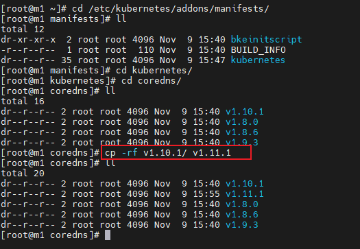
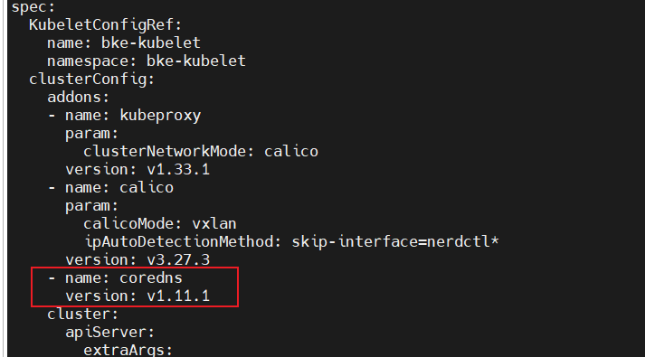

# Install Management Cluster (Not Applicable for Small-Scale Deployment)

This document describes how to set up and verify a management cluster using BKE and kubectl.

## Node Requirements

- Nodes can connect to external networks.
- Nodes can be logged in as the root user.
- The tar tool must be installed on the bootstrap node.
  
>  **Notice:**  
> It is recommended that your node environment is a clean operating system with no Docker or Kubernetes components installed; otherwise, version conflicts may cause installation failures. If you need to experimentally install in an existing environment, you can download the [environment pre-check tool](../environment_preparation/environment_pre_check_tool_guide.md) for environment verification.

## Management Cluster

After the bootstrap node initialization is complete, example configuration template files are generated in the `/bke/cluster` directory:

- 1master-cluster.yaml: Used to create a management cluster with 1 master node.
- 1master-node.yaml: Node information file for creating a management cluster with 1 master node.
- 1master1node-cluster.yaml: Used to create a management cluster with 1 master node and 1 worker node.
- 1master1node-nodes.yaml: Node information file for creating a management cluster with 1 master node and 1 worker node.
- 3master-cluster.yaml: Used to create a management cluster with 3 master nodes; can be configured with a load balancer for a highly available management cluster.
- 3master-nodes.yaml: Node information file for creating a management cluster with 3 master nodes.

>  **Note:** <br />
> It is recommended not to use the bootstrap node as a Master node for a high-availability cluster. If the number of nodes is insufficient and the bootstrap node must be used as a Master node, do not set the port field of controlPlaneEndpoint to 36443.<br />

The following uses 1master-cluster.yaml and 1master-node.yaml as examples.

### Modify Configuration Files

Edit the 1master-cluster.yaml and 1master-node.yaml files to fill in the correct node information.

>  **Note:**<br />For custom addon installation, refer to the [Appendix](../service_cluster_installation/service_cluster_deployment_guide_(linux_backend).md#appendix) section.

**Configure BKENode Resource (1master-node.yaml)**

```yaml
apiVersion: bke.bocloud.com/v1beta1
kind: BKENode
metadata:
  name: master-1
  namespace: bke-cluster
  labels:
    # Associated cluster name
    cluster.x-k8s.io/cluster-name: bke-cluster
spec:
  hostname: m1  # Modify to the node name
  ip: 127.0.0.1  # Modify to the actual node IP
  password: '******'  # Modify to the actual node password
  port: "22"   # Default port is 22
  role:
  - master/node
  - etcd
  username: root   # Default is root user
status: {}
```

**Configure BKECluster Resource (1master-cluster.yaml)**

>  **Note:**<br />`BKECluster` (kubectl short name `bc`) is the core custom resource for creating a cluster. The example below is the default template generated after **online** bootstrap cluster initialization, and its default values are the official recommended configurations of the openFuyao platform. For the meaning, value range, and recommendations of each field, see [Appendix: cluster-api-provider-bke Configuration Parameters](../appendix/cluster-api-provider-bke_configuration.md#bkecluster-crd-configuration). For the differences in repository addresses and addon parameters under **offline installation** and **custom repository** scenarios, see [Value Differences in Offline/Custom Repository Scenarios](#value-differences-in-offlinecustom-repository-scenarios). After creation or update, you can adjust it with `kubectl edit bc -n <namespace> <name>`.

```yaml
apiVersion: bke.bocloud.com/v1beta1
kind: BKECluster
metadata:
  creationTimestamp: null
  name: bke-cluster
  namespace: bke-cluster
spec:
  KubeletConfigRef:  # Custom kubelet configuration
    name: bke-kubelet
    namespace: bke-kubelet
  clusterConfig:
    addons:
    - name: kubeproxy
      param:
        clusterNetworkMode: calico
      version: v1.34.3-of.1
    - block: true
      name: calico
      param:
        calicoMode: vxlan
        ipAutoDetectionMethod: skip-interface=nerdctl*
      version: v3.31.3
    - name: coredns
      param:
        EnableAntiAffinity: "false"   # false for single-node deployment, true for multi-node deployment
      version: v1.12.2-of.1
    - block: true     # cluster-api component; management cluster has this addon, service cluster does not
      name: cluster-api
      param:
        containerdVersion: v2.1.1
        healthPort: "58080"
        manage: "true"
        manifestsVersion: latest
        ntpServer: 192.168.200.115:123
        offline: "false"   # "true" in offline scenarios
        openFuyaoVersion: latest
        providerVersion: latest
        replicas: "1"
        sandbox: hub.oepkgs.net/openfuyao/pause:3.9   # deploy.bocloud.k8s:40443/kubernetes/pause:3.9 in offline scenarios
      version: v1.4.3
    - name: openfuyao-system-controller   # openFuyao core component addon
      param:
        helmRepo: https://helm.openfuyao.cn/_core   # http://<bootstrap-node-IP>:38080 in offline scenarios
        tagVersion: latest
      version: latest
    cluster:
      agentHealthPort: "58080"   # Health check port of bkeagent on nodes
      apiServer:
        extraArgs:
          max-mutating-requests-inflight: "3000"
          max-requests-inflight: "1000"
          watch-cache-sizes: node#1000,pod#5000
      certificatesDir: /etc/kubernetes/pki
      chartRepo:    # Chart repository
        domain: cr.openfuyao.cn
        ip: 119.3.216.97   # Automatically filled in by domain resolution
        port: "443"
        prefix: charts
      containerRuntime:
        cri: containerd
        param:
          data-root: /var/lib/containerd
        runtime: runc
      containerdConfigRef:    # Custom containerd configuration
        name: bke-containerd
        namespace: bke-containerd
      containerdVersion: v2.1.1
      controllerManager:
        extraArgs:
          kube-api-burst: "1000"
          kube-api-qps: "1000"
      etcd:
        dataDir: /var/lib/openFuyao/etcd
      etcdVersion: v3.6.7-of.1
      httpRepo:    # HTTP repository (binary/RPM system package source; defaults to the local service on the bootstrap node)
        domain: http.bocloud.k8s
        ip: 192.168.200.115    # Modify to the bootstrap node IP
        port: "40080"
        prefix: ""
      imageRepo:    # Image repository
        domain: default    # Online installation marker; component images use public default repositories. Do not modify
        ip: 192.168.200.115    # Modify to the bootstrap node IP
        port: "40443"
        prefix: ""    # Keep empty for online installation; kubernetes for offline installation
      kubelet:
        extraArgs:
          kube-api-burst: "2000"
          kube-api-qps: "1000"
        extraVolumes:
        - hostPath: /var/lib/kubelet
          name: kubelet-root-dir
      kubernetesVersion: v1.34.3-of.1
      networking:
        dnsDomain: cluster.local
        podSubnet: 10.250.0.0/16
        serviceSubnet: 10.96.0.0/16
      ntpServer: 192.168.200.115:123   # Modify to the actual NTP server; defaults to cn.pool.ntp.org:123
      openFuyaoVersion: latest
      scheduler:
        extraArgs:
          kube-api-qps: "1000"
    customExtra:
      agentLogLevel: INFO   # bkeagent log level; supports TRACE/DEBUG/INFO/WARNING/ERROR/CRITICAL
      chartRepoPort: "38080"   # Local chart repository port on the bootstrap node
      clusterapi: latest
      containerd: containerd-v2.1.1-linux-{.arch}.tar.gz
      domain: deploy.bocloud.k8s
      host: 192.168.200.115     # Modify to the bootstrap node IP
      imageRepoPort: "40443"   # Local image repository port on the bootstrap node
      nfsserverpath: /
      onlineImage: cr.openfuyao.cn/openfuyao/bke-online-installed:latest   # Online installation image; empty in offline/custom repository scenarios
      otherChart: ""   # Private chart repository address; fill in for custom repository scenarios
      otherChartIp: ""
      otherRepo: ""   # Private image repository address; fill in for custom repository scenarios
      otherRepoIp: ""
      otherSource: ""   # Private system package source address; fill in for custom repository scenarios
      yumRepoPort: "40080"   # Local system package source port on the bootstrap node
  controlPlaneEndpoint: {}
  pause: false
status:
  agentStatus: {}
  controlPlaneConfigHash: {}
  ready: false
```

The remaining items are defaults and do not need to be changed. Users must ensure that the edited and submitted YAML file is reliable. The reconciler will perform validation, but cannot confirm business logic correctness (e.g., incorrect IP addresses, incorrect passwords, etc., require user confirmation).

### Value Differences in Offline/Custom Repository Scenarios

The example above shows the template values generated after **online** installation (the bootstrap cluster initialized with `bke init --onlineImage ...`). The templates under `/bke/cluster` are automatically generated by `bke init` with values matching the bootstrap cluster initialization mode, so manual modification is usually **not required**. The following table is for reference when writing or verifying the YAML manually.

**Table 1** Value comparison across online/offline/custom repository scenarios

| Item | Online Installation | Offline Installation | Custom Repository |
| --- | --- | --- | --- |
| `cluster.imageRepo` | `domain: default`, `prefix: ""`: K8s/openFuyao component images fall back to public default repositories (`cr.openfuyao.cn/openfuyao`, `hub.oepkgs.net/openfuyao`) | `domain: deploy.bocloud.k8s`, `ip: <bootstrap-node-IP>`, `port: "40443"`, `prefix: kubernetes`: uses the local image repository on the bootstrap node | Points to the private image repository: `domain: <repository domain or IP>`, `ip: <repository IP>`, `port: <port>`, `prefix: <project/path>` |
| `cluster.httpRepo` | Local HTTP source on the bootstrap node: `ip: <bootstrap-node-IP>`, `port: "40080"` (binaries/RPMs are unpacked from the online installation image and served by the local service) | Same as online (local HTTP source on the bootstrap node) | Points to the private system package source: `ip: <source IP>`, `port: <source port>`, `prefix: <source path>` |
| `cluster.chartRepo` | Public chart repository: `domain: cr.openfuyao.cn`, `port: "443"`, `prefix: charts` | Local chart repository on the bootstrap node: `domain: ""`, `ip: <bootstrap-node-IP>`, `port: "38080"`, `prefix: ""`. **When domain is empty, ip must be retained**; otherwise the chart address falls back to the public repository and offline installation fails | Same as online or offline (depending on whether the bootstrap node can resolve `cr.openfuyao.cn`); the private chart repository is specified via `--otherChart` and applies to the `helmRepo` of `openfuyao-system-controller` |
| `customExtra.onlineImage` | Online installation image address | `""` | `""` (retained if the online installation image is also used, i.e., the hybrid scenario) |
| `customExtra.otherRepo` / `otherRepoIp` | `""` | `""` | Private image repository address (`<domain-or-IP>[:<port>]/<path>`) and its resolved IP |
| `customExtra.otherSource` | `""` | `""` | Private system package source address (`http://<domain-or-IP>:<port>[/<path>]`) |
| `customExtra.otherChart` / `otherChartIp` | `""` | `""` | Private chart repository address and its resolved IP |
| `offline` of the `cluster-api` addon | `"false"` | `"true"` | `"false"` |
| `sandbox` of the `cluster-api` addon | `hub.oepkgs.net/openfuyao/pause:3.9` | `deploy.bocloud.k8s:40443/kubernetes/pause:3.9` | `<private image repository with its last path segment removed>/pause:3.9`, e.g., `192.168.100.17:443/pause:3.9` |
| `helmRepo` of the `openfuyao-system-controller` addon | `https://helm.openfuyao.cn/_core` | `http://<bootstrap-node-IP>:38080` | When the private chart repository port is 443: `https://<host>:443`; other ports: `http://<host>:<port>`; when no private chart repository is specified: `https://helm.openfuyao.cn/_core` |

>  **Note:**<br />
> 1. Repository addresses are assembled and accessed by `domain` (with port) first; when both `domain` and `ip` are configured, the installation process writes domain→IP mappings into `/etc/hosts` on each node, and falls back to `ip` when `domain` is unreachable. `prefix` is the project/path prefix within the repository.
> 2. In the custom repository scenario, specify the repositories during bootstrap cluster initialization via `bke init --otherRepo <private image repository> --otherSource <private system package source> --otherChart <private chart repository>` (you can also provide a BKECluster YAML containing custom repository addresses via `bke init --file`, which the tool recognizes automatically). For the complete procedure (private repository media preparation, CA certificates, containerd registry authentication configuration, etc.), see [Custom Repository Configuration](../bootstrap_cluster_configuration/custom_repository_configuration_guide.md).

### Create Management Cluster

Execute the following command to complete the cluster creation. Replace the file after -f with the actual path to 1master-cluster.yaml, and the file after -n with the actual path to 1master-node.yaml.

```bash
bke cluster create -f /bke/cluster/1master-cluster.yaml -n /bke/cluster/1master-node.yaml
```

>  **Note:** <br />
> When the command output shows `Reason: ClusterReady, Message: cluster is ready`, it means the management cluster installation is complete; if `Reason: ClusterDeployFailed` appears, it means the management cluster installation failed.<br />

## (Optional) Install openFuyao Management Plane

If `openfuyao-system-controller` was **not** installed when creating the management cluster (or for other reasons the management cluster does not have the openFuyao management plane), you can manually install it after the cluster is ready, depending on the scenario:

- Online scenario: See [Online openFuyao-system-controller Manual Deployment](../appendix/online_incremental_deployment_guide.md).
- Offline scenario: See [Offline openFuyao-system-controller Manual Deployment](../appendix/offline_incremental_deployment_guide.md).

The default login address for the management cluster management plane is `https://<management-cluster-node-IP>:31616` (for default username/password on first login, see [Installation and Deployment Concepts and Process](../read_before_installation/installation_process.md#openfuyao-management-plane-introduction)).

## FAQ

If you encounter issues during the process, you can first refer to the [Troubleshooting Guide](../appendix/cluster_deployment_issue_diagnosis_guide.md) and [FAQ](../appendix/FAQ.md) to try to resolve them.

## Appendix

The appendix section introduces knowledge related to Linux backend cluster installation.

### Custom Addon Installation

openFuyao provides K8s cluster installation and deployment capabilities. By adding addon fields, users can install custom extension components. bke-manifests provides YAML files for community-used extensions, including coredns, calico, and other components. Additionally, through hostPath mounting, users can place custom extension component YAML files to achieve custom addon installation.
The hostPath mount path is /etc/openFuyao/addons/manifests/kubernetes.

Follow the steps below to install custom addon extensions:

1. Launch the bootstrap cluster or management cluster as the cluster management center for the business cluster.

2. Place the custom addon extension YAML files in the /etc/openFuyao/addons/manifests/kubernetes directory according to the component-name/version-number/yaml-file structure. As shown in the figure below, the copy operation simulates custom YAML file processing.

   

3. When installing the business cluster, add the addon field to install custom extension components.

   
